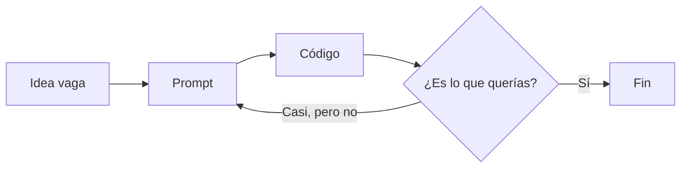
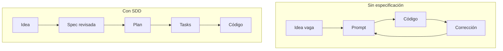
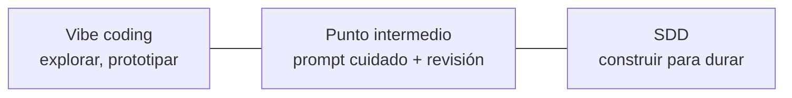
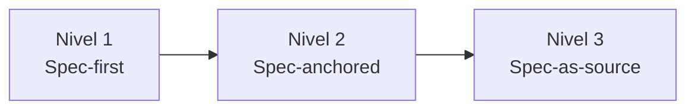
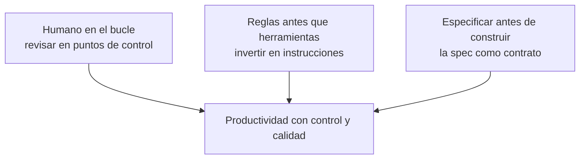
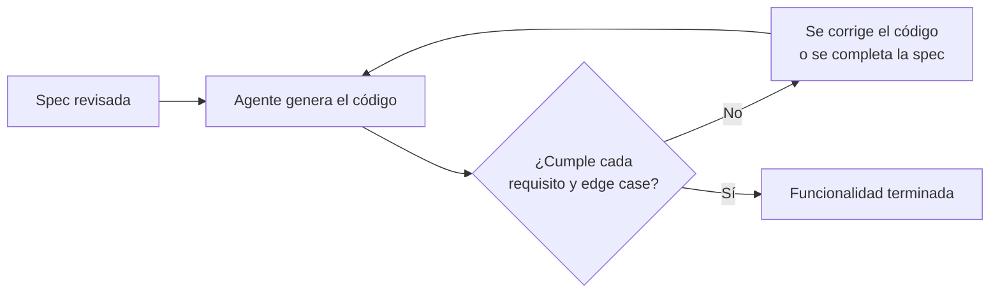

# 1. Qué es el desarrollo guiado por especificaciones

[⬅️ Volver a la unidad](./README.md)

## Índice

- [1.1. Programar con agentes de IA](#11-programar-con-agentes-de-ia)
  - [1.1.1. Del autocompletado al agente](#111-del-autocompletado-al-agente)
  - [1.1.2. Qué cambia cuando el agente escribe el código](#112-qué-cambia-cuando-el-agente-escribe-el-código)
- [1.2. El problema: el código como especificación de facto](#12-el-problema-el-código-como-especificación-de-facto)
  - [1.2.1. El ciclo «casi, pero no»](#121-el-ciclo-casi-pero-no)
  - [1.2.2. Por qué el agente rellena los huecos](#122-por-qué-el-agente-rellena-los-huecos)
  - [1.2.3. Consecuencias](#123-consecuencias)
- [1.3. La idea del desarrollo guiado por especificaciones](#13-la-idea-del-desarrollo-guiado-por-especificaciones)
  - [1.3.1. Del prompt al contrato](#131-del-prompt-al-contrato)
  - [1.3.2. El flujo en una imagen](#132-el-flujo-en-una-imagen)
- [1.4. Vibe coding y SDD: un espectro](#14-vibe-coding-y-sdd-un-espectro)
  - [1.4.1. Tres formas de programar con IA](#141-tres-formas-de-programar-con-ia)
  - [1.4.2. Cuándo usar cada una](#142-cuándo-usar-cada-una)
  - [1.4.3. Explorar y después formalizar](#143-explorar-y-después-formalizar)
- [1.5. Los tres niveles de SDD](#15-los-tres-niveles-de-sdd)
  - [1.5.1. Nivel 1: spec-first](#151-nivel-1-spec-first)
  - [1.5.2. Nivel 2: spec-anchored](#152-nivel-2-spec-anchored)
  - [1.5.3. Nivel 3: spec-as-source](#153-nivel-3-spec-as-source)
  - [1.5.4. Comparación](#154-comparación)
- [1.6. ¿Quién es la fuente de verdad?](#16-quién-es-la-fuente-de-verdad)
- [1.7. Tres principios para trabajar con agentes](#17-tres-principios-para-trabajar-con-agentes)
- [1.8. Ejemplo integrador: añadir una tarea, con y sin spec](#18-ejemplo-integrador-añadir-una-tarea-con-y-sin-spec)
- [Resumen](#resumen)
- [Ejercicios de reflexión](#ejercicios-de-reflexión)

> **Criterios que trabaja este tema:** OA1 a.

---

## 1.1. Programar con agentes de IA

### 1.1.1. Del autocompletado al agente

La IA ha entrado en el desarrollo de software por etapas. Cada una da más autonomía a la herramienta:

| Etapa | Qué hace la IA | Qué hace el desarrollador |
|-------|----------------|---------------------------|
| **Autocompletado** | Sugiere la línea o el bloque que estás escribiendo | Escribe el código y acepta o rechaza sugerencias |
| **Asistente de chat** | Responde preguntas y genera fragmentos de código | Copia los fragmentos y los integra a mano |
| **Agente de codificación** | Lee el proyecto, edita ficheros, ejecuta comandos y tests | Describe qué quiere y revisa lo que hace el agente |

Un **agente de codificación** (*coding agent*) es un programa que usa un modelo de lenguaje para **actuar** sobre tu proyecto: no solo propone código, sino que abre ficheros, los modifica, lanza los tests y corrige lo que falla, en varios pasos seguidos. En este curso usarás **OpenCode**, que verás en el tema 3.

> 📝 **Nota del Profesor**: el salto del chat al agente es lo que hace necesario este curso. Mientras tú copiabas y pegabas, eras el filtro de cada línea. Cuando el agente escribe directamente en el proyecto, necesitas otra forma de decirle **qué** construir y de comprobar **qué** ha construido.

### 1.1.2. Qué cambia cuando el agente escribe el código

Con un agente, tu trabajo se desplaza:

- **Antes:** pensar la solución y escribirla línea a línea.
- **Ahora:** explicar con precisión qué quieres, revisar lo que produce el agente y decidir si es correcto.

La parte difícil ya no es escribir el código, sino **comunicar la intención** y **verificar el resultado**. De eso trata el desarrollo guiado por especificaciones.

---

## 1.2. El problema: el código como especificación de facto

### 1.2.1. El ciclo «casi, pero no»

Imagina que trabajas en una API y le pides a un agente:

```text
Añade autenticación con JWT a la API.
```

El agente genera código que funciona. Pero al revisarlo descubres que:

- Los tokens caducan a los 15 minutos (tú querías 24 horas).
- Firma con HS256 y una clave escrita en el código (tu equipo usa RS256 y variables de entorno).
- Si el token caduca, responde `403` (tu frontend espera `401`).
- Ha añadido un sistema de *refresh tokens* que nadie había pedido.

Así que escribes otro prompt para corregirlo. Y otro. Y otro. Este es el ciclo habitual de trabajar con un agente sin estructura:



El bucle de la derecha es donde se pierde el tiempo: cada vuelta corrige algo, pero puede romper otra cosa, y las decisiones que se toman en el camino no quedan escritas en ningún sitio.

### 1.2.2. Por qué el agente rellena los huecos

El prompt «añade autenticación con JWT» deja abiertas muchas decisiones: duración del token, algoritmo de firma, dónde vive la clave, códigos de error, qué pasa al cerrar sesión… Una persona de tu equipo **preguntaría**. Un agente, normalmente, **decide**: elige la opción que le parece más probable y sigue adelante.

Piensa en el agente como un **compañero de programación en pareja muy literal**: es excelente reconociendo patrones y escribe deprisa, pero no conoce tu proyecto ni tus preferencias si no se las dices. Lo que no está escrito, lo inventa.

> ⚠️ **Cuidado**: que el código **funcione** no significa que haga **lo que necesitas**. El agente puede entregar algo correcto desde el punto de vista técnico y equivocado para tu problema. Los fallos más caros son los que pasan la demo.

### 1.2.3. Consecuencias

Cuando todas las decisiones se toman sobre la marcha, a golpe de prompt, el **código se convierte en la especificación de facto**: la única forma de saber qué hace el sistema es leer el código. Eso tiene consecuencias:

| Consecuencia | Ejemplo |
|--------------|---------|
| **Decisiones invisibles** | Nadie sabe por qué el token dura 15 minutos: lo decidió el agente en una sesión que ya no existe |
| **Inconsistencia** | Cada endpoint gestiona los errores de una forma distinta, porque se generó en un momento distinto |
| **Mantenimiento difícil** | Para cambiar algo hay que reconstruir primero qué se pretendía |
| **Código de baja calidad** | El agente genera código genérico o incoherente porque le faltaba contexto |

A este último fenómeno se le llama a veces ***slop***: código de baja calidad generado por una IA. La causa casi nunca es que el modelo no sepa programar, sino que **no tenía información suficiente** para saber qué construir y cómo comprobarlo.

> 💡 **Tip del Examinador**: «¿Qué significa que el código se convierte en la especificación de facto?». Que, al no existir una descripción escrita del comportamiento esperado, la única fuente para saber qué hace (y qué debería hacer) el sistema es el propio código, con todas las decisiones implícitas que tomó el agente.

---

## 1.3. La idea del desarrollo guiado por especificaciones

### 1.3.1. Del prompt al contrato

El **desarrollo guiado por especificaciones** (SDD, *Spec-Driven Development*) propone escribir, **antes** de generar código, un documento que describa con precisión qué debe hacer una funcionalidad: la **especificación** o ***spec***. Ese documento se revisa, se aprueba y después guía al agente.

Volvamos al ejemplo del JWT. En lugar del prompt de una línea, el agente recibe una spec con fragmentos como estos:

```markdown
## Requisitos no funcionales

- RNF-01: Los tokens se firman con RS256. Nunca HS256.
- RNF-02: La clave privada se lee de la variable de entorno JWT_PRIVATE_KEY.
- RNF-03: Los tokens caducan a las 24 horas.

## Edge cases

- EC-01: Si el token ha caducado, el sistema responde 401 con el mensaje
  "Token expirado".

## Fuera de alcance

- Refresh tokens (se abordarán en otra spec).
```

Cada línea resuelve una de las decisiones que antes tomaba el agente por su cuenta. Ahora las toma **una persona**, antes de que exista código, y quedan **escritas** en el repositorio.

La clave del cambio es pasar de **microgestionar** al agente, prompt a prompt, a **delegarle** el trabajo con un **contrato** claro: esto es lo que hay que construir, estas son las restricciones y así sabremos que está terminado.

> ✅ **Buena práctica**: corregir una decisión en la spec cuesta una frase; corregirla cuando ya hay código generado cuesta reescribir, revisar y volver a probar. Cuanto antes se detecta un error, más barato es arreglarlo.

### 1.3.2. El flujo en una imagen

El siguiente diagrama compara el trabajo sin spec con el flujo de SDD que desarrollarás durante el curso:



En el flujo de SDD las correcciones se hacen **en los documentos**, antes del código: el humano revisa la spec, el plan y las *tasks* (las tareas en que se divide el trabajo) en puntos de control. Verás cada fase en detalle en la UD2.

---

## 1.4. Vibe coding y SDD: un espectro

### 1.4.1. Tres formas de programar con IA

Hay varias formas de trabajar con IA, de menos a más estructurada:

| Enfoque | Cómo se trabaja | Dónde está la atención |
|---------|-----------------|------------------------|
| **Autocompletado** (*inline coding*) | El desarrollador escribe y la IA sugiere | En el código |
| **Vibe coding** | Se describe en lenguaje natural lo que se quiere y el agente lo genera; se itera mirando el resultado | En el resultado, no en el código |
| **SDD** | Se especifica el comportamiento antes de generar; el agente trabaja dentro de esas restricciones | En la especificación y en la verificación |

El ***vibe coding*** (algo así como «programar a ojo» o «por sensaciones») consiste en ir pidiendo cambios al agente y aceptar lo que funciona, sin leer ni planificar demasiado el código. Es rápido y muy útil… mientras el código no tenga que durar.

### 1.4.2. Cuándo usar cada una

SDD y *vibe coding* no son el bueno y el malo de la película: son herramientas para momentos distintos.



El punto de la línea que te conviene depende de la tarea:

| Situación | Enfoque adecuado |
|-----------|------------------|
| Probar una idea en una tarde | *Vibe coding* |
| Un prototipo o una demo que se va a tirar | *Vibe coding* |
| Requisitos que todavía no conoces | *Vibe coding* para descubrirlos |
| Un cambio pequeño y localizado (un texto, una configuración) | Un buen prompt, sin spec completa |
| Una funcionalidad que va a producción | SDD |
| Código que mantendrán varias personas | SDD |
| Comportamiento que debe ser predecible y verificable | SDD |

> 📝 **Nota del Profesor**: el límite del *vibe coding* aparece cuando el código empieza a **importar**: cuando hay que mantenerlo, cuando trabajan varias personas o cuando un fallo tiene consecuencias. A partir de ahí, cada cambio sin especificación es un riesgo.

### 1.4.3. Explorar y después formalizar

Una forma práctica de combinarlos es usar el *vibe coding* para **descubrir** qué quieres construir y, cuando lo tienes claro, **formalizarlo** en una spec antes de llevarlo a producción. El *vibe coding* resuelve el problema de no saber qué construir; la spec resuelve el de construirlo bien.

Es un patrón muy repetido en equipos que empiezan con agentes: al principio, sin specs, todo va muy rápido. Con el tiempo aparecen APIs que no siguen las mismas reglas, patrones distintos para el mismo problema y sesiones de depuración cada vez más largas. Al introducir specs, las revisiones se vuelven más ágiles y el código recupera la coherencia.

> ⚠️ **Cuidado**: el prototipo hecho con *vibe coding* no es la base del producto por defecto. Si decides conservarlo, escribe primero la spec de lo que hace (y de lo que debería hacer) y revisa el código contra ella.

---

## 1.5. Los tres niveles de SDD

SDD no es un estándar único, sino un conjunto de prácticas que se aplican con más o menos intensidad. Se suelen distinguir tres niveles.

### 1.5.1. Nivel 1: spec-first

**Spec primero.** Antes de programar una funcionalidad se escribe su spec y se le da al agente como contexto. No hace falta ninguna herramienta especial: un fichero Markdown en el repositorio basta.

- **Cuándo:** proyectos individuales, equipos pequeños y equipos que empiezan con SDD.
- **Señal de que funciona:** el agente acierta a la primera más a menudo y hacen falta menos vueltas de corrección.

Es el nivel en el que trabajarás durante la mayor parte del curso.

### 1.5.2. Nivel 2: spec-anchored

**Spec como ancla.** La spec no solo se escribe antes: **gobierna** la implementación durante toda su vida. Hay puntos de control humanos en cada fase y mecanismos automáticos que comprueban que el código no se aparta de la spec (tests derivados de los criterios de aceptación, reglas de arquitectura, comprobaciones en la integración continua).

- **Cuándo:** equipos medianos, proyectos con mucho código existente, sistemas con requisitos de auditoría.
- **Señal de que funciona:** cuando el código se separa de la spec, se detecta **antes** de integrar los cambios.

A esa separación entre spec y código se le llama ***spec drift*** y la estudiarás en la UD3.

### 1.5.3. Nivel 3: spec-as-source

**Spec como código fuente.** El extremo más ambicioso: la spec es lo único que se mantiene, y el código se **genera** a partir de ella, igual que un compilador genera un ejecutable a partir del código fuente. Para cambiar el comportamiento, se cambia la spec y se regenera.

- **Estado:** experimental. Hay herramientas que exploran esta idea, pero no es un enfoque habitual en proyectos reales.
- **Señal de que funcionaría:** cambiar la spec regenera el código correcto sin tocarlo a mano.

> 💡 **Tip del Examinador**: «Diferencia *spec-first* de *spec-anchored*». En *spec-first* la spec se usa como contexto **antes** de programar; en *spec-anchored* la spec **gobierna** el código durante toda su vida, con puntos de control y comprobaciones que detectan cuándo se separan.

### 1.5.4. Comparación

| | Spec-first | Spec-anchored | Spec-as-source |
|---|---|---|---|
| **Papel de la spec** | Contexto antes de programar | Contrato que gobierna el código | Única fuente; el código se genera |
| **Fuente de verdad** | El código | Spec y código, sincronizados | La spec |
| **Infraestructura** | Ninguna | Tests, reglas, integración continua | Herramientas de generación específicas |
| **Madurez** | Práctica extendida | Práctica de equipos con experiencia | Experimental |

Los niveles son acumulativos: para trabajar en el nivel 2 necesitas dominar el 1.



Cada nivel añade control y también coste: no todos los proyectos necesitan llegar al siguiente.

---

## 1.6. ¿Quién es la fuente de verdad?

Detrás de los tres niveles hay una pregunta de fondo: cuando la spec y el código no coinciden, **¿cuál manda?**

| Postura | Idea | Quién la defiende |
|---------|------|-------------------|
| **Pragmática** | La spec es un medio para generar buen código. El código que se ejecuta sigue siendo lo que se mantiene | La mayoría de los equipos (niveles 1 y 2) |
| **Radical** | La spec debería sustituir al código como artefacto principal; el código es un detalle | Herramientas experimentales (nivel 3) |

GitHub formula la postura que da más peso a la spec, en el documento de metodología de su kit **Spec Kit**, como una **inversión**:

- **Lo tradicional:** el código es la fuente de verdad, y la especificación es un andamio que se escribe al principio y se abandona en cuanto empieza la programación.
- **La inversión:** el código sirve a la especificación. La spec genera la implementación, y el código es solo una de sus posibles expresiones en un lenguaje o framework concreto. Mantener el sistema significa hacer evolucionar la spec, y depurarlo, corregir la spec y el plan que produjeron el código defectuoso.

Es una buena forma de entender **hacia dónde** apunta SDD, aunque en el día a día la mayoría de los equipos (y la propia herramienta, en la práctica) trabajan en el nivel *spec-first*.

En la práctica, la postura más viable es la **pragmática**: la spec es un **contrato vivo que convive con el código**. Se actualiza cuando cambian las decisiones y, si el código y la spec divergen, se investiga cuál de los dos tiene razón: puede que el código tenga un error o que la spec se haya quedado vieja.

Una forma de situar SDD dentro de lo que ya conoces:

- La **ingeniería de prompts** (*prompt engineering*) se ocupa de cómo formular una instrucción concreta.
- La **ingeniería de contexto** (*context engineering*) se ocupa de **todo** lo que el agente tiene delante cuando trabaja: instrucciones, documentos, código, historial.
- **SDD es ingeniería de contexto aplicada al desarrollo de software**: la spec es la pieza de contexto más importante que le das al agente.

Verás la ingeniería de contexto en la UD2.

---

## 1.7. Tres principios para trabajar con agentes

SDD forma parte de una forma más amplia de trabajar con agentes, que se apoya en tres principios:

1. **El humano en el bucle** (*human in the loop*). El agente no trabaja de forma totalmente autónoma: el humano interviene en ciclos cortos, revisando la spec antes de que el agente planifique, el plan antes de que implemente y el código antes de integrarlo. La autonomía del agente puede crecer con la confianza, pero los puntos de control no desaparecen.
2. **Reglas antes que herramientas** (*rules over tools*). La calidad del resultado depende más de las instrucciones que recibe el agente que de la herramienta concreta. Un agente con instrucciones claras en una herramienta modesta rinde más que uno sin instrucciones en la mejor herramienta. Merece más la pena invertir en reglas, specs y procedimientos que en cambiar de herramienta.
3. **Especificar antes de construir.** Explicar el problema y cómo se comprobará la solución antes de que el agente escriba código. Es el principio que da nombre a SDD.



Los tres se refuerzan: las specs dan algo concreto que revisar en los puntos de control, y las reglas evitan repetir en cada spec lo que vale para todo el proyecto.

> 📝 **Nota del Profesor**: hay una **paradoja del contexto**. Con poco contexto, el agente rellena huecos y genera código genérico. Con demasiado, o mal organizado, se pierde y también genera código flojo. El objetivo no es darle **más** información, sino la **adecuada**.

---

## 1.8. Ejemplo integrador: añadir una tarea, con y sin spec

Durante el curso usarás como hilo conductor una aplicación sencilla: una **lista de tareas compartida**, con una API en Node.js y una página web. La primera funcionalidad es **añadir una tarea**.

**Sin spec.** Le pides al agente:

```text
Haz un endpoint para añadir tareas a la lista.
```

El agente genera un endpoint `POST /tasks` que funciona en la demo. Al revisarlo con calma encuentras decisiones que nadie tomó de forma consciente:

| Situación | Lo que hace el código generado |
|-----------|--------------------------------|
| El texto está vacío o solo tiene espacios | Crea una tarea vacía |
| El texto tiene 5.000 caracteres | Lo acepta |
| La petición no trae el campo `text` | Falla con un error 500 |
| El identificador de la tarea | Lo envía el cliente en la petición |
| La ruta | `/tasks`, aunque el resto de la API usa `/api/…` |

**Con spec.** Antes de pedir nada al agente, escribes y revisas una spec. Un fragmento:

```markdown
## Requisitos funcionales

- RF-01: El sistema guarda la tarea con un identificador único
  generado por el servidor, el texto, el estado "pendiente" y la
  fecha de creación.

## Requisitos no funcionales

- RNF-01: El texto no puede superar los 280 caracteres.

## Edge cases

- EC-01: Si el texto está vacío o solo tiene espacios, el sistema
  responde 400 con { error: "El texto de la tarea no puede estar vacío" }.
- EC-02: Si el texto supera 280 caracteres, responde 400 con
  { error: "El texto no puede superar 280 caracteres" }.
- EC-03: Si la petición no incluye el campo text, responde 400.
```

Con esta spec, el agente sabe qué hacer en cada caso de la tabla anterior. Y, sobre todo, **tú** sabes qué comprobar cuando revises su trabajo: cada línea de la spec es algo verificable.



La diferencia con el ciclo «casi, pero no» es que ahora la pregunta «¿es lo que querías?» tiene una respuesta objetiva: lo que dice la spec.

> 📝 **Nota del Profesor**: fíjate en que la spec no dice qué librería usar ni cómo organizar el código: dice **qué** debe pasar y **en qué casos**. Cómo escribir buenas specs es el tema 5.

---

## Resumen

- Un **agente de codificación** actúa sobre el proyecto: lee, edita, ejecuta y corrige. Tu trabajo pasa a ser comunicar la intención y verificar el resultado.
- Sin especificación, el agente **rellena los huecos** con lo más probable y el **código se convierte en la especificación de facto**: decisiones invisibles, inconsistencias y código de baja calidad (*slop*).
- El **desarrollo guiado por especificaciones** (SDD) escribe y revisa una **spec** antes de generar código, y la usa como **contrato** con el agente.
- ***Vibe coding*** y SDD son extremos de un **espectro**: el primero para explorar, el segundo para construir lo que tiene que durar.
- Hay **tres niveles**: *spec-first* (la spec como contexto), *spec-anchored* (la spec gobierna el código) y *spec-as-source* (el código se genera de la spec, experimental).
- La postura más viable es la **pragmática**: la spec es un contrato vivo que convive con el código.
- SDD es **ingeniería de contexto** aplicada al desarrollo de software.
- Tres principios: **humano en el bucle**, **reglas antes que herramientas** y **especificar antes de construir**.

## Ejercicios de reflexión

1. Piensa en la última vez que pediste algo a una IA y tuviste que corregir el resultado varias veces. ¿Qué decisiones tomó la IA que tú no le habías indicado?
2. Escribe tres decisiones que quedan abiertas en el prompt «haz un formulario de registro de usuarios».
3. ¿En qué situaciones elegirías *vibe coding* aunque conozcas SDD? ¿Y en cuáles no lo harías nunca?
4. Explica con tus palabras por qué que el código «funcione en la demo» no garantiza que haga lo que necesitas.
5. ¿Por qué el nivel *spec-as-source* exige que la spec sea mucho más completa que en *spec-first*?

---

[⬅️ Volver a la unidad](./README.md)
