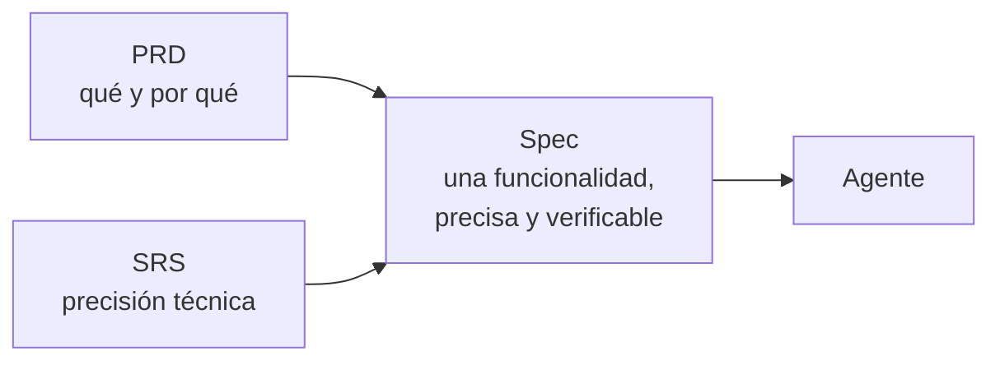
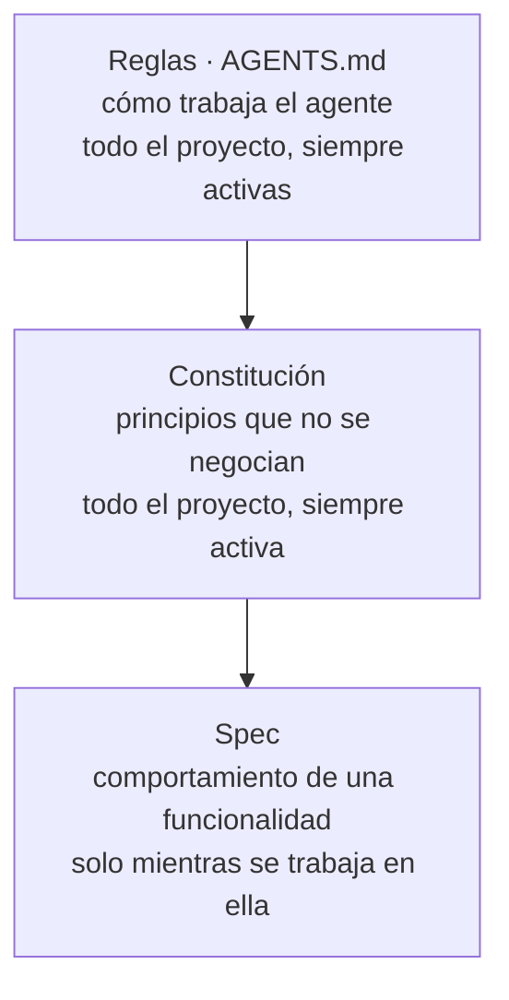
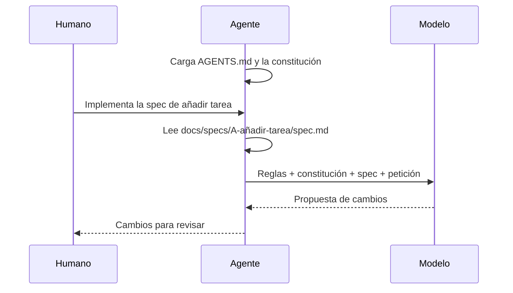
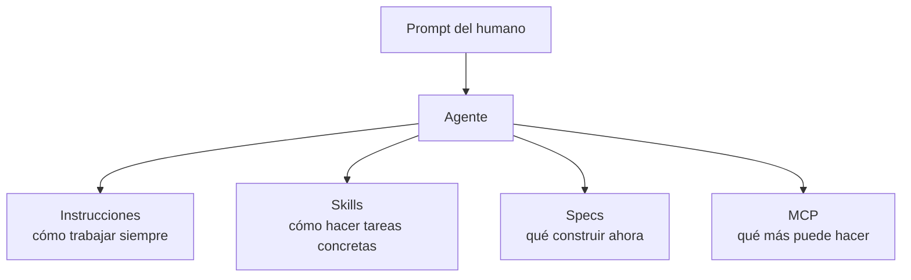

# 2. Artefactos y capas de contexto

[⬅️ Volver a la unidad](./README.md)

## Índice

- [2.1. Por qué distinguir los artefactos](#21-por-qué-distinguir-los-artefactos)
- [2.2. El prompt](#22-el-prompt)
- [2.3. El PRD: documento de requisitos de producto](#23-el-prd-documento-de-requisitos-de-producto)
- [2.4. El SRS: especificación de requisitos de software](#24-el-srs-especificación-de-requisitos-de-software)
- [2.5. La spec](#25-la-spec)
  - [2.5.1. Qué es una spec en SDD](#251-qué-es-una-spec-en-sdd)
  - [2.5.2. Comparación con el PRD y el SRS](#252-comparación-con-el-prd-y-el-srs)
  - [2.5.3. Lo que es y lo que no es una spec](#253-lo-que-es-y-lo-que-no-es-una-spec)
- [2.6. Los edge cases](#26-los-edge-cases)
- [2.7. Las tres capas de contexto](#27-las-tres-capas-de-contexto)
  - [2.7.1. Reglas: AGENTS.md](#271-reglas-agentsmd)
  - [2.7.2. Constitución](#272-constitución)
  - [2.7.3. Spec](#273-spec)
  - [2.7.4. Cómo se combinan](#274-cómo-se-combinan)
  - [2.7.5. Los nombres en cada herramienta](#275-los-nombres-en-cada-herramienta)
- [2.8. Las primitivas de la programación con agentes](#28-las-primitivas-de-la-programación-con-agentes)
- [2.9. Ejemplo integrador: el contexto de la lista de tareas](#29-ejemplo-integrador-el-contexto-de-la-lista-de-tareas)
- [Resumen](#resumen)
- [Ejercicios de reflexión](#ejercicios-de-reflexión)

> **Criterios que trabaja este tema:** OA1 b.

---

## 2.1. Por qué distinguir los artefactos

Cuando trabajas con un agente le das información de muchas formas: una frase en el chat, un documento de requisitos, un fichero de instrucciones del proyecto, la spec de una funcionalidad… Cada uno de esos documentos es un **artefacto** (*artifact*): un producto del proceso de desarrollo con un propósito concreto.

Confundirlos es uno de los errores más frecuentes al empezar con SDD. Por ejemplo:

- Meter en la spec de una funcionalidad las convenciones de todo el proyecto («usa comillas simples»), que hay que repetir en cada spec.
- Escribir en el fichero de instrucciones del proyecto detalles de una sola funcionalidad, que molestan al agente en todas las demás.
- Creer que un prompt largo y detallado ya es una spec.

En este tema verás qué es cada artefacto, para qué sirve, cuánto dura y quién lo lee.

---

## 2.2. El prompt

Un **prompt** es una instrucción en lenguaje natural que le das al modelo **en un momento concreto** de una conversación:

```text
Añade una columna con la fecha de creación a la tabla de tareas.
```

Sus características:

- **Es transitorio:** existe en esa conversación. Cuando la cierras, desaparece.
- **No se versiona:** no queda en el repositorio, así que nadie puede revisarlo después ni saber por qué se hizo un cambio.
- **No tiene estructura:** el agente no puede volver a consultarlo de forma ordenada en otra sesión.

El prompt es la herramienta adecuada para **tareas pequeñas y localizadas**: cambiar un texto, renombrar una variable, explicar un fragmento de código. Se queda corto para funcionalidades con varias decisiones o para trabajar en equipo.

> ⚠️ **Cuidado**: un prompt de tres párrafos sigue siendo un prompt. Que sea largo no lo convierte en una spec: le sigue faltando estructura, revisión y un lugar en el repositorio.

---

## 2.3. El PRD: documento de requisitos de producto

El **PRD** (*Product Requirements Document*, documento de requisitos de producto) es un documento de **gestión de producto**. Lo escribe normalmente la persona responsable del producto y responde a **qué** se va a construir y **por qué**, sin entrar en el **cómo** técnico.

Estructura típica:

```markdown
# PRD: Lista de tareas compartida

## Objetivo
Que un equipo pequeño comparta una lista de tareas sin usar
herramientas externas.

## Problema
Hoy las tareas se apuntan en un chat y se pierden entre mensajes.

## Usuarios
Los miembros del equipo (entre 3 y 10 personas).

## Casos de uso
- Añadir una tarea.
- Ver la lista.
- Marcar una tarea como hecha.
- Borrar una tarea.

## Métricas de éxito
El equipo deja de apuntar tareas en el chat.

## Fuera de alcance
Usuarios, permisos, notificaciones.
```

El PRD aporta algo valioso al agente: **la razón** detrás de cada funcionalidad. Saber que el objetivo es «sustituir un chat» ayuda a decidir bien cuando los requisitos no cubren un caso. Pero **no basta** para que un agente programe: no dice qué pasa si el texto está vacío, cómo se identifican las tareas ni qué devuelve la API.

> 📝 **Nota del Profesor**: piensa en el PRD como el encargo de un cliente: dice a dónde hay que llegar, pero no cómo conducir el coche.

---

## 2.4. El SRS: especificación de requisitos de software

El **SRS** (*Software Requirements Specification*, especificación de requisitos de software) es el documento técnico clásico de la ingeniería del software. Va un paso más allá del PRD: describe con precisión los **requisitos funcionales** (qué hace el sistema) y **no funcionales** (rendimiento, seguridad, restricciones), y a menudo la arquitectura, las interfaces y las tecnologías.

```markdown
RF-03. El sistema permitirá añadir una tarea con un texto de hasta
280 caracteres. La tarea se almacenará con identificador, texto,
estado y fecha de creación.

RNF-02. El tiempo de respuesta de cualquier operación será inferior
a 200 ms con 50 usuarios simultáneos.
```

Un SRS tradicional suele describir **todo el sistema**, es muy formal y puede ocupar decenas de páginas. Se escribe para personas: el equipo lo lee una vez, lo consulta cuando duda y lo actualiza (si se actualiza) de vez en cuando.

---

## 2.5. La spec

### 2.5.1. Qué es una spec en SDD

La **spec** (*specification*, especificación) de SDD es un documento **estructurado**, escrito en **Markdown**, que describe el **comportamiento esperado de una funcionalidad concreta** y sirve de contrato para el agente.

Se puede ver como la **fusión de un PRD y un SRS, calibrada para un agente**:

- Del PRD toma el **porqué**: el contexto y el objetivo de la funcionalidad.
- Del SRS toma la **precisión**: requisitos verificables, casos límite, restricciones técnicas que importan.
- Y se ajusta al agente: **una funcionalidad por spec**, con secciones fijas, sin ambigüedad y versionada junto al código.



La spec no sustituye necesariamente al PRD: en muchos equipos el PRD sigue existiendo y la spec se escribe a partir de él, una por cada funcionalidad.

### 2.5.2. Comparación con el PRD y el SRS

| | PRD | SRS | **Spec (SDD)** |
|---|---|---|---|
| **Orientación** | Negocio y usuario | Técnica | Comportamiento, con lo técnico que importa |
| **Lo lee** | Producto, dirección | Ingenieros | El agente y el equipo |
| **Alcance** | Producto o funcionalidad | Sistema completo | Una funcionalidad |
| **Formato** | Variable | Formal | Markdown estructurado |
| **Dónde vive** | Herramienta de gestión, documentos | Documentos | El repositorio, junto al código |
| **Evolución** | Lenta | Lenta | Evoluciona con el código |

> 💡 **Tip del Examinador**: «¿En qué se diferencia una spec de un PRD?». El PRD dice qué se construye y por qué, desde el punto de vista del negocio. La spec describe el comportamiento de **una** funcionalidad con la precisión suficiente para que un agente la implemente y una persona pueda verificarla: requisitos, criterios de aceptación, casos límite y fuera de alcance.

### 2.5.3. Lo que es y lo que no es una spec

Una spec **no es**:

- Un prompt largo.
- Un PRD sin detalles técnicos.
- Un documento de arquitectura de todo el sistema.
- Una lista de tareas de programación.

Una spec **sí es**:

- Un **contrato de comportamiento** para una funcionalidad concreta.
- Un fichero **versionado** en el repositorio, junto al código que describe.
- Un documento **vivo**: se actualiza cuando cambian las decisiones.
- El **punto de partida** del que el agente saca el plan técnico y las tareas.

Una forma de verlo: si el PRD dice «quiero una pizza», la spec dice «masa fina, tomate natural, mozzarella fresca, horno a 300 °C durante 8 minutos, sin gluten». Con eso, el pizzero (el agente) puede trabajar sin preguntar.

Cómo se escribe una buena spec, sección a sección, es el tema 5.

---

## 2.6. Los edge cases

Los ***edge cases*** (casos límite o casos frontera) son las **situaciones en los extremos del funcionamiento normal**: entradas inesperadas, condiciones poco habituales o combinaciones raras de estado, poco probables pero posibles.

Son el complemento del **camino feliz** (*happy path*): el camino feliz describe cómo funciona el sistema cuando todo va bien; los *edge cases*, qué pasa cuando algo se sale de lo normal.

Ejemplos para la funcionalidad «añadir una tarea»:

| Tipo de *edge case* | Ejemplo |
|---------------------|---------|
| **Entrada vacía** | El usuario pulsa «Añadir» sin escribir nada |
| **Formato inválido** | Llega un número en lugar de un texto |
| **Límite de longitud** | El texto tiene 5.000 caracteres |
| **Valor en el límite** | El texto tiene exactamente 280 caracteres (¿se acepta?) |
| **Duplicado** | Ya existe una tarea con el mismo texto |
| **Concurrencia** | Dos personas añaden una tarea a la vez |
| **Caracteres especiales** | El texto contiene `<script>` o emojis |
| **Fallo externo** | El almacenamiento no responde |

**Por qué son críticos con un agente.** Si la spec no los menciona, el agente implementa el camino feliz y **supone** el resto. El resultado funciona en la demo y falla en producción. Los agentes tienden a generar el caso más probable, no el más robusto.

Escribirlos tiene además una ventaja para ti: te obliga a pensar cómo se comportará el sistema **antes** de que exista código.

> ✅ **Buena práctica**: por cada requisito, pregúntate qué pasa si la entrada está **vacía**, es **inválida**, está **duplicada**, es **demasiado grande** o llega **fuera de orden**. Las respuestas son tus *edge cases*.

---

## 2.7. Las tres capas de contexto

Además de la spec de cada funcionalidad, el agente necesita información que vale para **todo el proyecto**. Esa información se organiza en tres capas, con propósito y ciclo de vida distintos:



De arriba abajo, las capas son cada vez más concretas y cambian con más frecuencia: las reglas casi no cambian; las specs, en cada funcionalidad.

### 2.7.1. Reglas: AGENTS.md

Las **reglas** (*rules*) son instrucciones permanentes sobre **cómo debe trabajar el agente** en cualquier tarea del proyecto. Se escriben una vez y el agente las carga al empezar cada sesión.

El formato más extendido es un fichero **`AGENTS.md`** en la raíz del repositorio, un formato abierto que leen OpenCode y la mayoría de agentes:

```markdown
# AGENTS.md

## Comandos
- Instalar: `npm install`
- Tests: `npm test`
- Lint: `npm run lint`

## Convenciones
- JavaScript con módulos ES. Identificadores en español.
- Comillas simples y punto y coma.

## Prohibiciones
- No añadir dependencias sin consultarlo.
- No escribir claves ni contraseñas en el código.
```

Contenido típico: comandos de compilación y pruebas, estructura de carpetas, convenciones de código, prohibiciones. Es **operativo**: el agente lo puede seguir sin interpretarlo.

### 2.7.2. Constitución

La **constitución** (*constitution*) recoge los **principios del proyecto que no se negocian** y que todo cambio debe respetar. Es más estratégica que las reglas: explica decisiones y su motivo.

```markdown
# Constitución — Lista de tareas compartida

## Arquitectura
Capas: controladores → servicios → repositorios. Los controladores
no contienen lógica de negocio. Solo los repositorios acceden al
almacenamiento.

## API
Todas las respuestas son JSON. Los errores devuelven
{ error: "mensaje" } con el código HTTP adecuado.

## Pruebas
Los tests se escriben antes que el código.
```

El nombre viene de GitHub Spec Kit, que la llama así. En otros entornos se habla de *memory bank* (banco de memoria) o de *steering files* (ficheros de orientación). La idea es la misma.

> 📝 **Nota del Profesor**: la diferencia entre reglas y constitución es sutil y en proyectos pequeños pueden ir en el mismo fichero. Una forma de recordarla: **las reglas dicen cómo trabaja el agente; la constitución dice qué es innegociable en el proyecto**.

### 2.7.3. Spec

La **spec** es la capa más concreta y la que más cambia. Describe una sola funcionalidad y **solo es relevante mientras se trabaja en ella**. Contiene:

- El contexto y el propósito de la funcionalidad (el porqué).
- Los requisitos funcionales y no funcionales.
- Los criterios de aceptación, que se pueden comprobar.
- Las restricciones técnicas propias de esta funcionalidad.
- Los *edge cases* y el comportamiento ante errores.
- Lo que queda fuera de alcance.

Se guarda en el repositorio, normalmente en una carpeta por funcionalidad (`docs/specs/A-añadir-tarea/spec.md`).

### 2.7.4. Cómo se combinan

Cuando el agente trabaja en una funcionalidad, recibe las tres capas a la vez:



Lo importante es que el humano solo escribe **la petición y la spec**: las reglas y la constitución ya estaban, y valen para todas las funcionalidades.

Resumen de las tres capas:

| Capa | Pregunta que responde | Alcance | Cambia… |
|------|-----------------------|---------|---------|
| **Reglas** (`AGENTS.md`) | ¿Cómo trabaja el agente en este proyecto? | Todo el proyecto | Muy poco |
| **Constitución** | ¿Qué principios no se pueden romper? | Todo el proyecto | Poco, con acuerdo del equipo |
| **Spec** | ¿Qué debe hacer esta funcionalidad? | Una funcionalidad | En cada funcionalidad |

> ⚠️ **Cuidado**: si una instrucción solo afecta a una funcionalidad, no va en las reglas ni en la constitución. Cada línea de más en los ficheros globales la lee el agente en **todas** las tareas, aunque no le sirva.

### 2.7.5. Los nombres en cada herramienta

Cada herramienta llama de una forma a estas capas, aunque las ideas son las mismas:

| Herramienta | Reglas | Constitución | Specs |
|-------------|--------|--------------|-------|
| **OpenCode** | `AGENTS.md` | Un fichero propio enlazado desde las reglas | Ficheros Markdown del proyecto |
| **GitHub Spec Kit** | El fichero de instrucciones de cada agente | `constitution.md` | `spec.md` por funcionalidad |
| **Kiro** | *Steering files* | *Steering files* | `requirements.md`, `design.md`, `tasks.md` |
| **Claude Code** | `CLAUDE.md` | `CLAUDE.md` o un fichero enlazado | Ficheros Markdown del proyecto |
| **Cursor** | Reglas del proyecto | Reglas del proyecto | Ficheros Markdown del proyecto |

Los nombres concretos pueden cambiar con las versiones; lo que importa es reconocer qué capa es cada fichero. En el tema 3 configurarás estas capas en OpenCode.

---

## 2.8. Las primitivas de la programación con agentes

Todas las herramientas de programación con agentes se construyen con unos pocos bloques básicos, las **primitivas**. Cambian de nombre según la herramienta, pero son las mismas:

| Primitiva | Qué es | Dónde vive | Lo verás en |
|-----------|--------|------------|-------------|
| **Prompt** | Instrucción de un solo uso | La conversación | Este tema |
| **Instrucciones (reglas)** | Indicaciones permanentes sobre cómo trabaja el agente | `AGENTS.md` y similares | Temas 2 y 3, UD2 |
| **Skills** | Procedimientos reutilizables que el agente carga cuando la tarea lo necesita | Una carpeta con un `SKILL.md` | UD2 |
| **Specs** | Contratos de comportamiento de una funcionalidad | `docs/specs/` | Toda la unidad |
| **MCP** | Protocolo para conectar el agente con sistemas externos (GitHub, bases de datos…) | La configuración del agente | UD3 |
| **Agentes** | Los programas que usan un modelo para ejecutar tareas con todo lo anterior | El editor o el terminal | Tema 3, UD4 |

Cómo encajan:



El agente es quien junta todas las piezas: las **instrucciones** le dicen cómo trabajar siempre, las **skills** le enseñan a hacer tareas concretas cuando las necesita, las **specs** le dicen qué construir en esta funcionalidad y **MCP** amplía lo que puede hacer más allá de los ficheros del proyecto. El **prompt** es la orden que pone todo en marcha.

> 💡 **Tip del Examinador**: «¿Qué diferencia hay entre una regla y una skill?». La regla se aplica **siempre**, en todas las tareas; la skill es un procedimiento que el agente carga **solo cuando la tarea lo necesita** (por ejemplo, cómo publicar una versión).

---

## 2.9. Ejemplo integrador: el contexto de la lista de tareas

Así queda el repositorio de la lista de tareas cuando se va a implementar la primera funcionalidad:

```text
lista-tareas/
├── AGENTS.md                      ← reglas: comandos, convenciones, prohibiciones
├── constitution.md                ← principios: capas, formato de la API, pruebas
├── docs/
│   ├── prd.md                     ← PRD: objetivo, usuarios, casos de uso
│   └── specs/
│       └── A-añadir-tarea/
│           └── spec.md            ← spec de la funcionalidad
└── src/                           ← todavía vacío
```

Y el prompt que pone en marcha el trabajo:

```text
Lee docs/specs/A-añadir-tarea/spec.md y propón un plan técnico.
No escribas código todavía.
```

Cada pregunta que se haría el agente tiene respuesta en un artefacto distinto:

| Pregunta del agente | Dónde está la respuesta |
|---------------------|-------------------------|
| ¿Para qué sirve esta aplicación? | `docs/prd.md` |
| ¿Cómo se ejecutan los tests? | `AGENTS.md` |
| ¿Puede el controlador acceder al almacenamiento? | `constitution.md` (no: solo los repositorios) |
| ¿Qué formato tienen los errores? | `constitution.md` |
| ¿Cuántos caracteres puede tener una tarea? | `spec.md` |
| ¿Qué pasa si el texto está vacío? | `spec.md` (un *edge case*) |
| ¿Hay que hacer ya el borrado de tareas? | `spec.md` (fuera de alcance) |
| ¿Qué hago ahora? | El prompt |

Si alguna pregunta no tiene respuesta en ningún artefacto, el agente la responderá por su cuenta. Ese es justo el hueco que hay que cerrar antes de implementar.

---

## Resumen

- Un **artefacto** es un documento del proceso con un propósito concreto. Confundirlos lleva a repetir información o a meter ruido en el contexto del agente.
- El **prompt** es transitorio y sin estructura: útil para tareas pequeñas.
- El **PRD** dice qué y por qué, desde el negocio. El **SRS** describe requisitos técnicos de todo un sistema.
- La **spec** de SDD funde el porqué del PRD y la precisión del SRS para **una funcionalidad**, en Markdown, versionada y viva.
- Los ***edge cases*** son los casos fuera del camino feliz: si no están en la spec, el agente los supone.
- Tres **capas de contexto**: **reglas** (`AGENTS.md`, cómo trabaja el agente), **constitución** (principios innegociables) y **spec** (una funcionalidad).
- Las **primitivas** de la programación con agentes: prompts, instrucciones, skills, specs, MCP y agentes.

## Ejercicios de reflexión

1. Clasifica estos textos como prompt, PRD, regla, constitución o spec: «usa siempre `npm test` para ejecutar las pruebas», «la aplicación sustituirá al chat del equipo para apuntar tareas», «si el texto está vacío, responde 400», «los controladores no contienen lógica de negocio», «arregla el error de la línea 40».
2. ¿Por qué no conviene escribir en `AGENTS.md` que «las tareas tienen como máximo 280 caracteres»? ¿Dónde lo pondrías?
3. Escribe cinco *edge cases* para la funcionalidad «marcar una tarea como hecha».
4. ¿Qué información del PRD de la lista de tareas puede ayudar al agente a decidir bien en un caso que la spec no cubre?
5. Explica con tus palabras la diferencia entre una regla y una skill.

---

[⬅️ Volver a la unidad](./README.md)
