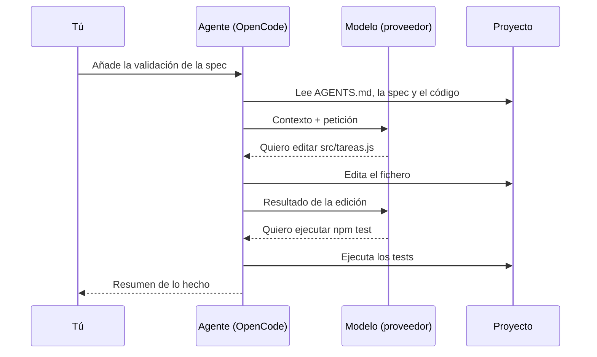
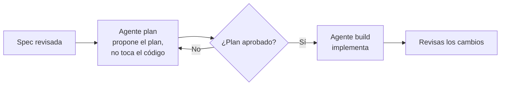
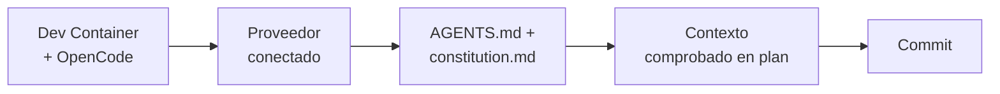

# 3. El entorno de trabajo: OpenCode

[⬅️ Volver a la unidad](./README.md)

## Índice

- [3.1. Agente y modelo](#31-agente-y-modelo)
  - [3.1.1. Qué hace cada uno](#311-qué-hace-cada-uno)
  - [3.1.2. Las herramientas del agente](#312-las-herramientas-del-agente)
- [3.2. Por qué OpenCode](#32-por-qué-opencode)
- [3.3. Instalación en un Dev Container](#33-instalación-en-un-dev-container)
  - [3.3.1. El fichero devcontainer.json](#331-el-fichero-devcontainerjson)
  - [3.3.2. Otras formas de instalarlo](#332-otras-formas-de-instalarlo)
- [3.4. Conectar un proveedor de modelos](#34-conectar-un-proveedor-de-modelos)
  - [3.4.1. El comando /connect](#341-el-comando-connect)
  - [3.4.2. Elegir el modelo](#342-elegir-el-modelo)
  - [3.4.3. Modelos locales](#343-modelos-locales)
  - [3.4.4. Dónde se guardan las claves](#344-dónde-se-guardan-las-claves)
- [3.5. Primera sesión](#35-primera-sesión)
  - [3.5.1. Arrancar OpenCode](#351-arrancar-opencode)
  - [3.5.2. Referenciar ficheros y ejecutar comandos](#352-referenciar-ficheros-y-ejecutar-comandos)
  - [3.5.3. Sesiones, deshacer y compactar](#353-sesiones-deshacer-y-compactar)
- [3.6. Los agentes plan y build](#36-los-agentes-plan-y-build)
- [3.7. El contexto del proyecto](#37-el-contexto-del-proyecto)
  - [3.7.1. /init y AGENTS.md](#371-init-y-agentsmd)
  - [3.7.2. Añadir la constitución con opencode.json](#372-añadir-la-constitución-con-opencodejson)
  - [3.7.3. Reglas globales y reglas del proyecto](#373-reglas-globales-y-reglas-del-proyecto)
- [3.8. Permisos y seguridad](#38-permisos-y-seguridad)
- [3.9. Buenas prácticas](#39-buenas-prácticas)
- [3.10. Ejemplo integrador: preparar el proyecto de la lista de tareas](#310-ejemplo-integrador-preparar-el-proyecto-de-la-lista-de-tareas)
- [Resumen](#resumen)
- [Ejercicios de reflexión](#ejercicios-de-reflexión)

> **Criterios que trabaja este tema:** OA1 c.

> ⚠️ **Cuidado**: OpenCode cambia muy deprisa. Los comandos y opciones de este tema se han comprobado con la versión que fija el Dev Container del curso. Si algo no coincide con tu versión, consulta la documentación oficial (enlazada en la portada de la unidad).

---

## 3.1. Agente y modelo

### 3.1.1. Qué hace cada uno

Hasta ahora has hablado del «agente» como si fuera una sola cosa, pero son dos piezas distintas:

- El **modelo** (*model*) es el modelo de lenguaje: recibe un texto y genera una respuesta. No ve tus ficheros ni puede ejecutar nada. Lo ofrece un **proveedor** (*provider*) a través de una API: Anthropic, OpenAI, Google, Mistral… o tu propio ordenador, si usas un modelo local.
- El **agente** es el programa que trabaja contigo: lee tus ficheros, prepara el contexto, se lo envía al modelo, interpreta lo que el modelo quiere hacer y lo ejecuta (editar un fichero, lanzar un comando) en varios pasos.



El agente va y viene entre el modelo y tu proyecto hasta terminar la tarea. Por eso **el mismo agente puede funcionar con modelos distintos**, y el mismo modelo puede usarse desde agentes distintos.

A ese programa que rodea al modelo también se le llama **arnés (*harness*)**. La imagen es la de un caballo de tiro: el caballo pone la fuerza, y el arnés (*harness*) la lleva al carro y la dirige. Aquí, el modelo pone el razonamiento, y el arnés (*harness*) decide qué contexto le llega, qué herramientas puede usar y qué se hace con sus respuestas. Encontrarás la palabra a menudo al leer sobre agentes. Una parte del arnés (*harness*) la trae la herramienta, y otra la pones tú en el repositorio: en este tema empiezas con `AGENTS.md`, la constitución y los permisos.

> 📝 **Nota del Profesor**: el agente decide **qué contexto** recibe el modelo; el modelo decide **qué hacer** con él. Cuando el resultado es malo, la causa puede estar en cualquiera de los dos, pero casi siempre empieza por un contexto pobre: una spec incompleta o unas reglas ausentes.

### 3.1.2. Las herramientas del agente

El modelo no toca tu proyecto directamente: pide al agente que use una **herramienta** (*tool*). Las herramientas habituales de un agente de codificación son:

| Herramienta | Qué hace |
|-------------|----------|
| Leer (*read*) | Lee el contenido de un fichero |
| Buscar (*glob*, *grep*) | Busca ficheros por nombre o por contenido |
| Editar (*edit*, *write*) | Modifica o crea ficheros |
| Terminal (*shell*) | Ejecuta comandos: tests, instalaciones, Git |
| Web (*webfetch*) | Descarga una página para consultarla |

Cada herramienta tiene un **permiso**: el agente la usa sin preguntar, te pide confirmación o la tiene prohibida. Lo configurarás en el apartado 3.8.

---

## 3.2. Por qué OpenCode

En el curso usarás **OpenCode**, un agente de codificación para el terminal. Se ha elegido por estas razones:

| Característica | Por qué importa en el curso |
|----------------|-----------------------------|
| **Código abierto** | Puedes ver cómo funciona y no dependes de una empresa |
| **Multiproveedor** | Funciona con los modelos que tengas disponibles, incluidos los locales |
| **Lee `AGENTS.md`** | Las reglas del proyecto valen también para otros agentes |
| **Agentes *plan* y *build*** | Separa planificar de implementar, como pide el flujo de SDD |
| **Funciona en el terminal** | Se usa igual dentro de un contenedor, en Windows, Linux o macOS |

Lo que aprendas con OpenCode se traslada a otros agentes (Claude Code, Copilot, Cursor…): cambian los nombres de los comandos, pero las ideas son las mismas. Los compararás en la UD3.

---

## 3.3. Instalación en un Dev Container

Igual que en otros módulos del ciclo, cada práctica del curso se trabaja dentro de un **Dev Container**: un contenedor de Docker que VS Code abre como si fuera tu equipo, con todas las herramientas ya instaladas. Así todo el mundo tiene el mismo entorno y no instalas nada en tu sistema.

### 3.3.1. El fichero devcontainer.json

Cada ejercicio trae un `.devcontainer/devcontainer.json` como este:

```json
{
  "name": "SDD con OpenCode",
  "image": "mcr.microsoft.com/devcontainers/javascript-node:24",
  "runArgs": ["--security-opt", "label=disable"],
  "remoteUser": "node",
  "mounts": [
    "source=sdd-opencode,target=/home/node/.local/share/opencode,type=volume"
  ],
  "postCreateCommand": "sudo chown node:node /home/node/.local/share/opencode && npm install -g @opencode/cli@2.3.2",
  "customizations": {
    "vscode": {
      "extensions": ["dbaeumer.vscode-eslint", "esbenp.prettier-vscode"]
    }
  }
}
```

Qué hace cada parte:

| Clave | Para qué sirve |
|-------|----------------|
| `image` | Imagen con Node.js, npm y Git |
| `runArgs` | Evita problemas de permisos en los Linux con SELinux (Fedora, openSUSE); en el resto no cambia nada |
| `remoteUser` | Trabajas como el usuario `node`, no como administrador |
| `mounts` | Un **volumen** de Docker llamado `sdd-opencode` donde OpenCode guarda tus credenciales y sesiones. Sobrevive aunque borres el contenedor, así que conectas el proveedor **una sola vez** para todas las prácticas |
| `postCreateCommand` | Al crear el contenedor, da al usuario `node` permiso sobre ese volumen e instala OpenCode con una **versión fijada** |
| `extensions` | Extensiones de VS Code del curso |

Para abrirlo: abre en VS Code **la carpeta que contiene `.devcontainer/`** y ejecuta **Dev Containers: Reopen in Container** desde la paleta de comandos. La primera vez tarda unos minutos.

> 💡 **Tip del Examinador**: «¿Por qué se fija la versión de OpenCode?». Para que todo el grupo tenga exactamente la misma herramienta y los enunciados funcionen igual para todos. OpenCode publica versiones nuevas con mucha frecuencia y los comandos pueden cambiar entre ellas.

### 3.3.2. Otras formas de instalarlo

Fuera del curso, OpenCode se puede instalar directamente en tu equipo:

| Sistema | Orden |
|---------|-------|
| Cualquiera con Node.js | `npm install -g @opencode/cli` |
| Linux o macOS | Script oficial de instalación (ver la documentación) |
| macOS con Homebrew | Paquete de Homebrew (ver la documentación) |
| Windows | Se recomienda usarlo dentro de WSL |

Comprueba la instalación con:

```bash
opencode --version
```

---

## 3.4. Conectar un proveedor de modelos

OpenCode no trae un modelo propio: tienes que **conectarlo a un proveedor**. En el curso usarás los que tengas disponibles: una cuenta del centro, un plan gratuito de algún proveedor o un modelo local. Siempre que puedas, usa uno **gratuito**. Ningún ejercicio exige un modelo concreto.

### 3.4.1. El comando /connect

Dentro de OpenCode, escribe:

```text
/connect
```

OpenCode muestra la lista de proveedores. Eliges uno y pegas la **clave de API** (*API key*) que te ha dado ese proveedor, o inicias sesión si el proveedor lo permite. La clave es como una contraseña: identifica tu cuenta y es lo que el proveedor usa para cobrarte o limitar tu uso.

También puedes conectarlo desde el terminal, con `opencode auth login`, y ver los proveedores conectados con:

```bash
opencode auth list
```

> ⚠️ **Cuidado**: no conectes OpenCode a pasarelas que reenvían tus peticiones a otros proveedores. En el curso se conecta **directamente** a cada proveedor, para saber siempre quién recibe tu código.

### 3.4.2. Elegir el modelo

Con un proveedor conectado, elige el modelo con:

```text
/models
```

O desde el terminal, para ver la lista completa:

```bash
opencode models
```

Cómo elegir:

- Para **planificar** y revisar specs, conviene un modelo con buena capacidad de razonamiento.
- Para **tareas sencillas** (renombrar, formatear, tests pequeños), uno más rápido y barato suele bastar.
- Si un modelo da malos resultados con una spec clara, prueba otro antes de culpar a la spec… pero revisa primero la spec.

Cambiar de modelo a mano con `/models` está bien para probar. En un proyecto real conviene **dejarlo fijado**: por ejemplo, un modelo potente para programar y otro más barato para documentar. OpenCode lo permite porque **cada agente puede tener su propio modelo** (apartado 3.6).

### 3.4.3. Modelos locales

Si tu equipo tiene potencia suficiente, puedes ejecutar un modelo en local con herramientas como **Ollama** o **LM Studio**, sin enviar nada a internet. OpenCode los reconoce sin configurar nada cuando se ejecutan en el mismo equipo, en su dirección de siempre. Si están en otra máquina, la dirección se indica en `opencode.json`:

```json
{
  "$schema": "https://opencode.ai/config.json",
  "providers": {
    "ollama": {
      "settings": { "baseURL": "http://<equipo-con-ollama>:11434/v1" }
    }
  }
}
```

Los modelos locales protegen tu código, pero suelen ser menos capaces que los de los proveedores en la nube: funcionan para tareas acotadas y peor para planificar funcionalidades completas.

> ⚠️ **Cuidado**: dentro del Dev Container, `localhost` es el propio contenedor, no tu equipo. Si Ollama se ejecuta en tu equipo, OpenCode no lo encuentra solo: indica su dirección con el bloque anterior (en Docker Desktop, `host.docker.internal`). El profesor te indicará la del aula.

### 3.4.4. Dónde se guardan las claves

OpenCode guarda las claves que añades con `/connect` en su base de datos, `~/.local/share/opencode/opencode.db`, **fuera de tu proyecto**. En el Dev Container del curso, esa carpeta es el volumen `sdd-opencode`.

Reglas que no se rompen:

- La clave **nunca** va en el repositorio: ni en `opencode.json`, ni en el código, ni en el README.
- Si una clave acaba en un commit, **cámbiala** en el proveedor: borrar el commit no basta.
- En un equipo compartido (el aula), quien abra después un Dev Container del curso encontraría tu clave en el volumen. **Bórralo al terminar cada sesión**, con el contenedor parado, y vuelve a conectar el proveedor la próxima vez:

```bash
docker volume rm sdd-opencode
```

---

## 3.5. Primera sesión

### 3.5.1. Arrancar OpenCode

Abre la terminal de VS Code (dentro del contenedor), sitúate en la carpeta del proyecto y ejecuta:

```bash
opencode
```

Se abre la interfaz de texto de OpenCode a pantalla completa en el terminal: arriba la conversación, abajo el cuadro donde escribes. En una esquina inferior verás qué **agente** está activo (*build* o *plan*) y qué **modelo**. Escribes la petición en lenguaje natural y pulsas `Intro`.

Para salir, escribe `/exit`.

### 3.5.2. Referenciar ficheros y ejecutar comandos

Dos atajos que usarás constantemente:

| Escribe… | Qué hace | Ejemplo |
|----------|----------|---------|
| `@` | Busca un fichero del proyecto y lo añade al mensaje | `Revisa @docs/specs/A-añadir-tarea/spec.md` |
| `!` al principio | Ejecuta un comando de terminal y añade su salida a la conversación | `!npm test` |

> ✅ **Buena práctica**: referencia los ficheros con `@` en lugar de pegarlos en el mensaje. Así el agente lee la versión actual del fichero y tu mensaje queda corto.

### 3.5.3. Sesiones, deshacer y compactar

Cada conversación es una **sesión**. Estos comandos te dan el control:

| Comando | Qué hace |
|---------|----------|
| `/new` | Empieza una sesión nueva, con el contexto limpio |
| `/sessions` | Lista las sesiones anteriores y permite volver a una |
| `/undo` | Deshace el último mensaje **y los cambios que hizo en los ficheros** |
| `/redo` | Rehace lo deshecho con `/undo` |
| `/compact` | Resume la sesión para liberar espacio en el contexto |
| `/export` | Exporta la conversación a un fichero, en Markdown o JSON, o la copia al portapapeles |
| `/help` | Muestra la ayuda |

Muchos tienen además un atajo de teclado que empieza por `Ctrl+X` (por ejemplo, `Ctrl+X` y después `N` para `/new`). `Ctrl+P` muestra todos los comandos con sus atajos.

`/export` es importante en el curso: en los ejercicios con agente tendrás que documentar la sesión, y la exportación es tu registro de lo que pediste y lo que hizo el agente. Guarda la conversación en la carpeta del proyecto con un nombre como `session-….md`; en los ejercicios la moverás a la carpeta `sesiones/` con el nombre que pida el enunciado.

> 📝 **Nota del Profesor**: empezar una **sesión nueva** para cada fase o cada grupo de tareas es una de las prácticas más eficaces que existen. Una sesión larga acumula intentos fallidos y correcciones que confunden al modelo. Lo estudiarás a fondo en la UD2.

---

## 3.6. Los agentes plan y build

OpenCode trae dos **agentes principales**, y cambias de uno a otro con **`Mayús+Tab`**:

| Agente | Para qué | Qué puede hacer |
|--------|----------|-----------------|
| **build** | Implementar | Todas las herramientas: lee, edita y ejecuta comandos. Es el agente por defecto |
| **plan** | Analizar y planificar | Lee y busca. **No puede editar** los ficheros del proyecto (solo guardar sus propios planes, fuera del proyecto, en `~/.opencode/plan/`). Ejecuta comandos, salvo que los limites con permisos (apartado 3.8) |

Encaja directamente con el flujo de SDD:



Primero trabajas en *plan* hasta que el plan te convence; después cambias a *build* para implementarlo. Si quieres guardar el plan en un fichero del proyecto (por ejemplo, `plan.md`), *plan* no puede hacerlo: cambia a *build* y pídeselo, o cópialo tú.

Además de los dos principales, OpenCode tiene **subagentes**: agentes especializados que el agente principal llama para tareas concretas, o que tú invocas mencionándolos con `@`. Por ejemplo, `@explore` busca en el código sin modificar nada.

También puedes **crear tus propios agentes**, cada uno con su modelo, sus instrucciones y sus permisos. Así se reparte el trabajo de un proyecto entre modelos distintos: el agente que programa usa un modelo potente, y un subagente `@documentador` usa uno más barato y solo puede editar la documentación. Aprenderás a crearlos en la UD2 y a diseñar equipos de agentes en la UD4.

> 💡 **Tip del Examinador**: «¿Qué diferencia hay entre los agentes *plan* y *build* de OpenCode?». *Plan* analiza y propone sin modificar el proyecto (no puede editar sus ficheros); *build* tiene todas las herramientas y es el que implementa.

---

## 3.7. El contexto del proyecto

En el tema 2 viste las tres capas de contexto: reglas, constitución y spec. Así se configuran en OpenCode.

### 3.7.1. /init y AGENTS.md

En un proyecto que ya tiene código, el comando:

```text
/init
```

analiza el repositorio y crea (o actualiza) un **`AGENTS.md`** en la raíz con lo que ha encontrado: comandos, estructura, convenciones. Es un **borrador**: revísalo, quita lo que sobre, añade lo que falte y súbelo al repositorio.

> ⚠️ **Cuidado**: el `AGENTS.md` que genera `/init` describe lo que el agente **ha deducido** del código, no lo que **tú quieres**. Si el proyecto tiene malas costumbres, las copiará como si fueran reglas. Revísalo siempre antes de hacer commit.

En un proyecto vacío, escribe tú el `AGENTS.md` desde el principio, como el ejemplo del tema 2.

### 3.7.2. Añadir la constitución con opencode.json

OpenCode lee `AGENTS.md` automáticamente, pero **no sigue los enlaces** que escribas dentro. Para que cargue también la constitución en todas las sesiones, se añade al campo `instructions` de **`opencode.json`**, el fichero de configuración del proyecto:

```json
{
  "$schema": "https://opencode.ai/config.json",
  "instructions": ["constitution.md"]
}
```

`instructions` admite varios ficheros y patrones (`"docs/reglas/*.md"`). Todos se suman a `AGENTS.md` en el contexto de cada sesión.

> 📝 **Nota del Profesor**: la línea `"$schema"` no es obligatoria, pero hace que VS Code te sugiera las opciones válidas y te avise de los errores mientras escribes el fichero.

### 3.7.3. Reglas globales y reglas del proyecto

OpenCode busca reglas en dos niveles:

| Nivel | Fichero | Para qué |
|-------|---------|----------|
| **Proyecto** | `AGENTS.md` en la raíz (y `opencode.json`) | Reglas del proyecto. Se suben al repositorio y las comparte el equipo |
| **Global** | `~/.config/opencode/AGENTS.md` | Tus preferencias personales para todos tus proyectos. No se suben a ningún repositorio |

Si un proyecto tiene un `CLAUDE.md` (el fichero de reglas de Claude Code) y no tiene `AGENTS.md`, OpenCode lo usa también. Si existen los dos, solo usa `AGENTS.md`.

---

## 3.8. Permisos y seguridad

Por defecto, OpenCode permite casi todo: el agente *build* edita y ejecuta comandos sin preguntar. Mientras aprendes, conviene que **te pregunte** antes de ejecutar comandos. Se configura en `opencode.json` con la clave `permissions`, una lista de reglas:

```json
{
  "$schema": "https://opencode.ai/config.json",
  "instructions": ["constitution.md"],
  "permissions": [
    { "action": "shell", "resource": "*", "effect": "ask" },
    { "action": "shell", "resource": "npm test", "effect": "allow" },
    { "action": "shell", "resource": "npm run *", "effect": "allow" },
    { "action": "shell", "resource": "git status", "effect": "allow" },
    { "action": "shell", "resource": "git diff *", "effect": "allow" },
    { "action": "shell", "resource": "rm *", "effect": "deny" }
  ]
}
```

Cada regla tiene tres partes: la **acción** (`shell` para los comandos de terminal, `edit` para editar ficheros, `read` para leerlos…), el **recurso** (el comando o la ruta, donde `*` vale por cualquier texto) y el **efecto**: `allow` (sin preguntar), `ask` (pregunta) o `deny` (prohibido). Primero va la regla general (`shell` con `*` en `ask`) y después las excepciones, porque **gana la última regla que coincide**. Un ` *` al final es opcional: `git diff *` vale para `git diff` y para `git diff src/app.js`.

La regla general de `shell` en `ask` es importante también para el agente *plan*: no puede editar, pero sin ella **ejecuta comandos sin preguntar**.

> ⚠️ **Cuidado**: no añadas a `permissions` una regla `edit` en `allow`. *Build* ya puede editar sin ella, y como tu configuración se aplica después de las reglas del agente *plan*, esa regla le **quitaría** a *plan* la prohibición de editar. Puedes comprobar las reglas de cada agente, en el orden en que se aplican, con `opencode debug agents`.

Otras protecciones que ya tienes:

- OpenCode **pregunta antes de leer los ficheros `.env`**, donde suelen ir las claves (los `.env.example` los lee sin preguntar).
- El **Dev Container** aísla al agente: aunque ejecute un comando equivocado, solo afecta al contenedor y a la carpeta del proyecto.

Lo que **no** está protegido por defecto son las carpetas fuera del proyecto: el agente puede leerlas y editarlas sin preguntar. Dentro del Dev Container eso es poco más que el propio contenedor. Si quieres que pregunte, añade la regla `{ "action": "external_directory", "resource": "*", "effect": "ask" }`.

> ✅ **Buena práctica**: haz un **commit antes de cada sesión** con el agente. Si algo sale mal, `git diff` te enseña exactamente qué ha cambiado y `git restore` lo deshace, aunque `/undo` ya no alcance.

---

## 3.9. Buenas prácticas

| Práctica | Por qué |
|----------|---------|
| Una sesión por fase o grupo de tareas (`/new`) | El contexto limpio da mejores resultados |
| Planificar en *plan*, implementar en *build* | Separa decidir de ejecutar, como pide SDD |
| Referenciar con `@` en lugar de pegar | El agente lee la versión actual y el mensaje es corto |
| Commit antes y después de cada sesión | Puedes ver y deshacer cualquier cambio |
| Revisar cada cambio antes de aceptarlo | Que funcione no significa que sea lo que querías |
| Exportar la sesión (`/export`) en los ejercicios | Es tu evidencia de cómo has trabajado |
| No poner datos personales ni secretos en los prompts | Todo lo que escribes llega al proveedor del modelo |
| Vigilar el consumo | Los modelos de pago cobran por uso; `opencode stats` muestra lo que llevas gastado |

---

## 3.10. Ejemplo integrador: preparar el proyecto de la lista de tareas

Vas a dejar listo el proyecto de la lista de tareas para empezar a trabajar con specs en los temas siguientes.

**1. Crea la carpeta y el Dev Container.** Crea `lista-tareas/` con el `.devcontainer/devcontainer.json` del apartado 3.3.1, ábrela en VS Code y reábrela en el contenedor.

**2. Inicializa Git y haz el primer commit:**

```bash
git init
git add .
git commit -m "Dev Container del proyecto"
```

**3. Escribe las reglas y la constitución.** Crea `AGENTS.md` y `constitution.md` con el contenido de los ejemplos del tema 2, y `opencode.json` con el del apartado 3.8.

**4. Arranca OpenCode y conecta un proveedor:**

```bash
opencode
```

```text
/connect
```

Elige el proveedor que tengas disponible y después el modelo con `/models`.

**5. Comprueba que el agente tiene el contexto.** Con el agente *plan* activo (pulsa `Mayús+Tab` hasta verlo), pregunta:

```text
¿Qué reglas y principios tienes que respetar en este proyecto?
Resúmelos en una lista.
```

La respuesta debería recoger lo que escribiste en `AGENTS.md` y `constitution.md`: capas, formato de errores, comandos, prohibiciones. Si falta la constitución, revisa el campo `instructions` de `opencode.json`.

**6. Prueba plan sin tocar nada:**

```text
Propón la estructura de carpetas para la API de la lista de tareas
según la constitución. No crees ningún fichero.
```

El agente propone, pero no modifica el proyecto. Compruébalo con:

```text
!git status
```

**7. Guarda el trabajo:**

```bash
git add AGENTS.md constitution.md opencode.json
git commit -m "Reglas, constitución y configuración de OpenCode"
```

El proyecto queda con las dos primeras capas de contexto configuradas. En los temas 5 y 6 escribirás la tercera: la spec.



---

## Resumen

- El **modelo** genera respuestas; el **agente**, el **arnés (*harness*)** que lo rodea, prepara el contexto, ejecuta las herramientas (leer, editar, terminal) y va y viene hasta terminar la tarea.
- **OpenCode** es un agente de código abierto, multiproveedor, para el terminal, que lee `AGENTS.md`.
- En el curso se usa dentro de un **Dev Container** con una **versión fijada** y un **volumen** que conserva las credenciales.
- Se conecta a un proveedor con **`/connect`** y se elige el modelo con **`/models`**. Las claves se guardan fuera del proyecto y **nunca** van al repositorio.
- `@` referencia ficheros, `!` ejecuta comandos; `/new`, `/sessions`, `/undo`, `/redo`, `/compact` y `/export` controlan las sesiones.
- **`Mayús+Tab`** cambia entre el agente **plan** (analiza sin modificar) y **build** (implementa).
- **`/init`** genera un borrador de `AGENTS.md`; la constitución se añade con **`instructions`** en `opencode.json`.
- Los **permisos** (`allow`, `ask`, `deny`) controlan qué puede hacer el agente sin preguntar.

## Ejercicios de reflexión

1. Explica con un ejemplo por qué el mismo agente puede dar resultados distintos con dos modelos diferentes.
2. ¿Qué ventajas tiene trabajar con OpenCode dentro de un Dev Container frente a instalarlo en tu equipo?
3. Un compañero ha escrito su clave de API en `opencode.json` y ha hecho push. ¿Qué tiene que hacer y por qué no basta con borrar la línea?
4. ¿Por qué no conviene aceptar sin revisar el `AGENTS.md` que genera `/init`?
5. Escribe las reglas de `permissions` para que el agente ejecute sin preguntar `npm test` y `git diff`, pregunte por cualquier otro comando y nunca pueda ejecutar `git push`.

---

[⬅️ Volver a la unidad](./README.md)
