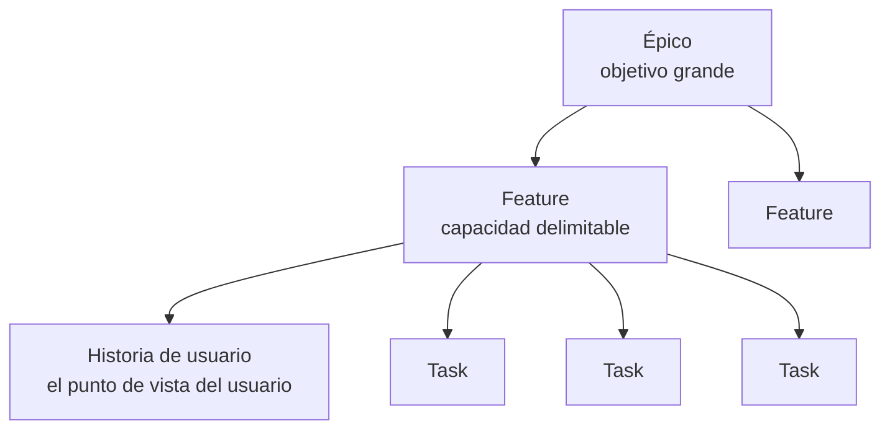
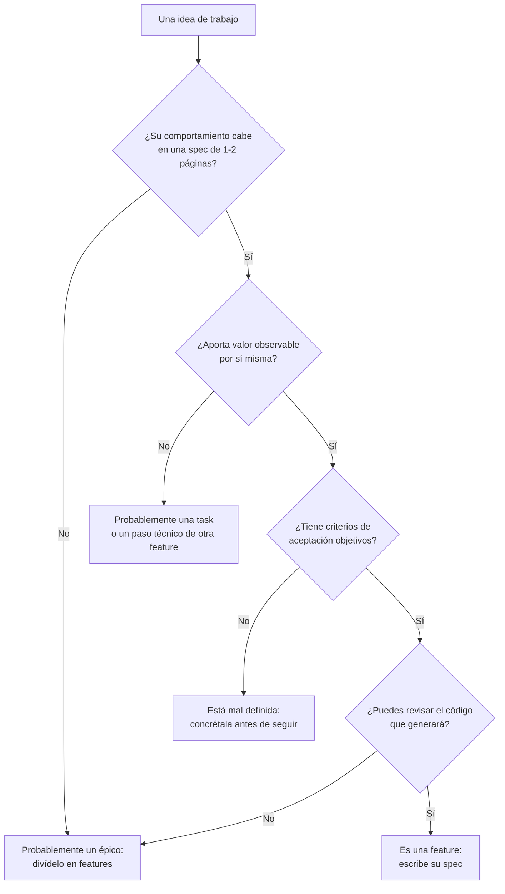
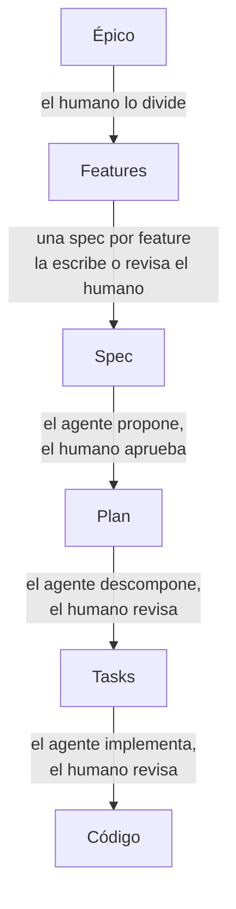

# 4. Features: la unidad de trabajo de una spec

[⬅️ Volver a la unidad](./README.md)

## Índice

- [4.1. Qué es una feature](#41-qué-es-una-feature)
- [4.2. La jerarquía del trabajo](#42-la-jerarquía-del-trabajo)
  - [4.2.1. Épico](#421-épico)
  - [4.2.2. Feature](#422-feature)
  - [4.2.3. Historia de usuario](#423-historia-de-usuario)
  - [4.2.4. Task](#424-task)
  - [4.2.5. Comparación de los cuatro niveles](#425-comparación-de-los-cuatro-niveles)
- [4.3. Qué hace buena a una feature para SDD](#43-qué-hace-buena-a-una-feature-para-sdd)
- [4.4. ¿Es una feature? Preguntas de diagnóstico](#44-es-una-feature-preguntas-de-diagnóstico)
  - [4.4.1. Demasiado grande, demasiado pequeña o técnica](#441-demasiado-grande-demasiado-pequeña-o-técnica)
- [4.5. Del épico a la spec](#45-del-épico-a-la-spec)
- [4.6. Cuándo no escribir una spec completa](#46-cuándo-no-escribir-una-spec-completa)
- [4.7. Ordenar las features](#47-ordenar-las-features)
- [4.8. Dos ejemplos de descomposición](#48-dos-ejemplos-de-descomposición)
- [4.9. Ejemplo integrador: las features de la lista de tareas](#49-ejemplo-integrador-las-features-de-la-lista-de-tareas)
- [Resumen](#resumen)
- [Ejercicios de reflexión](#ejercicios-de-reflexión)

> **Criterios que trabaja este tema:** OA1 d.

---

## 4.1. Qué es una feature

Una ***feature*** (funcionalidad) es una **capacidad concreta y delimitable del sistema** que aporta un valor observable al usuario o al negocio, y que se puede desarrollar, probar y desplegar de forma bastante independiente del resto.

La palabra clave es **delimitable**: una feature tiene fronteras claras. Se sabe dónde empieza y dónde acaba, así que se puede:

- escribir una spec para ella,
- generar un plan y dividirla en tareas,
- y comprobar con criterios de aceptación concretos que está terminada.

En SDD, la feature es la **unidad natural de trabajo de una spec**: **una spec por feature**. Ni más grande (eso sería un épico, que necesita varias specs) ni más pequeña (eso sería una tarea, que sale del plan).

> 📝 **Nota del Profesor**: elegir bien el tamaño de las features es la primera decisión de diseño de un proyecto con SDD, y la toma una persona, no el agente. Si la feature es demasiado grande, la spec se vuelve inmanejable y el agente se pierde; si es demasiado pequeña, el proceso pesa más que el trabajo.

---

## 4.2. La jerarquía del trabajo

En los equipos de desarrollo, el trabajo se organiza en niveles de tamaño. Los nombres vienen de las metodologías ágiles, como Scrum, y te los encontrarás en cualquier empresa:



Un épico se divide en features; cada feature tiene una o varias historias de usuario que explican su porqué, y se implementa mediante tasks. La spec se escribe en el nivel de la **feature**.

### 4.2.1. Épico

Un **épico** (*epic*) es un objetivo de negocio o un área del producto demasiado grande para abordarlo de una vez. No se especifica ni se implementa directamente: se **divide en features**.

- **Tamaño:** semanas o meses de trabajo.
- **Ejemplo:** «Sistema de autenticación y gestión de usuarios».
- **En SDD:** no tiene spec propia. Como mucho, un PRD que describe el objetivo.

### 4.2.2. Feature

Una **feature** es una capacidad concreta que se puede especificar, planificar y terminar en un ciclo de trabajo razonable.

- **Tamaño:** días; una o dos semanas como mucho.
- **Ejemplos:** «Inicio de sesión con JWT», «Registro con validación del correo», «Recuperar la contraseña».
- **En SDD:** tiene **su propia spec**, con criterios de aceptación verificables.

### 4.2.3. Historia de usuario

Una **historia de usuario** (*user story*) describe una necesidad **desde el punto de vista de quien usa el sistema**. Tiene un formato clásico:

```text
Como [tipo de usuario],
quiero [acción o capacidad],
para [beneficio o motivo].
```

Por ejemplo:

```text
Como usuario registrado,
quiero iniciar sesión con mi correo y mi contraseña,
para acceder a mis datos desde cualquier dispositivo.
```

La historia no dice cómo se construye nada: explica **quién** necesita algo y **para qué**. Una feature puede tener una o varias historias.

- **En SDD:** las historias van en el **contexto** de la spec, la sección que responde al porqué. Ayudan al agente a decidir bien cuando la spec no cubre un caso.

> ⚠️ **Cuidado**: una historia de usuario **no es una spec**. «Quiero iniciar sesión para acceder a mis datos» no dice cuánto dura la sesión, qué pasa si la contraseña es incorrecta ni qué devuelve la API. Es el punto de partida, no el contrato.

### 4.2.4. Task

Una **task** (tarea) es la unidad mínima de implementación: un paso concreto y acotado que el agente puede hacer de forma independiente.

- **Tamaño:** de minutos a pocas horas. Suele tocar uno o dos ficheros.
- **Ejemplo:** «Crear el endpoint `POST /auth/login` que valida las credenciales y devuelve el token».
- **En SDD:** no se escribe a mano desde cero. **Sale del plan** de la feature, que a su vez sale de la spec (lo verás en la UD2).

### 4.2.5. Comparación de los cuatro niveles

| | Épico | Feature | Historia de usuario | Task |
|---|---|---|---|---|
| **Qué expresa** | Un objetivo de negocio | Una capacidad del sistema | Una necesidad del usuario | Un paso de implementación |
| **Tamaño** | Semanas o meses | Días | (la de su feature) | Minutos u horas |
| **Quién lo define** | Producto | Producto y equipo | Producto | El agente, a partir del plan; el humano lo revisa |
| **Artefacto en SDD** | PRD | **Spec** | Contexto de la spec | `tasks.md` |
| **¿Lo implementa el agente directamente?** | No | No, a través de sus tasks | No | Sí |

> 💡 **Tip del Examinador**: «¿En qué nivel de la jerarquía se escribe una spec y por qué?». En el de la **feature**: es lo bastante pequeña para describirla con precisión y verificarla con criterios de aceptación, y lo bastante grande para aportar valor por sí misma. El épico es demasiado amplio para una spec y la task demasiado pequeña: sale del plan.

---

## 4.3. Qué hace buena a una feature para SDD

En las metodologías ágiles, una feature se define sobre todo por el **valor** que aporta. Cuando el trabajo lo hace un agente, hay que añadir un criterio: que se pueda **delegar** bien. Una buena feature para SDD es:

| Criterio | Qué significa | Señal de alarma |
|----------|---------------|-----------------|
| **Delimitable** | Se sabe qué partes del sistema toca y cuáles no | «Afecta un poco a todo» |
| **Especificable** | Su comportamiento cabe en una spec de una o dos páginas | La spec no deja de crecer |
| **Descomponible** | Se puede dividir en tasks que se hacen y prueban por separado | Todas las tareas dependen de todas |
| **Verificable** | Tiene criterios de aceptación objetivos: se cumple o no | «Estará bien cuando esté bonito» |
| **Revisable** | Una persona puede revisar el código generado en un tiempo razonable | El cambio toca decenas de ficheros |
| **Con valor propio** | Aporta algo observable aunque las demás no existan todavía | Solo tiene sentido junto a otra |

El criterio **revisable** es el más específico del trabajo con agentes. Un agente puede generar en minutos cambios en treinta ficheros, pero tú no puedes revisarlos con atención en ese tiempo. Si la feature produce cambios que no puedes revisar, es demasiado grande, aunque el agente sea capaz de hacerla.

---

## 4.4. ¿Es una feature? Preguntas de diagnóstico

Ante una idea, estas preguntas te dicen si es una feature, un épico o una task:



Las preguntas se hacen en orden: las primeras descartan los épicos y las tareas; las últimas detectan las features mal definidas o demasiado grandes para revisarlas.

### 4.4.1. Demasiado grande, demasiado pequeña o técnica

Los tres errores más frecuentes al definir features:

| Error | Ejemplo | Cómo corregirlo |
|-------|---------|-----------------|
| **Demasiado grande** (un épico disfrazado) | «Gestión de usuarios» | Dividir: registro, inicio de sesión, recuperar la contraseña, editar el perfil |
| **Demasiado pequeña** (una task disfrazada) | «Añadir el botón de enviar» | Integrarla en la feature a la que pertenece: «Enviar el formulario de contacto» |
| **Técnica, sin valor propio** | «Crear la tabla de usuarios» | Es un paso del plan de otra feature (por ejemplo, el registro), no una feature |

> ⚠️ **Cuidado**: las tareas técnicas (crear una tabla, configurar una librería, preparar el proyecto) no son features aunque lleven trabajo. Aparecen en el **plan** de la primera feature que las necesita. Si las conviertes en features, tendrás specs sin comportamiento que verificar.

---

## 4.5. Del épico a la spec

La jerarquía encaja directamente con el flujo de SDD. Cada nivel tiene un responsable claro:



Las decisiones de los niveles altos (qué features existen, dónde están sus fronteras, qué dice cada spec) son **humanas**. El agente trabaja en los niveles bajos (plan, tasks, código), siempre con revisión.

Esta división evita el problema que viste en el tema 1: en lugar de pedirle al agente una feature entera que toca decenas de ficheros, la feature se convierte en una spec, la spec en un plan y el plan en tasks pequeñas, cada una de uno o dos ficheros y fácil de revisar.

> ✅ **Buena práctica**: puedes pedirle al agente que **proponga** cómo dividir un épico en features (lo harás en el ejemplo integrador), pero la decisión final es tuya. Revisa la propuesta con los criterios del apartado 4.3.

---

## 4.6. Cuándo no escribir una spec completa

SDD no es para todo. Una spec completa tiene un coste (escribirla, revisarla, mantenerla) que solo compensa cuando la feature tiene cierta complejidad.

**No hace falta una spec completa cuando:**

- Es una **corrección pequeña y localizada** de un error.
- Es un **cambio de configuración** o de un texto de la interfaz.
- Es una **tarea técnica muy acotada**: actualizar una dependencia, renombrar una variable en un fichero.
- Son **ajustes visuales** finos.
- Es un **prototipo o un experimento** que se va a tirar.

**Sí hace falta cuando:**

- Hay **lógica de negocio** que no es trivial.
- Hay ***edge cases*** importantes que decidir antes de programar.
- Afecta a **varias partes** del sistema.
- Van a trabajar en ella **varias personas o varios agentes**.
- Necesitas **criterios objetivos** para saber que está terminada.
- Un error tendría **consecuencias serias** (pagos, datos personales, seguridad).

Entre los dos extremos hay un punto intermedio: para un cambio pequeño pero con alguna decisión, basta con un **prompt cuidado** que diga qué se quiere, qué casos hay que tener en cuenta y cómo se comprueba, sin el resto de la estructura.

> 💡 **Tip del Examinador**: «¿Hay que escribir una spec para todo en SDD?». No. Para correcciones pequeñas, cambios de configuración o prototipos basta un buen prompt. La spec compensa cuando hay lógica no trivial, casos límite, varias personas implicadas o riesgo alto.

---

## 4.7. Ordenar las features

Después de dividir el épico hay que decidir **en qué orden** se implementan las features. Criterios:

1. **Dependencias:** si una feature necesita algo que crea otra, va después. No puedes marcar una tarea como hecha si todavía no se pueden crear tareas.
2. **Valor:** a igualdad de dependencias, primero lo que antes aporta valor al usuario.
3. **Riesgo:** conviene adelantar las features con más incertidumbre, para descubrir pronto los problemas.

En SDD, ese orden se refleja en el **nombre de la carpeta** de cada feature, con un prefijo de letra o número:

```text
docs/specs/
├── A-añadir-tarea/
├── B-ver-lista/
├── C-marcar-hecha/
└── D-borrar-tarea/
```

El prefijo indica el **orden de implementación** acordado, no el orden en que se escribieron las specs. Así, de un vistazo, cualquiera (incluido el agente) sabe qué va primero. Cómo se lleva el estado de cada feature lo verás en la UD2.

---

## 4.8. Dos ejemplos de descomposición

**Tienda en línea: el pago.**

| Nivel | Ejemplo |
|-------|---------|
| **Épico** | Sistema de pagos |
| **Feature** | Pago con tarjeta |
| **Feature** | Pago con una pasarela externa |
| **Feature** | Devoluciones |
| **Historia** | «Como cliente, quiero pagar con mi tarjeta guardada para no volver a escribir sus datos» |
| **Task** | Crear el endpoint `POST /pagos/tarjeta` |
| **Task** | Integrar la autorización del proveedor de pagos |
| **Task** | Tratar la confirmación asíncrona del pago |
| **Task** | Tests del servicio de pagos |

**Autenticación.**

| Nivel | Ejemplo |
|-------|---------|
| **Épico** | Autenticación y gestión de usuarios |
| **Feature** | Inicio de sesión |
| **Feature** | Registro con validación del correo |
| **Feature** | Recuperar la contraseña |
| **Feature** | Autenticación en dos pasos |
| **Historia** | «Como usuario, quiero recuperar mi contraseña por correo si la olvido» |
| **Task** | Crear el endpoint `POST /auth/olvido-contrasena` |
| **Task** | Generar y guardar el código de recuperación |
| **Task** | Plantilla del correo de recuperación |
| **Task** | Endpoint `POST /auth/restablecer-contrasena` con validación del código |

Fíjate en que las tasks pertenecen a **una sola** de las features del épico: las del segundo ejemplo son todas de «Recuperar la contraseña».

---

## 4.9. Ejemplo integrador: las features de la lista de tareas

Vuelves al proyecto que preparaste en el tema 3. El PRD (tema 2) dice que el equipo quiere una lista de tareas compartida para dejar de apuntarlas en el chat. Ese es el **épico**. Toca dividirlo en features.

**0. Añade el PRD.** Crea `docs/prd.md` con el PRD de ejemplo del tema 2 (apartado 2.3) y haz commit.

**1. Pide una propuesta al agente.** En OpenCode, con el agente *plan* activo:

```text
Lee @docs/prd.md. Propón cómo dividir el épico en features para
desarrollarlas con SDD. Para cada una indica su nombre, qué valor
aporta, de qué otras depende y una historia de usuario.
No crees ningún fichero.
```

**2. Revisa la propuesta.** Supón que el agente propone:

| Propuesta del agente | Revisión con los criterios del 4.3 |
|----------------------|------------------------------------|
| Gestión de tareas | ❌ Demasiado grande: es el épico. Hay que dividirla |
| Configurar la base de datos | ❌ Técnica, sin valor propio: va en el plan de la primera feature |
| Añadir una tarea | ✅ Delimitable, verificable, con valor propio |
| Ver la lista de tareas | ✅ |
| Marcar una tarea como hecha | ✅ |
| Borrar una tarea | ✅ |
| Botón de borrar | ❌ Demasiado pequeña: es parte de «Borrar una tarea» |
| Usuarios y permisos | ❌ Fuera de alcance según el PRD |

La propuesta es útil como punto de partida, pero mezcla niveles. La revisión humana la deja en **cuatro features**.

**3. Decide el orden.** Añadir es la base: sin tareas, no hay nada que ver, marcar ni borrar. Después, ver la lista; marcar y borrar dependen de que las tareas existan y se vean:

| # | Feature | Depende de | Historia de usuario |
|---|---------|------------|---------------------|
| A | Añadir una tarea | — | Como miembro del equipo, quiero apuntar una tarea para que no se pierda en el chat |
| B | Ver la lista de tareas | A | Como miembro del equipo, quiero ver todas las tareas para saber qué queda por hacer |
| C | Marcar una tarea como hecha | A, B | Como miembro del equipo, quiero marcar una tarea como hecha para que los demás sepan que está resuelta |
| D | Borrar una tarea | A, B | Como miembro del equipo, quiero borrar una tarea apuntada por error |

**4. Crea las carpetas y el índice.** Ahora sí, cambia al agente *build* (o hazlo tú a mano):

```text
docs/specs/
├── README.md          ← índice con las cuatro features
├── A-añadir-tarea/
├── B-ver-lista/
├── C-marcar-hecha/
└── D-borrar-tarea/
```

`docs/specs/README.md`:

```markdown
# Features

| # | Feature | Carpeta | Estado |
|---|---------|---------|--------|
| A | Añadir una tarea | A-añadir-tarea/ | ⏳ Pendiente |
| B | Ver la lista de tareas | B-ver-lista/ | ⏳ Pendiente |
| C | Marcar una tarea como hecha | C-marcar-hecha/ | ⏳ Pendiente |
| D | Borrar una tarea | D-borrar-tarea/ | ⏳ Pendiente |
```

«Pendiente» quiere decir que la feature está identificada pero su spec aún no existe.

**5. Guarda el trabajo.** Las carpetas vacías no se suben a Git, así que el commit recoge el índice; las carpetas aparecerán con su `spec.md`:

```bash
git add docs/specs/README.md
git commit -m "Features del épico de la lista de tareas"
```

En el tema 5 escribirás la spec de la feature A.

---

## Resumen

- Una **feature** es una capacidad concreta y **delimitable** del sistema, con valor propio. En SDD, **una spec por feature**.
- La jerarquía del trabajo: **épico** (objetivo grande, se divide), **feature** (se especifica), **historia de usuario** (el porqué, va en el contexto de la spec) y **task** (sale del plan, la implementa el agente).
- Una buena feature para SDD es **delimitable, especificable, descomponible, verificable, revisable** y tiene **valor propio**.
- Errores típicos: features **demasiado grandes** (épicos), **demasiado pequeñas** (tasks) o **técnicas** sin valor propio.
- Las decisiones de los niveles altos (qué features, qué dice cada spec) son **humanas**; el agente trabaja en el plan, las tasks y el código, con revisión.
- No todo necesita una spec completa: para cambios pequeños basta un **prompt cuidado**.
- El orden de las features se decide por **dependencias, valor y riesgo**, y se refleja en el **prefijo** de su carpeta.

## Ejercicios de reflexión

1. Clasifica como épico, feature, historia o task: «Plataforma de reservas del gimnasio», «Reservar una clase», «Como socio, quiero reservar una clase desde el móvil para no hacer cola», «Crear el endpoint `POST /reservas`», «Cancelar una reserva».
2. ¿Por qué «Configurar la base de datos» no es una feature, aunque lleve trabajo? ¿Dónde aparece ese trabajo en SDD?
3. Explica con tus palabras por qué el criterio **revisable** es especialmente importante cuando el código lo genera un agente.
4. Pon un ejemplo de cambio para el que no escribirías una spec completa y explica qué incluirías en el prompt.
5. En la lista de tareas, ¿por qué «Ver la lista» va antes que «Marcar como hecha»? ¿Podrían hacerse en paralelo?

---

[⬅️ Volver a la unidad](./README.md)
