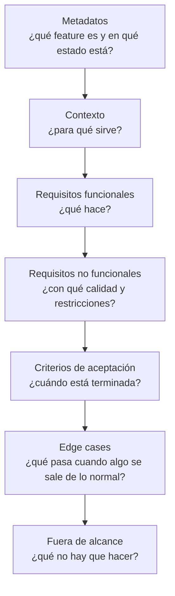
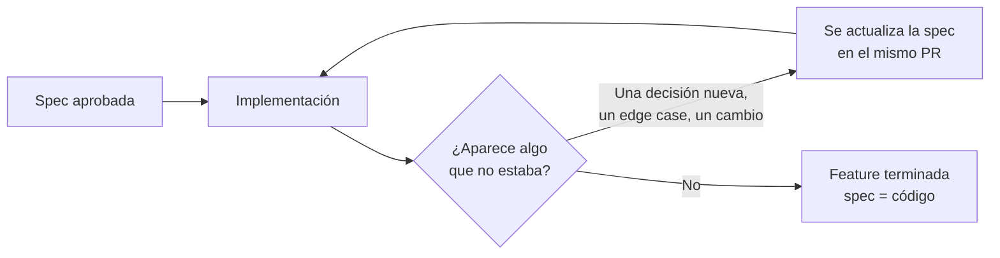

# 5. Anatomía de una spec

[⬅️ Volver a la unidad](./README.md)

## Índice

- [5.1. Qué hace buena a una spec para un agente](#51-qué-hace-buena-a-una-spec-para-un-agente)
- [5.2. Las secciones de una spec](#52-las-secciones-de-una-spec)
- [5.3. Metadatos y contexto](#53-metadatos-y-contexto)
- [5.4. Requisitos funcionales](#54-requisitos-funcionales)
- [5.5. Requisitos no funcionales](#55-requisitos-no-funcionales)
- [5.6. Criterios de aceptación](#56-criterios-de-aceptación)
- [5.7. Edge cases y comportamiento ante errores](#57-edge-cases-y-comportamiento-ante-errores)
- [5.8. Fuera de alcance](#58-fuera-de-alcance)
- [5.9. Lo que todavía no está decidido](#59-lo-que-todavía-no-está-decidido)
- [5.10. Plantilla base](#510-plantilla-base)
- [5.11. La spec como documento vivo](#511-la-spec-como-documento-vivo)
- [5.12. Antipatrones](#512-antipatrones)
- [5.13. Ejemplo integrador: la spec de «Añadir una tarea»](#513-ejemplo-integrador-la-spec-de-añadir-una-tarea)
- [Resumen](#resumen)
- [Ejercicios de reflexión](#ejercicios-de-reflexión)

> **Criterios que trabaja este tema:** OA1 e.

---

## 5.1. Qué hace buena a una spec para un agente

Una spec tiene **dos lectores a la vez**: la persona que la escribe y la revisa, y el agente que la usará para generar el código. Eso cambia lo que significa «estar bien escrita».

Entre personas, un requisito ambiguo se resuelve con una pregunta en el pasillo. Un agente, normalmente, **no pregunta: supone**. Elige la interpretación más probable y la deja escrita en el código, donde nadie la cuestiona.

Por eso una buena spec para un agente es:

| Cualidad | Qué significa | Contraejemplo |
|----------|---------------|---------------|
| **Inequívoca** | Cada frase admite una sola interpretación | «La respuesta debe ser rápida» |
| **Completa en su alcance** | Todo lo que importa está escrito: lo que no está, no existe para el agente | No decir qué pasa si el texto está vacío |
| **Orientada al comportamiento** | Dice **qué** debe hacer el sistema, no **cómo** programarlo | «Crea una función `validar()` con un `if`…» |
| **Verificable** | Cada requisito se puede comprobar de forma objetiva | «La interfaz debe ser intuitiva» |
| **Delimitada** | Dice también lo que **no** hay que hacer | No mencionar que la edición queda para otra feature |
| **Versionada** | Es un fichero Markdown en el repositorio, junto al código | Un documento en el correo o en el chat |

> 📝 **Nota del Profesor**: escribe la spec pensando que la va a leer alguien **muy literal y sin contexto**, que hará exactamente lo que diga y rellenará cada hueco con lo más habitual. Esa es la mejor descripción de un agente.

---

## 5.2. Las secciones de una spec

Una spec bien formada tiene secciones fijas. Cada una responde a una pregunta distinta:



El orden va de lo general (para qué) a lo concreto (casos límite) y termina marcando la frontera. Verás cada sección con el ejemplo de una feature de **inicio de sesión con JWT** (*JSON Web Token*, un formato de token de sesión firmado), que tiene requisitos de seguridad interesantes. Al final del tema escribirás la spec completa de la lista de tareas.

---

## 5.3. Metadatos y contexto

**Metadatos.** Una tabla corta que identifica la spec:

```markdown
| Campo   | Valor                    |
|---------|--------------------------|
| Feature | Inicio de sesión con JWT |
| Estado  | Borrador                 |
| Versión | 1.0                      |
| Fecha   | AAAA-MM-DD               |
| Autor   | <nombre>                 |
```

El campo **Estado** dice en qué punto del flujo está la spec: `Borrador`, `En revisión`, `Aprobada`, `En implementación` o `Implementada`. Lo usarás para llevar el control de las features en la UD2.

**Contexto.** Responde al **qué** y al **porqué** de la feature:

```markdown
## Contexto

**Objetivo:** que los usuarios inicien sesión de forma segura y no
tengan que volver a identificarse en cada petición.

**Historia de usuario:** como usuario registrado, quiero iniciar sesión
con mi correo y mi contraseña para acceder a mis datos.

**Usuarios afectados:** todos los usuarios registrados.

**Dependencias:** módulo de usuarios existente (`src/usuarios`) y Redis
para guardar los tokens revocados.
```

**Por qué importa:** sin contexto, el agente puede construir algo técnicamente correcto pero equivocado para el problema real. Saber el porqué le ayuda a decidir bien en las situaciones que los requisitos no cubren.

> ✅ **Buena práctica**: el contexto son **dos a cuatro frases**, no un ensayo. Si necesitas más, probablemente estás mezclando el PRD con la spec: enlaza el PRD y quédate con lo esencial.

---

## 5.4. Requisitos funcionales

Los **requisitos funcionales** (RF) describen **qué debe hacer el sistema**. Son el núcleo de la spec. Cada uno lleva un identificador (`RF-01`, `RF-02`…) para poder citarlo desde el plan, las tareas y los tests.

```markdown
## Requisitos funcionales

- RF-01: El sistema deberá generar un token JWT firmado cuando el
  inicio de sesión sea correcto.
- RF-02: El token deberá incluir el identificador del usuario, su rol
  y una fecha de caducidad de 24 horas.
- RF-03: El sistema deberá validar el token en cada petición a un
  endpoint protegido antes de procesarla.
- RF-04: El sistema deberá revocar el token al cerrar la sesión,
  guardando su identificador en Redis hasta que caduque.
```

Reglas para escribirlos:

- **Atómicos:** una sola responsabilidad por requisito.
- **Con «deberá»** (o «debe»): deja claro que es obligatorio.
- **Verificables:** se puede escribir un test que lo compruebe.

> ⚠️ **Cuidado**: los requisitos compuestos esconden decisiones. «El sistema deberá validar el token y registrar el acceso y avisar si caduca pronto» son **tres** requisitos. Si los juntas, el agente puede implementar dos y olvidar el tercero, y nadie lo notará al revisar.

---

## 5.5. Requisitos no funcionales

Los **requisitos no funcionales** (RNF) describen **con qué calidad y bajo qué restricciones** debe funcionar el sistema: rendimiento, seguridad, mantenibilidad. Sin ellos, el agente optimiza solo para que «funcione».

```markdown
## Requisitos no funcionales

- RNF-01: Validar el token no deberá añadir más de 10 ms al tiempo de
  respuesta del endpoint.
- RNF-02: Los tokens se firmarán con RS256 (clave asimétrica). Nunca HS256.
- RNF-03: La clave privada no estará escrita en el código: se leerá de
  la variable de entorno JWT_PRIVATE_KEY.
- RNF-04: Las funciones de generación y validación del token tendrán
  una cobertura de tests de al menos el 90 %.
```

Fíjate en que todos son **medibles o comprobables**: un tiempo, un algoritmo, una variable de entorno, un porcentaje. «Deberá ser seguro» o «deberá ser rápido» no le sirven al agente ni a quien revisa.

> 💡 **Tip del Examinador**: «¿Qué diferencia hay entre un requisito funcional y uno no funcional?». El funcional dice **qué hace** el sistema (genera un token, valida una petición); el no funcional, **cómo de bien o con qué restricciones** lo hace (en cuánto tiempo, con qué algoritmo, con qué cobertura de tests).

---

## 5.6. Criterios de aceptación

Los **criterios de aceptación** (AC, *acceptance criteria*) son la **definición de terminado**: las condiciones concretas que se tienen que cumplir para dar la feature por acabada. Para el agente son, además, la fuente directa de los tests.

Cada criterio debe ser:

- **Binario:** se cumple o no se cumple, sin término medio.
- **Comprobable:** se puede escribir un test que lo verifique.
- **Enfocado:** comprueba una sola cosa.

La forma más habitual es **Dado… cuando… entonces…**:

```markdown
## Criterios de aceptación

- AC-01: Dado un usuario con credenciales correctas, cuando hace
  POST /auth/login, entonces recibe un 200 con un token JWT en el cuerpo.
- AC-02: Dado un token válido, cuando se envía en la cabecera
  Authorization de un endpoint protegido, entonces la petición se procesa.
- AC-03: Dado un token caducado, cuando se usa en una petición,
  entonces el sistema responde 401 con el mensaje "Token expirado".
- AC-04: Dado un usuario con la sesión iniciada, cuando hace
  POST /auth/logout, entonces su token deja de ser válido.
```

**Dado** fija la situación de partida, **cuando** la acción y **entonces** el resultado observable. Esa estructura se convierte casi directamente en un test (lo harás en la UD3).

¿Qué diferencia hay con los requisitos? El requisito dice **qué** debe hacer el sistema; el criterio de aceptación, **cómo se comprueba** que lo hace. Un requisito puede tener uno o varios criterios.

---

## 5.7. Edge cases y comportamiento ante errores

Viste qué son los *edge cases* en el tema 2. En la spec van en su propia sección, con identificador (`EC-01`…) y con la **respuesta exacta** del sistema:

```markdown
## Edge cases y comportamiento ante errores

- EC-01: Si la cabecera Authorization existe pero no empieza por
  "Bearer ", el sistema responderá 401 con "Formato de token inválido".
- EC-02: Si el token está bien firmado pero su identificador está en
  Redis (revocado), responderá 401 con "Token revocado".
- EC-03: Si Redis no está disponible al validar, el sistema rechazará
  la petición con 503 y registrará el error en el log con nivel ERROR.
- EC-04: Si llegan a la vez dos cierres de sesión con el mismo token,
  los dos terminarán sin error y el token quedará revocado.
- EC-05: Si el token declara en su cabecera un algoritmo distinto de
  RS256 (por ejemplo "none" o "HS256"), el sistema lo rechazará con 401.
```

Los *edge cases* son la sección que más suele faltar y la que más problemas evita. El agente implementa por defecto el camino feliz; todo lo demás, si no está escrito, lo improvisa.

> ⚠️ **Cuidado**: algunos *edge cases* esconden **decisiones de diseño**, no solo de programación. En EC-03, ¿qué es mejor si Redis no responde: rechazar la petición (más seguro, pero el servicio se cae con Redis) o aceptarla sin comprobar si el token está revocado (el servicio sigue, pero un token revocado podría colarse)? No hay una respuesta universal. Lo importante es que **la decida una persona** y quede escrita; si no, la decidirá el agente.

---

## 5.8. Fuera de alcance

La sección **fuera de alcance** dice lo que la feature **no** hace. Es tan importante como el resto: sin ella, el agente puede añadir funcionalidades que parecen lógicas pero que nadie ha pedido ni revisado.

```markdown
## Fuera de alcance

- Refresh tokens (se abordarán en otra spec).
- Inicio de sesión con proveedores externos (Google, GitHub…).
- Límite de intentos de inicio de sesión (lo cubre un middleware global).
- Limitar las sesiones simultáneas de un usuario (no hay límite).
```

Cada línea cierra una puerta concreta: los *refresh tokens* son justo lo que añadió el agente en el ejemplo del tema 1 sin que nadie se lo pidiera.

> ✅ **Buena práctica**: cuando la exclusión es temporal, di dónde se tratará («se abordará en otra spec»). Así el agente no lo implementa y el equipo no lo olvida.

---

## 5.9. Lo que todavía no está decidido

Mientras escribes una spec aparecen preguntas que aún no sabes responder. **No las escondas**: márcalas. GitHub Spec Kit usa el marcador `[NEEDS CLARIFICATION]`; en el curso usarás su equivalente en español:

```markdown
- RF-02: El token deberá caducar a las [NECESITA ACLARACIÓN: ¿24 horas
  o 7 días? Depende de si la aplicación se usa en equipos compartidos].
```

Reglas del marcador:

- Marca la duda **justo donde afecta**, con la pregunta concreta y, si puedes, las alternativas.
- Una spec con algún `[NECESITA ACLARACIÓN]` **no se puede aprobar**: no pasa a `Aprobada` hasta que se resuelven todos.
- Puedes pedirle al agente que revise la spec y **añada marcadores** donde vea ambigüedades. Es una de las mejores formas de usarlo en esta fase.

Así la duda se ve en la revisión, en lugar de convertirse en una decisión silenciosa del agente.

---

## 5.10. Plantilla base

Esta es la plantilla de spec del curso. Cópiala, rellénala y borra las secciones que no apliquen (casi nunca sobra ninguna):

```markdown
# Spec: <Nombre de la feature>

## Metadatos

| Campo   | Valor |
|---------|-------|
| Feature | <Nombre> |
| Estado  | Borrador |
| Versión | 1.0 |
| Fecha   | AAAA-MM-DD |
| Autor   | <nombre> |

---

## Contexto

<Objetivo y problema que resuelve, en dos a cuatro frases.>

**Historia de usuario:** como <tipo de usuario>, quiero <acción>
para <beneficio>.

**Dependencias:** <módulos o servicios de los que depende>

---

## Requisitos funcionales

- RF-01: El sistema deberá <comportamiento atómico y verificable>.

---

## Requisitos no funcionales

- RNF-01: <rendimiento, seguridad, restricciones, calidad: medible>.

---

## Criterios de aceptación

- AC-01: Dado <situación>, cuando <acción>, entonces <resultado observable>.

---

## Edge cases y comportamiento ante errores

- EC-01: Si <condición límite o error>, el sistema <respuesta exacta>.

---

## Fuera de alcance

- <Lo que no hace esta feature y, si aplica, dónde se tratará.>

---

## Referencias

- <PRD, otras specs, documentación técnica>
```

> 📝 **Nota del Profesor**: la plantilla es un punto de partida, no una ley. Herramientas como Spec Kit o Kiro usan plantillas con otros nombres de sección, pero todas cubren lo mismo: contexto, qué hace, cómo se comprueba, casos límite y qué queda fuera.

---

## 5.11. La spec como documento vivo

Una spec no se escribe, se aprueba y se archiva. **Evoluciona con el código.**



Cuándo se actualiza la spec:

- Cuando se toma una **decisión** durante la implementación que debe quedar registrada.
- Cuando **cambia un requisito**.
- Cuando se descubre un ***edge case*** que no estaba.
- Cuando se **saca algo del alcance** que estaba previsto.

Cómo:

- La spec vive en el **repositorio**, versionada con Git.
- Los cambios de la spec van en el **mismo commit o PR** que el código al que afectan.
- Si el código y la spec dejan de coincidir, se investiga quién tiene razón: puede que el código tenga un error o que la spec se haya quedado vieja. Esa separación tiene nombre, ***spec drift***, y la estudiarás en la UD3.

> ✅ **Buena práctica**: trata la spec como código. Si no está en el repositorio, no existe; si está desactualizada, es peor que no tenerla, porque le da al agente información falsa.

---

## 5.12. Antipatrones

| Antipatrón | Qué pasa | Cómo evitarlo |
|------------|----------|---------------|
| **Vaguedad** («manejar los errores correctamente») | El agente rellena el hueco con lo más probable | Respuestas exactas: código, mensaje, comportamiento |
| **Solo el camino feliz** | Funciona en la demo y falla en producción | Sección de *edge cases* obligatoria |
| **Spec gigante sin estructura** | Más de cincuenta requisitos sin orden saturan al agente | Dividir en varias features (tema 4) |
| **Spec que prescribe la implementación** | Nombres de funciones o estructuras internas: cualquier refactorización la deja vieja y el agente duda entre la spec y el código | Describir comportamiento; el cómo va en el plan |
| **Spec fuera del repositorio** | No evoluciona con el código y acaba desactualizada | Markdown en `docs/specs/`, versionado |
| **Mezclar spec y plan** | El agente no distingue restricción de sugerencia | Spec: qué. Plan: cómo |
| **Dudas escondidas** | Se aprueba una spec con huecos que decidirá el agente | Marcar con `[NECESITA ACLARACIÓN]` |

---

## 5.13. Ejemplo integrador: la spec de «Añadir una tarea»

Vuelves a la lista de tareas. En el tema 4 dividiste el épico en cuatro features; ahora toca escribir la spec de la primera.

**1. Escribe un borrador.** Empieza tú, aunque sea breve. Por ejemplo, en lenguaje natural:

```text
El usuario escribe el texto de una tarea y pulsa un botón. La tarea
aparece al final de la lista como pendiente. Si el campo está vacío,
no pasa nada. Máximo 280 caracteres.
```

**2. Pide al agente que lo estructure y marque las dudas.** En OpenCode, con el agente *plan*:

```text
Convierte este borrador en una spec con la plantilla del curso
(secciones: metadatos, contexto, requisitos funcionales y no
funcionales, criterios de aceptación, edge cases y fuera de alcance).
Respeta @constitution.md. Donde falte información, no la inventes:
marca [NECESITA ACLARACIÓN] con la pregunta concreta.

<pega aquí el borrador>
```

**3. Resuelve las dudas.** Un agente atento marcará cosas como: ¿quién genera el identificador?, ¿qué pasa si el texto solo tiene espacios?, ¿y si la petición no trae el campo del texto?, ¿qué código devuelve un error? Las respondes tú, una a una.

**4. Revisa la spec completa.** El resultado, ya sin marcadores, queda así en `docs/specs/A-añadir-tarea/spec.md`:

```markdown
# Spec: Añadir una tarea

## Metadatos

| Campo   | Valor            |
|---------|------------------|
| Feature | Añadir una tarea |
| Estado  | En revisión      |
| Versión | 1.0              |
| Fecha   | AAAA-MM-DD       |
| Autor   | <nombre>         |

---

## Contexto

Los miembros del equipo pueden añadir tareas a la lista compartida
escribiendo un texto. Las tareas nuevas aparecen al final de la lista
como pendientes. Es la feature base: sin ella, las demás no tienen sentido.

**Historia de usuario:** como miembro del equipo, quiero apuntar una
tarea para que no se pierda en el chat.

**Dependencias:** ninguna (es la primera feature).

---

## Requisitos funcionales

- RF-01: El sistema deberá aceptar el texto de una tarea nueva enviado
  por el usuario.
- RF-02: El sistema deberá guardar la tarea con un identificador único,
  el texto, el estado "pendiente" y la fecha de creación.
- RF-03: El sistema deberá devolver la tarea creada como confirmación.
- RF-04: La página deberá mostrar la tarea nueva al final de la lista
  sin recargarse.

---

## Requisitos no funcionales

- RNF-01: El endpoint de creación responderá en menos de 200 ms en
  condiciones normales.
- RNF-02: El texto de la tarea no podrá superar los 280 caracteres.
- RNF-03: El identificador lo generará el servidor, nunca el cliente.

---

## Criterios de aceptación

- AC-01: Dado un usuario en la página principal, cuando escribe
  "Comprar leche" y pulsa "Añadir", entonces la tarea aparece al final
  de la lista como pendiente.
- AC-02: Dado un usuario que envía el formulario con el campo vacío,
  entonces no se crea ninguna tarea y el campo sigue vacío.
- AC-03: Dado un texto válido, cuando el servidor crea la tarea,
  entonces responde 201 con su id, texto, estado "pendiente" y fecha
  de creación.

---

## Edge cases y comportamiento ante errores

- EC-01: Si el texto solo tiene espacios, el sistema lo trata como vacío
  y responde 400 con { error: "El texto de la tarea no puede estar vacío" }.
- EC-02: Si el texto supera 280 caracteres, responde 400 con
  { error: "El texto no puede superar 280 caracteres" }.
- EC-03: Si el servidor no puede guardar la tarea, responde 500 con
  { error: "Error al guardar la tarea" }.
- EC-04: Si el cuerpo de la petición trae campos que no se esperan,
  el sistema los ignora.
- EC-05: Si el cuerpo no incluye el campo text, o no es un texto,
  responde 400 con { error: "El campo text es obligatorio y debe ser texto" }.

---

## Fuera de alcance

- Asignar la tarea a una persona.
- Fecha límite o prioridad.
- Editar el texto de una tarea creada (será otra feature).
- Ordenar las tareas de otra forma que no sea por fecha de creación.

---

## Referencias

- docs/prd.md
```

Fíjate en cómo cada decisión que en el tema 1 tomaba el agente por su cuenta (identificador, texto vacío, longitud, campo ausente, código de error) está ahora escrita y es **verificable**.

**5. Guarda la spec y actualiza el índice.** En `docs/specs/README.md`, la feature A pasa de `⏳ Pendiente` a `👀 En revisión`:

```bash
git add docs/specs/
git commit -m "Spec de la feature A: añadir una tarea (en revisión)"
```

La spec queda **en revisión**: antes de aprobarla, en el tema 6 revisarás si la notación y el nivel de detalle son los adecuados.

---

## Resumen

- Una buena spec para un agente es **inequívoca, completa en su alcance, orientada al comportamiento, verificable, delimitada y versionada**. El agente no pregunta: supone.
- Secciones: **metadatos** (con el estado), **contexto** (qué y por qué), **requisitos funcionales** (qué hace), **no funcionales** (con qué calidad), **criterios de aceptación** (cuándo está terminada), ***edge cases*** (qué pasa fuera de lo normal) y **fuera de alcance** (qué no se hace).
- Requisitos **atómicos y con identificador**; no funcionales **medibles**; criterios **binarios** con la forma **Dado… cuando… entonces…**.
- Algunos *edge cases* son **decisiones de diseño** que debe tomar una persona.
- Las dudas se marcan con **`[NECESITA ACLARACIÓN]`**; una spec con marcadores no se aprueba.
- La spec es un **documento vivo**: se actualiza en el mismo commit que el código.

## Ejercicios de reflexión

1. Reescribe de forma verificable: «el sistema debe responder rápido y gestionar bien los errores».
2. Divide en requisitos atómicos: «el sistema deberá validar el formulario, guardar el usuario y enviarle un correo de bienvenida».
3. Escribe dos criterios de aceptación con la forma Dado… cuando… entonces… para «marcar una tarea como hecha».
4. En EC-03 del ejemplo de JWT, ¿qué elegirías si Redis no responde: rechazar o aceptar la petición? Justifica tu respuesta para una aplicación bancaria y para un blog.
5. ¿Por qué es peor una spec desactualizada que no tener spec?

---

[⬅️ Volver a la unidad](./README.md)
