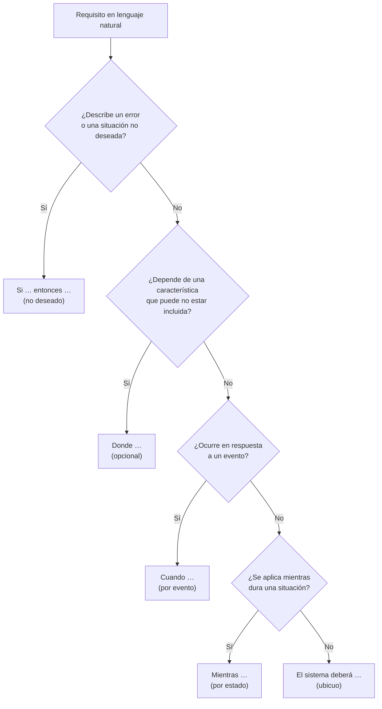
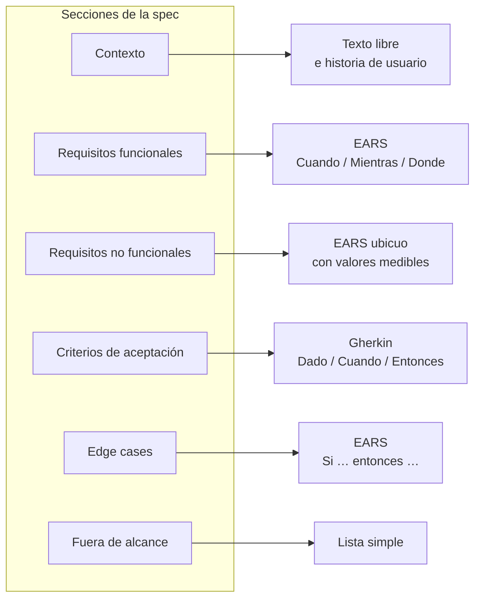
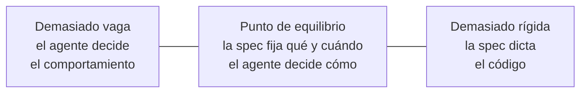

# 6. Notaciones y granularidad

[⬅️ Volver a la unidad](./README.md)

## Índice

- [6.1. Por qué usar una notación](#61-por-qué-usar-una-notación)
- [6.2. EARS: requisitos con plantilla](#62-ears-requisitos-con-plantilla)
- [6.3. Gherkin: escenarios Dado, Cuando, Entonces](#63-gherkin-escenarios-dado-cuando-entonces)
- [6.4. Markdown estructurado sin notación formal](#64-markdown-estructurado-sin-notación-formal)
- [6.5. Qué notación usar en cada sección](#65-qué-notación-usar-en-cada-sección)
- [6.6. Granularidad: ni vaga ni rígida](#66-granularidad-ni-vaga-ni-rígida)
- [6.7. Spec o plan: dónde va cada decisión](#67-spec-o-plan-dónde-va-cada-decisión)
- [6.8. Revisar una spec con el agente](#68-revisar-una-spec-con-el-agente)
- [6.9. Ejemplo integrador: aprobar la spec de «Añadir una tarea»](#69-ejemplo-integrador-aprobar-la-spec-de-añadir-una-tarea)
- [Resumen](#resumen)
- [Ejercicios de reflexión](#ejercicios-de-reflexión)

> **Criterios que trabaja este tema:** OA1 f.

---

## 6.1. Por qué usar una notación

En el tema 5 escribiste requisitos en lenguaje natural con unas pocas reglas: atómicos, con «deberá», verificables. Funciona, pero el lenguaje natural tiene un problema: **hay muchas formas de decir lo mismo**, y cada una deja huecos distintos.

Mira estas tres frases sobre la misma regla de la lista de tareas:

```text
1. No se pueden crear tareas vacías.
2. El sistema valida que el texto no esté vacío.
3. Si el texto está vacío, el sistema deberá responder 400 con
   { error: "El texto de la tarea no puede estar vacío" }.
```

La primera dice lo que **no** pasa, pero no qué pasa en su lugar. La segunda dice que hay una validación, pero no qué ocurre si falla. Solo la tercera tiene **condición** y **respuesta exacta**.

Una **notación estructurada** es una plantilla de redacción que te obliga a escribir siempre de la tercera forma: cada requisito tiene un hueco para la condición y otro para la respuesta, y si no sabes rellenar alguno, lo ves enseguida.

En este tema verás dos notaciones muy usadas en SDD:

- **EARS**, para los **requisitos**: qué debe hacer el sistema y en qué situación.
- **Gherkin**, para los **criterios de aceptación**: ejemplos concretos de uso que se pueden convertir en tests.

Y una pregunta que va más allá de la notación: **¿cuánto detalle debe llevar una spec?** Es la **granularidad**, y es uno de los errores más frecuentes en SDD.

> 📝 **Nota del Profesor**: la notación no es un fin en sí mismo. Una spec en Markdown libre, clara y completa es mejor que una en EARS llena de huecos. Lo que te dan las notaciones es una **disciplina**: escribir siempre condición y respuesta, sin dejar nada a la interpretación.

---

## 6.2. EARS: requisitos con plantilla

### 6.2.1. Qué es

**EARS** (*Easy Approach to Requirements Syntax*, «forma sencilla de redactar requisitos») es una notación ligera para escribir requisitos en lenguaje natural con una estructura fija. La creó Alistair Mavin con un equipo de Rolls-Royce para los requisitos de los sistemas de control de motores de avión, donde un requisito ambiguo puede ser muy caro.

La idea es sencilla: **cada requisito sigue una de cinco plantillas**, que empiezan con una palabra clave según el tipo de situación. Todas terminan igual: *el sistema deberá* + la respuesta.

**Por qué funciona bien con agentes:**

- La estructura fija reduce las suposiciones: la condición y la respuesta están siempre en el mismo sitio.
- Cada requisito se traduce casi directamente en una tarea y en un test.
- Las palabras clave hacen visible el **tipo** de requisito: de un vistazo sabes cuáles son de errores y cuáles del camino feliz.

### 6.2.2. Los cinco patrones

El original está en inglés (con la palabra *shall*, «deberá»). En el curso lo escribes en español, con estas equivalencias:

| Patrón | Cuándo se usa | Plantilla en español | Original |
|--------|---------------|----------------------|----------|
| **Ubicuo** (*ubiquitous*) | Siempre, sin condición | El sistema deberá <respuesta>. | *The system shall…* |
| **Por evento** (*event-driven*) | Respuesta a algo que ocurre | **Cuando** <evento>, el sistema deberá <respuesta>. | *When…* |
| **Por estado** (*state-driven*) | Mientras dura una situación | **Mientras** <estado>, el sistema deberá <respuesta>. | *While…* |
| **Comportamiento no deseado** (*unwanted behaviour*) | Errores, fallos, entradas no válidas | **Si** <condición no deseada>, **entonces** el sistema deberá <respuesta>. | *If… then…* |
| **Opcional** (*optional feature*) | Solo si una característica está incluida | **Donde** <característica esté incluida>, el sistema deberá <respuesta>. | *Where…* |

Con ejemplos de la lista de tareas:

```markdown
- RF-01 (ubicuo): El sistema deberá guardar cada tarea con un
  identificador único generado por el servidor.
- RF-02 (por evento): Cuando el usuario envíe el texto de una tarea
  nueva, el sistema deberá guardarla con el estado "pendiente".
- RF-03 (por estado): Mientras una tarea esté marcada como hecha, el
  sistema deberá mostrar su texto tachado.
- EC-01 (no deseado): Si el texto de la tarea supera 280 caracteres,
  entonces el sistema deberá responder 400 con
  { error: "El texto no puede superar 280 caracteres" }.
- RF-04 (opcional): Donde esté activado el registro de actividad, el
  sistema deberá anotar quién creó cada tarea.
```

Cómo elegir el patrón para una frase:



La primera pregunta es la de los errores porque es la que más se olvida: si una frase describe algo que **no debería pasar**, va con **Si… entonces…**, aunque también la provoque un evento.

> 💡 **Tip del Examinador**: «¿Qué diferencia hay entre *Cuando* y *Mientras* en EARS?». **Cuando** reacciona a un **evento** puntual (el usuario envía el formulario, llega una petición): ocurre una vez. **Mientras** se aplica durante un **estado** que dura (la tarea está hecha, el sistema está en mantenimiento): se cumple todo el tiempo que dura el estado.

### 6.2.3. Patrones combinados

Los patrones se pueden combinar cuando un requisito depende de un estado **y** de un evento. El orden fijo es: primero el estado, después el evento y al final la respuesta.

```text
Mientras <estado>, cuando <evento>, el sistema deberá <respuesta>.
```

Por ejemplo, con la feature de JWT del tema 5:

```markdown
- RF-05: Mientras el servicio esté en modo mantenimiento, cuando llegue
  una petición autenticada, el sistema deberá responder 503 con
  { error: "Servicio en mantenimiento" }.
```

Combina solo cuando haga falta. Si un requisito necesita tres o cuatro condiciones, probablemente son **varios requisitos** juntos.

### 6.2.4. EARS en Kiro

**Kiro**, el entorno de desarrollo de AWS orientado a SDD, organiza cada feature en tres ficheros: `requirements.md` (requisitos), `design.md` (diseño) y `tasks.md` (tareas). En `requirements.md` escribe **historias de usuario** y, debajo de cada una, sus **criterios de aceptación en EARS**, en inglés y con las palabras clave en mayúsculas, del estilo `WHEN <evento> THE SYSTEM SHALL <respuesta>`.

Fíjate en dos cosas:

- Kiro usa EARS para los **criterios de aceptación**, no en una sección aparte de requisitos. En el curso separas requisitos y criterios (tema 5), pero la idea es la misma: cada frase tiene condición y respuesta comprobable.
- Que una herramienta real lo use por defecto indica que EARS encaja bien con los agentes: el agente lo lee sin ambigüedad y lo convierte en tareas.

Los nombres de los ficheros y el formato exacto pueden cambiar entre versiones de Kiro; lo que se mantiene es la idea.

### 6.2.5. Por dónde empezar

No hace falta adoptar los cinco patrones a la vez. Empieza por dos:

- **Cuando…**, para los requisitos del camino feliz.
- **Si… entonces…**, para los *edge cases* y los errores.

Solo con eso desaparece buena parte de la ambigüedad, porque te obliga a escribir **qué dispara** cada comportamiento y **qué pasa cuando algo va mal**.

### 6.2.6. Errores típicos con EARS

| Error | Ejemplo | Corrección |
|-------|---------|------------|
| Respuesta vaga | Si el texto está vacío, entonces el sistema deberá **avisar al usuario**. | …deberá responder 400 con `{ error: "El texto de la tarea no puede estar vacío" }`. |
| Varias respuestas juntas | Cuando se cree una tarea, el sistema deberá guardarla, **mostrarla y enviar un aviso**. | Tres requisitos, uno por respuesta. |
| *Si* para un evento normal | **Si** el usuario pulsa «Añadir», entonces… | **Cuando** el usuario pulse «Añadir», … (*Si… entonces* es para lo no deseado). |
| Implementación en la respuesta | …el sistema deberá **llamar a `guardarTarea()`** con el texto. | …el sistema deberá guardar la tarea con el estado "pendiente". |
| Condición imposible de comprobar | Cuando **haya mucha carga**, … | Cuando haya más de 100 peticiones por segundo, … |

> ⚠️ **Cuidado**: EARS da forma, no contenido. «Si se produce un error, entonces el sistema deberá gestionarlo correctamente» sigue la plantilla y no dice nada. La plantilla solo ayuda si rellenas los huecos con datos concretos.

---

## 6.3. Gherkin: escenarios Dado, Cuando, Entonces

### 6.3.1. Qué es

**Gherkin** es el lenguaje de los escenarios del **BDD** (*Behaviour-Driven Development*, desarrollo guiado por el comportamiento). Describe el comportamiento con **ejemplos concretos**: una situación de partida, una acción y un resultado observable.

Ya lo conoces: los criterios de aceptación del tema 5 con la forma **Dado… cuando… entonces…** son Gherkin informal. Gherkin formaliza esa forma con palabras clave fijas y una estructura que pueden leer herramientas como **Cucumber**, que ejecutan los escenarios como tests.

Gherkin admite palabras clave en español. Basta con poner `# language: es` en la primera línea:

| Español | Original | Para qué sirve |
|---------|----------|----------------|
| `Característica` | `Feature` | Nombre de la feature que se describe |
| `Antecedentes` | `Background` | Pasos comunes a todos los escenarios |
| `Escenario` | `Scenario` | Un ejemplo concreto de comportamiento |
| `Dado` | `Given` | Situación de partida |
| `Cuando` | `When` | Acción o evento |
| `Entonces` | `Then` | Resultado observable |
| `Y`, `Pero` | `And`, `But` | Encadenar pasos del mismo tipo |
| `Esquema del escenario` | `Scenario Outline` | Un escenario que se repite con varios datos |
| `Ejemplos` | `Examples` | Tabla de datos para el esquema |

### 6.3.2. Un ejemplo con la lista de tareas

```gherkin
# language: es
Característica: Añadir una tarea

  Antecedentes:
    Dado que la lista tiene 2 tareas

  Escenario: Añadir una tarea válida
    Cuando el usuario escribe "Comprar leche" y pulsa "Añadir"
    Entonces la lista tiene 3 tareas
    Y la última tarea es "Comprar leche" con el estado "pendiente"

  Escenario: Intentar añadir una tarea vacía
    Cuando el usuario pulsa "Añadir" con el campo vacío
    Entonces la lista sigue teniendo 2 tareas
```

Cada escenario es **binario** (se cumple o no) y **concreto**: no dice «una tarea válida», dice «Comprar leche»; no dice «la lista crece», dice «la lista tiene 3 tareas». Esa concreción es la que permite convertirlo en un test.

### 6.3.3. Esquemas: el mismo escenario con varios datos

Cuando varios casos siguen la misma forma y solo cambian los datos, un **esquema del escenario** evita repetir. Los valores entre `<…>` se toman de la tabla de `Ejemplos`:

```gherkin
# language: es
Característica: Añadir una tarea

  Esquema del escenario: Rechazar textos no válidos
    Cuando se envía una petición POST /tareas con el texto <texto>
    Entonces la respuesta tiene el código 400
    Y el cuerpo contiene el error "<error>"

    Ejemplos:
      | texto | error                                        |
      | ""    | El texto de la tarea no puede estar vacío    |
      | "   " | El texto de la tarea no puede estar vacío    |
```

Es una forma muy cómoda de escribir los *edge cases* de validación: cada fila es un caso límite con su respuesta exacta, y añadir uno nuevo es añadir una fila.

### 6.3.4. Escenarios declarativos, no guiones de clics

El error más habitual con Gherkin es escribir **guiones de la interfaz** en lugar de comportamiento:

```gherkin
# ❌ Imperativo: describe clics, no comportamiento
Escenario: Añadir tarea
  Dado que abro el navegador en http://localhost:3000
  Cuando hago clic en el campo con id "texto-tarea"
  Y escribo "Comprar leche"
  Y hago clic en el botón azul de la derecha
  Entonces veo un nuevo elemento li en la lista ul
```

```gherkin
# ✅ Declarativo: describe qué pasa, no cómo está hecha la página
Escenario: Añadir tarea
  Cuando el usuario añade la tarea "Comprar leche"
  Entonces la última tarea de la lista es "Comprar leche"
```

El primero se rompe en cuanto cambia el color de un botón o el `id` de un campo, y además **le dicta al agente** cómo construir la página. El segundo sobrevive a cualquier rediseño. Es la misma idea de granularidad que verás en el apartado 6.6.

> ✅ **Buena práctica**: **un escenario, un comportamiento**. Si un escenario tiene varios *Cuando* y varios *Entonces* alternados, son varios escenarios juntos: sepáralos.

### 6.3.5. EARS frente a Gherkin

No compiten: responden a preguntas distintas.

| | EARS | Gherkin |
|-|------|---------|
| **Describe** | Una regla general | Un ejemplo concreto |
| **Pregunta** | ¿Qué debe hacer el sistema en esta situación? | ¿Cómo compruebo que lo hace? |
| **Ejemplo** | Si el texto supera 280 caracteres, entonces el sistema deberá responder 400 | Cuando envío un texto de 281 caracteres, entonces recibo un 400 |
| **Sección de la spec** | Requisitos y *edge cases* | Criterios de aceptación |
| **Se convierte en** | Tareas del plan | Tests |

Una regla en EARS suele tener **uno o varios** escenarios en Gherkin que la comprueban, igual que un requisito tiene uno o varios criterios de aceptación.

---

## 6.4. Markdown estructurado sin notación formal

La tercera opción es la más común en la práctica: **listas y secciones en Markdown**, con frases claras y sin palabras clave formales. Es lo que hiciste en el tema 5.

```markdown
## Requisitos funcionales

- RF-01: El sistema deberá aceptar el texto de una tarea nueva.
- RF-02: El sistema deberá guardar la tarea con un identificador único,
  el texto, el estado "pendiente" y la fecha de creación.
- RF-03: El sistema deberá devolver la tarea creada como confirmación.
```

**Cuándo es suficiente:** en proyectos individuales y equipos pequeños, y siempre que cada frase sea atómica, verificable y con respuesta exacta. La clave no es la notación, sino la **claridad** y que no falte nada.

**Cuándo pasar a EARS o Gherkin:**

- Cuando la spec tiene muchos requisitos condicionales y empiezan a mezclarse.
- Cuando varias personas escriben specs y conviene que todas se parezcan.
- Cuando quieres convertir los criterios de aceptación en tests de forma sistemática (lo harás en la UD3).
- Cuando la herramienta que usas lo propone por defecto, como Kiro con EARS.

Puedes empezar en Markdown libre y **migrar poco a poco**: reescribir con *Cuando* y *Si… entonces* los requisitos que te den problemas es ya un paso.

---

## 6.5. Qué notación usar en cada sección

No hace falta escribir toda la spec con la misma notación. Cada sección tiene la suya natural:



Lo importante de esta combinación: **las reglas** (requisitos y *edge cases*) van en EARS y **los ejemplos que las comprueban** (criterios de aceptación) van en Gherkin. El contexto y el fuera de alcance no necesitan notación.

| Notación | Ventajas | Inconvenientes | Úsala cuando… |
|----------|----------|----------------|---------------|
| **Markdown libre** | Sin aprendizaje, rápida | Depende de la disciplina de quien escribe | El equipo es pequeño y las specs, cortas |
| **EARS** | Condición y respuesta siempre visibles; tipos de requisito claros | Hay que aprender los patrones; puede resultar rígida para el contexto | Hay muchos requisitos condicionales y de error |
| **Gherkin** | Ejemplos concretos que se convierten en tests | Tiende a crecer mucho; se degrada en guiones de clics | Los criterios tienen varios pasos o quieres tests de aceptación |

> 📝 **Nota del Profesor**: elige una forma y **sé coherente en todo el proyecto**. Si unas specs usan EARS y otras Markdown libre, el agente y las personas que revisan tienen que cambiar de registro en cada una. Esa decisión es buena candidata para la **constitución** (tema 2): «Los requisitos se escriben en EARS y los criterios de aceptación en Gherkin».

---

## 6.6. Granularidad: ni vaga ni rígida

La **granularidad** es el nivel de detalle de la spec. Es uno de los errores más frecuentes en SDD, y se puede fallar por los dos lados:



En los dos extremos alguien hace un trabajo que no le toca: en la spec vaga, el agente decide cosas que debería haber decidido una persona; en la spec rígida, la persona escribe el código en Markdown y el agente solo lo transcribe.

### 6.6.1. Demasiado vaga

Una spec es **demasiado vaga** cuando el agente tiene que tomar **decisiones de comportamiento** que deberían estar resueltas en ella.

```markdown
- El sistema debe permitir añadir tareas de forma rápida e intuitiva.
- Los errores deben manejarse adecuadamente.
- Las tareas deben tener una longitud razonable.
```

Señales de alerta:

- **Palabras subjetivas:** rápido, intuitivo, adecuado, razonable, seguro, eficiente, amigable.
- **Sin respuesta ante fallos:** dice que hay errores, pero no qué se responde.
- **Sin valores:** «una longitud razonable» en lugar de «280 caracteres».
- **Criterios que no se pueden comprobar:** nadie puede decir objetivamente si «es intuitivo».

Qué hace el agente con esta spec: lo mismo que con un prompt. Elige un límite de longitud, un formato de error y un código de respuesta, y los deja en el código sin que nadie los haya decidido. Vuelves al problema del tema 1.

### 6.6.2. Demasiado rígida

Una spec es **demasiado rígida** cuando prescribe la **implementación** en lugar del comportamiento.

```markdown
- Crear en src/tareas.js una función crearTarea(texto) que haga
  texto.trim(), compruebe con un if que la longitud es menor que 281,
  genere el id con crypto.randomUUID() y haga push en el array tareas.
- En el frontend, añadir un addEventListener('submit') al formulario
  con id "form-tarea" que llame a fetch('/tareas', { method: 'POST' }).
```

Señales de alerta:

- Nombres de **funciones, clases, variables o ficheros** internos.
- **Pseudocódigo** o fragmentos de código.
- **Estructuras de datos internas** paso a paso.
- Decisiones que pertenecen al **plan** o a las **tasks**, no a la spec.

Por qué es un problema:

- **Mezcla qué y cómo.** El agente no sabe qué partes son restricciones obligatorias y cuáles son sugerencias.
- **Es frágil.** Cualquier refactorización deja la spec desactualizada, aunque el comportamiento no cambie: aparece el *spec drift* sin que nada vaya mal.
- **No se puede revisar como spec.** Quien la revisa tiene que leer código para saber qué hace el sistema.
- **Desaprovecha al agente** justo en lo que mejor hace: elegir una implementación razonable para un comportamiento bien definido.

### 6.6.3. El punto de equilibrio

> La spec define **qué** hace el sistema y **en qué condiciones**. El plan y las tasks definen **cómo**.

La misma feature, bien graduada:

```markdown
- RF-01: Cuando el usuario envíe el texto de una tarea nueva, el sistema
  deberá guardarla con un identificador único, el texto, el estado
  "pendiente" y la fecha de creación.
- RNF-01: El texto de una tarea no podrá superar los 280 caracteres.
- RNF-02: El identificador lo generará el servidor, nunca el cliente.
- EC-01: Si el texto está vacío o solo tiene espacios, entonces el sistema
  deberá responder 400 con { error: "El texto de la tarea no puede estar vacío" }.
```

Todo lo que importa está fijado: qué se guarda, el límite, quién genera el identificador, la respuesta exacta al error. Lo que no importa (cómo se llama la función, cómo se genera el identificador, dónde se guarda el array) queda libre para el plan.

> 💡 **Tip del Examinador**: «¿Cuándo es una spec demasiado vaga y cuándo demasiado rígida?». **Vaga**, cuando el agente tiene que **decidir comportamiento** (qué responder, qué límite poner). **Rígida**, cuando la spec **dicta implementación** (nombres de funciones, código, estructuras internas). En el equilibrio, la spec fija el comportamiento observable y las restricciones acordadas, y deja el cómo al plan.

### 6.6.4. Granularidad y tamaño

La granularidad no es lo mismo que la longitud. Una spec puede ser larga y estar bien graduada si la feature lo necesita, y puede ser corta y estar llena de código.

Lo que sí indica un problema de tamaño es lo que viste en el tema 4: si la spec pasa de unas pocas decenas de requisitos o mezcla varios objetivos, no es un problema de granularidad, es que **la feature es demasiado grande** y hay que dividirla.

---

## 6.7. Spec o plan: dónde va cada decisión

La línea entre «qué» y «cómo» no siempre es evidente. Una pregunta ayuda a decidir:

> **¿Si esto cambiara, lo notaría alguien desde fuera, o rompería una restricción acordada?** Si la respuesta es sí, va en la spec. Si no, va en el plan.

Aplicada a decisiones concretas de la lista de tareas y del ejemplo de JWT:

| Decisión | ¿Dónde va? | Por qué |
|----------|-----------|---------|
| Límite de 280 caracteres | Spec | El usuario lo nota |
| Código 400 y mensaje del error | Spec | Lo ve quien llama a la API |
| Nombre del campo `text` en la petición | Spec | Es el contrato entre el cliente y el servidor |
| El servidor genera el identificador | Spec | Restricción acordada (seguridad y coherencia) |
| Formato de la fecha (ISO 8601) | Spec | Aparece en la respuesta |
| Firmar los tokens con RS256 | Spec | Restricción de seguridad acordada |
| Librería para generar el identificador | Plan | No cambia nada visible |
| Nombre de la función `crearTarea` | Plan (o código) | Detalle interno |
| Guardar las tareas en un array o en un fichero | Plan | Detalle interno, salvo que la constitución diga otra cosa |
| Estructura de carpetas del código | Plan o constitución | Convención del proyecto, no de la feature |

> ⚠️ **Cuidado**: «no poner implementación en la spec» no significa «no poner nada técnico». Un **algoritmo de firma**, un **formato de fecha** o el **nombre de un campo de la API** son técnicos, pero son **restricciones** que alguien ha decidido y que se ven desde fuera. Esas sí van en la spec. Lo que no va es **cómo** se programan.

Las decisiones técnicas que valen para **todo el proyecto** (el lenguaje, el framework de tests, el estilo del código) tampoco van en cada spec: van en la **constitución** o en `AGENTS.md`, como viste en el tema 2.

---

## 6.8. Revisar una spec con el agente

El agente es un buen **revisor** de specs: lee sin prisa, no se salta líneas y detecta palabras vagas que tú ya no ves. Lo que no puede es **decidir** por ti cómo resolver cada problema.

Un prompt de revisión para el agente *plan* de OpenCode:

```text
Revisa @docs/specs/A-añadir-tarea/spec.md. No la modifiques: solo
quiero una lista de problemas.

Para cada línea con un problema, indica:
- El identificador (RF-01, AC-02…).
- El tipo: VAGA (el agente tendría que decidir comportamiento), RÍGIDA
  (dicta implementación) o NOTACIÓN (no sigue EARS en requisitos y edge
  cases, o Gherkin en criterios de aceptación).
- Una propuesta de redacción.

Si algo no se puede resolver sin una decisión mía, márcalo con
[NECESITA ACLARACIÓN] y la pregunta concreta.
```

Fíjate en tres decisiones del prompt:

- **«No la modifiques»:** el agente propone y tú decides. Además, el agente *plan* no tiene permiso para editar, pero conviene decirlo.
- **Tipos cerrados:** VAGA, RÍGIDA o NOTACIÓN. Así la respuesta se puede revisar en orden y no es una lista de opiniones sueltas.
- **El marcador del tema 5:** las decisiones que no le tocan al agente quedan señaladas, no resueltas.

> ⚠️ **Cuidado**: los agentes tienden a **añadir detalle** cuando revisan, y no siempre en la dirección correcta. Es habitual que propongan cosas como «especificar que el identificador se genere con `crypto.randomUUID()`». Eso hace la spec **más rígida**, no mejor. Cada sugerencia se acepta o se rechaza con el criterio del apartado 6.7.

---

## 6.9. Ejemplo integrador: aprobar la spec de «Añadir una tarea»

En el tema 5 dejaste la spec de la feature A **en revisión**. Ahora toca revisar la notación y la granularidad y, si todo está bien, **aprobarla**.

**1. Pide la revisión al agente.** En OpenCode, con el agente *plan*, usa el prompt del apartado 6.8. Una respuesta típica se parece a esta (la tuya será distinta, porque el agente no responde siempre igual):

```text
- RF-01 a RF-04 — NOTACIÓN: no siguen EARS. Propuesta: "Cuando el
  usuario envíe el texto de una tarea nueva, el sistema deberá…".
- RF-02 — VAGA: no se indica el formato de la fecha de creación.
  [NECESITA ACLARACIÓN: ¿ISO 8601 o marca de tiempo numérica?]
- RNF-01 — VAGA: "en condiciones normales" no es medible.
  [NECESITA ACLARACIÓN: ¿con cuántas tareas guardadas se mide?]
- RNF-03 — RÍGIDA: propongo concretar "el servidor generará el id con
  crypto.randomUUID()".
- AC-02 — NOTACIÓN: no tiene "Cuando". Propuesta: "Cuando el usuario
  pulsa «Añadir» con el campo vacío, entonces…".
- AC-01 a AC-03 — NOTACIÓN: no están en Gherkin.
- EC-01 a EC-05 — NOTACIÓN: no siguen "Si… entonces…".
```

**2. Decide sobre cada propuesta.** Aquí trabajas tú. Para cada punto, aceptas, rechazas o respondes:

| Punto | Decisión | Motivo |
|-------|----------|--------|
| Notación de RF, AC y EC | Se acepta | Es la convención que quieres en el proyecto |
| Formato de la fecha | Se responde: **ISO 8601** | Se ve en la respuesta de la API, así que es spec |
| RNF-01 «condiciones normales» | Se responde: **con 1.000 tareas guardadas** | Así es medible y se puede probar |
| RNF-03 con `crypto.randomUUID()` | **Se rechaza** | Es implementación: la librería va en el plan |
| AC-02 sin «Cuando» | Se acepta | El criterio queda binario y completo |

El rechazo de RNF-03 es la parte más importante del ejemplo: el agente propuso una mejora que **empeoraba** la spec, y lo detectaste con el criterio de granularidad.

**3. Reescribe la spec.** Con las decisiones tomadas, la spec queda así en `docs/specs/A-añadir-tarea/spec.md`:

````markdown
# Spec: Añadir una tarea

## Metadatos

| Campo   | Valor            |
|---------|------------------|
| Feature | Añadir una tarea |
| Estado  | Aprobada         |
| Versión | 1.0              |
| Fecha   | AAAA-MM-DD       |
| Autor   | <nombre>         |

---

## Contexto

Los miembros del equipo pueden añadir tareas a la lista compartida
escribiendo un texto. Las tareas nuevas aparecen al final de la lista
como pendientes. Es la feature base: sin ella, las demás no tienen sentido.

**Historia de usuario:** como miembro del equipo, quiero apuntar una
tarea para que no se pierda en el chat.

**Dependencias:** ninguna (es la primera feature).

---

## Requisitos funcionales

- RF-01: Cuando el usuario envíe el texto de una tarea nueva, el sistema
  deberá guardarla con un identificador único, el texto, el estado
  "pendiente" y la fecha de creación en formato ISO 8601.
- RF-02: Cuando el sistema guarde una tarea nueva, deberá devolverla
  completa como confirmación.
- RF-03: Cuando el sistema confirme la creación de una tarea, la página
  deberá mostrarla al final de la lista sin recargarse.

---

## Requisitos no funcionales

- RNF-01: El endpoint de creación deberá responder en menos de 200 ms
  con 1.000 tareas guardadas.
- RNF-02: El texto de una tarea no podrá superar los 280 caracteres.
- RNF-03: El identificador lo generará el servidor, nunca el cliente.

---

## Criterios de aceptación

```gherkin
# language: es
Característica: Añadir una tarea

  Escenario: AC-01 Añadir una tarea desde la página
    Dado que la lista tiene 2 tareas
    Cuando el usuario escribe "Comprar leche" y pulsa "Añadir"
    Entonces la lista tiene 3 tareas
    Y la última tarea es "Comprar leche" con el estado "pendiente"

  Escenario: AC-02 Campo vacío en la página
    Dado que la lista tiene 2 tareas
    Cuando el usuario pulsa "Añadir" con el campo vacío
    Entonces la lista sigue teniendo 2 tareas
    Y el campo sigue vacío

  Escenario: AC-03 Respuesta del servidor al crear una tarea
    Cuando se envía una petición POST /tareas con el texto "Comprar leche"
    Entonces la respuesta tiene el código 201
    Y el cuerpo contiene un id, el texto "Comprar leche", el estado "pendiente" y una fecha en formato ISO 8601
```

---

## Edge cases y comportamiento ante errores

- EC-01: Si el texto está vacío o solo tiene espacios, entonces el
  sistema deberá responder 400 con
  { error: "El texto de la tarea no puede estar vacío" }.
- EC-02: Si el texto supera 280 caracteres, entonces el sistema deberá
  responder 400 con { error: "El texto no puede superar 280 caracteres" }.
- EC-03: Si el servidor no puede guardar la tarea, entonces deberá
  responder 500 con { error: "Error al guardar la tarea" }.
- EC-04: Si el cuerpo de la petición trae campos que no se esperan,
  entonces el sistema deberá ignorarlos.
- EC-05: Si el cuerpo no incluye el campo text, o no es un texto,
  entonces el sistema deberá responder 400 con
  { error: "El campo text es obligatorio y debe ser texto" }.

---

## Fuera de alcance

- Asignar la tarea a una persona.
- Fecha límite o prioridad.
- Editar el texto de una tarea creada (será otra feature).
- Ordenar las tareas de otra forma que no sea por fecha de creación.

---

## Referencias

- docs/prd.md
````

Compárala con la del tema 5:

- Los **requisitos** siguen EARS (*Cuando…*) y han pasado de cuatro a tres: aceptar el texto y guardarlo eran el mismo evento, así que ahora es un solo requisito con una sola respuesta.
- Los **criterios de aceptación** son escenarios de Gherkin. Llevan el identificador en el nombre del escenario (`AC-01`…) para poder citarlos desde el plan y los tests.
- Los ***edge cases*** siguen *Si… entonces…*: de un vistazo se ve que todos son situaciones no deseadas.
- Las dos ambigüedades (formato de la fecha y condiciones de RNF-01) están resueltas, y la propuesta rígida del agente no ha entrado.
- El campo `text` sigue en la spec: es parte del **contrato de la API**, no un detalle interno.

**4. Comprueba antes de aprobar.** Una spec pasa a `Aprobada` solo si cumple todo esto:

- [ ] No queda ningún `[NECESITA ACLARACIÓN]`.
- [ ] Cada requisito es atómico, verificable y sigue la notación acordada.
- [ ] Cada criterio de aceptación es un escenario binario y concreto.
- [ ] Cada *edge case* tiene una respuesta exacta.
- [ ] No hay nombres de funciones, código ni estructuras internas.
- [ ] El fuera de alcance cierra lo que el agente podría añadir por su cuenta.

**5. Aprueba la spec y actualiza el índice.** En la spec, el estado pasa a `Aprobada` (ya está en la versión de arriba). En `docs/specs/README.md`, la feature A pasa de `👀 En revisión` a `🔜 Aprobada`:

```markdown
| # | Feature | Carpeta | Estado |
|---|---------|---------|--------|
| A | Añadir una tarea | A-añadir-tarea/ | 🔜 Aprobada |
| B | Ver la lista de tareas | B-ver-lista/ | ⏳ Pendiente |
| C | Marcar una tarea como hecha | C-marcar-hecha/ | ⏳ Pendiente |
| D | Borrar una tarea | D-borrar-tarea/ | ⏳ Pendiente |
```

```bash
git add docs/specs/
git commit -m "Spec de la feature A en EARS y Gherkin (aprobada)"
```

Con la spec aprobada termina el trabajo de esta unidad sobre la feature A. En la UD2 seguirás el flujo: a partir de esta spec, el agente generará el **plan técnico**, que es donde sí se decide cómo se genera el identificador.

---

## Resumen

- Una **notación estructurada** obliga a escribir siempre **condición y respuesta**. No sustituye a la claridad: la hace más fácil.
- **EARS** tiene cinco patrones: **ubicuo** (*El sistema deberá*), **por evento** (*Cuando*), **por estado** (*Mientras*), **no deseado** (*Si… entonces*) y **opcional** (*Donde*). Se pueden combinar: *Mientras…, cuando…, el sistema deberá…*.
- Para empezar con EARS bastan **Cuando** (camino feliz) y **Si… entonces** (errores). Kiro usa EARS en los criterios de aceptación de sus `requirements.md`.
- **Gherkin** describe **ejemplos concretos** con *Dado*, *Cuando* y *Entonces*; admite palabras clave en español (`# language: es`) y esquemas con tablas de ejemplos. Los escenarios deben ser **declarativos**, no guiones de clics.
- EARS para **las reglas** (requisitos y *edge cases*); Gherkin para **los ejemplos que las comprueban** (criterios de aceptación). La notación elegida, igual en todo el proyecto: buena candidata para la constitución.
- **Granularidad:** demasiado **vaga** si el agente decide comportamiento; demasiado **rígida** si la spec dicta implementación. La spec fija **qué y en qué condiciones**; el plan, **cómo**.
- Para decidir si algo va en la spec: **¿lo notaría alguien desde fuera o rompe una restricción acordada?**
- El agente es buen **revisor** de specs, pero tiende a añadir detalle de implementación: cada propuesta se acepta o se rechaza con criterio.

## Ejercicios de reflexión

1. Reescribe en EARS e indica el patrón de cada uno: «no se pueden borrar tareas hechas», «al marcar una tarea, se actualiza el contador de pendientes», «la lista se ve en modo oscuro si el usuario lo tiene activado».
2. ¿Por qué *Si el usuario pulsa «Borrar», entonces…* es un mal uso de EARS? Reescríbelo.
3. Escribe un esquema del escenario en Gherkin con tres textos no válidos para la feature «Añadir una tarea» y su error esperado.
4. Clasifica cada línea como vaga, rígida o adecuada y justifica: «el borrado debe ser seguro», «usar `Array.prototype.filter` para quitar la tarea», «si la tarea no existe, el sistema deberá responder 404».
5. Un compañero quiere poner en la spec que las tareas se guardan en SQLite. ¿Va en la spec, en el plan o en la constitución? ¿De qué depende?

---

[⬅️ Volver a la unidad](./README.md)
