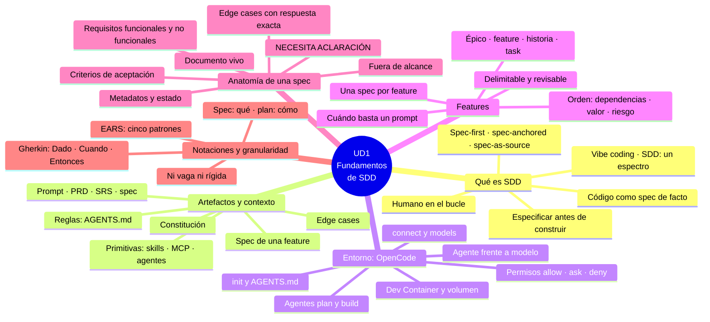
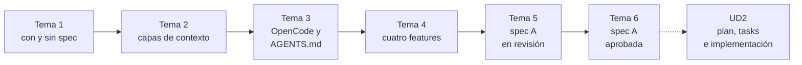

# 7. Resumen y mapa mental

[⬅️ Volver a la unidad](./README.md)

## Índice

- [Resumen ejecutivo](#resumen-ejecutivo)
- [Mapa mental](#mapa-mental)
- [El proyecto al terminar la unidad](#el-proyecto-al-terminar-la-unidad)
- [Checklist de evaluación](#checklist-de-evaluación)
  - [SDD y sus niveles (criterio a)](#sdd-y-sus-niveles-criterio-a)
  - [Artefactos y capas de contexto (criterio b)](#artefactos-y-capas-de-contexto-criterio-b)
  - [El entorno de trabajo (criterio c)](#el-entorno-de-trabajo-criterio-c)
  - [Features (criterio d)](#features-criterio-d)
  - [La spec completa (criterio e)](#la-spec-completa-criterio-e)
  - [Notaciones y granularidad (criterio f)](#notaciones-y-granularidad-criterio-f)

> **Criterios que trabaja este tema:** OA1 a, b, c, d, e, f.

---

## Resumen ejecutivo

En esta unidad has visto **por qué programar con agentes necesita especificaciones** y cómo escribirlas:

1. **Qué es SDD**: sin especificación, el agente rellena los huecos con lo más probable y el código se convierte en la especificación de facto. El desarrollo guiado por especificaciones escribe y revisa una spec antes de generar código y la usa como contrato. *Vibe coding* y SDD son extremos de un espectro. Tres niveles: *spec-first*, *spec-anchored* y *spec-as-source*. Tres principios: humano en el bucle, reglas antes que herramientas y especificar antes de construir.
2. **Artefactos y capas de contexto**: el prompt (transitorio), el PRD (qué y por qué, desde el negocio), el SRS (requisitos técnicos de todo un sistema) y la spec (una funcionalidad, en Markdown, versionada y viva). Los *edge cases*. Tres capas de contexto: reglas (`AGENTS.md`), constitución y spec. Las primitivas: prompts, instrucciones, skills, specs, MCP y agentes.
3. **El entorno de trabajo**: el modelo genera respuestas y el agente, el arnés (*harness*) que lo rodea, actúa sobre el proyecto. OpenCode en un Dev Container con versión fijada y un volumen para las credenciales; `/connect` y `/models`; agentes *plan* y *build*; `/init` y `AGENTS.md`; la constitución con `instructions` en `opencode.json`; permisos `allow`, `ask` y `deny`.
4. **Features**: la feature es la unidad de trabajo de una spec. Jerarquía épico → feature → historia de usuario → task. Una buena feature es delimitable, especificable, descomponible, verificable, revisable y con valor propio. Cuándo basta un prompt cuidado. El orden de las features, por dependencias, valor y riesgo.
5. **Anatomía de una spec**: metadatos con el estado, contexto con la historia de usuario, requisitos funcionales y no funcionales, criterios de aceptación (Dado… cuando… entonces…), *edge cases* con respuesta exacta y fuera de alcance. El marcador `[NECESITA ACLARACIÓN]`. La plantilla del curso. La spec como documento vivo.
6. **Notaciones y granularidad**: EARS para las reglas (*El sistema deberá*, *Cuando*, *Mientras*, *Si… entonces*, *Donde*) y Gherkin para los ejemplos que las comprueban (*Dado*, *Cuando*, *Entonces*). Una spec demasiado vaga deja al agente decidir el comportamiento; una demasiado rígida dicta el código. La spec fija qué y en qué condiciones; el plan, cómo.

---

## Mapa mental

El mapa recoge los conceptos clave de los seis temas:



Cada rama es un tema; si no sabes explicar alguna de sus hojas con tus palabras, vuelve a ese tema.

---

## El proyecto al terminar la unidad

El hilo conductor de la unidad ha sido la **lista de tareas compartida**. Al terminar, el repositorio tiene las tres capas de contexto y la primera spec aprobada:

```text
lista-tareas/
├── .devcontainer/devcontainer.json   ← tema 3: OpenCode con versión fijada
├── AGENTS.md                         ← temas 2 y 3: reglas
├── constitution.md                   ← temas 2 y 3: principios
├── opencode.json                     ← tema 3: instructions y permisos
└── docs/
    ├── prd.md                        ← tema 2: el porqué del producto
    └── specs/
        ├── README.md                 ← tema 4: índice de features y estado
        └── A-añadir-tarea/
            └── spec.md               ← temas 5 y 6: aprobada
```

Así ha ido avanzando el trabajo, tema a tema:



Todavía no hay ni una línea de código en `src/`, y es a propósito: en SDD, el código llega **después** de que una persona haya revisado y aprobado la spec. En la UD2, el agente generará a partir de ella el plan técnico, las tasks y la implementación.

---

## Checklist de evaluación

### SDD y sus niveles (criterio a)

- [ ] Sé explicar qué cambia cuando el código lo escribe un agente y no una persona
- [ ] Sé explicar por qué, sin spec, el código se convierte en la especificación de facto
- [ ] Reconozco las decisiones que toma un agente por su cuenta cuando el prompt deja huecos
- [ ] Sé situar *vibe coding* y SDD en un espectro y decidir cuándo conviene cada uno
- [ ] Diferencio los niveles *spec-first*, *spec-anchored* y *spec-as-source*
- [ ] Sé explicar quién es la fuente de verdad en cada nivel
- [ ] Conozco los tres principios: humano en el bucle, reglas antes que herramientas y especificar antes de construir

### Artefactos y capas de contexto (criterio b)

- [ ] Diferencio un prompt, un PRD, un SRS y una spec, y sé para qué sirve cada uno
- [ ] Sé qué es un *edge case* y por qué debe estar en la spec
- [ ] Distingo las tres capas de contexto: reglas (`AGENTS.md`), constitución y spec
- [ ] Sé en qué capa va cada tipo de información
- [ ] Conozco las primitivas de la programación con agentes: prompts, instrucciones, skills, specs, MCP y agentes

### El entorno de trabajo (criterio c)

- [ ] Sé explicar la diferencia entre el modelo y el agente, el arnés (*harness*) que lo rodea
- [ ] Tengo el Dev Container del curso con OpenCode funcionando
- [ ] He conectado OpenCode a un proveedor de modelos y sé elegir el modelo
- [ ] Sé dónde se guardan las claves y por qué nunca van al repositorio
- [ ] Sé referenciar ficheros, ejecutar comandos y gestionar sesiones en OpenCode
- [ ] Diferencio el agente *plan* del agente *build* y sé cuándo usar cada uno
- [ ] Sé generar un `AGENTS.md` con `/init` y añadir la constitución con `instructions`
- [ ] Sé configurar los permisos del agente en `opencode.json`

### Features (criterio d)

- [ ] Diferencio épico, feature, historia de usuario y task
- [ ] Sé dividir un épico en features con valor propio
- [ ] Reconozco una feature demasiado grande, demasiado pequeña o técnica
- [ ] Sé decidir cuándo basta un prompt cuidado y cuándo hace falta una spec completa
- [ ] Sé ordenar las features por dependencias, valor y riesgo

### La spec completa (criterio e)

- [ ] Sé qué hace buena a una spec para un agente
- [ ] Escribo una spec con todas sus secciones: metadatos, contexto, requisitos, criterios de aceptación, *edge cases* y fuera de alcance
- [ ] Escribo requisitos atómicos y verificables, con identificador
- [ ] Diferencio un requisito funcional de uno no funcional, y escribo los no funcionales medibles
- [ ] Escribo criterios de aceptación binarios con la forma Dado… cuando… entonces…
- [ ] Escribo *edge cases* con la respuesta exacta del sistema
- [ ] Marco las dudas con `[NECESITA ACLARACIÓN]` y sé que una spec con marcadores no se aprueba
- [ ] Sé cuándo y cómo se actualiza una spec durante la implementación

### Notaciones y granularidad (criterio f)

- [ ] Reescribo requisitos en EARS eligiendo el patrón adecuado
- [ ] Diferencio *Cuando* (evento) de *Mientras* (estado) y uso *Si… entonces* solo para lo no deseado
- [ ] Escribo escenarios en Gherkin declarativos, con esquemas cuando cambian solo los datos
- [ ] Sé qué notación usar en cada sección de la spec
- [ ] Reconozco una spec demasiado vaga y una demasiado rígida, y sé corregirlas
- [ ] Sé decidir si una decisión va en la spec, en el plan o en la constitución
- [ ] Sé revisar una spec con el agente y aceptar o rechazar sus propuestas con criterio

> 📝 **Nota del Profesor**: esta unidad es la base del curso. Todo lo que harás en las siguientes (planificar, implementar, validar, trabajar con varios agentes) parte de una spec bien escrita. Si alguna casilla se te queda sin marcar, repasa el tema correspondiente antes de empezar la UD2.

> 💡 **Tip del Examinador**: las preguntas más frecuentes de esta unidad son: por qué el código se convierte en la especificación de facto, los tres niveles de SDD, la diferencia entre PRD, SRS y spec, las tres capas de contexto, agente frente a modelo, *plan* frente a *build*, feature frente a historia de usuario y task, requisito funcional frente a no funcional, los cinco patrones de EARS y la diferencia entre una spec vaga y una rígida.

---

[⬅️ Volver a la unidad](./README.md)
