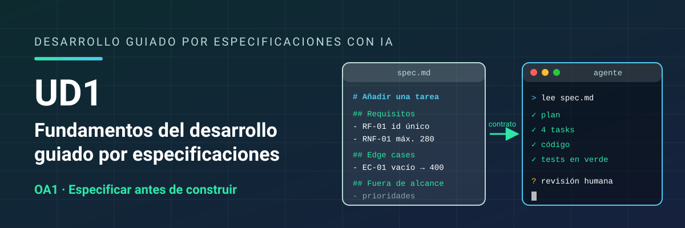

# Desarrollo guiado por especificaciones con IA - UD1 Fundamentos del desarrollo guiado por especificaciones

Unidad 1 Fundamentos del desarrollo guiado por especificaciones.

## Objetivo de aprendizaje

Esta unidad trabaja el **OA1** y sus criterios de evaluación: [ver objetivo de aprendizaje y criterios de evaluación](./objetivos-aprendizaje.md).

## Contenidos

1. [Qué es el desarrollo guiado por especificaciones](./01-que-es-sdd.md)
2. [Artefactos y capas de contexto](./02-artefactos-contexto.md)
3. [El entorno de trabajo: OpenCode](./03-entorno-opencode.md)
4. [Features: la unidad de trabajo de una spec](./04-features.md)
5. [Anatomía de una spec](./05-anatomia-spec.md)
6. [Notaciones y granularidad](./06-notaciones-granularidad.md)
7. [Resumen](./07-resumen.md)

## Diapositivas

Las diapositivas resumen las **ideas principales** de cada tema, con un ejemplo de cada una. Se proyectan en clase y te sirven para repasar; el detalle está en el tema.

1. [Qué es el desarrollo guiado por especificaciones](./diapositivas/pdf/01-que-es-sdd.pdf)
2. [Artefactos y capas de contexto](./diapositivas/pdf/02-artefactos-contexto.pdf)
3. [El entorno de trabajo: OpenCode](./diapositivas/pdf/03-entorno-opencode.pdf)
4. [Features: la unidad de trabajo de una spec](./diapositivas/pdf/04-features.pdf)
5. [Anatomía de una spec](./diapositivas/pdf/05-anatomia-spec.pdf)
6. [Notaciones y granularidad](./diapositivas/pdf/06-notaciones-granularidad.pdf)

## Referencias

- [Spec-driven development: unpacking one of 2025's key new AI-assisted engineering practices](https://www.thoughtworks.com/en-us/insights/blog/agile-engineering-practices/spec-driven-development-unpacking-2025-new-engineering-practices), de Thoughtworks (en inglés). Presenta qué es SDD, de dónde viene y qué problemas resuelve. Buena lectura de introducción para los temas 1 y 2.
- [Understanding Spec-Driven Development: Kiro, spec-kit, and Tessl](https://martinfowler.com/articles/exploring-gen-ai/sdd-3-tools.html), de Birgitta Böckeler en el sitio de Martin Fowler (en inglés). Compara los niveles de SDD con tres herramientas reales. Complementa el tema 1. Las herramientas que menciona evolucionan deprisa: quédate con las ideas, no con los detalles de cada una.
- [GitHub Spec Kit](https://github.com/github/spec-kit), el kit de herramientas de código abierto de GitHub para SDD (en inglés). Su documento de metodología, [`spec-driven.md`](https://github.com/github/spec-kit/blob/main/spec-driven.md), explica la idea de fondo del tema 1: que el código sirva a la spec y no al revés. Trae plantillas de constitución, spec, plan y tasks que te servirán de modelo en toda la unidad.
- [How to Write a Good Spec for AI Agents](https://www.oreilly.com/radar/how-to-write-a-good-spec-for-ai-agents/), de Addy Osmani en O'Reilly Radar (en inglés). Consejos prácticos para redactar specs. Complementa los temas 5 y 6.
- [EARS: Easy Approach to Requirements Syntax](https://alistairmavin.com/ears/), sitio oficial de la notación EARS, de su autor, Alistair Mavin (en inglés). Para profundizar en el tema 6.
- [Kiro: specs](https://kiro.dev/docs/specs/), documentación del IDE de AWS orientado a SDD (en inglés). Muestra cómo organiza una herramienta real los requisitos, el diseño y las tareas de una feature, con criterios de aceptación en EARS. Complementa los temas 5 y 6.
- [AGENTS.md](https://agents.md), el formato abierto para dar instrucciones permanentes a los agentes de codificación (en inglés). Lo leen OpenCode y la mayoría de agentes. Complementa los temas 2 y 3.
- [Documentación de OpenCode](https://opencode.ai/docs/), la herramienta del curso (en inglés). Consulta aquí los comandos y opciones de la versión que uses: pueden cambiar respecto a lo que explica el tema 3.

## Licencia

Este material se distribuye bajo licencia **Creative Commons BY-NC-SA 4.0**. Consulta las condiciones en [LICENSE.md](./LICENSE.md).
