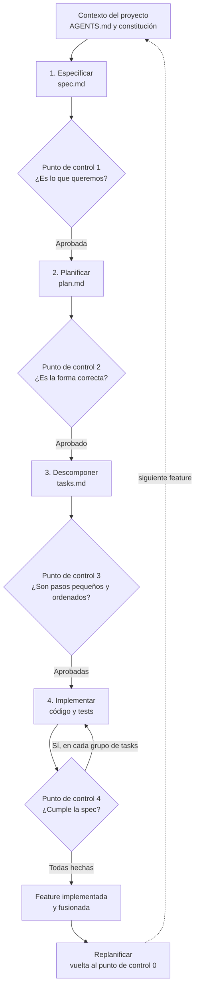
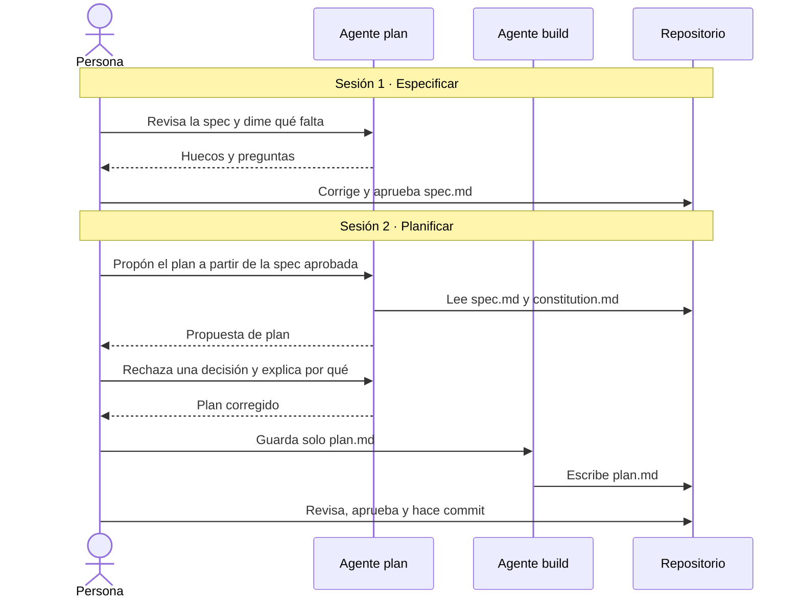
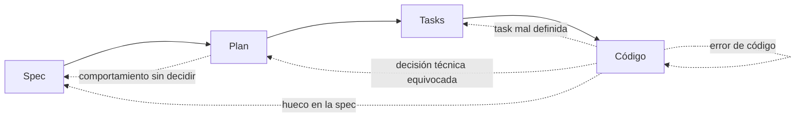
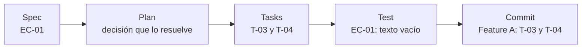
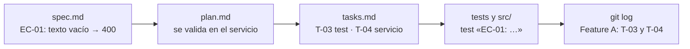

# 1. El flujo SDD

[⬅️ Volver a la unidad](./README.md)

## Índice

- [1.1. Por qué un flujo](#11-por-qué-un-flujo)
  - [1.1.1. Separar la intención de la ejecución](#111-separar-la-intención-de-la-ejecución)
  - [1.1.2. Corregir pronto sale barato](#112-corregir-pronto-sale-barato)
- [1.2. Las fases del flujo](#12-las-fases-del-flujo)
  - [1.2.1. Visión general](#121-visión-general)
  - [1.2.2. Antes de empezar: el contexto del proyecto](#122-antes-de-empezar-el-contexto-del-proyecto)
  - [1.2.3. Especificar](#123-especificar)
  - [1.2.4. Planificar](#124-planificar)
  - [1.2.5. Descomponer en tasks](#125-descomponer-en-tasks)
  - [1.2.6. Implementar](#126-implementar)
  - [1.2.7. Los artefactos de cada fase](#127-los-artefactos-de-cada-fase)
  - [1.2.8. Entre features: replanificar](#128-entre-features-replanificar)
- [1.3. Humano y agente: quién hace qué](#13-humano-y-agente-quién-hace-qué)
  - [1.3.1. El reparto en cada fase](#131-el-reparto-en-cada-fase)
  - [1.3.2. Qué agente de OpenCode usar en cada fase](#132-qué-agente-de-opencode-usar-en-cada-fase)
  - [1.3.3. Una sesión por fase](#133-una-sesión-por-fase)
  - [1.3.4. Una rama por feature](#134-una-rama-por-feature)
- [1.4. Los puntos de control](#14-los-puntos-de-control)
  - [1.4.1. La pregunta de cada punto de control](#141-la-pregunta-de-cada-punto-de-control)
  - [1.4.2. Cuando un punto de control falla](#142-cuando-un-punto-de-control-falla)
  - [1.4.3. La regla: no saltarse ninguno](#143-la-regla-no-saltarse-ninguno)
- [1.5. Trazabilidad: del requisito al commit](#15-trazabilidad-del-requisito-al-commit)
- [1.6. El mismo flujo en otras herramientas](#16-el-mismo-flujo-en-otras-herramientas)
  - [1.6.1. Spec Kit](#161-spec-kit)
  - [1.6.2. Kiro](#162-kiro)
  - [1.6.3. Conductor](#163-conductor)
  - [1.6.4. OpenCode con ficheros a mano](#164-opencode-con-ficheros-a-mano)
  - [1.6.5. Comparación](#165-comparación)
- [1.7. Críticas al flujo y cómo responderlas](#17-críticas-al-flujo-y-cómo-responderlas)
  - [1.7.1. «Es el desarrollo en cascada de siempre»](#171-es-el-desarrollo-en-cascada-de-siempre)
  - [1.7.2. «Es demasiado lento para cambios pequeños»](#172-es-demasiado-lento-para-cambios-pequeños)
  - [1.7.3. «Genera Markdown que nadie lee»](#173-genera-markdown-que-nadie-lee)
  - [1.7.4. «El agente no sigue la spec»](#174-el-agente-no-sigue-la-spec)
  - [1.7.5. «El código falla aunque la spec sea buena»](#175-el-código-falla-aunque-la-spec-sea-buena)
- [1.8. Ejemplo integrador: el recorrido de la feature A](#18-ejemplo-integrador-el-recorrido-de-la-feature-a)
- [Resumen](#resumen)
- [Ejercicios de reflexión](#ejercicios-de-reflexión)

> **Criterios que trabaja este tema:** OA2 a.

---

## 1.1. Por qué un flujo

### 1.1.1. Separar la intención de la ejecución

En la UD1 escribiste la spec de la feature A de la lista de tareas («Añadir una tarea») y la dejaste **aprobada**. La spec dice **qué** debe hacer el sistema y en qué casos. Pero entre la spec y el código quedan muchas decisiones: en qué ficheros va cada cosa, en qué orden se construye, cómo se comprueba cada paso.

Podrías darle la spec al agente y decirle «impleméntala». Funcionaría a veces. Otras, el agente tomaría esas decisiones por su cuenta, generaría cientos de líneas de una vez y tú tendrías que revisar todo junto: la arquitectura, los nombres, los tests y la lógica, mezclados.

El **flujo SDD** resuelve esto con una idea sencilla: **separar la intención de la ejecución** en fases, de modo que cada fase produce un documento que una persona revisa antes de seguir.

- **Especificar:** qué hay que construir (la spec).
- **Planificar:** cómo se va a construir (el plan técnico).
- **Descomponer:** en qué pasos pequeños (las *tasks*).
- **Implementar:** el código, paso a paso.

Es como una obra: primero el encargo del cliente, después el proyecto del arquitecto, luego la planificación de la obra por fases y, por último, los albañiles. Nadie empieza a levantar paredes sin que el cliente haya aprobado los planos.

> 📝 **Nota del Profesor**: el flujo no existe para que el agente trabaje más despacio, sino para que **tú puedas revisar**. Revisar una spec de una página, un plan de dos y una lista de tareas es mucho más fácil que revisar mil líneas de código en las que están todas esas decisiones mezcladas.

### 1.1.2. Corregir pronto sale barato

El principio que sostiene el flujo ya lo viste en la UD1: **cuanto más tarde se detecta un error, más cuesta corregirlo**.

| Se detecta en… | Qué hay que hacer para corregirlo |
|----------------|-----------------------------------|
| La spec | Cambiar una frase |
| El plan | Cambiar una decisión técnica en un documento |
| Las tasks | Reordenar o dividir una lista |
| El código | Reescribir código, revisarlo y volver a probar |
| Producción | Todo lo anterior, más los datos y los usuarios afectados |

El flujo coloca **puntos de corrección tempranos y deliberados**: cada fase termina con una revisión humana, y solo se pasa a la siguiente cuando el documento está aprobado.

> ⚠️ **Cuidado**: el flujo no evita los errores; los **adelanta**. Si te saltas las revisiones, tienes todo el coste de escribir los documentos y ninguna de sus ventajas.

---

## 1.2. Las fases del flujo

### 1.2.1. Visión general

El flujo SDD tiene **cuatro fases**, precedidas por la preparación del contexto del proyecto y seguidas de una pausa para **replanificar** antes de la siguiente feature. El siguiente diagrama muestra las fases, el documento que produce cada una y el punto de control que la cierra:



Fíjate en que el flujo es **secuencial** y en que cada flecha hacia delante pasa por una aprobación humana. El bucle de la fase 4 es deliberado: el código se revisa en **grupos pequeños de tasks**, no al final. Y la flecha discontinua del final cierra el ciclo: antes de empezar otra feature, se revisa el contexto con lo aprendido en esta (apartado 1.2.8).

### 1.2.2. Antes de empezar: el contexto del proyecto

Antes de la primera feature, el proyecto necesita las capas de contexto que viste en la UD1 (tema 2):

- **`AGENTS.md`:** reglas para el agente (comandos, estructura, convenciones y prohibiciones).
- **Constitución** (`constitution.md`): los principios que no se negocian en cada feature (arquitectura en capas, formato de los errores, tests antes que el código…).

Se escriben **una vez por proyecto** y se revisan solo cuando cambia algo de fondo. Todas las fases las leen: la constitución es la que impide que cada plan invente su propia arquitectura.

> ✅ **Buena práctica**: si en la revisión de un plan te encuentras corrigiendo **la misma decisión** por segunda vez (por ejemplo, «los errores van en español»), esa decisión no es de la feature: llévala a la constitución.

### 1.2.3. Especificar

- **Qué ocurre:** se describe la feature en una spec con requisitos, criterios de aceptación, *edge cases* y fuera de alcance. El agente puede ayudar a estructurarla, detectar huecos y proponer *edge cases*, pero las **decisiones** las toma una persona.
- **Entrada:** la idea de la feature (una línea del índice de features, unas notas, el PRD).
- **Salida:** `docs/specs/<feature>/spec.md` con el estado `Aprobada`.
- **Se revisa:** que la spec diga exactamente lo que se quiere, sin marcadores `[NECESITA ACLARACIÓN]` pendientes.

Es la fase que trabajaste a fondo en la UD1. En esta unidad partirás de specs ya aprobadas.

### 1.2.4. Planificar

- **Qué ocurre:** a partir de la spec aprobada y la constitución, el agente propone el **plan técnico**: qué ficheros se crean o modifican, qué decisiones de arquitectura se toman y por qué, qué dependencias hacen falta y en qué orden se construye.
- **Entrada:** `spec.md` aprobada, `constitution.md` y el código existente, si lo hay.
- **Salida:** `docs/specs/<feature>/plan.md` aprobado.
- **Se revisa:** que el enfoque respete la constitución y la arquitectura del proyecto, y que las decisiones técnicas sean las que quieres.

La instrucción clave de esta fase es: **el agente no escribe código**. El plan es el sitio de las decisiones de **cómo** (en la UD1 lo llamaste así: «¿lo notaría alguien desde fuera? Si no, va en el plan»).

Lo verás en detalle en el tema 2.

### 1.2.5. Descomponer en tasks

- **Qué ocurre:** el agente divide el plan en ***tasks***: pasos pequeños, ordenados y verificables, cada uno con los ficheros que toca y un criterio de terminado. Las tasks de test van antes que la implementación que comprueban.
- **Entrada:** `plan.md` aprobado y `spec.md`.
- **Salida:** `docs/specs/<feature>/tasks.md` aprobado, con cada task como casilla sin marcar (`- [ ]`).
- **Se revisa:** que ninguna task sea demasiado grande, que el orden respete las dependencias y que no falten tasks (tests, documentación).

### 1.2.6. Implementar

- **Qué ocurre:** el agente implementa las tasks **de una en una o de dos en dos**, ejecuta los tests y marca cada task como hecha (`- [x]`). Entre un grupo de tasks y el siguiente, una persona revisa el código.
- **Entrada:** `tasks.md` aprobado, con el plan y la spec como referencia.
- **Salida:** código y tests, `tasks.md` con todas las casillas marcadas y un **commit** por cada grupo de tasks revisado.
- **Se revisa:** que el código haga lo que dice la task y cumpla la spec y la constitución, y que los tests pasen.

Si durante la implementación aparece algo que nadie previó, **se para** y se corrige el documento que corresponda antes de seguir. Las fases de tasks e implementación son el tema 3.

### 1.2.7. Los artefactos de cada fase

Cada fase deja un fichero en el repositorio, en la **carpeta de la feature**:

| Fase | Artefacto | Responde a | Lo aprueba |
|------|-----------|------------|------------|
| Contexto | `AGENTS.md`, `constitution.md` | ¿Cómo se trabaja en este proyecto? | El equipo, una vez |
| Especificar | `spec.md` | ¿Qué hay que construir? | Quien decide el producto |
| Planificar | `plan.md` | ¿Cómo se va a construir? | Quien conoce la arquitectura |
| Descomponer | `tasks.md` | ¿En qué pasos y en qué orden? | Quien va a supervisar la implementación |
| Implementar | Código, tests y commits | ¿Está hecho y funciona? | Quien revisa el código |

En un proyecto pequeño, todas esas personas pueden ser la misma: tú. Lo importante es que **cada pregunta se responde en su documento** y no se mezclan.

```text
lista-tareas/
├── AGENTS.md
├── constitution.md
└── docs/
    └── specs/
        ├── README.md              ← índice de features y estado
        └── A-añadir-tarea/
            ├── spec.md            ← fase 1: qué
            ├── plan.md            ← fase 2: cómo
            └── tasks.md           ← fase 3: en qué pasos
```

Los tres documentos de la feature viven juntos y **junto al código**, en el mismo repositorio. Cómo se lleva el estado de cada feature en el índice es el tema 4.

> 💡 **Tip del Examinador**: «Nombra las fases del flujo SDD y el artefacto que produce cada una». Especificar → `spec.md` (qué); planificar → `plan.md` (cómo); descomponer → `tasks.md` (en qué pasos); implementar → código, tests y commits. Antes, una vez por proyecto, el contexto: `AGENTS.md` y la constitución.

### 1.2.8. Entre features: replanificar

Cuando una feature queda implementada, la tentación es abrir la siguiente spec enseguida. Antes conviene parar un momento y **replanificar**: revisar el contexto del proyecto con lo que has aprendido en la feature que acabas de terminar.

No es una quinta fase ni produce un documento nuevo. Es **volver al punto de control 0** (apartado 1.4.1) con cuatro preguntas:

| Pregunta | Si la respuesta es sí… | Dónde |
|----------|------------------------|-------|
| ¿La siguiente feature del índice sigue siendo la que toca? | Se reordena, se divide, se junta con otra o se descarta | Índice de features (tema 4) |
| ¿Has corregido la misma decisión en varios planes o ciclos? | Se lleva a la constitución | `constitution.md` |
| ¿El agente ha tropezado varias veces con lo mismo (un comando, una ruta, una convención)? | Se añade o se corrige una regla | `AGENTS.md` (tema 6) |
| ¿Has escrito el mismo prompt varias veces? | Se convierte en un comando o en una skill | `.opencode/` (tema 6) |

Si alguna respuesta cambia algo, el cambio va en su propio commit, **antes** de empezar la feature siguiente. Si no cambia nada, la replanificación dura un par de minutos y también ha servido: has comprobado que el contexto con el que va a trabajar el agente sigue diciendo la verdad.

> 📝 **Nota del Profesor**: la replanificación es lo que impide que el flujo se convierta en una cascada. Cada feature terminada es información nueva sobre el proyecto, y este es el momento de usarla. Un cambio grande que aparece aquí (por ejemplo, que la aplicación tiene que funcionar bien en el móvil) no se cuela en la siguiente feature: se convierte en una feature propia en el índice.

> ⚠️ **Cuidado**: replanificar no es empezar a programar «una cosa rápida» que se te ha ocurrido. Si la mejora toca código, es una feature (o un cambio sobre una feature, tema 4) y pasa por el flujo.

---

## 1.3. Humano y agente: quién hace qué

### 1.3.1. El reparto en cada fase

En SDD, el trabajo de la persona **no es escribir código**: es **tomar las decisiones** y **comprobar** que el agente las ha entendido. El agente aporta velocidad: redacta, propone, descompone e implementa.

| Fase | La persona | El agente |
|------|------------|-----------|
| **Especificar** | Aporta la idea y el contexto; decide el comportamiento, los *edge cases* y el fuera de alcance; aprueba | Estructura la spec, pregunta por lo ambiguo, propone *edge cases* y detecta huecos |
| **Planificar** | Comprueba que el enfoque respeta la constitución; acepta o rechaza cada decisión técnica; aprueba | Lee la spec y el código, y propone ficheros, decisiones, dependencias y orden |
| **Descomponer** | Comprueba el tamaño, el orden y que no falte nada; aprueba | Divide el plan en tasks con ficheros y criterio de terminado |
| **Implementar** | Pide las tasks en grupos pequeños; revisa el código y los tests; hace el commit; para si algo no encaja | Implementa cada task, ejecuta los tests y marca las tasks hechas |

Fíjate en la columna de la persona: en todas las fases aparece **aprobar** o **revisar**. Ninguna fase la cierra el agente.

> 📝 **Nota del Profesor**: que el agente haga **preguntas** es una buena señal. En la UD1 usaste el marcador `[NECESITA ACLARACIÓN]` para que el agente señale las dudas en lugar de inventar la respuesta. En todas las fases vale lo mismo: una pregunta del agente es una decisión que vas a tomar tú, no él.

### 1.3.2. Qué agente de OpenCode usar en cada fase

En el tema 3 de la UD1 viste los dos agentes principales de OpenCode: ***plan***, que analiza sin poder editar los ficheros del proyecto, y ***build***, que lo puede hacer todo. Encajan con las fases así:

| Fase | Agente | Por qué |
|------|--------|---------|
| Especificar | *plan* para revisar y proponer; *build* (o tú) para guardar `spec.md` | La revisión no debe tocar nada |
| Planificar | *plan* para proponer el plan; *build* para guardarlo en `plan.md` | El agente no debe escribir código en esta fase |
| Descomponer | *plan* para proponer las tasks; *build* para guardarlas en `tasks.md` | Igual que el plan |
| Implementar | *build* | Tiene que editar ficheros y ejecutar los tests |

Como *plan* no puede editar los ficheros del proyecto, en las tres primeras fases el documento se guarda en dos pasos: primero *plan* propone y tú discutes con él hasta que te convence; después cambias a *build* (con `Mayús+Tab`) y le pides que **guarde solo ese fichero**, sin tocar nada más.

```text
Guarda el plan que hemos acordado en docs/specs/A-añadir-tarea/plan.md.
No crees ni modifiques ningún otro fichero.
```

> ⚠️ **Cuidado**: al cambiar a *build* para guardar un documento, el agente puede «adelantarse» y empezar a implementar. Por eso el prompt dice expresamente qué fichero crear y que no toque nada más. Revisa siempre qué ficheros ha cambiado antes de seguir (`git status`).

### 1.3.3. Una sesión por fase

Una **sesión** de OpenCode acumula todo lo que se ha dicho en ella: los intentos fallidos, las propuestas rechazadas, las correcciones. Si haces las cuatro fases en la misma sesión, al llegar a la implementación el agente arrastra un contexto lleno de discusiones que ya no importan.

La práctica recomendada es **empezar una sesión nueva** (`/new`) en cada fase, y en la implementación, en cada grupo de tasks. No se pierde nada, porque lo importante ya está **escrito en los documentos** y el agente los vuelve a leer.

El siguiente diagrama muestra la conversación entre la persona y el agente en las dos primeras fases:



Lo que destaca del diagrama: el agente *plan* **lee** del repositorio pero no escribe; lo único que escribe *build* en esta fase es el documento acordado, y el commit lo hace la persona después de revisar.

> ✅ **Buena práctica**: termina cada fase con un **commit** del documento aprobado. Así el historial de Git cuenta la historia de la feature (spec aprobada, plan aprobado, tasks aprobadas, cada grupo de tasks implementado) y puedes volver a cualquier punto.

Por qué una sesión larga empeora el trabajo del agente lo estudiarás en el tema 5.

### 1.3.4. Una rama por feature

Igual que cada fase tiene su sesión, cada feature tiene su **rama de Git**. El reparto es este:

- **La spec se aprueba en `main`.** Es una decisión de producto: todo el equipo debe poder ver en el índice qué features están aprobadas.
- **Al empezar el plan, se crea la rama** de la feature, con el nombre de su carpeta: `feature/A-añadir-tarea`. En ella van el plan, las tasks, el código y los tests, y también las versiones nuevas de la spec que surjan al planificar o al implementar.
- **Cuando la feature está implementada**, una persona la **fusiona** en `main` y borra la rama.

```bash
git switch -c feature/A-añadir-tarea          # al empezar el plan
# … plan, tasks y ciclos de implementación, cada uno con su commit …
git switch main                               # con la feature implementada
git merge --no-ff feature/A-añadir-tarea -m "Fusiona la feature A: añadir una tarea"
git branch -d feature/A-añadir-tarea
```

La opción `--no-ff` obliga a Git a crear un **commit de fusión** aunque `main` no haya cambiado. Ese commit marca en el historial dónde empieza y dónde acaba cada feature (lo verás en el tema 4).

¿Qué ganas con la rama?

| Sin rama | Con una rama por feature |
|----------|--------------------------|
| `main` tiene features a medias mientras se implementan | `main` solo recibe features completas y revisadas |
| Si una feature se abandona, hay que deshacer sus commits uno a uno | Se borra la rama y `main` queda como estaba |
| El historial mezcla los commits de todas las features | Cada feature es un bloque, cerrado por su commit de fusión |
| Para ver qué cambió una feature hay que buscar sus commits | `git diff main...feature/A-añadir-tarea` muestra todo lo que trae la rama |

> ⚠️ **Cuidado**: fusionar es una **decisión**, como aprobar: la toma una persona después del último punto de control, no el agente. Y la rama se fusiona **entera**: si la feature no está terminada, no se fusiona «lo que hay».

Los cambios pequeños del contexto que surgen dentro de una feature (una línea nueva en la constitución, como la que verás en el tema 2) pueden ir en su rama. Un cambio de fondo en la constitución, que afecta a todas las features, mejor en una rama propia o en la replanificación (apartado 1.2.8), para saber qué versión de la constitución produjo cada código.

---

## 1.4. Los puntos de control

Un **punto de control** (*checkpoint*) es el momento en que una persona revisa lo que ha producido el agente y decide si se puede seguir. Son el mecanismo de calidad del flujo.

### 1.4.1. La pregunta de cada punto de control

Cada punto de control responde a **una pregunta**, y solo a esa:

| Punto de control | Después de | Pregunta | Qué se revisa |
|------------------|------------|----------|---------------|
| **0** | Preparar el contexto, y de nuevo al replanificar entre features | ¿Están claros los principios del proyecto? | `AGENTS.md` y constitución: arquitectura, convenciones, prohibiciones; índice de features |
| **1** | Especificar | ¿La spec dice lo que queremos? | Requisitos, criterios verificables, *edge cases*, fuera de alcance, sin marcadores pendientes |
| **2** | Planificar | ¿Es la forma correcta de construirlo? | Coherencia con la constitución, ficheros, dependencias, orden, suposiciones sobre el código |
| **3** | Descomponer | ¿Son pasos pequeños, ordenados y verificables? | Tamaño, dependencias, tests antes que el código, tasks que faltan |
| **4** | Cada grupo de tasks | ¿El código cumple la task, la spec y la constitución? | Diferencias en los ficheros, tests en verde, nada fuera de lo pedido |

Separar las preguntas es lo que hace la revisión manejable: en el punto de control 2 no discutes si la tarea vacía devuelve 400 (eso ya se decidió en el 1), sino **dónde** se comprueba.

> 💡 **Tip del Examinador**: «¿Qué se revisa en el punto de control del plan?». Que el enfoque técnico respete la constitución y la arquitectura existente, que las dependencias y decisiones sean las que quiere el equipo, que el orden de construcción tenga sentido y que el agente no haya supuesto cosas falsas sobre el código. El comportamiento no se discute ahí: ya está en la spec aprobada.

### 1.4.2. Cuando un punto de control falla

Si en un punto de control encuentras un problema, no siempre se corrige en el documento que estás revisando. Se corrige **donde nació**:

| Detectas… | Ejemplo | Se corrige en |
|-----------|---------|---------------|
| Un comportamiento que nadie decidió | El plan dice «si el texto está vacío, se guarda como "Sin título"» | La **spec** (y se vuelve a aprobar) |
| Una decisión técnica que no te gusta | El plan añade una librería de validación que no hace falta | El **plan** |
| Una task enorme o mal ordenada | «T-03: implementar toda la API» | Las **tasks** |
| Un error en el código | El servicio no recorta los espacios antes de comprobar si el texto está vacío | El **código** (la task sigue abierta) |
| Una decisión que se repite en todas las features | Cada plan elige un formato de error distinto | La **constitución** |

El siguiente diagrama muestra esas vueltas atrás:



Cuanto más larga es la flecha discontinua, más caro es el problema: un hueco en la spec descubierto en el código obliga a corregir la spec, revisar el plan y las tasks afectadas y rehacer el código.

> ⚠️ **Cuidado**: el error más frecuente es corregir **solo el código** cuando el problema estaba en la spec o en el plan. El código queda bien, pero los documentos ya no dicen la verdad, y la próxima vez que el agente los lea volverá a cometer el mismo error. A esa separación entre documentos y código se le llama ***spec drift*** y la estudiarás en la UD3.

### 1.4.3. La regla: no saltarse ninguno

La regla práctica del flujo es **no pasar a la fase siguiente sin aprobar el punto de control**. La tentación aparece cuando el agente lo ha hecho «bastante bien»: el plan parece razonable, las tasks parecen bien… y se pasa a implementar sin leerlos con calma.

Saltarse un punto de control tiene dos efectos:

- El error que no viste llega a la fase siguiente, donde es más caro.
- El documento queda **aprobado sin que nadie lo haya revisado**: el agente y tus compañeros confiarán en algo que no ha comprobado nadie.

> 📝 **Nota del Profesor**: aprobar no es un trámite. Cuando cambias el estado de una spec a `Aprobada` o haces el commit de un plan, estás firmando que lo has leído y que estás de acuerdo. En los ejercicios con agente de esta unidad, la rúbrica evalúa precisamente eso: qué revisaste, qué aceptaste, qué rechazaste y por qué.

---

## 1.5. Trazabilidad: del requisito al commit

Que los artefactos estén separados no significa que estén sueltos. Cada uno **cita** al anterior con sus identificadores:

- El **plan** justifica sus decisiones con los requisitos y *edge cases* de la spec (`RF-01`, `EC-01`).
- Cada **task** dice qué parte del plan desarrolla y qué criterios de la spec comprueba.
- Cada **test** lleva en su nombre el criterio o *edge case* que verifica.
- Cada **commit** dice qué tasks incluye.

A esta cadena de referencias se le llama **trazabilidad**: poder seguir cualquier requisito hasta el código que lo cumple, y cualquier línea de código hasta el requisito que la justifica.



La trazabilidad responde a dos preguntas que en el *vibe coding* no tienen respuesta:

- **«¿Dónde se cumple este requisito?»** Se sigue la cadena hacia la derecha.
- **«¿Por qué está este código aquí?»** Se sigue hacia la izquierda. Si un fichero no viene de ninguna task, nadie lo pidió.

Por eso los identificadores que pusiste en la UD1 (`RF-01`, `AC-01`, `EC-01`) son importantes: son los enganches de toda la cadena. Verás un ejemplo completo en el apartado 1.8.

> ✅ **Buena práctica**: pide al agente que cite los identificadores de la spec en el plan, en las tasks y en los nombres de los tests. Es una instrucción barata que hace que cada punto de control se revise mucho más deprisa: compruebas que cada `EC-` tiene su test.

---

## 1.6. El mismo flujo en otras herramientas

El flujo SDD **no depende de una herramienta**. Varias herramientas lo automatizan con comandos y plantillas propias, pero todas siguen la misma idea: contexto del proyecto, spec, plan, tasks e implementación, en ficheros Markdown dentro del repositorio y con revisión humana entre fases.

> ⚠️ **Cuidado**: los nombres de comandos, ficheros y carpetas de estas herramientas **cambian** entre versiones. Quédate con la estructura del flujo y consulta la documentación de la versión que uses (enlaces en la portada de la unidad).

### 1.6.1. Spec Kit

**GitHub Spec Kit** es un kit de código abierto para SDD que funciona con muchos agentes, OpenCode incluido. Instala en el proyecto plantillas y **comandos**, uno por fase, con el prefijo `speckit` (la forma exacta de escribirlos depende del agente):

| Fase | Comando (idea) | Qué produce |
|------|----------------|-------------|
| Contexto | *constitution* | La constitución del proyecto |
| Especificar | *specify* | La spec de la feature |
| Planificar | *plan* | El plan técnico y otros documentos de diseño |
| Descomponer | *tasks* | `tasks.md` |
| Implementar | *implement* | El código, task a task |

Los puntos de control 1 y 3 (revisar la spec y revisar las tasks) los haces tú, lo mismo que en el flujo del curso. La herramienta puede ofrecer además comandos de aclaración o de análisis de coherencia, pero cambian entre versiones: consulta su documentación antes de apoyarte en ellos. Y aunque los uses, el informe lo lee y lo decide una persona.

### 1.6.2. Kiro

**Kiro** es un entorno de desarrollo de AWS orientado a SDD. Cada feature tiene tres documentos, en una carpeta por feature:

| Fase | Documento | Contenido |
|------|-----------|-----------|
| Especificar | `requirements.md` | Historias de usuario y criterios de aceptación en EARS |
| Planificar | `design.md` | Arquitectura, flujo de datos, gestión de errores y estrategia de pruebas |
| Descomponer | `tasks.md` | Lista de tasks; Kiro va marcando cada una al implementarla |

El contexto del proyecto va aparte, en unos ficheros que Kiro llama de ***steering*** (orientación): uno sobre el producto, otro sobre la tecnología y otro sobre la estructura del proyecto. Kiro pide revisar cada documento antes de pasar al siguiente. Tiene también variantes del flujo: empezar por el diseño en lugar de por los requisitos, un flujo para corregir errores (con un documento de análisis del fallo en lugar de los requisitos) y uno rápido que genera los tres documentos de una vez, sin pausas, para features muy claras.

### 1.6.3. Conductor

**Conductor** es una extensión de Gemini CLI que Google presenta como ***context-driven development*** (desarrollo guiado por el contexto). El nombre cambia; el flujo es el mismo:

1. **Preparar el contexto** una vez por proyecto: ficheros sobre el producto, la tecnología y la forma de trabajar del equipo (lo que en este curso son el PRD, la constitución y `AGENTS.md`).
2. **Crear un *track*** (una unidad de trabajo: una feature o una corrección), con su spec y su plan. El plan de Conductor lleva ya las tareas dentro, divididas en fases.
3. **Implementar** el plan aprobado; el agente marca las tareas hechas en el propio plan.

Conductor incluye también comandos para revisar el trabajo hecho contra el plan y para **deshacer** una tarea o una fase completa usando el historial de Git.

### 1.6.4. OpenCode con ficheros a mano

En este curso harás el flujo **sin framework**: los documentos son ficheros Markdown que escribes o pides al agente, con las plantillas del curso, y las fases las marcas tú con prompts y con el cambio entre *plan* y *build*. Es el enfoque que siguen muchos equipos con Claude Code, Cursor u OpenCode.

| Ventaja | Inconveniente |
|---------|---------------|
| Entiendes cada fase, porque la haces tú | Requiere más disciplina: nadie te obliga a parar en cada punto de control |
| Funciona con cualquier agente y cualquier modelo | Tienes que escribir los prompts de cada fase (en el tema 6 los convertirás en comandos reutilizables) |
| Los documentos son tan ligeros como necesites | Sin plantillas, cada persona puede organizarlos a su manera: hace falta acordarlo en la constitución |

> 📝 **Nota del Profesor**: primero el método, después la herramienta. Cuando sepas hacer el flujo a mano, cualquier framework te parecerá lo que es: una forma de automatizar pasos que ya entiendes. En las prácticas de esta unidad usarás además **OpenSpec**, un framework pensado para proponer **cambios** sobre features que ya existen.

### 1.6.5. Comparación

| | OpenCode a mano | Spec Kit | Kiro | Conductor |
|---|---|---|---|---|
| **Contexto del proyecto** | `AGENTS.md` y constitución | Constitución | Ficheros de *steering* (producto, tecnología, estructura) | Producto, tecnología y forma de trabajo |
| **Especificar** | `spec.md` | Spec (con fase de aclaración) | `requirements.md` | Spec del *track* |
| **Planificar** | `plan.md` | Plan y documentos de diseño | `design.md` | Plan del *track* |
| **Descomponer** | `tasks.md` | `tasks.md` | `tasks.md` | Dentro del plan |
| **Implementar** | *build*, por grupos de tasks | Comando de implementación | Ejecución de tasks | Comando de implementación |
| **Puntos de control** | Los marcas tú | Entre comandos, más el análisis de coherencia | Revisión de cada documento | Aprobación del plan y revisión del trabajo |

Las columnas cambian los nombres; las filas son siempre las mismas. Eso es lo que significa que **el método no depende de la herramienta**.

> 💡 **Tip del Examinador**: «¿Qué tienen en común Spec Kit, Kiro y Conductor?». Los tres separan el contexto del proyecto, la spec, el plan y las tareas en ficheros Markdown versionados en el repositorio, y piden una revisión humana antes de implementar. Cambian los nombres de los ficheros y el grado de automatización, no el flujo.

---

## 1.7. Críticas al flujo y cómo responderlas

El flujo SDD tiene críticas serias. Conocerlas te ayuda a usarlo con criterio, no por fe.

### 1.7.1. «Es el desarrollo en cascada de siempre»

**La crítica:** especificar, diseñar, planificar y después construir suena al **modelo en cascada** (*waterfall*), el que se abandonó porque los requisitos cambian y nadie acierta a la primera. Algunos autores sostienen que, como el agente genera código tan deprisa, sale más a cuenta **iterar** sobre código desechable que planificar.

**La respuesta:** la diferencia está en la **escala**. La cascada planificaba el proyecto entero durante meses antes de programar. El flujo SDD se aplica a **una feature**, y una vuelta completa (spec, plan, tasks e implementación) dura horas o pocos días. La spec es un **documento vivo**: si al implementar aprendes algo, se actualiza. Y nada impide explorar antes con *vibe coding* (UD1, tema 1) y formalizar después.

### 1.7.2. «Es demasiado lento para cambios pequeños»

**La crítica:** cuatro fases con revisiones para cambiar un texto o corregir un error de una línea es absurdo.

**La respuesta:** tiene razón, y por eso el flujo **se ajusta al tamaño** del cambio:

| Cambio | Flujo adecuado |
|--------|----------------|
| Un texto, una configuración, un error evidente de una línea | Un buen prompt y revisar el cambio |
| Un cambio pequeño en una feature que ya tiene spec | Actualizar la spec y unas pocas tasks, sin plan formal |
| Una feature nueva y acotada | Spec y tasks; el plan, breve |
| Una feature con decisiones de arquitectura o que toca varias partes | El flujo completo |

En la UD1 (tema 4) viste cuándo **no** escribir una spec completa. El flujo sigue el mismo criterio: se justifica cuando el valor de pensar antes supera lo que cuesta.

### 1.7.3. «Genera Markdown que nadie lee»

**La crítica:** algunos frameworks producen miles de líneas de documentos (planes repetitivos, modelos de datos, contexto inventado) que cuesta horas revisar y que nadie vuelve a leer.

**La respuesta:** el problema existe y la solución es **el mínimo útil**: una spec bien escrita, un plan corto y una lista de tasks. Si un documento no lo va a revisar nadie, no debería existir. Y si el agente lo rellena con texto de relleno, pídele que lo recorte: un plan de dos páginas que lees entero vale más que uno de veinte que apruebas sin leer.

### 1.7.4. «El agente no sigue la spec»

**La crítica:** aunque una restricción esté escrita, el agente a veces la ignora o la aplica de forma demasiado literal.

**La respuesta:** ocurre, sobre todo con documentos largos o sesiones largas. Se mitiga con **specs acotadas** (una feature, no un épico), con las restricciones importantes también en la **constitución** o en `AGENTS.md`, con **sesiones nuevas** por fase y con los **puntos de control**, que existen precisamente para detectar la desviación pronto.

### 1.7.5. «El código falla aunque la spec sea buena»

**La crítica:** después de todo el proceso, el código sigue teniendo errores.

**La respuesta:** es lo esperado. La spec reduce los errores, no los elimina: el agente no es determinista. Por eso los **tests** forman parte del flujo y cada task tiene un criterio de terminado verificable. Y cuando algo falla, la pregunta de SDD es: **¿había un hueco en la spec que permitía este error?** Si lo había, se corrige primero la spec y después el código. Lo estudiarás en la UD3.

> 📝 **Nota del Profesor**: fíjate en que todas las respuestas tienen algo en común: **adaptar** el flujo, no abandonarlo ni seguirlo a ciegas. Saber cuándo una fase sobra es tan importante como saber hacerla.

---

## 1.8. Ejemplo integrador: el recorrido de la feature A

En la UD1 dejaste la lista de tareas compartida con la spec de la feature A («Añadir una tarea») aprobada. En los temas 2 y 3 recorrerás con OpenCode el resto del flujo. Antes, este ejemplo te enseña **el mapa**: qué vas a hacer en cada fase, qué documento saldrá y cómo se enlaza todo.

**1. El punto de partida.** El repositorio tiene el contexto y una spec aprobada, y ni una línea de código:

```text
lista-tareas/
├── AGENTS.md
├── constitution.md
├── opencode.json
└── docs/
    ├── prd.md
    └── specs/
        ├── README.md                 ← A: 🔜 Aprobada
        └── A-añadir-tarea/
            └── spec.md               ← Estado: Aprobada
```

**2. El plan de trabajo.** Cada fase tiene su agente, su sesión, su punto de control y su commit, y todas menos la primera van en la rama `feature/A-añadir-tarea`:

| Fase | Rama | Agente | Sesión | Documento | Punto de control | Commit |
|------|------|--------|--------|-----------|------------------|--------|
| Especificar | `main` | (hecha en la UD1) | — | `spec.md` | 1: aprobada | `Spec de la feature A en EARS y Gherkin (aprobada)` |
| Planificar | Se crea | *plan*; *build* para guardar | Nueva | `plan.md` | 2 | `Plan de la feature A (aprobado)` |
| Descomponer | La de A | *plan*; *build* para guardar | Nueva | `tasks.md` | 3 | `Tasks de la feature A (aprobadas)` |
| Implementar | La de A | *build* | Una por grupo de tasks | Código y tests | 4, en cada grupo | `Feature A: T-01 y T-02, …` y siguientes |
| Fusionar y replanificar | `main` | — | — | Índice, constitución, `AGENTS.md` si cambian | 0 | `Fusiona la feature A: añadir una tarea` |

**3. Un hilo de principio a fin.** Para ver la trazabilidad, sigue un solo *edge case* de la spec a través de todos los documentos. Este es **EC-01**, tal como quedó aprobado:

```markdown
- EC-01: Si el texto está vacío o solo tiene espacios, entonces el
  sistema deberá responder 400 con
  { error: "El texto de la tarea no puede estar vacío" }.
```

En el **plan**, EC-01 no se repite: se convierte en una **decisión técnica** sobre dónde se comprueba, justificada con la constitución (los controladores no contienen lógica de negocio):

```markdown
## Decisiones técnicas

- D-01: Validación del texto (EC-01, EC-02, EC-05): en el servicio de
  tareas, no en el controlador, como exige la constitución. El servicio
  lanza un ErrorValidacion con el mensaje de la spec; el controlador lo
  traduce a una respuesta 400 { error: "…" }.
```

En las **tasks**, la decisión se convierte en dos pasos pequeños: primero el test, después el código.

```markdown
- [ ] T-03: Tests del servicio de tareas
  - Fichero: tests/servicio-tareas.test.js
  - Cubre: RF-01, RF-04, RNF-02, RNF-03, EC-01, EC-02 y EC-05
    (D-01, D-03, D-05)
  - Terminada cuando: los tests existen y fallan, porque el servicio
    aún no existe

- [ ] T-04: Servicio de tareas y ErrorValidacion
  - Ficheros: src/servicios/servicio-tareas.js,
    src/errores/error-validacion.js
  - Depende de: T-02 (el repositorio) y T-03
  - Terminada cuando: los tests de T-03 pasan y los de T-01 siguen
    pasando
```

En el **código**, el test lleva el identificador en el nombre, de modo que, al leer la salida de los tests, sabes qué parte de la spec se cumple:

```javascript
test('EC-01: rechaza un texto con solo espacios', () => {
  expect(() => crearTarea('   ')).toThrow(
    'El texto de la tarea no puede estar vacío',
  );
});
```

Y en el **historial de Git**, cada commit dice qué tasks incluye:

```text
Feature A: T-03 y T-04, servicio de tareas con sus tests
```

El recorrido completo de EC-01 queda así:



Si mañana alguien pregunta «¿por qué la API responde 400 a una tarea con espacios?», la respuesta está en la cadena: el test cita EC-01 y EC-01 está en una spec aprobada. Y si alguien pregunta «¿por qué la validación está en el servicio y no en el controlador?», la respuesta está en el plan, que cita la constitución.

**4. El punto de llegada.** Al terminar la feature A, el repositorio tendrá esta forma (los nombres exactos de los ficheros de código los decidirá el plan en el tema 2):

```text
lista-tareas/
├── AGENTS.md
├── constitution.md
├── docs/specs/
│   ├── README.md                 ← A: ✅ Implementada
│   └── A-añadir-tarea/
│       ├── spec.md
│       ├── plan.md               ← tema 2
│       └── tasks.md              ← tema 3, todas marcadas
├── src/                          ← tema 3
└── tests/                        ← tema 3
```

Y un historial que cuenta la historia de la feature, fase a fase:

```text
Fusiona la feature A: añadir una tarea
Feature A: T-07 y T-08, página (implementada)
Feature A: T-05 y T-06, API POST /tareas con sus tests
Feature A: T-03 y T-04, servicio de tareas con sus tests
Feature A: T-01 y T-02, repositorio de tareas con sus tests
Tasks de la feature A (aprobadas)
Plan de la feature A (aprobado)
Constitución: tecnología del proyecto
Spec de la feature A 1.1: texto sin espacios en los extremos (aprobada)
Spec de la feature A en EARS y Gherkin (aprobada)
```

> 📝 **Nota del Profesor**: lee ese historial de abajo arriba. Las cinco primeras líneas son **documentos** (al planificar se descubrió un hueco en la spec y una decisión que era de todo el proyecto: lo verás en el tema 2); el código llega después, en grupos pequeños y revisados, y la última línea es la fusión en `main`. Si alguna vez ves un historial de SDD que empieza con «Implementar la feature A» en un solo commit, alguien se ha saltado el flujo.

---

## Resumen

- El **flujo SDD** separa la intención de la ejecución en cuatro fases: **especificar** (qué), **planificar** (cómo), **descomponer** en tasks (en qué pasos) e **implementar** (el código, por grupos de tasks). Antes, una vez por proyecto, se prepara el **contexto**: `AGENTS.md` y la constitución.
- Cada fase produce un **artefacto** en la carpeta de la feature (`spec.md`, `plan.md`, `tasks.md`) o en el código, versionado en el mismo repositorio.
- La persona **decide y aprueba**; el agente **redacta, propone e implementa**. Ninguna fase la cierra el agente.
- Al terminar una feature se **replanifica**: se vuelve al punto de control 0 para revisar el índice, la constitución, `AGENTS.md` y los prompts repetidos antes de empezar la siguiente.
- En OpenCode, ***plan*** propone en las fases de documentos y ***build*** guarda el documento acordado e implementa. Conviene una **sesión nueva** por fase y un **commit** por documento aprobado o por grupo de tasks.
- Cada feature tiene su **rama**: la spec se aprueba en `main`, la rama se crea al empezar el plan y una persona la **fusiona** con `--no-ff` cuando la feature está implementada.
- Los **puntos de control** (0 a 4) cierran cada fase con una pregunta concreta. Un problema se corrige **donde nació**: spec, plan, tasks, código o constitución.
- La **trazabilidad** enlaza requisito, decisión del plan, task, test y commit mediante los identificadores de la spec.
- **Spec Kit**, **Kiro** y **Conductor** automatizan el mismo flujo con otros nombres: el método no depende de la herramienta.
- Las críticas (cascada, lentitud, exceso de Markdown, agente que no obedece, errores pese a la spec) se responden **adaptando** el flujo al tamaño del cambio, con documentos mínimos y con tests.

## Ejercicios de reflexión

1. Explica con tus palabras por qué el flujo separa el plan de las tasks. ¿Qué perderías si el agente pasara directamente de la spec a una lista de tasks?
2. En el punto de control 2 descubres que el plan guarda las tareas en un fichero JSON, y la constitución no dice nada del almacenamiento. ¿Dónde lo corriges? ¿Y si el plan decide que las tareas vacías se guardan con el texto «Sin título»?
3. ¿Por qué conviene empezar una sesión nueva en cada fase si el agente «ya sabe» lo que habéis hablado?
4. Elige una de las críticas del apartado 1.7 y escribe un caso en el que te parezca que tiene razón.
5. Sigue el hilo de **EC-02** de la feature A (texto de más de 280 caracteres) por los artefactos del apartado 1.8: ¿en qué decisión del plan, en qué task y en qué test aparecerá?
6. Busca la documentación de una de las herramientas del apartado 1.6 y anota cómo llama a cada fase y a cada documento. Indica la fecha en que la consultaste.
7. Acabas de implementar la feature A y, al replanificar, ves que en varios ciclos has tenido que pedirle al agente que el fichero de test se llame como el fichero que prueba. ¿Qué cambias, en qué fichero y en qué momento? ¿Por qué no lo dejas para cuando aparezca en la feature B?
8. ¿Por qué la spec se aprueba en `main` y el plan ya va en la rama de la feature? ¿Qué pasaría si la spec también se escribiera en la rama?

---

[⬅️ Volver a la unidad](./README.md)
