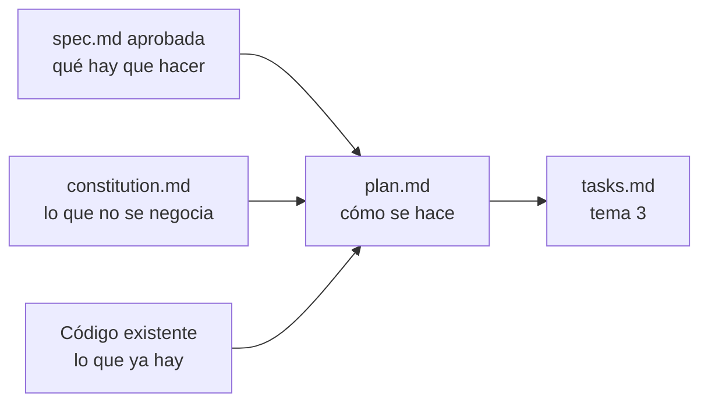
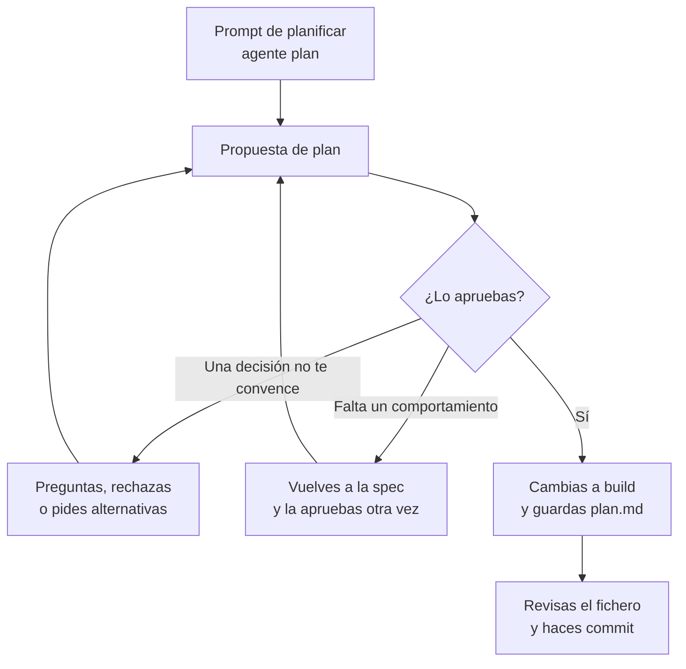
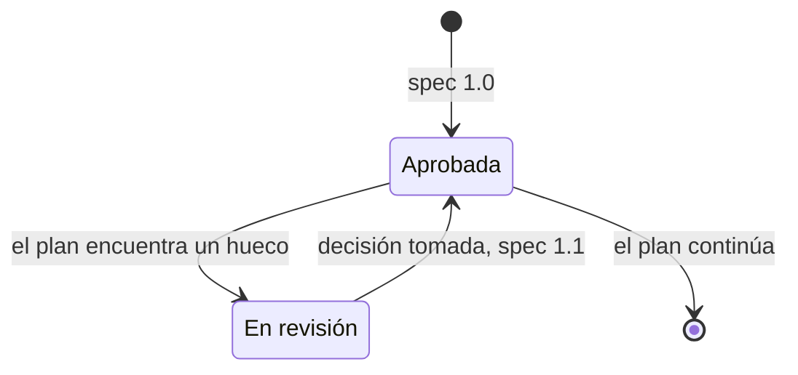

# 2. Especificar y planificar

[⬅️ Volver a la unidad](./README.md)

## Índice

- [2.1. Especificar con el agente](#21-especificar-con-el-agente)
  - [2.1.1. Qué aporta el agente en esta fase](#211-qué-aporta-el-agente-en-esta-fase)
  - [2.1.2. Tres formas de empezar](#212-tres-formas-de-empezar)
  - [2.1.3. La ronda de aclaración](#213-la-ronda-de-aclaración)
  - [2.1.4. Punto de control 1: aprobar la spec](#214-punto-de-control-1-aprobar-la-spec)
- [2.2. Qué es un plan técnico](#22-qué-es-un-plan-técnico)
  - [2.2.1. El plan decide el cómo](#221-el-plan-decide-el-cómo)
  - [2.2.2. Por qué el agente no escribe código en esta fase](#222-por-qué-el-agente-no-escribe-código-en-esta-fase)
  - [2.2.3. De dónde sale el plan](#223-de-dónde-sale-el-plan)
- [2.3. Anatomía de un plan](#23-anatomía-de-un-plan)
  - [2.3.1. Las secciones](#231-las-secciones)
  - [2.3.2. Cómo se escribe una decisión técnica](#232-cómo-se-escribe-una-decisión-técnica)
  - [2.3.3. La estrategia de pruebas](#233-la-estrategia-de-pruebas)
  - [2.3.4. Plantilla del plan](#234-plantilla-del-plan)
- [2.4. Generar el plan con OpenCode](#24-generar-el-plan-con-opencode)
  - [2.4.1. Preparar la sesión](#241-preparar-la-sesión)
  - [2.4.2. El prompt de planificar](#242-el-prompt-de-planificar)
  - [2.4.3. Conversar sobre el plan](#243-conversar-sobre-el-plan)
  - [2.4.4. Guardar el plan](#244-guardar-el-plan)
- [2.5. Revisar el plan: punto de control 2](#25-revisar-el-plan-punto-de-control-2)
  - [2.5.1. Lista de comprobación](#251-lista-de-comprobación)
  - [2.5.2. Errores típicos de un plan generado](#252-errores-típicos-de-un-plan-generado)
  - [2.5.3. Aceptar, rechazar y dejarlo escrito](#253-aceptar-rechazar-y-dejarlo-escrito)
  - [2.5.4. Cuando el plan descubre un hueco en la spec](#254-cuando-el-plan-descubre-un-hueco-en-la-spec)
- [2.6. El plan en otras herramientas](#26-el-plan-en-otras-herramientas)
- [2.7. Ejemplo integrador: el plan de «Añadir una tarea»](#27-ejemplo-integrador-el-plan-de-añadir-una-tarea)
- [Resumen](#resumen)
- [Ejercicios de reflexión](#ejercicios-de-reflexión)

> **Criterios que trabaja este tema:** OA2 b.

---

## 2.1. Especificar con el agente

### 2.1.1. Qué aporta el agente en esta fase

En la UD1 aprendiste a escribir una spec completa: requisitos en EARS, criterios de aceptación en Gherkin, *edge cases*, fuera de alcance y el marcador `[NECESITA ACLARACIÓN]`. En la fase de especificar del flujo, el agente puede ayudarte a llegar antes a esa spec, pero con un reparto claro:

| El agente puede… | El agente no debe… |
|------------------|--------------------|
| Estructurar unas notas desordenadas con la plantilla | Decidir el comportamiento que falta |
| Detectar palabras vagas y requisitos que no se pueden comprobar | Rellenar los huecos con «lo más habitual» |
| Proponer *edge cases* que no habías pensado | Añadir funcionalidades que nadie ha pedido |
| Preguntarte lo que no está decidido | Responder él mismo a esas preguntas |
| Comprobar que la spec sigue la notación de la constitución | Meter detalles de implementación en la spec |

Todo lo que el agente **propone** pasa por ti; todo lo que **decide** sin preguntarte es un fallo de la fase.

### 2.1.2. Tres formas de empezar

Según lo clara que tengas la feature, hay tres formas de arrancar la fase:

| Forma | Cómo | Cuándo |
|-------|------|--------|
| **Tú escribes, el agente revisa** | Escribes la spec con la plantilla y pides al agente *plan* una revisión (la del tema 6 de la UD1) | Tienes la feature muy clara |
| **Borrador y estructura** | Escribes unas notas breves y pides al agente que las ordene con la plantilla, con marcadores donde falte una decisión | Sabes lo que quieres, pero no lo has ordenado |
| **Entrevista** | Pides al agente que te **pregunte** antes de escribir nada, y la spec sale de tus respuestas | La feature está todavía difusa |

La **entrevista** es la menos conocida y una de las más útiles. Por ejemplo, para la feature B de la lista de tareas («Ver la lista de tareas»), con el agente *plan* activo:

```text
Vamos a especificar la feature B, «Ver la lista de tareas», del índice
@docs/specs/README.md. Lee @docs/prd.md y la spec de la feature A,
@docs/specs/A-añadir-tarea/spec.md, para conocer el proyecto.

No escribas la spec todavía. Hazme primero las preguntas que necesites
para escribirla, de una en una, empezando por las que más afectan al
comportamiento. Para cada pregunta, propón dos o tres respuestas
posibles y di qué consecuencia tiene cada una.
```

Una respuesta típica del agente:

```text
1. ¿En qué orden se muestran las tareas?
   a) Por fecha de creación, la más antigua primero (coherente con la
      feature A, que añade las tareas al final).
   b) La más reciente primero.
   c) Primero las pendientes y después las hechas.
```

Cada respuesta tuya es una **decisión de producto** que acabará en la spec. El agente ha hecho el trabajo de encontrar las preguntas; tú, el de responderlas.

> ✅ **Buena práctica**: pide al agente que proponga **alternativas con sus consecuencias**, no solo preguntas. Decidir entre tres opciones bien explicadas es mucho más rápido que inventar la respuesta desde cero, y te obliga a pensar en lo que implica cada una.

### 2.1.3. La ronda de aclaración

Sea cual sea la forma de empezar, antes de aprobar conviene una **ronda de aclaración**: pedir al agente que lea el borrador como lo leería al implementarlo y marque todo lo que tendría que decidir él.

```text
Lee @docs/specs/B-ver-lista/spec.md como si fueras a implementarla
mañana. No la modifiques. Haz una lista de las decisiones que tendrías
que tomar tú porque la spec no las resuelve. Para cada una, di en qué
requisito o edge case falta y si se notaría desde fuera del sistema.
```

Las decisiones que **se notarían desde fuera** van a la spec (con tu respuesta). Las que no, se quedan para el plan. Es la pregunta del tema 6 de la UD1: «¿lo notaría alguien desde fuera?».

> 💡 **Tip del Examinador**: «¿Para qué sirve la ronda de aclaración antes de aprobar una spec?». Para descubrir las decisiones que la spec deja abiertas y que el agente tomaría por su cuenta al implementar. Las que cambian el comportamiento visible se resuelven en la spec; las internas se dejan para el plan.

### 2.1.4. Punto de control 1: aprobar la spec

La fase termina con el punto de control 1. Es la lista del tema 6 de la UD1, con una pregunta más, propia del flujo:

- [ ] No queda ningún `[NECESITA ACLARACIÓN]`.
- [ ] Cada requisito es atómico, verificable y sigue la notación acordada.
- [ ] Cada criterio de aceptación es un escenario binario y concreto.
- [ ] Cada *edge case* tiene una respuesta exacta.
- [ ] No hay nombres de funciones, código ni estructuras internas.
- [ ] El fuera de alcance cierra lo que el agente podría añadir por su cuenta.
- [ ] **¿Podría alguien hacer el plan con esta spec sin preguntarme nada sobre el comportamiento?**

Si la respuesta a la última es sí, la spec pasa a `Aprobada`, se actualiza el índice y se hace el commit. Desde ese momento es la **entrada** de la fase siguiente.

---

## 2.2. Qué es un plan técnico

### 2.2.1. El plan decide el cómo

El **plan técnico** (*technical plan*) es el documento que describe **cómo** se va a construir una feature cuya spec está aprobada. Si la spec es el encargo, el plan es el proyecto del arquitecto: no cambia lo que se pidió, decide cómo hacerlo.

| | Spec | Plan |
|---|---|---|
| **Pregunta** | ¿Qué hace el sistema? | ¿Cómo lo construimos? |
| **Lo lee** | Quien decide el producto, quien prueba, el agente | Quien conoce la arquitectura, el agente |
| **Contiene** | Requisitos, criterios, *edge cases*, fuera de alcance | Ficheros, decisiones técnicas, dependencias, orden, estrategia de pruebas |
| **Habla de** | Comportamiento visible y restricciones acordadas | Estructura interna |
| **Si cambia…** | Cambia lo que nota el usuario | El usuario no nota nada |

Algunas decisiones que **van en el plan** de la feature A:

- En qué capa se comprueba que el texto no está vacío.
- Con qué función se genera el identificador.
- Si las tareas se guardan en memoria o en un fichero.
- En qué orden se construyen el servicio, el repositorio, el controlador y la página.
- Qué criterios de la spec se comprueban con tests unitarios, cuáles con tests de integración de la API y cuáles a mano.

Ninguna de ellas cambia lo que ve quien usa la lista de tareas. Todas cambian **cómo es el código**.

> 📝 **Nota del Profesor**: el plan es donde más se nota la diferencia entre un agente bien guiado y uno suelto. Sin plan, el agente toma todas estas decisiones mientras escribe el código, de una en una y sin enseñártelas. Con plan, las ves todas juntas, en dos páginas, **antes** de que existan, y puedes cambiar cualquiera con una frase.

### 2.2.2. Por qué el agente no escribe código en esta fase

La instrucción clave de la fase es: **el agente no escribe código**. Ni ficheros, ni fragmentos dentro del plan. Hay tres motivos:

1. **Revisar decisiones es más fácil sin código.** Un plan que dice «la validación va en el servicio» se revisa en un segundo. El mismo plan con cuarenta líneas de código obliga a revisar a la vez la decisión y cada línea.
2. **El código ancla.** Si el agente ya ha escrito el servicio, cambiar la decisión significa tirar trabajo, y la tentación es aceptarla tal como está.
3. **El plan aún puede cambiar la spec.** Si al planificar aparece un hueco en la spec (lo verás en el apartado 2.5.4), hay que resolverlo antes de que exista código que dependa de él.

Por eso el plan se hace con el agente ***plan*** de OpenCode, que no puede editar los ficheros del proyecto.

> ⚠️ **Cuidado**: «sin código» no quiere decir «sin nombres». El plan **sí** dice qué ficheros se crean, cómo se llaman las funciones principales y qué paquetes se instalan: son decisiones que hay que revisar. Lo que no lleva es el **cuerpo** de las funciones.

### 2.2.3. De dónde sale el plan

El plan no se inventa: se deduce de tres fuentes, y cada una pesa distinto.



- La **spec** dice qué hay que cubrir: cada requisito, criterio y *edge case* tiene que tener su sitio en el plan.
- La **constitución** pone los límites: arquitectura, tecnología, formato de los errores, forma de probar. El plan no los discute; los aplica.
- El **código existente** dice dónde encaja lo nuevo. En la primera feature de un proyecto no hay código; en las siguientes, el plan tiene que reutilizar lo que ya existe.

Lo que el plan decide por su cuenta es **todo lo demás**: lo que ni la spec ni la constitución fijan. Esas son las decisiones que revisarás con más atención.

---

## 2.3. Anatomía de un plan

### 2.3.1. Las secciones

El plan del curso tiene estas secciones, basadas en la plantilla de plan de Spec Kit y adaptadas a proyectos pequeños:

| Sección | Qué contiene | Para qué |
|---------|--------------|----------|
| **Metadatos** | Feature, versión de la spec que desarrolla, estado, fecha, autor | Saber a qué spec responde |
| **Visión general** | Un párrafo con el enfoque | Entender el plan antes de leer el detalle |
| **Contexto técnico** | Lenguaje, frameworks, pruebas y almacenamiento, tomados de la constitución | Que nadie suponga otra tecnología |
| **Comprobación de la constitución** | Cada principio de la constitución y cómo lo cumple el plan | Detectar choques antes de construir |
| **Ficheros** | Qué se crea o modifica y la responsabilidad de cada fichero | Ver el alcance del cambio |
| **Decisiones técnicas** | Cada decisión con su identificador (`D-01`…), motivo, alternativa descartada y qué cubre de la spec | Revisar y trazar las decisiones |
| **Dependencias** | Paquetes nuevos y para qué | Aprobar cada dependencia de forma explícita |
| **Secuencia de implementación** | Orden de construcción y por qué | Base de las tasks del tema 3 |
| **Estrategia de pruebas** | Qué identificador de la spec se comprueba, cómo y dónde | Que ningún criterio se quede sin comprobar |
| **Riesgos y dudas** | Lo que puede salir mal y lo que aún no está claro | Atención especial en la revisión |

La **comprobación de la constitución** viene de Spec Kit, que la trata como una puerta: si el plan incumple un principio, no avanza hasta que se corrige o se justifica la excepción. Es una idea muy útil: obliga al agente a releer la constitución y a ti a comprobarla en un solo sitio.

### 2.3.2. Cómo se escribe una decisión técnica

Una decisión técnica bien escrita tiene cuatro partes: **qué** se decide, **por qué**, **qué alternativa se descartó** y **qué cubre** de la spec.

**Mal:**

```markdown
- Se usará la librería uuid para los identificadores.
```

**Bien:**

```markdown
- D-03: Identificador (RNF-03). Se genera en el servicio con
  crypto.randomUUID(), que viene con Node.
  - Descartado: el paquete uuid. Hace lo mismo y añade una dependencia.
```

La segunda versión se revisa sola: sabes qué requisito cubre (RNF-03), ves que no hay dependencia nueva y sabes qué se descartó. Si mañana alguien pregunta «¿por qué no usamos `uuid`?», la respuesta está escrita.

> ✅ **Buena práctica**: la **alternativa descartada** es la parte que más se olvida y la que más vale. Te obliga a comprobar que el agente ha considerado otras opciones y te protege de que, dentro de un mes, otra persona (u otro agente) proponga exactamente lo que ya se descartó.

### 2.3.3. La estrategia de pruebas

La sección de pruebas es una **tabla de trazabilidad**: cada identificador de la spec, con el **tipo de prueba** que lo comprueba y el fichero donde estará el test.

En esta unidad hay tres tipos de prueba:

| Tipo | Qué prueba | Herramienta | Cuándo se elige |
|------|------------|-------------|-----------------|
| **Unitaria** | Una pieza sola: una función del servicio, el repositorio | Vitest | Una decisión interna del plan con lógica propia (cómo se recorta el texto, cómo se genera el id) o el detalle de una regla (cada límite) |
| **De integración** | Varias piezas juntas: la petición HTTP atraviesa rutas, controlador, servicio y repositorio, sin abrir un puerto | Vitest y supertest | Lo que la spec dice de la respuesta de la API: el código, el cuerpo, los errores |
| **A mano** | La página en el navegador | Una lista de comprobación en la task de la página | Lo que solo se ve en la página |

Para elegir, la pregunta es **dónde se ve lo que dice la spec**. Si un *edge case* se nota en la respuesta de la API, necesita un test de integración, aunque también tenga uno unitario: el unitario prueba la pieza, pero no que la API la use. Por eso muchos identificadores tienen dos tests, uno en cada fichero.

```markdown
| Spec | Cómo se comprueba | Dónde |
|------|-------------------|-------|
| EC-01 | Test unitario del servicio y test de integración de la API | tests/servicio-tareas.test.js, tests/api-tareas.test.js |
| RNF-01 | Integración: la API con 1.000 tareas guardadas | tests/api-tareas.test.js |
| AC-01 | A mano en el navegador | Lista de comprobación de la task de la página |
```

Con esta tabla, revisar la cobertura es mecánico: recorres la spec de arriba abajo y compruebas que **cada** identificador aparece en la columna «Spec». El que falte es un requisito que nadie va a comprobar.

> 📝 **Nota del Profesor**: lo que se comprueba a mano no se vuelve a comprobar solo. Si un cambio posterior rompe la página, nadie lo verá hasta que alguien la abra. Los tests unitarios y de integración, en cambio, se ejecutan en cada ciclo y, desde el tema 3, en cada subida a GitHub. En la UD3 las comprobaciones de la página también pasarán a ser automáticas, con pruebas de **extremo a extremo** (*e2e*) que manejan un navegador.

> 💡 **Tip del Examinador**: «¿Qué debe contener la estrategia de pruebas de un plan?». Cada requisito, criterio de aceptación y *edge case* de la spec, con el tipo de prueba que lo comprueba (unitaria, de integración o a mano) y el fichero donde estará. Así se ve de un vistazo si algún punto de la spec se queda sin comprobar, y si lo que la spec dice de la API se comprueba a través de la API.

### 2.3.4. Plantilla del plan

Esta es la plantilla del curso. Se guarda como `plan.md` en la carpeta de la feature:

```markdown
# Plan: <nombre de la feature>

## Metadatos

| Campo   | Valor                                 |
|---------|---------------------------------------|
| Feature | <nombre de la feature>                |
| Spec    | spec.md, versión <x.y>                |
| Estado  | Borrador · En revisión · Aprobado     |
| Fecha   | AAAA-MM-DD                            |
| Autor   | <nombre>                              |

## Visión general

<Un párrafo: qué se construye, en qué capas y en qué orden general.>

## Contexto técnico

<Lenguaje, frameworks, pruebas y almacenamiento. Si lo fija la
constitución, se remite a ella.>

## Comprobación de la constitución

- [ ] <Principio de la constitución>: <cómo lo cumple el plan (D-xx)>.

## Ficheros

| Fichero | Nuevo o modificado | Responsabilidad |
|---------|--------------------|-----------------|

## Decisiones técnicas

- D-01: <Tema> (<identificadores de la spec>). <Decisión y motivo>.
  - Descartado: <alternativa y por qué no>.

## Dependencias

| Paquete | Producción o desarrollo | Para qué |
|---------|-------------------------|----------|

## Secuencia de implementación

1. <Paso> (<D-xx>).

<Por qué este orden.>

## Estrategia de pruebas

| Spec | Cómo se comprueba | Dónde |
|------|-------------------|-------|

## Riesgos y dudas

- <Riesgo o duda, y cómo se trata.>
```

El estado del plan es más sencillo que el de la spec: `Borrador` mientras se discute, `En revisión` cuando está guardado y pendiente de tu lectura final, y `Aprobado` cuando pasa el punto de control 2.

> 📝 **Nota del Profesor**: la plantilla es un máximo, no un mínimo. En una feature pequeña, «Dependencias» puede ser «Ninguna» y «Riesgos y dudas» puede tener una línea. Lo que **no** se omite nunca son las decisiones técnicas y la estrategia de pruebas: son las dos secciones que más errores evitan.

---

## 2.4. Generar el plan con OpenCode

### 2.4.1. Preparar la sesión

Antes de pedir el plan:

1. **La spec está aprobada** y hay un commit con ella en `main`. Si no, vuelve a la fase anterior.
2. **Rama de la feature** (tema 1, apartado 1.3.4): desde `main`, `git switch -c feature/A-añadir-tarea`. Desde aquí, todo lo de la feature va en esta rama.
3. **Sesión nueva** (`/new`): la conversación en la que escribiste la spec está llena de propuestas descartadas que ya no importan.
4. **Agente *plan*** activo (`Mayús+Tab` hasta verlo en la esquina inferior).
5. **La constitución está en el contexto.** Si la cargas con `instructions` en `opencode.json` (tema 3 de la UD1), el agente ya la tiene; si no, menciónala con `@`.

### 2.4.2. El prompt de planificar

Un prompt de planificar tiene que dejar claro qué leer, qué producir, con qué estructura y qué **no** hacer:

```text
Vamos a planificar la feature A. Lee la spec aprobada
@docs/specs/A-añadir-tarea/spec.md y la constitución
@constitution.md.

Propón un plan técnico con estas secciones: visión general, contexto
técnico, comprobación de la constitución, ficheros, decisiones técnicas
(D-01, D-02… con el motivo, la alternativa descartada y los
identificadores de la spec que cubre), dependencias, secuencia de
implementación con el porqué del orden, estrategia de pruebas (una fila
por cada identificador de la spec, con el tipo de prueba: unitaria, de
integración o a mano) y riesgos.

Reglas:
- No escribas código, ni en ficheros ni dentro del plan.
- No cambies la spec. Si encuentras algo que la spec no decide y que se
  notaría desde fuera del sistema, no lo decidas: márcalo con
  [NECESITA ACLARACIÓN] y explícame la duda.
- Si una decisión contradice la constitución, dímelo en lugar de
  tomarla.
- No añadas nada que no pida la spec.
```

Fíjate en cuatro decisiones del prompt:

- **Estructura cerrada:** las secciones de la plantilla. Así sabes dónde buscar cada cosa y nada se queda fuera por olvido.
- **«Una fila por cada identificador»:** obliga al agente a recorrer la spec entera en la estrategia de pruebas.
- **No decidir comportamiento:** el agente de la fase de planificar es el que más tentación tiene de «completar» la spec. El marcador le da una salida que no sea inventar.
- **No añadir nada:** sin esta línea, es habitual que el plan proponga caché, paginación o registro de actividad que nadie ha pedido.

### 2.4.3. Conversar sobre el plan

La primera propuesta casi nunca es la definitiva. Mientras sigues en el agente *plan*, la fase es una **conversación**:

| Quieres… | Pregunta algo como… |
|----------|---------------------|
| Entender una decisión | «¿Por qué D-04 guarda las tareas en un fichero y no en memoria? ¿Qué gano y qué pierdo?» |
| Ver alternativas | «Dame otra forma de resolver D-02 y compárala con la tuya.» |
| Rechazar una decisión | «Rechazo D-05: la constitución dice que la lógica va en el servicio. Rehaz D-05 respetándolo.» |
| Simplificar | «Este plan es largo para una feature tan pequeña. Quita lo que no sea necesario para cumplir la spec.» |
| Comprobar la cobertura | «Recorre la spec identificador por identificador y dime cuáles no aparecen en la estrategia de pruebas.» |



El diagrama muestra los dos bucles de la fase: el corto, en el que discutes el plan con el agente, y el largo, en el que un hueco te obliga a volver a la spec. Solo se sale por abajo cuando el plan está aprobado.

> ⚠️ **Cuidado**: OpenCode puede guardar **sus propios planes**, fuera del proyecto (en `~/.opencode/plan/`), mientras trabaja en el agente *plan*. Ese fichero es una nota interna de la herramienta, no el plan de la feature. El plan del flujo vive en `docs/specs/<feature>/plan.md`, se revisa y se versiona con el resto del proyecto.

### 2.4.4. Guardar el plan

Cuando el plan te convence, cambias al agente *build* y le pides que lo guarde **sin tocar nada más**:

```text
Guarda el plan que hemos acordado en
docs/specs/A-añadir-tarea/plan.md, con la plantilla del curso y el
estado «En revisión». No crees ni modifiques ningún otro fichero.
```

Después, antes de aprobar:

```bash
git status
```

Solo debe aparecer `docs/specs/A-añadir-tarea/plan.md`. Si aparece cualquier otro fichero (un `package.json`, una carpeta `src/`), el agente se ha adelantado: deshaz con `/undo` y repite el prompt.

Lee el fichero guardado **completo**: el agente puede haber resumido o cambiado algo al pasarlo a limpio. Si todo está bien, cambia el estado a `Aprobado` y haz el commit:

```bash
git add docs/specs/A-añadir-tarea/plan.md
git commit -m "Plan de la feature A (aprobado)"
```

---

## 2.5. Revisar el plan: punto de control 2

### 2.5.1. Lista de comprobación

El punto de control 2 responde a una pregunta: **¿es la forma correcta de construirlo?** Esta es la lista para responderla:

**Respeto a la constitución**

- [ ] La sección «Comprobación de la constitución» recorre **todos** sus principios.
- [ ] La arquitectura y la tecnología son las de la constitución.
- [ ] Los errores siguen el formato acordado.

**Cobertura de la spec**

- [ ] Cada requisito, criterio y *edge case* aparece en la estrategia de pruebas, con un tipo de prueba que lo ve (lo que se nota en la API, con un test de integración).
- [ ] El plan no añade comportamiento que no esté en la spec.
- [ ] El plan no contradice nada de la spec (códigos, mensajes, límites).

**Decisiones**

- [ ] Cada decisión tiene motivo y alternativa descartada.
- [ ] Cada dependencia nueva está justificada y no la cubre algo que ya hay.
- [ ] No hay sobreingeniería: nada que la spec no necesite.

**Viabilidad**

- [ ] La secuencia respeta las dependencias entre ficheros.
- [ ] El plan no supone cosas falsas sobre el código existente.
- [ ] No hay código en el plan.

En el comportamiento **no se entra**: ya se decidió en el punto de control 1. Si al revisar el plan te descubres discutiendo qué responde la API, el problema no es del plan: es un hueco de la spec (apartado 2.5.4).

### 2.5.2. Errores típicos de un plan generado

Estos son los errores que más aparecen en los planes que proponen los agentes:

| Error | Ejemplo | Qué hacer |
|-------|---------|-----------|
| **Inventa comportamiento** | «Si el texto está vacío, se guarda como "Sin título"» | Rechazar; si la spec no lo decide, es un hueco de la spec |
| **Contradice la constitución** | Valida el texto en el controlador con un *middleware* | Rechazar y citar el principio |
| **Dependencia innecesaria** | Añade `uuid` cuando Node ya trae `crypto.randomUUID()` | Rechazar la dependencia |
| **Sobreingeniería** | Base de datos, caché o paginación para una feature que no lo pide | Pedir la versión mínima que cumpla la spec |
| **Supone código que no existe** | «Se reutiliza el middleware de autenticación» en un proyecto sin autenticación | Corregir la suposición |
| **Orden imposible** | La página antes que el endpoint que necesita | Reordenar con el porqué |
| **Pruebas incompletas** | La estrategia de pruebas no menciona un *edge case*, o comprueba solo con un test unitario algo que se ve en la respuesta de la API | Pedir la fila que falta o el test de integración |
| **Código en el plan** | Bloques con el cuerpo de las funciones | Pedir que los quite y deje la decisión |
| **Relleno** | Diez páginas con historia del proyecto y principios genéricos | Pedir que lo recorte a lo que se va a revisar |
| **Cambia la spec en silencio** | El plan habla de un límite de 500 caracteres | Rechazar: la spec manda |

> ⚠️ **Cuidado**: el error más peligroso de la tabla es el primero, porque **parece razonable**. «Guardar como "Sin título"» no es absurdo, y si no lees con atención lo aceptas. Pero es una decisión de producto que nadie ha tomado. Cualquier frase del plan que describa **qué ve el usuario** debe estar en la spec; si no está, se para.

### 2.5.3. Aceptar, rechazar y dejarlo escrito

Cada propuesta del agente acaba **aceptada** o **rechazada**, y en los dos casos con un motivo. En los ejercicios con agente lo documentarás en el README con esta tabla:

```markdown
| Propuesta del agente | Aceptada o rechazada | Motivo |
|----------------------|----------------------|--------|
| Validar en el controlador con un middleware | Rechazada | La constitución pone la lógica en el servicio |
| Array en memoria en el repositorio | Aceptada | Ninguna spec pide persistencia todavía; el repositorio permite cambiarlo |
```

Las decisiones rechazadas no desaparecen: las más importantes pasan al plan como **alternativa descartada**. Así el siguiente que lea el plan (o el agente de la siguiente sesión) no volverá a proponerlas.

> 💡 **Tip del Examinador**: «El agente propone en el plan una dependencia que no está en la constitución. ¿Qué haces?». No se acepta por defecto: se comprueba si hace falta (si algo que ya existe cubre lo mismo, se rechaza) y, si se acepta, se anota en «Dependencias» con su motivo. Si va a usarse en todo el proyecto, se lleva también a la constitución.

### 2.5.4. Cuando el plan descubre un hueco en la spec

A veces, al planificar, el agente (o tú) encuentra algo que la spec **no decide** y que **se notaría desde fuera**. No es un fallo del plan: es la fase haciendo su trabajo. Lo que **no** se puede hacer es decidirlo en el plan.

El procedimiento:

1. **Se para el plan** en ese punto.
2. **Se decide** el comportamiento (lo decide quien aprueba la spec).
3. **Se actualiza la spec**: se añade o se cambia el requisito o el *edge case*, sube la versión (de `1.0` a `1.1`) y se vuelve a aprobar, con su propio commit.
4. **Se retoma el plan**, que ahora cita la versión nueva de la spec.



El diagrama muestra que la spec **vuelve atrás** a «En revisión» mientras se toma la decisión, y que el plan no sigue hasta que vuelve a estar aprobada. Verás un caso real en el ejemplo integrador.

> 📝 **Nota del Profesor**: que el plan descubra huecos es una **buena noticia**. Cada hueco encontrado en esta fase es una decisión que el agente habría tomado en silencio al escribir el código. Encontrarlo ahora cuesta una línea en la spec; encontrarlo en producción cuesta mucho más.

---

## 2.6. El plan en otras herramientas

Todas las herramientas de SDD tienen una fase equivalente, aunque el documento cambia de nombre y de forma:

| Herramienta | Documento | Qué tiene de particular |
|-------------|-----------|-------------------------|
| **Spec Kit** | Plan y documentos de diseño | Además del plan, puede generar un documento de investigación (alternativas técnicas), un modelo de datos, contratos de la API y una guía rápida de prueba. Su plan incluye la comprobación de la constitución como puerta y una tabla para justificar cada excepción |
| **Kiro** | `design.md` | Arquitectura, diagramas de secuencia, flujo de datos, gestión de errores y estrategia de pruebas |
| **Conductor** | Plan del *track* | El plan incluye ya las tareas, organizadas en fases; no hay un documento de tasks aparte |
| **Modos de planificación** de otros agentes | Propuesta en la conversación | Muchos agentes tienen un modo que solo lee y propone, como *plan* en OpenCode. La propuesta no se guarda en el repositorio salvo que lo pidas |

La última fila es la más importante para ti: un **modo de planificación** no es lo mismo que un **plan de la feature**. El modo te da una conversación sin riesgo; el plan del flujo es un documento versionado que se revisa, se aprueba y se cita desde las tasks.

---

## 2.7. Ejemplo integrador: el plan de «Añadir una tarea»

En el tema 6 de la UD1 aprobaste la spec de la feature A. Ahora vas a obtener su plan con OpenCode y a revisarlo.

**1. Prepara la sesión.** Comprueba que la spec está aprobada y en el historial de `main`, crea la rama de la feature, abre OpenCode, empieza una sesión nueva con `/new` y activa el agente *plan*.

```bash
git log --oneline -1
```

```text
Spec de la feature A en EARS y Gherkin (aprobada)
```

```bash
git switch -c feature/A-añadir-tarea
```

Los commits de este tema (la spec 1.1, la constitución y el plan) y los del tema 3 van en esta rama.

**2. Pide el plan.** Usa el prompt del apartado 2.4.2.

**3. Lee la primera propuesta.** El agente devuelve un plan completo. Resumido, propone esto (tu propuesta será distinta, pero se parecerá):

```text
Contexto técnico: Node.js con Express. Pruebas con Vitest y supertest.

Decisiones:
D-01. Validación del texto con un middleware de express-validator en la
      ruta POST /tareas (EC-01, EC-02, EC-05).
D-02. Identificador con el paquete uuid (RNF-03).
D-03. Almacenamiento en un array en memoria dentro del repositorio.
D-04. Errores inesperados: 500 con { error: "Error al guardar la
      tarea" } (EC-03).
...

Estrategia de pruebas: RF-01, RF-02, AC-03, EC-01, EC-02, EC-03,
EC-05, RNF-01, RNF-02, RNF-03. AC-01, AC-02 y RF-03, a mano.

[NECESITA ACLARACIÓN] La spec no dice si el texto se guarda tal cual o
sin los espacios del principio y del final. Si alguien envía
"  Comprar leche  ", ¿la tarea devuelta lleva los espacios? ¿Y el
límite de 280 caracteres se cuenta con ellos o sin ellos?
```

**4. Revisa con la lista del apartado 2.5.1.** Encuentras cinco cosas:

| Propuesta del agente | Aceptada o rechazada | Motivo |
|----------------------|----------------------|--------|
| D-01: validar con un middleware de `express-validator` en la ruta | Rechazada | La constitución pone la lógica de negocio en el servicio, no en la capa HTTP. Además añade una dependencia |
| D-02: paquete `uuid` | Rechazada | Node trae `crypto.randomUUID()`: misma función, sin dependencia |
| D-03: array en memoria | Aceptada | Ninguna spec pide que las tareas sobrevivan a un reinicio; el repositorio permite cambiarlo sin tocar el servicio. Se anota como riesgo |
| Estrategia de pruebas sin EC-04 | Rechazada | Falta comprobar que los campos extra se ignoran; se pide la fila |
| Contexto técnico: Express, Vitest y supertest | Aceptada, y se lleva a la **constitución** | Lo usarán todas las features: no es una decisión de A |

Y la duda marcada por el agente es un **hueco real de la spec**: el texto de la tarea aparece en la respuesta de la API, así que si lleva o no los espacios **se nota desde fuera**. No se decide en el plan.

**5. Resuelve el hueco en la spec.** Decides que el texto se guarda sin los espacios de los extremos, y que el límite se cuenta sobre el texto ya recortado. En `spec.md` añades un requisito, ajustas otro y subes la versión a `1.1`:

```markdown
- RF-04: Cuando el sistema guarde una tarea nueva, deberá guardar el
  texto sin los espacios del principio y del final.
```

```markdown
- RNF-02: El texto de una tarea, sin los espacios del principio y del
  final, no podrá superar los 280 caracteres.
```

Revisas la spec con la lista del punto de control 1, vuelve a `Aprobada` y haces su commit:

```bash
git commit -am "Spec de la feature A 1.1: texto sin espacios en los extremos (aprobada)"
```

**6. Lleva la tecnología a la constitución.** La constitución no decía con qué se construye el proyecto, y la feature A es la primera que lo necesita. Como las features B, C y D usarán lo mismo, no es una decisión del plan de A. Añades una sección a `constitution.md`:

```markdown
## Tecnología

- API en Node.js con módulos ES y Express 5.
- Página en HTML y JavaScript sin framework, servida por la misma
  aplicación de Express.
- Pruebas con Vitest; las de la API, con supertest.
- No se añaden otras dependencias sin acordarlo antes.
```

```bash
git commit -am "Constitución: tecnología del proyecto"
```

**7. Pide el plan corregido.** En la misma sesión, todavía en *plan*:

```text
He actualizado la spec a la versión 1.1 (RF-04 y RNF-02) y he añadido
la sección Tecnología a la constitución. Vuelve a leer las dos.
Rehaz el plan con estos cambios:
- Rechazo D-01: la validación va en el servicio, como dice la
  constitución. Anótalo como alternativa descartada.
- Rechazo D-02: usa crypto.randomUUID(). Anota uuid como descartado.
- Añade EC-04 a la estrategia de pruebas.
- Incluye RF-04 en las decisiones y en las pruebas.
```

**8. Guarda, revisa y aprueba.** Cambia a *build*, pide que guarde el plan (apartado 2.4.4), comprueba con `git status` que solo ha cambiado `plan.md` y léelo completo. Este es el plan aprobado:

```markdown
# Plan: Añadir una tarea

## Metadatos

| Campo   | Valor                |
|---------|----------------------|
| Feature | Añadir una tarea     |
| Spec    | spec.md, versión 1.1 |
| Estado  | Aprobado             |
| Fecha   | AAAA-MM-DD           |
| Autor   | <nombre>             |

## Visión general

La feature crea el primer endpoint de la API, POST /tareas, y la primera
versión de la página. Se construye de dentro afuera: la lógica
(servicio), el almacenamiento (repositorio), la capa HTTP (controlador y
rutas) y, al final, la página, que necesita el endpoint para funcionar.

## Contexto técnico

El de la sección Tecnología de la constitución: Node.js con módulos ES,
Express 5, página en HTML y JavaScript sin framework, Vitest y supertest.
Almacenamiento en memoria (D-04).

## Comprobación de la constitución

- [x] Capas controladores → servicios → repositorios; la lógica de
  negocio, en el servicio (D-01, D-05).
- [x] Respuestas JSON y errores { error: "mensaje" } en español (D-01,
  D-02).
- [x] Tests antes que el código (secuencia de implementación).
- [x] Sin dependencias fuera de la sección Tecnología.

## Ficheros

| Fichero | Nuevo o modificado | Responsabilidad |
|---------|--------------------|-----------------|
| package.json | Nuevo | Dependencias y scripts: npm start y npm test |
| .gitignore | Nuevo | Deja node_modules/ fuera del repositorio |
| src/errores/error-validacion.js | Nuevo | Clase ErrorValidacion |
| src/servicios/servicio-tareas.js | Nuevo | crearTarea: valida y recorta el texto, construye la tarea y la guarda |
| src/repositorios/repositorio-tareas.js | Nuevo | Guarda y devuelve las tareas, en memoria |
| src/controladores/controlador-tareas.js | Nuevo | Traduce la petición HTTP al servicio y el resultado a la respuesta |
| src/rutas/tareas.js | Nuevo | Ruta POST /tareas |
| src/app.js | Nuevo | Crea la aplicación de Express sin arrancarla |
| src/servidor.js | Nuevo | Arranca la aplicación en un puerto |
| public/index.html | Nuevo | Página con el formulario y la lista |
| public/app.js | Nuevo | Envío del formulario y actualización de la lista |
| tests/servicio-tareas.test.js | Nuevo | Tests unitarios del servicio |
| tests/repositorio-tareas.test.js | Nuevo | Tests unitarios del repositorio |
| tests/api-tareas.test.js | Nuevo | Tests de integración de la API, con supertest |

## Decisiones técnicas

- D-01: Validación del texto (EC-01, EC-02, EC-05): en el servicio de
  tareas, no en el controlador, como exige la constitución. El servicio
  lanza un ErrorValidacion con el mensaje de la spec; el controlador lo
  traduce a una respuesta 400 { error: "…" }.
  - Descartado: un middleware de express-validator en la ruta. Pone
    lógica de negocio en la capa HTTP y añade una dependencia.
- D-02: Errores inesperados (EC-03): ante cualquier error que no sea un
  ErrorValidacion, el controlador responde 500
  { error: "Error al guardar la tarea" }.
- D-03: Identificador (RNF-03): crypto.randomUUID(), en el servicio.
  - Descartado: el paquete uuid. Hace lo mismo con una dependencia más.
- D-04: Almacenamiento: un array en memoria dentro del repositorio. Las
  tareas se pierden al reiniciar el servidor (ver riesgos).
  - Descartado: un fichero JSON. Ninguna spec pide todavía persistencia.
- D-05: Texto recortado (RF-04, RNF-02): el servicio quita los espacios
  de los extremos antes de comprobar si está vacío y su longitud, y
  guarda el texto recortado.
- D-06: Campos extra (EC-04): el controlador pasa al servicio solo el
  campo text del cuerpo; el resto no se lee.
- D-07: Aplicación y servidor separados: app.js exporta la aplicación
  sin ponerla a escuchar, para que los tests de la API no abran puertos.
- D-08: Página (RF-03, AC-01, AC-02): public/app.js envía el formulario
  con fetch, añade la tarea devuelta al final de la lista sin recargar y
  no envía nada si el campo está vacío.

## Dependencias

| Paquete | Producción o desarrollo | Para qué |
|---------|-------------------------|----------|
| express | Producción | API y ficheros de la página |
| vitest | Desarrollo | Tests |
| supertest | Desarrollo | Tests de la API sin abrir puertos |

## Secuencia de implementación

1. Repositorio, con sus tests antes (D-04).
2. ErrorValidacion y servicio de tareas, con sus tests antes (D-01,
   D-03, D-05).
3. Tests de la API (todas las filas «Integración» de la estrategia de pruebas).
4. Controlador, rutas, aplicación y servidor (D-02, D-06, D-07).
5. Página (D-08).

Cada paso usa el anterior: el servicio guarda en el repositorio, el
controlador llama al servicio y la página necesita el endpoint. Los
tests de la API van antes que el controlador, como pide la constitución.

## Estrategia de pruebas

| Spec | Cómo se comprueba | Dónde |
|------|-------------------|-------|
| RF-01, RNF-03 | Unitario: id generado, texto, estado "pendiente" y fecha ISO 8601 | tests/servicio-tareas.test.js |
| RF-02, AC-03 | Integración: 201 con la tarea completa | tests/api-tareas.test.js |
| RF-04 | Unitario: el texto se guarda recortado | tests/servicio-tareas.test.js |
| EC-01 | Unitario e integración: vacío y solo espacios → 400 | Los dos ficheros |
| EC-02, RNF-02 | Unitario e integración: 280 caracteres se aceptan, 281 no | Los dos ficheros |
| EC-03 | Integración: el repositorio falla → 500 | tests/api-tareas.test.js |
| EC-04 | Integración: un campo extra no aparece en la tarea | tests/api-tareas.test.js |
| EC-05 | Unitario e integración: sin text, o text no es texto → 400 | Los dos ficheros |
| RNF-01 | Integración: con 1.000 tareas guardadas, la petición tarda menos de 200 ms | tests/api-tareas.test.js |
| RF-03, AC-01, AC-02 | A mano en el navegador | Lista de comprobación en la task de la página |

## Riesgos y dudas

- Las tareas se pierden al reiniciar el servidor (D-04). Se acepta hasta
  que una spec pida persistencia; cambiarlo solo afectará al
  repositorio.
- EC-03 obliga a provocar un fallo del repositorio en un test. El
  repositorio se exporta como un objeto, para que el test pueda
  sustituir su función de guardar por una que falle.
- RNF-01 se mide en un test: en un equipo muy lento podría fallar sin
  que el código sea el problema. Si pasa, se revisa el entorno antes
  que el código.
```

Fíjate en cómo el plan aprobado recoge todo lo que pasó en la revisión: las dos propuestas rechazadas aparecen como **descartadas**, el hueco de la spec se ha convertido en **RF-04** y **D-05**, EC-04 tiene su fila en las pruebas y el contexto técnico **remite a la constitución** en lugar de repetirla.

**9. Haz el commit del plan.**

```bash
git add docs/specs/A-añadir-tarea/plan.md
git commit -m "Plan de la feature A (aprobado)"
git log --oneline
```

```text
Plan de la feature A (aprobado)
Constitución: tecnología del proyecto
Spec de la feature A 1.1: texto sin espacios en los extremos (aprobada)
Spec de la feature A en EARS y Gherkin (aprobada)
...
```

El historial cuenta lo que ha pasado en la fase: el plan obligó a mejorar la spec y la constitución **antes** de aprobarse, y todavía no hay ni una línea de código. En el tema 3, el agente convertirá la secuencia de implementación en tasks y empezará a construir.

> 📝 **Nota del Profesor**: compara la primera propuesta con el plan aprobado. El agente hizo la mayor parte del trabajo (ficheros, orden, pruebas), pero **cuatro** de sus propuestas necesitaron una persona: dos eran incorrectas, a una le faltaba una fila y otra no le correspondía a esta feature, sino a todo el proyecto. Y la duda que marcó no le correspondía al plan, sino a la spec. Ese es el valor del punto de control 2.

---

## Resumen

- En la fase de **especificar**, el agente estructura, revisa, propone *edge cases* y **pregunta**; las decisiones de comportamiento son tuyas. Se puede empezar escribiendo tú, con un borrador o con una **entrevista** del agente, y conviene cerrar con una **ronda de aclaración**.
- El **plan técnico** decide el **cómo**: ficheros, decisiones técnicas, dependencias, orden y estrategia de pruebas. Sale de la **spec aprobada**, la **constitución** y el **código existente**.
- En la fase de planificar el agente **no escribe código**: las decisiones se revisan mejor sin código, el código ancla y el plan aún puede cambiar la spec.
- Cada **decisión técnica** lleva identificador, motivo, **alternativa descartada** y los identificadores de la spec que cubre. La **estrategia de pruebas** tiene una fila por cada identificador de la spec.
- En OpenCode, el plan se discute con el agente ***plan*** en una sesión nueva y se guarda con ***build***, comprobando con `git status` que solo ha cambiado `plan.md`. Antes se crea la **rama de la feature**, donde irá todo hasta la fusión.
- El **punto de control 2** revisa respeto a la constitución, cobertura de la spec, decisiones y viabilidad, sin volver a discutir el comportamiento.
- Errores típicos: inventar comportamiento, contradecir la constitución, dependencias innecesarias, sobreingeniería, suposiciones falsas, pruebas incompletas, código en el plan y relleno.
- Si el plan descubre un **hueco en la spec**, se para, se decide, la spec sube de versión y se vuelve a aprobar; si una decisión vale para todo el proyecto, va a la **constitución**.

## Ejercicios de reflexión

1. ¿Por qué el plan se hace con el agente *plan* aunque después haya que cambiar a *build* para guardarlo? ¿Qué podría pasar si lo hicieras todo con *build*?
2. Clasifica estas decisiones en spec, plan o constitución: «las tareas se ordenan por fecha de creación», «la lista se pide con `GET /tareas`», «el repositorio devuelve una copia del array», «todas las features usan Vitest».
3. El agente propone en el plan de la feature B añadir paginación «por si la lista crece». La spec no dice nada. ¿Qué haces y cómo lo dejas escrito?
4. Explica por qué la alternativa descartada de una decisión técnica es útil para el siguiente agente que trabaje en el proyecto.
5. En el ejemplo integrador, el texto recortado acabó en la spec y el array en memoria, en el plan. Aplica la pregunta «¿lo notaría alguien desde fuera?» a las dos decisiones y explica la diferencia.
6. Escribe el prompt de una ronda de aclaración para la spec de la feature D («Borrar una tarea») y anota tres decisiones que esperas que el agente encuentre.

---

[⬅️ Volver a la unidad](./README.md)
