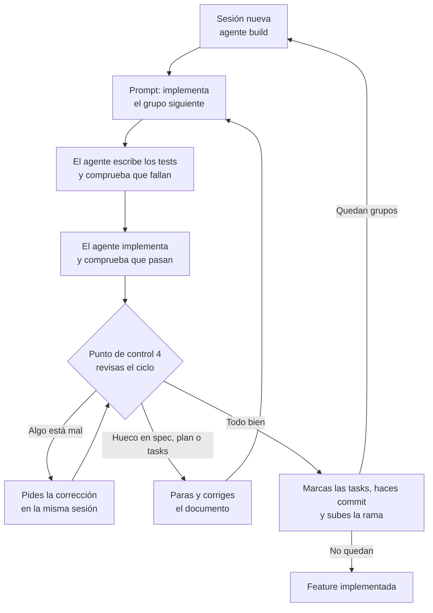

# 3. Descomponer en tasks e implementar

[⬅️ Volver a la unidad](./README.md)

## Índice

- [3.1. Del plan a las tasks](#31-del-plan-a-las-tasks)
  - [3.1.1. Qué es una task en el flujo](#311-qué-es-una-task-en-el-flujo)
  - [3.1.2. Cualidades de una buena task](#312-cualidades-de-una-buena-task)
  - [3.1.3. Anatomía de una task](#313-anatomía-de-una-task)
  - [3.1.4. Grupos, marcadores y paralelismo](#314-grupos-marcadores-y-paralelismo)
  - [3.1.5. Plantilla de tasks](#315-plantilla-de-tasks)
- [3.2. Generar las tasks con OpenCode](#32-generar-las-tasks-con-opencode)
- [3.3. Revisar las tasks: punto de control 3](#33-revisar-las-tasks-punto-de-control-3)
  - [3.3.1. Lista de comprobación](#331-lista-de-comprobación)
  - [3.3.2. Errores típicos de unas tasks generadas](#332-errores-típicos-de-unas-tasks-generadas)
- [3.4. Implementar en ciclos cortos](#34-implementar-en-ciclos-cortos)
  - [3.4.1. La cadencia](#341-la-cadencia)
  - [3.4.2. El prompt de implementar](#342-el-prompt-de-implementar)
  - [3.4.3. Tests antes que el código](#343-tests-antes-que-el-código)
  - [3.4.4. Revisar el ciclo: punto de control 4](#344-revisar-el-ciclo-punto-de-control-4)
  - [3.4.5. Marcar, hacer commit y seguir](#345-marcar-hacer-commit-y-seguir)
  - [3.4.6. La integración continua](#346-la-integración-continua)
  - [3.4.7. Fusionar la feature](#347-fusionar-la-feature)
- [3.5. Cuando aparece lo inesperado](#35-cuando-aparece-lo-inesperado)
- [3.6. Errores típicos al implementar con un agente](#36-errores-típicos-al-implementar-con-un-agente)
- [3.7. Las tasks en otras herramientas](#37-las-tasks-en-otras-herramientas)
- [3.8. Ejemplo integrador: implementar «Añadir una tarea»](#38-ejemplo-integrador-implementar-añadir-una-tarea)
- [Resumen](#resumen)
- [Ejercicios de reflexión](#ejercicios-de-reflexión)

> **Criterios que trabaja este tema:** OA2 c.

---

## 3.1. Del plan a las tasks

### 3.1.1. Qué es una task en el flujo

En la UD1 (tema 4) viste la **task** como el último nivel de la jerarquía épico → feature → historia → task: una tarea técnica concreta, como «crear el endpoint `POST /tareas`». También viste que en SDD las tasks **no se escriben a mano desde cero**: salen del plan.

Ahora toca hacerlo. La fase de **descomponer** convierte la **secuencia de implementación** del plan en una lista de pasos pequeños que el agente puede hacer de uno en uno y que tú puedes revisar de uno en uno. El resultado es el fichero `tasks.md`, en la carpeta de la feature.

| | Plan | Tasks |
|---|---|---|
| **Pregunta** | ¿Cómo se construye? | ¿En qué pasos y en qué orden? |
| **Unidad** | Decisión técnica (`D-01`) | Paso verificable (`T-01`) |
| **Lo usa** | Quien revisa la arquitectura | El agente que implementa y quien revisa cada ciclo |
| **Cambia durante la implementación** | Rara vez | Se marca cada task hecha y se añaden las que aparezcan |

> 📝 **Nota del Profesor**: las tasks son la parte del flujo que **más se parece a programar**: son tu lista de la compra para la sesión de trabajo. Si el plan está bien hecho, descomponer es casi mecánico. Si cuesta mucho descomponer, suele ser una señal de que al plan le falta algo.

### 3.1.2. Cualidades de una buena task

Una buena task cumple seis condiciones:

| Cualidad | Qué significa | Señal de que falla |
|----------|---------------|--------------------|
| **Pequeña** | Toca uno o dos ficheros y se hace en minutos, no en días | «T-03: implementar la API» |
| **Aislada** | Se puede hacer y comprobar sin terminar otras tasks del mismo grupo, salvo las dependencias marcadas | Dos tasks que modifican el mismo fichero a la vez |
| **Verificable** | Tiene un criterio de terminado objetivo: un test que pasa, un comando que funciona | «Terminada cuando: funciona bien» |
| **Ordenada** | Va después de todo lo que necesita | El controlador antes que el servicio que llama |
| **Trazable** | Dice qué decisiones del plan desarrolla y qué identificadores de la spec cubre | Una task que no viene de ninguna decisión del plan |
| **Con los tests delante** | Si la constitución pide tests antes que el código, la task de test va antes que la de implementación | La task de tests al final de la lista |

La regla de **uno o dos ficheros** es orientativa. Si una task toca cinco ficheros muy pequeños que no tienen sentido por separado (por ejemplo, el «cableado» de una aplicación: rutas, arranque y configuración), se puede aceptar, pero **justificándolo** en la revisión.

> 💡 **Tip del Examinador**: «¿Qué características debe tener una task bien formada?». Debe ser pequeña (uno o dos ficheros), aislada, verificable con un criterio de terminado objetivo, ordenada respecto a sus dependencias y trazable a las decisiones del plan y a los identificadores de la spec. Si el proyecto aplica TDD, las tasks de test van antes que las de implementación.

### 3.1.3. Anatomía de una task

Cada task del curso tiene esta forma:

```markdown
- [ ] T-04: Servicio de tareas y ErrorValidacion
  - Ficheros: src/servicios/servicio-tareas.js,
    src/errores/error-validacion.js
  - Cubre: D-01, D-03, D-05
  - Depende de: T-02 (el repositorio) y T-03
  - Terminada cuando: los tests de T-03 pasan y los de T-01 siguen
    pasando
```

| Parte | Para qué |
|-------|----------|
| `- [ ]` | Casilla que se marca (`- [x]`) cuando la task está hecha y revisada. GitHub la muestra como casilla |
| `T-04` | Identificador estable: se cita en los prompts y en los commits |
| Título | Qué se hace, en pocas palabras |
| **Ficheros** | Qué ficheros puede crear o modificar el agente. Todo lo demás está fuera de la task |
| **Cubre** | Decisiones del plan (`D-`) y, en las tasks de test, identificadores de la spec |
| **Depende de** | Tasks que tienen que estar hechas antes. Se omite si no depende de nada |
| **Terminada cuando** | El criterio objetivo para marcarla |

La línea **Ficheros** es la más útil durante la implementación: cuando revisas el ciclo, cualquier fichero modificado que no esté en esa línea es algo que el agente ha hecho sin que se lo pidieras.

### 3.1.4. Grupos, marcadores y paralelismo

Las tasks se organizan en **grupos**, y cada grupo termina en un **punto de control**: es la cantidad de trabajo que revisarás de una vez. Un grupo típico tiene dos tasks: la de tests y la de implementación.

Además, algunas herramientas usan **marcadores** en las tasks. Los más extendidos son:

| Marcador | Significado | En el curso |
|----------|-------------|-------------|
| `[P]` | La task se puede hacer **en paralelo** con otras: no depende de ellas ni toca sus ficheros | Se usa |
| Punto de control al final del grupo | Hay que revisar antes de seguir | Se usa, como línea al final de cada grupo |
| Marcador de test | La task es de tests y va antes que su implementación | No hace falta: el título empieza por «Tests de…» y va antes |

El marcador `[P]` tiene sentido cuando varios agentes (o varias personas) trabajan a la vez. En la UD4 verás cómo se reparten tasks en paralelo entre agentes; por ahora, te sirve para saber qué tasks podrías adelantar si una se atasca.

### 3.1.5. Plantilla de tasks

```markdown
# Tasks: <nombre de la feature>

| Campo   | Valor                                 |
|---------|---------------------------------------|
| Feature | <nombre de la feature>                |
| Plan    | plan.md                               |
| Estado  | Borrador · Aprobadas                  |

## Grupo 1 · <qué se construye> (<D-xx>)

- [ ] T-01: Tests de <…>
  - Fichero: <ruta>
  - Cubre: <identificadores de la spec> (<D-xx>)
  - Terminada cuando: los tests existen y fallan

- [ ] T-02: <…>
  - Ficheros: <rutas>
  - Depende de: T-01
  - Terminada cuando: los tests de T-01 pasan

> Punto de control: revisar los cambios, ejecutar los tests y hacer commit.

## Grupo 2 · …
```

---

## 3.2. Generar las tasks con OpenCode

La fase sigue el mismo esquema que la del plan (tema 2): **sesión nueva**, agente ***plan*** para proponer, ***build*** para guardar.

```text
Lee el plan aprobado @docs/specs/A-añadir-tarea/plan.md y la spec
@docs/specs/A-añadir-tarea/spec.md.

Descompón la secuencia de implementación del plan en tasks con la
plantilla del curso:
- Identificadores T-01, T-02…, en grupos de dos como máximo, con un
  punto de control al final de cada grupo.
- En cada task: ficheros, decisiones del plan que cubre (D-xx),
  dependencias y un criterio de terminado objetivo.
- Las tasks de tests van antes que las de implementación y dicen qué
  identificadores de la spec comprueban. Entre todas, deben cubrir
  todas las filas de la estrategia de pruebas del plan.
- Marca con [P] las tasks que se puedan hacer en paralelo.

No añadas nada que no esté en el plan. Si para descomponer necesitas
una decisión que el plan no toma, dímelo en lugar de tomarla.
```

Fíjate en la frase de la cobertura: «entre todas, deben cubrir todas las filas de la estrategia de pruebas». Obliga al agente a comprobar la trazabilidad de la spec hasta las tasks, y te da algo concreto que revisar.

Cuando la propuesta te convence, cambias a *build* y le pides que guarde **solo** `tasks.md`. Compruebas con `git status`, lees el fichero, cambias el estado a `Aprobadas` y haces el commit:

```bash
git add docs/specs/A-añadir-tarea/tasks.md
git commit -m "Tasks de la feature A (aprobadas)"
```

---

## 3.3. Revisar las tasks: punto de control 3

### 3.3.1. Lista de comprobación

El punto de control 3 responde a una pregunta: **¿son pasos pequeños, ordenados y verificables?**

**Tamaño y orden**

- [ ] Cada task toca uno o dos ficheros (o la excepción está justificada).
- [ ] Ninguna task depende de otra que va después.
- [ ] Las tasks de tests van antes que su implementación.

**Cobertura**

- [ ] Cada decisión del plan aparece en alguna task.
- [ ] Cada fila de la estrategia de pruebas está en alguna task de tests.
- [ ] No faltan tasks «aburridas»: el `package.json`, el `.gitignore`, la configuración, la página, la comprobación manual.

**Verificabilidad**

- [ ] Cada task tiene un criterio de terminado que se puede comprobar sin opinar.
- [ ] Los grupos son lo bastante pequeños para revisarlos de una vez.

**Alcance**

- [ ] No hay tasks que no vengan del plan.

### 3.3.2. Errores típicos de unas tasks generadas

| Error | Ejemplo | Qué hacer |
|-------|---------|-----------|
| **Task enorme** | «T-02: implementar el backend» | Dividirla siguiendo las decisiones del plan |
| **Tasks microscópicas** | Una task por cada función de cuatro líneas | Agruparlas: el proceso no puede pesar más que el trabajo |
| **Tests al final** | Todas las tasks de tests en el último grupo | Ponerlas delante de su implementación |
| **Dependencia al revés** | El servicio antes que el repositorio en el que guarda | Reordenar |
| **Criterio vago** | «Terminada cuando: el servicio funciona» | Pedir un criterio comprobable: qué tests pasan, qué comando funciona |
| **Falta una task** | Nadie crea el `package.json` ni instala las dependencias | Añadirla en el primer grupo que la necesite |
| **Task que no viene del plan** | «T-09: añadir registro de peticiones» | Quitarla; si hace falta, va al plan primero |
| **Cobertura incompleta** | Ninguna task de tests cubre EC-04 | Añadir el identificador a la task de tests que corresponda |

> ⚠️ **Cuidado**: el error «dependencia al revés» se detecta mal leyendo las tasks una por una, porque cada una parece correcta. Léelas **en orden** y pregúntate en cada una: «¿lo que necesita esta task ya existe?».

---

## 3.4. Implementar en ciclos cortos

### 3.4.1. La cadencia

Con las tasks aprobadas empieza la fase en la que el agente escribe código. La regla de oro es **no pedirle todas las tasks de golpe**. Se trabaja en **ciclos cortos**, un grupo de tasks cada vez:



El diagrama muestra por qué los ciclos son cortos: cada vuelta termina con una revisión y un commit, así que un error nunca arrastra más de un grupo de tasks. Y cada ciclo empieza con una **sesión nueva**: el contexto de la sesión anterior ya está en los ficheros y en el historial.

| Si pides… | Pasa que… |
|-----------|-----------|
| Todas las tasks de una vez | El agente acumula errores, pierde el hilo y te entrega un cambio enorme que no puedes revisar a fondo |
| Un grupo (una o dos tasks) | Revisas un cambio pequeño, con sus tests, y cada error se detecta en el ciclo en que nace |

> 📝 **Nota del Profesor**: los ciclos cortos son la diferencia más visible entre SDD y *vibe coding*. En el *vibe coding* revisas un resultado; en SDD revisas **cambios pequeños con un propósito escrito** (la task) y una forma objetiva de comprobarlos (sus tests).

### 3.4.2. El prompt de implementar

```text
Implementa el grupo 1 de @docs/specs/A-añadir-tarea/tasks.md
(T-01 y T-02).

Primero T-01: escribe los tests, ejecuta npm test y comprueba que
fallan. Después T-02: escribe lo mínimo para que pasen y vuelve a
ejecutar npm test.

Reglas:
- Haz solo estas dos tasks. No crees ni modifiques ficheros que no
  aparezcan en ellas, salvo para marcarlas en tasks.md.
- No cambies un test para que pase. Si crees que un test está mal,
  dímelo.
- Si algo no encaja con la spec, el plan o la constitución, para y
  pregúntame.
- Al terminar, marca T-01 y T-02 con [x] en tasks.md y espera mi
  revisión.
```

Las reglas del prompt son las que evitan los problemas más frecuentes:

- **«Solo estas dos tasks»:** sin esta línea, el agente tiende a «adelantar trabajo» del grupo siguiente.
- **«No cambies un test para que pase»:** un agente que no consigue que un test pase puede cambiar el test en lugar del código. Es la trampa más peligrosa de la fase, porque todo queda en verde.
- **«Para y pregúntame»:** la salida que el agente necesita para no inventar.
- **«Espera mi revisión»:** el punto de control es tuyo.

El agente necesita ejecutar `npm test` varias veces en cada ciclo. En el `opencode.json` del tema 3 de la UD1 ese comando ya está permitido (`"npm test": "allow"`), mientras que el resto de comandos sigue preguntando (`"*": "ask"`). Si el agente te pide permiso para algo distinto, como instalar un paquete, léelo antes de aceptar: la task dice qué dependencias tocan en cada ciclo.

### 3.4.3. Tests antes que el código

La constitución de la lista de tareas dice que los tests se escriben **antes** que el código. Por eso cada grupo tiene una task de tests y una de implementación, en ese orden. El ciclo tiene dos pasos que debes ver en cada grupo:

1. **Rojo:** los tests existen y **fallan**, porque el código todavía no existe. Si un test nuevo pasa sin código, no está comprobando nada.
2. **Verde:** el agente escribe el código mínimo y los tests **pasan**.

Hay un tercer paso, **refactorizar** (mejorar el código sin cambiar su comportamiento, con los tests en verde), y una disciplina completa detrás: el **desarrollo guiado por pruebas** (TDD, *Test-Driven Development*). En la UD3 verás cómo se sacan las pruebas de la spec y dónde encaja TDD. Por ahora, quédate con la idea: en SDD los tests **salen de la spec** (cada uno lleva su identificador) y se escriben antes para que el código se escriba **contra** ellos.

> ✅ **Buena práctica**: pide al agente que te enseñe la salida de los tests en rojo antes de implementar. Es la prueba de que los tests se escribieron primero y de que fallan por el motivo correcto (el código no existe), no por un error en el propio test.

### 3.4.4. Revisar el ciclo: punto de control 4

Cuando el agente dice que ha terminado, **no te fíes de su resumen**: revisa tú.

```bash
git status
git diff
npm test
```

Y responde a esta lista:

- [ ] **Ficheros:** solo han cambiado los de las tasks del grupo (y `tasks.md`).
- [ ] **Tests:** `npm test` en verde **ejecutado por ti**, y ningún test anterior se ha modificado ni borrado.
- [ ] **Cobertura:** los tests llevan en su nombre los identificadores que dice la task, y comprueban de verdad lo que dicen (el mensaje exacto, el código exacto).
- [ ] **Plan y constitución:** el código sigue las decisiones `D-xx` y los principios (capas, formato de los errores, nombres en español).
- [ ] **Alcance:** no hay comportamiento que no esté en la spec.
- [ ] **Legibilidad:** entiendes el código. Si no lo entiendes, pide al agente que te lo explique **antes** de aceptarlo.

> ⚠️ **Cuidado**: «el agente dice que todos los tests pasan» no es lo mismo que «los tests pasan». El agente puede haber ejecutado otro comando, haber leído mal la salida o haber cambiado algo después. Ejecuta `npm test` tú mismo en cada punto de control.

Después del commit, la **integración continua** repetirá los tests en GitHub (apartado 3.4.6). No sustituye a esta revisión: la CI solo dice si los tests pasan, no si los ficheros, el alcance o el código son los que tocaban.

> 💡 **Tip del Examinador**: «¿Qué compruebas en el punto de control de un ciclo de implementación?». Que solo han cambiado los ficheros de las tasks, que los tests pasan al ejecutarlos tú y no se ha modificado ninguno anterior, que los tests cubren los identificadores de la spec indicados, que el código respeta el plan y la constitución y que no hay comportamiento que no esté en la spec.

### 3.4.5. Marcar, hacer commit y seguir

Si el ciclo está bien:

1. Comprueba que las tasks del grupo están marcadas con `[x]` en `tasks.md`.
2. Haz **un commit por grupo**, con las tasks en el mensaje:

   ```bash
   git add .
   git commit -m "Feature A: T-01 y T-02, repositorio de tareas con sus tests"
   ```

3. **Sube la rama** (`git push`) y comprueba que la integración continua termina en verde (apartado 3.4.6).
4. Empieza una **sesión nueva** para el siguiente grupo.

Al empezar el primer ciclo, el estado de la spec y del índice de features pasa a `En implementación`; al terminar el último, a `Implementada`. Cómo se lleva ese estado lo verás en el tema 4.

### 3.4.6. La integración continua

Hasta ahora, la garantía de que los tests pasan es que **tú** ejecutas `npm test` en **tu** equipo. Funciona, pero tiene dos puntos débiles: depende de que te acuerdes, y tu equipo puede tener cosas que el repositorio no tiene (un fichero que no añadiste al commit, una dependencia instalada a mano).

La **integración continua** (CI, *continuous integration*) cubre esos dos huecos. Cada vez que subes commits a GitHub, un servidor descarga el repositorio en una **máquina limpia**, instala las dependencias y ejecuta los tests. El resultado, verde o rojo, queda junto al commit, a la vista de cualquiera.

**El workflow del curso.** En GitHub, la CI se configura con **GitHub Actions**: un fichero YAML en la carpeta `.github/workflows/`, llamado ***workflow***. El curso te da este, `.github/workflows/calidad.yml`, y lo copias tal cual:

```yaml
name: Calidad

on:
  push:

permissions:
  contents: read

jobs:
  tests:
    name: Tests
    runs-on: ubuntu-latest
    steps:
      - uses: actions/checkout@v7
      - uses: actions/setup-node@v7
        with:
          node-version: 24
          cache: npm
      - run: npm ci
      - run: npm test
```

| Parte | Qué hace |
|-------|----------|
| `on: push` | Se ejecuta con cada `push`, a cualquier rama |
| `permissions: contents: read` | El workflow solo puede **leer** el repositorio: no necesita más |
| `jobs: tests` | Un ***job***: una lista de pasos que se ejecuta en una máquina limpia (`runs-on: ubuntu-latest`), creada para él y destruida al terminar |
| `actions/checkout` | Descarga el código del commit |
| `actions/setup-node` | Instala Node 24 y guarda las dependencias descargadas entre ejecuciones (`cache: npm`), para que la instalación tarde menos |
| `npm ci` | Instala **exactamente** las versiones de `package-lock.json`, sin modificarlo. Por eso `package-lock.json` va en el repositorio, y `node_modules/` no (está en `.gitignore`) |
| `npm test` | Los mismos tests que ejecutas tú en cada punto de control |

> ⚠️ **Cuidado**: el workflow **no se modifica**, ni tú ni el agente. Es la vara de medir: si para que la CI pase se cambia el workflow (se quita un paso, se cambia `npm test` por otro comando), deja de medir lo mismo. Cambiarlo es una decisión del proyecto, como un cambio de la constitución. En la UD3 lo ampliarás con más comprobaciones.

**Dónde se ve el resultado.** En la pestaña **Actions** del repositorio aparece una ejecución por cada `push`, con el registro de cada paso. GitHub pone además una marca junto al último commit de la rama: verde si todo ha pasado, roja si algo ha fallado, amarilla mientras se ejecuta.

**El ciclo con la CI.** Después del commit de cada grupo subes la rama. La CI no sustituye al punto de control 4: **repite** sus tests en otra máquina. Tú ejecutas `npm test` antes del commit; la CI, después del `push`. Si las dos dicen lo mismo, el resultado no depende de tu equipo.

**Si la CI sale en rojo** y en tu equipo los tests pasan, casi siempre es porque tu equipo tiene algo que el repositorio no dice:

| Causa | Cómo se ve | Arreglo |
|-------|------------|---------|
| Un fichero sin añadir al commit | `Cannot find module` en la CI; en local, todo bien | `git status`, añadir el fichero y hacer un commit |
| `package-lock.json` sin subir o desfasado respecto a `package.json` | El *job* falla al instalar, antes de llegar a los tests | `npm install` y commit de `package.json` y `package-lock.json` juntos |
| Un test que depende de tu equipo | Falla solo en la CI: la zona horaria, una ruta de tu disco, el orden en que se ejecutan los tests | Arreglar el test para que no dependa de eso, y pensar por qué el punto de control no lo vio |

Para reproducirlo, haz en tu equipo lo mismo que la CI, desde cero:

```bash
rm -rf node_modules
npm ci
npm test
```

Lo arreglas en la rama con un commit nuevo, como cualquier otro fallo. **No se empieza el ciclo siguiente con la CI en rojo**, y una feature con la CI en rojo no se fusiona.

> 💡 **Tip del Examinador**: «Si ejecutas `npm test` en cada punto de control, ¿para qué sirve la integración continua?». Para que los tests se ejecuten **siempre**, en cada `push`, y en una **máquina limpia** que solo tiene lo que hay en el repositorio. Detecta lo que tu equipo esconde (un fichero sin subir, una dependencia que no está en `package-lock.json`) y deja el resultado a la vista, junto al commit.

### 3.4.7. Fusionar la feature

Con el último ciclo revisado y su commit hecho, la feature está terminada en su rama (tema 1, apartado 1.3.4). Antes de fusionarla, una comprobación final de **toda** la feature, no solo del último grupo:

```bash
git status                                   # nada sin commit
npm test                                     # todos los tests, en verde
git diff --stat main...feature/A-añadir-tarea  # todo lo que trae la rama
```

Y en GitHub, la CI del **último commit** de la rama, en verde. Si el último `push` es anterior a algún commit, súbelo antes y espera al resultado.

La última orden lista los ficheros que la rama cambia respecto a `main`. Todos deberían venir de una task, de la carpeta de la feature o de un cambio del contexto que aprobaste por el camino. Si aparece algo que no reconoces, se revisa antes de fusionar.

Después, la fusión y el borrado de la rama:

```bash
git switch main
git merge --no-ff feature/A-añadir-tarea -m "Fusiona la feature A: añadir una tarea"
git branch -d feature/A-añadir-tarea
git push origin main
```

Al subir `main`, la CI se ejecuta también sobre el resultado de la fusión. Si `main` había avanzado mientras trabajabas en la rama, es la primera vez que se prueban juntos los dos lados.

Con la feature en `main`, toca **replanificar** antes de la siguiente (tema 1, apartado 1.2.8).

> ✅ **Buena práctica**: si una feature se alarga, no la fusiones a medias para «tener algo en `main`». Si resulta demasiado grande, el problema está en cómo se delimitó (UD1, tema 4): se para, se divide en dos features (tema 4, apartado 4.6) y se termina primero la parte que tiene sentido por sí sola.

---

## 3.5. Cuando aparece lo inesperado

Por bien hecho que esté el plan, durante la implementación aparecen cosas que nadie previó. La regla es la del tema 1: **se para y se corrige donde nació**, antes de seguir.

| Situación | Ejemplo | Qué se corrige |
|-----------|---------|----------------|
| La task es más grande de lo previsto | El controlador necesita además un manejador de errores común | `tasks.md`: se añade una task nueva con el siguiente número libre, indicando de qué task sale |
| Choca con código existente | Ya existe una función parecida que el plan no tuvo en cuenta | `plan.md`: decisión nueva o corregida; después, las tasks afectadas |
| Una dependencia no se comporta como se esperaba | La librería no admite lo que el plan supuso | `plan.md` |
| Aparece un comportamiento que nadie decidió | Los nombres de los campos de la respuesta de la API | `spec.md`: nueva versión, y el plan se actualiza para citarla |
| El agente quiere mejorar algo «de paso» | Reorganizar un fichero que no está en la task | Nada: se anota para otra feature y no se hace ahora |

El procedimiento:

1. **Para** el ciclo: no se sigue implementando con la duda abierta.
2. **Decide** y corrige el documento que corresponda (spec, plan o tasks).
3. **Retoma** el ciclo; si la sesión se ha llenado de discusión, con una sesión nueva.
4. El cambio en el documento va en el **mismo commit** que el código al que afecta (tema 5 de la UD1: la spec como documento vivo).

> 📝 **Nota del Profesor**: parar parece lento, pero evita el problema más caro de un SDD mal hecho: que el código se separe de los documentos sin que nadie lo note. Un comportamiento decidido en el código y no en la spec es una decisión invisible, exactamente lo que SDD pretende evitar.

---

## 3.6. Errores típicos al implementar con un agente

| Error | Consecuencia | Cómo evitarlo |
|-------|--------------|---------------|
| Pedir todas las tasks de una vez | Un cambio enorme, imposible de revisar a fondo | Un grupo por ciclo |
| Aceptar sin leer el `git diff` | Entran ficheros y comportamientos que nadie pidió | Revisar los ficheros contra la línea «Ficheros» de cada task |
| Dejar que el agente cambie los tests | Todo en verde, pero los tests ya no comprueban la spec | Prohibirlo en el prompt y revisar que ningún test anterior ha cambiado |
| Fiarse del «todos los tests pasan» | Errores que nadie ha visto | Ejecutar `npm test` tú en cada punto de control |
| Corregir solo el código cuando el hueco era de la spec | Los documentos dejan de decir la verdad | Parar y corregir donde nació (apartado 3.5) |
| Una sesión para toda la feature | El agente arrastra errores y discusiones viejas | Sesión nueva en cada ciclo |
| Un commit al final | No se puede volver a un punto intermedio ni saber qué cambió en cada paso | Un commit por grupo de tasks |
| Marcar tasks sin revisarlas | `tasks.md` dice que está hecho algo que nadie ha comprobado | Las tasks se dan por hechas en el punto de control, no cuando lo dice el agente |
| Seguir o fusionar con la CI en rojo «porque en mi equipo pasa» | El repositorio no funciona fuera de tu equipo, y el fallo se mezcla con los cambios siguientes | Reproducirlo con `npm ci` desde cero y arreglarlo antes de seguir |
| Cambiar el workflow para que la CI pase | La CI ya no mide lo que medía | El workflow no se toca; se arregla el código, el test o el repositorio |

---

## 3.7. Las tasks en otras herramientas

| Herramienta | Cómo son las tasks |
|-------------|--------------------|
| **Spec Kit** | `tasks.md` con identificadores numerados, el marcador `[P]` para lo que se puede hacer en paralelo y las tasks agrupadas por historia de usuario, con los tests antes que la implementación. Un comando implementa las tasks en orden |
| **Kiro** | `tasks.md` con casillas que Kiro marca mientras trabaja. Puede ejecutar todas las tasks construyendo un grafo de dependencias y lanzando a la vez las que no dependen entre sí |
| **Conductor** | No hay fichero de tasks: el plan tiene fases y, dentro, tareas con casillas. El agente marca cada una y puede deshacerse una tarea o una fase usando el historial de Git |

En todas, la idea es la misma: una lista de pasos pequeños, con casillas, que el agente recorre y que alguien revisa. Lo que cambia es **cuánto** se deja hacer al agente de una vez: ejecutar todas las tasks seguidas es rápido, pero reduce los puntos de control. En el curso, por ahora, irás grupo a grupo.

---

## 3.8. Ejemplo integrador: implementar «Añadir una tarea»

En el tema 2 aprobaste el plan de la feature A. Ahora vas a descomponerlo y a implementarlo, ciclo a ciclo.

**1. Las tasks.** En una sesión nueva, con *plan*, usas el prompt del apartado 3.2. En la primera propuesta del agente encuentras dos problemas: la creación del `package.json` no está en ninguna task, y T-06 toca cinco ficheros. Pides que el `package.json` se cree en T-01, junto con un `.gitignore` que deje `node_modules/` fuera del repositorio (el plan los lista en «Ficheros»), y que se amplíe en las tasks que añaden dependencias; T-06 lo aceptas, porque son ficheros de «cableado» muy pequeños que no tienen sentido por separado. Este es `tasks.md` aprobado:

```markdown
# Tasks: Añadir una tarea

| Campo   | Valor            |
|---------|------------------|
| Feature | Añadir una tarea |
| Plan    | plan.md          |
| Estado  | Aprobadas        |

## Grupo 1 · Repositorio (D-04)

- [ ] T-01: Tests del repositorio de tareas
  - Ficheros: package.json (Vitest y el script test), .gitignore
    (node_modules/), tests/repositorio-tareas.test.js
  - Cubre: D-04
  - Terminada cuando: los tests existen y fallan, porque el repositorio
    aún no existe

- [ ] T-02: Repositorio de tareas
  - Fichero: src/repositorios/repositorio-tareas.js
  - Depende de: T-01
  - Terminada cuando: los tests de T-01 pasan

> Punto de control: revisar los cambios, ejecutar los tests y hacer commit.

## Grupo 2 · Servicio (D-01, D-03, D-05)

- [ ] T-03: Tests del servicio de tareas
  - Fichero: tests/servicio-tareas.test.js
  - Cubre: RF-01, RF-04, RNF-02, RNF-03, EC-01, EC-02 y EC-05
    (D-01, D-03, D-05)
  - Terminada cuando: los tests existen y fallan, porque el servicio
    aún no existe

- [ ] T-04: Servicio de tareas y ErrorValidacion
  - Ficheros: src/servicios/servicio-tareas.js,
    src/errores/error-validacion.js
  - Depende de: T-02 (el repositorio) y T-03
  - Terminada cuando: los tests de T-03 pasan y los de T-01 siguen
    pasando

> Punto de control: revisar los cambios, ejecutar los tests y hacer commit.

## Grupo 3 · API (D-02, D-06, D-07)

- [ ] T-05: Tests de la API
  - Ficheros: package.json (supertest), tests/api-tareas.test.js
  - Cubre: RF-02, AC-03, EC-01, EC-02, EC-03, EC-04, EC-05 y RNF-01
    (D-02, D-06)
  - Terminada cuando: los tests existen y fallan, porque la aplicación
    aún no existe

- [ ] T-06: Controlador, rutas, aplicación y servidor
  - Ficheros: package.json (Express y el script start),
    src/controladores/controlador-tareas.js, src/rutas/tareas.js,
    src/app.js, src/servidor.js
  - Depende de: T-04 y T-05
  - Terminada cuando: pasan todos los tests y npm start arranca el
    servidor

> Punto de control: revisar los cambios, ejecutar los tests y hacer commit.

## Grupo 4 · Página (D-08)

- [ ] T-07 [P]: Página con el formulario y la lista
  - Fichero: public/index.html
  - Terminada cuando: con el servidor arrancado, la dirección raíz
    muestra el formulario

- [ ] T-08: Envío del formulario
  - Fichero: public/app.js
  - Cubre: RF-03, AC-01, AC-02 (D-08)
  - Depende de: T-06 y T-07
  - Terminada cuando: comprobados a mano en el navegador AC-01 (la
    tarea aparece al final de la lista sin recargar) y AC-02 (con el
    campo vacío no se añade nada)

> Punto de control: revisar los cambios, ejecutar los tests, comprobar
> la página y hacer commit.
```

Fíjate en tres detalles: cada grupo empieza por los tests; T-07 lleva `[P]` porque el HTML no depende de la API y podría hacerse en paralelo con el grupo 3; y las comprobaciones manuales de la página (AC-01 y AC-02) están **escritas** como criterio de terminado, igual que un test.

```bash
git commit -am "Tasks de la feature A (aprobadas)"
```

**2. Ciclo 1: el repositorio (T-01 y T-02).** Sesión nueva con *build* y el prompt del apartado 3.4.2. El agente crea el `package.json`, el `.gitignore` y los tests, y los ejecuta. Están en **rojo**, por el motivo correcto:

```text
 FAIL  tests/repositorio-tareas.test.js
Error: Cannot find module '../src/repositorios/repositorio-tareas.js'
imported from tests/repositorio-tareas.test.js

 Test Files  1 failed (1)
      Tests  no tests
```

Después escribe el repositorio. Es un array en memoria, como decidió D-04, exportado como un objeto para que un test pueda sustituir `guardar` (riesgo anotado en el plan para EC-03):

```javascript
const tareas = [];

export const repositorioTareas = {
  guardar(tarea) {
    tareas.push(tarea);
    return tarea;
  },

  obtenerTodas() {
    return [...tareas];
  },
};
```

`obtenerTodas` devuelve una **copia** del array, para que nadie pueda cambiar las tareas guardadas desde fuera del repositorio. La feature A la necesita para comprobar en los tests que una tarea se ha guardado (RF-01).

Revisas con la lista del apartado 3.4.4: solo han cambiado `package.json`, `package-lock.json`, `.gitignore`, los dos ficheros de las tasks y `tasks.md`; `npm test` en verde; el código cumple D-04. Al ser el primer ciclo, cambias también el estado de la spec y del índice a `En implementación`. Commit:

```bash
git add .
git commit -m "Feature A: T-01 y T-02, repositorio de tareas con sus tests"
```

**3. La lista de tareas en GitHub, con la CI.** Hasta aquí el proyecto solo estaba en tu equipo. Con el ciclo 1 hecho ya tiene `package.json` y `package-lock.json`, así que la CI tiene algo que ejecutar. Creas en GitHub un repositorio **vacío** llamado `lista-tareas` (sin README ni licencia, para que no haya nada que fusionar), copias en la rama el workflow del apartado 3.4.6 en `.github/workflows/calidad.yml` y lo subes todo:

```bash
git add .github/workflows/calidad.yml
git commit -m "CI: workflow de tests del curso"
git remote add origin https://github.com/<tu-usuario>/lista-tareas.git
git push -u origin main
git push -u origin feature/A-añadir-tarea
```

El workflow va en la rama y no en `main`, porque `main` todavía no tiene `package.json` y la CI fallaría al instalar. Llegará a `main` con la fusión. Es un cambio del contexto del proyecto, no de la feature, y por eso va en su propio commit, separado de los de las tasks.

En la pestaña **Actions** aparece la primera ejecución del workflow `Calidad`, en la rama: el *job* `Tests`, en verde, con los 3 tests del repositorio. Al subir `main` no se ejecutó nada, porque `main` no tiene el workflow.

**4. Ciclo 2: el servicio (T-03 y T-04), con una sorpresa.** Sesión nueva, mismo prompt con el grupo 2. El agente escribe los tests en rojo y después el servicio. En la revisión, al leer el `git diff`, ves cómo construye la tarea:

```javascript
const tarea = {
  id: randomUUID(),
  texto: textoRecortado,
  estado: 'pendiente',
  fechaCreacion: new Date().toISOString(),
};
```

El código es correcto, pero hace una pregunta que nadie había respondido: **¿cómo se llaman los campos de la tarea en la respuesta de la API?** La spec dice que la respuesta contiene «un id, el texto, el estado y una fecha», pero no sus nombres. El agente ha elegido `texto`, mientras que la petición usa `text`. Quien llame a la API enviará `text` y recibirá `texto`. Eso **se nota desde fuera**: es un hueco de la spec que no detectaron ni el punto de control 1 ni el 2.

Aplicas el apartado 3.5:

1. **Paras** el ciclo antes de hacer commit.
2. **Decides:** la respuesta usa el mismo nombre que la petición para el texto (`text`) y nombres en español para el resto, como el resto del proyecto. En la spec, RF-02 pasa a nombrar los campos y la versión sube a `1.2`:

   ```markdown
   - RF-02: Cuando el sistema guarde una tarea nueva, deberá devolverla
     completa como confirmación, con los campos id, text, estado y
     fechaCreacion.
   ```

   En el plan solo cambia la línea de metadatos que cita la spec: `spec.md, versión 1.2`.

3. **Retomas** en la misma sesión:

   ```text
   He actualizado la spec a la versión 1.2: lee RF-02 en
   @docs/specs/A-añadir-tarea/spec.md. La tarea usa los campos id, text,
   estado y fechaCreacion. Corrige el servicio y los tests de T-03 para
   que usen esos nombres. No cambies nada más.
   ```

Vuelves a revisar. Así quedan los tests del servicio, cada uno con su identificador:

```javascript
import { describe, expect, test } from 'vitest';
import { ErrorValidacion } from '../src/errores/error-validacion.js';
import { repositorioTareas } from '../src/repositorios/repositorio-tareas.js';
import { crearTarea } from '../src/servicios/servicio-tareas.js';

describe('crearTarea', () => {
  test('RF-01: guarda la tarea con id, texto, estado "pendiente" y fecha', () => {
    const tarea = crearTarea('Comprar leche');

    expect(tarea).toEqual({
      id: expect.any(String),
      text: 'Comprar leche',
      estado: 'pendiente',
      fechaCreacion: expect.any(String),
    });
    expect(new Date(tarea.fechaCreacion).toISOString()).toBe(
      tarea.fechaCreacion,
    );
    expect(repositorioTareas.obtenerTodas()).toContainEqual(tarea);
  });

  test('RNF-03: genera un id distinto para cada tarea', () => {
    const primera = crearTarea('Primera');
    const segunda = crearTarea('Segunda');

    expect(primera.id).not.toBe(segunda.id);
  });

  test('RF-04: guarda el texto sin los espacios de los extremos', () => {
    expect(crearTarea('  Comprar leche  ').text).toBe('Comprar leche');
  });

  test('EC-01: rechaza un texto vacío', () => {
    expect(() => crearTarea('')).toThrow(
      'El texto de la tarea no puede estar vacío',
    );
  });

  test('EC-01: rechaza un texto con solo espacios', () => {
    expect(() => crearTarea('   ')).toThrow(
      'El texto de la tarea no puede estar vacío',
    );
  });

  test('EC-02: acepta un texto de 280 caracteres', () => {
    expect(crearTarea('a'.repeat(280)).text).toHaveLength(280);
  });

  test('EC-02: rechaza un texto de 281 caracteres', () => {
    expect(() => crearTarea('a'.repeat(281))).toThrow(
      'El texto no puede superar 280 caracteres',
    );
  });

  test('RNF-02: cuenta los caracteres sin los espacios de los extremos', () => {
    expect(crearTarea(`  ${'a'.repeat(280)}  `).text).toHaveLength(280);
  });

  test.each([undefined, null, 42, {}])(
    'EC-05: rechaza un text que no es texto (%o)',
    (valor) => {
      expect(() => crearTarea(valor)).toThrow(ErrorValidacion);
      expect(() => crearTarea(valor)).toThrow(
        'El campo text es obligatorio y debe ser texto',
      );
    },
  );
});
```

Fíjate en los **límites**: EC-02 se comprueba con 280 caracteres (se acepta) y con 281 (se rechaza). Comprobar solo un texto muy largo dejaría sin probar justo el valor donde suelen estar los errores.

Y el servicio, que valida, recorta y guarda, como dicen D-01, D-03 y D-05:

```javascript
export class ErrorValidacion extends Error {
  constructor(mensaje) {
    super(mensaje);
    this.name = 'ErrorValidacion';
  }
}
```

```javascript
import { randomUUID } from 'node:crypto';
import { ErrorValidacion } from '../errores/error-validacion.js';
import { repositorioTareas } from '../repositorios/repositorio-tareas.js';

const LONGITUD_MAXIMA = 280;

export function crearTarea(texto) {
  if (typeof texto !== 'string') {
    throw new ErrorValidacion('El campo text es obligatorio y debe ser texto');
  }

  const textoRecortado = texto.trim();

  if (textoRecortado === '') {
    throw new ErrorValidacion('El texto de la tarea no puede estar vacío');
  }

  if (textoRecortado.length > LONGITUD_MAXIMA) {
    throw new ErrorValidacion('El texto no puede superar 280 caracteres');
  }

  const tarea = {
    id: randomUUID(),
    text: textoRecortado,
    estado: 'pendiente',
    fechaCreacion: new Date().toISOString(),
  };

  return repositorioTareas.guardar(tarea);
}
```

El orden de las comprobaciones importa: primero que sea texto (EC-05), porque `trim()` fallaría con un número; después se recorta (RF-04) y, sobre el texto recortado, se comprueban el vacío (EC-01) y la longitud (EC-02 y RNF-02).

El cambio de la spec va en el **mismo commit** que el código que lo motivó:

```bash
git add .
git commit -m "Feature A: T-03 y T-04, servicio de tareas con sus tests"
git push
```

La CI de la rama, en verde.

**5. Ciclo 3: la API (T-05 y T-06).** Sesión nueva. Primero los tests de la API con supertest, que prueban la aplicación sin abrir un puerto:

```javascript
import request from 'supertest';
import { afterEach, describe, expect, test, vi } from 'vitest';
import { app } from '../src/app.js';
import { repositorioTareas } from '../src/repositorios/repositorio-tareas.js';

afterEach(() => {
  vi.restoreAllMocks();
});

describe('POST /tareas', () => {
  test('AC-03: responde 201 con la tarea completa', async () => {
    const respuesta = await request(app)
      .post('/tareas')
      .send({ text: 'Comprar leche' });

    expect(respuesta.status).toBe(201);
    expect(respuesta.body).toEqual({
      id: expect.any(String),
      text: 'Comprar leche',
      estado: 'pendiente',
      fechaCreacion: expect.any(String),
    });
  });

  test.each([
    ['EC-01', { text: '   ' }, 'El texto de la tarea no puede estar vacío'],
    [
      'EC-02',
      { text: 'a'.repeat(281) },
      'El texto no puede superar 280 caracteres',
    ],
    ['EC-05', {}, 'El campo text es obligatorio y debe ser texto'],
    ['EC-05', { text: 42 }, 'El campo text es obligatorio y debe ser texto'],
  ])(
    '%s: responde 400 con el mensaje de la spec',
    async (_id, cuerpo, mensaje) => {
      const respuesta = await request(app).post('/tareas').send(cuerpo);

      expect(respuesta.status).toBe(400);
      expect(respuesta.body).toEqual({ error: mensaje });
    },
  );

  test('EC-03: responde 500 si no se puede guardar la tarea', async () => {
    vi.spyOn(repositorioTareas, 'guardar').mockImplementation(() => {
      throw new Error('Fallo del almacenamiento');
    });

    const respuesta = await request(app)
      .post('/tareas')
      .send({ text: 'Comprar leche' });

    expect(respuesta.status).toBe(500);
    expect(respuesta.body).toEqual({ error: 'Error al guardar la tarea' });
  });

  test('EC-04: ignora los campos que no se esperan', async () => {
    const respuesta = await request(app)
      .post('/tareas')
      .send({
        text: 'Comprar pan',
        id: 'mio',
        estado: 'hecha',
        prioridad: 'alta',
      });

    expect(respuesta.status).toBe(201);
    expect(respuesta.body.id).not.toBe('mio');
    expect(respuesta.body.estado).toBe('pendiente');
    expect(respuesta.body).not.toHaveProperty('prioridad');
  });

  test('RNF-01: responde en menos de 200 ms con 1.000 tareas guardadas', async () => {
    for (let i = 0; i < 1000; i++) {
      repositorioTareas.guardar({ id: `carga-${i}`, text: `Tarea ${i}` });
    }

    const inicio = performance.now();
    const respuesta = await request(app)
      .post('/tareas')
      .send({ text: 'Una más' });
    const duracion = performance.now() - inicio;

    expect(respuesta.status).toBe(201);
    expect(duracion).toBeLessThan(200);
  });
});
```

Dos tests merecen una explicación:

- **EC-03** sustituye durante el test la función `guardar` del repositorio por una que falla (`vi.spyOn`), y `afterEach` la restaura al terminar. Por eso el plan decidió exportar el repositorio como un objeto.
- **EC-04** envía un `id` y un `estado` propios, además de un campo inventado, y comprueba que el servidor no hace caso a ninguno de ellos.

Después, la capa HTTP. El controlador no contiene lógica de negocio (constitución): llama al servicio y traduce el resultado (D-02, D-06):

```javascript
import { ErrorValidacion } from '../errores/error-validacion.js';
import { crearTarea } from '../servicios/servicio-tareas.js';

export function crearTareaHttp(peticion, respuesta) {
  try {
    const tarea = crearTarea(peticion.body?.text);
    respuesta.status(201).json(tarea);
  } catch (error) {
    if (error instanceof ErrorValidacion) {
      respuesta.status(400).json({ error: error.message });
      return;
    }
    respuesta.status(500).json({ error: 'Error al guardar la tarea' });
  }
}
```

`peticion.body?.text` cubre el caso en que la petición no trae cuerpo: sin el `?.`, el controlador fallaría antes de llegar al servicio y respondería 500 en lugar del 400 de EC-05.

La ruta, la aplicación (sin `listen`, D-07) y el arranque:

```javascript
import { Router } from 'express';
import { crearTareaHttp } from '../controladores/controlador-tareas.js';

export const rutasTareas = Router();

rutasTareas.post('/', crearTareaHttp);
```

```javascript
import express from 'express';
import { rutasTareas } from './rutas/tareas.js';

export const app = express();

app.use(express.json());
app.use(express.static('public'));
app.use('/tareas', rutasTareas);
```

```javascript
import { app } from './app.js';

const PUERTO = process.env.PUERTO ?? 3000;

app.listen(PUERTO, () => {
  console.log(`Lista de tareas en http://localhost:${PUERTO}`);
});
```

Revisas, ejecutas `npm test` y haces el commit:

```bash
git add .
git commit -m "Feature A: T-05 y T-06, API POST /tareas con sus tests"
git push
```

La CI de la rama, en verde.

**6. Ciclo 4: la página (T-07 y T-08).** Sesión nueva. La página es mínima, como pide D-08:

```html
<!doctype html>
<html lang="es">
  <head>
    <meta charset="utf-8" />
    <title>Lista de tareas</title>
  </head>
  <body>
    <h1>Lista de tareas</h1>
    <form id="form-tarea">
      <input
        id="texto-tarea"
        aria-label="Texto de la tarea"
        autocomplete="off"
      />
      <button type="submit">Añadir</button>
    </form>
    <ul id="lista-tareas"></ul>
    <script type="module" src="app.js"></script>
  </body>
</html>
```

```javascript
const formulario = document.querySelector('#form-tarea');
const campoTexto = document.querySelector('#texto-tarea');
const lista = document.querySelector('#lista-tareas');

function mostrarTarea(tarea) {
  const elemento = document.createElement('li');
  elemento.textContent = `${tarea.text} (${tarea.estado})`;
  lista.append(elemento);
}

formulario.addEventListener('submit', async (evento) => {
  evento.preventDefault();

  const texto = campoTexto.value;
  if (texto.trim() === '') {
    return;
  }

  const respuesta = await fetch('/tareas', {
    method: 'POST',
    headers: { 'Content-Type': 'application/json' },
    body: JSON.stringify({ text: texto }),
  });
  if (!respuesta.ok) {
    return;
  }

  mostrarTarea(await respuesta.json());
});
```

La página no carga las tareas que ya existían: eso es la feature B («Ver la lista de tareas»), que todavía no está implementada. Y usa `textContent`, no `innerHTML`, para que un texto como `<b>hola</b>` se muestre tal cual y no se interprete como HTML.

El criterio de terminado de T-08 es una comprobación **a mano**: arrancas el servidor con `npm start`, abres la página, añades dos tareas (AC-01: aparecen al final sin recargar) y pulsas «Añadir» con el campo vacío (AC-02: no pasa nada). Como es el último ciclo, la spec y el índice pasan a `Implementada`.

```bash
npm test
```

```text
 ✓ tests/repositorio-tareas.test.js (3 tests)
 ✓ tests/servicio-tareas.test.js (12 tests)
 ✓ tests/api-tareas.test.js (8 tests)

 Test Files  3 passed (3)
      Tests  23 passed (23)
```

```bash
git add .
git commit -m "Feature A: T-07 y T-08, página (implementada)"
git push
```

**7. Fusiona la feature.** Haces la comprobación final del apartado 3.4.7: `git status` limpio, los 23 tests en verde en tu equipo y en la CI del último `push` y, en `git diff --stat main...feature/A-añadir-tarea`, solo los ficheros de las tasks (`src/`, `public/`, `tests/`, `package.json`, `package-lock.json` y `.gitignore`), la carpeta de la feature, la constitución (el cambio del tema 2) y el workflow (paso 3). Todo cuadra, así que fusionas y subes `main`:

```bash
git switch main
git merge --no-ff feature/A-añadir-tarea -m "Fusiona la feature A: añadir una tarea"
git branch -d feature/A-añadir-tarea
git push origin main
```

Es la primera ejecución de la CI en `main`, que ya tiene el workflow: en verde.

**8. El resultado.** La feature A está implementada y en `main`, con todas las tasks marcadas y un historial que cuenta cómo se hizo:

```text
Fusiona la feature A: añadir una tarea
Feature A: T-07 y T-08, página (implementada)
Feature A: T-05 y T-06, API POST /tareas con sus tests
Feature A: T-03 y T-04, servicio de tareas con sus tests
CI: workflow de tests del curso
Feature A: T-01 y T-02, repositorio de tareas con sus tests
Tasks de la feature A (aprobadas)
Plan de la feature A (aprobado)
Constitución: tecnología del proyecto
Spec de la feature A 1.1: texto sin espacios en los extremos (aprobada)
Spec de la feature A en EARS y Gherkin (aprobada)
```

Cada identificador de la spec tiene su test o su comprobación manual escrita, cada fichero de código viene de una task y cada task, de una decisión del plan. Y los tests no solo pasan en tu equipo: la CI los ha ejecutado en cada `push`. Es la cadena de trazabilidad del tema 1, ahora completa.

> 📝 **Nota del Profesor**: fíjate en la sorpresa del ciclo 2. Dos puntos de control no vieron el hueco de los nombres de los campos, y lo encontró el tercero, al leer el código. Eso no es un fracaso del flujo: es el flujo funcionando. Lo importante es que la decisión acabó **en la spec**, no escondida en el código, y que el siguiente agente que lea la spec ya no tendrá que adivinarla.

---

## Resumen

- La fase de **descomponer** convierte la secuencia del plan en **tasks**: pasos pequeños (uno o dos ficheros), aislados, verificables, ordenados y trazables, con los tests delante cuando la constitución lo pide.
- Cada task tiene identificador, **ficheros**, decisiones y criterios que **cubre**, **dependencias** y un criterio de **terminado** objetivo. Se agrupan en grupos que acaban en un punto de control; `[P]` marca lo que se puede hacer en paralelo.
- El **punto de control 3** revisa tamaño, orden, cobertura del plan y de la estrategia de pruebas, verificabilidad y alcance.
- La implementación va en **ciclos cortos**: un grupo de tasks por ciclo, con una **sesión nueva**, tests en **rojo** y después en **verde**, y un **commit** por grupo.
- El prompt de implementar limita el trabajo a las tasks pedidas, **prohíbe cambiar tests** para que pasen y obliga a parar ante cualquier duda.
- El **punto de control 4** se hace con `git status`, `git diff` y `npm test` **ejecutado por ti**: ficheros, tests, cobertura, plan, constitución y alcance.
- Después de cada commit se sube la rama y la **integración continua** (el workflow `calidad.yml` del curso, que no se modifica) ejecuta los tests en una máquina limpia. Con la CI en rojo no se sigue ni se fusiona: se reproduce con `npm ci` desde cero y se arregla.
- Con el último ciclo revisado, se comprueba la feature entera (`git diff --stat main...<rama>` y la CI en verde) y una persona **fusiona** la rama en `main` con `--no-ff` y la sube. Después, replanificar.
- Cuando aparece **lo inesperado**, se para y se corrige el documento donde nació (tasks, plan o spec), y el cambio va en el mismo commit que el código.

## Ejercicios de reflexión

1. ¿Por qué cada grupo de tasks empieza con una task de tests? ¿Qué perderías si escribieras los tests de toda la feature al final?
2. En la primera propuesta de tasks del ejemplo integrador faltaba el `package.json`. ¿Por qué crees que es un olvido frecuente? ¿Qué otras tasks «aburridas» suelen faltar?
3. El agente te dice: «He cambiado el test de EC-02 porque esperaba 280 caracteres y era más cómodo usar 300». ¿Qué haces y por qué?
4. En el ciclo 2, el hueco de los nombres de los campos se resolvió en la spec. ¿Qué habría pasado en la feature B si se hubiera corregido solo en el código?
5. La API responde con un error en HTML (no en JSON) cuando el cuerpo de la petición no es JSON válido. ¿Incumple algo de lo acordado? ¿En qué documento lo resolverías: spec, plan, constitución o tasks?
6. Compara la cadencia del curso (un grupo por ciclo) con la de una herramienta que ejecuta todas las tasks seguidas. ¿Cuándo elegirías cada una?
7. En tu equipo, `npm test` pasa; en la CI, el mismo commit falla con `Cannot find module '../src/servicios/servicio-tareas.js'`. ¿Qué ha pasado probablemente, cómo lo compruebas y qué punto de control debería haberlo visto?

---

[⬅️ Volver a la unidad](./README.md)
