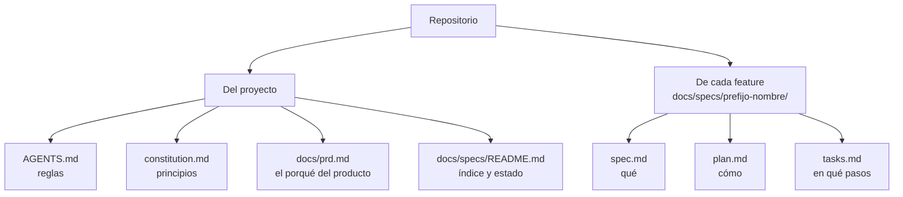
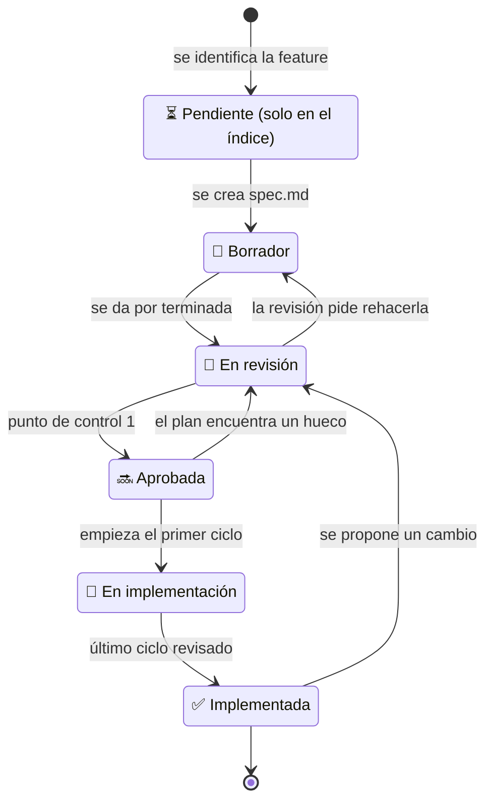

# 4. Artefactos y estado de las features

[⬅️ Volver a la unidad](./README.md)

## Índice

- [4.1. Por qué llevar el estado](#41-por-qué-llevar-el-estado)
- [4.2. Dónde viven los artefactos](#42-dónde-viven-los-artefactos)
  - [4.2.1. Artefactos del proyecto y artefactos de la feature](#421-artefactos-del-proyecto-y-artefactos-de-la-feature)
  - [4.2.2. Una carpeta por feature](#422-una-carpeta-por-feature)
  - [4.2.3. Todo en el mismo repositorio que el código](#423-todo-en-el-mismo-repositorio-que-el-código)
- [4.3. Los estados de una feature](#43-los-estados-de-una-feature)
  - [4.3.1. Los cinco estados de la spec](#431-los-cinco-estados-de-la-spec)
  - [4.3.2. El ciclo de vida, con sus vueltas atrás](#432-el-ciclo-de-vida-con-sus-vueltas-atrás)
  - [4.3.3. Qué hay en la carpeta en cada estado](#433-qué-hay-en-la-carpeta-en-cada-estado)
  - [4.3.4. Quién cambia cada estado](#434-quién-cambia-cada-estado)
  - [4.3.5. El estado del plan y de las tasks](#435-el-estado-del-plan-y-de-las-tasks)
- [4.4. El índice de features](#44-el-índice-de-features)
  - [4.4.1. Formato](#441-formato)
  - [4.4.2. Cuándo se actualiza](#442-cuándo-se-actualiza)
  - [4.4.3. Una sola fuente de verdad](#443-una-sola-fuente-de-verdad)
  - [4.4.4. El índice como contexto del agente](#444-el-índice-como-contexto-del-agente)
- [4.5. El historial de Git como registro](#45-el-historial-de-git-como-registro)
- [4.6. Cuando cambia el plan del proyecto](#46-cuando-cambia-el-plan-del-proyecto)
- [4.7. Otras formas de llevar el estado](#47-otras-formas-de-llevar-el-estado)
- [4.8. Errores típicos](#48-errores-típicos)
- [4.9. Ejemplo integrador: el estado de la lista de tareas](#49-ejemplo-integrador-el-estado-de-la-lista-de-tareas)
- [Resumen](#resumen)
- [Ejercicios de reflexión](#ejercicios-de-reflexión)

> **Criterios que trabaja este tema:** OA2 d.

---

## 4.1. Por qué llevar el estado

En un proyecto con SDD las specs se escriben **antes** de implementar, así que en cualquier momento conviven features en fases distintas: una está implementada, otra tiene el plan aprobado, otra es un borrador y otra solo es una línea en el índice. Sin un control del estado, para saber en qué punto está cada una hay que abrir sus ficheros uno a uno, o preguntárselo a quien la lleva.

Llevar el estado sirve a tres lectores:

| Lector | Qué necesita saber | Ejemplo |
|--------|--------------------|---------|
| **Tú** | Qué está hecho, qué está en curso y qué toca después | «La feature A está implementada; la B tiene la spec aprobada» |
| **El agente** | Qué existe ya y qué debe construir, sin que se lo expliques en cada sesión | «No vuelvas a crear el endpoint `POST /tareas`: la feature A ya está implementada» |
| **El equipo** | Quién trabaja en qué, para no pisarse | «Nadie toca la feature C: está en revisión» |

El segundo lector es el que hace este tema importante en SDD. El agente **no recuerda** las sesiones anteriores: lo que sabe del proyecto al empezar una sesión es lo que lee en el repositorio. Si el estado está escrito, el agente lo sabe; si no, lo adivina.

> 📝 **Nota del Profesor**: llevar el estado no es burocracia: es **memoria del proyecto** escrita donde el agente puede leerla. En el tema 6 verás otras formas de darle memoria al agente; esta es la más sencilla y la primera que necesitas.

---

## 4.2. Dónde viven los artefactos

### 4.2.1. Artefactos del proyecto y artefactos de la feature

Los ficheros de SDD se dividen en dos grupos:

| Grupo | Ficheros | Cuántos hay | Cuándo cambian |
|-------|----------|-------------|----------------|
| **Del proyecto** | `AGENTS.md`, `constitution.md`, `docs/prd.md`, `docs/specs/README.md` | Uno de cada | Rara vez, salvo el índice, que cambia con cada estado |
| **De la feature** | `spec.md`, `plan.md`, `tasks.md` | Uno de cada por feature | Durante el flujo de esa feature |



El diagrama muestra la idea clave: el **índice** es del proyecto, pero su contenido es el estado de cada feature. Es el puente entre los dos grupos.

### 4.2.2. Una carpeta por feature

Cada feature tiene su carpeta dentro de `docs/specs/`, con un **prefijo** que indica el orden de implementación (lo decidiste en el tema 4 de la UD1) y el nombre en minúsculas con guiones:

```text
docs/specs/
├── README.md
├── A-añadir-tarea/
│   ├── spec.md
│   ├── plan.md
│   └── tasks.md
└── B-ver-lista/
    └── spec.md
```

| Decisión | Convención del curso | Por qué |
|----------|----------------------|---------|
| Prefijo | Una letra (`A`, `B`…) | Pocos elementos y orden claro. Con muchas features, números con ceros (`01`, `02`…) para que se ordenen bien |
| Nombre | Minúsculas y guiones, en español | Se lee en el explorador de ficheros y en las URL de GitHub |
| Nombres de los ficheros | Siempre `spec.md`, `plan.md` y `tasks.md` | El agente y tú sabéis dónde buscar sin mirar |
| Carpeta vacía | No existe hasta que hay `spec.md` | Git no guarda carpetas vacías; la feature pendiente vive solo en el índice |

> ✅ **Buena práctica**: los tres ficheros se llaman **igual** en todas las carpetas. Así una instrucción como «lee la spec y el plan de la feature B» no necesita rutas exactas, y los scripts que comprueban el estado (apartado 4.4.3) funcionan para todas las features.

### 4.2.3. Todo en el mismo repositorio que el código

La spec, el plan y las tasks se guardan en el **mismo repositorio** que el código, no en una wiki ni en un documento compartido aparte. Así:

- El agente puede **leerlos** durante la implementación sin que se los pegues.
- Un cambio de comportamiento lleva en **el mismo commit** la spec y el código (lo hiciste en el ciclo 2 del tema 3).
- El historial de Git muestra cómo evolucionó la **intención**, no solo el código.
- Cualquier persona nueva (o un agente nuevo) entiende el **porqué** de cada decisión leyendo los documentos de la feature.
- Al empezar una sesión, el agente sabe qué está implementado y qué sigue leyendo el índice.

> ⚠️ **Cuidado**: una spec que vive fuera del repositorio (en un documento de un servicio en la nube, en un correo, en el chat) **no existe para el agente**. Y tarde o temprano deja de coincidir con la que tú tienes en la cabeza. Si no está en el repositorio, no es la spec.

---

## 4.3. Los estados de una feature

### 4.3.1. Los cinco estados de la spec

El estado de una feature es el **estado de su spec**, el campo `Estado` de los metadatos que viste en el tema 5 de la UD1. Tiene cinco valores:

| Estado | Emoji | Significado | Se entra cuando… |
|--------|-------|-------------|------------------|
| `Borrador` | 📝 | La spec se está escribiendo | Se crea `spec.md` |
| `En revisión` | 👀 | La spec está escrita y espera el punto de control 1 | Quien la escribe la da por terminada |
| `Aprobada` | 🔜 | Revisada y aprobada; lista para planificar | Pasa el punto de control 1 |
| `En implementación` | 🔧 | Hay ciclos de implementación en curso | Empieza el primer ciclo |
| `Implementada` | ✅ | Todas las tasks están hechas y revisadas, y los tests pasan | Termina el último ciclo |

En el **índice** aparece además un sexto valor que **no es un estado de la spec**:

| Valor | Emoji | Significado |
|-------|-------|-------------|
| `Pendiente` | ⏳ | La feature está identificada (por ejemplo, al dividir el épico), pero su spec todavía no existe. En cuanto se crea `spec.md`, pasa a `Borrador` |

El emoji 🔜 de `Aprobada` se lee como «la siguiente»: una spec aprobada es la candidata a planificarse en cuanto haya alguien libre.

> 💡 **Tip del Examinador**: «¿Qué diferencia hay entre una feature `Pendiente` y una en `Borrador`?». `Pendiente` es un valor solo del índice: la feature está identificada pero no tiene spec. `Borrador` es un estado de la spec: el fichero `spec.md` existe y se está escribiendo.

### 4.3.2. El ciclo de vida, con sus vueltas atrás

Los estados avanzan en orden, pero no siempre en línea recta. En los temas 2 y 3 viste dos vueltas atrás: la spec de la feature A volvió a revisión cuando el plan encontró un hueco, y cambió de versión durante la implementación.



Lo que destaca del diagrama: se puede **volver a revisión** desde `Aprobada` y desde `Implementada`, pero **nunca se salta** el punto de control 1. Una spec que cambia vuelve a pasar por él.

Durante la implementación hay un caso intermedio. Si aparece un hueco pequeño que puedes decidir en el momento (como los nombres de los campos en el ciclo 2 del tema 3), la spec **sube de versión** y sigue `En implementación`; el cambio va en el mismo commit que el código. Si el hueco necesita una revisión de verdad (otras personas, otras features afectadas), la spec vuelve a `En revisión` y **la implementación se para** hasta que se apruebe.

> 📝 **Nota del Profesor**: cambiar una feature ya implementada es el caso más delicado, porque hay código que depende de la spec anterior. En las prácticas de esta unidad usarás **OpenSpec**, que está pensado justo para eso: describir el **cambio** sobre una feature que ya existe, en lugar de reescribir su spec.

### 4.3.3. Qué hay en la carpeta en cada estado

El estado y los ficheros de la carpeta tienen que ser coherentes. Esta tabla te sirve para detectar incoherencias de un vistazo:

| Estado | `spec.md` | `plan.md` | `tasks.md` | Código |
|--------|-----------|-----------|------------|--------|
| ⏳ Pendiente | No existe | — | — | — |
| 📝 Borrador | Existe, puede tener `[NECESITA ACLARACIÓN]` | — | — | — |
| 👀 En revisión | Completa | — | — | — |
| 🔜 Aprobada | Sin marcadores | Puede estar en curso o aprobado | Pueden estar en curso o aprobadas | Ninguno |
| 🔧 En implementación | Sin marcadores | Aprobado | Aprobadas, algunas `[x]` | Parte |
| ✅ Implementada | Sin marcadores | Aprobado | Todas `[x]` | Completo, tests en verde |

Por ejemplo: una feature `Aprobada` con código en `src/` es una incoherencia (alguien empezó a implementar sin cambiar el estado), igual que una `Implementada` con tasks sin marcar.

### 4.3.4. Quién cambia cada estado

Los cambios de estado son **decisiones**, así que los toma una persona. El agente puede ayudar a escribir el cambio en los ficheros, pero solo cuando se lo pides.

| Cambio | Quién lo decide | Qué ficheros cambian | Commit |
|--------|-----------------|----------------------|--------|
| ⏳ → 📝 | Quien escribe la spec | `spec.md` (nuevo) e índice | `Spec de la feature B (borrador)` |
| 📝 → 👀 | Quien escribe la spec | `spec.md` e índice | `Spec de la feature B (en revisión)` |
| 👀 → 🔜 | Quien aprueba la spec (punto de control 1) | `spec.md` e índice | `Spec de la feature B (aprobada)` |
| 🔜 → 🔧 | Quien empieza la implementación | `spec.md` e índice, en el commit del primer ciclo | `Feature B: T-01 y T-02, …` |
| 🔧 → ✅ | Quien revisa el último ciclo (punto de control 4) | `spec.md` e índice, en el commit del último ciclo | `Feature B: T-07 y T-08, … (implementada)` |
| ✅ o 🔜 → 👀 | Quien propone el cambio | `spec.md` (versión nueva) e índice | `Spec de la feature A 1.1: … (en revisión)` |

> ⚠️ **Cuidado**: el agente **no** aprueba nada. Si le pides «revisa la spec» y, además de revisarla, cambia el estado a `Aprobada`, deshaz ese cambio. Por eso conviene escribirlo como prohibición en `AGENTS.md` (lo harás en el ejemplo integrador).

**El estado en `main` y en la rama.** Los tres primeros cambios de la tabla se hacen en `main`; los dos siguientes, en la rama de la feature (tema 1, apartado 1.3.4), porque van en los commits de los ciclos. Por eso, mientras se implementa una feature, `main` sigue diciendo `🔜 Aprobada` y la rama dice `🔧 En implementación`. Al fusionar, `main` pasa directamente a `✅ Implementada`. Es lo esperado: `main` muestra lo que está **terminado**; para saber qué se está haciendo, mira las ramas abiertas (`git branch`).

### 4.3.5. El estado del plan y de las tasks

El plan y las tasks tienen su propio estado, más sencillo, en sus metadatos (temas 2 y 3):

| Documento | Estados |
|-----------|---------|
| `plan.md` | `Borrador` → `En revisión` → `Aprobado` |
| `tasks.md` | `Borrador` → `Aprobadas`, y cada task con su casilla `- [ ]` o `- [x]` |

Estos estados **no se copian al índice**: el estado de la feature es el de su spec. Mientras la spec está `Aprobada`, el plan y las tasks pueden estar en borrador o aprobados; el índice sigue diciendo `🔜 Aprobada` hasta que empieza el primer ciclo de implementación.

En proyectos grandes, algunos equipos añaden columnas «Plan» y «Tasks» al índice para ver también en qué punto de la planificación está cada feature. Es una variante válida si se mantiene al día; en el curso, el índice tiene una sola columna de estado.

---

## 4.4. El índice de features

### 4.4.1. Formato

El índice es `docs/specs/README.md`. Como se llama `README.md`, GitHub lo muestra automáticamente al abrir la carpeta `docs/specs/`: el estado del proyecto se ve sin abrir ningún otro fichero.

```markdown
# Features

| # | Feature | Carpeta | Estado |
|---|---------|---------|--------|
| A | Añadir una tarea | A-añadir-tarea/ | ✅ Implementada |
| B | Ver la lista de tareas | B-ver-lista/ | 🔜 Aprobada |
| C | Marcar una tarea como hecha | C-marcar-hecha/ | ⏳ Pendiente |
| D | Borrar una tarea | D-borrar-tarea/ | ⏳ Pendiente |
```

| Columna | Contenido |
|---------|-----------|
| `#` | El prefijo de la carpeta, que es el orden de implementación |
| `Feature` | El nombre de la feature, igual que en los metadatos de su spec |
| `Carpeta` | El nombre de la carpeta, terminado en `/` |
| `Estado` | Emoji y estado, igual que el campo `Estado` de la spec (o `⏳ Pendiente`) |

### 4.4.2. Cuándo se actualiza

El índice se actualiza **en el mismo commit** que el cambio de estado de la spec, nunca después:

- Al crear la spec → `📝 Borrador`.
- Al darla por terminada → `👀 En revisión`.
- Al aprobarla → `🔜 Aprobada`.
- En el primer ciclo de implementación → `🔧 En implementación`.
- En el último ciclo → `✅ Implementada`.
- Al proponer un cambio sobre una feature aprobada o implementada → `👀 En revisión`.

Si el índice se actualiza «luego», se olvida. Y un índice que dice algo distinto de las specs es peor que no tener índice, porque el agente lo cree.

### 4.4.3. Una sola fuente de verdad

El estado está escrito en **dos sitios**: en la spec (la fuente) y en el índice (una copia para verlo todo de un vistazo). Siempre que hay una copia, hay riesgo de que se desincronice. La regla es:

> **Manda la spec.** Si el índice y la spec no coinciden, el índice está mal.

Para detectar las diferencias sin revisarlas a mano, basta un pequeño script que recorra las specs y compare su estado con el del índice. Este funciona en el Dev Container del curso (y en cualquier sistema con un `sh` estándar):

```sh
#!/bin/sh
# Compara el estado de cada spec con el del índice de features.
# Uso: sh herramientas/estado-features.sh (desde la raíz del proyecto)

INDICE=docs/specs/README.md
errores=0

for spec in docs/specs/*/spec.md; do
  carpeta=$(basename "$(dirname "$spec")")
  en_spec=$(grep -m1 '^| Estado' "$spec" | cut -d'|' -f3 | xargs)
  en_indice=$(grep -F "| $carpeta/ |" "$INDICE" | cut -d'|' -f5 | xargs)

  case "$en_indice" in
    *"${en_spec:-sin estado}")
      echo "✅ $carpeta: $en_spec"
      ;;
    *)
      echo "❌ $carpeta: la spec dice «${en_spec:-nada}» y el índice, «${en_indice:-nada}»"
      errores=$((errores + 1))
      ;;
  esac
done

exit "$errores"
```

Cómo funciona:

- Para cada `spec.md`, saca el nombre de su carpeta y el valor de la fila `| Estado` de los metadatos.
- Busca en el índice la fila de esa carpeta y saca la cuarta columna.
- Si el estado del índice **termina** en el de la spec (`✅ Implementada` termina en `Implementada`), coinciden.
- Detecta también una spec sin fila en el índice y una spec sin campo `Estado`.
- Termina con un código distinto de cero si hay algún error, para poder usarlo más adelante como comprobación automática (lo verás en los *quality gates* de la UD3).

> ✅ **Buena práctica**: añade el script a `package.json` (`"estado": "sh herramientas/estado-features.sh"`) y menciónalo en los comandos de `AGENTS.md`. Así tanto tú como el agente podéis ejecutar `npm run estado` antes de empezar a trabajar.

### 4.4.4. El índice como contexto del agente

El índice es la forma más barata de poner al agente al día al empezar una sesión:

```text
Lee @docs/specs/README.md y @constitution.md. La feature A está
implementada y la B tiene la spec aprobada. Vamos a planificar la B:
lee @docs/specs/B-ver-lista/spec.md y el código de la feature A en
src/, que la B tiene que reutilizar.
```

Con esas líneas, el agente sabe qué existe, qué no tiene que volver a construir y dónde está lo que necesita. Sin el índice, tendría que deducirlo explorando el repositorio, con el riesgo de equivocarse y con el gasto de contexto que supone (tema 5).

---

## 4.5. El historial de Git como registro

Si has hecho un commit por fase y por ciclo, el **historial de Git** es el registro detallado de cada feature. Git puede filtrar el historial por carpeta:

```bash
git log --oneline -- docs/specs/A-añadir-tarea/
```

Así ves solo los commits que tocaron los documentos de la feature A: su vida completa, de la primera versión de la spec al último ciclo.

Para que el historial se lea bien, los mensajes siguen una convención fija:

| Momento | Mensaje |
|---------|---------|
| Spec nueva | `Spec de la feature B (borrador)` |
| Cambio de estado de la spec | `Spec de la feature B (en revisión)`, `… (aprobada)` |
| Nueva versión de la spec | `Spec de la feature A 1.1: <qué cambia> (aprobada)` |
| Plan | `Plan de la feature A (aprobado)` |
| Tasks | `Tasks de la feature A (aprobadas)` |
| Ciclo de implementación | `Feature A: T-01 y T-02, <qué se ha hecho>` |
| Último ciclo | `Feature A: T-07 y T-08, <qué se ha hecho> (implementada)` |
| Fusión de la rama en `main` | `Fusiona la feature A: <nombre de la feature>` |
| Replanificación | `Replanificación tras la feature A: <qué cambia>` |

Como cada feature se fusiona con `--no-ff`, el historial de `main` se puede leer también **feature a feature**. La opción `--first-parent` sigue solo la línea de `main` y oculta los commits de dentro de cada rama:

```bash
git log --oneline --first-parent
```

```text
Fusiona la feature A: añadir una tarea
Spec de la feature A en EARS y Gherkin (aprobada)
Spec de la feature A: añadir una tarea (en revisión)
…
```

Así ves lo que se ha hecho en `main`: specs aprobadas, features fusionadas y replanificaciones. Sin `--first-parent`, ves además cada fase y cada ciclo.

| Herramienta | Responde a |
|-------------|------------|
| Índice | ¿En qué estado está cada feature **ahora**? |
| `tasks.md` | ¿Qué falta de la feature en curso? |
| Historial de Git | ¿**Cómo y cuándo** llegó cada feature a su estado? |

> 💡 **Tip del Examinador**: «¿Por qué se hace un commit por cada fase y por cada ciclo de implementación?». Porque así el historial de Git registra la evolución de la feature (spec aprobada, plan, tasks y cada grupo de tasks), permite volver a cualquier punto intermedio y muestra qué cambió en cada paso y por qué.

---

## 4.6. Cuando cambia el plan del proyecto

El orden y la lista de features no son fijos. El momento natural para cambiarlos es la **replanificación** que se hace al terminar cada feature (tema 1, apartado 1.2.8): con la feature recién fusionada, miras el índice y te preguntas si la siguiente sigue siendo la que toca. Los cambios se hacen en `main`, en un commit propio, antes de empezar la siguiente spec. Estos son los habituales y cómo se reflejan:

| Cambio | Qué haces |
|--------|-----------|
| **Cambia el orden** de dos features | Cambias el prefijo de sus carpetas con `git mv` (para que Git conserve el historial) y reordenas el índice |
| **Aparece una feature nueva** | Añades una fila `⏳ Pendiente` en el lugar que le toca; si cambia el orden de las siguientes, se renombran |
| **Una feature se divide** en dos | La spec original se queda con una parte y la otra pasa a una feature nueva con su propia fila |
| **Se descarta** una feature | Se quita del índice y se borra su carpeta. El historial conserva lo que se hizo; si es una decisión de producto, se anota en el fuera de alcance del PRD |

```bash
git mv docs/specs/C-marcar-hecha docs/specs/D-marcar-hecha
git mv docs/specs/D-borrar-tarea docs/specs/C-borrar-tarea
```

> ⚠️ **Cuidado**: al renombrar una carpeta, revisa las **referencias** a ella en otros documentos (dependencias de otras specs, prompts guardados, `AGENTS.md`). El agente seguirá la ruta que ponga el documento, aunque ya no exista.

Si el orden cambia muy a menudo, los prefijos dan trabajo. En ese caso se pueden usar nombres sin prefijo y llevar el orden solo en el índice; a cambio, el explorador de ficheros ya no muestra el orden.

---

## 4.7. Otras formas de llevar el estado

El método del curso (carpeta por feature, campo `Estado` e índice) no necesita ninguna herramienta. Hay otras formas, y las herramientas de SDD traen la suya:

| Método o herramienta | Cómo lleva el estado |
|----------------------|----------------------|
| **Incidencias de GitHub** (*issues*) o un gestor de proyectos | Una incidencia por feature, con etiquetas o columnas de estado. La spec enlaza su incidencia y viceversa |
| **Spec Kit** | Numera las features automáticamente (`001`, `002`…) y crea una carpeta y una rama de Git por feature con el mismo nombre, como haces tú a mano en el curso |
| **Conductor** | Un fichero índice de *tracks* que el propio agente actualiza al avanzar, y un estado por tarea dentro de cada plan |
| **OpenSpec** | Separa las specs **vigentes** (cómo es el sistema ahora) de los **cambios** en curso, cada uno en su carpeta. Al terminar un cambio, se **archiva** y sus requisitos se integran en las specs vigentes |

Para elegir, estas preguntas ayudan:

| Pregunta | Si la respuesta es sí… |
|----------|------------------------|
| ¿Trabaja una sola persona o un equipo pequeño? | El índice en el repositorio basta |
| ¿El equipo ya usa un gestor de proyectos? | Llevar allí el estado y enlazar las specs, sin duplicarlo en el índice |
| ¿Hay muchas features en paralelo? | Un gestor con filtros y vistas, o el índice con más columnas |
| ¿Importa poder auditar quién aprobó qué y cuándo? | El estado versionado en Git junto al código |
| ¿Se cambian a menudo features que ya existen? | Un método que separe lo vigente de los cambios, como OpenSpec |

> 📝 **Nota del Profesor**: sea cual sea el método, la regla es la misma: **una fuente de verdad** para el estado, actualizada en el momento en que cambia y legible por el agente. Un gestor de proyectos que el agente no puede leer resuelve la coordinación del equipo, pero no el contexto del agente.

---

## 4.8. Errores típicos

| Error | Consecuencia | Cómo evitarlo |
|-------|--------------|---------------|
| El índice no se actualiza con la spec | El agente planifica una feature que ya estaba hecha, o reimplementa algo | Actualizarlo en el mismo commit y comprobarlo con `npm run estado` |
| Estado que no coincide con los ficheros | `Aprobada` con código, `Implementada` con tasks sin marcar | Repasar la tabla del apartado 4.3.3 |
| El agente cambia estados por su cuenta | Specs «aprobadas» que nadie ha revisado | Prohibirlo en `AGENTS.md` y revisar el `git diff` |
| Artefactos fuera del repositorio | El agente no los ve y se desactualizan | Todo en `docs/specs/` |
| Nombres de fichero distintos en cada carpeta | `especificacion.md`, `spec-final.md`, `plan-v2.md` | Siempre `spec.md`, `plan.md`, `tasks.md` |
| Varias versiones de un documento | `spec.md` y `spec-v2.md` conviven y nadie sabe cuál vale | Una sola spec por feature; las versiones las guarda Git |
| Saltarse estados | De `Borrador` a `En implementación` sin pasar por el punto de control 1 | Cada cambio de estado, con su commit |
| Renombrar carpetas sin `git mv` | Git pierde la relación entre el nombre viejo y el nuevo | Usar `git mv` |
| Empezar la siguiente feature sin fusionar la anterior | La rama nueva sale de un `main` sin la feature terminada, o de la rama vieja y arrastra sus commits | Fusionar, volver a `main` y replanificar antes de crear otra rama |
| Fusionar una feature a medias | `main` dice `🔜 Aprobada` y tiene código sin terminar | Fusionar solo con la feature `✅ Implementada` |

---

## 4.9. Ejemplo integrador: el estado de la lista de tareas

En el tema 3 terminaste la feature A y la fusionaste en `main`. Ahora, en `main`, haces la **replanificación** (tema 1, apartado 1.2.8): compruebas el estado del proyecto, automatizas la comprobación y le das al agente las reglas que le faltaban. Después empiezas la feature B.

**1. El punto de partida.** Así está `docs/specs/`:

```text
docs/specs/
├── README.md
└── A-añadir-tarea/
    ├── spec.md      ← Estado: Implementada · Versión: 1.2
    ├── plan.md      ← Estado: Aprobado
    └── tasks.md     ← Estado: Aprobadas · T-01 a T-08 marcadas
```

```markdown
| # | Feature | Carpeta | Estado |
|---|---------|---------|--------|
| A | Añadir una tarea | A-añadir-tarea/ | ✅ Implementada |
| B | Ver la lista de tareas | B-ver-lista/ | ⏳ Pendiente |
| C | Marcar una tarea como hecha | C-marcar-hecha/ | ⏳ Pendiente |
| D | Borrar una tarea | D-borrar-tarea/ | ⏳ Pendiente |
```

Compruebas la coherencia con la tabla del apartado 4.3.3: la spec está `Implementada`, el plan aprobado, todas las tasks marcadas y los tests en verde. Todo cuadra. Y la primera pregunta de la replanificación: ¿la B sigue siendo la siguiente? Sí: sin ver la lista, las tareas que se añaden no se pueden comprobar en la página. El orden se queda como está.

**2. La vida de la feature A.** El historial de su carpeta cuenta lo que hiciste en la UD1 y en esta unidad:

```bash
git log --oneline -- docs/specs/A-añadir-tarea/
```

```text
Feature A: T-07 y T-08, página (implementada)
Feature A: T-05 y T-06, API POST /tareas con sus tests
Feature A: T-03 y T-04, servicio de tareas con sus tests
Feature A: T-01 y T-02, repositorio de tareas con sus tests
Tasks de la feature A (aprobadas)
Plan de la feature A (aprobado)
Spec de la feature A 1.1: texto sin espacios en los extremos (aprobada)
Spec de la feature A en EARS y Gherkin (aprobada)
Spec de la feature A: añadir una tarea (en revisión)
```

El commit de la constitución no aparece, porque no toca esa carpeta. Los commits de los ciclos sí, porque cada uno marcó sus tasks en `tasks.md`.

**3. Automatiza la comprobación.** Crea `herramientas/estado-features.sh` con el script del apartado 4.4.3 y añade el comando a `package.json`:

```json
"scripts": {
  "start": "node src/servidor.js",
  "test": "vitest run",
  "estado": "sh herramientas/estado-features.sh"
}
```

```bash
npm run estado
```

```text
✅ A-añadir-tarea: Implementada
```

**4. Díselo al agente.** Añade a `AGENTS.md` el comando y dos reglas sobre el estado:

```markdown
## Comandos

- Comprobar que el índice coincide con el estado de cada spec:
  `npm run estado`

## Al empezar una sesión

- Lee `docs/specs/README.md` para saber qué features están
  implementadas y cuál es la siguiente.

## Prohibiciones

- No cambies el estado de una spec ni del índice: lo cambia una persona.
```

La segunda regla complementa la que ya tenías («no modifiques una spec aprobada sin que se te pida»). El agente puede **marcar tasks** cuando termina una (tema 3), pero los estados de la feature los decides tú.

```bash
git add herramientas/estado-features.sh package.json AGENTS.md
git commit -m "Replanificación tras la feature A: comprobación del estado de las features"
```

Con este commit termina la replanificación. La spec de la B se escribe también en `main`: su rama no se creará hasta que empiece su plan.

**5. Empieza la feature B.** Escribes su spec con la entrevista del tema 2 (apartado 2.1.2) y la guardas en `docs/specs/B-ver-lista/spec.md` con el estado `Borrador`. Antes del commit, compruebas:

```bash
npm run estado
```

```text
✅ A-añadir-tarea: Implementada
❌ B-ver-lista: la spec dice «Borrador» y el índice, «⏳ Pendiente»
```

El script ha detectado el olvido más común: la spec existe, pero el índice sigue diciendo que no. Actualizas la fila de B a `📝 Borrador`, vuelves a comprobar y haces el commit con los dos ficheros:

```bash
npm run estado
git add docs/specs/B-ver-lista/spec.md docs/specs/README.md
git commit -m "Spec de la feature B (borrador)"
```

**6. Revisión y aprobación.** Haces la ronda de aclaración del tema 2, resuelves los marcadores y la spec pasa a `En revisión` y, tras el punto de control 1, a `Aprobada`. Cada cambio de estado, con el índice, la comprobación y su commit:

```bash
git commit -am "Spec de la feature B (en revisión)"
git commit -am "Spec de la feature B (aprobada)"
```

El índice queda así:

```markdown
| # | Feature | Carpeta | Estado |
|---|---------|---------|--------|
| A | Añadir una tarea | A-añadir-tarea/ | ✅ Implementada |
| B | Ver la lista de tareas | B-ver-lista/ | 🔜 Aprobada |
| C | Marcar una tarea como hecha | C-marcar-hecha/ | ⏳ Pendiente |
| D | Borrar una tarea | D-borrar-tarea/ | ⏳ Pendiente |
```

**7. La siguiente sesión.** Cuando vayas a planificar la B, empezarás con el índice como contexto (apartado 4.4.4). El agente sabrá, sin que se lo expliques, que `POST /tareas` ya existe, que la B es la siguiente y dónde están sus documentos.

> 📝 **Nota del Profesor**: fíjate en cuánto trabajo ahorra el índice al agente y cuánto le cuesta mantenerlo a la persona: una fila por cambio de estado, comprobada con un comando. Es el primer ejemplo de algo que verás en los temas 5 y 6: **dar al agente el contexto justo**, escrito en el repositorio, en lugar de explicárselo en cada sesión.

---

## Resumen

- En SDD conviven features en fases distintas; llevar su **estado** sirve a la persona, al equipo y, sobre todo, al **agente**, que no recuerda las sesiones anteriores.
- Hay **artefactos del proyecto** (`AGENTS.md`, constitución, PRD, índice) y **artefactos de cada feature** (`spec.md`, `plan.md`, `tasks.md`), estos en una **carpeta por feature** con prefijo de orden, todos en el mismo repositorio que el código.
- El estado de la feature es el de su spec: **Borrador**, **En revisión**, **Aprobada**, **En implementación** e **Implementada**, más **Pendiente** solo en el índice. Se puede volver a revisión, pero nunca saltarse el punto de control 1.
- Los cambios de estado los decide **una persona**, con un commit cada uno; el agente puede marcar tasks, pero no aprobar.
- El **índice** `docs/specs/README.md` se actualiza **en el mismo commit** que la spec. **Manda la spec**: un script como `npm run estado` detecta las diferencias.
- La spec se aprueba en `main`; los estados de implementación cambian en la **rama de la feature**, así que `main` muestra lo terminado y pasa a `✅ Implementada` al fusionar.
- El **historial de Git**, con un commit por fase y por ciclo y mensajes con una convención fija, registra cómo llegó cada feature a su estado. Con `--first-parent` se lee feature a feature.
- El orden y la lista de features se revisan al **replanificar**, en `main`, después de cada fusión. Los cambios de orden se hacen con `git mv`. Hay otras formas de llevar el estado (incidencias, Spec Kit, Conductor, OpenSpec); lo importante es **una sola fuente de verdad** que el agente pueda leer.

## Ejercicios de reflexión

1. ¿Por qué el estado de una feature se escribe en la spec y no solo en el índice? ¿Qué pasaría si fuera al revés?
2. Encuentras una feature con el estado `🔜 Aprobada` en el índice y una carpeta `src/listado/` con código a medio hacer. ¿Qué ha pasado y qué haces?
3. El agente, al terminar una revisión, ha cambiado el estado de la spec a `Aprobada`. ¿Por qué es un problema, aunque la revisión fuera buena?
4. El equipo decide implementar «Borrar una tarea» antes que «Marcar una tarea como hecha». Escribe los comandos y los cambios en el índice.
5. Compara el índice del curso con llevar el estado en incidencias de GitHub. ¿Qué ganas y qué pierdes con cada uno, pensando en el agente?
6. Mientras implementas la feature B en su rama, alguien del equipo mira el índice en `main` y ve que la B está `🔜 Aprobada`. ¿Está mal el índice? ¿Cómo puede saber en qué punto está la B?
7. Busca en la documentación de OpenSpec cómo se llama la carpeta donde guarda los cambios terminados. ¿Qué ventaja tiene separar las specs vigentes de los cambios? Indica la fecha de consulta.

---

[⬅️ Volver a la unidad](./README.md)
