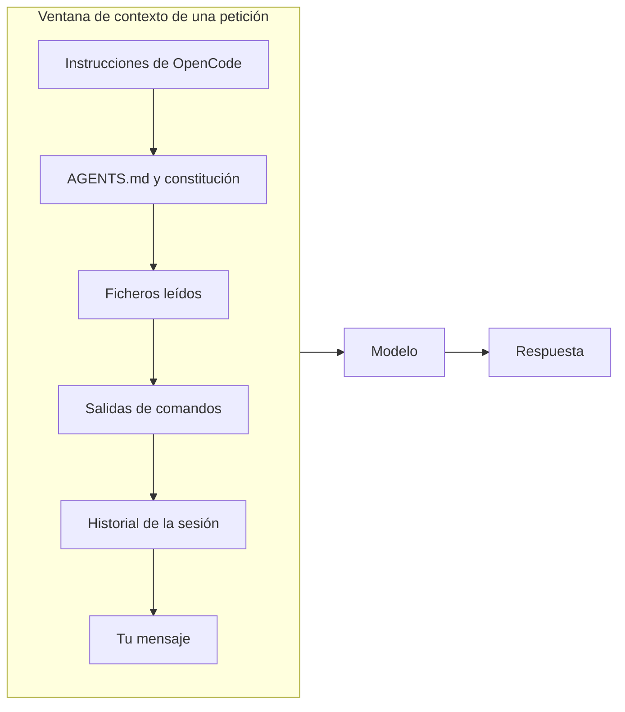
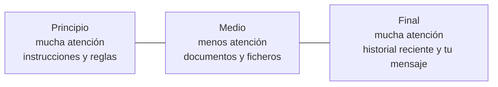
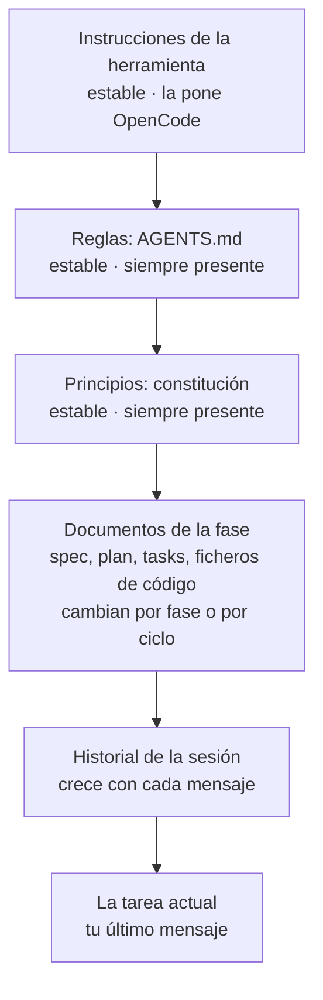
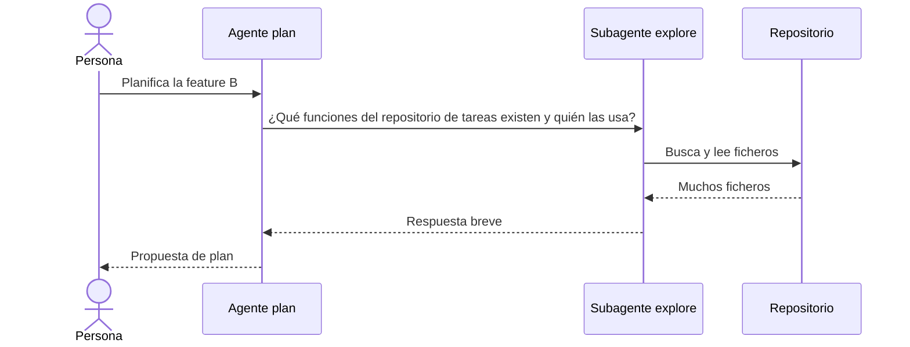
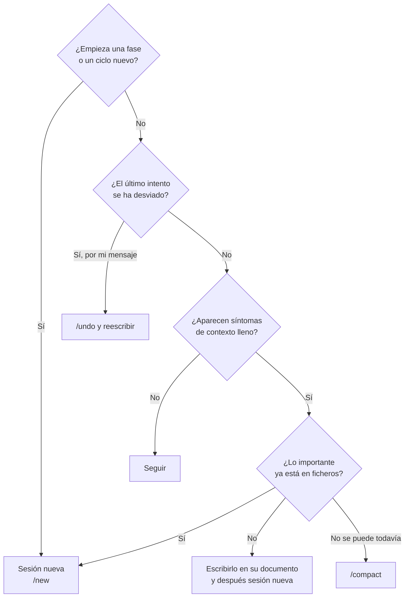

# 5. La ventana de contexto

[⬅️ Volver a la unidad](./README.md)

## Índice

- [5.1. Qué es el contexto de un agente](#51-qué-es-el-contexto-de-un-agente)
  - [5.1.1. La ventana de contexto](#511-la-ventana-de-contexto)
  - [5.1.2. Qué entra en la ventana](#512-qué-entra-en-la-ventana)
  - [5.1.3. Ingeniería de contexto](#513-ingeniería-de-contexto)
- [5.2. Por qué más contexto no es mejor](#52-por-qué-más-contexto-no-es-mejor)
  - [5.2.1. Un presupuesto de atención](#521-un-presupuesto-de-atención)
  - [5.2.2. Perdido en el medio](#522-perdido-en-el-medio)
  - [5.2.3. La degradación del contexto](#523-la-degradación-del-contexto)
  - [5.2.4. Las instrucciones que se apagan](#524-las-instrucciones-que-se-apagan)
  - [5.2.5. Cómo se nota en una sesión](#525-cómo-se-nota-en-una-sesión)
- [5.3. Las capas del contexto](#53-las-capas-del-contexto)
- [5.4. El contexto de cada fase del flujo](#54-el-contexto-de-cada-fase-del-flujo)
- [5.5. Los tipos de memoria del agente](#55-los-tipos-de-memoria-del-agente)
- [5.6. Cómo preparar el contexto](#56-cómo-preparar-el-contexto)
  - [5.6.1. Lo justo, no lo posible](#561-lo-justo-no-lo-posible)
  - [5.6.2. El orden importa](#562-el-orden-importa)
  - [5.6.3. Referencias, no copias](#563-referencias-no-copias)
  - [5.6.4. Un ejemplo vale más que una descripción](#564-un-ejemplo-vale-más-que-una-descripción)
- [5.7. Estrategias durante el trabajo](#57-estrategias-durante-el-trabajo)
  - [5.7.1. Sesión nueva por fase y por ciclo](#571-sesión-nueva-por-fase-y-por-ciclo)
  - [5.7.2. Deshacer en lugar de corregir encima](#572-deshacer-en-lugar-de-corregir-encima)
  - [5.7.3. Compactar](#573-compactar)
  - [5.7.4. Escribir en ficheros lo que importa](#574-escribir-en-ficheros-lo-que-importa)
  - [5.7.5. Subagentes con su propio contexto](#575-subagentes-con-su-propio-contexto)
  - [5.7.6. Seguir, compactar o empezar de cero](#576-seguir-compactar-o-empezar-de-cero)
- [5.8. Errores típicos](#58-errores-típicos)
- [5.9. Ejemplo integrador: planificar la feature B con el contexto justo](#59-ejemplo-integrador-planificar-la-feature-b-con-el-contexto-justo)
- [Resumen](#resumen)
- [Ejercicios de reflexión](#ejercicios-de-reflexión)

> **Criterios que trabaja este tema:** OA2 e.

---

## 5.1. Qué es el contexto de un agente

### 5.1.1. La ventana de contexto

Un modelo de lenguaje no tiene memoria entre una petición y la siguiente. Cada vez que el agente le pide algo, le envía **todo** lo que necesita saber en ese momento: las instrucciones, los ficheros que ha leído, la conversación hasta ahí y tu último mensaje. A ese conjunto se le llama **contexto**, y el tamaño máximo que un modelo puede recibir de una vez es su **ventana de contexto** (*context window*).

El tamaño se mide en ***tokens***: trozos de texto de unos pocos caracteres (una palabra corta, parte de una palabra larga, un signo). Cada modelo tiene su propia ventana, y los tamaños cambian con cada generación de modelos, así que no conviene memorizar cifras: lo que importa es entender que **es limitada** y qué pasa cuando se llena.

Tres consecuencias que marcan todo el tema:

- **Lo que no está en la ventana, no existe** para el modelo. Ni tus conversaciones de ayer ni el fichero que no ha leído.
- **Todo lo que está en la ventana compite** por la atención del modelo, sea útil o no.
- **El contexto cuesta.** Cada token que se envía consume recursos: según el entorno, gasta la cuota de tu plan, se cobra o, con un modelo local, ocupa tu equipo. Y una sesión larga reenvía su historial en cada petición. La interfaz de OpenCode muestra cuánto contexto lleva la sesión, y `opencode stats` resume el uso de tokens y, si el proveedor lo informa, el coste.

> 📝 **Nota del Profesor**: en el tema 3 de la UD1 viste que el agente «no recuerda» las sesiones anteriores. Ahora sabes por qué: la memoria del modelo es la ventana, y cada sesión empieza con la ventana vacía. Todo lo que quieras que el agente sepa en la próxima sesión tiene que estar **escrito en algún sitio** que vuelva a leer.

### 5.1.2. Qué entra en la ventana

En una sesión de OpenCode, la ventana se llena con piezas que vienen de sitios distintos:

| Pieza | De dónde sale | Quién la controla |
|-------|---------------|-------------------|
| Instrucciones de la herramienta | OpenCode, según el agente activo (*plan*, *build*) | La herramienta |
| Definición de las herramientas | Leer, editar, buscar, ejecutar comandos… y las que añadas (UD3) | La herramienta y tú |
| Reglas del proyecto | `AGENTS.md` y los ficheros de `instructions` (la constitución) | Tú, una vez |
| Ficheros leídos | Los que mencionas con `@` y los que el agente decide abrir | Tú y el agente |
| Salidas de comandos | Tests, `git diff`, errores… | El agente, al ejecutarlos |
| Historial | Todos los mensajes anteriores de la sesión, tuyos y del agente | Tú, con `/new`, `/undo` y `/compact` |
| Tu mensaje | El prompt actual | Tú |

Fíjate en que solo una pieza de la tabla es «tu prompt». El resto también ocupa la ventana, y parte lo decide el agente: si le pides «revisa el proyecto», puede leer decenas de ficheros y llenar la ventana antes de empezar a trabajar.



El diagrama muestra lo que recibe el modelo en **cada** petición: no solo tu mensaje, sino todo lo anterior. Cuanto más larga es la sesión, más crece la parte de en medio.

### 5.1.3. Ingeniería de contexto

En la UD1 viste la diferencia entre la **ingeniería de prompts** (cómo formular una instrucción) y la **ingeniería de contexto** (*context engineering*): decidir **todo** lo que el modelo ve en cada momento, qué entra, en qué orden, qué se carga siempre, qué solo cuando hace falta y qué se descarta.

Y viste que **SDD es ingeniería de contexto aplicada al desarrollo**: la spec, el plan, las tasks, el índice y la constitución son piezas de contexto escritas para que el agente reciba en cada fase exactamente lo que necesita. Este tema explica **por qué** eso funciona y cómo hacerlo bien.

> 💡 **Tip del Examinador**: «Diferencia ingeniería de prompts de ingeniería de contexto». La ingeniería de prompts se ocupa de cómo redactar una instrucción concreta. La ingeniería de contexto se ocupa de todo lo que el modelo tiene delante cuando responde (instrucciones, ficheros, historial, salidas de herramientas) y de decidir qué entra, en qué orden y qué se descarta.

---

## 5.2. Por qué más contexto no es mejor

La intuición dice que, si el agente tiene más información, trabajará mejor. Hasta cierto punto es verdad: sin contexto, el agente inventa (lo viste en la UD1). Pero a partir de cierto punto, **añadir contexto empeora el resultado**. Hay tres fenómenos detrás.

### 5.2.1. Un presupuesto de atención

Anthropic, en su artículo sobre ingeniería de contexto (enlazado en la portada de la unidad), lo explica con una imagen útil: el modelo tiene un **presupuesto de atención** limitado, y cada token que entra en la ventana gasta una parte. Los primeros tokens relevantes aportan mucho; a partir de ahí, cada token más aporta menos, y los que no son relevantes **restan**, porque reparten la atención entre más cosas.

De ahí sale el principio que guía todo el tema:

> **El objetivo es el conjunto más pequeño de información útil que haga más probable el resultado que quieres.**

No «todo lo que pueda servir», sino **lo justo** para esta tarea.

### 5.2.2. Perdido en el medio

Un trabajo de investigación de 2023, titulado *Lost in the Middle* («perdido en el medio»), mostró que los modelos aprovechan peor la información situada **en el centro** de un contexto largo que la que está al principio o al final.



La consecuencia práctica: una restricción importante **enterrada** en medio de un documento largo, o en un mensaje de hace una hora, tiene menos probabilidades de respetarse que la misma restricción al principio (en las reglas del proyecto) o al final (en tu mensaje actual).

### 5.2.3. La degradación del contexto

A medida que una sesión avanza, la ventana acumula **ruido**: propuestas descartadas, correcciones, salidas de tests que ya pasaron, errores que ya se arreglaron, ficheros leídos para una task anterior. A la pérdida de calidad que produce esa acumulación se le llama ***context rot*** (literalmente, «el contexto se pudre»).

No es que el modelo «se canse»: es que cada vez una parte mayor de lo que tiene delante **ya no importa**, y compite con lo que sí importa.

### 5.2.4. Las instrucciones que se apagan

Un caso particular de los dos anteriores: las instrucciones que diste **al principio de la conversación** van quedando enterradas bajo el historial y pierden fuerza. El agente no las «olvida» del todo, pero su atención se desplaza hacia lo reciente. A veces se le llama ***instruction fade-out*** («desvanecimiento de las instrucciones»).

Por eso las reglas permanentes no se dan en el primer mensaje de una sesión, sino en `AGENTS.md` y la constitución, que la herramienta carga siempre en una posición fija.

### 5.2.5. Cómo se nota en una sesión

| Síntoma | Causa probable |
|---------|----------------|
| El agente vuelve a proponer algo que rechazaste hace un rato | El rechazo está en medio del historial; la propuesta, también |
| Empieza a incumplir una convención que respetaba al principio | Instrucción enterrada bajo el historial |
| Mezcla decisiones de dos tasks distintas | Contexto de la task anterior todavía en la ventana |
| Responde de forma genérica, sin usar lo que hay en el proyecto | Demasiado contexto irrelevante, o falta el fichero clave |
| Implementa más de lo pedido | Ha leído ficheros o tasks que no eran de este ciclo |
| Cada respuesta tarda más y cuesta más | La ventana está muy llena |

> ⚠️ **Cuidado**: el síntoma más traicionero es el primero. Una propuesta rechazada **sigue en la ventana** mientras la sesión dure, y el agente puede recuperarla como si fuera una decisión. En SDD, lo decidido está en los documentos; lo que solo está en la conversación no cuenta.

---

## 5.3. Las capas del contexto

El contexto de un agente de codificación se organiza en **capas**. Las de arriba son **estables**: se escriben una vez y cambian poco. Las de abajo son **dinámicas**: cambian en cada fase, en cada ciclo o en cada mensaje.



La ingeniería de contexto trabaja sobre todo en dos sitios:

- **Las capas estables**, para que sean cortas, claras y siempre las mismas (tema 6).
- **Las capas dinámicas**, para que en cada fase entren solo los documentos necesarios y el historial no crezca sin control (este tema).

En la UD1 viste las «tres capas de contexto» de un proyecto (reglas, constitución y spec). Son las mismas: aquí se añaden las capas que pone la herramienta y las que se forman al trabajar.

---

## 5.4. El contexto de cada fase del flujo

Cada fase del flujo necesita un contexto distinto. Dar a todas las fases todo el contexto es uno de los errores más frecuentes.

| Fase | Necesita | No necesita | Por qué |
|------|----------|-------------|---------|
| **Especificar** | Reglas, constitución, PRD, índice y la idea de la feature | El código, otros planes | El código existente puede sesgar la spec hacia lo que ya hay en lugar de lo que hace falta |
| **Planificar** | Reglas, constitución, spec aprobada, índice y los ficheros de código que la feature va a usar o cambiar | El historial de la fase de especificar, el código que no toca | Decide cómo encaja en lo que ya existe, sin leerlo todo |
| **Descomponer** | Reglas, constitución, plan aprobado y spec | El código, el historial del plan | Con el plan y la spec basta para dividir el trabajo |
| **Implementar** (cada ciclo) | Reglas, constitución, las tasks del ciclo, la spec, los ficheros que tocan esas tasks y sus tests | Las tasks de otros ciclos, el código no relacionado, el historial de ciclos anteriores | Contexto enfocado: código más preciso y sin «adelantar trabajo» |

Fíjate en dos detalles de la tabla:

- El **índice** aparece en las fases tempranas: es el mapa del proyecto (tema 4).
- El **historial de la fase anterior** no aparece en ninguna: lo que importaba de esa fase ya está en su documento aprobado.

> ✅ **Buena práctica**: antes de cada fase, hazte la pregunta de la tabla: «¿qué necesita **esta** fase?». Escribe esa lista en el prompt con `@` y no pidas al agente que «revise el proyecto» para situarse.

---

## 5.5. Los tipos de memoria del agente

Como el modelo no recuerda nada entre peticiones, todo lo que llamamos «memoria» del agente son en realidad **ficheros y mecanismos** que vuelven a meter información en la ventana. Se suelen distinguir cuatro tipos:

| Tipo | Responde a | En un proyecto con SDD | Cuándo entra en la ventana |
|------|-----------|------------------------|----------------------------|
| **De trabajo** | ¿Qué estamos haciendo ahora? | La propia ventana: historial, ficheros leídos, salidas | Siempre; desaparece al cerrar la sesión |
| **Procedimental** | ¿Cómo se hacen las cosas aquí? | `AGENTS.md`: comandos, estructura, convenciones, prohibiciones | Siempre, al empezar cada sesión |
| **Semántica** | ¿Qué es verdad en este proyecto? | Constitución, PRD, specs vigentes | La constitución, siempre; las specs, cuando la fase las necesita |
| **Episódica** | ¿Cómo se resolvió algo parecido antes? | Specs y planes de features anteriores, código ya hecho, el historial de Git | Solo cuando es útil para la tarea actual |

La memoria **episódica** es la menos conocida y una de las más útiles en SDD. El plan de la feature A es un ejemplo perfecto para planificar la B: muestra el formato, las decisiones que ya se tomaron y el código que se puede reutilizar. No hace falta cargarlo siempre, pero sí cuando se planifica una feature parecida.

> 💡 **Tip del Examinador**: «¿Qué tipos de memoria tiene un agente de codificación y dónde vive cada una?». De trabajo: la ventana de la sesión. Procedimental: `AGENTS.md` y reglas parecidas. Semántica: la constitución y las specs. Episódica: specs, planes y código de features anteriores, que se cargan cuando sirven de ejemplo.

En el tema 6 verás cómo configurar en OpenCode cada tipo de memoria persistente: instrucciones, reglas por carpeta, *skills* y comandos.

---

## 5.6. Cómo preparar el contexto

### 5.6.1. Lo justo, no lo posible

Antes de añadir algo al contexto, la pregunta no es «¿podría servir?», sino **«¿lo necesita esta tarea?»**. Si la respuesta es «no lo sé», normalmente es que no.

| En lugar de… | Mejor… |
|--------------|--------|
| «Lee todo el proyecto y luego planifica la feature B» | «Lee la spec de B, el índice y estos tres ficheros» |
| Pegar el `package.json` entero «por si acaso» | Mencionarlo solo si la tarea toca dependencias |
| Cargar las specs de todas las features | Cargar la spec de la feature en curso y, si sirve de ejemplo, la de una parecida |

### 5.6.2. El orden importa

Por el efecto «perdido en el medio», conviene que lo más importante esté **al principio o al final**:

- **Al principio** van las reglas y los principios. En OpenCode ya lo están: `AGENTS.md` y los ficheros de `instructions` se cargan al empezar cada sesión, antes de tu primer mensaje.
- **En medio** quedan los documentos de referencia (spec, plan, código). Es la zona de menos atención, pero es información de consulta, no de control.
- **Al final** está tu mensaje. Ahí va **la tarea concreta** y, si hay una restricción crítica para esa tarea, **repítela**.

Por eso los prompts de los temas 2 y 3 terminan con una lista de **reglas** («no escribas código», «no cambies un test para que pase»): son la parte del contexto con más atención.

### 5.6.3. Referencias, no copias

Hay dos formas de dar un fichero al agente:

| Forma | Cómo | Qué pasa |
|-------|------|----------|
| **Copiar** | Pegas el contenido en el mensaje | Entra entero, aunque solo sirva una parte, y queda en el historial aunque luego el fichero cambie |
| **Referenciar** | Lo mencionas con `@` o das su ruta | El agente lo lee cuando lo necesita y siempre en su versión actual |

Las herramientas modernas combinan las dos estrategias: cargan al empezar una pequeña cantidad de información fija (las reglas) y dejan que el agente **busque el resto cuando lo necesite**, a partir de **referencias ligeras** (rutas de ficheros, nombres de funciones, el índice). Cada cosa que lee le da pistas para la siguiente, en lugar de tenerlo todo cargado desde el principio. Es lo que Anthropic llama **recuperación justo a tiempo** (*just-in-time*).

El **índice de features** (tema 4) es una referencia ligera perfecta: unas pocas líneas que dicen qué existe y dónde está, sin cargar ningún documento.

### 5.6.4. Un ejemplo vale más que una descripción

Un fragmento de código real del proyecto enseña más al agente que tres párrafos explicando cómo debería hacerse. En lugar de describir una convención:

```text
Los tests deben llevar en el nombre el identificador de la spec que
comprueban y usar el mensaje de error exacto.
```

Señala un ejemplo:

```text
Escribe los tests como los de @tests/servicio-tareas.test.js: el
identificador de la spec al principio del nombre y el mensaje de error
exacto en toThrow.
```

Un ejemplo bien elegido sustituye a una lista de reglas, y además el agente lo aplica con el estilo real del proyecto. Es memoria episódica usada con intención.

---

## 5.7. Estrategias durante el trabajo

### 5.7.1. Sesión nueva por fase y por ciclo

La estrategia más eficaz y más sencilla: **empezar una sesión nueva** (`/new`) en cada fase del flujo y en cada ciclo de implementación. Así cada fase empieza con la ventana limpia y bien ordenada.

La preocupación habitual es «el agente perderá lo que hicimos antes». La respuesta es la de toda la unidad: lo que importa de lo que hicisteis ya está **en los ficheros** (la spec aprobada, el plan, `tasks.md` marcado, el código y sus tests, el índice). La conversación era el andamio; los documentos son el edificio.

Los puntos de control son el momento natural para cambiar de sesión: se cierra una fase con un commit y la siguiente empieza limpia.

### 5.7.2. Deshacer en lugar de corregir encima

Cuando el agente toma un camino equivocado, la reacción natural es corregirlo en el siguiente mensaje: «no, eso no; hazlo así». El problema es que el intento equivocado **sigue en la ventana**, y el agente trabaja ahora con la versión mala y la corrección a la vez.

Si el intento no vale, es mejor **deshacerlo** con `/undo` (tema 3 de la UD1): quita el último mensaje de la conversación y revierte los cambios en los ficheros. Después reescribes tu mensaje con la información que faltaba. La ventana queda como si el intento nunca hubiera existido.

> ✅ **Buena práctica**: usa `/undo` cuando el problema era **tu** mensaje (le faltaba información o era ambiguo). Corrige encima cuando el problema es un detalle pequeño del resultado y el resto vale.

### 5.7.3. Compactar

Cuando no puedes empezar de cero (estás a mitad de una conversación larga que todavía necesitas), puedes **compactar**: la herramienta resume el historial y sustituye los mensajes por ese resumen. La ventana se libera y la sesión continúa.

En OpenCode:

- `/compact` compacta la sesión cuando tú quieras.
- Por defecto, OpenCode compacta **solo** cuando la ventana se llena. Se configura en `opencode.json` con la clave `compaction`:

```json
{
  "$schema": "https://opencode.ai/config.json",
  "instructions": ["constitution.md"],
  "compaction": {
    "auto": true,
    "prune": true
  }
}
```

| Clave | Qué hace |
|-------|----------|
| `auto` | Compacta automáticamente cuando la ventana se llena (activada por defecto) |
| `prune` | Elimina las salidas antiguas de las herramientas (resultados de comandos, ficheros leídos) para ahorrar espacio (desactivada por defecto) |

Compactar tiene un coste: **el resumen pierde detalles**, y no decides tú cuáles. Por eso:

- Compactar a mano **en un buen momento** (al terminar una parte del trabajo) da mejores resúmenes que esperar a que salte solo en mitad de una tarea.
- Si lo que viene es una **fase nueva**, no compactes: empieza una sesión nueva.

### 5.7.4. Escribir en ficheros lo que importa

La conversación es memoria **efímera**; los ficheros del repositorio, memoria **persistente**. La regla es sencilla: **si algo importa para después, escríbelo en un fichero**.

| Lo que ha pasado en la sesión | Dónde se escribe |
|-------------------------------|------------------|
| Una decisión de comportamiento | La spec (nueva versión) |
| Una decisión técnica | El plan |
| Una task terminada | `tasks.md`, con `[x]` |
| Un cambio de estado de la feature | La spec y el índice |
| Una convención nueva que vale para todo el proyecto | `AGENTS.md` o la constitución |

Esta es la versión SDD de lo que Anthropic llama **toma de notas estructurada** (*structured note-taking*): el agente (o tú) escribe notas fuera de la ventana y las vuelve a leer cuando hacen falta. `tasks.md` es exactamente eso: una lista de pendientes que sobrevive a cualquier sesión.

### 5.7.5. Subagentes con su propio contexto

Algunas tareas necesitan leer mucho para responder poco: «¿dónde se usa esta función?», «¿qué ficheros tocan el repositorio?». Si las hace el agente principal, todo lo que lee se queda en **tu** ventana.

Un **subagente** (tema 3 de la UD1) trabaja en una **sesión hija**, con su propia ventana. En OpenCode, el subagente ***explore*** busca en el código sin modificar nada y devuelve la respuesta a la sesión principal; los ficheros que ha leído para encontrarla se quedan en su sesión. Puedes llamarlo tú, empezando el mensaje con `@explore`, o pedir al agente principal que le encargue la búsqueda (el agente *plan* puede hacerlo).



Lo que destaca del diagrama: el subagente lee **mucho** del repositorio, pero a la ventana del agente *plan* solo llega su **respuesta breve**. Es la misma idea que verás a gran escala en la UD4, con equipos de agentes que se reparten el trabajo.

### 5.7.6. Seguir, compactar o empezar de cero

Durante una sesión, de vez en cuando conviene preguntarse si seguir en ella:



Fíjate en que la sesión nueva aparece en tres caminos y la compactación en uno solo: compactar es el **último recurso**, para cuando aún no has podido escribir en ficheros lo que importa.

---

## 5.8. Errores típicos

| Error | Consecuencia | Cómo evitarlo |
|-------|--------------|---------------|
| Pedir al agente que «lea todo el proyecto» | Ventana llena de ficheros que no importan; respuesta genérica | Dar la lista de ficheros de la fase con `@` |
| Una sesión para toda la feature | Degradación del contexto; propuestas rechazadas que vuelven | Sesión nueva por fase y por ciclo |
| Corregir encima de un intento fallido | El agente trabaja con la versión mala y la corrección a la vez | `/undo` y reescribir el mensaje |
| Confiar en la conversación para las decisiones | En la siguiente sesión no existen | Escribirlas en la spec, el plan o `tasks.md` |
| Repetir las reglas en cada primer mensaje | Ocupan ventana y se apagan con el historial | Ponerlas en `AGENTS.md` o la constitución |
| Convertir `AGENTS.md` en un cajón de sastre | Reglas contradictorias que llenan la ventana en todas las sesiones | Antes de añadir una regla, preguntarse si el problema era de contexto o de spec (tema 6) |
| Pegar ficheros en el mensaje | Copias desactualizadas en el historial | Referenciarlos con `@` |
| Esperar a que la compactación salte sola | Resumen en mal momento, con detalles importantes perdidos | Sesión nueva o `/compact` al terminar una parte |

> 📝 **Nota del Profesor**: casi todos los errores de la tabla tienen la misma raíz: tratar la conversación como si fuera el proyecto. La conversación es temporal y se degrada; el repositorio es permanente y lo controlas tú. Cuanto más trabajo pase del primero al segundo, mejor funcionará el agente.

---

## 5.9. Ejemplo integrador: planificar la feature B con el contexto justo

En el tema 4 dejaste la spec de la feature B («Ver la lista de tareas») aprobada. Ahora toca planificarla, y vas a ver la diferencia entre hacerlo con el contexto que se ha ido acumulando y hacerlo con el contexto justo.

**1. La tentación: seguir en la misma sesión.** La spec de B la escribiste con la entrevista del tema 2 en una sesión larga. En ella el agente propuso, entre otras cosas, **paginar** la lista y **ordenar primero las pendientes**. Rechazaste las dos: la spec dice que la lista se muestra completa, ordenada por fecha de creación. Con la spec aprobada, escribes en la misma sesión:

```text
Perfecto. Ahora haz el plan técnico de la feature B.
```

La propuesta del agente incluye una decisión como esta:

```text
D-03. Paginación: GET /tareas?pagina=1 devuelve 20 tareas por página,
      con las pendientes primero, como comentamos.
```

Las dos propuestas que rechazaste estaban **en medio del historial**, y el agente las ha recuperado «como comentamos». Además, en esa sesión el agente leyó el PRD, las specs de A y B y medio proyecto para la entrevista: la ventana está llena de cosas que la fase de planificar no necesita.

**2. Mejor: sesión nueva con el contexto de la fase.** Deshaces el intento (`/undo`), empiezas una sesión nueva (`/new`), activas el agente *plan* y preparas el contexto con la tabla del apartado 5.4:

| Entra | Por qué |
|-------|---------|
| `AGENTS.md` y la constitución | Ya los carga OpenCode al empezar (reglas y `instructions`) |
| `docs/specs/README.md` | El mapa: qué está implementado y qué no |
| `docs/specs/B-ver-lista/spec.md` | Lo que hay que planificar |
| `docs/specs/A-añadir-tarea/plan.md` | Memoria episódica: formato y decisiones de un plan parecido |
| El código de A que B va a usar | Lo descubre el subagente *explore*, sin llenar la ventana |

| No entra | Por qué |
|----------|---------|
| La conversación de la entrevista | Lo que importaba ya está en la spec aprobada |
| `docs/prd.md` | Ya se usó para escribir la spec |
| Las tasks y los tests de A | Son de otra feature; si el plan necesita un detalle, se lee después |
| El resto del código | No lo toca la feature B |

**3. El prompt.** La tarea y las reglas van **al final**, que es donde más atención recibe el modelo:

```text
Lee el índice @docs/specs/README.md, la spec aprobada
@docs/specs/B-ver-lista/spec.md y, como ejemplo de formato y de
decisiones ya tomadas, el plan de la feature A
@docs/specs/A-añadir-tarea/plan.md.

Antes de proponer nada, encarga al subagente explore que averigüe qué
funciones del repositorio, del servicio y de las rutas de tareas existen
ya y dónde se usan. No leas tú esos ficheros enteros.

Propón el plan técnico de la feature B con la plantilla del curso.

Reglas:
- No escribas código.
- Reutiliza lo que ya existe de la feature A antes de crear nada nuevo.
- La spec manda: si algo no está en la spec, no lo añadas.
```

**4. El resultado.** El subagente devuelve un resumen breve:

```text
- src/repositorios/repositorio-tareas.js exporta repositorioTareas con
  guardar(tarea) y obtenerTodas(). obtenerTodas() devuelve una copia del
  array; ahora mismo solo la usan los tests.
- src/servicios/servicio-tareas.js exporta crearTarea(texto).
- src/rutas/tareas.js define solo POST /.
```

Y el agente *plan*, con ese resumen y la spec, propone decisiones que **reutilizan** lo hecho en A y no recuperan nada de lo rechazado:

```text
D-01. La lista sale de repositorioTareas.obtenerTodas(), que ya existe
      (feature A) y devuelve las tareas en orden de creación.
D-02. Nueva función listarTareas() en el servicio de tareas, para que
      el controlador no acceda al repositorio (constitución).
D-03. Ruta GET / en src/rutas/tareas.js, junto a la de POST.
```

Este plan ya va por buen camino, pero todavía no lo guardas: en el tema 6 convertirás este prompt en un comando y planificarás la B con él, en su rama, de principio a fin.

**5. Lo que ha cambiado.** Compara las dos sesiones:

| | Misma sesión | Sesión nueva con el contexto justo |
|---|---|---|
| Lo que había en la ventana | La entrevista entera, el PRD, medio proyecto | Reglas, índice, spec B, plan A y un resumen breve del código |
| Propuestas rechazadas | Vuelven («como comentamos») | No existen en esta sesión |
| Reutilización de A | Incierta: el agente tenía mucho que leer | Explícita: el subagente encontró `obtenerTodas()` |
| Coste | Cada petición reenvía todo el historial | Ventana pequeña |

> 📝 **Nota del Profesor**: fíjate en que la sesión buena no necesitó **ninguna** información que no estuviera ya en el repositorio. Esa es la prueba de que el flujo funciona: si para planificar una feature necesitas recordar lo que se habló en otra sesión, algo que importaba no llegó a escribirse. En el tema 6 convertirás este prompt en un **comando** reutilizable, para no tener que escribirlo en cada feature.

---

## Resumen

- La **ventana de contexto** es todo lo que el modelo recibe en cada petición: instrucciones de la herramienta, reglas, ficheros leídos, salidas de comandos, historial y tu mensaje. Es **limitada**, se mide en **tokens**, cuesta (cuota, dinero o equipo, según el entorno) y se vacía al empezar cada sesión.
- La **ingeniería de contexto** decide qué entra en la ventana, en qué orden y qué se descarta. SDD es ingeniería de contexto aplicada al desarrollo.
- Más contexto no es mejor: hay un **presupuesto de atención**, la información **en el medio** se aprovecha peor, el contexto se **degrada** (*context rot*) y las **instrucciones** del principio de la sesión **se apagan**.
- El contexto tiene **capas** estables (herramienta, `AGENTS.md`, constitución) y dinámicas (documentos de la fase, historial, tu mensaje). Cada **fase del flujo** necesita solo una parte.
- La memoria del agente es **de trabajo** (la ventana), **procedimental** (`AGENTS.md`), **semántica** (constitución y specs) y **episódica** (features anteriores como ejemplo).
- Para preparar el contexto: **lo justo**, lo importante **al principio o al final**, **referencias** con `@` en lugar de copias y **ejemplos** del propio proyecto.
- Durante el trabajo: **sesión nueva** por fase y por ciclo, **`/undo`** en lugar de corregir encima, **`/compact`** como último recurso, **escribir en ficheros** lo que importa y **subagentes** como *explore* para que lo que leen no llene tu ventana.

## Ejercicios de reflexión

1. Explica con tus palabras por qué una propuesta que rechazaste puede volver a aparecer más adelante en la misma sesión.
2. Haz la lista de lo que debería entrar en la ventana para implementar el grupo 3 de tasks de la feature A (T-05 y T-06) y de lo que no.
3. ¿Cuándo usarías `/undo` y cuándo corregirías en el siguiente mensaje? Pon un ejemplo de cada caso.
4. ¿Por qué compactar es el último recurso y no la primera opción? ¿Qué puede perderse en el resumen?
5. Clasifica en memoria procedimental, semántica o episódica: «los tests se ejecutan con `npm test`», «la API responde siempre en JSON», «el plan de la feature A», «los errores llevan el mensaje en español».
6. Busca en la documentación de OpenCode cómo ver en la interfaz el contexto usado por la sesión y qué hace `opencode stats`. Indica la versión y la fecha de consulta.

---

[⬅️ Volver a la unidad](./README.md)
