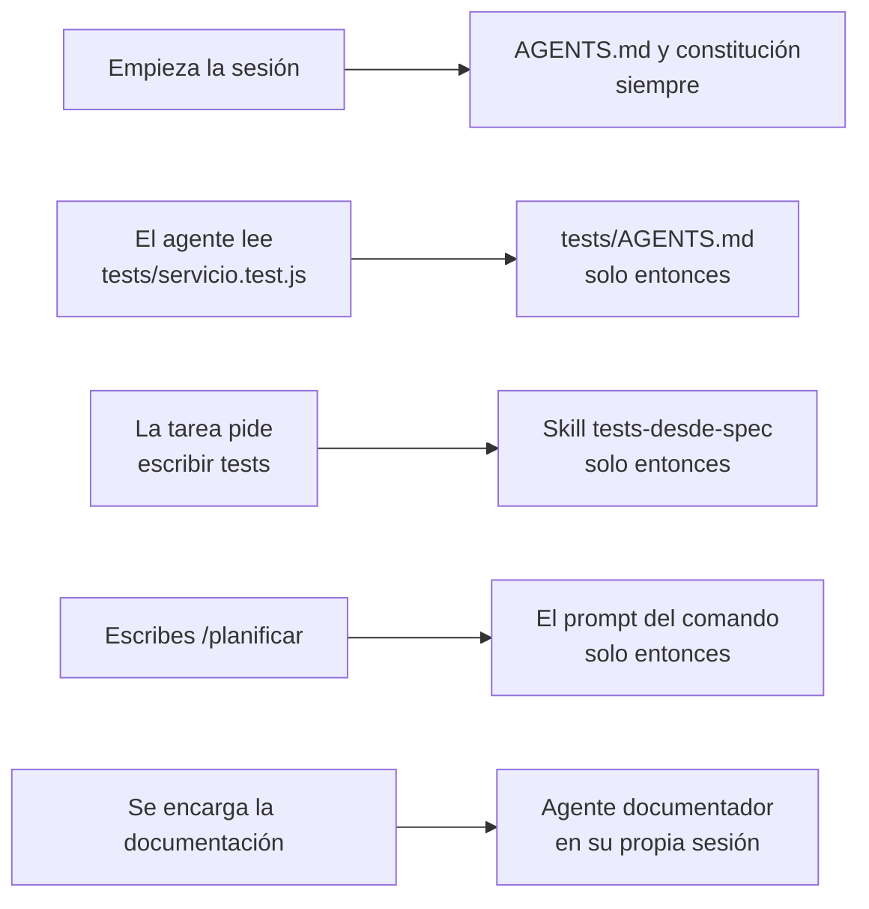
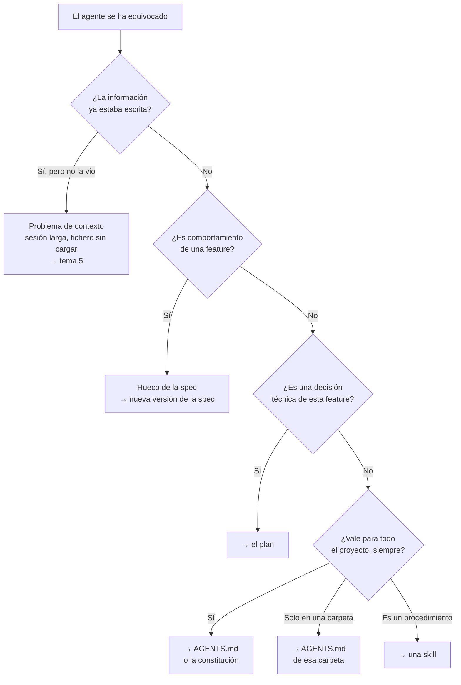
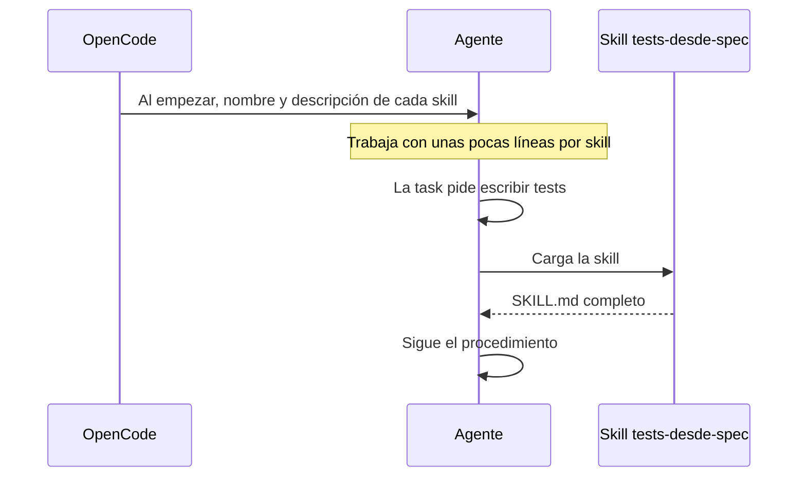
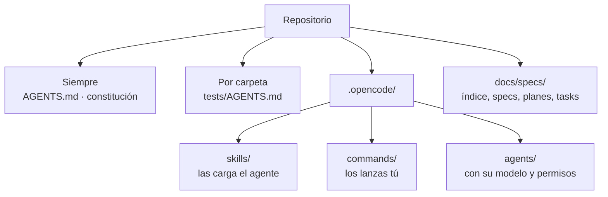

# 6. Memoria persistente del agente

[⬅️ Volver a la unidad](./README.md)

## Índice

- [6.1. La memoria que sobrevive a la sesión](#61-la-memoria-que-sobrevive-a-la-sesión)
- [6.2. Instrucciones persistentes: AGENTS.md y constitución](#62-instrucciones-persistentes-agentsmd-y-constitución)
  - [6.2.1. Qué va en cada fichero](#621-qué-va-en-cada-fichero)
  - [6.2.2. Qué no va](#622-qué-no-va)
  - [6.2.3. Corto, concreto y verdadero](#623-corto-concreto-y-verdadero)
  - [6.2.4. Antes de añadir una regla](#624-antes-de-añadir-una-regla)
- [6.3. Instrucciones contextuales](#63-instrucciones-contextuales)
  - [6.3.1. Reglas que solo valen en una parte del proyecto](#631-reglas-que-solo-valen-en-una-parte-del-proyecto)
  - [6.3.2. En OpenCode: AGENTS.md en una carpeta](#632-en-opencode-agentsmd-en-una-carpeta)
  - [6.3.3. En otras herramientas](#633-en-otras-herramientas)
- [6.4. Skills](#64-skills)
  - [6.4.1. Qué es una skill](#641-qué-es-una-skill)
  - [6.4.2. Cómo se carga](#642-cómo-se-carga)
  - [6.4.3. Estructura y ubicación](#643-estructura-y-ubicación)
  - [6.4.4. Cuándo crear una](#644-cuándo-crear-una)
- [6.5. Comandos: el prompt como código](#65-comandos-el-prompt-como-código)
  - [6.5.1. Prompt as code](#651-prompt-as-code)
  - [6.5.2. Comandos en OpenCode](#652-comandos-en-opencode)
  - [6.5.3. Comandos frente a skills](#653-comandos-frente-a-skills)
- [6.6. Agentes personalizados](#66-agentes-personalizados)
  - [6.6.1. Por qué crear un agente](#661-por-qué-crear-un-agente)
  - [6.6.2. El fichero de un agente](#662-el-fichero-de-un-agente)
  - [6.6.3. Un modelo para cada trabajo](#663-un-modelo-para-cada-trabajo)
  - [6.6.4. Permisos mínimos](#664-permisos-mínimos)
  - [6.6.5. El reparto vale con cualquier herramienta](#665-el-reparto-vale-con-cualquier-herramienta)
- [6.7. Cómo encaja todo](#67-cómo-encaja-todo)
- [6.8. Errores típicos](#68-errores-típicos)
- [6.9. Ejemplo integrador: la memoria de la lista de tareas](#69-ejemplo-integrador-la-memoria-de-la-lista-de-tareas)
- [Resumen](#resumen)
- [Ejercicios de reflexión](#ejercicios-de-reflexión)

> **Criterios que trabaja este tema:** OA2 f.

---

## 6.1. La memoria que sobrevive a la sesión

En el tema 5 viste que la ventana de contexto se vacía al empezar cada sesión, y que todo lo que llamamos «memoria» del agente son ficheros que vuelven a meter información en ella. En la UD1 conociste las **primitivas** con las que se construye esa memoria. Este tema enseña a **configurarlas** en OpenCode y a decidir cuál usar en cada caso.

La diferencia entre ellas está en **cuándo** entran en la ventana:

| Primitiva | Fichero en OpenCode | Entra en la ventana… |
|-----------|---------------------|----------------------|
| **Instrucciones persistentes** | `AGENTS.md` en la raíz y `instructions` en `opencode.json` | Siempre, al empezar cada sesión |
| **Instrucciones contextuales** | `AGENTS.md` dentro de una carpeta | Cuando el agente lee un fichero de esa carpeta |
| **Skills** | `.opencode/skills/<nombre>/SKILL.md` | Cuando la tarea encaja con su descripción |
| **Comandos** | `.opencode/commands/<nombre>.md` | Cuando tú escribes `/<nombre>` |
| **Agentes personalizados** | `.opencode/agents/<nombre>.md` | Cuando los eliges o cuando otro agente les encarga trabajo, en su propia sesión |



El diagrama muestra la idea del tema: solo la primera fila entra **siempre**. Todo lo demás entra **cuando hace falta**, que es exactamente lo que pedía el tema 5: el contexto justo en cada momento.

> 📝 **Nota del Profesor**: OpenCode **vigila** estos ficheros y vuelve a cargar la configuración cuando guardas un cambio en un agente, un comando, una skill u `opencode.json`. Si un cambio no parece aplicarse, escribe `/reload`. Y para probar una configuración nueva, hazlo en una **sesión nueva** (`/new`): así no se mezcla con lo que el agente ya ha visto.

---

## 6.2. Instrucciones persistentes: AGENTS.md y constitución

### 6.2.1. Qué va en cada fichero

Los dos ficheros entran en todas las sesiones, pero tienen papeles distintos (UD1, tema 2):

| | `AGENTS.md` | `constitution.md` |
|---|---|---|
| **Responde a** | ¿Cómo se trabaja aquí? | ¿Qué no se negocia en este proyecto? |
| **Tono** | Operativo: órdenes que se siguen sin interpretar | Principios, con su motivo |
| **Contenido** | Comandos, estructura de carpetas, convenciones de código, prohibiciones, qué leer al empezar | Arquitectura, tecnología, formato de la API, forma de probar, notación de las specs |
| **Ejemplo** | «Tests: `npm test`» | «Los controladores no contienen lógica de negocio» |
| **Lo usa también** | Cualquier agente que lea `AGENTS.md` | Quien revisa un plan (punto de control 2) |

### 6.2.2. Qué no va

| No va en las instrucciones persistentes | Dónde va |
|-----------------------------------------|----------|
| Cómo se implementa una feature concreta | Su spec y su plan |
| Reglas que solo valen en una carpeta | Un `AGENTS.md` en esa carpeta (apartado 6.3) |
| Un procedimiento largo que solo se usa a veces | Una skill (apartado 6.4) |
| Un prompt que lanzas en cada fase | Un comando (apartado 6.5) |
| Decisiones descartadas y su historia | El plan (alternativas descartadas) o el historial de Git |
| Lo que el agente puede deducir leyendo el código | Nada: no hace falta escribirlo |

### 6.2.3. Corto, concreto y verdadero

Cada línea de `AGENTS.md` ocupa contexto en **todas** las sesiones (tema 5), así que cada línea tiene que ganarse su sitio:

- **Corto.** Si una regla solo vale a veces, no es una regla global: muévela a donde se use.
- **Concreto.** «Escribe buen código» no se puede cumplir ni comprobar; «identificadores en español» sí.
- **Verdadero.** Una regla que no se corresponde con el proyecto es peor que no tener regla: el agente intentará cumplirla. Si `AGENTS.md` dice «Lint: `npm run lint`» y el proyecto no tiene linter, el agente perderá el tiempo buscándolo o, peor, lo instalará.
- **Sin contradicciones.** Si dos reglas chocan, el agente cumplirá una u otra según el momento, y el resultado será inconsistente.

> ✅ **Buena práctica**: revisa `AGENTS.md` cada vez que cierres una feature. Es el momento natural para quitar lo que ya no es verdad (un comando que cambió, una carpeta que se renombró) y para añadir lo que has tenido que explicar al agente más de una vez.

### 6.2.4. Antes de añadir una regla

Cuando el agente se equivoca, la tentación es añadir una regla a `AGENTS.md` para que no vuelva a pasar. Si lo haces siempre, el fichero se convierte en un **cajón de sastre**: largo, contradictorio y lleno de casos concretos. Antes de añadir nada, diagnostica **por qué** se equivocó:



Lo que destaca del diagrama: `AGENTS.md` es **una** de las seis salidas, no la respuesta por defecto. Muchos errores del agente se arreglan con el contexto (tema 5) o con la spec, y una regla global no los habría evitado.

> 💡 **Tip del Examinador**: «El agente ha incumplido algo. ¿Lo añades a `AGENTS.md`?». Antes, se diagnostica: si la información ya estaba escrita y no la vio, es un problema de contexto; si es comportamiento de una feature, va en su spec; si es una decisión técnica de la feature, en el plan. Solo lo que vale para todo el proyecto y siempre va en `AGENTS.md` o la constitución.

---

## 6.3. Instrucciones contextuales

### 6.3.1. Reglas que solo valen en una parte del proyecto

Hay reglas que solo importan cuando se trabaja en una parte concreta del proyecto: cómo se escriben los tests, cómo se organiza la página, cómo se nombran las migraciones de la base de datos. Ponerlas en el `AGENTS.md` raíz tiene dos problemas: ocupan la ventana en todas las sesiones, aunque no se toque esa parte, y hacen el fichero más largo.

Las **instrucciones contextuales** son reglas que **se activan solas** cuando el agente trabaja en ficheros de una carpeta o de un tipo concreto.

### 6.3.2. En OpenCode: AGENTS.md en una carpeta

En OpenCode, una instrucción contextual es un **`AGENTS.md` dentro de una carpeta**. Cuando el agente lee un fichero de esa carpeta (o de una subcarpeta), OpenCode añade a la conversación las instrucciones de ese `AGENTS.md`. Si el agente no toca la carpeta, no se cargan.

```text
lista-tareas/
├── AGENTS.md            ← siempre
└── tests/
    ├── AGENTS.md        ← solo cuando el agente lee algo de tests/
    ├── servicio-tareas.test.js
    └── api-tareas.test.js
```

Un ejemplo para la carpeta de tests de la lista de tareas:

```markdown
# Tests

- Vitest. Un fichero por módulo: `tests/<módulo>.test.js`.
- El nombre de cada test empieza por el identificador de la spec que
  comprueba: `test('EC-01: rechaza un texto vacío', …)`.
- Los mensajes de error se comprueban con el texto exacto de la spec.
- Los tests de la API usan supertest contra `app`, sin arrancar el
  servidor.
- Nunca cambies un test para que pase: si crees que está mal, dilo.
```

Son las convenciones que fuiste fijando en el tema 3. Antes estaban en tus prompts; ahora están escritas donde se aplican.

> ⚠️ **Cuidado**: no confundas los `AGENTS.md` de carpeta con el campo `instructions` de `opencode.json`. Los ficheros de `instructions` (como `constitution.md`) se cargan **siempre**, aunque los indiques con un patrón como `"docs/reglas/*.md"`. Si quieres que una regla entre solo cuando hace falta, ponla en el `AGENTS.md` de la carpeta.

### 6.3.3. En otras herramientas

Todas las herramientas tienen un mecanismo parecido, con nombres distintos (pueden cambiar entre versiones):

| Herramienta | Nombre | Cómo se activa |
|-------------|--------|----------------|
| **OpenCode** | `AGENTS.md` de carpeta | Al leer un fichero de esa carpeta |
| **Claude Code** | `CLAUDE.md` de carpeta y reglas con rutas | Al trabajar con ficheros de esa carpeta o que encajan con un patrón |
| **GitHub Copilot** | Instrucciones por ruta (`.instructions.md`) | Un patrón en la cabecera (`applyTo`) |
| **Cursor** | Reglas (`.cursor/rules/`) | Un patrón en la cabecera (`globs`) o siempre |
| **Kiro** | Ficheros de *steering* | Un patrón en la cabecera, siempre o a mano |

El principio es el mismo en todas: **reglas específicas para contextos específicos**, sin llenar el contexto de todas las sesiones.

---

## 6.4. Skills

### 6.4.1. Qué es una skill

Una ***skill*** es un **procedimiento** empaquetado en una carpeta: instrucciones paso a paso, ejemplos y, si hace falta, scripts o ficheros de apoyo, para que el agente sepa hacer una tarea concreta **cuando la necesita**.

En la UD1 viste la diferencia con una regla: la regla se aplica **siempre**; la skill, **solo cuando la tarea lo pide**. Por eso una skill puede ser larga sin que eso cueste nada en las sesiones que no la usan.

Las skills siguen un formato abierto, **Agent Skills** (enlazado en la portada de la unidad), que entienden OpenCode, Claude Code, GitHub Copilot y otros agentes. Una skill escrita para un agente sirve, en general, para los demás.

### 6.4.2. Cómo se carga

Al empezar una sesión, el agente **no** lee las skills enteras. Solo recibe una lista con el **nombre** y la **descripción** de cada una. Cuando una tarea encaja con alguna descripción, el agente decide cargarla y solo entonces lee el `SKILL.md` completo.



Es la **recuperación justo a tiempo** del tema 5 aplicada a los procedimientos. Y tiene una consecuencia práctica: **la descripción decide si la skill se usa**. Si la descripción no dice claramente qué hace y cuándo usarla, el agente no sabrá que existe para esa tarea.

| Descripción | Problema |
|-------------|----------|
| «Tests.» | No dice qué hace ni cuándo usarla |
| «Ayuda con los tests del proyecto.» | Demasiado vaga: ¿escribirlos, ejecutarlos, revisarlos? |
| «Procedimiento para escribir los tests de una feature a partir de los identificadores de su spec y de la estrategia de pruebas de su plan. Úsala cuando una task pida escribir tests.» | Dice qué hace, con qué y cuándo |

### 6.4.3. Estructura y ubicación

Una skill es una **carpeta** con un fichero **`SKILL.md`** y, si hace falta, otros ficheros:

```text
.opencode/skills/
└── tests-desde-spec/
    └── SKILL.md
```

El `SKILL.md` empieza con una cabecera YAML con dos campos obligatorios:

| Campo | Reglas |
|-------|--------|
| `name` | Minúsculas, números y guiones simples, sin guion al principio ni al final. **Igual que el nombre de la carpeta** |
| `description` | Qué hace la skill y cuándo usarla, en una o dos frases |

Después de la cabecera va el procedimiento en Markdown. Un buen `SKILL.md` tiene la forma de una task bien hecha: qué hacer **antes**, **durante** y **al terminar**, con un criterio para saber que se ha hecho bien. Lo verás completo en el ejemplo integrador.

OpenCode busca skills en `.opencode/skills/` del proyecto y en `~/.config/opencode/skills/` para las tuyas personales. Por compatibilidad, también lee las de `.claude/skills/` y `.agents/skills/`. Para ver qué skills ha encontrado, escribe en la interfaz de OpenCode:

```text
/skills
```

> ⚠️ **Cuidado**: OpenCode puede cargar una skill aunque no cumpla las reglas del formato (por ejemplo, con un `name` distinto del nombre de la carpeta), pero otros agentes no lo harán. Sigue el formato aunque tu herramienta no te avise: así la skill sirve en cualquier agente.

### 6.4.4. Cuándo crear una

Una skill merece la pena cuando:

- Un **procedimiento con varios pasos** se repite (escribir tests desde la spec, preparar una versión, migrar un módulo).
- El agente comete **errores recurrentes** en esa tarea, aunque la información esté en la spec y en las reglas.
- El procedimiento **no cabe en una regla**: necesita pasos ordenados, ejemplos o un script.

Y no merece la pena cuando lo que tienes es una regla corta (va en `AGENTS.md`), algo que solo pasa una vez (va en el prompt) o algo que lanzas tú siempre en el mismo momento (es un comando).

---

## 6.5. Comandos: el prompt como código

### 6.5.1. Prompt as code

En los temas 2 y 3 escribiste prompts largos y cuidados para cada fase: planificar, descomponer, implementar. Funcionan bien porque cada línea tiene un motivo. Pero si se quedan en la conversación, se pierden al cerrar la sesión, y la próxima vez los reescribes de memoria, peor.

***Prompt as code*** («el prompt como código») es tratar los prompts que se repiten como lo que son: **artefactos del proyecto**, guardados en ficheros, versionados con Git, revisados y mejorados como cualquier otro fichero.

| Prompt en la conversación | Prompt como fichero |
|---------------------------|---------------------|
| Se pierde al cerrar la sesión | Está en el repositorio |
| Cada persona del equipo escribe el suyo | Todo el equipo usa el mismo |
| No se sabe qué cambio lo mejoró | El historial de Git lo cuenta |
| No se puede revisar | Se revisa en un *pull request* como el código |

### 6.5.2. Comandos en OpenCode

En OpenCode, un prompt guardado es un **comando**: un fichero Markdown en `.opencode/commands/`. El nombre del fichero es el nombre del comando: `planificar.md` se lanza con `/planificar`.

```markdown
---
description: Propone el plan técnico de una feature con la spec aprobada
agent: plan
---
Vamos a planificar la feature de la carpeta docs/specs/$1/.

Lee el índice docs/specs/README.md, la spec aprobada
docs/specs/$1/spec.md y, como ejemplo de formato y de decisiones ya
tomadas, el plan de la última feature implementada del índice.
…
```

| Parte | Para qué |
|-------|----------|
| `description` | El texto que ves al escribir `/` en OpenCode |
| `agent` | Qué agente ejecuta el comando: *plan* para no tocar ficheros, *build* para implementar |
| `model` | Opcional: un modelo distinto para este comando |
| `subagent` | Opcional: `true` para que se ejecute como un subagente, en su propia sesión |
| El cuerpo | El prompt que se envía |
| `$ARGUMENTS` | Todo lo que escribes después del comando |
| `$1`, `$2`… | Cada palabra por separado: con `/implementar A-añadir-tarea 2`, `$1` es `A-añadir-tarea` y `$2` es `2` |

El campo `agent` es más importante de lo que parece: con `agent: plan`, el comando de planificar **no puede** editar ficheros aunque el prompt se equivoque. La protección no depende de que el agente obedezca, sino de la configuración.

Para comprobar que OpenCode ha cargado tus comandos, escribe `/` en la interfaz: aparecen en la lista, cada uno con su `description`.

> ✅ **Buena práctica**: dentro de un comando, da las **rutas** de los ficheros en lugar de pegar su contenido. El comando sigue siendo corto, el agente lee la versión actual de cada fichero y el mismo comando sirve para todas las features cambiando solo el argumento.

### 6.5.3. Comandos frente a skills

Comandos y skills son los dos «procedimientos guardados», y se confunden a menudo:

| | Comando | Skill |
|---|---|---|
| **Quién lo activa** | Tú, escribiendo `/<nombre>` | El agente, cuando la tarea encaja con la descripción |
| **Qué es** | Una petición: «haz esto ahora» | Un saber hacer: «así se hace esto» |
| **Cuándo** | En un momento concreto del flujo (al planificar, al implementar) | Cuando aparece la tarea, aunque no la hayas previsto |
| **Ejemplo** | `/planificar B-ver-lista` | Cómo escribir tests desde la spec |

Se combinan bien: el comando `/implementar` pide un grupo de tasks; cuando el agente llega a la task de tests, carga la skill de tests por su cuenta.

> 💡 **Tip del Examinador**: «¿Qué diferencia hay entre un comando y una skill?». El comando lo lanza la persona en un momento concreto (`/planificar`) y es una petición; la skill la carga el agente cuando la tarea encaja con su descripción y es un procedimiento sobre cómo hacer algo.

---

## 6.6. Agentes personalizados

### 6.6.1. Por qué crear un agente

*Plan* y *build* sirven para casi todo, pero hay trabajos que conviene separar en un **agente propio**:

- Con **otro modelo**: más barato para tareas sencillas, más potente para las difíciles, local para el código que no debe salir del equipo.
- Con **otros permisos**: que solo pueda tocar la documentación, o solo leer.
- Con **otras instrucciones**: un papel concreto, con su forma de trabajar.

### 6.6.2. El fichero de un agente

En OpenCode, un agente es un fichero Markdown en `.opencode/agents/`. El nombre del fichero es el nombre del agente; la cabecera, su configuración; y el cuerpo, sus **instrucciones** (su *prompt* de sistema).

| Campo | Para qué |
|-------|----------|
| `description` | Qué hace. Los agentes principales la leen para decidir cuándo encargarle trabajo |
| `mode` | `primary` (se elige con `Mayús+Tab`, como *plan* y *build*), `subagent` (lo llama otro agente o tú con `@`) o `all` (las dos cosas) |
| `model` | El modelo, con el formato `proveedor/modelo`. Si no se indica, usa el de la sesión |
| `permissions` | Qué puede hacer: una lista de reglas como la de `opencode.json` (UD1, tema 3), que se aplican **después** de las del proyecto |

Para ver la configuración final de todos los agentes, cada uno con sus reglas combinadas con las del proyecto y en el orden en que se aplican:

```bash
opencode debug agents
```

La salida es larga, en JSON. Para ver solo qué agentes hay y de qué tipo es cada uno:

```bash
opencode debug agents | grep -E '"(id|mode)"'
```

### 6.6.3. Un modelo para cada trabajo

No todas las tareas necesitan el mismo modelo. Planificar o implementar una feature con decisiones delicadas pide un modelo capaz; resumir un cambio o redactar la documentación de un endpoint, normalmente no.

| Trabajo | Qué pesa más | Modelo |
|---------|--------------|--------|
| Planificar, implementar | Calidad del razonamiento | El más capaz que tengas |
| Documentar, resumir, revisar el estilo | Coste y rapidez | Uno más económico |
| Código o datos que no pueden salir del equipo | Privacidad | Un modelo local |

Para ver los modelos que tienes disponibles con tus proveedores:

```bash
opencode models
```

> ⚠️ **Cuidado**: un agente con un modelo que no tienes disponible **falla** al usarlo. Antes de copiar un agente de otro proyecto, cambia su `model` por uno de la lista de `opencode models`, o quita la línea para que use el de la sesión.

En la UD4 verás cómo elegir un modelo para cada papel cuando trabajan varios agentes a la vez.

### 6.6.4. Permisos mínimos

Un agente debe tener **solo los permisos que su trabajo necesita**: es el **principio de mínimo privilegio**. Un documentador no necesita editar el código ni ejecutar comandos, así que no debe poder hacerlo.

Los permisos de edición admiten patrones de rutas. Recuerda la regla del tema 3 de la UD1: **gana la última regla que coincide**. Por eso el orden importa:

```yaml
permissions:
  - { action: edit, resource: "*", effect: deny }
  - { action: edit, resource: "README.md", effect: allow }
  - { action: edit, resource: "docs/**", effect: allow }
  - { action: edit, resource: "docs/specs/**", effect: deny }
  - { action: edit, resource: "docs/prd.md", effect: deny }
```

| Fichero | Reglas que coinciden | Gana | Resultado |
|---------|----------------------|------|-----------|
| `src/app.js` | `*` | `*` | ❌ No puede |
| `README.md` | `*`, `README.md` | `README.md` | ✅ Puede |
| `docs/api.md` | `*`, `docs/**` | `docs/**` | ✅ Puede |
| `docs/specs/A-añadir-tarea/spec.md` | `*`, `docs/**`, `docs/specs/**` | `docs/specs/**` | ❌ No puede |
| `docs/prd.md` | `*`, `docs/**`, `docs/prd.md` | `docs/prd.md` | ❌ No puede |

Si escribieras la regla de `docs/specs/**` **antes** que la de `docs/**`, ganaría la de `docs/**` y el documentador podría cambiar las specs.

> 📝 **Nota del Profesor**: los permisos son la diferencia entre **pedir** y **garantizar**. Puedes escribir en las instrucciones del agente «no toques el código», y casi siempre lo cumplirá. Con una regla `edit` en `deny`, no puede incumplirlo aunque quiera. Las reglas importantes de seguridad van siempre en los permisos.

### 6.6.5. El reparto vale con cualquier herramienta

Fíjate en que nada de lo que hace el documentador depende de lo que pasó en otras sesiones: lee la spec, el índice y el código, que están en el repositorio. Por eso el reparto de trabajo funciona igual si cada tarea la hace **otra herramienta**: un agente puede implementar con OpenCode y otro, en otro programa, revisar o documentar, porque todos leen las mismas specs, las mismas reglas y la misma constitución.

Es la ventaja de fondo de SDD: el contexto está **en el repositorio**, no en la cabeza de una herramienta.

---

## 6.7. Cómo encaja todo

| Necesitas… | Usa… | Dónde en OpenCode |
|------------|------|-------------------|
| Que el agente sepa siempre cómo se trabaja aquí | Instrucciones persistentes | `AGENTS.md` raíz |
| Que respete siempre los principios del proyecto | Instrucciones persistentes | `constitution.md` en `instructions` |
| Reglas que solo valen en una carpeta | Instrucciones contextuales | `AGENTS.md` en esa carpeta |
| Que sepa hacer un procedimiento cuando aparezca | Skill | `.opencode/skills/<nombre>/SKILL.md` |
| Lanzar siempre igual el prompt de una fase | Comando | `.opencode/commands/<nombre>.md` |
| Otro modelo, otros permisos u otro papel | Agente personalizado | `.opencode/agents/<nombre>.md` |
| Saber qué está hecho y qué sigue | Índice de features (tema 4) | `docs/specs/README.md` |



Todo vive en el repositorio y se versiona con Git: la memoria del agente es parte del proyecto, igual que el código.

En la UD1 viste que el agente es el **arnés (*harness*)** del modelo: el programa que decide qué contexto le llega y qué puede hacer. Estas piezas son la parte del arnés (*harness*) que **pones tú**, no la herramienta. Casi todas son **guías**: le dicen al agente qué sabe y cómo se trabaja. Los permisos son ya un **control**: impiden al `documentador` editar el código aunque se lo pidas. En la UD3 añadirás más controles: tests que el agente no puede cambiar y comprobaciones automáticas (*quality gates*).

---

## 6.8. Errores típicos

| Error | Consecuencia | Cómo evitarlo |
|-------|--------------|---------------|
| Añadir una regla a `AGENTS.md` por cada fallo | Cajón de sastre largo y contradictorio | Diagnosticar antes (apartado 6.2.4) |
| Reglas que no son verdad (comandos que no existen, carpetas renombradas) | El agente intenta cumplirlas | Revisar `AGENTS.md` al cerrar cada feature |
| Reglas de una carpeta en el `AGENTS.md` raíz | Ocupan la ventana en todas las sesiones | Un `AGENTS.md` en la carpeta |
| Skill con una descripción vaga | El agente no la carga cuando hace falta | Decir qué hace, con qué y cuándo usarla |
| `name` de la skill distinto del nombre de la carpeta | Otros agentes no la reconocen | Mismo nombre en los dos sitios |
| Comando que pega ficheros enteros | Prompt largo y desactualizado | Dar rutas |
| Comando de planificar con `agent: build` | Nada impide que escriba código | `agent: plan` |
| Agente con permisos de más | Puede tocar lo que no debe | Mínimo privilegio, con `deny` por defecto |
| Orden equivocado en los permisos | Una regla general anula a una concreta | La general primero, las excepciones después |
| Agente con un modelo que no tienes | Falla al usarlo | Comprobarlo con `opencode models` |
| Probar una configuración nueva en la sesión de antes | La sesión arrastra lo que el agente ya había visto | Probarla en una sesión nueva (`/new`), y `/reload` si un cambio no se aplica |

---

## 6.9. Ejemplo integrador: la memoria de la lista de tareas

La lista de tareas tiene la feature A implementada y la B con la spec aprobada (tema 4). Vas a convertir lo que has aprendido en la unidad en la memoria del proyecto: reglas revisadas, una regla por carpeta, una skill, tres comandos y un agente.

**1. Revisa `AGENTS.md`.** El que escribiste en la UD1 tenía un comando que no existe (`npm run lint`: el proyecto no tiene linter todavía; llegará con los *quality gates* de la UD3). Lo quitas, añades los comandos y la estructura que ahora sí existen y reúnes las reglas que fuiste añadiendo en el tema 4:

```markdown
# AGENTS.md

Lista de tareas compartida: API en Node.js con Express y una página web
sin framework. Los principios están en `constitution.md`, y el porqué
del producto, en `docs/prd.md`.

## Al empezar una sesión

- Lee `docs/specs/README.md` para saber qué features están
  implementadas y cuál es la siguiente.

## Comandos

- Instalar: `npm install`
- Tests: `npm test`
- Arrancar: `npm start` (en http://localhost:3000)
- Comprobar que el índice coincide con el estado de cada spec:
  `npm run estado`

## Estructura

- `src/`: una carpeta por capa (controladores, servicios, repositorios),
  más `rutas/` y `errores/`.
- `public/`: la página.
- `tests/`: un fichero de tests por módulo.
- `docs/specs/<prefijo>-<nombre>/`: spec, plan y tasks de cada feature.

## Convenciones

- JavaScript con módulos ES. Identificadores en español.
- Comillas simples y punto y coma.

## Prohibiciones

- No añadas dependencias sin consultarlo.
- No escribas claves ni contraseñas en ningún fichero.
- No modifiques una spec aprobada sin que se te pida: propón el cambio.
- No cambies el estado de una spec ni del índice: lo cambia una persona.
```

No hay nada sobre cómo se escriben los tests ni sobre cómo se planifica: eso va en los siguientes pasos.

**2. Añade la regla de la carpeta de tests.** Crea `tests/AGENTS.md` con el contenido del apartado 6.3.2. Las convenciones de los tests entran en la ventana solo cuando el agente trabaja con ellos.

**3. Crea la skill de tests.** En el tema 3 explicaste en cada prompt cómo escribir los tests. Es un procedimiento que se repite en cada feature: `.opencode/skills/tests-desde-spec/SKILL.md`:

```markdown
---
name: tests-desde-spec
description: Procedimiento para escribir los tests de una feature a partir de los identificadores de su spec y de la estrategia de pruebas de su plan. Úsala cuando una task pida escribir tests (en tasks.md, las que empiezan por «Tests de…»).
---

# Tests desde la spec

## Antes de escribir

1. Lee en `tasks.md` la línea **Cubre** de la task: son los
   identificadores que tienes que comprobar.
2. Busca cada identificador en la **estrategia de pruebas** del plan: dice
   si se comprueba con un test unitario, con uno de integración de la API
   o a mano.
3. Lee cada identificador en la spec. Apunta el valor exacto que la spec
   fija: el código HTTP, el mensaje de error, el límite.

## Al escribir

4. Un test por cada caso, con el identificador al principio del nombre.
5. En los límites, prueba los dos lados: si el máximo es 280, un test con
   280 (se acepta) y otro con 281 (se rechaza).
6. Si varios valores dan el mismo resultado, usa `test.each` con todos.
7. Para provocar un fallo interno, sustituye la función que falla con
   `vi.spyOn` y restáurala en `afterEach` con `vi.restoreAllMocks()`.
8. Sigue el estilo de `tests/servicio-tareas.test.js` y
   `tests/api-tareas.test.js`.

## Al terminar

9. Ejecuta `npm test`. Los tests nuevos tienen que **fallar**, y por el
   motivo correcto: que el código aún no existe, no un error del test.
10. Comprueba que cada identificador de la línea **Cubre** tiene al menos
    un test. Si alguno no se puede comprobar como dice el plan, dilo.
```

Fíjate en la diferencia con `tests/AGENTS.md`: la regla de carpeta dice **cómo son** los tests del proyecto (convenciones); la skill dice **cómo se escriben** a partir de una spec (procedimiento). Y el paso 8 usa memoria episódica (tema 5): señala tests reales en lugar de describirlos.

**4. Guarda los prompts de las fases como comandos.** En el tema 5 prometiste convertir el prompt de planificar en un comando. `.opencode/commands/planificar.md`:

```markdown
---
description: Propone el plan técnico de una feature con la spec aprobada
agent: plan
---
Vamos a planificar la feature de la carpeta docs/specs/$1/.

Lee el índice docs/specs/README.md, la spec aprobada
docs/specs/$1/spec.md y, como ejemplo de formato y de decisiones ya
tomadas, el plan de la última feature implementada del índice.

Antes de proponer nada, encarga al subagente explore que averigüe qué
código existente puede reutilizar esta feature. No leas tú esos ficheros
enteros.

Propón el plan técnico con estas secciones: visión general, contexto
técnico, comprobación de la constitución, ficheros, decisiones técnicas
(D-01, D-02… con el motivo, la alternativa descartada y los
identificadores de la spec que cubre), dependencias, secuencia de
implementación con el porqué del orden, estrategia de pruebas (una fila
por cada identificador de la spec, con el tipo de prueba: unitaria, de
integración o a mano) y riesgos.

Reglas:
- No escribas código, ni en ficheros ni dentro del plan.
- No cambies la spec. Si encuentras algo que la spec no decide y que se
  notaría desde fuera del sistema, márcalo con [NECESITA ACLARACIÓN] y
  explícame la duda.
- Si una decisión contradice la constitución, dímelo en lugar de tomarla.
- Reutiliza lo que ya existe antes de crear nada nuevo.
```

Y el de implementar un grupo de tasks, con el prompt del tema 3: `.opencode/commands/implementar.md`:

```markdown
---
description: Implementa un grupo de tasks de una feature
agent: build
---
Implementa el grupo $2 de docs/specs/$1/tasks.md.

Si el grupo tiene una task de tests, hazla primero: escribe los tests,
ejecuta npm test y comprueba que fallan. Después la de implementación:
escribe lo mínimo para que pasen y vuelve a ejecutar npm test.

Reglas:
- Haz solo las tasks de ese grupo. No crees ni modifiques ficheros que no
  aparezcan en ellas, salvo para marcarlas en tasks.md.
- No cambies un test para que pase. Si crees que un test está mal, dímelo.
- Si algo no encaja con la spec, el plan o la constitución, para y
  pregúntame.
- Al terminar, marca las tasks del grupo con [x] en tasks.md y espera mi
  revisión.
```

El prompt es el mismo que escribiste a mano en el tema 3, pero con la feature y el grupo como argumentos. Y la parte de cómo escribir los tests ya no hace falta: la pone la skill.

**5. Crea el agente documentador.** La documentación de la API es un trabajo sencillo y repetitivo: no necesita el modelo más capaz, y no debe tocar ni el código ni las specs. `.opencode/agents/documentador.md`:

```markdown
---
description: Documenta las features implementadas en docs/api.md y README.md a partir de su spec y su código. No modifica el código, las specs ni los planes.
mode: subagent
model: proveedor/modelo-economico
permissions:
  - { action: edit, resource: "*", effect: deny }
  - { action: edit, resource: "README.md", effect: allow }
  - { action: edit, resource: "docs/**", effect: allow }
  - { action: edit, resource: "docs/specs/**", effect: deny }
  - { action: edit, resource: "docs/prd.md", effect: deny }
  - { action: shell, resource: "*", effect: deny }
  - { action: shell, resource: "git diff *", effect: allow }
  - { action: shell, resource: "git log *", effect: allow }
  - { action: subagent, resource: "*", effect: deny }
---

Eres el documentador del proyecto de la lista de tareas.

Mantienes al día dos ficheros:

- `docs/api.md`: cada endpoint con su método, ruta, cuerpo de la
  petición, respuestas y errores, con un ejemplo de cada uno.
- `README.md`: qué es el proyecto, cómo se instala, cómo se arranca y
  cómo se ejecutan los tests.

Cómo trabajas:

- La fuente es la spec de la feature y el código que la implementa. Si
  no coinciden, no elijas: avisa de la diferencia.
- Documenta solo las features con el estado Implementada en
  `docs/specs/README.md`.
- Escribe en español, para alguien que va a usar la API, no para quien
  la programa.
- No inventes nada que no esté en la spec o en el código.
```

Cambia `proveedor/modelo-economico` por un modelo económico de los que te muestra `opencode models`. Y un comando para llamarlo, `.opencode/commands/documentar.md`:

```markdown
---
description: Documenta una feature implementada con el subagente documentador
agent: documentador
subagent: true
---
Documenta la feature de la carpeta docs/specs/$1/ en docs/api.md. Si
cambia algo de cómo se instala, se arranca o se prueba el proyecto,
actualiza también README.md.
```

Con `subagent: true`, el documentador trabaja en una **sesión hija**: lo que lee para documentar no llena la ventana de tu sesión (tema 5).

**6. Comprueba que OpenCode lo ha cargado todo.** Primero, los agentes, desde el terminal:

```bash
opencode debug agents | grep -E '"(id|mode)"'
```

```text
    "id": "build",
    "mode": "primary",
…
    "id": "documentador",
    "mode": "subagent",
…
```

Después, en la interfaz de OpenCode, `/skills` muestra `tests-desde-spec` (y alguna skill que trae OpenCode de serie), y al escribir `/` aparecen `planificar`, `implementar` y `documentar` con su descripción.

Y lo más importante, los permisos del documentador. En la salida de `opencode debug agents`, busca el agente `documentador`: su lista `permissions` empieza por las reglas de serie y las del proyecto, y después vienen las suyas, que por ir detrás ganan:

| Acción | Recurso | Efecto |
|--------|---------|--------|
| `edit` | `*` | deny |
| `edit` | `README.md` | allow |
| `edit` | `docs/**` | allow |
| `edit` | `docs/specs/**` | deny |
| `edit` | `docs/prd.md` | deny |
| `shell` | `*` | deny |
| `shell` | `git diff *` | allow |
| `shell` | `git log *` | allow |
| `subagent` | `*` | deny |

Con la tabla del apartado 6.6.4 compruebas que no puede tocar `src/`, las specs ni el PRD, y que no puede ejecutar más comandos que `git diff` y `git log`.

Fíjate en la primera regla de la lista, la de serie: `*` con `*` en `allow`. Todo lo que el agente no prohíbe de forma expresa **está permitido**. Por eso hace falta la última regla, `subagent` en `deny`: sin ella, el documentador podría **encargar trabajo a otro agente**, por ejemplo al subagente `general`, que sí puede editar cualquier fichero, y su regla de `edit` no serviría de nada. Cierra siempre las acciones que permiten actuar a través de otro agente.

**7. Guarda la memoria del proyecto.** Todavía estás en `main`, entre la feature A y la B: revisar las reglas y convertir los prompts repetidos en comandos es justo lo que se hace al replanificar (tema 1, apartado 1.2.8).

```bash
git add AGENTS.md tests/AGENTS.md .opencode/
git commit -m "Memoria del agente: reglas, skill, comandos y documentador"
```

```text
lista-tareas/
├── AGENTS.md                         ← revisado
├── constitution.md
├── opencode.json
├── .opencode/
│   ├── agents/
│   │   └── documentador.md
│   ├── commands/
│   │   ├── documentar.md
│   │   ├── implementar.md
│   │   └── planificar.md
│   └── skills/
│       └── tests-desde-spec/
│           └── SKILL.md
├── docs/specs/…
├── src/…
└── tests/
    ├── AGENTS.md                     ← regla de carpeta
    └── …
```

**8. Úsalo.** Al abrir OpenCode, escribe `/` y verás tus tres comandos con su descripción. Empieza por documentar la feature A, que ya está en `main`:

```text
/documentar A-añadir-tarea
```

El documentador crea `docs/api.md` con el endpoint `POST /tareas`. Si le pides que corrija algo en `src/`, OpenCode rechaza la edición: no depende de que el agente obedezca. Revisas el documento y haces el commit en `main`:

```bash
git add docs/api.md
git commit -m "Documentación de la API: feature A"
```

Después, la feature B. Creas su rama (tema 1, apartado 1.3.4) y, en una sesión nueva, lanzas el comando:

```bash
git switch -c feature/B-ver-lista
```

```text
/planificar B-ver-lista
```

Revisas el plan (punto de control 2), lo guardas con *build* y haces el commit, como en el tema 2. Después de aprobar las tasks, cada ciclo empieza con una sesión nueva y una sola línea:

```text
/implementar B-ver-lista 1
```

> 📝 **Nota del Profesor**: compara el prompt de implementar del tema 3 (quince líneas que escribías en cada ciclo) con `/implementar B-ver-lista 1`. Lo que has ganado no es solo comodidad: el prompt ya no depende de tu memoria ni de tu prisa, todo el equipo usa el mismo y, si un día lo mejoras, el historial de Git lo registra. Eso es tratar el prompt como código.

---

## Resumen

- La memoria persistente del agente son **ficheros del repositorio** que entran en la ventana en momentos distintos: siempre, por carpeta, cuando la tarea lo pide, cuando tú lo lanzas o en la sesión de otro agente. OpenCode los lee **al arrancar**.
- **`AGENTS.md`** (operativo) y la **constitución** (principios) entran siempre: tienen que ser **cortos, concretos, verdaderos** y sin contradicciones. Antes de añadir una regla, se **diagnostica** si el fallo era de contexto, de spec, de plan o de verdad una regla global.
- Las **instrucciones contextuales** son reglas que solo entran cuando se trabaja en una parte del proyecto. En OpenCode, un **`AGENTS.md` dentro de una carpeta**, que se carga al leer un fichero de esa carpeta.
- Una **skill** es un procedimiento en `.opencode/skills/<nombre>/SKILL.md`, con `name` (igual que la carpeta) y `description`. El agente solo ve al principio el nombre y la descripción, y carga el resto cuando la tarea encaja: **la descripción decide si se usa**.
- Un **comando** es un prompt guardado en `.opencode/commands/<nombre>.md` (***prompt as code***), con `agent`, `model`, `subagent` y argumentos `$ARGUMENTS`, `$1`, `$2`. El comando lo lanzas tú; la skill la carga el agente.
- Un **agente personalizado** en `.opencode/agents/<nombre>.md` tiene su **modo**, su **modelo** y sus **permisos**. Los permisos aplican el **mínimo privilegio** y **gana la última regla que coincide**.
- Como todo el contexto está en el repositorio, el reparto de trabajo entre agentes funciona aunque cada uno use una herramienta distinta.
- El agente es el **arnés (*harness*)** del modelo, y estas piezas son la parte que pone el proyecto: sobre todo guías, y algún control, como los permisos. En la UD3 llegan los tests protegidos y los *quality gates*.

## Ejercicios de reflexión

1. Clasifica dónde pondrías cada una: «los commits empiezan por el identificador de la feature», «la página no usa ningún framework», «cómo preparar una versión nueva del proyecto», «las migraciones de la base de datos se nombran con la fecha», «el prompt que lanzas para revisar una spec».
2. El agente ha creado un fichero de tests en `test/` en lugar de `tests/`. Recorre el diagrama del apartado 6.2.4 y decide qué cambias.
3. Escribe la descripción de una skill para «revisar una spec antes de aprobarla» que haga que el agente la cargue en el momento adecuado.
4. ¿Por qué el comando `/planificar` lleva `agent: plan` aunque el prompt ya diga «no escribas código»?
5. Un compañero propone dar al documentador una regla `edit` en `allow` para todo y confiar en sus instrucciones. Explica qué podría pasar y por qué los permisos son mejor garantía.
6. Busca en la documentación de Agent Skills qué otros ficheros puede contener la carpeta de una skill además de `SKILL.md` y para qué sirven. Indica la fecha de consulta.

---

[⬅️ Volver a la unidad](./README.md)
