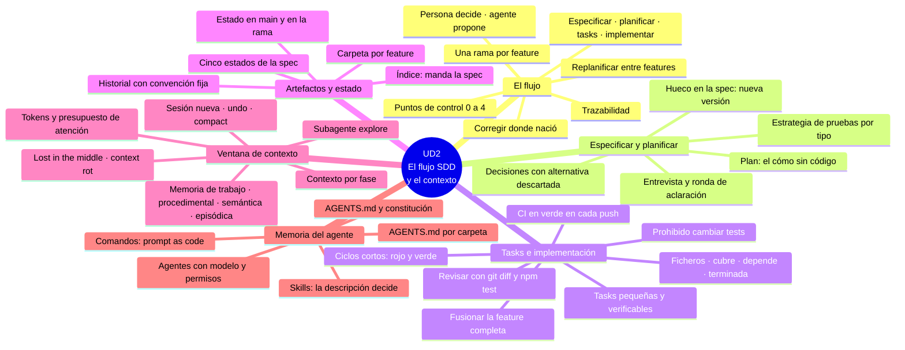
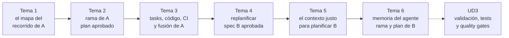

# 7. Resumen y mapa mental

[⬅️ Volver a la unidad](./README.md)

## Índice

- [Resumen ejecutivo](#resumen-ejecutivo)
- [Mapa mental](#mapa-mental)
- [El proyecto al terminar la unidad](#el-proyecto-al-terminar-la-unidad)
- [Checklist de evaluación](#checklist-de-evaluación)
  - [El flujo y sus puntos de control (criterio a)](#el-flujo-y-sus-puntos-de-control-criterio-a)
  - [Especificar y planificar (criterio b)](#especificar-y-planificar-criterio-b)
  - [Tasks e implementación (criterio c)](#tasks-e-implementación-criterio-c)
  - [Artefactos y estado (criterio d)](#artefactos-y-estado-criterio-d)
  - [La ventana de contexto (criterio e)](#la-ventana-de-contexto-criterio-e)
  - [La memoria del agente (criterio f)](#la-memoria-del-agente-criterio-f)

> **Criterios que trabaja este tema:** OA2 a, b, c, d, e, f.

---

## Resumen ejecutivo

En esta unidad has llevado una spec aprobada **hasta el código**, con un agente, sin perder el control de lo que hace ni del contexto que recibe:

1. **El flujo SDD**: cuatro fases (especificar, planificar, descomponer en tasks e implementar), cada una con su artefacto y su punto de control, precedidas por el contexto del proyecto. La persona decide y aprueba; el agente redacta, propone e implementa. *Plan* propone y *build* guarda e implementa, con una sesión nueva por fase. Los problemas se corrigen donde nacieron, y la trazabilidad enlaza requisito, decisión, task, test y commit. Cada feature tiene su **rama**, desde el plan hasta la fusión, y entre una feature y la siguiente se **replanifica**. Spec Kit, Kiro y Conductor siguen el mismo flujo con otros nombres.
2. **Especificar y planificar**: el agente ayuda a especificar con una entrevista y una ronda de aclaración, pero el comportamiento lo decides tú. El plan técnico decide el **cómo** (ficheros, decisiones con su alternativa descartada, dependencias, orden y estrategia de pruebas, con el tipo de cada prueba: unitaria, de integración o a mano) sin escribir código. Si el plan encuentra un hueco en la spec, la spec sube de versión; si una decisión vale para todo el proyecto, va a la constitución.
3. **Tasks e implementación**: las tasks son pasos pequeños, aislados, ordenados y verificables, con sus ficheros, lo que cubren, sus dependencias y un criterio de terminado. Se implementan en **ciclos cortos**: un grupo de tasks, una sesión nueva, tests en rojo y en verde, revisión con `git status`, `git diff` y `npm test`, un commit y la subida de la rama, con la **integración continua** del curso en verde. Lo inesperado para el ciclo y se corrige en su documento. Al final, la feature completa se comprueba y se fusiona.
4. **Artefactos y estado**: una carpeta por feature con `spec.md`, `plan.md` y `tasks.md`, junto al código. Cinco estados de la spec, cambiados por una persona con un commit cada uno, y un índice que se actualiza en el mismo commit (**manda la spec**; `npm run estado` lo comprueba). `main` muestra lo terminado y la rama, lo que está en curso. El historial de Git, con mensajes fijos, cuenta la vida de cada feature.
5. **La ventana de contexto**: todo lo que recibe el modelo en cada petición, limitado y de pago. Más contexto no es mejor: presupuesto de atención, *lost in the middle*, *context rot* e instrucciones que se apagan. Cada fase necesita solo una parte; la memoria del agente es de trabajo, procedimental, semántica y episódica. Estrategias: lo justo, referencias con `@`, sesión nueva, `/undo`, `/compact` como último recurso, escribir en ficheros y subagentes.
6. **La memoria persistente del agente**: `AGENTS.md` y la constitución (cortos, concretos y verdaderos), instrucciones contextuales con un `AGENTS.md` por carpeta, skills que el agente carga por su descripción, comandos que guardan los prompts (*prompt as code*) y agentes personalizados con su propio modelo y permisos de mínimo privilegio. Todo en el repositorio, así que sirve a cualquier agente.

---

## Mapa mental

El mapa recoge los conceptos clave de los seis temas:



Cada rama es un tema; si no sabes explicar alguna de sus hojas con tus palabras, vuelve a ese tema.

---

## El proyecto al terminar la unidad

El hilo conductor ha seguido siendo la **lista de tareas compartida**. Al terminar, `main` tiene la feature A implementada y fusionada, la spec de la B aprobada y la memoria del agente; la rama de la B ya tiene su plan:

```text
lista-tareas/
├── .devcontainer/devcontainer.json
├── .github/workflows/calidad.yml     ← tema 3: la CI del curso
├── .gitignore                        ← tema 3
├── AGENTS.md                         ← tema 4 (reglas del estado) y tema 6 (revisado)
├── constitution.md                   ← tema 2: sección «Tecnología»
├── opencode.json
├── package.json                      ← tema 3, y el script «estado» del tema 4
├── .opencode/                        ← tema 6
│   ├── agents/documentador.md
│   ├── commands/
│   │   ├── documentar.md
│   │   ├── implementar.md
│   │   └── planificar.md
│   └── skills/tests-desde-spec/SKILL.md
├── docs/
│   ├── api.md                        ← tema 6: escrito por el documentador
│   ├── prd.md
│   └── specs/
│       ├── README.md                 ← A: ✅ Implementada · B: 🔜 Aprobada
│       ├── A-añadir-tarea/
│       │   ├── spec.md               ← versión 1.2, implementada
│       │   ├── plan.md               ← tema 2
│       │   └── tasks.md              ← tema 3, T-01 a T-08 marcadas
│       └── B-ver-lista/
│           └── spec.md               ← tema 4: aprobada (su plan, en la rama)
├── herramientas/estado-features.sh   ← tema 4
├── public/                           ← tema 3: la página
├── src/                              ← tema 3: rutas, controladores, servicios, repositorios, errores
└── tests/                            ← tema 3: 23 tests en verde
    └── AGENTS.md                     ← tema 6: regla de carpeta
```

Así ha ido avanzando el trabajo, tema a tema:



Y así lo cuenta el historial de `main`, feature a feature (`git log --oneline --first-parent`, solo esta unidad):

```text
Documentación de la API: feature A
Memoria del agente: reglas, skill, comandos y documentador
Spec de la feature B (aprobada)
Spec de la feature B (en revisión)
Spec de la feature B (borrador)
Replanificación tras la feature A: comprobación del estado de las features
Fusiona la feature A: añadir una tarea
```

Debajo de la fusión, en la rama de A, están sus nueve commits: la spec 1.1, la constitución y el plan (tema 2), y las tasks, los cuatro ciclos y el workflow de la CI (tema 3). Fíjate en el orden de `main`: una feature terminada, una pausa para replanificar y la spec de la siguiente, aprobada antes de abrir su rama.

Hay código, tests y una CI que los ejecuta en cada `push`, pero todavía no sabes **si el código cumple la spec** más allá de lo que comprueban los tests que escribió el agente, la página se comprueba a mano y nada vigila la arquitectura ni la trazabilidad. Eso es la UD3: validar el código frente a la spec, detectar el *spec drift*, derivar los tests de los criterios de aceptación (también los de la página, con pruebas e2e) y ampliar la CI con *quality gates* (el linter que quitaste de `AGENTS.md` en el tema 6 llega ahí).

---

## Checklist de evaluación

### El flujo y sus puntos de control (criterio a)

- [ ] Sé nombrar las cuatro fases del flujo, el artefacto que produce cada una y la pregunta que responde
- [ ] Sé explicar qué hace la persona y qué hace el agente en cada fase, y por qué ninguna fase la cierra el agente
- [ ] Sé qué agente de OpenCode usar en cada fase y por qué conviene una sesión nueva por fase
- [ ] Conozco la pregunta de cada punto de control (0 a 4) y sé dónde se corrige un problema según dónde nació
- [ ] Sé seguir un requisito de la spec hasta su decisión, su task, su test y su commit
- [ ] Trabajo con una rama por feature: spec aprobada en `main`, rama desde el plan y fusión con `--no-ff`
- [ ] Sé replanificar entre features: siguiente feature, decisiones repetidas, reglas del agente y prompts repetidos
- [ ] Reconozco el mismo flujo en Spec Kit, Kiro y Conductor
- [ ] Sé ajustar el flujo al tamaño del cambio y responder a sus críticas

### Especificar y planificar (criterio b)

- [ ] Sé usar el agente para especificar (revisión, entrevista, ronda de aclaración) sin dejarle las decisiones
- [ ] Sé qué decide un plan técnico y qué no le corresponde
- [ ] Sé explicar por qué el agente no escribe código en la fase de planificar
- [ ] Sé escribir decisiones técnicas con identificador, motivo, alternativa descartada y los identificadores de la spec que cubren
- [ ] Sé comprobar que la estrategia de pruebas tiene una fila por cada identificador de la spec, con su tipo de prueba (unitaria, de integración o a mano)
- [ ] Sé obtener un plan con *plan*, guardarlo con *build* y comprobar con `git status` que solo ha cambiado `plan.md`
- [ ] Reviso un plan con la lista del punto de control 2 y reconozco sus errores típicos
- [ ] Sé qué hacer cuando el plan descubre un hueco en la spec o una decisión que es de todo el proyecto

### Tasks e implementación (criterio c)

- [ ] Diferencio una task de una decisión del plan y conozco las cualidades de una buena task
- [ ] Escribo tasks con sus ficheros, lo que cubren, sus dependencias y un criterio de terminado objetivo
- [ ] Agrupo las tasks en grupos que acaban en un punto de control y marco con `[P]` lo que puede ir en paralelo
- [ ] Reviso unas tasks en el punto de control 3: tamaño, orden, cobertura y alcance
- [ ] Implemento en ciclos cortos: un grupo de tasks, una sesión nueva, rojo, verde y un commit
- [ ] Escribo un prompt de implementar que limita el trabajo, prohíbe cambiar tests y obliga a parar ante una duda
- [ ] Reviso cada ciclo con `git status`, `git diff` y `npm test` ejecutado por mí
- [ ] Ante lo inesperado, paro y corrijo el documento donde nació
- [ ] Subo la rama tras cada ciclo y no sigo ni fusiono con la integración continua en rojo
- [ ] Compruebo la feature entera antes de fusionarla

### Artefactos y estado (criterio d)

- [ ] Diferencio los artefactos del proyecto de los de cada feature y sé dónde va cada uno
- [ ] Conozco los cinco estados de la spec, sus vueltas atrás y qué debe haber en la carpeta en cada uno
- [ ] Sé quién cambia cada estado y con qué commit, y sé que el agente no aprueba
- [ ] Actualizo el índice en el mismo commit que la spec y compruebo la coherencia con `npm run estado`
- [ ] Sé explicar por qué `main` dice `🔜 Aprobada` mientras la feature se implementa en su rama
- [ ] Leo la vida de una feature con `git log -- <carpeta>` y la de `main` con `--first-parent`
- [ ] Sé reordenar, dividir o descartar features al replanificar, con `git mv`

### La ventana de contexto (criterio e)

- [ ] Sé qué entra en la ventana de contexto en OpenCode y quién controla cada parte
- [ ] Sé explicar por qué más contexto no es mejor: presupuesto de atención, *lost in the middle*, *context rot* e instrucciones que se apagan
- [ ] Reconozco los síntomas de una sesión con el contexto degradado
- [ ] Diferencio las capas estables y dinámicas, y sé qué contexto necesita cada fase
- [ ] Diferencio la memoria de trabajo, la procedimental, la semántica y la episódica
- [ ] Preparo el contexto de una sesión: lo justo, lo importante al principio o al final, referencias con `@` y ejemplos del proyecto
- [ ] Sé cuándo usar una sesión nueva, `/undo`, `/compact`, un fichero o un subagente

### La memoria del agente (criterio f)

- [ ] Sé cuándo entra en la ventana cada primitiva: reglas, instrucciones contextuales, skills, comandos y agentes
- [ ] Escribo un `AGENTS.md` y una constitución cortos, concretos y verdaderos
- [ ] Antes de añadir una regla, diagnostico si el fallo era de contexto, de spec, de plan o de verdad una regla global
- [ ] Uso instrucciones contextuales con un `AGENTS.md` en una carpeta
- [ ] Creo una skill con un `name` igual al de su carpeta y una `description` que diga cuándo usarla
- [ ] Creo comandos con `agent`, `subagent` y argumentos, y sé diferenciarlos de una skill
- [ ] Creo un agente personalizado con su modelo y permisos de mínimo privilegio, y compruebo qué puede hacer y qué no

> 📝 **Nota del Profesor**: con esta unidad tienes el ciclo completo de una feature y la memoria que lo hace repetible. Lo que todavía falta es **comprobar** que el resultado cumple la spec, y eso no se le puede dejar al agente que escribió el código. Si alguna casilla se te queda sin marcar, repasa el tema correspondiente antes de empezar la UD3.

> 💡 **Tip del Examinador**: las preguntas más frecuentes de esta unidad son: las fases del flujo y su artefacto, qué se revisa en cada punto de control, dónde se corrige un hueco en la spec descubierto en el código, por qué el agente no escribe código al planificar, las cualidades de una task, qué se comprueba en un ciclo de implementación, por qué el índice se actualiza en el mismo commit que la spec, por qué una rama por feature y qué es replanificar, por qué más contexto no es mejor, los cuatro tipos de memoria del agente y la diferencia entre un comando y una skill.

---

[⬅️ Volver a la unidad](./README.md)
