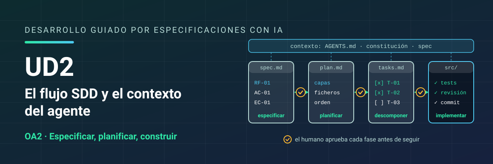

# Desarrollo guiado por especificaciones con IA - UD2 El flujo SDD y el contexto del agente

Unidad 2 El flujo SDD y el contexto del agente.

## Objetivo de aprendizaje

Esta unidad trabaja el **OA2** y sus criterios de evaluación: [ver objetivo de aprendizaje y criterios de evaluación](./objetivos-aprendizaje.md).

## Contenidos

1. [El flujo SDD](./01-flujo-sdd.md)
2. [Especificar y planificar](./02-especificar-planificar.md)
3. [Descomponer en tasks e implementar](./03-tasks-implementar.md)
4. [Artefactos y estado de las features](./04-artefactos-estado.md)
5. [La ventana de contexto](./05-ventana-contexto.md)
6. [Memoria persistente del agente](./06-memoria-persistente.md)
7. [Resumen](./07-resumen.md)

## Diapositivas

Las diapositivas resumen las **ideas principales** de cada tema, con un ejemplo de cada una. Se proyectan en clase y te sirven para repasar; el detalle está en el tema.

1. [El flujo SDD](./diapositivas/pdf/01-flujo-sdd.pdf)
2. [Especificar y planificar con el agente](./diapositivas/pdf/02-especificar-planificar.pdf)
3. [Tasks e implementación](./diapositivas/pdf/03-tasks-implementar.pdf)
4. [Artefactos y estado del proyecto](./diapositivas/pdf/04-artefactos-estado.pdf)
5. [La ventana de contexto](./diapositivas/pdf/05-ventana-contexto.pdf)
6. [Memoria persistente del agente](./diapositivas/pdf/06-memoria-persistente.pdf)

## Referencias

- [`spec-driven.md`](https://github.com/github/spec-kit/blob/main/spec-driven.md), el documento de metodología de GitHub Spec Kit (en inglés). Describe el flujo completo (constitución, spec, plan, tasks e implementación) y el porqué de cada fase. Complementa los temas 1, 2 y 3.
- [Implement spec-driven development using the GitHub Spec Kit](https://learn.microsoft.com/en-us/training/modules/spec-driven-development-github-spec-kit-enterprise-developers), módulo gratuito de Microsoft Learn (en inglés). Recorre el flujo de principio a fin con Spec Kit, incluida la constitución. Útil para ver los temas 1 a 4 con otra herramienta.
- [Conductor: Introducing context-driven development for Gemini CLI](https://developers.googleblog.com/conductor-introducing-context-driven-development-for-gemini-cli/), del blog de desarrolladores de Google (en inglés). Presenta el mismo flujo con otro nombre: contexto del proyecto, spec y plan, implementación, todo en ficheros Markdown del repositorio. Complementa los temas 1 y 6.
- [Putting Spec Kit Through Its Paces: Radical Idea or Reinvented Waterfall?](https://blog.scottlogic.com/2025/11/26/putting-spec-kit-through-its-paces-radical-idea-or-reinvented-waterfall.html), de Colin Eberhardt en el blog de Scott Logic (en inglés). Una crítica razonada del flujo: demasiado Markdown, mucho tiempo de revisión y el parecido con el desarrollo en cascada. Léelo después del tema 1 para contrastar.
- [Effective context engineering for AI agents](https://www.anthropic.com/engineering/effective-context-engineering-for-ai-agents), de Anthropic (en inglés). Explica por qué un agente rinde peor con el contexto lleno y cómo darle solo la información útil. Es la base del tema 5.
- [AGENTS.md](https://agents.md) y [Agent Skills](https://agentskills.io), los formatos abiertos de instrucciones y de *skills* para agentes (en inglés). Complementan el tema 6.
- [Documentación de OpenCode](https://opencode.ai/docs/), la herramienta del curso (en inglés). Para el tema 6, consulta en especial las páginas de [reglas](https://opencode.ai/docs/rules/), [agentes](https://opencode.ai/docs/agents/), [comandos](https://opencode.ai/docs/commands/) y [skills](https://opencode.ai/docs/skills/). Los nombres y opciones pueden cambiar entre versiones.
- [OpenSpec](https://github.com/Fission-AI/OpenSpec), un framework de SDD de código abierto que se integra con OpenCode (en inglés). Lo usarás en las prácticas para proponer cambios sobre una feature ya implementada.

## Licencia

Este material se distribuye bajo licencia **Creative Commons BY-NC-SA 4.0**. Consulta las condiciones en [LICENSE.md](./LICENSE.md).
