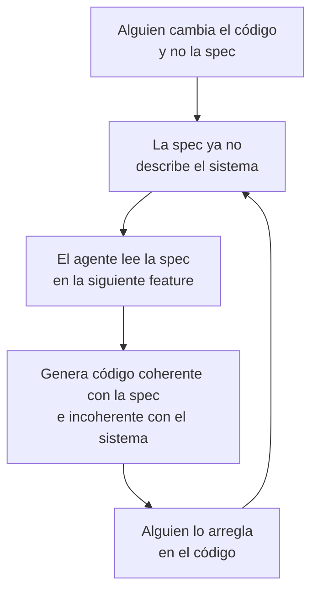
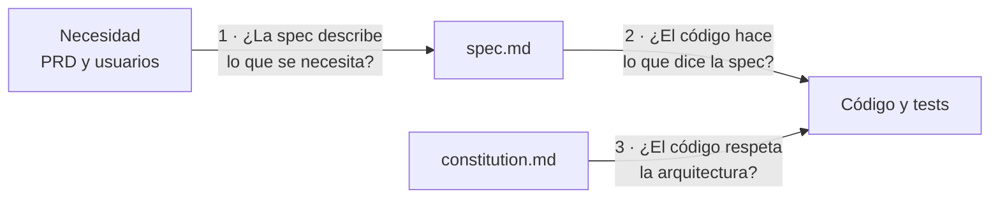
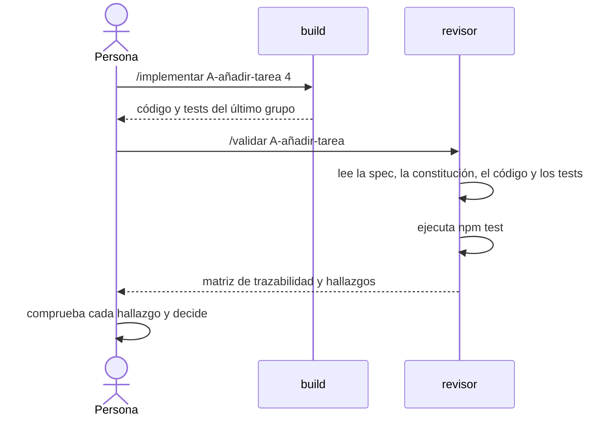
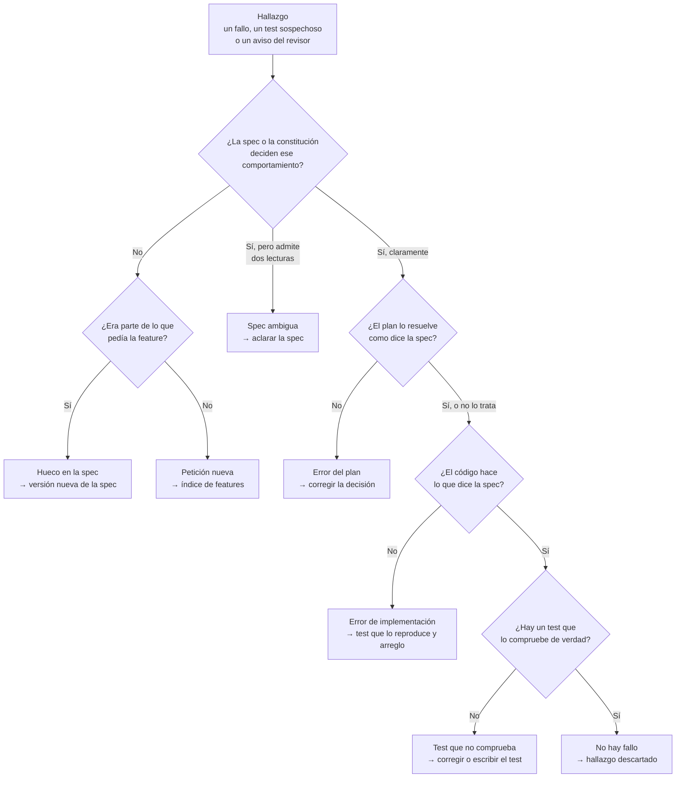

# 1. Validación y *spec drift*

[⬅️ Volver a la unidad](./README.md)

## Índice

- [1.1. Por qué validar es distinto con un agente](#11-por-qué-validar-es-distinto-con-un-agente)
  - [1.1.1. Lo que cambia cuando el código lo escribe un agente](#111-lo-que-cambia-cuando-el-código-lo-escribe-un-agente)
  - [1.1.2. Qué es validar en SDD](#112-qué-es-validar-en-sdd)
  - [1.1.3. Dónde está el proyecto](#113-dónde-está-el-proyecto)
- [1.2. El *spec drift*](#12-el-spec-drift)
  - [1.2.1. Qué es](#121-qué-es)
  - [1.2.2. Cuatro formas de *drift*](#122-cuatro-formas-de-drift)
  - [1.2.3. Dos casos, de cerca](#123-dos-casos-de-cerca)
  - [1.2.4. Por qué es más grave con un agente](#124-por-qué-es-más-grave-con-un-agente)
  - [1.2.5. Señales de *drift* en el repositorio](#125-señales-de-drift-en-el-repositorio)
- [1.3. Los tres niveles de validación](#13-los-tres-niveles-de-validación)
  - [1.3.1. Validar la spec](#131-validar-la-spec)
  - [1.3.2. Validar el código frente a la spec](#132-validar-el-código-frente-a-la-spec)
  - [1.3.3. Validar la arquitectura](#133-validar-la-arquitectura)
  - [1.3.4. Los tres niveles, comparados](#134-los-tres-niveles-comparados)
- [1.4. Revisión independiente: un agente que no escribió el código](#14-revisión-independiente-un-agente-que-no-escribió-el-código)
  - [1.4.1. Por qué otro agente](#141-por-qué-otro-agente)
  - [1.4.2. El subagente revisor](#142-el-subagente-revisor)
  - [1.4.3. El comando `/validar`](#143-el-comando-validar)
  - [1.4.4. Leer el informe del revisor](#144-leer-el-informe-del-revisor)
- [1.5. Depurar desde la spec](#15-depurar-desde-la-spec)
  - [1.5.1. El código es el síntoma](#151-el-código-es-el-síntoma)
  - [1.5.2. Seis diagnósticos](#152-seis-diagnósticos)
  - [1.5.3. Dos diagnósticos, de cerca](#153-dos-diagnósticos-de-cerca)
  - [1.5.4. Cómo decidir](#154-cómo-decidir)
  - [1.5.5. Qué se hace en cada caso](#155-qué-se-hace-en-cada-caso)
- [1.6. Límites de la validación automática](#16-límites-de-la-validación-automática)
- [1.7. Errores típicos](#17-errores-típicos)
- [1.8. Ejemplo integrador: validar la feature A](#18-ejemplo-integrador-validar-la-feature-a)
- [Resumen](#resumen)
- [Ejercicios de reflexión](#ejercicios-de-reflexión)

> **Criterios que trabaja este tema:** OA3 a, d.

---

## 1.1. Por qué validar es distinto con un agente

### 1.1.1. Lo que cambia cuando el código lo escribe un agente

Cuando programas tú, sabes lo que querías hacer, y los tests comprueban que lo has hecho. Cuando el código lo escribe un agente, aparece una pregunta más: **¿ha hecho lo que dice la spec, o lo que él entendió?** Hay cuatro motivos para no dar la respuesta por supuesta:

- **No es determinista.** La misma spec y el mismo prompt pueden dar implementaciones distintas en dos sesiones. Lo que comprobaste ayer no garantiza nada sobre lo que el agente genere mañana.
- **El código parece correcto.** Un agente escribe código limpio, con buenos nombres y comentarios. Eso hace que los errores sutiles (un código HTTP cambiado, un caso que falta) pasen desapercibidos en una lectura rápida.
- **El agente se revisa a sí mismo.** Si el mismo agente escribe el código y los tests, tiende a comprobar que el código hace **lo que él escribió**, no lo que pedía la spec. Los tests pasan, pero no demuestran nada.
- **El volumen.** El agente genera código más deprisa de lo que una persona puede revisarlo con atención. Cuanto más código, más **fatiga de revisión**, y más cosas se aceptan sin leer.

La conclusión es una idea que se repite en todas las fuentes sobre agentes: **generar el código es la parte fácil; comprobar que es correcto es la parte difícil**. Esta unidad trata de esa parte.

> 📝 **Nota del Profesor**: en la UD2 ya validabas: en cada punto de control leías el `git diff` y ejecutabas `npm test`. Lo que añade esta unidad es **método**: contra qué se valida cada cosa, cómo se detecta que el código y la spec se han separado y qué hacer cuando aparece un fallo. Y, en los temas siguientes, cómo automatizar todo lo que se pueda.

### 1.1.2. Qué es validar en SDD

En SDD, **validar** es comprobar un artefacto **frente a lo que se aprobó**: la spec frente a la necesidad, el código frente a la spec, el código frente a la constitución. La referencia nunca es «lo que parece razonable» ni «lo que hace el código»: es un documento aprobado del repositorio.

En ingeniería del software se distinguen dos preguntas que conviene no mezclar:

| Pregunta | Nombre clásico | En SDD |
|----------|----------------|--------|
| ¿Lo estamos construyendo **bien**? | Verificación | ¿El código cumple la spec y la constitución? |
| ¿Estamos construyendo **lo que se necesita**? | Validación | ¿La spec describe lo que el usuario necesita? |

En el curso se usa «validar» para las dos, como hacen las herramientas de SDD. Lo importante es saber **cuál de las dos estás respondiendo**, porque los fallos se corrigen en sitios distintos: si el código no cumple la spec, se corrige el código; si la spec no describe lo que se necesita, se corrige la spec.

### 1.1.3. Dónde está el proyecto

El hilo conductor sigue siendo la **lista de tareas compartida**. Al terminar la UD2:

- La **feature A** («Añadir una tarea», spec 1.2) está implementada y fusionada en `main`, con **23 tests en verde**. Las comprobaciones de la página (RF-03, AC-01 y AC-02) se hicieron a mano.
- La **feature B** («Ver la lista de tareas») tiene la spec aprobada, su rama `feature/B-ver-lista` y el plan.
- El proyecto tiene la memoria del agente: `AGENTS.md`, la constitución, la skill `tests-desde-spec` y los comandos `/planificar`, `/implementar` y `/documentar`.

Todo está en verde. La pregunta de este tema es la que nadie ha respondido todavía: **¿la feature A cumple su spec?** Que los tests pasen solo dice que el código hace lo que comprueban los tests, y los tests los escribió el mismo agente que el código.

---

## 1.2. El *spec drift*

### 1.2.1. Qué es

El ***spec drift*** (deriva de la spec) es la **separación progresiva entre lo que dice la spec y lo que hace el código**. Empieza con una diferencia pequeña y crece con cada cambio que se hace en un lado y no en el otro.

Piensa en el plano de una casa que se ha reformado varias veces sin actualizar el plano. Al principio la diferencia es un tabique; años después, nadie sabe por dónde van las tuberías. Si un fontanero se fía del plano, rompe una. En SDD, ese fontanero es el agente: **lee la spec y se la cree**.

### 1.2.2. Cuatro formas de *drift*

| Forma | Qué pasa | Ejemplo en la lista de tareas |
|-------|----------|-------------------------------|
| **Interpretación del agente** | El agente implementa algo que funciona, pero no es exactamente lo especificado | EC-02 pide responder `400`; el agente responde `422 Unprocessable Entity`, «que es más correcto». Funciona, pero no es lo aprobado |
| **Cambios que no llegan a la spec** | Se toma una decisión durante la implementación o después, y nadie actualiza la spec | Un compañero sube el límite del texto a 500 caracteres en el servicio «porque se lo pidieron». La spec sigue diciendo 280 |
| **Regeneración** | Se pide al agente que rehaga una parte, y se pierde lo que solo estaba en el código | Alguien corrigió a mano el orden de las comprobaciones del servicio. Al pedir al agente que «reescriba el servicio más limpio», vuelve el error, porque la corrección no estaba en ningún documento |
| **Arquitectura** | El código cumple la spec, pero viola la constitución | El controlador importa el repositorio directamente, saltándose el servicio. Todos los tests pasan |

Las cuatro tienen algo en común: **los tests pueden seguir en verde**. En las dos primeras, porque los tests cambiaron con el código o nunca comprobaron el detalle; en la tercera, porque nadie escribió un test del arreglo; en la cuarta, porque los tests miran el comportamiento, no la estructura.

Hay una quinta forma, más silenciosa: el ***drift* de los tests**. Un test lleva en su nombre un identificador de la spec, pero no comprueba lo que ese identificador dice (por ejemplo, comprueba que hay una fecha, pero no su formato). El nombre promete algo que el test no cumple. Lo verás en el ejemplo integrador.

### 1.2.3. Dos casos, de cerca

**Caso 1: el agente «mejora» la spec.** La spec de la feature A dice:

```markdown
- EC-02: Si el texto supera 280 caracteres, entonces el sistema deberá
  responder 400 con { error: "El texto no puede superar 280 caracteres" }.
```

Imagina que, en el ciclo de la API, el agente hubiera escrito este controlador, porque en muchas API se usa `422` para los datos que no superan una validación:

```javascript
if (error instanceof ErrorValidacion) {
  respuesta.status(422).json({ error: error.message });
  return;
}
```

Y, en la misma sesión, este test:

```javascript
test('EC-02: rechaza un texto demasiado largo', async () => {
  const respuesta = await request(app)
    .post('/tareas')
    .send({ text: 'a'.repeat(281) });

  expect(respuesta.status).toBe(422);
});
```

`npm test` está en verde. El test lleva el identificador de la spec, comprueba el código HTTP y pasa. Pero compara su aserción con EC-02: la spec dice `400`, el test dice `422`. **El test no comprueba la spec: comprueba el código**, porque los dos salieron de la misma decisión del agente. Además, falta la comprobación del mensaje.

¿Qué pasa si nadie lo ve? Quien programe otro cliente de la API (una aplicación móvil, otra página) leerá la spec y esperará un `400` que nunca llega. Y la próxima feature que el agente construya leyendo la spec responderá `400` en sus errores de validación: la API tendrá dos criterios distintos para el mismo tipo de error.

¿Cómo se detecta? Leyendo la aserción **con la spec al lado**: el número del test tiene que ser el número de la spec. Es exactamente lo que hace la matriz de trazabilidad (apartado 1.3.2). ¿Cómo se corrige? El controlador y el test vuelven a `400`, con el mensaje exacto. La spec no cambia: la decisión ya estaba tomada.

**Caso 2: el arreglo de cinco minutos.** Alguien del equipo pide poder escribir tareas más largas. Un compañero abre el servicio, cambia una línea y ajusta el test para que pase:

```bash
git log --oneline -- src/
```

```text
3c1d9a2 Sube el límite del texto a 500
…
```

```diff
-const LONGITUD_MAXIMA = 280;
+const LONGITUD_MAXIMA = 500;
```

`git log --oneline -- docs/specs/A-añadir-tarea/` no muestra ese commit: la spec sigue diciendo 280 (RNF-02 y EC-02), y el mensaje de error sigue diciendo «280 caracteres» porque está escrito en el código. Ya hay tres verdades distintas: la spec (280), el límite real (500) y el mensaje que ve el usuario (280).

Semanas después llega la feature «Editar una tarea». El agente lee la spec de A, ve el límite de 280 y lo aplica a la edición. Resultado: puedes crear una tarea de 400 caracteres, pero no puedes editarla sin recortarla. Nadie ha cometido un error en la feature nueva: el agente hizo lo que decía la spec.

La corrección no es elegir un número en el código, sino **decidir**: si 500 es el límite bueno, se cambia la spec (versión nueva, con RNF-02, EC-02 y su mensaje) y se pasa por el flujo; si no lo es, se deshace el commit. En los dos casos, el número vuelve a estar en un único sitio que manda.

> ✅ **Buena práctica**: si una petición de un usuario cambia un comportamiento que la spec decide, es un **cambio de la spec**, aunque en el código sea una línea. Empieza por la spec: el código va detrás.

### 1.2.4. Por qué es más grave con un agente

Con un equipo de personas, el *drift* es molesto: alguien pregunta «¿esto no era 280?» y se aclara. Con un agente, el *drift* **se realimenta**:



El diagrama muestra el círculo vicioso: cada arreglo hecho solo en el código deja la spec un poco más lejos de la realidad, y el agente vuelve a equivocarse en cuanto la lee. Como el agente no es determinista, el error no reaparece igual cada vez, sino **con formas distintas**, y cuesta reconocer que es el mismo problema.

La única forma de romper el círculo es la regla de la UD2: **se corrige donde nació**. Si el comportamiento correcto no estaba en la spec, se pone en la spec.

> ⚠️ **Cuidado**: el *drift* casi nunca se produce de golpe. Se acumula en arreglos de cinco minutos: «lo cambio en el código y luego actualizo la spec». Ese «luego» es el origen de la mayoría de las specs que ya no dicen la verdad.

### 1.2.5. Señales de *drift* en el repositorio

No hace falta esperar a un fallo para sospechar. Estas señales se ven en el propio repositorio:

| Señal | Cómo se ve |
|-------|------------|
| Commits que tocan el código de una feature sin tocar sus documentos | En `git log --oneline -- src/` aparecen commits que no están en `git log --oneline -- docs/specs/A-añadir-tarea/` ni en una rama de la feature |
| Identificadores de la spec sin test | Un `EC-` de la spec no aparece en el nombre de ningún test (apartado 1.3.2) |
| Tests con identificadores que no existen | Un test se llama `EC-07` y la spec solo llega a `EC-05` |
| Comentarios que deciden | `// de momento, 500 caracteres` o `// TODO: confirmar el mensaje` en el código |
| Una spec `Implementada` con cambios posteriores en su código | El último commit de la spec es anterior a cambios en los ficheros que la implementan, fuera de una rama de la feature |

Compara, por ejemplo, la historia del código con la de la feature:

```bash
git log --oneline -- src/ public/
git log --oneline -- docs/specs/A-añadir-tarea/
```

Si todos los commits del código vienen de los ciclos de una feature (`Feature A: T-…`), no hay cambios sueltos. Un commit como `Arreglo rápido del límite de texto` en la primera lista y en ninguna rama es una señal de *drift* que merece una revisión.

> 💡 **Tip del Examinador**: «¿Qué es el *spec drift* y por qué es especialmente peligroso al trabajar con agentes?». Es la separación progresiva entre la spec y el código. Es peligroso porque el agente toma la spec como verdad: si la spec ya no describe el sistema, el agente genera código que contradice los cambios hechos fuera de ella, y el error reaparece con formas distintas en cada feature. Sus formas: interpretación del agente, cambios que no llegan a la spec, regeneración y arquitectura.

---

## 1.3. Los tres niveles de validación

Cada nivel compara un artefacto con su referencia:



El diagrama muestra que los niveles no se sustituyen: un código puede cumplir la spec (nivel 2) y saltarse las capas de la constitución (nivel 3), y una spec perfectamente implementada puede describir algo que nadie necesitaba (nivel 1).

### 1.3.1. Validar la spec

Es el **punto de control 1** del flujo, que ya conoces de la UD1 y la UD2. Desde el punto de vista de las pruebas, una spec es válida si cumple estos criterios:

| Criterio | Pregunta |
|----------|----------|
| Completa | ¿Está todo el camino feliz? ¿Están los errores y los límites? |
| **Comprobable** | ¿Sabes cómo se probaría cada requisito, criterio y *edge case*? |
| Sin ambigüedad | ¿Algún término admite dos lecturas? |
| Con fuera de alcance | ¿Dice qué no se hace? |
| Coherente | ¿Hay requisitos que se contradicen entre sí o con la constitución? |

El criterio nuevo en esta unidad es **comprobable**. Un truco práctico: para cada identificador, intenta escribir **el nombre del test** que lo comprobaría y la **aserción** principal. Si no puedes, la spec no está terminada:

| Requisito | ¿Comprobable? | Por qué |
|-----------|---------------|---------|
| «La API responde rápido» | ❌ | ¿Cuánto es rápido? ¿En qué condiciones? |
| RNF-01: «menos de 200 ms con 1.000 tareas guardadas» | ✅ | Test: guardar 1.000 tareas, medir una petición, `toBeLessThan(200)` |
| «Los errores se muestran de forma clara» | ❌ | ¿Dónde? ¿Con qué texto? |
| EC-02: «400 con `{ error: "El texto no puede superar 280 caracteres" }`» | ✅ | Test: 281 caracteres, código `400` y cuerpo exacto |

Antes de aprobar, puedes pedir un análisis a *plan*, en una sesión nueva:

```text
Lee @docs/specs/B-ver-lista/spec.md y la constitución. No escribas código
ni plan. Para cada requisito, criterio de aceptación y edge case, dime
cómo se comprobaría (test unitario, de la API, de la página o a mano) y
cuál sería la comprobación principal. Señala los que no se pueden
comprobar tal como están escritos, los términos ambiguos y los casos de
error que falten.
```

> ✅ **Buena práctica**: el mejor momento para encontrar un requisito que no se puede probar es **antes de aprobar la spec**. Después, el agente lo implementará de alguna forma, y la tendrás que descubrir leyendo el código.

### 1.3.2. Validar el código frente a la spec

Aquí la pregunta es: **¿cada cosa que dice la spec está comprobada, y la comprobación es buena?** La herramienta es la **matriz de trazabilidad**: una fila por identificador de la spec, con el test que lo comprueba.

| Spec | Test | ¿Comprueba lo que dice? |
|------|------|-------------------------|
| RF-01 | `servicio-tareas.test.js` › `RF-01: guarda la tarea con id, texto, estado "pendiente" y fecha` | Sí: los cuatro campos, la fecha en ISO 8601 y que se guarda |
| EC-02 | `servicio-tareas.test.js` › `EC-02: acepta…280` y `EC-02: rechaza…281`; `api-tareas.test.js` › `EC-02: responde 400…` | Sí: los dos lados del límite y el mensaje exacto |
| AC-01 | A mano (plan: lista de comprobación de la task de la página) | Comprobado al implementar, no se repite solo |

Es la estrategia de pruebas del plan (UD2, tema 2), pero **mirando lo que existe**, no lo que se planificó. La tercera columna es la importante: un test puede existir, llevar el identificador y no comprobar lo que el identificador dice.

**Dos tipos de test, dos referencias.** En la matriz aparecen tests de dos clases:

| Tipo | De dónde sale | Qué comprueba | Ejemplo |
|------|---------------|---------------|---------|
| **De aceptación** | Los criterios de aceptación y los *edge cases* de la spec | El comportamiento que se ve desde fuera | `POST /tareas` con 281 caracteres responde `400` y el mensaje de EC-02 |
| **Unitarios** | Las decisiones del plan y las tasks | Que cada pieza interna hace su parte | `crearTarea` recorta el texto antes de contarlo (D-05) |

Para validar el código frente a la spec mandan los primeros. Los unitarios ayudan a localizar un fallo, pero no demuestran que la feature cumple la spec. En el tema 2 verás cómo elegir el nivel de cada test.

**Una primera comprobación automática.** Como en el curso cada test lleva el identificador en su nombre (UD2, tema 3), puedes buscar qué identificadores de la spec **no aparecen** en ningún test:

```bash
comm -23 \
  <(grep -oE '(RF|RNF|AC|EC)-[0-9]+' docs/specs/A-añadir-tarea/spec.md | sort -u) \
  <(grep -ohE '(RF|RNF|AC|EC)-[0-9]+' tests/*.js | sort -u)
```

La primera línea saca los identificadores de la spec; la segunda, los que aparecen en los tests; `comm -23` muestra los que están en la primera lista y no en la segunda. La salida no es una sentencia, sino una **lista de preguntas**: cada identificador que aparece o tiene una comprobación a mano escrita en el plan, o está cubierto por un test con otro nombre, o no lo comprueba nadie.

> ⚠️ **Cuidado**: esta búsqueda solo mira **nombres**. Que un test se llame `EC-02` no significa que compruebe EC-02. Para cada fila de la matriz, abre el test y lee la **aserción**: ¿comprueba el código exacto, el mensaje exacto, el formato exacto que dice la spec?

**¿Puede fallar este test?** Hay una comprobación muy eficaz para saber si un test sirve: **romper el código a propósito** y ver si el test falla. Cambia un `400` por un `401` en el controlador, o el formato de la fecha en el servicio, y ejecuta los tests. Si siguen en verde, el test no protege lo que dice proteger. Después, deshaz el cambio (`git checkout -- <fichero>`). Es la idea de las **pruebas de mutación**, que hacen esto de forma automática con herramientas específicas.

### 1.3.3. Validar la arquitectura

El tercer nivel compara el código con la **constitución**. La de la lista de tareas dice, entre otras cosas, que las capas son controladores → servicios → repositorios, que solo los repositorios acceden al almacenamiento y que todas las respuestas son JSON con `{ error: "mensaje" }`.

Los tests de aceptación no ven la arquitectura: un controlador que llama directamente al repositorio responde exactamente igual. Por eso cada principio de la constitución necesita su propia comprobación:

| Principio de la constitución | Cómo se comprueba |
|------------------------------|-------------------|
| Los controladores no acceden a los repositorios | Buscar importaciones prohibidas: `grep -rn "repositorios" src/controladores/` no debe encontrar nada |
| Respuestas JSON y errores `{ error: "mensaje" }` | Tests de la API que comprueban el cuerpo de **cada** error, también los que no produce tu código (un cuerpo que no es JSON, una ruta que no existe) |
| Sin dependencias fuera de la sección Tecnología | Revisar `dependencies` y `devDependencies` del `package.json` en el `git diff` de cada feature |
| Tests antes que el código | El historial: en cada ciclo, los tests llegan con el código, y la sesión mostró el rojo antes del verde |

La primera fila se puede convertir en una **regla del linter**. Con ESLint, la regla `no-restricted-imports` prohíbe ciertas importaciones en ciertos ficheros:

```javascript
export default [
  {
    files: ['src/controladores/**/*.js'],
    rules: {
      'no-restricted-imports': [
        'error',
        {
          patterns: [
            {
              group: ['**/repositorios/**'],
              message:
                'Un controlador no accede a los repositorios: usa un servicio (constitución).',
            },
          ],
        },
      ],
    },
  },
];
```

La clave `files` limita la regla a los controladores: los servicios sí pueden importar repositorios. En el **tema 3** instalarás ESLint en el proyecto y esta regla se ejecutará sola en cada cambio, como un *quality gate*. Por ahora, la comprobación es la búsqueda con `grep`.

> 📝 **Nota del Profesor**: la validación de la arquitectura es la que más se olvida y la que más se paga a largo plazo. Una violación de capas no rompe nada hoy; rompe la siguiente feature, cuando el agente copia el «ejemplo» que encuentra en el código y la violación se multiplica.

### 1.3.4. Los tres niveles, comparados

| Nivel | Pregunta | Referencia | Cuándo | Cómo |
|-------|----------|------------|--------|------|
| 1 · Spec | ¿Describe lo que se necesita? ¿Se puede probar? | PRD, usuarios, constitución | Punto de control 1 | Revisión humana y análisis con *plan* |
| 2 · Código frente a spec | ¿Hace lo que dice la spec? | La spec aprobada | Puntos de control 4, antes de fusionar y cuando hay dudas | Matriz de trazabilidad, tests de aceptación, revisor |
| 3 · Arquitectura | ¿Respeta los principios del proyecto? | La constitución | Puntos de control 2 y 4, antes de fusionar | Búsquedas, linter, revisión del `git diff` |

> 💡 **Tip del Examinador**: «Nombra los tres niveles de validación en SDD y di qué compara cada uno». Validación de la spec (la spec frente a la necesidad: completa, comprobable, sin ambigüedades), del código frente a la spec (cada identificador con un test que comprueba lo que dice) y de la arquitectura (el código frente a la constitución: capas, formato de errores, dependencias). Un código puede pasar los tests de aceptación y violar la arquitectura.

---

## 1.4. Revisión independiente: un agente que no escribió el código

### 1.4.1. Por qué otro agente

El agente que implementó una feature es el peor revisor de su trabajo: tiene en su contexto el razonamiento que le llevó a cada decisión y tiende a confirmarlo. Las guías de buenas prácticas para agentes recomiendan lo mismo que harías con una persona: que revise **otro**, en un **contexto limpio**, que solo ve el resultado y los criterios.

En OpenCode puedes hacerlo con un **subagente** (UD2, tema 6), con tres garantías:

- **Contexto limpio**: el subagente trabaja en su propia sesión; no ha visto las conversaciones de implementación.
- **Solo lectura**: con permisos, no **puede** cambiar nada, aunque quiera «arreglar» lo que encuentra.
- **Criterios fijos**: sus instrucciones le dicen contra qué revisa (la spec y la constitución) y cómo informa.

Puedes ir más allá y darle **otro modelo** (con `model`, UD2, tema 6): un modelo distinto del que implementó no comparte sus puntos ciegos. No es imprescindible; el contexto limpio es lo que más cuenta.



El diagrama muestra el reparto: *build* implementa, el revisor solo lee e informa, y **la persona decide** qué hallazgos acepta. El revisor no sustituye al punto de control 4: lo prepara.

### 1.4.2. El subagente revisor

`.opencode/agents/revisor.md`:

```markdown
---
description: Revisa si el código de una feature cumple su spec y la constitución, y devuelve la matriz de trazabilidad y los hallazgos. Solo lee y ejecuta los tests; no modifica ningún fichero.
mode: subagent
permissions:
  - { action: edit, resource: "*", effect: deny }
  - { action: subagent, resource: "*", effect: deny }
  - { action: webfetch, resource: "*", effect: deny }
  - { action: websearch, resource: "*", effect: deny }
  - { action: shell, resource: "*", effect: deny }
  - { action: shell, resource: "npm test", effect: allow }
  - { action: shell, resource: "git diff *", effect: allow }
  - { action: shell, resource: "git log *", effect: allow }
---

Eres el revisor del proyecto de la lista de tareas. No has escrito el
código que revisas, y tu trabajo no es defenderlo, sino comprobar si
cumple lo que se aprobó.

Cómo trabajas:

- La referencia es la spec de la feature y `constitution.md`. El código
  no decide nada: si hace algo que la spec no dice, es un hallazgo.
- Para cada identificador de la spec (RF, RNF, AC, EC), busca el test
  que lo comprueba y mira si comprueba de verdad lo que dice: el código
  HTTP exacto, el mensaje exacto, el formato exacto.
- Busca casos que la spec decide y que el código no cumple, aunque
  ningún test los pruebe.
- Comprueba la constitución: capas, formato de las respuestas y de los
  errores.
- Ejecuta `npm test`, pero recuerda que todo en verde no significa que el
  código cumpla la spec.
- Clasifica cada hallazgo: hueco en la spec, spec ambigua, error del
  plan, error de implementación o test que no comprueba lo que dice.
- Cita el fichero, la línea y el identificador de la spec o el principio
  de la constitución que afecta.
- Informa solo de lo que afecta a la spec o a la constitución, no de
  preferencias de estilo. Si no encuentras nada, dilo: no inventes
  hallazgos.
- No propongas código ni cambies ningún fichero.
```

Los permisos, uno a uno:

| Acción | Efecto | Por qué |
|--------|--------|---------|
| `edit` | `deny` | No puede crear, modificar ni borrar ficheros |
| `subagent` | `deny` | No puede encargar trabajo a otros subagentes |
| `webfetch`, `websearch` | `deny` | La referencia está en el repositorio, no en internet |
| `shell` | Todo denegado salvo `npm test`, `git diff` y `git log` | Puede ejecutar los tests y ver los cambios, nada más |

> ⚠️ **Cuidado**: la regla de `subagent` es fácil de olvidar, porque lo que no se prohíbe está permitido. Sin ella, el revisor puede encargar trabajo al subagente `general`, que **sí** puede editar ficheros. Un agente de solo lectura que puede pedir a otro que escriba no es de solo lectura. Compruébalo siempre con `opencode debug agents`: en el agente `revisor`, las reglas de `edit` y de `subagent` con el recurso `*` tienen que estar en `deny`.

Las instrucciones también importan. Dos líneas evitan los problemas más frecuentes de un revisor automático:

- **«Si no encuentras nada, dilo: no inventes hallazgos»**. Un agente al que se le pide buscar problemas tiende a encontrar alguno, aunque no lo haya.
- **«Informa solo de lo que afecta a la spec o a la constitución»**. Sin esta línea, el informe se llena de preferencias de estilo y los hallazgos importantes se pierden.

### 1.4.3. El comando `/validar`

Como con el documentador, un comando lanza al revisor con un prompt fijo. `.opencode/commands/validar.md`:

```markdown
---
description: Revisa con el subagente revisor si una feature cumple su spec
agent: revisor
subagent: true
---
Revisa la feature de la carpeta docs/specs/$1/: su spec, su plan, el
código que la implementa y sus tests.

Devuelve:

1. La matriz de trazabilidad: una fila por cada identificador de la
   spec, con el test que lo comprueba (fichero y nombre del test), «a
   mano» si el plan dice que se comprueba a mano o «sin test», y si el
   test comprueba de verdad lo que dice el identificador.
2. Los hallazgos: qué pasa, dónde (fichero y línea), qué identificador
   o principio afecta y de qué tipo es.
```

Con `subagent: true`, el revisor trabaja en una sesión hija y todo lo que lee no llena tu ventana de contexto (UD2, tema 5): a tu sesión solo llega el informe. Se usa así:

```text
/validar A-añadir-tarea
```

¿Cuándo lanzarlo? Al terminar el **último ciclo** de una feature, antes de fusionar, y cada vez que sospeches *drift* en una feature ya implementada. En features grandes, también al final de cada grupo de tasks.

### 1.4.4. Leer el informe del revisor

El informe del revisor es una **lista de propuestas**, no un veredicto. Cada hallazgo se comprueba antes de actuar:

1. **Reprodúcelo.** Si dice que algo falla, provócalo tú: un test, una petición con `curl`, la página en el navegador.
2. **Contrástalo con la spec.** Si el revisor dice que algo «debería» hacerse de otra forma, busca dónde lo dice la spec. Si no lo dice, no es un fallo del código: como mucho, una propuesta para la spec.
3. **Clasifícalo** con el apartado 1.5 y decide.

Igual que con el plan (UD2, tema 2), deja constancia de lo que aceptas y lo que rechazas:

| Hallazgo | Decisión | Motivo |
|----------|----------|--------|
| «EC-03 no tiene test» | Rechazado | Sí lo tiene, con otro nombre en un `test.each`. El revisor lo ha pasado por alto |
| «El servicio debería validar con una librería» | Rechazado | Preferencia de implementación; no lo pide ni la spec ni la constitución |
| «AC-03 no comprueba el formato de la fecha» | Aceptado | Leída la aserción, es cierto |

> ✅ **Buena práctica**: pide **evidencia**, no opiniones: fichero, línea e identificador. Un hallazgo que no cita dónde está ni qué incumple es difícil de comprobar, y lo más probable es que sea ruido.

---

## 1.5. Depurar desde la spec

### 1.5.1. El código es el síntoma

Cuando aparece un fallo, el instinto es abrir el código y arreglarlo. En SDD, la primera pregunta es otra: **¿quién decidió mal, o quién no decidió?** El código es el **síntoma**; la causa puede estar en la spec, en el plan, en el propio código o en los tests.

La razón es la del apartado 1.2.4: si el fallo nace de un hueco de la spec y solo arreglas el código, el hueco sigue ahí, y el agente volverá a rellenarlo a su manera la próxima vez que toque esa parte.

### 1.5.2. Seis diagnósticos

| Diagnóstico | Qué ha pasado | Ejemplo en la lista de tareas | Dónde se corrige |
|-------------|---------------|-------------------------------|------------------|
| **Hueco en la spec** | La spec no decide ese comportamiento, y era parte de lo que pedía la feature | La spec dice qué responde la API ante un texto demasiado largo, pero no qué hace la **página** con esa respuesta. La página no muestra nada | Spec (versión nueva) y, después, plan, tasks, tests y código |
| **Spec ambigua** | La spec lo decide, pero admite dos lecturas, y el agente eligió la que no era | RNF-02 dice «280 caracteres». El servicio cuenta con `length`, que cuenta un emoji como **dos**: `'Ir al médico 🩺'.length` da 15, aunque se ven 14 caracteres | Spec (aclarar el término) y lo que dependa de ella |
| **Error del plan** | La spec es correcta, pero el plan tomó una decisión que no la cumple, y el código sigue al plan | El plan decide guardar la fecha con `toLocaleString()`; la spec pide ISO 8601. El código hace lo que dice el plan | Plan (decisión corregida) y, después, código y tests |
| **Error de implementación** | La spec y el plan lo dicen bien; el código no lo cumple | Un cuerpo que no es JSON válido no tiene campo `text`, así que EC-05 pide `400` con su mensaje. Express responde `400` con una **página HTML** | Código, con un test que reproduce el fallo. La spec no cambia |
| **Test que no comprueba lo que dice** | El código es correcto (o no), pero el test que lo vigila no comprueba lo que su identificador promete | El test de AC-03 comprueba que hay una fecha, no que esté en ISO 8601 | Test. Se comprueba que puede fallar |
| **Petición nueva** | No es un fallo: es algo que la feature no pedía | «Quiero poner prioridad a las tareas». La spec lo deja **fuera de alcance** | Índice de features: una feature nueva o un cambio, con su propio flujo |

> 📝 **Nota del Profesor**: fíjate en el caso de la spec ambigua. «Carácter» parece una palabra clarísima, pero para JavaScript, para la base de datos y para una persona son tres cosas distintas. No hay una respuesta correcta universal: hay una **decisión** que alguien tiene que tomar y escribir en la spec (por ejemplo, «caracteres tal como los ve el usuario»). Si no se toma, la toma el agente sin decírtelo.

### 1.5.3. Dos diagnósticos, de cerca

El hueco en la spec, el error de implementación y el test que no comprueba lo que dice los verás desarrollados en el ejemplo integrador. Aquí tienes los otros dos.

**Spec ambigua: ¿qué es un carácter?** RNF-02 dice que el texto «no podrá superar los 280 caracteres», y el servicio lo comprueba así:

```javascript
if (textoRecortado.length > LONGITUD_MAXIMA) {
  throw new ErrorValidacion('El texto no puede superar 280 caracteres');
}
```

Alguien intenta guardar una tarea con 150 emojis y recibe el error de los 280 caracteres. En la consola de Node lo ves:

```text
> '🩺'.repeat(150).length
300
```

En JavaScript, `length` cuenta **unidades de UTF-16**, y muchos emojis ocupan dos. ¿Es un error de implementación? No: el código cumple una lectura razonable de la spec. El problema es que «carácter» admite varias, y cada una da un resultado distinto:

| Forma de contar | En JavaScript | `'🩺'` | `'👨‍👩‍👧'` (familia) |
|-----------------|---------------|-------|--------------------|
| Unidades de UTF-16 | `texto.length` | 2 | 8 |
| Puntos de código | `[...texto].length` | 1 | 5 |
| Caracteres que ve una persona | `Intl.Segmenter` con `granularity: 'grapheme'` | 1 | 1 |

Ninguna es incorrecta: es una decisión de producto. Si el equipo decide contar como ve el usuario, se aclara la spec:

```markdown
- RNF-02: El texto de una tarea, sin los espacios del principio y del
  final, no podrá superar los 280 caracteres, contados como los ve el
  usuario (un emoji cuenta como un carácter).
```

Después vienen el plan (una decisión: contar con `Intl.Segmenter`), los tests de los dos lados del límite, ahora con emojis (280 se aceptan, 281 no), y el código. Fíjate en que el test de EC-02 que ya existía, con `'a'.repeat(281)`, nunca habría encontrado este problema: con letras, las tres formas de contar coinciden.

**Error del plan: un identificador que se repite.** Imagina que el plan de la feature A hubiera decidido así el identificador:

```markdown
- D-03: Identificador (RNF-03): el servicio usa Date.now() convertido a
  texto. Es único y, además, ordena las tareas por fecha.
```

El agente lo implementa tal cual (`id: String(Date.now())`) y, en el ciclo del servicio, el test de RNF-03 falla:

```text
 × RNF-03: genera un id distinto para cada tarea
AssertionError: expected '1792617533945' not to be '1792617533945'

      Tests  1 failed | 11 passed (12)
```

Dos tareas creadas en el mismo milisegundo reciben el mismo identificador. El agente propone «arreglarlo» esperando un milisegundo entre las dos tareas **del test**. Recorre el diagrama: ¿la spec lo decide? Sí, claramente: RF-01 pide un identificador único. ¿El plan lo resuelve como dice la spec? **No**: D-03 promete que `Date.now()` es único, y no lo es. Es un **error del plan**, y el código solo lo ha obedecido.

La propuesta del agente es la peor salida: cambia el test para que deje de ver el fallo (justo lo que prohíbe el prompt de implementar), y el error seguiría ahí en cuanto dos personas añadieran una tarea a la vez. Lo correcto es parar y corregir el plan:

```markdown
- D-03: Identificador (RNF-03): crypto.randomUUID(), en el servicio.
  - Descartado: Date.now(). Se repite si se crean dos tareas en el mismo
    milisegundo.
```

Y después el código. El test no cambia: era correcto desde el principio. Si hubieras corregido solo el código, el plan seguiría diciendo `Date.now()`, y la siguiente feature que lo tomara como ejemplo repetiría el error. En el plan real de la feature A (UD2, tema 2), D-03 ya usaba `crypto.randomUUID()`: este caso muestra por qué una decisión tan pequeña merece estar escrita con su motivo.

### 1.5.4. Cómo decidir

Las preguntas, en orden:



El diagrama se lee de arriba abajo, y la primera pregunta es la que más importa: **¿lo decide algún documento?** Todo lo que está a la izquierda (hueco, petición nueva) se corrige en documentos de producto; todo lo de la derecha, en documentos técnicos, código o tests. Fíjate en la rama «Sí, o no lo trata»: si el plan no menciona un caso que la spec sí decide, el código tenía que cumplirlo igualmente, y no hacerlo es un error de implementación.

> 💡 **Tip del Examinador**: «Un usuario informa de un fallo. ¿Cómo decides si corriges la spec o el código?». Se busca primero si la spec (o la constitución) decide ese comportamiento. Si no lo decide y era parte de la feature, es un hueco en la spec: se decide, se escribe en una versión nueva de la spec y después se corrige el código. Si lo decide claramente y el código no lo cumple, es un error de implementación: se escribe un test que reproduce el fallo y se corrige el código, sin tocar la spec.

### 1.5.5. Qué se hace en cada caso

**Hueco en la spec o spec ambigua.** Es una decisión de producto, así que la toma una persona:

1. Se para: no se toca el código todavía.
2. Se decide el comportamiento y se escribe en la spec: un requisito, un *edge case* o un criterio de aceptación nuevo, o un término aclarado. La versión sube y la spec vuelve a `En revisión` hasta que se aprueba (UD2, tema 4).
3. El plan cita la versión nueva y, si hace falta, añade una decisión; las tasks añaden lo necesario.
4. Se implementa como siempre: primero el test del comportamiento nuevo (en rojo), después el código (en verde).

**Error del plan.** Se corrige la decisión del plan (con el motivo) y las tasks afectadas, y después el código, con su test. La spec no cambia.

**Error de implementación.** Es el caso clásico de depuración, con una regla: **primero un test que reproduce el fallo**.

1. Se escribe un test con el identificador que se incumple. Tiene que fallar, y por el motivo correcto: es la prueba de que has entendido el fallo.
2. Se corrige el código hasta que el test pasa.
3. Se ejecutan **todos** los tests: el arreglo no puede romper nada que funcionaba.
4. La spec no cambia. Si el arreglo necesita una decisión técnica (dónde se arregla), va al plan.

Kiro, por ejemplo, organiza así sus specs de corrección de errores: unas pruebas que demuestran el fallo, otras que comprueban el arreglo y otras que vigilan que el resto del comportamiento no cambia. Es el mismo procedimiento, con otro nombre.

**Test que no comprueba lo que dice.** Se corrige el test para que compruebe exactamente lo que dice la spec. Como el código puede estar bien, el test corregido puede pasar a la primera, y eso no prueba nada: **rómpelo a propósito** (apartado 1.3.2) para ver que ahora sí falla cuando debe.

**Petición nueva.** No se toca nada de la feature. Se anota en el índice de features como una feature nueva o un cambio, y se ordena al replanificar (UD2, tema 1).

> ⚠️ **Cuidado**: un error de implementación también puede esconder un hueco en el plan o en los tests: si nadie lo probó, pregúntate por qué. Pero no al revés: **nunca** cambies la spec para que diga lo que hace el código solo porque el código ya está hecho. Eso no corrige el fallo; lo legaliza.

---

## 1.6. Límites de la validación automática

Tests, linter, búsquedas y revisor ayudan mucho, pero ninguno responde a todo. Conviene saber qué **no** detecta cada uno, para no tener una falsa sensación de seguridad:

| Comprobación | Detecta | No detecta |
|--------------|---------|------------|
| Tests de aceptación | Que el código hace lo que comprueban | Lo que la spec no dice: si falta un *edge case*, no hay test, y todo pasa |
| Tests unitarios | Que cada pieza hace su parte | Que las piezas juntas cumplen la spec, o que respetan las capas |
| Linter y búsquedas | Las reglas que alguien escribió antes | La lógica de negocio: que la validación es correcta |
| Búsqueda de identificadores | Identificadores sin ningún test | Si el test comprueba lo que dice |
| Revisor (otro agente) | Diferencias entre la spec y el código, con una lectura completa | Nada con certeza: también es un modelo, puede pasar algo por alto o inventar un problema |
| Todo lo anterior | — | Que la spec describe lo que el usuario necesita, y que el código será fácil de cambiar |

Y tres límites más, que no dependen de lo bien que escribas los tests:

- **La validación caduca.** Si el agente regenera una parte del código, lo que validaste ya no vale: hay que volver a ejecutar los tests y, si el cambio es grande, volver a pasar el revisor.
- **No existe una herramienta que lea una spec en lenguaje natural y garantice que el código la cumple.** Los tests derivados de la spec (tema 2) y los *quality gates* (tema 3) automatizan una parte; el resto es una revisión humana.
- **Nadie comprueba la mantenibilidad.** Un código es **mantenible** si puedes cambiar una parte sin romper otras sin darte cuenta. Si para subir un límite hay que tocar el servicio, el controlador, la página y tres tests, el código funciona, pero cada cambio será caro y arriesgado. Los tests comprueban qué hace el código, no lo fácil que será cambiarlo; y un agente que trabaja para que los tests pasen puede llegar a verde con atajos (una excepción capturada «por si acaso», una conversión de tipos forzada) que nadie le reprocha. El coste aparece semanas o meses después, cuando hay que cambiar algo. Un revisor automático ayuda a subir el nivel mínimo, pero tampoco lo garantiza.

> 📝 **Nota del Profesor**: la última fila de la tabla es la más importante. Todo lo automático compara el código con la spec; nada compara la spec con lo que necesita el usuario. Ese juicio sigue siendo tuyo, y por eso los fallos que vienen de **usuarios reales** son tan valiosos: son los únicos que validan la spec desde fuera.

> ⚠️ **Cuidado**: que todo esté automatizado no significa que puedas dejar de **leer el código**. Si el agente escribe y nadie lee, el día que algo falle y el agente no sepa arreglarlo te encontrarás con un código que nadie del equipo conoce, justo cuando más prisa hay. Leer cada ciclo en el punto de control 4 no es desconfianza: es lo que te permite seguir siendo el dueño del proyecto.

---

## 1.7. Errores típicos

| Error | Consecuencia | Cómo evitarlo |
|-------|--------------|---------------|
| Dar por buena una feature porque los tests están en verde | Los tests comprueban lo que escribió el agente, no necesariamente la spec | Matriz de trazabilidad y lectura de las aserciones |
| Fiarse del nombre del test | Un `EC-02` que no comprueba el mensaje pasa por bueno | Abrir el test y leer qué comprueba |
| Arreglar en el código un hueco de la spec | *Drift*: el agente reintroduce el fallo con otra forma | Diagnosticar antes de arreglar (apartado 1.5.4) |
| Cambiar la spec para que coincida con el código | Se legaliza el fallo y la spec deja de decir lo que se necesitaba | La spec solo cambia por una decisión de producto, no por comodidad |
| Arreglar un error sin un test que lo reproduzca | No sabes si lo has arreglado, y puede volver | Test en rojo primero, arreglo después |
| Validar la arquitectura solo «a ojo» | Las violaciones de capas se cuelan y se copian | Búsquedas ahora, linter en el tema 3 |
| Pedir la revisión al mismo agente que implementó | Confirma su propio trabajo | Subagente revisor con contexto limpio |
| Aceptar todos los hallazgos del revisor | Cambios innecesarios, código defensivo, specs más rígidas | Reproducir y contrastar con la spec cada hallazgo |
| Un revisor con permisos de escritura | «Arregla» lo que encuentra sin que nadie lo revise | `edit`, `subagent` y casi toda la terminal (`shell`) denegados; comprobarlo con `opencode debug agents` |

---

## 1.8. Ejemplo integrador: validar la feature A

La feature B tiene su plan en la rama `feature/B-ver-lista`. Antes de construirla, y como B va a reutilizar el código de A, decides comprobar que A cumple su spec. Además, ha llegado un comentario de alguien del equipo que ya usa la lista. Vuelves a `main`:

```bash
git switch main
```

**1. La matriz, a mano.** Empiezas por la búsqueda de identificadores del apartado 1.3.2:

```bash
comm -23 \
  <(grep -oE '(RF|RNF|AC|EC)-[0-9]+' docs/specs/A-añadir-tarea/spec.md | sort -u) \
  <(grep -ohE '(RF|RNF|AC|EC)-[0-9]+' tests/*.js | sort -u)
```

```text
AC-01
AC-02
RF-02
RF-03
```

Cada línea es una pregunta. En la estrategia de pruebas del plan:

- **RF-03, AC-01 y AC-02** se comprueban **a mano** en el navegador (la página). No es *drift*: es una decisión del plan. Pero es una comprobación que no se repite sola; en el **tema 2** la convertirás en un test de extremo a extremo.
- **RF-02** está en la misma fila que AC-03 («API: 201 con la tarea completa»). El test de AC-03 lo cubre, pero no lo dice. Es un problema de **trazabilidad**: lo apuntas para renombrar el test.

Después abres el test de AC-03 para comprobar que cubre RF-02 de verdad, y lees su aserción:

```javascript
expect(respuesta.body).toEqual({
  id: expect.any(String),
  text: 'Comprar leche',
  estado: 'pendiente',
  fechaCreacion: expect.any(String),
});
```

Los cuatro campos de RF-02 están. Pero AC-03 dice algo más: «una fecha en formato **ISO 8601**», y el test acepta **cualquier texto**. Si mañana alguien cambia el formato de la fecha, este test seguiría en verde. Es un **test que no comprueba lo que dice**. (El test unitario de RF-01 sí comprueba el formato, pero en el servicio; AC-03 habla de la respuesta de la API.)

**2. La revisión independiente.** Creas el subagente y el comando de los apartados 1.4.2 y 1.4.3, compruebas sus permisos con `opencode debug agents` y haces el commit en `main`, porque es memoria del proyecto:

```bash
git add .opencode/agents/revisor.md .opencode/commands/validar.md
git commit -m "Memoria del agente: subagente revisor y comando validar"
```

Abres OpenCode y lanzas:

```text
/validar A-añadir-tarea
```

El revisor lee la spec, la constitución, el código y los tests, ejecuta `npm test` (23 en verde) y devuelve la matriz y sus hallazgos. Este es un resumen de lo que podría devolver (el tuyo no será igual, pero debería encontrar cosas parecidas):

```text
Hallazgos

H1. Error de implementación. src/app.js:6. EC-05 y constitución
    («todas las respuestas son JSON»). Si el cuerpo de POST /tareas no
    es un JSON válido, express.json() lanza un error y ningún manejador
    lo trata: Express responde con su página de error en HTML, no con
    400 { error: "El campo text es obligatorio y debe ser texto" }.
    Ningún test lo prueba.

H2. Test que no comprueba lo que dice. tests/api-tareas.test.js:21.
    AC-03 pide una fecha en ISO 8601; el test acepta cualquier texto
    (expect.any(String)).

H3. Error de implementación. tests/api-tareas.test.js:57, EC-04. Los
    campos que no se esperan deberían rechazarse con 400 para avisar al
    cliente.

H4. Error de implementación. public/app.js. La página muestra el texto
    de la tarea sin escaparlo: riesgo de inyección de HTML.
```

**3. Compruebas cada hallazgo.** Para H1, lo reproduces con el servidor arrancado (`npm start`), enviando un JSON al que le falta la llave final:

```bash
curl -i -X POST http://localhost:3000/tareas \
  -H 'Content-Type: application/json' \
  -d '{"text": "Comprar leche"'
```

```text
HTTP/1.1 400 Bad Request
Content-Type: text/html; charset=utf-8

<!DOCTYPE html>
<html lang="en">
…
<pre>SyntaxError: Expected &#39;,&#39; or &#39;}&#39; after property value in JSON
at position 24 …<br> &nbsp; &nbsp;at JSON.parse (&lt;anonymous&gt;)<br>
&nbsp; &nbsp;at parse (/…/node_modules/body-parser/lib/types/json.js:91:21)
…</pre>
```

Es cierto, y es peor de lo que decía el revisor: la respuesta incluye la **traza del error** con rutas internas del servidor. Express la muestra mientras no se arranca en modo producción (con la variable `NODE_ENV=production`); en producción enseña solo `Bad Request`, pero sigue siendo HTML.

Y decides:

| Hallazgo | Decisión | Motivo |
|----------|----------|--------|
| H1 | Aceptado | Reproducido. EC-05 decide la respuesta (un cuerpo que no es JSON no trae el campo `text`) y la constitución exige JSON. Error de implementación |
| H2 | Aceptado | Leída la aserción, es cierto |
| H3 | **Rechazado** | EC-04 dice exactamente lo contrario: los campos que no se esperan **se ignoran**. El revisor propone cambiar la spec, no señala un fallo |
| H4 | **Rechazado** | `mostrarTarea` usa `textContent`, que no interpreta HTML (UD2, tema 3). Falso positivo |

Fíjate en H3 y H4: el revisor no es infalible. H3 es una opinión de diseño que contradice una decisión aprobada; H4, una lectura apresurada del código. Si los hubieras aceptado sin comprobar, habrías cambiado una spec aprobada y añadido código innecesario.

**4. Llega un fallo de un usuario.** El comentario del equipo dice:

> «Escribí una tarea larguísima, pulsé Añadir y no pasó nada. No sé si se guardó o no.»

Lo reproduces: escribes 281 caracteres y pulsas «Añadir». La lista no cambia y no aparece ningún mensaje. En `public/app.js` ves por qué:

```javascript
if (!respuesta.ok) {
  return;
}
```

Recorres el diagrama del apartado 1.5.4. ¿La spec decide qué hace la **página** cuando el servidor rechaza una tarea? EC-01 a EC-05 deciden qué **responde la API**; AC-02 solo habla del campo vacío, que la página ni siquiera envía. Nadie decidió qué ve el usuario ante un error. ¿Era parte de lo que pedía la feature? Sí: añadir una tarea incluye saber si se ha añadido. Es un **hueco en la spec**. El código hace lo que dice el plan (D-08); el agente no se equivocó, simplemente nadie le dijo qué hacer.

**5. Los diagnósticos, juntos.**

| Hallazgo | Diagnóstico | Qué se corrige |
|----------|-------------|----------------|
| Cuerpo que no es JSON (H1) | Error de implementación | Test que lo reproduce y arreglo en `src/app.js`. La spec no cambia; el plan anota dónde se arregla |
| Test de AC-03 (H2) y nombre de RF-02 | Test que no comprueba lo que dice | El test |
| La página no avisa del error | Hueco en la spec | Spec 1.3, plan, tasks, código |
| RF-03, AC-01 y AC-02 a mano | No es un fallo | Nada ahora; tests e2e en el tema 2 |

Como hay que cambiar la spec, primero va la spec, en `main`.

**6. La spec 1.3.** Propones el cambio: la spec pasa de `Implementada` a `En revisión`, con la versión `1.3`, un *edge case* nuevo y un criterio de aceptación nuevo:

```markdown
- EC-06: Si el servidor rechaza la tarea, entonces la página deberá
  mostrar el mensaje de error de la respuesta, sin añadir nada a la
  lista y sin borrar el texto del campo.
```

```gherkin
  Escenario: AC-04 Tarea rechazada por el servidor
    Dado que la lista tiene 2 tareas
    Cuando el usuario escribe un texto de 281 caracteres y pulsa "Añadir"
    Entonces la lista sigue teniendo 2 tareas
    Y la página muestra el mensaje "El texto no puede superar 280 caracteres"
    Y el campo conserva el texto escrito
```

La decisión de **conservar el texto** es tuya, no del agente: el usuario puede recortarlo y volver a intentarlo sin escribirlo de nuevo. Actualizas el índice en el mismo commit (`👀 En revisión`), revisas la spec con la lista del punto de control 1 y la apruebas (`🔜 Aprobada`):

```bash
git commit -am "Spec de la feature A 1.3: errores en la página (en revisión)"
# … revisión del punto de control 1 …
git commit -am "Spec de la feature A 1.3: errores en la página (aprobada)"
npm run estado
```

**7. Plan y tasks, en la rama de la feature.** Es un cambio de la feature A, así que sigue la convención de la UD2: una rama con su nombre, que se crea al empezar el plan.

```bash
git switch -c feature/A-añadir-tarea
```

En el plan cambian la versión de la spec (`spec.md, versión 1.3`), los ficheros (`src/app.js`, `public/index.html`, `public/app.js` y `tests/api-tareas.test.js`, modificados) y se añaden dos decisiones y dos filas de la estrategia de pruebas:

```markdown
- D-09: Cuerpo que no es JSON (EC-05): un manejador de errores al final
  de src/app.js convierte el error de lectura del cuerpo de
  express.json() en la respuesta 400 de EC-05. Los demás errores siguen
  su camino.
  - Descartado: leer el cuerpo como texto y hacer JSON.parse en el
    controlador. Repite lo que ya hace express.json().
- D-10: Errores en la página (EC-06, AC-04): si la respuesta no es
  correcta, public/app.js muestra el campo error de la respuesta en un
  párrafo con role="alert", sin tocar la lista ni el campo. El mensaje
  se borra al volver a enviar.
```

```markdown
| EC-05 | Unitario y API: sin text, text que no es texto o cuerpo que no es JSON → 400 | Los dos ficheros |
| EC-06, AC-04 | A mano en el navegador | Lista de comprobación en la task de la página |
```

La fila de EC-05 **sustituye** a la que había: el caso del cuerpo que no es JSON faltaba en la estrategia de pruebas, y por eso nadie lo probó. Las tasks añaden un grupo:

```markdown
## Grupo 5 · Correcciones de la validación (D-09, D-10)

- [ ] T-09: Tests de la API: cuerpo que no es JSON y fecha de AC-03
  - Fichero: tests/api-tareas.test.js
  - Cubre: EC-05 (cuerpo que no es JSON), RF-02 y AC-03 (fecha en
    ISO 8601, e identificadores en el nombre del test)
  - Terminada cuando: el test de EC-05 falla porque la respuesta es
    HTML, y el de AC-03 falla si se rompe a propósito el formato de la
    fecha

- [ ] T-10: Manejador del cuerpo que no es JSON
  - Fichero: src/app.js
  - Depende de: T-09
  - Terminada cuando: pasan todos los tests

- [ ] T-11: Mensaje de error en la página
  - Ficheros: public/index.html, public/app.js
  - Cubre: EC-06, AC-04 (D-10)
  - Terminada cuando: comprobado a mano AC-04 (con 281 caracteres
    aparece el mensaje, la lista no cambia y el campo conserva el texto)
    y AC-01 sigue funcionando

> Punto de control: revisar los cambios, ejecutar los tests, comprobar
> la página y hacer commit.
```

```bash
git commit -am "Plan de la feature A: D-09 y D-10 (aprobado)"
git commit -am "Tasks de la feature A: grupo 5 (aprobadas)"
```

**8. El ciclo.** Sesión nueva:

```text
/implementar A-añadir-tarea 5
```

El agente escribe primero los tests de T-09. El test nuevo de EC-05:

```javascript
test('EC-05: responde 400 con el mensaje de la spec si el cuerpo no es JSON', async () => {
  const respuesta = await request(app)
    .post('/tareas')
    .set('Content-Type', 'application/json')
    .send('{"text": "Comprar leche"');

  expect(respuesta.status).toBe(400);
  expect(respuesta.body).toEqual({
    error: 'El campo text es obligatorio y debe ser texto',
  });
});
```

Y el de AC-03, con el nombre y la aserción que faltaban:

```javascript
test('RF-02, AC-03: responde 201 con la tarea completa', async () => {
  // … la misma petición y el mismo toEqual de antes …
  expect(new Date(respuesta.body.fechaCreacion).toISOString()).toBe(
    respuesta.body.fechaCreacion,
  );
});
```

`npm test` en **rojo**, por el motivo correcto:

```text
 × EC-05: responde 400 con el mensaje de la spec si el cuerpo no es JSON
AssertionError: expected {} to deeply equal { Object (error) }

      Tests  1 failed | 23 passed (24)
```

El código es `400`, como pide EC-05; lo que falla es el cuerpo, que supertest no puede leer como JSON porque es HTML. El test de AC-03, en cambio, pasa: el código ya devolvía la fecha en ISO 8601. Que pase a la primera no demuestra nada; lo comprobarás cuando todo esté en verde.

El agente sigue con T-10. El manejador va al final de `src/app.js`, después de las rutas, porque Express solo pasa los errores a los manejadores que se registran detrás:

```javascript
app.use((error, peticion, respuesta, siguiente) => {
  if (error.type === 'entity.parse.failed') {
    respuesta
      .status(400)
      .json({ error: 'El campo text es obligatorio y debe ser texto' });
    return;
  }
  siguiente(error);
});
```

Los cuatro parámetros son los que hacen que Express lo trate como **manejador de errores**. `entity.parse.failed` es el tipo de error que lanza `express.json()` cuando el cuerpo no se puede leer; cualquier otro error sigue su camino con `siguiente(error)`.

Y T-11. En `public/index.html`, un párrafo para el mensaje, entre el formulario y la lista:

```html
<p id="mensaje-error" role="alert"></p>
```

En `public/app.js`, la referencia al párrafo, el mensaje se borra al enviar y, si la respuesta no es correcta, se muestra:

```javascript
const mensajeError = document.querySelector('#mensaje-error');
```

```javascript
formulario.addEventListener('submit', async (evento) => {
  evento.preventDefault();
  mensajeError.textContent = '';

  // … igual que antes, hasta la respuesta …

  if (!respuesta.ok) {
    const { error } = await respuesta.json();
    mensajeError.textContent = error;
    return;
  }

  mostrarTarea(await respuesta.json());
});
```

Fíjate en que este código **confía en que todas las respuestas de error de la API son JSON**: si alguna fuera HTML, `respuesta.json()` fallaría y el usuario volvería a no ver nada. Esa garantía la da la constitución, y T-10 acaba de reparar el único caso conocido que la incumplía. Por eso los principios de la constitución se validan aunque ningún usuario se haya quejado: otras partes del sistema cuentan con ellos.

Con los **24 tests en verde**, falta comprobar que el test de AC-03 ahora **sí puede fallar**. Cambias a propósito en el servicio `new Date().toISOString()` por `String(Date.now())` y ejecutas `npm test`:

```text
 × RF-01: guarda la tarea con id, texto, estado "pendiente" y fecha
 × RF-02, AC-03: responde 201 con la tarea completa

      Tests  2 failed | 22 passed (24)
```

Fallan los dos tests que vigilan la fecha: el unitario y, ahora también, el de la API. Deshaces el cambio con `git checkout -- src/servicios/servicio-tareas.js` (el servicio no forma parte de este ciclo).

Revisas el ciclo con la lista del punto de control 4 (UD2, tema 3): solo han cambiado los ficheros de las tasks, `npm test` en verde, ejecutado por ti, y la comprobación a mano de AC-04 (con 281 caracteres aparece «El texto no puede superar 280 caracteres», la lista no cambia y el campo conserva el texto) y de AC-01 (una tarea normal se añade y el mensaje desaparece). Como es el último ciclo, la spec y el índice vuelven a `Implementada`:

```bash
git add .
git commit -m "Feature A: T-09 a T-11, errores de validación (implementada)"
```

**9. Validar otra vez y fusionar.** Antes de fusionar, `/validar A-añadir-tarea` de nuevo. La matriz tiene ahora un test para cada identificador salvo los de la página, y ninguno de los hallazgos aceptados reaparece. Fusionas como siempre:

```bash
git switch main
git merge --no-ff feature/A-añadir-tarea -m "Fusiona la feature A 1.3: añadir una tarea"
git branch -d feature/A-añadir-tarea
```

Y vuelves a la feature B. Su rama salió de `main` antes de estos cambios, así que los traes antes de seguir, para que B se construya sobre la A corregida:

```bash
git switch feature/B-ver-lista
git merge main
```

**10. El resultado.** El historial de `main` cuenta la validación entera:

```bash
git log --oneline --first-parent
```

```text
Fusiona la feature A 1.3: añadir una tarea
Spec de la feature A 1.3: errores en la página (aprobada)
Spec de la feature A 1.3: errores en la página (en revisión)
Memoria del agente: subagente revisor y comando validar
Documentación de la API: feature A
…
```

Y dentro de la rama, cómo se corrigió:

```text
Feature A: T-09 a T-11, errores de validación (implementada)
Tasks de la feature A: grupo 5 (aprobadas)
Plan de la feature A: D-09 y D-10 (aprobado)
```

Cada fallo se corrigió **donde nació**: el hueco, en la spec; el error de implementación, en el código, con un test y una decisión en el plan; el test débil, en el test. Y dos hallazgos del revisor se rechazaron con su motivo.

> 📝 **Nota del Profesor**: fíjate en de dónde vino cada hallazgo. La búsqueda de identificadores encontró un problema de nombres; leer las aserciones, un test débil; el revisor, un error que ningún test buscaba (y dos falsos positivos); y el **usuario**, un hueco que ninguna herramienta podía ver, porque la spec no decía nada. Cada técnica ve cosas distintas. Ninguna sobra, y ninguna sustituye a las demás.

---

## Resumen

- Con un agente, validar es más necesario: el resultado **no es determinista**, el código **parece** correcto, el agente **se revisa a sí mismo** y el volumen provoca **fatiga de revisión**. Generar es fácil; verificar es lo difícil.
- Validar en SDD es comparar cada artefacto con **lo aprobado**: la spec con la necesidad, el código con la spec y con la constitución.
- El ***spec drift*** es la separación progresiva entre spec y código: por **interpretación** del agente, por **cambios que no llegan a la spec**, por **regeneración** o por **arquitectura**, y también en los tests. Con un agente se realimenta, porque el agente se cree la spec.
- **Tres niveles de validación**: la spec (completa, **comprobable**, sin ambigüedades), el código frente a la spec (**matriz de trazabilidad**: cada identificador con un test que comprueba lo que dice) y la arquitectura (búsquedas y, en el tema 3, el linter).
- Un test sirve si **puede fallar**: rompe el código a propósito para comprobarlo.
- La **revisión independiente** la hace un **subagente revisor** de solo lectura (`edit`, `subagent` y casi toda la terminal denegados), lanzado con `/validar`. Su informe son propuestas: se reproducen, se contrastan con la spec y se aceptan o rechazan con su motivo.
- **Depurar desde la spec**: el código es el síntoma. Seis diagnósticos: hueco en la spec, spec ambigua, error del plan, error de implementación, test que no comprueba lo que dice y petición nueva. Cada uno se corrige **donde nació**, y un error de implementación empieza por un **test que lo reproduce**.
- Ninguna comprobación automática dice si la spec describe lo que el usuario necesita ni si el código será **fácil de cambiar**: por eso la persona sigue leyendo el código en cada punto de control.

## Ejercicios de reflexión

1. Clasifica cada situación con el diagrama del apartado 1.5.4: (a) la API responde `404` a una tarea que no existe, pero la spec pide `400`; (b) un usuario quiere que las tareas se puedan ordenar por prioridad; (c) un test de EC-01 envía `''` pero no `'   '`, que la spec también incluye; (d) la spec dice «la fecha de creación» y el agente guardó la hora local del servidor.
2. Busca en el proyecto de la lista de tareas (o en el de un ejercicio de la UD2) un test que no fallaría si se rompiera lo que dice comprobar. Explica cómo lo has encontrado.
3. ¿Por qué el revisor tiene denegada la acción `subagent`? ¿Qué otro permiso le quitarías si el proyecto tuviera un comando `npm run deploy`?
4. En el ejemplo integrador, el cuerpo que no es JSON se clasificó como error de implementación, aunque el plan no previó el caso. Argumenta si podría considerarse un error del plan y si eso cambia lo que se corrige.
5. Con la RNF-02 aclarada del apartado 1.5.3 (caracteres como los ve el usuario), escribe los dos tests de los límites con emojis (280 se aceptan, 281 no). ¿Pasarían con el servicio actual? ¿Por qué el test con `'a'.repeat(281)` no basta?
6. Busca en la documentación de una herramienta de SDD (Spec Kit, Kiro u OpenSpec) qué ofrece para comprobar que el código o las tasks cumplen la spec. Compáralo con el revisor de este tema e indica la fecha de consulta.

---

[⬅️ Volver a la unidad](./README.md)
