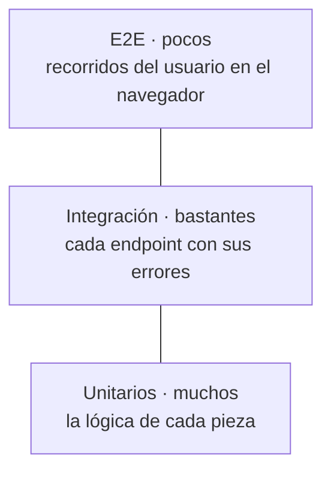
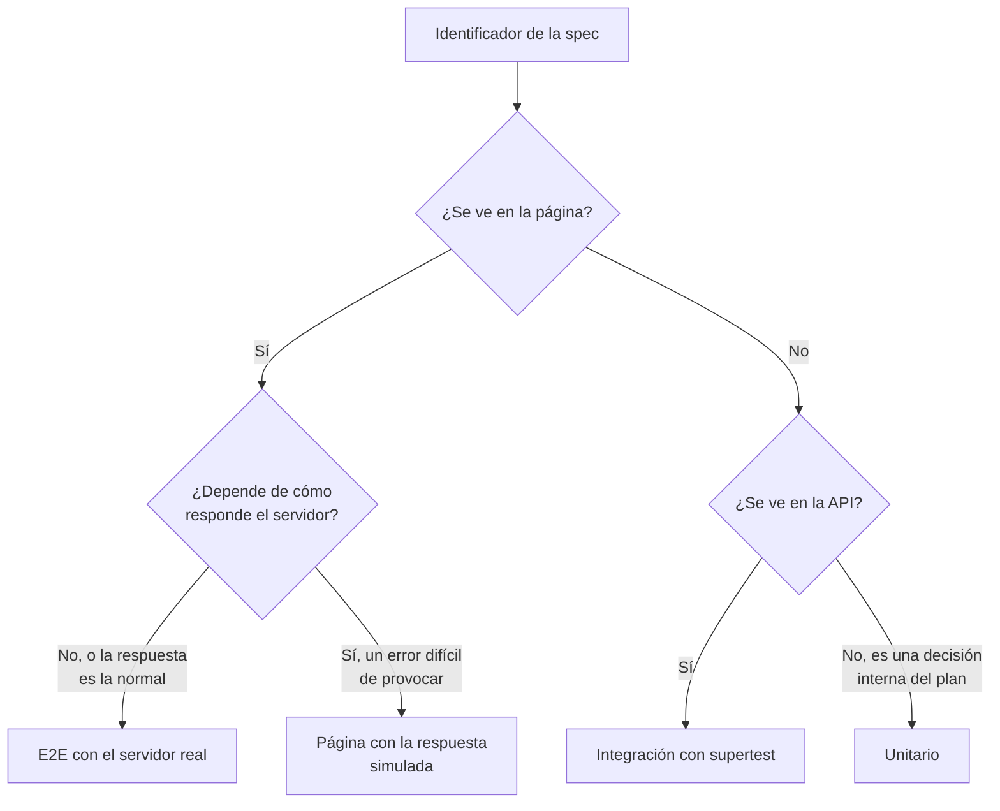
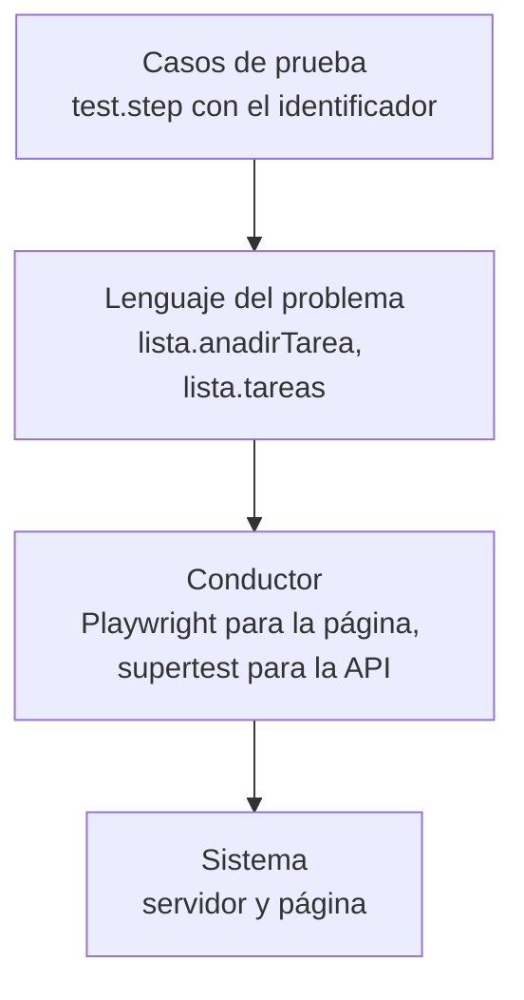
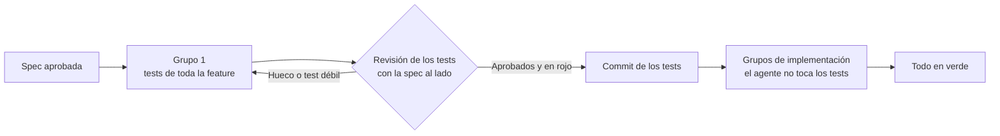
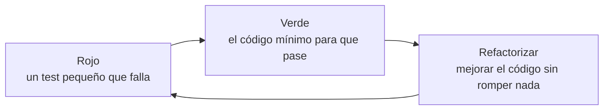

# 2. Pruebas desde la spec

[⬅️ Volver a la unidad](./README.md)

## Índice

- [2.1. Por qué probar desde la spec](#21-por-qué-probar-desde-la-spec)
  - [2.1.1. Los tests, la parte de la spec que se ejecuta](#211-los-tests-la-parte-de-la-spec-que-se-ejecuta)
  - [2.1.2. Pruebas desde la spec no es lo mismo que TDD](#212-pruebas-desde-la-spec-no-es-lo-mismo-que-tdd)
  - [2.1.3. Dónde está el proyecto: la spec de la feature B](#213-dónde-está-el-proyecto-la-spec-de-la-feature-b)
- [2.2. Del identificador al test](#22-del-identificador-al-test)
  - [2.2.1. Un test por criterio y por *edge case*](#221-un-test-por-criterio-y-por-edge-case)
  - [2.2.2. De un escenario de Gherkin a un test](#222-de-un-escenario-de-gherkin-a-un-test)
  - [2.2.3. Los límites y los datos que distinguen](#223-los-límites-y-los-datos-que-distinguen)
  - [2.2.4. Escribir los tests también valida la spec](#224-escribir-los-tests-también-valida-la-spec)
  - [2.2.5. Identificadores cuando hay varias features](#225-identificadores-cuando-hay-varias-features)
  - [2.2.6. Otra opción: que la spec se ejecute sola](#226-otra-opción-que-la-spec-se-ejecute-sola)
- [2.3. Niveles de prueba](#23-niveles-de-prueba)
  - [2.3.1. Unitarias, de integración y de extremo a extremo](#231-unitarias-de-integración-y-de-extremo-a-extremo)
  - [2.3.2. La pirámide](#232-la-pirámide)
  - [2.3.3. El nivel adecuado para cada identificador](#233-el-nivel-adecuado-para-cada-identificador)
  - [2.3.4. Pruebas de extremo a extremo con Playwright](#234-pruebas-de-extremo-a-extremo-con-playwright)
  - [2.3.5. `npm test` y `npm run e2e`](#235-npm-test-y-npm-run-e2e)
  - [2.3.6. Tests en el lenguaje del problema](#236-tests-en-el-lenguaje-del-problema)
- [2.4. Tests antes que el código](#24-tests-antes-que-el-código)
  - [2.4.1. Por qué antes](#241-por-qué-antes)
  - [2.4.2. Revisar los tests antes de implementar](#242-revisar-los-tests-antes-de-implementar)
  - [2.4.3. El rojo correcto](#243-el-rojo-correcto)
- [2.5. Tests que mienten](#25-tests-que-mienten)
  - [2.5.1. El código como referencia](#251-el-código-como-referencia)
  - [2.5.2. Datos que no distinguen](#252-datos-que-no-distinguen)
  - [2.5.3. Aserciones que no se ejecutan](#253-aserciones-que-no-se-ejecutan)
  - [2.5.4. Otras formas de mentir](#254-otras-formas-de-mentir)
  - [2.5.5. Pruebas de mutación con Stryker](#255-pruebas-de-mutación-con-stryker)
- [2.6. Tests que el agente no controla](#26-tests-que-el-agente-no-controla)
  - [2.6.1. Un agente que quiere ver verde](#261-un-agente-que-quiere-ver-verde)
  - [2.6.2. Tres reglas](#262-tres-reglas)
  - [2.6.3. Dos agentes y dos comandos](#263-dos-agentes-y-dos-comandos)
  - [2.6.4. Comprobar que nadie ha tocado los tests](#264-comprobar-que-nadie-ha-tocado-los-tests)
  - [2.6.5. Cuando el test está mal](#265-cuando-el-test-está-mal)
- [2.7. El ciclo de TDD, como técnica opcional](#27-el-ciclo-de-tdd-como-técnica-opcional)
- [2.8. Las pruebas en las herramientas de SDD](#28-las-pruebas-en-las-herramientas-de-sdd)
- [2.9. Errores típicos](#29-errores-típicos)
- [2.10. Ejemplo integrador: la feature B, con los tests primero](#210-ejemplo-integrador-la-feature-b-con-los-tests-primero)
- [Resumen](#resumen)
- [Ejercicios de reflexión](#ejercicios-de-reflexión)

> **Criterios que trabaja este tema:** OA3 b.

---

## 2.1. Por qué probar desde la spec

### 2.1.1. Los tests, la parte de la spec que se ejecuta

En el tema 1 viste el problema: si el mismo agente escribe el código y los tests en la misma sesión, los dos salen de **la misma interpretación**. El test de EC-02 que comprobaba `422` pasaba porque el controlador respondía `422`; los dos estaban de acuerdo entre sí y en desacuerdo con la spec. Un test así no comprueba la spec: **comprueba el código contra sí mismo**.

La solución es cambiar de dónde salen los tests. En lugar de escribirlos mirando el código, se escriben **mirando la spec**, y **antes** de que exista el código:

| | Tests desde el código | Tests desde la spec |
|---|---|---|
| **Fuente** | Lo que hace el código | Lo que dice la spec |
| **Cuándo** | Después de implementar | Antes de implementar |
| **Qué demuestran** | Que el código sigue haciendo lo que hacía | Que el código cumple lo aprobado |
| **Si el agente se equivoca** | El test reproduce el error | El test lo detecta |

Piensa en un examen. Si el alumno escribe las preguntas después de ver sus respuestas, siempre aprueba. Si el profesor escribe el examen antes, sin conocer las respuestas, el examen mide algo. Los tests desde la spec son el examen escrito antes.

Visto así, los tests son **la parte de la spec que se puede ejecutar**. La spec dice «si el texto supera 280 caracteres, el sistema responde 400 con este mensaje»; el test lo comprueba cada vez que alguien ejecuta `npm test`. Si alguien cambia el código y deja de cumplirlo, el test lo dice. Si alguien cambia la spec, el test tiene que cambiar con ella, en el mismo flujo.

> 📝 **Nota del Profesor**: este tema no inventa nada nuevo. Desde la UD2 cada test lleva el identificador de la spec y cada grupo de tasks empieza por sus tests. Lo que cambia es el rigor: todos los tests de la feature se escriben **y se revisan** antes de implementar, el agente que implementa **no puede tocarlos**, y cada criterio se prueba en el **nivel** adecuado, también los de la página, que hasta ahora se comprobaban a mano.

### 2.1.2. Pruebas desde la spec no es lo mismo que TDD

Seguramente has oído hablar del **desarrollo guiado por pruebas** (TDD, *Test-Driven Development*): escribir un test que falla, el código mínimo para que pase y mejorar el código sin romper nada. Es una técnica de programación con muchos años de historia, y se parece a lo que hace este tema, pero no es lo mismo:

| | TDD | Pruebas desde la spec |
|---|---|---|
| **De dónde salen los tests** | De lo que la persona que programa decide en ese momento | De los criterios de aceptación y los *edge cases* de una spec aprobada |
| **Tamaño del paso** | Un test cada vez, minutos | Todos los tests de la feature (o de un grupo de tasks) |
| **Quién escribe el código** | La misma persona, alternando test y código | El agente, después de que una persona revise los tests |
| **Para qué sirve sobre todo** | Diseñar el código paso a paso | Comprobar que el código cumple lo aprobado |

En SDD, las decisiones de comportamiento ya están tomadas en la spec: no hace falta descubrirlas test a test. Lo que necesitas es que cada decisión tenga una comprobación **independiente del código**. TDD sigue siendo útil para diseñar una pieza de lógica interna difícil, y por eso tiene su apartado al final del tema (2.7), como técnica opcional.

> 💡 **Tip del Examinador**: «¿Es lo mismo escribir los tests antes que el código que hacer TDD?». No. TDD es un ciclo corto de rojo, verde y refactorizar, un test cada vez, para diseñar el código. Las pruebas desde la spec derivan todos los tests de los criterios de aceptación y los *edge cases* de una spec aprobada, se revisan antes de implementar y sirven para comprobar que el código cumple la spec. Comparten la idea de que el test va primero.

### 2.1.3. Dónde está el proyecto: la spec de la feature B

Al terminar el tema 1, la feature A (spec 1.3) está corregida y fusionada en `main`, con **24 tests en verde**, y la rama `feature/B-ver-lista` ha traído esos cambios. La feature B tiene la spec aprobada (UD2, tema 4) y el plan (UD2, tema 6), pero todavía no tiene tasks.

Esta es la spec de B. La vas a usar en todo el tema:

````markdown
# Spec: Ver la lista de tareas

## Metadatos

| Campo   | Valor                  |
|---------|------------------------|
| Feature | Ver la lista de tareas |
| Estado  | Aprobada               |
| Versión | 1.0                    |
| Fecha   | AAAA-MM-DD             |
| Autor   | <nombre>               |

---

## Contexto

Al abrir la página, los miembros del equipo ven todas las tareas de la
lista compartida, en el orden en que se añadieron.

**Historia de usuario:** como miembro del equipo, quiero ver todas las
tareas al abrir la página para saber qué queda por hacer.

**Dependencias:** feature A (las tareas se crean con ella).

---

## Requisitos funcionales

- RF-01: Cuando se pida la lista de tareas, el sistema deberá devolver
  todas las tareas guardadas, cada una con los campos id, text, estado y
  fechaCreacion, de la más antigua a la más reciente.
- RF-02: Cuando el usuario abra la página, la página deberá mostrar
  todas las tareas guardadas, con su texto y su estado, en el orden de
  RF-01.
- RF-03: Mientras no haya ninguna tarea guardada, la página deberá
  mostrar el mensaje "Todavía no hay tareas".

---

## Requisitos no funcionales

- RNF-01: La petición de la lista deberá responder en menos de 200 ms
  con 1.000 tareas guardadas.

---

## Criterios de aceptación

```gherkin
# language: es
Característica: Ver la lista de tareas

  Escenario: AC-01 Ver las tareas al abrir la página
    Dado que se han añadido las tareas "Comprar leche", "Pagar la luz" y "Llamar al fontanero", en ese orden
    Cuando el usuario abre la página
    Entonces la lista muestra las 3 tareas en ese orden
    Y cada tarea muestra su texto y el estado "pendiente"

  Escenario: AC-02 Lista vacía
    Dado que no hay ninguna tarea
    Cuando el usuario abre la página
    Entonces la página muestra el mensaje "Todavía no hay tareas"
    Y la lista no muestra ninguna tarea

  Escenario: AC-03 Respuesta del servidor
    Dado que se han añadido las tareas "Comprar leche", "Pagar la luz" y "Llamar al fontanero", en ese orden
    Cuando se envía una petición GET /tareas
    Entonces la respuesta tiene el código 200
    Y el cuerpo es una lista con las 3 tareas en ese orden, cada una con id, text, estado y fechaCreacion

  Escenario: AC-04 La primera tarea
    Dado que no hay ninguna tarea
    Y el usuario tiene la página abierta
    Cuando el usuario añade la tarea "Comprar leche"
    Entonces deja de verse el mensaje "Todavía no hay tareas"
    Y la lista muestra la tarea "Comprar leche"
```

---

## Edge cases y comportamiento ante errores

- EC-01: Si no hay ninguna tarea guardada, entonces el sistema deberá
  responder 200 con una lista vacía.
- EC-02: Si el servidor no puede obtener las tareas, entonces deberá
  responder 500 con { error: "Error al obtener las tareas" }.
- EC-03: Si el servidor responde con un error al pedir la lista,
  entonces la página deberá mostrar el mensaje de error de la respuesta,
  sin mostrar el mensaje "Todavía no hay tareas".

---

## Fuera de alcance

- Paginar la lista o limitar cuántas tareas se muestran.
- Filtrar las tareas u ordenarlas de otra forma.
- Que la lista se actualice sola cuando otra persona añade una tarea:
  hay que recargar la página.
- Marcar una tarea como hecha (feature C) o borrarla (feature D).
````

Y estas son las decisiones del plan de B que importan para las pruebas:

```markdown
- D-01: La lista sale de repositorioTareas.obtenerTodas(), que ya existe
  (feature A) y devuelve las tareas en el orden en que se guardaron.
- D-02: Nueva función listarTareas() en el servicio de tareas, para que
  el controlador no acceda al repositorio (constitución).
- D-03: Ruta GET / en src/rutas/tareas.js. El controlador responde 200
  con la lista y, ante cualquier error, 500 (EC-02).
- D-04: Página: al cargarse, pide GET /tareas y muestra cada tarea con
  la función mostrarTarea de la feature A. El mensaje «Todavía no hay
  tareas» es un párrafo fuera de la lista, oculto cuando hay tareas. Los
  errores, en el párrafo de errores de la feature A (EC-03).
```

La estrategia de pruebas del plan, escrita en la UD2, es la que habrías hecho entonces:

```markdown
| Spec | Cómo se comprueba | Dónde |
|------|-------------------|-------|
| RF-01, AC-03 | API: 200 con las tareas en orden | tests/api-tareas.test.js |
| EC-01, EC-02 | API: lista vacía → 200 []; el repositorio falla → 500 | tests/api-tareas.test.js |
| RNF-01 | API: con 1.000 tareas, menos de 200 ms | tests/api-tareas.test.js |
| RF-02, RF-03, AC-01, AC-02, AC-04, EC-03 | A mano en el navegador | Lista de comprobación en la task de la página |
```

Fíjate en la última fila: **seis identificadores** que nadie volverá a comprobar después de implementar. A lo largo del tema verás por qué esa fila no basta y cómo se convierte en pruebas que se ejecutan solas.

---

## 2.2. Del identificador al test

### 2.2.1. Un test por criterio y por *edge case*

La regla de partida es sencilla: **cada criterio de aceptación y cada *edge case* tiene al menos un test**, y el test lleva el identificador en su nombre. Los requisitos (RF y RNF) se comprueban a través de los criterios que los concretan o con su propio test, si ninguno lo hace.

| Elemento de la spec | Qué test sale de él |
|---------------------|---------------------|
| Criterio de aceptación (AC) | Un test que reproduce el escenario: el mismo «Dado», el mismo «Cuando», las mismas comprobaciones del «Entonces» |
| *Edge case* (EC) | Un test que provoca la situación y comprueba la respuesta exacta: código, mensaje, estado de la página |
| Requisito funcional (RF) | Normalmente, cubierto por los AC que lo concretan; si ninguno lo hace, su propio test |
| Requisito no funcional (RNF) | Un test con la medida de la spec (tiempo, tamaño, límite), si se puede medir de forma fiable |
| Decisión del plan (D) | Un test **unitario**, si la decisión tiene lógica propia; no sale de la spec, sino del plan |

La última fila es la diferencia que ya viste en el tema 1 entre **tests de aceptación** (salen de la spec y miran desde fuera) y **tests unitarios** (salen del plan y miran piezas internas). Los dos son útiles, pero solo los primeros demuestran que la feature cumple la spec.

### 2.2.2. De un escenario de Gherkin a un test

Un escenario de Gherkin ya tiene la forma de un test. Las tres partes se corresponden con las tres partes de cualquier test (preparar, actuar, comprobar):

| Gherkin | En el test | Ejemplo con AC-03 de B |
|---------|------------|------------------------|
| **Dado** | Preparar los datos | Crear tres tareas, en un orden concreto |
| **Cuando** | Hacer la acción | Enviar `GET /tareas` |
| **Entonces** / **Y** | Comprobar | Código `200`; el cuerpo, las tres tareas en ese orden con sus cuatro campos |

Así queda el test de AC-03, en `tests/api-tareas.test.js`:

```javascript
test('B-RF-01, B-AC-03: responde 200 con las tareas en el orden en que se añadieron', async () => {
  const creadas = [];
  for (const text of ['Comprar leche', 'Pagar la luz', 'Llamar al fontanero']) {
    const respuesta = await request(app).post('/tareas').send({ text });
    creadas.push(respuesta.body);
  }

  const respuesta = await request(app).get('/tareas');

  expect(respuesta.status).toBe(200);
  expect(respuesta.body).toEqual(creadas);
});
```

(El prefijo `B-` del nombre lo explica el apartado 2.2.5.) Lee la última línea con la spec al lado. `creadas` son las tres tareas que devolvió la API al crearlas, **en el orden en que se crearon**. Comparar con `toEqual` comprueba a la vez todo lo que pide AC-03: que hay tres, que están en ese orden y que cada una tiene sus cuatro campos con los mismos valores. Y comprueba RF-01, que AC-03 concreta.

Un *edge case* se traduce igual. EC-02 pide un `500` con un mensaje exacto cuando el servidor no puede obtener las tareas. Para provocarlo, el test sustituye la función del repositorio por una que falla, como hacía EC-03 de la feature A:

```javascript
test('B-EC-02: responde 500 si no se pueden obtener las tareas', async () => {
  vi.spyOn(repositorioTareas, 'obtenerTodas').mockImplementation(() => {
    throw new Error('Fallo del almacenamiento');
  });

  const respuesta = await request(app).get('/tareas');

  expect(respuesta.status).toBe(500);
  expect(respuesta.body).toEqual({ error: 'Error al obtener las tareas' });
});
```

Las dos aserciones son las dos mitades de EC-02: el código **y** el cuerpo exacto. Un test que solo comprobara el `500` dejaría pasar un cuerpo en HTML o un mensaje en inglés.

> ✅ **Buena práctica**: copia los valores exactos de la spec en el test: el código HTTP, el mensaje, el texto que ve el usuario. Si el test los «parafrasea» (`toContain('Error')`), deja de comprobar lo que la spec decidió.

### 2.2.3. Los límites y los datos que distinguen

Dos ideas de diseño de pruebas que ya usaste en la feature A y que conviene tener presentes en cada test.

**Los límites, por los dos lados.** Si la spec fija un máximo de 280 caracteres, los errores suelen estar justo en el borde: un `>` donde iba un `>=`. Por eso EC-02 de A tiene dos tests, uno con 280 caracteres (se acepta) y otro con 281 (se rechaza). Lo mismo vale para cualquier límite: el mínimo, el máximo, el primer valor fuera.

**Datos que distinguen lo correcto de lo incorrecto.** Un test sirve si **falla** cuando el código está mal. Y eso depende mucho de los datos que elijas. Mira las tres tareas del test de AC-03: «Comprar leche», «Pagar la luz», «Llamar al fontanero». No están elegidas al azar:

| Si el código… | Devolvería | ¿El test lo detecta? |
|---------------|------------|----------------------|
| Respeta el orden en que se añadieron | Comprar, Pagar, Llamar | Es lo esperado |
| Ordena por orden alfabético | Comprar, Llamar, Pagar | Sí |
| Devuelve la más reciente primero | Llamar, Pagar, Comprar | Sí |

Con «Tarea 1», «Tarea 2» y «Tarea 3», el orden alfabético y el de creación **coinciden**, y un código que ordenara alfabéticamente pasaría el test. Lo verás de cerca en el apartado 2.5.2.

> ⚠️ **Cuidado**: elige los datos de cada test preguntándote «¿qué implementación incorrecta, pero razonable, pasaría este test?». Si encuentras una, cambia los datos hasta que falle.

### 2.2.4. Escribir los tests también valida la spec

Al traducir cada identificador a un test aparecen preguntas que nadie se hizo al aprobar la spec. Es lo que en el tema 1 se llamó validar que la spec es **comprobable**, pero desde otro ángulo: cuando intentas escribir el «Dado» y el «Entonces» exactos, los huecos se ven.

Un ejemplo con la feature B. Al escribir el test de EC-03 (la página recibe un error), preparas una respuesta `500` con su mensaje y compruebas que la página lo muestra. Y te preguntas: **¿y si no hay respuesta?** Si el servidor está caído, `fetch` no devuelve una respuesta con un mensaje: lanza un error. EC-03 habla del «mensaje de error de la respuesta», y en ese caso no lo hay. La spec no decide qué ve el usuario.

Recorre el diagrama del tema 1 (apartado 1.5.4): la spec no lo decide, y era parte de la feature (ver la lista incluye saber por qué no se ve). Es un **hueco en la spec**, y lo has encontrado **antes de escribir una línea de código**. Se decide y se escribe:

```markdown
- EC-04: Si la página no recibe respuesta del servidor al pedir la
  lista, entonces deberá mostrar el mensaje "No se ha podido conectar
  con el servidor", sin mostrar el mensaje "Todavía no hay tareas".
```

Sin este paso, el agente habría implementado algo (o nada) al escribir el código, y lo habrías descubierto, con suerte, al leerlo.

> 📝 **Nota del Profesor**: los tests y la spec se validan mutuamente. La spec dice qué comprobar; al escribir la comprobación descubres lo que la spec no dice. Por eso los tests se escriben al **empezar** la implementación de la feature y no al final: cuanto antes aparezca el hueco, más barato es cerrarlo.

### 2.2.5. Identificadores cuando hay varias features

Hasta ahora el proyecto tenía una sola feature, y un test llamado `EC-02` no tenía pérdida. Con B aparece un problema: **B también tiene un EC-01, un EC-02 y un AC-03**. Si los tests de B se llaman igual, la búsqueda de identificadores del tema 1 deja de servir: un `EC-02` en los tests ya no dice de qué feature es, y un identificador de A sin test quedaría oculto por el test del mismo número de B.

La solución es añadir la **letra de la feature** al identificador en el nombre de los tests: `A-EC-02`, `B-EC-02`. La spec no cambia (dentro de la spec de B, `EC-02` no es ambiguo); solo los tests, que viven todos juntos en `tests/`:

```javascript
test('A-EC-02: rechaza un texto de 281 caracteres', () => { … });
test('B-EC-02: responde 500 si no se pueden obtener las tareas', async () => { … });
```

Y la búsqueda de identificadores sin test se hace por feature, añadiendo la letra a los de la spec:

```bash
comm -23 \
  <(grep -oE '(RF|RNF|AC|EC)-[0-9]+' docs/specs/B-ver-lista/spec.md | sed 's/^/B-/' | sort -u) \
  <(grep -rohE 'B-(RF|RNF|AC|EC)-[0-9]+' tests/ e2e/ | sort -u)
```

El `sed` añade `B-` delante de cada identificador de la spec; la segunda búsqueda recorre también la carpeta `e2e/`, donde irán las pruebas de la página (apartado 2.3.4).

Es una **decisión de proyecto**, no de la feature B: afecta a los tests de A, a `tests/AGENTS.md` y a la skill `tests-desde-spec`. Así que se toma en `main`, como parte de la replanificación (UD2, tema 1), y se renombran los tests de A en un commit propio. Lo harás en el ejemplo integrador.

> ⚠️ **Cuidado**: renombrar los tests de A es **modificar tests existentes**. Aquí es correcto, porque lo decide una persona, por un motivo escrito y en un commit que solo hace eso. En el tema 3 verás un *quality gate* que avisa de los commits que modifican tests existentes: un cambio como este es justo el tipo de aviso que una persona lee y acepta, y uno que mezcla tests y código en el mismo commit, el tipo de error que bloquea.

### 2.2.6. Otra opción: que la spec se ejecute sola

Fíjate en lo que hiciste en el apartado 2.2.2: el escenario AC-03 está escrito **dos veces**, una en la spec (en Gherkin) y otra en el test (en JavaScript). Lo que une las dos es el identificador en el nombre del test y tu revisión. Si alguien cambia el escenario y no el test, o escribe un test que no comprueba lo que dice el escenario, nada se pone en rojo. Es la puerta por la que entra el *spec drift* del tema 1.

Hay quien propone cerrar esa puerta haciendo que **el escenario sea el test**. Es la idea de la **especificación ejecutable**, que viene del BDD (UD1, tema 6) y del **desarrollo guiado por pruebas de aceptación** (ATDD, *Acceptance Test-Driven Development*). Quienes lo practican hacen una crítica directa al SDD con specs en Markdown: una spec en prosa es un prompt más largo; el agente puede no cumplirla y nada falla.

La herramienta habitual es **Cucumber** (en JavaScript, el paquete `@cucumber/cucumber`). El curso ya usa su lector de Gherkin para validar las specs; Cucumber completo va más allá: lee los ficheros `.feature` y **ejecuta** cada escenario. Para eso, cada frase del escenario se enlaza con una función, su **paso** (*step definition*).

Así quedaría AC-03 de B. Como Cucumber no lee Markdown, los criterios salen de `spec.md` a un fichero propio, `docs/specs/B-ver-lista/criterios.feature`:

```gherkin
# language: es
Característica: Ver la lista de tareas

  Escenario: AC-03 Respuesta del servidor
    Dado que se han añadido las tareas "Comprar leche", "Pagar la luz" y "Llamar al fontanero", en ese orden
    Cuando se envía una petición GET /tareas
    Entonces la respuesta tiene el código 200
    Y el cuerpo es una lista con las 3 tareas en ese orden, cada una con id, text, estado y fechaCreacion
```

Y los pasos, en `pasos/lista-tareas.pasos.js`:

```javascript
import { Before, Given, Then, When } from '@cucumber/cucumber';
import assert from 'node:assert/strict';
import request from 'supertest';
import { app } from '../src/app.js';
import { repositorioTareas } from '../src/repositorios/repositorio-tareas.js';

Before(() => {
  repositorioTareas.vaciar();
});

Given(
  'que se han añadido las tareas {string}, {string} y {string}, en ese orden',
  async function (primera, segunda, tercera) {
    this.creadas = [];
    for (const text of [primera, segunda, tercera]) {
      const respuesta = await request(app).post('/tareas').send({ text });
      this.creadas.push(respuesta.body);
    }
  },
);

When('se envía una petición GET \\/tareas', async function () {
  this.respuesta = await request(app).get('/tareas');
});

Then('la respuesta tiene el código {int}', function (codigo) {
  assert.equal(this.respuesta.status, codigo);
});

Then(
  'el cuerpo es una lista con las {int} tareas en ese orden, cada una con id, text, estado y fechaCreacion',
  function (cantidad) {
    assert.equal(this.respuesta.body.length, cantidad);
    assert.deepEqual(this.respuesta.body, this.creadas);
  },
);
```

Cada paso empieza por la frase del escenario sin la palabra clave (`Dado`, `Cuando`, `Entonces` y `Y` se escriben en el código como `Given`, `When` y `Then`). `{string}` recoge un texto entre comillas y `{int}` un número, y la función los recibe en orden. `this` es un objeto que comparten los pasos del mismo escenario, y `Before` vacía el repositorio antes de cada uno. Con un `cucumber.json` que diga dónde están los escenarios (`"paths"`) y los pasos (`"import"`), `npx cucumber-js` lo ejecuta:

```text
.....

1 scenario (1 passed)
5 steps (5 passed)
```

Son cinco pasos porque Cucumber cuenta también el `Before`.

> ⚠️ **Cuidado**: en las expresiones de Cucumber, la barra `/` separa alternativas (`tarea/tareas` vale para las dos palabras). Por eso el paso escribe `GET \\/tareas`. Si escribes `GET /tareas` sin escapar, Cucumber se niega a arrancar con el error «Alternative may not be empty».

**Qué gana.** Se ha probado cambiando la spec sin tocar los pasos, y el código sin tocar nada más:

| Cambio | Con Vitest (como en el curso) | Con Cucumber |
|--------|-------------------------------|--------------|
| En la spec, el código esperado pasa de `200` a `201` | El test sigue esperando `200` y pasa. La spec y el test ya no dicen lo mismo, y solo lo ve quien los revise | El paso recibe `201` y el escenario falla |
| En la spec, «en ese orden» pasa a «de la más nueva a la más antigua» | El test sigue en verde con el orden anterior | La frase ya no coincide con ningún paso: el escenario queda **sin definir** (*undefined*) y la ejecución falla hasta que alguien escriba el paso |
| El servicio ordena las tareas por texto | El test falla | El escenario falla |

**Qué no gana.** El código de los pasos es un test como cualquier otro, y puede mentir igual (apartado 2.5). Si el último paso solo comprobara `length`, el escenario estaría en verde con las tareas desordenadas. Cucumber garantiza que **cada frase tiene un código**, no que ese código compruebe lo que dice la frase. La revisión de los tests sigue haciendo falta; solo cambia de sitio, a los pasos.

**Lo que cuesta.**

- Una herramienta más, con otra forma de escribir tests, además de Vitest y Playwright. Los escenarios de la página necesitarían pasos con Playwright.
- Las frases de la spec se vuelven código. Al redactar un escenario nuevo hay que reutilizar frases exactas, y cambiar la redacción obliga a cambiar el paso.
- Los criterios salen de `spec.md` a un fichero aparte, y la spec queda en dos sitios.
- Los *edge cases* en EARS no son escenarios: o se reescriben en Gherkin o siguen con tests normales.

**Por qué el curso no lo usa.** Ya tienes un enlace entre la spec y sus tests: el identificador en el nombre, la búsqueda de identificadores sin test (apartado 2.2.5), la revisión de los tests antes de implementar y un agente que no puede tocarlos (apartado 2.6). Con eso, el hueco que cierra Cucumber se vigila, y te ahorras una herramienta. La especificación ejecutable compensa más cuando la spec cambia a menudo o la escriben personas que no programan. Es una **decisión de proyecto**, y su sitio es la constitución.

> 📝 **Nota del Profesor**: el curso y quienes defienden la especificación ejecutable no están tan lejos. Los dos piden que la intención la escriba y la apruebe una persona, antes que el código, y que se compruebe con algo que se ejecuta y que el agente no controla. La diferencia es cuánto se fía cada uno de la revisión humana para mantener unidos el texto de la spec y sus tests.

---

## 2.3. Niveles de prueba

### 2.3.1. Unitarias, de integración y de extremo a extremo

No todos los tests prueban lo mismo ni cuestan lo mismo. Se suelen agrupar en tres **niveles**, según cuánto del sistema ponen en marcha:

| Nivel | Qué pone en marcha | En la lista de tareas | Herramienta |
|-------|--------------------|-----------------------|-------------|
| **Unitario** | Una pieza aislada: una función, un módulo | `crearTarea` rechaza 281 caracteres | Vitest |
| **De integración** | Varias piezas juntas, sin el navegador | `POST /tareas` atraviesa rutas, controlador, servicio y repositorio | Vitest y supertest |
| **De extremo a extremo** (*end-to-end*, e2e) | Todo el sistema, como lo usa una persona | Abrir la página en un navegador, escribir una tarea y pulsar «Añadir» | Playwright |

Los tests de la API del proyecto son **de integración**, como ya los llamaba la estrategia de pruebas de la UD2: supertest envía peticiones HTTP reales a la aplicación de Express, que pasa por todas sus capas, aunque sin abrir un puerto ni usar un navegador.

Cada nivel tiene sus ventajas y sus costes:

| | Unitario | Integración | E2E |
|---|---|---|---|
| **Velocidad** | Milisegundos | Decenas de milisegundos | Segundos |
| **Si falla, dice dónde** | Con mucha precisión | En qué endpoint | Solo qué paso del usuario |
| **Lo que comprueba** | La lógica de una pieza | El contrato de la API | Lo que ve y hace el usuario |
| **Se rompe con cambios internos** | A menudo | Pocas veces | Casi nunca |
| **Fragilidad** | Baja | Baja | Más alta: tiempos de espera, navegador, servidor |

### 2.3.2. La pirámide

Una forma clásica de repartir los tests entre niveles es la **pirámide de pruebas**: muchos unitarios en la base, menos de integración en medio y pocos e2e arriba.



El diagrama no dice que los e2e sean peores, sino que son **caros**: lentos, más frágiles y poco precisos cuando fallan. Por eso se reservan para lo que solo ellos pueden comprobar (lo que pasa en la página) y el detalle (cada mensaje de error, cada límite) se prueba más abajo, donde es rápido y preciso.

Con un agente, la pirámide tiene una lectura más: los tests de integración y e2e salen de la spec (miran desde fuera), mientras que muchos unitarios salen del plan (miran piezas internas). Si un agente propone cincuenta tests unitarios y ninguno de la API, probablemente ha probado su implementación, no la spec.

### 2.3.3. El nivel adecuado para cada identificador

La pregunta para elegir el nivel es: **¿dónde se ve lo que la spec decide?**



El diagrama se lee de arriba abajo: el nivel lo decide el sitio donde la spec pone el comportamiento, no la comodidad. Aplicado a la feature B:

| Spec | ¿Dónde se ve? | Nivel |
|------|---------------|-------|
| RF-01, AC-03 | En la respuesta de `GET /tareas` | Integración |
| EC-01, EC-02 | En la respuesta de `GET /tareas` | Integración |
| RNF-01 | En el tiempo de respuesta de la API | Integración |
| RF-02, RF-03, AC-01, AC-02, AC-04 | En la página, con el servidor funcionando | E2E |
| EC-03, EC-04 | En la página, cuando el servidor falla o no responde | Página con la respuesta simulada |
| D-01, D-02 | No se ven desde fuera: el servicio llama al repositorio | Ninguno propio: los cubren los tests de la API |

La última fila es tan importante como las demás. `listarTareas()` es una función de una línea que devuelve lo que da el repositorio. Un test unitario suyo no comprobaría nada que no comprueben ya los tests de la API, y se rompería si mañana el plan cambiara cómo se obtienen las tareas. **No todo necesita un test unitario.** En la feature A sí tenían sentido: el servicio tiene lógica propia (recortar, validar en un orden concreto) que conviene probar de cerca.

¿Y los de A que se comprobaban a mano (RF-03, AC-01, AC-02 y la AC-04 de la spec 1.3)? Se ven en la página, así que les corresponde el nivel e2e. Como B toca la misma página, el recorrido de B puede comprobarlos también.

> 💡 **Tip del Examinador**: «¿Cómo decides si un criterio de aceptación se prueba con un test unitario, de integración o e2e?». Por el sitio donde se ve lo que decide la spec. Si es el comportamiento de la página, e2e; si es la respuesta de la API, integración; si es una decisión interna del plan con lógica propia, unitario. El detalle (cada error, cada límite) se prueba en el nivel más bajo donde se vea, porque es más rápido y más preciso.

### 2.3.4. Pruebas de extremo a extremo con Playwright

**Playwright** es una herramienta de pruebas e2e: abre un navegador de verdad (Chromium, Firefox o WebKit), carga la página y actúa como una persona: escribe, pulsa, espera a que aparezcan las cosas. Se instala como dependencia de desarrollo y necesita descargar los navegadores una vez:

```bash
npm install --save-dev @playwright/test
npx playwright install --with-deps chromium
```

La segunda orden descarga Chromium y, con `--with-deps`, instala las librerías del sistema que necesita. En el Dev Container del curso va en el `postCreateCommand`, detrás de `npm install`.

**La configuración.** `playwright.config.js`, en la raíz del proyecto:

```javascript
import { defineConfig, devices } from '@playwright/test';

export default defineConfig({
  testDir: 'e2e',
  testMatch: '*.e2e.js',
  use: {
    baseURL: 'http://localhost:3100',
  },
  webServer: {
    command: 'npm start',
    env: { PUERTO: '3100' },
    url: 'http://localhost:3100',
    reuseExistingServer: false,
  },
  projects: [{ name: 'chromium', use: { ...devices['Desktop Chrome'] } }],
});
```

| Clave | Qué hace |
|-------|----------|
| `testDir`, `testMatch` | Las pruebas e2e están en `e2e/` y terminan en `.e2e.js`. Así Vitest no las confunde con las suyas, que terminan en `.test.js` |
| `baseURL` | La dirección base: en las pruebas, `page.goto('/')` abre `http://localhost:3100/` |
| `webServer` | Playwright arranca el servidor con `npm start` antes de las pruebas y lo para al terminar |
| `env: { PUERTO: '3100' }` | Otro puerto que el de desarrollo (3000), para no chocar con el servidor que tengas abierto |
| `reuseExistingServer: false` | Siempre un servidor nuevo. Como las tareas se guardan en memoria (D-04 de A), **cada ejecución empieza con la lista vacía** |
| `projects` | En qué navegadores se ejecuta: aquí, solo Chromium |

**Encontrar los elementos como los encuentra una persona.** Playwright localiza los elementos con **localizadores** (*locators*). Los recomendados buscan por lo que ve o usa una persona, no por la estructura del HTML:

```javascript
const campo = page.getByLabel('Texto de la tarea');
const botonAnadir = page.getByRole('button', { name: 'Añadir' });
const tareas = page.getByRole('listitem');
const sinTareas = page.getByText('Todavía no hay tareas');
```

`getByRole('button', { name: 'Añadir' })` encuentra el botón cuyo texto accesible es «Añadir», esté donde esté y tenga el `id` que tenga. Si mañana alguien cambia el `id` del botón, el test sigue funcionando; si quita el texto del botón, falla, y con razón, porque el usuario ya no sabría qué pulsar. Como efecto secundario, estos localizadores comprueban que la página es **accesible**: si un lector de pantalla no puede encontrar el campo, Playwright tampoco.

**Las aserciones esperan.** En una página, las cosas no aparecen al instante: la tarea se añade cuando llega la respuesta del servidor. Las aserciones de Playwright **reintentan** hasta que se cumplen o se agota un tiempo (cinco segundos, por defecto):

```javascript
await expect(tareas).toHaveText(['Comprar leche (pendiente)']);
```

Esta línea espera hasta que la lista tenga exactamente un elemento con ese texto. No hace falta (y no se debe) añadir esperas fijas como «espera un segundo»: hacen los tests lentos y, aun así, fallan en un equipo más lento.

**Un recorrido por feature, con un paso por identificador.** Las pruebas e2e son caras, así que en lugar de un test por criterio se escribe un **recorrido**: un único test que sigue el camino de una persona y comprueba cada criterio en el paso donde ocurre. Cada paso va en un `test.step` con el identificador en el nombre:

```javascript
test('Recorrido de la lista de tareas', async ({ page }) => {
  // … los localizadores de arriba …

  await page.goto('/');

  await test.step('B-RF-03, B-AC-02: sin tareas, la página lo dice', async () => {
    await expect(sinTareas).toBeVisible();
    await expect(tareas).toHaveCount(0);
  });

  await test.step('B-AC-04: al añadir la primera tarea, desaparece el mensaje', async () => {
    await campo.fill('Comprar leche');
    await botonAnadir.click();

    await expect(tareas).toHaveText(['Comprar leche (pendiente)']);
    await expect(sinTareas).toBeHidden();
  });

  // … más pasos …
});
```

Si un paso falla, el informe de Playwright dice **qué paso** y, por tanto, qué identificador. Y como los nombres de los pasos llevan los identificadores, la búsqueda del apartado 2.2.5 los encuentra.

**Errores difíciles de provocar: la respuesta simulada.** Para EC-03 haría falta que el servidor fallara de verdad al leer las tareas, y en una prueba e2e no tienes un `vi.spyOn` para el servidor. Playwright puede **interceptar** las peticiones de la página y responder en lugar del servidor:

```javascript
test('B-EC-03: si el servidor responde con un error, la página lo muestra', async ({ page }) => {
  await page.route('**/tareas', (ruta) =>
    ruta.fulfill({ status: 500, json: { error: 'Error al obtener las tareas' } }),
  );

  await page.goto('/');

  await expect(page.getByRole('alert')).toHaveText('Error al obtener las tareas');
  await expect(page.getByText('Todavía no hay tareas')).toBeHidden();
});
```

`page.route` captura las peticiones a `/tareas` y `fulfill` responde con un `500` y el cuerpo de EC-02. Para EC-04, `ruta.abort()` hace que la petición falle como si el servidor no respondiera. Ten en cuenta que esto **ya no es extremo a extremo**: el servidor real no interviene. Es una prueba de la **página** con la API simulada, y comprueba solo cómo reacciona la página. Que el servidor responda de verdad ese `500` lo comprueba el test de integración de EC-02. Las dos juntas cubren EC-02 y EC-03 de punta a punta.

> ✅ **Buena práctica**: en las pruebas e2e, busca los elementos por su **papel y su texto** (`getByRole`, `getByLabel`, `getByText`), no por `id` ni por clases de CSS. El test describe lo que hace una persona, sobrevive a los cambios internos de la página y, de paso, comprueba que es accesible.

### 2.3.5. `npm test` y `npm run e2e`

Las pruebas e2e necesitan un navegador y un servidor, y tardan segundos. Las de Vitest, milisegundos. Por eso van en **dos scripts**:

```json
"scripts": {
  "start": "node src/servidor.js",
  "test": "vitest run",
  "e2e": "playwright test",
  "estado": "sh herramientas/estado-features.sh"
}
```

| Script | Qué ejecuta | Cuándo |
|--------|-------------|--------|
| `npm test` | Unitarias y de integración (Vitest) | Constantemente: en cada cambio, en cada ciclo |
| `npm run e2e` | E2E y de la página (Playwright) | En el punto de control de los ciclos que tocan la página, antes de fusionar y en la integración continua |

Separarlos permite que `npm test` siga siendo instantáneo, que es lo que hace que se ejecute a menudo. Pero que vayan separados **no significa que el e2e sea opcional**: en el tema 3, la integración continua ejecutará los dos y no se podrá fusionar con ninguno en rojo.

> ⚠️ **Cuidado**: Vitest, por defecto, ejecuta cualquier fichero que termine en `.test.js` o `.spec.js`. Si llamas a las pruebas de Playwright `lista.spec.js`, Vitest intentará ejecutarlas y fallarán con errores extraños. Por eso el curso usa la extensión `.e2e.js` y la carpeta `e2e/`.

### 2.3.6. Tests en el lenguaje del problema

Mira otra vez el recorrido del apartado 2.3.4. Cada paso mezcla dos cosas: **qué** comprueba (lo que dice la spec) y **cómo** se habla con la página (el campo con esta etiqueta, el botón con este texto). Con un recorrido no pasa nada. Con varios ficheros de e2e, un cambio en la forma de usar la página, como que el botón pase a decir «Guardar», obliga a tocar todos los pasos que añaden una tarea.

La solución es separar las dos cosas. El **cómo** va a un módulo con funciones que tienen nombres del problema, `e2e/pagina-lista.js`:

```javascript
export function paginaLista(page) {
  const campo = page.getByLabel('Texto de la tarea');
  const botonAnadir = page.getByRole('button', { name: 'Añadir' });

  return {
    campo,
    tareas: page.getByRole('listitem'),
    mensajeSinTareas: page.getByText('Todavía no hay tareas'),
    mensajeError: page.getByRole('alert'),

    abrir() {
      return page.goto('/');
    },

    async anadirTarea(texto) {
      await campo.fill(texto);
      await botonAnadir.click();
    },
  };
}
```

Y los pasos del recorrido dicen solo el **qué**:

```javascript
import { expect, test } from '@playwright/test';
import { paginaLista } from './pagina-lista.js';

test('Recorrido de la lista de tareas', async ({ page }) => {
  const lista = paginaLista(page);

  await lista.abrir();

  await test.step('B-RF-03, B-AC-02: sin tareas, la página lo dice', async () => {
    await expect(lista.mensajeSinTareas).toBeVisible();
    await expect(lista.tareas).toHaveCount(0);
  });

  await test.step('B-AC-04: al añadir la primera tarea, desaparece el mensaje', async () => {
    await lista.anadirTarea('Comprar leche');

    await expect(lista.tareas).toHaveText(['Comprar leche (pendiente)']);
    await expect(lista.mensajeSinTareas).toBeHidden();
  });

  // … más pasos …
});
```

Lee el segundo paso en voz alta y casi es el escenario AC-04 de la spec. Se ha probado cambiando el texto del botón a «Guardar»: el recorrido falla esperando `getByRole('button', { name: 'Añadir' })`. Si el cambio es correcto, se arregla en **una línea** de `pagina-lista.js`, y los pasos no cambian.

Esta separación tiene nombre en el mundo de las pruebas de aceptación: se organiza en **cuatro capas**. Este diagrama muestra qué hay en cada una en el proyecto:



Fíjate en que los detalles técnicos (etiquetas, papeles, rutas) se quedan en las capas de abajo:

| Capa | Qué contiene | En el proyecto |
|------|--------------|----------------|
| Casos de prueba | El escenario, en el lenguaje del problema | Los `test.step` con su identificador |
| Lenguaje del problema | Operaciones con nombres del dominio: abrir la lista, añadir una tarea | `paginaLista`: `abrir`, `anadirTarea`, `tareas` |
| Conductor (*driver*) | Cómo se habla con el sistema | Playwright con `page`; en las pruebas de la API, supertest |
| Sistema | La aplicación de verdad | El servidor Express y la página |

Llevada al extremo, la idea permite ejecutar **los mismos casos** con otro conductor (por la API en lugar de por la página) o reescribir la aplicación entera sin tocar los casos. En un proyecto pequeño basta con lo de este apartado: que los tests no repitan los detalles de la interfaz. En el proyecto del curso, con un solo recorrido, todavía no hace falta; compensa en cuanto hay varios ficheros de e2e.

> ⚠️ **Cuidado**: `pagina-lista.js` está en `e2e/`, así que el agente `implementador` tampoco puede tocarlo (apartado 2.6.3). Es lo correcto: cambiar cómo se habla con la página es cambiar el test. Si el agente cambia el texto del botón y el test falla, el que decide si el cambio era bueno eres tú.

---

## 2.4. Tests antes que el código

### 2.4.1. Por qué antes

Ya lo intuyes por el apartado 2.1: un test escrito antes que el código **no puede copiar el código**, porque el código no existe. Tiene que salir de otro sitio, y ese sitio es la spec. Hay tres motivos más:

- **Es el último momento barato para revisar.** Revisar diez tests contra la spec lleva minutos. Revisar diez tests y doscientas líneas de código a la vez, con todo en verde, es mucho más difícil, y la tentación de darlo por bueno es mayor.
- **El agente recibe un objetivo comprobable.** Con los tests escritos, «implementa el grupo 2» deja de ser una instrucción abierta: el agente sabe cuándo ha terminado (cuando pasan) y tú también.
- **Los huecos aparecen antes** (apartado 2.2.4).

En la UD2 ya escribías los tests antes, pero **grupo a grupo**: el agente escribía los tests de un grupo, los veía fallar e implementaba en la misma sesión. Este tema da un paso más: **todos los tests de la feature van en el primer grupo de tasks**, una persona los revisa en su punto de control y se hace un commit solo con ellos. Después vienen los grupos de implementación.



El diagrama muestra el punto de control nuevo: entre los tests y el código hay una revisión, y lo que sale de ella queda fijado en un commit. A partir de ahí, los tests son la referencia, y nadie los cambia sin una decisión (apartado 2.6.5).

### 2.4.2. Revisar los tests antes de implementar

Los tests los puede escribir el agente (con la skill `tests-desde-spec` de la UD2). Lo que no puede hacer es **aprobarlos**. Revisa cada test con la spec abierta al lado, con esta lista:

- [ ] Cada AC y cada EC de la spec tiene al menos un test, con el identificador (y la letra de la feature) en el nombre.
- [ ] El «Dado» del test prepara lo que dice el escenario, y nada más.
- [ ] Las aserciones comprueban **los valores exactos** de la spec: código, mensaje, texto, orden.
- [ ] Ninguna aserción compara con el resultado del propio código (apartado 2.5.1).
- [ ] Los datos distinguen la implementación correcta de las incorrectas razonables (apartado 2.2.3).
- [ ] Cada test está en el nivel adecuado (apartado 2.3.3).
- [ ] Los tests no dependen del orden en que se ejecutan: cada uno prepara su propio estado.
- [ ] Ningún test está desactivado (`skip`, `todo`) ni hay un `only` olvidado.
- [ ] Todos fallan, y por el motivo correcto (apartado 2.4.3).

Si un test no pasa la lista, se corrige ahora. Si al revisarlo aparece un hueco en la spec, se resuelve en la spec antes de seguir (apartado 2.2.4).

> 💡 **Tip del Examinador**: «¿Por qué hay que revisar los tests antes de que el agente implemente el código?». Porque después de implementar, con todo en verde, un test débil o equivocado ya no se nota: pasa igual. Antes de implementar, el test solo se puede comparar con la spec, que es justo lo que hay que hacer. Además, un test aprobado le da al agente un objetivo comprobable y no se puede ajustar al código que todavía no existe.

### 2.4.3. El rojo correcto

Un test recién escrito tiene que **fallar**, porque el código que lo cumple no existe. Pero no vale cualquier fallo. Fíjate en estos tres:

```text
 × B-EC-01: responde 200 con una lista vacía si no hay tareas
AssertionError: expected 404 to be 200
```

```text
 × B-EC-01: responde 200 con una lista vacía si no hay tareas
SyntaxError: Unexpected token ')'
```

```text
 FAIL  tests/api-tareas.test.js
Error: Cannot find module '../src/app'
```

Solo el primero es **el rojo correcto**: la ruta `GET /tareas` todavía no existe y Express responde `404`. El test ha llegado a la aserción y ha fallado por lo que tenía que fallar. Los otros dos fallan **antes** de comprobar nada (un error de sintaxis en el test, una ruta de importación mal escrita) y no demuestran que el test sepa detectar la ausencia del comportamiento. Cuando el código exista, quizá pasen por motivos que nada tienen que ver con la spec.

Un caso intermedio frecuente: los tests de B preparan su estado vaciando el repositorio con `vaciar()`, una función que todavía no existe. Todos los tests de `GET /tareas` fallan con `repositorioTareas.vaciar is not a function`, antes de llegar a la petición. Es aceptable, porque `vaciar()` es parte de lo que hay que construir, pero ten en cuenta que todavía no has visto el rojo de la aserción. Lo verás en el primer ciclo, cuando exista `vaciar()` y la ruta todavía no.

> ✅ **Buena práctica**: lee el **mensaje** de cada fallo, no solo el número de tests en rojo. «Expected 404 to be 200» dice que el test funciona; «Cannot find module» dice que el test ni siquiera ha empezado.

---

## 2.5. Tests que mienten

Un **test que miente** es un test que pasa aunque el código no cumpla lo que el test dice comprobar. Es peor que no tener test, porque da una seguridad falsa: la matriz de trazabilidad tiene su fila, `npm test` está en verde y nadie mira más. Estas son las formas más frecuentes, todas probadas con el proyecto de la lista de tareas.

### 2.5.1. El código como referencia

Este test de AC-03 parece razonable:

```javascript
test('B-RF-01, B-AC-03: responde 200 con las tareas en orden', async () => {
  for (const text of ['Comprar leche', 'Pagar la luz']) {
    await request(app).post('/tareas').send({ text });
  }

  const respuesta = await request(app).get('/tareas');

  expect(respuesta.body).toEqual(repositorioTareas.obtenerTodas());
});
```

La aserción compara la respuesta con **lo que devuelve el repositorio**. Pero el repositorio es parte del código que se prueba. Si el servicio devolviera las tareas desordenadas o el repositorio guardara mal un campo, los dos lados de la comparación cambiarían a la vez, y el test seguiría en verde. Se ha probado cambiando el servicio para que ordene por texto: este test **pasa**; el del apartado 2.2.2, que compara con las tareas creadas en un orden conocido, **falla**.

La regla: el valor esperado de un test (el **oráculo**) sale de la spec o del propio test, **nunca** del código que se está probando.

### 2.5.2. Datos que no distinguen

```javascript
test('B-RF-01, B-AC-03: responde 200 con las tareas en orden', async () => {
  for (const text of ['Tarea 1', 'Tarea 2', 'Tarea 3']) {
    await request(app).post('/tareas').send({ text });
  }

  const respuesta = await request(app).get('/tareas');

  expect(respuesta.body.map((tarea) => tarea.text)).toEqual([
    'Tarea 1',
    'Tarea 2',
    'Tarea 3',
  ]);
});
```

El oráculo es correcto (sale del test), pero los datos están en orden alfabético **y** en orden de creación a la vez. Con el servicio que ordena por texto, este test también **pasa**. Es el caso del apartado 2.2.3: los datos tienen que hacer que las implementaciones incorrectas razonables den un resultado distinto.

### 2.5.3. Aserciones que no se ejecutan

Este test tiene un error de una palabra:

```javascript
test('B-EC-01: responde 200 con una lista vacía', () => {
  request(app)
    .get('/tareas')
    .then((respuesta) => {
      expect(respuesta.status).toBe(418);
    });
});
```

Le falta el `await` (o el `return`) delante de `request`. La función del test termina enseguida, **antes** de que llegue la respuesta, y Vitest lo da por superado. La aserción se ejecuta después, cuando el test ya ha terminado. En la prueba, con un `418` imposible, Vitest marcó el test en verde y, al final de la ejecución y separado del test, informó de un «Unhandled Rejection» con el fallo. Es fácil no verlo.

Otra variante, igual de silenciosa, es la aserción condicional:

```javascript
const respuesta = await request(app).post('/tareas').send({ text: 'Hola' });
if (respuesta.status === 400) {
  expect(respuesta.body).toEqual({ error: 'El texto de la tarea no puede estar vacío' });
}
```

Si la respuesta no es `400`, el test no comprueba nada y pasa. Un test no decide si comprueba: comprueba siempre.

### 2.5.4. Otras formas de mentir

| Forma | Ejemplo | Por qué miente | Cómo se evita |
|-------|---------|----------------|---------------|
| **Aserción débil** | `expect(tarea.fechaCreacion).toEqual(expect.any(String))` | Acepta cualquier texto, no la fecha en ISO 8601 de la spec | Comprobar el valor o el formato exactos (tema 1, H2) |
| **Aserción incompleta** | Solo `expect(respuesta.status).toBe(500)` en EC-02 | Pasa con un cuerpo en HTML o con otro mensaje | Comprobar todas las partes del «Entonces» |
| **El *mock* sustituye lo que se prueba** | `vi.spyOn(servicio, 'listarTareas').mockReturnValue([])` en el test de EC-01 | Comprueba el *mock*, no el servicio ni el repositorio | Simular solo lo que no se prueba y es difícil de provocar (un fallo del almacenamiento) |
| **Test desactivado** | `test.skip('B-EC-02: …')` | No se ejecuta, pero su identificador sigue apareciendo en la búsqueda | Revisar que no haya `skip` ni `todo`; Vitest los cuenta aparte en su resumen |
| **Test que depende del orden** | El de EC-01 pasa solo si se ejecuta antes que los que crean tareas | El día que cambie el orden, falla sin que el código haya cambiado; o pasa por casualidad | Cada test prepara su estado (`vaciar()` en `beforeEach`) |
| **Esperas fijas en e2e** | `await page.waitForTimeout(1000)` antes de comprobar | Pasa o falla según la velocidad del equipo | Aserciones que esperan (`toHaveText`, `toBeVisible`) |

Y la herramienta para descubrir cualquiera de ellas es la del tema 1: **rompe el código a propósito** y comprueba que el test falla. Si cambias el servicio para que ordene por texto y todos los tests de orden siguen en verde, alguno miente.

> ⚠️ **Cuidado**: los agentes producen con facilidad las tres primeras formas de esta tabla, porque son las que menos fallan. Un agente que intenta que todo pase tiende a aserciones que se cumplen siempre. Por eso la revisión de los tests (apartado 2.4.2) busca **lo que el test no comprueba**, no solo lo que comprueba.

### 2.5.5. Pruebas de mutación con Stryker

Romper el código a propósito funciona, pero a mano solo pruebas los cambios que se te ocurren. Las **pruebas de mutación** lo hacen de forma sistemática. Una herramienta crea muchas versiones del código con un cambio pequeño cada una (un **mutante**): un `===` por `!==`, un texto vacío, una condición siempre verdadera, un `?.` que desaparece. Después ejecuta los tests con cada versión:

- Si algún test falla, el mutante **muere**: los tests detectan ese error.
- Si todos siguen en verde, el mutante **sobrevive**: hay un error posible que tus tests no ven.

Para JavaScript, la herramienta más conocida es **Stryker**. Se instala con su conector para Vitest:

```bash
npm install --save-dev @stryker-mutator/core @stryker-mutator/vitest-runner
```

Y se configura en `stryker.config.json`:

```json
{
  "testRunner": "vitest",
  "mutate": ["src/**/*.js", "!src/servidor.js"],
  "reporters": ["clear-text", "progress"]
}
```

`mutate` dice qué ficheros se mutan: el código de `src/`, salvo el arranque del servidor. `testRunner` dice con qué tests se juzga cada mutante: los de Vitest, los de `npm test`. Las pruebas de Playwright no entran.

`npx stryker run` lo ejecuta. Con el proyecto al terminar la feature B, el informe incluye este mutante superviviente:

```text
[Survived] OptionalChaining
src/controladores/controlador-tareas.js:6:30
-       const tarea = crearTarea(peticion.body?.text);
+       const tarea = crearTarea(peticion.body.text);
```

Léelo con la spec al lado. Sin el `?.`, en una petición POST **sin cuerpo** `peticion.body` no existe, el código lanza un error y el controlador responde `500` «Error al guardar la tarea». Pero A-EC-05 pide `400` con «El campo text es obligatorio y debe ser texto»: sin cuerpo tampoco hay campo `text`. Ningún test de A envía una petición sin cuerpo; los de A-EC-05 envían `{}`, `{ text: 42 }` o un JSON roto. El código está bien, pero **nada lo protege**: un agente que «simplifique» esa línea rompería A-EC-05 con todo en verde. Se ha comprobado que un test que envía `POST /tareas` sin cuerpo y espera el `400` de la spec mata al mutante.

No todo mutante superviviente es un hueco. En la misma ejecución sobreviven otros:

| Mutante superviviente | Qué significa | Qué se hace |
|-----------------------|---------------|-------------|
| `peticion.body?.text` → `peticion.body.text` | Falta un test de un caso que la spec decide (A-EC-05 sin cuerpo) | Un test nuevo, desde la spec, en un commit propio |
| `rutasTareas.get('/', …)` → `rutasTareas.get('', …)` | **Mutante equivalente**: Express trata igual las dos rutas, así que el comportamiento no cambia | Nada: ningún test puede matarlo |
| `const tareas = []` → `const tareas = ['Stryker was here']` | Los tests de Vitest vacían el repositorio antes de empezar. Que el servidor arranca sin tareas lo comprueba el e2e (cada ejecución arranca un servidor nuevo), que Stryker no ejecuta | Nada, porque otro nivel lo cubre |
| `this.name = 'ErrorValidacion'` → `this.name = ''` | Un detalle interno que no se ve desde fuera y que la spec no decide | Nada |

Cada superviviente es una **pregunta**: ¿la spec decide este comportamiento? Si lo decide y ningún test lo ve, falta un test. Si no lo decide y debería, es un hueco en la spec (tema 1, apartado 1.5). Si no se ve desde fuera, no hace falta test.

Las pruebas de mutación son **lentas**: ejecutan los tests una vez por mutante. Por eso no van en `npm test`. Se lanzan de vez en cuando, por ejemplo al cerrar una feature, con un script propio (`"mutacion": "stryker run"`). Stryker necesita la orden `ps`, que trae la imagen del Dev Container del curso pero no las imágenes mínimas de Node.

> ⚠️ **Cuidado**: no le pidas al agente que «mate todos los mutantes». Escribirá tests de detalles internos, como el `this.name` de la tabla, que no salen de la spec y que se rompen en cuanto alguien reorganiza el código. Los equivalentes no se pueden matar, así que perseguir que no sobreviva ninguno es imposible. Cada test nuevo sale de la spec, como todos los demás.

---

## 2.6. Tests que el agente no controla

### 2.6.1. Un agente que quiere ver verde

Un agente que implementa tiene un objetivo muy claro: que los tests pasen. Casi siempre lo consigue arreglando el código. Pero cuando un test se le resiste, hay atajos que también ponen el semáforo en verde:

- Cambiar el valor esperado del test para que coincida con lo que hace el código.
- Desactivar el test (`test.skip`) «de momento».
- Borrarlo, porque «comprueba un caso que no aplica».
- Cambiar la configuración para que ese fichero no se ejecute.

Lo hace sin mala intención: para el agente, un test en rojo es un problema que resolver, y cambiar el test es una forma de resolverlo. Kent Beck, el creador de TDD, cuenta en sus textos sobre programar con agentes que una de las cosas que más vigila es justo esta: que el agente no borre ni desactive tests para que todo pase. El prompt de implementar de la UD2 ya decía «No cambies un test para que pase». Es necesario, pero **un prompt es una petición**, y el agente puede no cumplirla, sobre todo en sesiones largas (UD2, tema 5).

### 2.6.2. Tres reglas

Para que los tests sigan siendo la referencia mientras el agente implementa, tres reglas:

1. **Los tests se escriben y se revisan antes**, y se guardan en un commit propio (apartado 2.4). Ese commit es la versión aprobada de los tests.
2. **El agente que implementa no puede modificarlos.** No porque se le pida, sino porque **no tiene permiso**: OpenCode rechaza la edición.
3. **Un test nuevo tiene que fallar antes del cambio.** Si un test pasa sin que exista el código que lo cumple, no comprueba ese código (apartado 2.4.3).

Y una comprobación al final: entre el commit de los tests y el último commit de la feature, **los ficheros de tests no han cambiado** (apartado 2.6.4).

### 2.6.3. Dos agentes y dos comandos

Para que el agente que implementa no pueda tocar los tests, se separan los dos trabajos en dos agentes con permisos distintos, igual que el revisor del tema 1:

| Trabajo | Agente | Puede editar |
|---------|--------|--------------|
| Escribir los tests | *build* | Todo |
| Implementar | `implementador` | Todo salvo los tests, las specs (excepto marcar las tasks) y la configuración de las pruebas |

`.opencode/agents/implementador.md`:

```markdown
---
description: Implementa las tasks de código de una feature. No puede modificar los tests, las specs ni la configuración de las pruebas.
mode: primary
permissions:
  - { action: edit, resource: "*", effect: allow }
  - { action: edit, resource: "tests/**", effect: deny }
  - { action: edit, resource: "e2e/**", effect: deny }
  - { action: edit, resource: "playwright.config.js", effect: deny }
  - { action: edit, resource: "package.json", effect: deny }
  - { action: edit, resource: "docs/specs/**", effect: deny }
  - { action: edit, resource: "docs/specs/*/tasks.md", effect: allow }
  - { action: subagent, resource: "*", effect: deny }
  - { action: shell, resource: "*", effect: ask }
  - { action: shell, resource: "npm test", effect: allow }
  - { action: shell, resource: "npm run e2e", effect: allow }
  - { action: shell, resource: "git status", effect: allow }
  - { action: shell, resource: "git diff *", effect: allow }
  - { action: shell, resource: "git log *", effect: allow }
---

Eres el implementador del proyecto de la lista de tareas.

- Implementas las tasks que se te piden, con el código mínimo para que
  pasen sus tests.
- Los tests son la referencia y los aprobó una persona. No puedes
  modificarlos. Si crees que un test está mal, o que no se puede cumplir
  sin contradecir la spec o la constitución, para y explícalo: qué test,
  qué esperabas y por qué.
- No añadas dependencias: si hacen falta, dilo.
```

Los permisos, uno a uno:

| Regla | Por qué |
|-------|---------|
| `edit` en `tests/**` y `e2e/**`: `deny` | Los tests de Vitest y de Playwright |
| `edit` en `playwright.config.js` y `package.json`: `deny` | Cambiar qué ficheros se ejecutan o el script `test` es otra forma de saltarse un test. Además, las dependencias las decide una persona (constitución) |
| `edit` en `docs/specs/**`: `deny`, salvo `tasks.md` | La spec y el plan no se tocan; las tasks, sí, para marcarlas como hechas |
| `subagent`: `deny` | Sin esto, podría encargar el cambio al subagente `general`, que sí puede editar tests (tema 1) |
| `shell`: `ask`, salvo los tests y `git` de lectura | Con la terminal libre, `sed -i` cambia un test sin pasar por `edit`. Cualquier otra orden te la pregunta |

Recuerda la regla de OpenCode: **gana la última regla que coincide** (UD2, tema 6). Por eso la regla de `docs/specs/*/tasks.md` en `allow` va **después** de la de `docs/specs/**` en `deny`. Compruébalo con `opencode debug agents`: en el agente `implementador`, después de las reglas del proyecto, aparecen las suyas en este orden, con `subagent` en `deny`.

> ⚠️ **Cuidado**: el permiso `edit` no cubre la terminal. Un agente con `edit` denegado en `tests/**` y la terminal libre puede cambiar un test con `sed -i`, `echo >` o un script. Si quieres que una carpeta sea intocable, cierra también la terminal (`shell` con `*` en `ask` o en `deny`) y deja abiertas solo las órdenes que necesite.

Los dos comandos. El de los tests, `.opencode/commands/escribir-tests.md`, con *build*:

```markdown
---
description: Escribe los tests de un grupo de tasks a partir de la spec
agent: build
---
Escribe los tests del grupo $2 de docs/specs/$1/tasks.md, con la skill
tests-desde-spec.

Reglas:
- Solo tests y su configuración: no escribas código de la aplicación.
- Ejecuta npm test (y npm run e2e si hay pruebas de la página) y
  comprueba que todos los tests nuevos fallan por el motivo correcto.
- Si al escribir un test descubres algo que la spec no decide, no lo
  decidas tú: márcalo y explícame la duda.
- Al terminar, marca las tasks del grupo y espera mi revisión.
```

Y el de implementar, el de la UD2 con dos cambios: el agente es `implementador`, y desaparece la parte de escribir los tests, que ahora es de otro comando.

```markdown
---
description: Implementa un grupo de tasks de una feature
agent: implementador
---
Implementa el grupo $2 de docs/specs/$1/tasks.md.

Escribe lo mínimo para que pasen los tests de las tasks y ejecuta
npm test (y npm run e2e si el grupo toca la página).

Reglas:
- Haz solo las tasks de ese grupo. No crees ni modifiques ficheros que no
  aparezcan en ellas, salvo para marcarlas en tasks.md.
- Si algo no encaja con la spec, el plan o la constitución, para y
  pregúntame.
- Al terminar, marca las tasks del grupo con [x] en tasks.md y espera mi
  revisión.
```

### 2.6.4. Comprobar que nadie ha tocado los tests

Los permisos evitan el problema en OpenCode, pero hay más formas de cambiar un fichero: otra herramienta, otra persona, tú mismo con prisa. La comprobación definitiva está en Git. Al terminar el último ciclo, compara los tests con el commit en que se aprobaron:

```bash
git diff --stat $(git log -1 --format=%h --grep='Tests de la feature B') -- tests/ e2e/
```

`git log -1 --format=%h --grep=…` busca el último commit cuyo mensaje contiene ese texto y escribe su identificador corto; `git diff --stat <commit> -- tests/ e2e/` muestra qué ficheros de esas carpetas han cambiado desde entonces. **Si no sale nada, los tests son los que aprobaste.** Si sale algo, cada cambio tiene que tener su commit y su motivo (apartado siguiente).

En el tema 3 esta comprobación se convierte en un *quality gate* de la integración continua, que la hace en cada cambio sin que nadie tenga que acordarse.

### 2.6.5. Cuando el test está mal

A veces el agente tiene razón: el test está mal. Una aserción con una errata, un dato que no cumple el «Dado», un test que depende del orden. La regla no es «los tests nunca cambian», sino **«los tests no los cambia quien implementa»**:

1. El agente para y explica qué test, qué esperaba y por qué cree que está mal (lo pide su prompt).
2. Tú lo compruebas con la spec al lado. Si el test es correcto, el que se corrige es el código: se lo dices al agente.
3. Si el test está mal, lo corriges **tú** (o *build*, a petición tuya), en un **commit propio** que explica el motivo: `Tests de la feature B: EC-01 parte de una lista vacía`.
4. Si el test estaba mal porque la spec era ambigua o tenía un hueco, primero va la spec (tema 1, apartado 1.5).

Así, en el historial queda cada cambio de los tests separado de los cambios del código, con su porqué. Un commit de implementación que modifica tests es una señal de alarma; un commit que solo cambia un test y explica por qué, no.

> 📝 **Nota del Profesor**: fíjate en el reparto. El agente que implementa tiene un objetivo (que pasen los tests) y la persona tiene la autoridad sobre qué significa «pasar». Si el agente pudiera cambiar los tests, tendría a la vez el objetivo y la vara de medir, y eso no funciona con nadie, sea persona o agente.

---

## 2.7. El ciclo de TDD, como técnica opcional

Las pruebas desde la spec deciden **qué** se comprueba. Dentro de una task, para diseñar una pieza de lógica interna difícil, puedes usar además el ciclo clásico de **TDD**, que se repite en pasos muy cortos:



El diagrama es el ciclo **rojo, verde, refactorizar** (*red, green, refactor*). Lo importante es el tamaño del paso: un solo comportamiento nuevo cada vez, y en verde solo lo mínimo, aunque parezca demasiado simple.

**Un ejemplo.** Imagina que el equipo aprueba la RNF-02 aclarada del tema 1 (apartado 1.5.3): el texto se cuenta en caracteres **como los ve el usuario**. El plan decide una función `contarCaracteres(texto)` en `src/servicios/contar-caracteres.js`. Es una pieza pequeña con un comportamiento delicado, buena candidata para TDD.

**Vuelta 1.** Rojo: el caso más simple.

```javascript
test('cuenta las letras de un texto normal', () => {
  expect(contarCaracteres('hola')).toBe(4);
});
```

Falla porque la función no existe. Verde, lo mínimo:

```javascript
export function contarCaracteres(texto) {
  return texto.length;
}
```

**Vuelta 2.** Rojo: un emoji cuenta como uno.

```javascript
test('un emoji cuenta como un carácter', () => {
  expect(contarCaracteres('🩺')).toBe(1);
});
```

Falla: `length` da `2`. Verde, lo mínimo que lo arregla: contar puntos de código.

```javascript
export function contarCaracteres(texto) {
  return [...texto].length;
}
```

**Vuelta 3.** Rojo: un emoji compuesto, como la familia, también es uno.

```javascript
test('un emoji compuesto cuenta como un carácter', () => {
  expect(contarCaracteres('👨‍👩‍👧')).toBe(1);
});
```

Falla: los puntos de código son `5`. Verde: contar lo que una persona ve como un carácter, con `Intl.Segmenter`:

```javascript
export function contarCaracteres(texto) {
  const segmentador = new Intl.Segmenter('es', { granularity: 'grapheme' });
  return [...segmentador.segment(texto)].length;
}
```

Refactorizar: el segmentador no cambia entre llamadas, así que se crea una sola vez fuera de la función. Los tres tests siguen en verde, que es la prueba de que la mejora no ha roto nada:

```javascript
const segmentador = new Intl.Segmenter('es', { granularity: 'grapheme' });

export function contarCaracteres(texto) {
  return [...segmentador.segment(texto)].length;
}
```

Cada vuelta obligó a la función a hacer algo que antes no hacía, y cada test documenta un caso que alguien podría romper sin darse cuenta. Fíjate en que estos tests son **unitarios** y salen del **plan** (una decisión sobre cómo contar), no de la spec: los de la spec seguirían siendo los dos de EC-02, ahora con emojis (280 se aceptan, 281 no).

¿Cuándo merece la pena? Cuando la lógica es delicada y la escribes tú, o la escribe el agente paso a paso contigo. En el resto del código, los tests derivados de la spec y revisados antes son suficientes.

---

## 2.8. Las pruebas en las herramientas de SDD

Las herramientas de SDD tratan las pruebas de formas distintas. Conviene conocerlas para saber qué te dan y qué tendrás que añadir tú (los detalles pueden cambiar entre versiones):

| Herramienta | Qué hace con las pruebas |
|-------------|--------------------------|
| **Spec Kit** | Su constitución de ejemplo pone los tests antes que el código como un principio que no se negocia y los ordena por niveles. Pero en su plantilla de tasks las tareas de tests son **opcionales**: solo se generan si la spec las pide |
| **Kiro** | Puede sacar de los requisitos de la spec **pruebas basadas en propiedades** (*property-based testing*): en lugar de unos pocos ejemplos, una regla que se comprueba con muchas entradas generadas al azar. También son opcionales |
| **Conductor** | Su flujo de trabajo admite TDD como una preferencia del proyecto, que se configura en sus ficheros de contexto |
| **OpenSpec** | Se centra en las specs y los cambios; no genera pruebas |

La conclusión es la del tema 1: ninguna herramienta garantiza que los tests comprueben la spec. Todas pueden **generar** tests; ninguna puede **revisarlos** por ti. Las reglas de este tema (tests desde la spec, revisados antes, en su nivel, y fuera del alcance del agente que implementa) las pones tú, uses la herramienta que uses.

Las **pruebas basadas en propiedades** de Kiro merecen una línea más. Una propiedad de la feature A sería «para cualquier texto de entre 1 y 280 caracteres sin espacios en los extremos, la tarea creada tiene ese texto». Una librería genera cientos de textos al azar (con emojis, espacios, caracteres raros) y busca uno que la incumpla. Encuentran casos que nadie habría escrito a mano, como el del emoji. En el curso no se usan, pero son una buena ampliación cuando la lógica tiene muchas entradas posibles.

---

## 2.9. Errores típicos

| Error | Consecuencia | Cómo evitarlo |
|-------|--------------|---------------|
| Escribir los tests mirando el código | Los tests reproducen las decisiones del agente, no las de la spec | Tests antes que el código, con la spec al lado |
| Dar por buenos los tests que escribió el agente sin leerlos | Tests que mienten aprobados como referencia | Revisión con la lista del apartado 2.4.2 |
| Un test por función en lugar de uno por criterio | Muchos tests, y los criterios de la spec sin comprobar | Partir de los identificadores de la spec |
| Probarlo todo en e2e | Pruebas lentas y frágiles; fallos difíciles de localizar | El detalle, en el nivel más bajo donde se vea |
| Dejar la página «a mano» para siempre | Los criterios de la página no se vuelven a comprobar | Un recorrido e2e por feature |
| Aceptar cualquier rojo | Tests que fallan por un error propio y pasan por casualidad después | Leer el mensaje de cada fallo |
| Datos de prueba que no distinguen | Implementaciones incorrectas en verde | Preguntarse qué implementación incorrecta pasaría |
| Comparar con el resultado del propio código | El test nunca falla | El esperado sale de la spec o del test |
| Dejar que el agente que implementa toque los tests | El agente ajusta la vara de medir | Agente `implementador` con `tests/**` denegado y comprobación con `git diff` |
| Cambiar un test en el mismo commit que el código | No se sabe si el test se ajustó al código | Commit propio para cada cambio de un test, con su motivo |
| Identificadores sin la letra de la feature | Con dos features, la búsqueda de identificadores sin test deja de funcionar | `A-EC-02`, `B-EC-02` |
| Repetir en cada test cómo se usa la página | Un cambio de la interfaz obliga a tocar todos los tests | Funciones con nombres del problema en un módulo aparte (`e2e/pagina-lista.js`) |
| Querer que no sobreviva ningún mutante | Tests de detalles internos que se rompen al reorganizar el código; los equivalentes no mueren nunca | Decidir cada superviviente con la spec al lado |

---

## 2.10. Ejemplo integrador: la feature B, con los tests primero

Estás en la rama `feature/B-ver-lista`, con la spec y el plan de B aprobados y `main` traído después de corregir la feature A. Vas a implementar B con todo lo de este tema. La fusión queda para el tema 3, con la integración continua ampliada.

**1. Las decisiones de proyecto, en `main`.** Antes de tocar B, tres cosas de este tema afectan a todo el proyecto, no solo a esta feature, así que van a `main` como una pequeña replanificación (UD2, tema 1):

```bash
git switch main
```

- **La constitución.** Playwright es una dependencia nueva, y la sección Tecnología dice que no se añaden dependencias sin acordarlo. La sección de pruebas también cambia:

  ```markdown
  ## Tecnología

  - API en Node.js con módulos ES y Express 5.
  - Página en HTML y JavaScript sin framework, servida por la misma
    aplicación de Express.
  - Pruebas con Vitest; las de la API, con supertest; las de la página,
    con Playwright.
  - No se añaden otras dependencias sin acordarlo antes.

  ## Pruebas

  - Cada criterio de aceptación y cada edge case tiene su test, en el
    nivel donde se ve el comportamiento.
  - Los tests de una feature se escriben y se revisan antes de
    implementarla. El agente que implementa no los modifica.
  ```

- **Los identificadores con la letra de la feature** (apartado 2.2.5). Renombras los tests de A (`EC-02` pasa a `A-EC-02`, y así todos) y actualizas la convención en `tests/AGENTS.md`:

  ```markdown
  - El nombre de cada test empieza por la letra de la feature y el
    identificador de la spec que comprueba:
    `test('A-EC-01: rechaza un texto vacío', …)`.
  - Las pruebas de la página van en `e2e/<nombre>.e2e.js`, con Playwright:
    un recorrido por feature, con un `test.step` por identificador.
  ```

  En la skill `tests-desde-spec`, el paso 2 ya no dice «unitario, de la API o a mano», sino el nivel de la estrategia de pruebas, y el paso 4 pide la letra de la feature.

- **El agente `implementador` y los comandos** del apartado 2.6.3, comprobados con `opencode debug agents`.

Tres commits, cada uno con su motivo:

```bash
git commit -am "Constitución: pruebas de la página con Playwright y tests antes de implementar"
git commit -am "Tests de A: identificadores con la letra de la feature"
git add .opencode/ tests/AGENTS.md
git commit -m "Memoria del agente: implementador y comandos de tests e implementación"
```

Ejecutas `npm test` después del segundo: **24 en verde**, los mismos tests con otro nombre. Vuelves a la rama de B y traes los cambios:

```bash
git switch feature/B-ver-lista
git merge main
```

**2. La estrategia de pruebas, revisada.** Con el apartado 2.3.3, la fila «a mano» del plan de B se convierte en pruebas de la página, y aparece un problema que nadie había previsto: los tests de `GET /tareas` necesitan saber cuántas tareas hay, pero el repositorio está en memoria y los tests de A van dejando tareas guardadas. Si el test de EC-01 (lista vacía) se ejecuta después de ellos, falla. Lo resuelves en el plan con dos decisiones nuevas:

```markdown
- D-05: Tests independientes: el repositorio añade vaciar(), y los tests
  de GET /tareas lo llaman antes de cada test (beforeEach).
  - Descartado: confiar en el orden de los tests. Un test que solo pasa
    si se ejecuta antes que otros no comprueba nada fiable.
- D-06: Pruebas de la página con Playwright (constitución): un recorrido
  en e2e/lista-tareas.e2e.js que comprueba los criterios de la página de
  B y, como la página es la misma, los de A que se comprobaban a mano.
  EC-03, con la respuesta del servidor simulada.
```

Y la estrategia de pruebas queda así, ya con la letra de la feature:

```markdown
| Spec | Cómo se comprueba | Dónde |
|------|-------------------|-------|
| B-RF-01, B-AC-03 | Integración: 200 con las tareas creadas, en ese orden | tests/api-tareas.test.js |
| B-EC-01 | Integración: sin tareas, 200 y [] | tests/api-tareas.test.js |
| B-EC-02 | Integración: el repositorio falla, 500 y el mensaje | tests/api-tareas.test.js |
| B-RNF-01 | Integración: con 1.000 tareas, menos de 200 ms | tests/api-tareas.test.js |
| B-RF-02, B-RF-03, B-AC-01, B-AC-02, B-AC-04 | E2E: recorrido | e2e/lista-tareas.e2e.js |
| B-EC-03 | Página con la respuesta simulada | e2e/lista-tareas.e2e.js |
| A-RF-03, A-AC-01, A-AC-02, A-AC-04, A-EC-06 | E2E: el mismo recorrido (antes, a mano) | e2e/lista-tareas.e2e.js |
| D-05 | Unitario: vaciar() deja el repositorio sin tareas | tests/repositorio-tareas.test.js |
```

D-01 y D-02 no tienen fila propia: los cubren los tests de la API (apartado 2.3.3).

```bash
git commit -am "Plan de la feature B: D-05, D-06 y pruebas de la página (aprobado)"
```

**3. Las tasks.** En una sesión nueva con *plan*, pides las tasks con el prompt de la UD2 y una regla más: «el grupo 1 son todos los tests de la feature». Revisas (punto de control 3) y apruebas:

```markdown
## Grupo 1 · Tests de la feature (D-05, D-06)

- [ ] T-01: Test unitario de vaciar()
  - Fichero: tests/repositorio-tareas.test.js
  - Cubre: D-05
  - Terminada cuando: el test existe y falla porque vaciar() no existe

- [ ] T-02: Tests de la API
  - Fichero: tests/api-tareas.test.js
  - Cubre: B-RF-01, B-AC-03, B-EC-01, B-EC-02, B-RNF-01
  - Terminada cuando: los tests existen y fallan porque GET /tareas no
    existe

- [ ] T-03: Pruebas de la página
  - Ficheros: package.json (Playwright y el script e2e),
    playwright.config.js, e2e/lista-tareas.e2e.js
  - Cubre: B-RF-02, B-RF-03, B-AC-01, B-AC-02, B-AC-04, B-EC-03 y los
    de la página de A
  - Terminada cuando: npm run e2e falla porque la página no carga la
    lista

> Punto de control: revisar los tests con la spec al lado, comprobar que
> fallan por el motivo correcto y hacer commit. Desde aquí, los tests no
> se tocan sin un commit propio.

## Grupo 2 · API (D-01, D-02, D-03, D-05)

- [ ] T-04: vaciar() en el repositorio y listarTareas() en el servicio
  - Ficheros: src/repositorios/repositorio-tareas.js,
    src/servicios/servicio-tareas.js
  - Depende de: T-01
  - Terminada cuando: pasa el test de T-01

- [ ] T-05: Controlador y ruta GET /tareas
  - Ficheros: src/controladores/controlador-tareas.js, src/rutas/tareas.js
  - Depende de: T-02 y T-04
  - Terminada cuando: pasan todos los tests de npm test

> Punto de control: revisar los cambios, ejecutar los tests y hacer commit.

## Grupo 3 · Página (D-04)

- [ ] T-06 [P]: Mensaje de lista vacía
  - Fichero: public/index.html

- [ ] T-07: Cargar la lista al abrir la página
  - Fichero: public/app.js
  - Depende de: T-03, T-05 y T-06
  - Terminada cuando: npm run e2e en verde y npm test sigue en verde

> Punto de control: revisar los cambios, ejecutar las dos baterías de
> pruebas y hacer commit.
```

```bash
git commit -am "Tasks de la feature B (aprobadas)"
```

**4. Los tests, con el agente.** Sesión nueva:

```text
/escribir-tests B-ver-lista 1
```

*build* añade Playwright a `package.json`, crea la configuración del apartado 2.3.4, escribe los tests y los ejecuta. Todo en rojo. Ahora viene el trabajo importante: **la revisión**, con la lista del apartado 2.4.2 y la spec al lado. Encuentras cuatro cosas:

```javascript
test('B-RF-01, B-AC-03: responde 200 con las tareas en orden', async () => {
  for (const text of ['Tarea 1', 'Tarea 2', 'Tarea 3']) {
    await request(app).post('/tareas').send({ text });
  }

  const respuesta = await request(app).get('/tareas');

  expect(respuesta.status).toBe(200);
  expect(respuesta.body).toEqual(repositorioTareas.obtenerTodas());
});
```

Dos mentiras en un test: el oráculo es el propio código (apartado 2.5.1) y los datos no distinguen el orden de creación del alfabético (apartado 2.5.2). Además, AC-03 dice qué tres tareas, y el test usa otras.

```javascript
test('B-EC-02: responde 500 si no se pueden obtener las tareas', async () => {
  vi.spyOn(repositorioTareas, 'obtenerTodas').mockImplementation(() => {
    throw new Error('Fallo del almacenamiento');
  });

  const respuesta = await request(app).get('/tareas');

  expect(respuesta.status).toBe(500);
});
```

Aserción incompleta: falta el cuerpo de EC-02.

```javascript
await test.step('B-RF-03, B-AC-02: sin tareas, la página lo dice', async () => {
  await expect(page.getByText('Todavía no hay tareas')).toBeVisible();
});
```

Falta la segunda mitad de AC-02: «la lista no muestra ninguna tarea».

Y la cuarta no es un fallo del agente: al revisar el test de EC-03 te haces la pregunta del apartado 2.2.4, **¿y si el servidor no responde?** La spec no lo decide. Es un hueco, y se cierra antes de seguir.

| Hallazgo | Decisión | Qué se hace |
|----------|----------|-------------|
| Test de AC-03: oráculo y datos | Corregir el test | Las tres tareas de AC-03, en su orden, comparadas con lo que devolvió la API al crearlas (apartado 2.2.2) |
| Test de EC-02: falta el cuerpo | Corregir el test | `toEqual({ error: 'Error al obtener las tareas' })` |
| Paso de AC-02: falta una comprobación | Corregir el test | `await expect(tareas).toHaveCount(0)` |
| El servidor no responde | Hueco en la spec | Spec 1.1 con EC-04; fila en la estrategia de pruebas y un test más |

Primero la spec. EC-04 entra como en el apartado 2.2.4, la versión pasa a `1.1` y, como es un hueco pequeño descubierto al empezar la implementación, la spec sigue en curso (UD2, tema 4). La estrategia de pruebas del plan añade `B-EC-04` a la fila de EC-03.

```bash
git commit -am "Spec de la feature B 1.1: el servidor no responde (EC-04)"
```

Pides a *build*, en la misma sesión, las tres correcciones y el test de EC-04 (con `ruta.abort()`). Vuelves a revisar y ejecutas las dos baterías. Rojo, y por el motivo correcto:

```text
 × B-D-05: vaciar deja el repositorio sin tareas
TypeError: repositorioTareas.vaciar is not a function
 …
      Tests  5 failed | 24 passed (29)
```

```text
  1) e2e/lista-tareas.e2e.js › Recorrido de la lista de tareas › B-RF-03, B-AC-02: sin tareas, la página lo dice
    Error: expect(locator).toBeVisible() failed
    Locator: getByText('Todavía no hay tareas')
    Expected: visible
    Error: element(s) not found
  2) e2e/lista-tareas.e2e.js › B-EC-03: si el servidor responde con un error, la página lo muestra
  3) e2e/lista-tareas.e2e.js › B-EC-04: si el servidor no responde, la página lo dice
```

Los 24 tests de A siguen en verde; los cinco de B fallan porque `vaciar()` no existe (apartado 2.4.3); los tres de Playwright, porque la página todavía no carga la lista. La búsqueda de identificadores del apartado 2.2.5 no devuelve nada: cada identificador de la spec 1.1 tiene su test. Es el momento del commit de los tests, el que servirá de referencia:

```bash
git add .
git commit -m "Tests de la feature B (revisados)"
```

**5. Ciclo de la API.** Sesión nueva:

```text
/implementar B-ver-lista 2
```

El agente `implementador` añade `vaciar()` al repositorio, `listarTareas()` al servicio, el controlador y la ruta, como dicen D-01 a D-05:

```javascript
export function listarTareasHttp(peticion, respuesta) {
  try {
    respuesta.status(200).json(listarTareas());
  } catch {
    respuesta.status(500).json({ error: 'Error al obtener las tareas' });
  }
}
```

`npm test` en verde: **29 tests**. Revisas con la lista del punto de control 4: solo han cambiado los ficheros de las tasks y `tasks.md`. Antes del commit, compruebas que los tests de la API pueden fallar: cambias a propósito `listarTareas()` para que ordene por texto, y el test de AC-03 falla; los dos tests mentirosos que corregiste en la revisión habrían pasado. Deshaces el cambio y haces el commit:

```bash
git add .
git commit -m "Feature B: T-04 y T-05, API GET /tareas"
```

**6. Ciclo de la página, con un test que el agente quería cambiar.** Sesión nueva, `/implementar B-ver-lista 3`. El agente escribe la página y ejecuta `npm run e2e`. Falla un paso:

```text
  1) e2e/lista-tareas.e2e.js › Recorrido de la lista de tareas › B-RF-03, B-AC-02: sin tareas, la página lo dice
    Error: expect(locator).toHaveCount(expected) failed
    Locator:  getByRole('listitem')
    Expected: 0
    Received: 1
```

El agente ha puesto el mensaje «Todavía no hay tareas» como un elemento **dentro de la lista** (`<li>`), así que la lista vacía tiene un elemento. Intenta cambiar la aserción a `toHaveCount(1)` «porque el mensaje cuenta como elemento», y OpenCode **rechaza la edición** de `e2e/lista-tareas.e2e.js`. Como dice su prompt, el agente para y te lo explica.

Lo compruebas con la spec: AC-02 dice «la lista no muestra ninguna tarea», y el plan (D-04) dice que el mensaje es un párrafo **fuera** de la lista. El test es correcto; el código no. Además, un lector de pantalla anunciaría «lista, un elemento» en una lista vacía. Se lo dices:

```text
El test es correcto: AC-02 pide que la lista no tenga ninguna tarea y D-04
dice que el mensaje es un párrafo fuera de la lista. Corrige la página,
no el test.
```

El agente mueve el mensaje a un `<p id="sin-tareas" hidden>` antes de la lista y lo muestra u oculta desde `public/app.js`:

```javascript
async function cargarTareas() {
  let respuesta;
  try {
    respuesta = await fetch('/tareas');
  } catch {
    mensajeError.textContent = 'No se ha podido conectar con el servidor';
    return;
  }
  if (!respuesta.ok) {
    const { error } = await respuesta.json();
    mensajeError.textContent = error;
    return;
  }

  const tareas = await respuesta.json();
  tareas.forEach(mostrarTarea);
  mensajeSinTareas.hidden = tareas.length > 0;
}
```

`mostrarTarea`, la de la feature A, oculta también el mensaje al añadir una tarea (AC-04). Las dos baterías, en verde:

```text
      Tests  29 passed (29)
```

```text
  ✓  1 e2e/lista-tareas.e2e.js › Recorrido de la lista de tareas (570ms)
  ✓  2 e2e/lista-tareas.e2e.js › B-EC-03: si el servidor responde con un error, la página lo muestra (64ms)
  ✓  3 e2e/lista-tareas.e2e.js › B-EC-04: si el servidor no responde, la página lo dice (58ms)

  3 passed (1.6s)
```

**7. Nadie ha tocado los tests.** Antes del último commit, la comprobación del apartado 2.6.4:

```bash
git diff --stat $(git log -1 --format=%h --grep='Tests de la feature B') -- tests/ e2e/
```

No sale nada: los tests son exactamente los que revisaste. Es el último ciclo, así que la spec y el índice pasan a `Implementada`:

```bash
git add .
git commit -m "Feature B: T-06 y T-07, página (implementada)"
```

**8. El resultado.** La rama de B cuenta cómo se hizo:

```bash
git log --oneline main..feature/B-ver-lista
```

```text
Feature B: T-06 y T-07, página (implementada)
Feature B: T-04 y T-05, API GET /tareas
Tests de la feature B (revisados)
Spec de la feature B 1.1: el servidor no responde (EC-04)
Tasks de la feature B (aprobadas)
Plan de la feature B: D-05, D-06 y pruebas de la página (aprobado)
Merge branch 'main' into feature/B-ver-lista
…
```

Los tests llegaron antes que el código, en su propio commit, y no cambiaron después. Los criterios de la página de A y de B, que antes se comprobaban a mano una vez, ahora se comprueban en cada ejecución de `npm run e2e`. Falta fusionar: en el tema 3 ampliarás la integración continua, que hasta ahora solo ejecuta `npm test`, para que ejecute todo esto en cada cambio, y fusionarás B con la CI en verde.

> 📝 **Nota del Profesor**: repasa de dónde salió cada mejora. Las tres correcciones de los tests las encontró la **revisión antes de implementar**; el hueco de EC-04, el **intento de escribir un test**; y la página incorrecta, un **test que el agente no podía cambiar**. Si el agente hubiera podido editar el e2e, la feature estaría en verde con un mensaje dentro de la lista, y nadie lo habría notado hasta que un usuario de lector de pantalla se quejara.

---

## Resumen

- Los tests escritos **desde la spec** y **antes** que el código no pueden copiar el código: son la parte de la spec que se ejecuta. No es lo mismo que TDD, que es una técnica para diseñar código paso a paso.
- **Cada criterio de aceptación y cada *edge case* tiene su test**, con el identificador y la **letra de la feature** en el nombre (`B-EC-02`). Un escenario de Gherkin se traduce en preparar (Dado), actuar (Cuando) y comprobar (Entonces), con los **valores exactos** de la spec.
- La **especificación ejecutable** es otra opción: Cucumber ejecuta los escenarios de Gherkin enlazando cada frase con un paso de código, y la spec ya no puede cambiar sin que falle algo. Pero los pasos pueden mentir como cualquier test, y añade una herramienta. El curso sigue con Vitest y los identificadores.
- Los **límites**, por los dos lados, y **datos que distinguen** lo correcto de lo incorrecto razonable. Escribir los tests también **valida la spec**: los huecos aparecen antes del código.
- Tres **niveles**: unitario (lógica interna, del plan), de integración (la API, con supertest) y **e2e** (la página, con **Playwright**). El nivel lo decide **dónde se ve** el comportamiento; el detalle, en el nivel más bajo posible. Un **recorrido e2e por feature**, con un `test.step` por identificador, y la API simulada con `page.route` para los errores difíciles de provocar. `npm test` y `npm run e2e`, por separado. Los tests hablan en el **lenguaje del problema** (`lista.anadirTarea(…)`), con los detalles de la interfaz en un solo módulo.
- **Tests antes que el código**: todos los de la feature en el primer grupo de tasks, **revisados** con la spec al lado y en **rojo por el motivo correcto**, en un commit propio.
- **Tests que mienten**: el código como oráculo, datos que no distinguen, aserciones que no se ejecutan, débiles o incompletas, *mocks* que sustituyen lo probado, tests desactivados o que dependen del orden. Se descubren **rompiendo el código a propósito**, a mano o con **pruebas de mutación** (Stryker). Cada mutante que sobrevive es una pregunta: falta un test, es equivalente, lo cubre otro nivel o es un detalle que la spec no decide.
- **Tests que el agente no controla**: el agente `implementador` no puede editar `tests/**`, `e2e/**` ni la configuración de las pruebas, y tiene la terminal limitada; `git diff` contra el commit de los tests comprueba que nadie los ha tocado. Si un test está mal, lo corrige una persona en un commit propio.
- El ciclo **rojo, verde, refactorizar** de TDD es una técnica opcional para la lógica interna delicada.

## Ejercicios de reflexión

1. Escribe el test de AC-02 de la feature B como un test de integración (sin navegador). ¿Qué parte del escenario puedes comprobar así y cuál no?
2. Para el test de RNF-01 de B, ¿qué implementación incorrecta pero razonable pasaría el test? ¿Cambiarías los datos?
3. Clasifica por nivel (unitario, integración, e2e o página con la API simulada) los identificadores de la spec de A. ¿Coincide con la estrategia de pruebas de su plan? ¿Qué cambiarías?
4. Busca en los tests de la feature A un test que mienta, o que podría mentir con otros datos. Explica qué implementación incorrecta lo pasaría y cómo lo corregirías.
5. El agente `implementador` tiene la terminal (`shell`) en `ask`. ¿Qué órdenes le tendrías que permitir si una task le pidiera instalar una dependencia? ¿Por qué el curso prefiere que eso lo haga una persona?
6. En el ejemplo integrador, el test de AC-02 encontró un error del agente en la página. Escribe la respuesta que le darías al agente si, en lugar de eso, el test hubiera estado mal (por ejemplo, con el texto «Todavía no hay tareas.» con un punto final que la spec no tiene). ¿Quién corrige el test y con qué commit?
7. Busca en la documentación de Playwright qué hace `expect.poll` y en qué se diferencia de `waitForTimeout`. Indica la fecha de consulta.
8. Stryker ha encontrado que ningún test de A envía una petición POST sin cuerpo. Escribe el test que mata a ese mutante, con su identificador. ¿Cambia la spec, los tests o el código? ¿En qué rama y con qué commit lo harías?
9. Escribe los pasos de Cucumber para el escenario AC-01 de B. ¿Cuáles puedes reutilizar de AC-03 y cuáles necesitan Playwright? Con esa experiencia, ¿usarías Cucumber en el proyecto? Justifícalo.
10. Quienes practican ATDD escriben **un escenario cada vez**: lo escriben, lo ven fallar, el agente lo hace pasar y se pasa al siguiente. El curso aprueba la spec completa de la feature antes del plan. ¿Es eso trabajar en cascada? Compara las dos formas con la feature B: qué se descubre antes, qué se revisa de una vez y cuándo se ve el primer código funcionando.

---

[⬅️ Volver a la unidad](./README.md)
