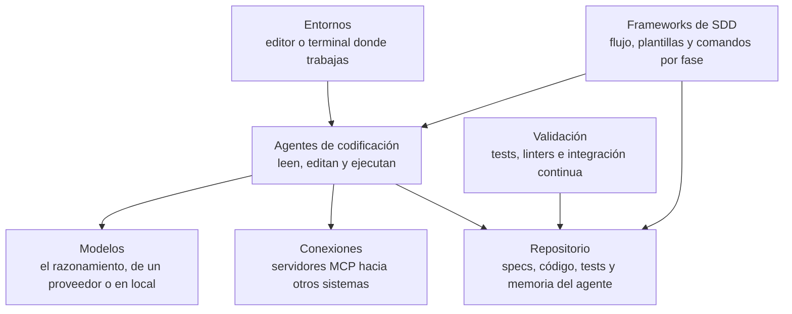
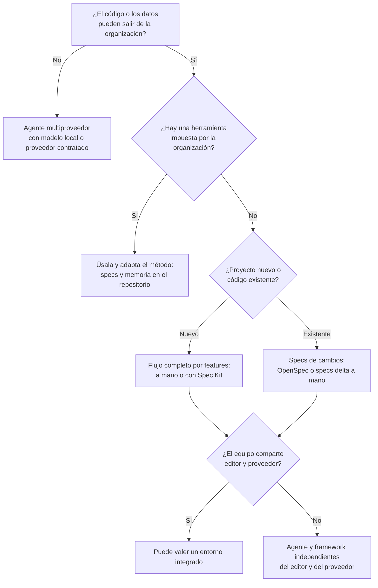

# 4. El ecosistema de herramientas

[⬅️ Volver a la unidad](./README.md)

## Índice

- [4.1. Un ecosistema que cambia deprisa](#41-un-ecosistema-que-cambia-deprisa)
  - [4.1.1. Por qué no hay una lista definitiva](#411-por-qué-no-hay-una-lista-definitiva)
  - [4.1.2. Cómo estudiar una herramienta nueva](#412-cómo-estudiar-una-herramienta-nueva)
- [4.2. El mapa: seis papeles](#42-el-mapa-seis-papeles)
- [4.3. Frameworks de SDD](#43-frameworks-de-sdd)
  - [4.3.1. Spec Kit](#431-spec-kit)
  - [4.3.2. OpenSpec](#432-openspec)
  - [4.3.3. Conductor](#433-conductor)
  - [4.3.4. Kiro](#434-kiro)
  - [4.3.5. Los cuatro, comparados](#435-los-cuatro-comparados)
- [4.4. Agentes de codificación](#44-agentes-de-codificación)
  - [4.4.1. Qué los distingue](#441-qué-los-distingue)
  - [4.4.2. Los mismos conceptos con otros nombres](#442-los-mismos-conceptos-con-otros-nombres)
  - [4.4.3. Agentes que trabajan solos en la nube](#443-agentes-que-trabajan-solos-en-la-nube)
- [4.5. Modelos y proveedores](#45-modelos-y-proveedores)
- [4.6. El eje que divide el ecosistema](#46-el-eje-que-divide-el-ecosistema)
- [4.7. Cómo elegir](#47-cómo-elegir)
  - [4.7.1. Las preguntas](#471-las-preguntas)
  - [4.7.2. Una matriz de decisión](#472-una-matriz-de-decisión)
- [4.8. Combinaciones que funcionan](#48-combinaciones-que-funcionan)
  - [4.8.1. Combinar sin perder el método](#481-combinar-sin-perder-el-método)
  - [4.8.2. Lo que se lleva al cambiar de herramienta](#482-lo-que-se-lleva-al-cambiar-de-herramienta)
- [4.9. Lo que no resuelve ninguna herramienta](#49-lo-que-no-resuelve-ninguna-herramienta)
- [4.10. Errores típicos](#410-errores-típicos)
- [4.11. Ejemplo integrador: elegir las herramientas de la lista de tareas](#411-ejemplo-integrador-elegir-las-herramientas-de-la-lista-de-tareas)
- [Resumen](#resumen)
- [Ejercicios de reflexión](#ejercicios-de-reflexión)

> **Criterios que trabaja este tema:** OA3 e.

---

## 4.1. Un ecosistema que cambia deprisa

### 4.1.1. Por qué no hay una lista definitiva

Las herramientas para programar con agentes aparecen, cambian de nombre, se fusionan y cambian de rumbo en cuestión de meses. Un ejemplo de este mismo curso: los comandos de Spec Kit que se citaban en la UD2 han cambiado de forma desde entonces, y Conductor, que nació como extensión de Gemini CLI, se ha llevado después a otros agentes. Cualquier tabla de «la mejor herramienta» que leas tiene fecha de caducidad.

Por eso este tema no te da un ranking. Te da tres cosas que no caducan:

- Un **mapa por papeles**: qué hace cada tipo de herramienta en el flujo, para poder colocar en él cualquier herramienta nueva.
- Los **conceptos** que se repiten con nombres distintos (instrucciones del proyecto, skills, subagentes, permisos, *hooks*), para reconocerlos.
- **Criterios para elegir y combinar**, que valen para las herramientas de hoy y para las que vengan.

Las herramientas concretas que aparecen son ejemplos, con lo que dice su documentación oficial al escribir el tema. Los nombres, comandos y funciones pueden cambiar: compruébalos siempre en la documentación antes de usarlos.

> 📝 **Nota del Profesor**: en este curso has hecho el flujo **a mano**, con ficheros Markdown y OpenCode, a propósito. Si sabes qué hace cada fase y por qué, cualquier herramienta es una forma de automatizar pasos que ya conoces. Si solo sabes usar una herramienta, el día que cambie te quedas sin método.

### 4.1.2. Cómo estudiar una herramienta nueva

Ante una herramienta que no conoces, estas preguntas te dicen casi todo lo que necesitas para decidir:

| Pregunta | Por qué importa |
|----------|-----------------|
| ¿Qué **papel** cumple: agente, framework de SDD, entorno, validación, conexión? | Para saber con qué compite y con qué se combina |
| ¿Dónde guarda las **specs** y el contexto? ¿En ficheros del repositorio, en formato abierto? | Si están en el repositorio y en Markdown, sobreviven a la herramienta |
| ¿Qué **fases** del flujo cubre y con qué **artefactos**? | Para mapearla con el flujo que ya conoces (UD2) |
| ¿Con qué **modelos** funciona? ¿Uno, varios, locales? | Coste, privacidad y dependencia de un proveedor |
| ¿Qué **licencia** tiene? ¿Se puede auditar o ampliar? | Algunas organizaciones exigen código abierto |
| ¿Qué **control** te da: permisos, revisión antes de aplicar, *hooks*? | El mínimo privilegio y los gates del tema 3 dependen de ello |
| ¿Dónde **trabaja**: terminal, editor, nube? | Encaje con el equipo y con la integración continua |

Y una prueba práctica: haz con ella **una feature pequeña** de un proyecto que conozcas. En una tarde sabrás más que con diez comparativas.

---

## 4.2. El mapa: seis papeles

Las herramientas del ecosistema cumplen seis papeles. Muchas cumplen más de uno, pero pensar por papeles evita comparar cosas que no se comparan (un modelo con un editor, por ejemplo).



El diagrama tiene una pieza en el centro que no es una herramienta: el **repositorio**. Ahí viven las specs, el código, los tests y la memoria del agente. Todo lo demás lee o escribe en él. Si lo importante está en el repositorio y en formatos abiertos, puedes cambiar cualquier otra pieza.

| Papel | Qué hace | Ejemplos | En el curso |
|-------|----------|----------|-------------|
| **Modelos** | Razonan y generan texto y código | Los de Anthropic, OpenAI, Google, Mistral; modelos abiertos en local | Los que tenga cada persona, conectados a OpenCode |
| **Agentes de codificación** | Leen el repositorio, editan ficheros, ejecutan órdenes, llaman al modelo | OpenCode, Claude Code, GitHub Copilot, Gemini CLI, Codex | OpenCode |
| **Frameworks de SDD** | Añaden el flujo: plantillas, un comando por fase, estructura de carpetas | Spec Kit, OpenSpec, Conductor | A mano; OpenSpec en una práctica de la UD2 |
| **Entornos** | El sitio donde trabajas: un editor con agente o un entorno con el flujo integrado | Kiro, Cursor, Windsurf, VS Code con Copilot | Terminal y Dev Container |
| **Validación** | Comprueban el resultado | Vitest, Playwright, ESLint, GitHub Actions | Temas 2 y 3 |
| **Conexiones** | Dan al agente acceso a otros sistemas | Servidores MCP | Tema 5 |

---

## 4.3. Frameworks de SDD

Un **framework de SDD** añade a un agente el flujo que en este curso has hecho a mano: plantillas para la constitución, la spec, el plan y las tasks, y un comando para cada fase. Cuatro ejemplos con enfoques distintos.

### 4.3.1. Spec Kit

**Qué es.** El kit de código abierto (licencia MIT) de GitHub para SDD. Se instala con una herramienta de línea de órdenes en Python y prepara el proyecto para el agente que elijas, con plantillas y comandos.

**Cómo encaja con el curso.** Es la herramienta de la que salen varias ideas que ya usas: la **constitución**, el marcador de dudas (`[NEEDS CLARIFICATION]`, que en el curso es `[NECESITA ACLARACIÓN]`), la **comprobación de la constitución** en el plan y el marcador `[P]` de las tasks. Sus comandos siguen las fases: principios del proyecto, especificar, planificar, descomponer en tasks e implementar. Además, tiene **extensiones** y ***presets*** para añadir comandos y comprobaciones o adaptar las plantillas a un equipo.

**Cuándo encaja.** Proyectos nuevos, equipos que quieren un flujo completo y uniforme sin depender de un agente concreto, y quien quiere ver cómo es una implementación de referencia de SDD.

**Lo que hay que vigilar.** Genera mucho texto para una feature pequeña, y su CLI necesita Python. Como cualquier framework, puede producir specs y planes larguísimos que nadie lee: el punto de control sigue siendo tuyo.

### 4.3.2. OpenSpec

**Qué es.** Un framework de SDD de código abierto (licencia MIT) que se instala con npm y se integra con muchos agentes, OpenCode incluido. Su idea central es distinta de la de Spec Kit: separa las **specs vigentes** (cómo es el sistema ahora) de los **cambios** en curso.

```text
openspec/
├── specs/                       ← cómo es el sistema ahora
│   └── tareas/spec.md
└── changes/
    ├── limite-500/              ← un cambio en curso
    │   ├── proposal.md          ← por qué y qué cambia
    │   ├── design.md
    │   ├── tasks.md
    │   └── specs/tareas/spec.md ← solo lo que cambia (delta)
    └── archive/                 ← cambios terminados, con su fecha
```

**Un cambio, de cerca.** Recuerda el «arreglo de cinco minutos» del tema 1: subir el límite del texto a 500 caracteres. Con OpenSpec, ese cambio se **propone** con un comando del agente, que crea la carpeta del cambio. La spec del cambio no repite toda la spec, solo la **diferencia** (*delta*), en secciones para lo añadido, lo modificado y lo eliminado:

```markdown
# Delta para tareas

## MODIFIED Requirements

### Requirement: Longitud del texto
El sistema SHALL rechazar el texto de una tarea que, sin los espacios de
los extremos, supere los 500 caracteres. (Antes: 280)

#### Scenario: Texto de 501 caracteres
- WHEN se envía una tarea con 501 caracteres
- THEN la respuesta tiene el código 400
- AND el cuerpo es { error: "El texto no puede superar 500 caracteres" }
```

Las palabras clave (*SHALL*, *MUST*) y los escenarios con *WHEN* y *THEN* cumplen el papel de EARS y Gherkin en el curso. Cuando el cambio está implementado, se **archiva**: OpenSpec aplica la diferencia a la spec vigente (lo modificado sustituye a lo anterior) y mueve el cambio a `archive/` con su fecha. La spec vigente vuelve a decir la verdad, y el porqué del cambio queda guardado.

**Cuándo encaja.** Proyectos con código existente, donde casi todo el trabajo son **cambios** sobre comportamientos que ya funcionan. Es justo el caso del *drift* por cambios que no llegan a la spec: OpenSpec obliga a que el cambio pase por la spec.

**Lo que hay que vigilar.** Sus specs se organizan por **capacidades** del sistema, no por features como en el curso; adoptarlo en un proyecto que ya tiene `docs/specs/` exige decidir cómo convivirán las dos formas.

### 4.3.3. Conductor

**Qué es.** Un complemento de código abierto (licencia Apache 2.0) que Google publicó para Gemini CLI y que se ha llevado después a otros agentes. Lo presentan como ***context-driven development***: primero el contexto del proyecto, después una spec y un plan por cada unidad de trabajo, y después la implementación.

**Cómo encaja con el curso.** Su preparación inicial genera los ficheros de contexto (producto, guías, tecnología, flujo de trabajo, estilo del código): lo que en el curso son el PRD, la constitución y `AGENTS.md`. Cada feature o corrección es un ***track*** con su `spec.md` y su `plan.md`, con las tareas dentro del plan. Tiene comandos para ver el estado, **revisar** lo hecho contra el plan y **deshacer** una tarea, una fase o un *track* entero con el historial de Git.

**Cuándo encaja.** Equipos que quieren un flujo ligero, con el contexto del proyecto muy cuidado y la posibilidad de deshacer con seguridad.

### 4.3.4. Kiro

**Qué es.** Un entorno de desarrollo de AWS con el flujo de SDD integrado. No es un complemento: es el propio editor (también tiene una versión de terminal). Cada feature tiene `requirements.md` (con criterios de aceptación en EARS, UD1), `design.md` y `tasks.md`, y el contexto del proyecto va en sus ficheros de ***steering***.

**Lo que aporta.** Además del flujo, reúne casi todo lo de esta unidad en un solo sitio: ***hooks*** que lanzan acciones del agente al guardar un fichero o al terminar una tarea (gates locales, tema 3), specs para **corregir errores** con pruebas que demuestran el fallo y vigilan que no vuelva (tema 1), pruebas basadas en propiedades sacadas de los requisitos (tema 2), subagentes, permisos y conexiones MCP (tema 5).

**Lo que hay que vigilar.** Es un producto propietario de un proveedor, con sus modelos y sus condiciones. Sus plantillas no tienen licencia abierta: se pueden estudiar, no copiar. Y adoptarlo significa cambiar de editor a todo el equipo.

### 4.3.5. Los cuatro, comparados

| | Spec Kit | OpenSpec | Conductor | Kiro |
|---|---|---|---|---|
| **Tipo** | Kit para cualquier agente | Framework para cualquier agente | Complemento de varios agentes | Entorno completo |
| **Licencia** | Abierta (MIT) | Abierta (MIT) | Abierta (Apache 2.0) | Propietaria |
| **Unidad de trabajo** | Feature | Cambio sobre capacidades | *Track* | Feature (spec) |
| **Documentos** | Constitución, spec, plan, tasks | Specs vigentes y, por cambio, propuesta, diseño, tasks y delta | Contexto; por *track*, spec y plan con tareas | *Steering*; por spec, requisitos, diseño y tasks |
| **Mejor en** | Proyectos nuevos, flujo completo | Código existente, cambios | Flujo ligero con mucho contexto | Todo integrado en el editor |
| **Se instala con** | Python | npm | El gestor de complementos del agente | Instalador propio |

Fíjate en la fila de documentos: **los cuatro separan el contexto del proyecto, la spec y el plan en Markdown dentro del repositorio**. Es lo que hiciste a mano en la UD1 y la UD2. Cambian los nombres; el método es el mismo.

> 💡 **Tip del Examinador**: «¿Qué diferencia a OpenSpec de Spec Kit?». Spec Kit organiza el trabajo por features y genera, para cada una, spec, plan y tasks; encaja mejor en proyectos nuevos. OpenSpec separa las specs vigentes del sistema de los cambios en curso, que se escriben como diferencias (lo añadido, lo modificado y lo eliminado) y se aplican a la spec vigente al archivar el cambio; encaja mejor en código existente.

---

## 4.4. Agentes de codificación

### 4.4.1. Qué los distingue

Todos los agentes hacen lo mismo en lo básico: leen el repositorio, proponen y aplican cambios, ejecutan órdenes y llaman a un modelo. Se distinguen en cinco cosas:

| Característica | Opciones | Ejemplos |
|----------------|----------|----------|
| **Dónde trabaja** | Terminal, editor, nube (o varias) | OpenCode, Claude Code, Gemini CLI y Codex nacieron en la terminal; Cursor y Windsurf son editores; GitHub Copilot vive en el editor y en GitHub |
| **Modelos** | De un proveedor o de muchos, también locales | Claude Code usa modelos de Anthropic; OpenCode, Cursor y Copilot permiten elegir entre varios proveedores |
| **Licencia** | Abierta o propietaria | OpenCode, Gemini CLI y Codex CLI son de código abierto; Claude Code, Cursor y Copilot, no |
| **Instrucciones del proyecto** | `AGENTS.md` o un fichero propio | OpenCode y muchos otros leen `AGENTS.md`; Claude Code usa `CLAUDE.md` (que puede importar `AGENTS.md`); Gemini CLI, `GEMINI.md` |
| **Control** | Permisos, modo de solo planificar, revisión antes de aplicar, *hooks* | Todos tienen alguna forma; cambian el detalle y lo fino que se puede ajustar |

Para SDD, la segunda y la cuarta fila son las que más importan a largo plazo. Un agente que solo funciona con un proveedor te ata a sus precios y a sus condiciones. Y un agente que lee instrucciones en un formato abierto hace que tu memoria del proyecto sirva también para el siguiente.

### 4.4.2. Los mismos conceptos con otros nombres

En la UD2 y en esta unidad has configurado a OpenCode con varias piezas. Casi todos los agentes tienen las mismas, con otros nombres:

| Concepto | En OpenCode (el curso) | En otros agentes |
|----------|------------------------|------------------|
| Instrucciones del proyecto | `AGENTS.md`, `instructions` en `opencode.json` | `CLAUDE.md`, `GEMINI.md`, instrucciones del repositorio de Copilot, reglas de Cursor, *steering* de Kiro |
| Instrucciones por carpeta | `AGENTS.md` en la carpeta | `CLAUDE.md` de carpeta, instrucciones con `applyTo` en Copilot, reglas con `globs` en Cursor |
| Procedimientos | Skills (formato Agent Skills) | El mismo formato abierto en Claude Code, Copilot y otros |
| Prompts reutilizables | Comandos en `.opencode/commands/` | *Slash commands*, *prompt files* |
| Agentes especializados | Agentes y subagentes en `.opencode/agents/` | Subagentes, *custom agents* |
| Planificar sin tocar nada | Agente *plan* | *Plan mode* |
| Mínimo privilegio | `permissions` (`allow`, `ask`, `deny`) | Permisos por herramienta y por orden |
| Acciones automáticas en ciertos momentos | *Plugins* | *Hooks* |
| Sistemas externos | Servidores MCP (tema 5) | Servidores MCP: es un estándar abierto |

Esta tabla es la razón por la que el curso usa una herramienta y no cinco: lo que aprendes en una se traslada. Cuando llegues a un equipo que usa otro agente, la pregunta no es «¿cómo se usa?», sino «¿cómo se llama aquí el subagente revisor?».

> ✅ **Buena práctica**: guarda la memoria del agente en **formatos abiertos** siempre que puedas: `AGENTS.md` para las instrucciones, Agent Skills para los procedimientos, Markdown para las specs. Lo que esté en un formato propio de la herramienta (comandos, permisos, agentes) tendrás que traducirlo si cambias.

### 4.4.3. Agentes que trabajan solos en la nube

Varios agentes pueden trabajar **sin ti delante**: les das una tarea (desde una incidencia de GitHub, desde la web, desde la terminal) y trabajan en una máquina en la nube hasta abrir una pull request. Es el caso de GitHub Copilot en la nube, de las versiones en la nube de otros agentes o del modo autónomo de Kiro.

Para SDD, esto cambia una cosa importante: **no hay puntos de control intermedios**. Nadie revisa el plan ni los ciclos; llega todo junto en la pull request. Por eso, con un agente en la nube:

- La spec, el plan y las tasks tienen que estar **aprobados antes** de encargar el trabajo, y el encargo tiene que citarlos.
- Los **tests**, escritos y revisados antes (tema 2), son lo único que el agente tiene para saber si ha terminado.
- Los ***quality gates*** de la integración continua (tema 3) son la primera revisión, y la pull request, la segunda. Sin ellos, cada pull request es una caja cerrada.

> ⚠️ **Cuidado**: un agente en la nube con una tarea vaga es el *vibe coding* de la UD1 con más autonomía. Cuanto menos supervisas el proceso, más tiene que estar decidido por escrito antes de empezar.

---

## 4.5. Modelos y proveedores

El **agente no es el modelo** (UD1, tema 3): es su **arnés (*harness*)**. OpenCode, Claude Code o Copilot son programas que organizan el trabajo; el razonamiento lo pone un modelo de lenguaje al que llaman por una API. Esto tiene tres consecuencias para elegir:

**Atado o multiproveedor.** Algunos agentes funcionan con los modelos de un solo proveedor; otros, como OpenCode, con muchos. Un agente multiproveedor te deja cambiar de modelo sin cambiar de herramienta, comparar varios con la misma spec o usar uno potente para implementar y otro más barato para documentar (UD2, tema 6).

**La misma spec no da lo mismo con dos modelos.** Una spec bien escrita reduce las diferencias, pero no las elimina: un modelo puede seguir mejor las instrucciones largas, otro equivocarse más con los límites. Los tests desde la spec (tema 2) son la forma de comprobar el resultado sea cual sea el modelo.

**Privacidad.** El código, las specs y lo que lee el agente se envían al proveedor del modelo. Si el código es confidencial, hay que revisar las condiciones del proveedor o usar **modelos locales**, que se ejecutan en tu equipo o en un servidor de la organización. Existen también **pasarelas** que dan acceso a modelos de muchos proveedores con una sola clave; en el curso no se usan porque añaden un intermediario más por el que pasa el código, y se conecta cada agente **directamente** a su proveedor.

| Situación | Qué tipo de modelo |
|-----------|--------------------|
| Planificar e implementar una feature con lógica delicada | Un modelo potente |
| Documentar, resumir, revisar el estilo | Un modelo más barato |
| Código que no puede salir de la organización | Un modelo local o un proveedor con un contrato que lo permita |
| Comparar si una spec es lo bastante clara | Dos modelos distintos con la misma spec |

---

## 4.6. El eje que divide el ecosistema

Más allá de las funciones, hay una decisión de fondo que separa las herramientas en dos estilos:

| | Velocidad y flexibilidad | Estructura y control |
|---|---|---|
| **La spec es…** | Una guía informal, a veces solo el prompt | Un contrato aprobado, con su flujo |
| **El agente…** | Itera rápido, con la persona al lado | Trabaja dentro de límites escritos |
| **Se prioriza** | Probar ideas deprisa | Trazabilidad y calidad repetible |
| **Herramientas típicas** | Un agente en el editor sin framework | Spec Kit, OpenSpec, Kiro con sus specs |

Es el espectro de la UD1, del *vibe coding* al SDD, visto desde las herramientas. Y la conclusión es la misma: **no hay que elegir un bando**. Un prototipo para ver si una idea funciona no necesita constitución ni plan; la feature que va a usar todo el equipo durante años, sí. La misma persona, con las mismas herramientas, puede trabajar en los dos extremos según lo que tenga entre manos.

Los tres niveles de SDD de la UD1 también se reflejan aquí. Casi todas las herramientas trabajan en ***spec-first*** (la spec guía la implementación) o ***spec-anchored*** (la spec se mantiene al día con el código). El ***spec-as-source*** (el código se regenera siempre desde la spec) ha tenido herramientas que lo han explorado, como Tessl, que el artículo de Birgitta Böckeler enlazado en la portada analiza; pero las herramientas de ese nivel cambian de rumbo deprisa, y el código sigue siendo, en la práctica, algo que las personas leen y mantienen.

---

## 4.7. Cómo elegir

### 4.7.1. Las preguntas

No hay una herramienta mejor, sino una más adecuada para **un proyecto y un equipo**. Estas preguntas, en este orden, descartan la mayoría de opciones:



El diagrama empieza por las **restricciones**, que no se negocian (privacidad, herramientas impuestas), y termina por las **preferencias**. Fíjate en que todas las ramas acaban con las specs y la memoria del agente en el repositorio: es lo único que no depende de la herramienta.

Algunas preguntas más que matizan la elección:

- **¿Qué sabe ya el equipo?** Si nunca ha hecho SDD, mejor empezar a mano o con el framework más ligero, para aprender el método antes que la herramienta.
- **¿El trabajo es sobre todo de features nuevas o de cambios?** Lo primero encaja con features (Spec Kit, el curso); lo segundo, con specs de cambios (OpenSpec).
- **¿Hay que trabajar con varios agentes o varias personas a la vez?** Lo verás en la UD4.
- **¿Cuánto cuesta?** Licencias, consumo de modelos y tiempo de aprendizaje. Compruébalo siempre en las condiciones vigentes de cada herramienta, que cambian a menudo.

### 4.7.2. Una matriz de decisión

Cuando hay dos o tres candidatas, una **matriz de decisión** hace explícito por qué se elige una. Se ponen los criterios, cada uno con un **peso** según lo que importa en ese proyecto, y se puntúa cada opción:

| Criterio | Peso | Opción 1 | Opción 2 |
|----------|------|----------|----------|
| Criterio que más importa | 3 | 2 → 6 | 1 → 3 |
| Criterio importante | 2 | … | … |
| Criterio deseable | 1 | … | … |
| **Total** | | **…** | **…** |

La matriz no decide sola: sirve para **discutir** los pesos (¿de verdad importa más la velocidad que la privacidad?) y para que la decisión quede escrita con su motivo. Lo verás en el ejemplo integrador.

> 💡 **Tip del Examinador**: «Una empresa con código confidencial quiere adoptar SDD con agentes. ¿Qué tendrías en cuenta para elegir herramientas?». Primero la restricción: el código no puede ir a cualquier proveedor, así que hace falta un agente que admita modelos locales o un proveedor con un contrato que lo permita. Después, si el trabajo es sobre código existente, un método de specs de cambios (como OpenSpec). Y en cualquier caso, las specs y la memoria del agente en el repositorio y en formatos abiertos, para no depender de la herramienta.

---

## 4.8. Combinaciones que funcionan

### 4.8.1. Combinar sin perder el método

Las herramientas no se excluyen: cada una cubre un papel del mapa. Algunas combinaciones habituales:

| Combinación | Qué aporta cada pieza | Cuándo |
|-------------|-----------------------|--------|
| **Método a mano + un agente multiproveedor** (el curso) | El método, sin framework; el agente, con permisos y comandos propios | Aprender SDD; proyectos pequeños; equipos que quieren control total |
| **Spec Kit + el agente del equipo** | Spec Kit pone el flujo y las plantillas; el agente, la ejecución | Proyectos nuevos con un flujo uniforme |
| **OpenSpec + el agente del equipo** | OpenSpec gestiona los cambios sobre lo que existe | Código existente, mantenimiento |
| **Kiro para especificar + otro agente para implementar** | Kiro ayuda con los requisitos y el diseño; otro agente implementa con más control | Cuando el equipo quiere la ayuda de Kiro en la spec sin cambiar de agente |
| **Un agente en el editor + otro en la terminal** | El del editor para cambios pequeños con la persona al lado; el de terminal para ciclos completos | Equipos que mezclan los dos estilos |
| **Cualquiera de las anteriores + integración continua** | Los *quality gates* del tema 3, independientes de la herramienta | Siempre |

La última fila no es opcional. Los gates de la integración continua son lo único que funciona **igual** sea cual sea la herramienta, la persona o el agente que hizo el cambio.

### 4.8.2. Lo que se lleva al cambiar de herramienta

Imagina que el equipo de la lista de tareas decide pasar de OpenCode a otro agente. ¿Qué se pierde?

| Fichero | ¿Sirve en otro agente? |
|---------|------------------------|
| `docs/specs/` (specs, planes, tasks e índice) | ✅ Markdown en el repositorio |
| `constitution.md`, `docs/prd.md` | ✅ Markdown |
| `AGENTS.md` y `tests/AGENTS.md` | ✅ Formato abierto; si el agente usa otro nombre, se importa o se copia |
| `.opencode/skills/tests-desde-spec/` | ✅ Formato Agent Skills; cambia la carpeta |
| Tests, `eslint.config.js`, `playwright.config.js` | ✅ No dependen del agente |
| `.github/workflows/calidad.yml` y `herramientas/` | ✅ No dependen del agente |
| `.opencode/commands/` | ⚠️ Hay que traducirlos al formato de comandos del otro agente; el texto del prompt sirve |
| `.opencode/agents/` (revisor, implementador, documentador) | ⚠️ Hay que traducir el formato y, sobre todo, **los permisos**, que cada agente expresa a su manera |
| `opencode.json` | ❌ Propio de OpenCode |

Casi todo lo que importa sobrevive, porque está en el repositorio y en formatos abiertos. Lo que hay que rehacer son las **piezas de configuración** del agente, y entre ellas la más delicada son los permisos: un `implementador` traducido sin cuidado puede volver a poder editar los tests.

Dicho con las palabras del tema 3: al cambiar de agente cambias la parte del **arnés (*harness*)** que trae la herramienta, y te llevas casi entera la que pone el proyecto, las guías y los controles. Por eso conviene que esa parte esté en el repositorio y en formatos abiertos: es la que más trabajo cuesta construir.

> ⚠️ **Cuidado**: al cambiar de agente, vuelve a comprobar los permisos con las herramientas del agente nuevo (como hiciste con `opencode debug agents`). Una regla de mínimo privilegio que no se traduce bien no da error: simplemente deja de proteger.

---

## 4.9. Lo que no resuelve ninguna herramienta

Conocer los huecos del ecosistema es tan útil como conocer las herramientas:

- **Saber si una spec es buena.** Las herramientas ayudan a encontrar ambigüedades y huecos, pero ninguna dice si la spec describe lo que el usuario necesita. Ese juicio es tuyo (tema 1).
- **Mantener las specs al día solas.** Algunas herramientas prometen specs «vivas» que se actualizan con el código. En la práctica, que la spec diga la verdad sigue dependiendo de que los cambios pasen por ella (tema 1 y OpenSpec).
- **Que los tests comprueben la spec.** Todas pueden generar tests; ninguna puede revisarlos por ti (tema 2).
- **Features que cruzan varios repositorios.** Casi todas suponen un solo repositorio. Coordinar una feature entre varios servicios sigue siendo trabajo manual (UD4).
- **El código existente sin specs.** Escribir la spec de lo que ya hace un sistema antiguo es lento, y ninguna herramienta lo automatiza del todo (UD4).
- **La portabilidad entre modelos.** Una spec puede funcionar muy bien con un modelo y peor con otro.
- **La responsabilidad.** El código que llega a `main` es del equipo, lo haya escrito quien lo haya escrito.

> 📝 **Nota del Profesor**: fíjate en que casi todos los huecos de la lista son los que este curso ha trabajado a mano: specs revisadas, tests desde la spec, gates, decisiones escritas. Las herramientas automatizan la parte mecánica del método; el juicio que el método exige no lo automatiza ninguna.

---

## 4.10. Errores típicos

| Error | Consecuencia | Cómo evitarlo |
|-------|--------------|---------------|
| Elegir herramienta antes de tener método | El equipo aprende la herramienta, no SDD; si cambia, no queda nada | Primero el flujo a mano, después la herramienta que lo automatiza |
| Comparar piezas de papeles distintos | «¿Kiro o Claude?» mezcla un entorno con un modelo | Colocar cada herramienta en el mapa antes de compararla |
| Guardar las specs fuera del repositorio | Se pierden al cambiar de herramienta y el agente no las ve en el historial | Specs en Markdown en el repositorio |
| Decidir por una comparativa de internet | Datos de otro proyecto y quizá caducados | Una prueba con una feature propia y una matriz con criterios del proyecto |
| Ignorar las restricciones (privacidad, herramienta impuesta) | Una elección que luego no se puede usar | Las restricciones primero (apartado 4.7.1) |
| Adoptar un framework y aceptar todo lo que genera | Specs y planes enormes que nadie lee | Los puntos de control siguen siendo tuyos |
| Cambiar de agente y copiar la configuración sin revisar los permisos | El mínimo privilegio deja de funcionar sin avisar | Comprobar los permisos con las herramientas del agente nuevo |
| Confiar en los *hooks* del editor como único gate | Cada persona los tiene configurados de una forma, o desactivados | La integración continua como gate común |

---

## 4.11. Ejemplo integrador: elegir las herramientas de la lista de tareas

La lista de tareas tiene dos features en `main`, los gates del tema 3 y la memoria del agente para OpenCode. El equipo crece: llegan dos personas que usan otro agente en su editor, y a partir de la feature C habrá muchos **cambios** sobre lo que ya existe (el límite del texto, los mensajes de error, el orden de la lista). Al replanificar después de fusionar B, te toca decidir si cambiar de herramientas.

**1. Las restricciones.** Las escribes antes que nada:

- El proyecto no tiene código confidencial: puede ir a cualquier proveedor.
- No hay herramienta impuesta, pero el centro tiene cuentas de dos proveedores de modelos y algunas personas prefieren un editor con agente.
- Todo lo que hay en `main` (specs, memoria, gates) tiene que seguir sirviendo.

**2. Las candidatas.** Con el apartado 4.7.1, te quedan tres opciones realistas:

| Opción | Descripción |
|--------|-------------|
| **A. Seguir igual** | Método a mano, OpenCode para todos |
| **B. Método a mano + OpenSpec para los cambios** | Las features nuevas, como hasta ahora; los cambios sobre lo que existe, con OpenSpec. Cada persona, con el agente que prefiera |
| **C. Spec Kit para todo** | Migrar las specs al formato de Spec Kit y usar sus comandos |

**3. La matriz.** Pones los criterios y sus pesos, y lo discutes con el equipo. El peso más alto es para lo que más se va a repetir a partir de ahora (los cambios) y para no perder lo que ya funciona:

| Criterio | Peso | A | B | C |
|----------|------|---|---|---|
| Cambios sobre comportamientos que ya existen | 3 | 1 → 3 | 3 → 9 | 1 → 3 |
| Conserva specs, memoria y gates de `main` | 3 | 3 → 9 | 3 → 9 | 1 → 3 |
| Cada persona puede usar su agente | 2 | 1 → 2 | 3 → 6 | 3 → 6 |
| Coste de aprenderlo | 2 | 3 → 6 | 2 → 4 | 1 → 2 |
| Herramientas de código abierto | 1 | 3 → 3 | 3 → 3 | 3 → 3 |
| **Total** | | **23** | **31** | **17** |

(Puntuación de 1 a 3; el número tras la flecha es puntuación × peso.)

La opción C pierde por lo que ya tienes: migrar todas las specs a otro formato es mucho trabajo y no aporta nada a los cambios. La A es la más barata, pero no resuelve el problema que viene. La B gana porque añade una herramienta **solo donde aporta**.

**4. Lo que implica la opción B.** Antes de decidir del todo, compruebas qué hay que cambiar, con la tabla del apartado 4.8.2:

- **Las personas que usan otro agente** leen el mismo `AGENTS.md` y la misma skill (formatos abiertos). Hay que traducir a su agente el `revisor` y el `implementador`, con sus permisos, y comprobarlos con las herramientas de ese agente. Hasta que estén comprobados, los tests y la validación de sus features las hacen con OpenCode.
- **OpenSpec** se instala en el Dev Container (con npm) y su carpeta `openspec/` convive con `docs/specs/`. Hay que decidir la regla: las features nuevas siguen en `docs/specs/`; los cambios sobre una feature implementada, en `openspec/changes/`, y al archivar el cambio se actualiza también la spec de la feature en `docs/specs/`.
- **Los gates** no cambian: la integración continua comprueba lo mismo, venga el cambio de donde venga. Habrá que ampliar el gate de spec existente para que acepte también un cambio de `openspec/changes/` como documentación.

**5. Una prueba piloto.** Antes de escribir la decisión, la pruebas con un cambio pequeño: el límite del texto a 500 caracteres, que alguien del equipo pidió en el tema 1. En una rama, propones el cambio con OpenSpec, revisas la propuesta y la delta (como la del apartado 4.3.2), la implementas con los tests primero y la archivas. La integración continua, en verde. La prueba responde a la pregunta que la matriz no podía responder: si al equipo le resulta cómodo.

**6. La decisión, escrita.** Las herramientas son una decisión del proyecto, así que van a la constitución, con su motivo:

```markdown
## Herramientas

- Features nuevas: flujo del proyecto a mano, en docs/specs/.
- Cambios sobre features implementadas: OpenSpec. Al archivar el cambio
  se actualiza la spec de la feature en docs/specs/.
- Agente: cada persona puede usar el suyo si lee AGENTS.md y tiene un
  revisor y un implementador con los permisos de .opencode/agents/,
  comprobados.
- Motivo: a partir de la feature C, la mayoría del trabajo son cambios
  sobre lo que ya existe; se conserva todo lo que hay en main.
```

```bash
git commit -am "Constitución: herramientas del proyecto"
```

> 📝 **Nota del Profesor**: fíjate en lo que **no** ha cambiado en la decisión: las specs, la memoria del agente en formatos abiertos, los tests y los gates. Por eso la decisión ha sido barata. Un proyecto que lo tuviera todo dentro de una herramienta habría tenido que elegir entre quedarse como estaba o empezar de nuevo.

---

## Resumen

- El ecosistema cambia deprisa: se estudia por **papeles** (modelos, agentes, frameworks de SDD, entornos, validación y conexiones) y con **preguntas** que valen para cualquier herramienta nueva. Lo que no cambia es el **repositorio**, donde viven specs, código, tests y memoria.
- Los **frameworks de SDD** automatizan el flujo del curso: **Spec Kit** (flujo completo por features, proyectos nuevos), **OpenSpec** (specs vigentes y cambios como diferencias, código existente), **Conductor** (contexto, *tracks* con spec y plan, deshacer con Git) y **Kiro** (un entorno con specs, *steering*, *hooks* y más). Los cuatro guardan contexto, spec y plan en Markdown.
- Los **agentes** se distinguen por dónde trabajan, qué modelos admiten, su licencia, cómo leen las instrucciones y el control que dan. Los conceptos (instrucciones, skills, comandos, subagentes, permisos, *hooks*, MCP) son los mismos con otros nombres.
- Los **agentes en la nube** no tienen puntos de control intermedios: specs, tests y gates tienen que estar listos antes.
- El **agente no es el modelo**: multiproveedor o atado, la misma spec con modelos distintos y la **privacidad** (modelos locales). En el curso, conexión directa al proveedor.
- Se elige empezando por las **restricciones**, con una **matriz de decisión** con pesos y una **prueba** con una feature propia; se combinan herramientas por papeles, siempre con la **integración continua** como gate común.
- Al cambiar de herramienta sobrevive lo que está en **formatos abiertos**; hay que rehacer la configuración del agente, sobre todo los **permisos**.
- Ninguna herramienta decide si una spec es buena, revisa los tests por ti ni asume la responsabilidad del código.

## Ejercicios de reflexión

1. Coloca en el mapa del apartado 4.2 tres herramientas que uses o conozcas (de este curso o de otros módulos). ¿Alguna cumple más de un papel?
2. Elige una herramienta de la que no se hable en el tema y respóndele las preguntas del apartado 4.1.2 con su documentación oficial. Indica la fecha de consulta.
3. Escribe con OpenSpec (formato del apartado 4.3.2) la delta de un cambio en la feature B: la lista se muestra con las tareas más recientes primero.
4. Rehaz la matriz del ejemplo integrador para un centro que exige que el código no salga de sus servidores. ¿Qué criterios cambian? ¿Qué opción gana?
5. Traduce el agente `revisor` del tema 1 al formato de subagentes de otro agente que elijas, con sus permisos, usando su documentación. ¿Qué permiso no has podido expresar igual?
6. Busca la lista de agentes compatibles con Spec Kit y con OpenSpec en su documentación. ¿Cuáles aparecen en las dos? Indica la fecha de consulta.

---

[⬅️ Volver a la unidad](./README.md)
