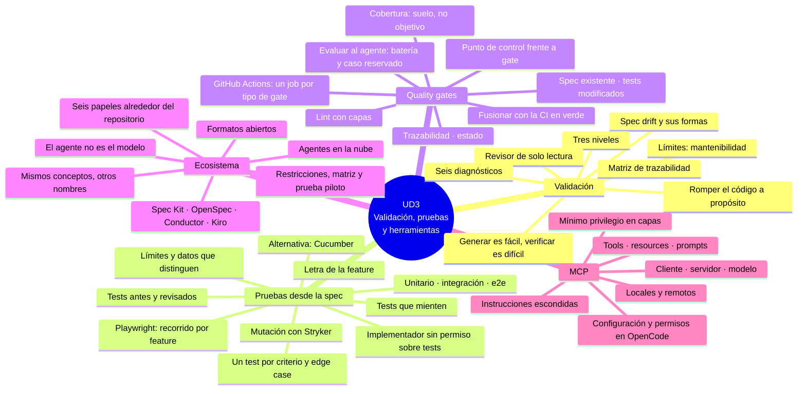
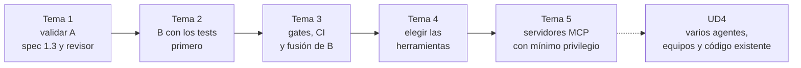

# 6. Resumen y mapa mental

[⬅️ Volver a la unidad](./README.md)

## Índice

- [Resumen ejecutivo](#resumen-ejecutivo)
- [Mapa mental](#mapa-mental)
- [El proyecto al terminar la unidad](#el-proyecto-al-terminar-la-unidad)
- [Checklist de evaluación](#checklist-de-evaluación)
  - [Validación y *spec drift* (criterio a)](#validación-y-spec-drift-criterio-a)
  - [Pruebas desde la spec (criterio b)](#pruebas-desde-la-spec-criterio-b)
  - [*Quality gates* e integración continua (criterio c)](#quality-gates-e-integración-continua-criterio-c)
  - [Evaluar al agente (criterio g)](#evaluar-al-agente-criterio-g)
  - [Diagnosticar un fallo (criterio d)](#diagnosticar-un-fallo-criterio-d)
  - [El ecosistema de herramientas (criterio e)](#el-ecosistema-de-herramientas-criterio-e)
  - [MCP con mínimo privilegio (criterio f)](#mcp-con-mínimo-privilegio-criterio-f)

> **Criterios que trabaja este tema:** OA3 a, b, c, d, e, f, g.

---

## Resumen ejecutivo

En esta unidad has pasado de **generar** código con un agente a **comprobar** que cumple lo aprobado, de forma que esa comprobación no dependa de la memoria ni de la buena voluntad de nadie:

1. **Validación y *spec drift***: con un agente, validar es más necesario (no es determinista, su código parece correcto, se revisa a sí mismo y genera más de lo que se puede leer con atención). El *spec drift* separa poco a poco la spec del código y se realimenta, porque el agente se cree la spec. Tres niveles de validación: la spec (comprobable), el código frente a la spec (matriz de trazabilidad, leer las aserciones, romper el código a propósito) y la arquitectura (constitución). Un subagente **revisor** de solo lectura revisa en un contexto limpio, y sus hallazgos se reproducen y se aceptan o rechazan. Para **depurar**, el código es el síntoma: seis diagnósticos, cada uno corregido donde nació. Ninguna comprobación automática mide la mantenibilidad ni si la spec es la adecuada.
2. **Pruebas desde la spec**: los tests son la parte de la spec que se ejecuta. Cada criterio y cada *edge case* tiene su test, con la letra de la feature y el identificador en el nombre, los valores exactos, los límites por los dos lados y datos que distinguen. Cada uno, en su **nivel** (unitario, integración con supertest, e2e con Playwright), según dónde se ve el comportamiento. Todos los tests de la feature se escriben y se **revisan antes** que el código, en rojo por el motivo correcto y en un commit propio. Los tests hablan en el lenguaje del problema. Los tests que mienten se descubren rompiendo el código, a mano o con **pruebas de mutación** (Stryker). El agente `implementador` **no puede tocar** los tests. TDD, como técnica opcional, y la **especificación ejecutable** con Cucumber, como alternativa que el curso no adopta.
3. ***Quality gates* e integración continua**: comprobaciones objetivas que bloquean un cambio o dejan un aviso para quien revisa. Siete en el proyecto: lint con las capas de la constitución, tests con cobertura, pruebas de la página, trazabilidad, estado, spec existente y tests modificados. Cada uno es un comando que se ejecuta igual en local y en **GitHub Actions**, agrupados en cinco *jobs*, uno por tipo de gate. Las ramas se fusionan con la CI en verde; para que no se pueda fusionar en rojo, hace falta además una regla de protección de la rama. La cobertura mide código ejecutado, no comprobado: un buen suelo y un mal objetivo. Con las guías (`AGENTS.md`, constitución, specs), los controles forman el **arnés (*harness*)** del proyecto. Un cambio en el arnés (*harness*) se **evalúa**: una batería pequeña de casos fijos, cada uno repetido y puntuado por separado en resultado, límites y escalar, y un caso reservado para detectar regresiones.
4. **Diagnosticar un fallo** (en los temas 1 y 2): hueco en la spec, spec ambigua, error del plan, error de implementación, test que no comprueba lo que dice o petición nueva. Un error de implementación empieza por un test que lo reproduce; un hueco, por una versión nueva de la spec. Escribir los tests también encuentra huecos, antes del código.
5. **El ecosistema de herramientas**: se estudia por papeles (modelos, agentes, frameworks de SDD, entornos, validación y conexiones) alrededor del repositorio. Spec Kit, OpenSpec, Conductor y Kiro automatizan el mismo método. Los agentes comparten conceptos con otros nombres. Se elige por restricciones, con una matriz de decisión y una prueba piloto, y lo que está en formatos abiertos sobrevive al cambio de herramienta.
6. **MCP**: el estándar abierto que conecta el agente con sistemas externos mediante servidores que ofrecen *tools*, *resources* y *prompts*. Cada servidor amplía la superficie del agente; las instrucciones escondidas en lo que lee son el riesgo característico. **Mínimo privilegio en capas**: servidores, herramientas, agentes, credenciales, datos y acciones. La defensa fiable es que el agente no pueda hacer el daño.

---

## Mapa mental

El mapa recoge los conceptos clave de los cinco temas:



Cada rama es un tema (el criterio d, diagnosticar un fallo, se trabaja dentro de la primera); si no sabes explicar alguna de sus hojas con tus palabras, vuelve a ese tema.

---

## El proyecto al terminar la unidad

La **lista de tareas compartida** termina la unidad con las features A y B en `main`, comprobadas en cada cambio por la integración continua y con el agente conectado a tres servidores MCP:

```text
lista-tareas/
├── .devcontainer/devcontainer.json   ← temas 2 y 5: Playwright y GITHUB_TOKEN
├── .github/workflows/calidad.yml     ← tema 3: cinco jobs
├── AGENTS.md                         ← tema 3: vuelve npm run lint
├── constitution.md                   ← temas 2 a 5: Pruebas, Calidad, Herramientas, Tecnología
├── eslint.config.js                  ← tema 3: reglas de capas
├── vitest.config.js                  ← tema 3: cobertura con umbral
├── playwright.config.js              ← tema 2
├── opencode.json                     ← tema 5: servidores MCP y permisos
├── package.json                      ← scripts test, e2e, lint, cobertura, estado, trazabilidad
├── .opencode/
│   ├── agents/
│   │   ├── documentador.md
│   │   ├── implementador.md          ← temas 2 y 3: sin permiso sobre tests ni gates
│   │   └── revisor.md                ← temas 1 y 5: solo lectura, specs y navegador
│   ├── commands/
│   │   ├── documentar.md
│   │   ├── escribir-tests.md         ← tema 2
│   │   ├── implementar.md            ← tema 2: con el implementador
│   │   ├── planificar.md
│   │   └── validar.md                ← tema 1
│   └── skills/tests-desde-spec/SKILL.md
├── docs/specs/
│   ├── README.md                     ← A y B: ✅ Implementada
│   ├── A-añadir-tarea/               ← spec 1.3 (tema 1)
│   └── B-ver-lista/                  ← spec 1.1 (tema 2)
├── e2e/lista-tareas.e2e.js           ← tema 2: recorrido y errores de carga
├── herramientas/
│   ├── estado-features.sh
│   ├── comprobar-trazabilidad.sh     ← tema 3
│   ├── comprobar-spec.sh             ← tema 3
│   └── comprobar-tests-modificados.sh ← tema 3
├── mcp/servidor-specs.js             ← tema 5
├── public/                           ← la página, con la lista y los errores
├── src/                              ← rutas, controladores, servicios, repositorios
└── tests/                            ← 29 tests de Vitest, con la letra de la feature
```

Así ha ido avanzando el trabajo, tema a tema:



Y así lo cuenta el historial de `main` (`git log --oneline --first-parent`, solo esta unidad):

```text
Memoria del agente: servidores MCP con mínimo privilegio
Constitución: herramientas del proyecto
Fusiona la feature B: ver la lista de tareas
Calidad: gates de SDD e integración continua
Calidad: ESLint con las reglas de capas y cobertura con umbral
Memoria del agente: implementador y comandos de tests e implementación
Tests de A: identificadores con la letra de la feature
Constitución: pruebas de la página con Playwright y tests antes de implementar
Fusiona la feature A 1.3: añadir una tarea
Spec de la feature A 1.3: errores en la página (aprobada)
Spec de la feature A 1.3: errores en la página (en revisión)
Memoria del agente: subagente revisor y comando validar
```

Fíjate en la proporción: dos fusiones de features y diez commits de **proceso** (specs, constitución, memoria del agente, calidad). En esta unidad el producto ha crecido poco; lo que ha crecido es la capacidad de comprobar que crece bien.

La lista de tareas tiene ya todo lo que necesita un proyecto con una persona y un agente. Lo que falta es lo que aparece cuando hay **varios agentes a la vez**, un **equipo** con roles distintos o un **código existente** sin specs. Eso es la UD4.

---

## Checklist de evaluación

### Validación y *spec drift* (criterio a)

- [ ] Sé explicar por qué validar es distinto cuando el código lo escribe un agente
- [ ] Diferencio verificar (¿cumple la spec?) de validar (¿la spec describe lo que se necesita?)
- [ ] Sé qué es el *spec drift*, sus formas y por qué se realimenta con un agente
- [ ] Reconozco las señales de *drift* en el historial y en el código
- [ ] Sé validar una spec comprobando que cada identificador se puede probar
- [ ] Construyo la matriz de trazabilidad de una feature y leo las aserciones de cada test
- [ ] Busco con `comm` los identificadores sin test y compruebo que un test puede fallar rompiendo el código
- [ ] Compruebo la arquitectura frente a la constitución con búsquedas y con el linter
- [ ] Configuro un subagente revisor de solo lectura y un comando `/validar`, y compruebo sus permisos
- [ ] Reproduzco y contrasto con la spec cada hallazgo del revisor antes de aceptarlo o rechazarlo
- [ ] Conozco los límites de la validación automática, incluida la mantenibilidad

### Pruebas desde la spec (criterio b)

- [ ] Sé explicar por qué los tests se escriben desde la spec y antes que el código, y en qué se diferencia de TDD
- [ ] Traduzco un escenario de Gherkin y un *edge case* en un test con los valores exactos de la spec
- [ ] Pruebo los límites por los dos lados y elijo datos que distinguen lo correcto de lo incorrecto razonable
- [ ] Uso la letra de la feature en los identificadores de los tests y busco los que faltan por feature
- [ ] Elijo el nivel de cada test (unitario, integración o e2e) según dónde se ve el comportamiento
- [ ] Escribo un recorrido e2e con Playwright, con localizadores por papel y texto, aserciones que esperan y un `test.step` por identificador
- [ ] Simulo con `page.route` los errores del servidor difíciles de provocar y sé por qué eso ya no es e2e
- [ ] Reviso los tests antes de implementar y compruebo que fallan por el motivo correcto
- [ ] Reconozco los tests que mienten: el código como oráculo, datos que no distinguen, aserciones que no se ejecutan, débiles o incompletas
- [ ] Ejecuto pruebas de mutación con Stryker y decido qué hacer con cada mutante que sobrevive (falta un test, es equivalente, lo cubre otro nivel o es un detalle que la spec no decide)
- [ ] Escribo los tests en el lenguaje del problema, con los detalles de la interfaz en un solo módulo
- [ ] Sé explicar qué es una especificación ejecutable con Cucumber, qué hueco cierra, qué no resuelve y por qué el curso sigue con Vitest
- [ ] Configuro un agente que implementa sin poder tocar los tests ni la configuración de las pruebas, y compruebo con `git diff` que no han cambiado
- [ ] Sé qué hacer cuando un test está mal: lo corrige una persona, en un commit propio

### *Quality gates* e integración continua (criterio c)

- [ ] Diferencio un punto de control de un *quality gate* y sé qué se automatiza y qué no
- [ ] Configuro ESLint con reglas de capas que citan la constitución
- [ ] Mido la cobertura con un umbral y sé explicar qué dice y qué no dice
- [ ] Automatizo la trazabilidad, el estado, la spec existente y los tests modificados con scripts
- [ ] Amplío un workflow de GitHub Actions con un *job* por tipo de gate, `npm ci`, `fetch-depth: 0`, `!cancelled()` y permisos de solo lectura
- [ ] Sé por qué una prueba puede funcionar en mi equipo y fallar en la CI (los navegadores, por ejemplo)
- [ ] Fusiono una rama solo con la CI en verde y leo los avisos de los gates
- [ ] Ejecuto en local los mismos gates antes de subir
- [ ] Distingo las guías y los controles del arnés (*harness*) del proyecto, y convierto en control automático una guía que el agente incumple cuando tiene respuesta objetiva
- [ ] Impido que el agente cambie la configuración de los gates

### Evaluar al agente (criterio g)

- [ ] Preparo una batería pequeña de casos con estado inicial, encargo y criterio de éxito fijos, fuera del alcance del agente
- [ ] Registro cada intento (commit inicial, encargo, modelo, eventos de la sesión, intervención, diff, tests y duración)
- [ ] Puntúo por separado el resultado, los límites y la petición de ayuda, y reconozco un intento afortunado
- [ ] Repito los casos y doy los resultados como recuentos («2 de 3»), sin porcentajes
- [ ] Comparo dos configuraciones con un solo cambio y detecto una regresión con un caso reservado

### Diagnosticar un fallo (criterio d)

- [ ] Sé explicar por qué el código es el síntoma y no la causa
- [ ] Clasifico un fallo en hueco en la spec, spec ambigua, error del plan, error de implementación, test que no comprueba lo que dice o petición nueva
- [ ] Sigo las preguntas en orden: ¿lo decide la spec?, ¿lo resuelve el plan?, ¿lo cumple el código?, ¿lo comprueba un test?
- [ ] Corrijo cada caso donde nació, y empiezo un error de implementación por un test que lo reproduce
- [ ] Sé por qué nunca se cambia la spec para que diga lo que hace el código
- [ ] Encuentro huecos de la spec al escribir sus tests

### El ecosistema de herramientas (criterio e)

- [ ] Coloco cualquier herramienta en el mapa de papeles y le hago las preguntas para estudiarla
- [ ] Sé qué aportan Spec Kit, OpenSpec, Conductor y Kiro y en qué tipo de proyecto encaja cada uno
- [ ] Reconozco en otros agentes los conceptos que uso en OpenCode
- [ ] Sé qué cambia con un agente que trabaja solo en la nube
- [ ] Sé por qué el agente no es el modelo y qué implica para el coste y la privacidad
- [ ] Elijo herramientas empezando por las restricciones, con una matriz de decisión con pesos y una prueba piloto
- [ ] Sé qué se conserva y qué hay que rehacer al cambiar de herramienta
- [ ] Conozco lo que no resuelve ninguna herramienta

### MCP con mínimo privilegio (criterio f)

- [ ] Sé explicar qué es MCP, el papel del anfitrión, el cliente y el servidor, y por qué el modelo no habla con el servidor
- [ ] Diferencio *tools*, *resources* y *prompts* y sé cuáles son más delicadas
- [ ] Entiendo un servidor MCP pequeño: herramientas con esquema, recursos y validación de parámetros
- [ ] Diferencio servidores locales y remotos y sus riesgos
- [ ] Configuro servidores en OpenCode y compruebo la conexión con `opencode mcp list`
- [ ] Permito las herramientas de cada servidor solo a los agentes que las necesitan, y lo compruebo con `opencode debug agents`
- [ ] Guardo las credenciales en variables de entorno, nunca en el repositorio
- [ ] Reconozco el riesgo de las instrucciones escondidas y sé por qué la defensa son los permisos
- [ ] Aplico el mínimo privilegio en todas las capas y reviso un servidor antes de instalarlo

> 📝 **Nota del Profesor**: lo más importante de esta unidad cabe en una frase: **no basta con pedir, hay que impedir**. Pedir al agente que no cambie los tests, que respete las capas o que no siga instrucciones de una incidencia funciona casi siempre; los permisos, los gates y la separación de agentes funcionan siempre. Y lo que no se puede impedir (que la spec sea la correcta, que el código se pueda mantener) sigue siendo trabajo tuyo.

> 💡 **Tip del Examinador**: las preguntas más frecuentes de esta unidad son: qué es el *spec drift* y por qué es más grave con un agente, los tres niveles de validación, para qué sirve el revisor y por qué de solo lectura, los seis diagnósticos y dónde se corrige cada uno, por qué los tests van antes y quién no puede cambiarlos, cómo se elige el nivel de un test, qué es un test que miente, la diferencia entre un punto de control y un *quality gate*, qué no dice la cobertura, cómo se elige una herramienta y qué es MCP y cómo se aplica el mínimo privilegio.

---

[⬅️ Volver a la unidad](./README.md)
