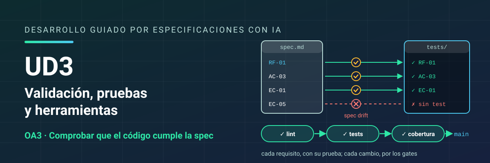

# Desarrollo guiado por especificaciones con IA - UD3 Validación, pruebas y herramientas

Unidad 3 Validación, pruebas y herramientas.

## Objetivo de aprendizaje

Esta unidad trabaja el **OA3** y sus criterios de evaluación: [ver objetivo de aprendizaje y criterios de evaluación](./objetivos-aprendizaje.md).

## Contenidos

1. [Validación y *spec drift*](./01-validacion-spec-drift.md)
2. [Pruebas desde la spec](./02-pruebas-desde-spec.md)
3. [*Quality gates* e integración continua](./03-quality-gates.md)
4. [El ecosistema de herramientas](./04-ecosistema.md)
5. [MCP: conectar el agente con sistemas externos](./05-mcp.md)
6. [Resumen](./06-resumen.md)

## Diapositivas

Las diapositivas resumen las **ideas principales** de cada tema, con un ejemplo de cada una. Se proyectan en clase y te sirven para repasar; el detalle está en el tema.

1. [Validación y *spec drift*](./diapositivas/pdf/01-validacion-spec-drift.pdf)
2. [Pruebas desde la spec](./diapositivas/pdf/02-pruebas-desde-spec.pdf)
3. [*Quality gates*](./diapositivas/pdf/03-quality-gates.pdf)
4. [El ecosistema de herramientas](./diapositivas/pdf/04-ecosistema.pdf)
5. [MCP y mínimo privilegio](./diapositivas/pdf/05-mcp.pdf)

## Referencias

- [Best practices for Claude Code](https://code.claude.com/docs/en/best-practices), de Anthropic (en inglés). Aunque es la guía de otra herramienta, sus apartados sobre verificación valen para cualquier agente: darle una comprobación que pueda ejecutar y revisar su trabajo con otro agente en un contexto limpio. Complementa el tema 1.
- [Harness Engineering Is Not Enough: Why Software Factories Fail](https://ai.engineer/talks/Ib5GBkD555M-harness-engineering-is-not-enough-why-software-factories-fail), charla de Dex Horthy en AI Engineer (vídeo con transcripción, en inglés). Explica por qué los tests y los revisores automáticos no garantizan que el código siga siendo fácil de mantener y por qué hay que seguir leyéndolo. La ingeniería del arnés (*harness engineering*) del título se explica en el tema 3. Es la opinión y la experiencia del ponente: tómala como argumento, no como datos. Complementa los temas 1 y 3.
- [`spec-driven.md`](https://github.com/github/spec-kit/blob/main/spec-driven.md), el documento de metodología de GitHub Spec Kit (en inglés). Su constitución de ejemplo pide escribir los tests antes que el código y ordenarlos por niveles. Complementa los temas 1 y 2.
- [Augmented Coding: Beyond the Vibes](https://tidyfirst.substack.com/p/augmented-coding-beyond-the-vibes), de Kent Beck, el creador de TDD (en inglés). Cuenta cómo programa con un agente sin perder la calidad: tests primero y vigilando que el agente no los borre ni los desactive para que todo pase. Léelo con el tema 2.
- [Kiro: Specs](https://kiro.dev/docs/specs/) y su página de [Correctness](https://kiro.dev/docs/specs/correctness/) (en inglés). Muestran cómo Kiro saca pruebas de los requisitos de la spec. Útil para los temas 2 y 4.
- Documentación de [Vitest](https://vitest.dev/guide/), [supertest](https://github.com/ladjs/supertest) y [Playwright](https://playwright.dev/docs/intro) (en inglés): las herramientas de pruebas del proyecto del curso. Consúltalas en el tema 2.
- Documentación de [GitHub Actions](https://docs.github.com/es/actions) (en español) y de [ESLint](https://eslint.org/docs/latest/) (en inglés): la integración continua y el linter de los *quality gates* del tema 3.
- [Implement spec-driven development using the GitHub Spec Kit](https://learn.microsoft.com/en-us/training/modules/spec-driven-development-github-spec-kit-enterprise-developers), módulo gratuito de Microsoft Learn (en inglés). Incluye la integración del flujo en una canalización de CI/CD. Complementa el tema 3.
- [Understanding Spec-Driven-Development: Kiro, spec-kit, and Tessl](https://www.martinfowler.com/articles/exploring-gen-ai/sdd-3-tools.html), de Birgitta Böckeler en el sitio de Martin Fowler (en inglés). Compara tres herramientas de SDD probándolas en casos reales, con sus ventajas y sus problemas. Léelo con el tema 4.
- [Conductor: Introducing context-driven development for Gemini CLI](https://developers.googleblog.com/conductor-introducing-context-driven-development-for-gemini-cli/), del blog de desarrolladores de Google, y [OpenSpec](https://github.com/Fission-AI/OpenSpec) (en inglés). Dos formas más de llevar el flujo de SDD a una herramienta, para el tema 4.
- [Model Context Protocol](https://modelcontextprotocol.io), la especificación oficial de MCP (en inglés), y la página de [servidores MCP de OpenCode](https://opencode.ai/docs/mcp-servers/). Son la base del tema 5.
- [Documentación de OpenCode](https://opencode.ai/docs/), la herramienta del curso (en inglés). Para el tema 1, consulta la página de [agentes](https://opencode.ai/docs/agents/). Los nombres y opciones pueden cambiar entre versiones.

## Licencia

Este material se distribuye bajo licencia **Creative Commons BY-NC-SA 4.0**. Consulta las condiciones en [LICENSE.md](./LICENSE.md).
