# 1. Varios agentes: orquestación, roles y trabajo en paralelo

[⬅️ Volver a la unidad](./README.md)

## Índice

- [1.1. Por qué varios agentes](#11-por-qué-varios-agentes)
  - [1.1.1. Ya tienes un pequeño equipo de agentes](#111-ya-tienes-un-pequeño-equipo-de-agentes)
  - [1.1.2. Los límites de un solo agente](#112-los-límites-de-un-solo-agente)
  - [1.1.3. Cuándo no compensa](#113-cuándo-no-compensa)
- [1.2. Orquestación y coreografía](#12-orquestación-y-coreografía)
- [1.3. Topologías](#13-topologías)
  - [1.3.1. En cadena](#131-en-cadena)
  - [1.3.2. Jerárquica: un orquestador y sus trabajadores](#132-jerárquica-un-orquestador-y-sus-trabajadores)
  - [1.3.3. En red](#133-en-red)
  - [1.3.4. Cuál elegir](#134-cuál-elegir)
- [1.4. Los roles](#14-los-roles)
  - [1.4.1. *Architect*: entender, especificar y planificar](#141-architect-entender-especificar-y-planificar)
  - [1.4.2. *Builder*: implementar contra la spec](#142-builder-implementar-contra-la-spec)
  - [1.4.3. *Craftsman*: cuidar la calidad](#143-craftsman-cuidar-la-calidad)
  - [1.4.4. Los roles en la lista de tareas](#144-los-roles-en-la-lista-de-tareas)
- [1.5. Subagentes en OpenCode](#15-subagentes-en-opencode)
  - [1.5.1. Cómo se encarga trabajo a un subagente](#151-cómo-se-encarga-trabajo-a-un-subagente)
  - [1.5.2. A quién puede encargar trabajo cada agente](#152-a-quién-puede-encargar-trabajo-cada-agente)
  - [1.5.3. Un coordinador para planificar: el arquitecto](#153-un-coordinador-para-planificar-el-arquitecto)
- [1.6. Qué modelo para cada rol](#16-qué-modelo-para-cada-rol)
- [1.7. Trabajo en paralelo con *worktrees*](#17-trabajo-en-paralelo-con-worktrees)
  - [1.7.1. Dos agentes en la misma carpeta](#171-dos-agentes-en-la-misma-carpeta)
  - [1.7.2. Qué es un *worktree*](#172-qué-es-un-worktree)
  - [1.7.3. Crear, usar y quitar *worktrees*](#173-crear-usar-y-quitar-worktrees)
  - [1.7.4. Qué se puede hacer en paralelo](#174-qué-se-puede-hacer-en-paralelo)
  - [1.7.5. Cuando dos ramas tocan lo mismo](#175-cuando-dos-ramas-tocan-lo-mismo)
- [1.8. *Handoffs*: pasar el trabajo](#18-handoffs-pasar-el-trabajo)
  - [1.8.1. Qué es un *handoff*](#181-qué-es-un-handoff)
  - [1.8.2. El encargo es todo lo que sabe el subagente](#182-el-encargo-es-todo-lo-que-sabe-el-subagente)
  - [1.8.3. El *handoff* entre roles](#183-el-handoff-entre-roles)
  - [1.8.4. Lo que vuelve](#184-lo-que-vuelve)
- [1.9. Meta-mantenimiento: mejorar las primitivas](#19-meta-mantenimiento-mejorar-las-primitivas)
- [1.10. Seguridad y trazabilidad](#110-seguridad-y-trazabilidad)
  - [1.10.1. Mínimo privilegio en cada agente](#1101-mínimo-privilegio-en-cada-agente)
  - [1.10.2. Las personas, en los puntos críticos](#1102-las-personas-en-los-puntos-críticos)
  - [1.10.3. Quién hizo qué](#1103-quién-hizo-qué)
  - [1.10.4. Los revisores automáticos suben el suelo](#1104-los-revisores-automáticos-suben-el-suelo)
- [1.11. Errores típicos](#111-errores-típicos)
- [1.12. Ejemplo integrador: las features C y D con varios agentes](#112-ejemplo-integrador-las-features-c-y-d-con-varios-agentes)
- [Resumen](#resumen)
- [Ejercicios de reflexión](#ejercicios-de-reflexión)

> **Criterios que trabaja este tema:** OA4 a, b.

---

## 1.1. Por qué varios agentes

### 1.1.1. Ya tienes un pequeño equipo de agentes

Aunque no lo hayas llamado así, la lista de tareas ya trabaja con **varios agentes**. Al terminar la UD3, el proyecto tiene estos:

| Agente | Tipo | De dónde viene | Qué hace | Qué no puede hacer |
|--------|------|----------------|----------|--------------------|
| *plan* | Principal | OpenCode | Analiza y propone | Editar los ficheros del proyecto |
| *build* | Principal | OpenCode | Todo | — |
| `implementador` | Principal | UD3, tema 2 | Implementa las tasks de código | Tocar los tests, las specs ni la configuración de las pruebas |
| *explore* | Subagente | OpenCode | Busca en el código y resume | Modificar nada |
| *general* | Subagente | OpenCode | Tareas de varios pasos que le encarga otro agente | — |
| `revisor` | Subagente | UD3, tema 1 | Comprueba si el código cumple la spec | Editar ni encargar trabajo a otros |
| `documentador` | Subagente | UD2, tema 6 | Escribe `docs/api.md` y `README.md` | Tocar el código, las specs ni ejecutar más que `git diff` y `git log` |

Cada uno tiene un **papel**, unos **permisos** y, si quieres, su propio **modelo**. Y quien decide qué agente trabaja en cada momento eres tú: cambias de *plan* a *build*, lanzas `/validar` para que trabaje el revisor o `/documentar` para el documentador.

Eso es un **sistema multiagente**: varios agentes especializados que colaboran en un mismo trabajo, cada uno con su parte. En esta unidad aprenderás a diseñarlo a propósito en lugar de ir añadiendo agentes sueltos: qué forma darle, qué papel tiene cada agente, cómo se pasan el trabajo, cómo trabajan a la vez sin pisarse y cómo se mantiene seguro.

### 1.1.2. Los límites de un solo agente

Un único agente con todos los permisos, que especifica, planifica, implementa y se revisa a sí mismo en la misma sesión, choca con cinco límites:

| Límite | Qué pasa | Lo viste en… |
|--------|----------|--------------|
| **Contexto** | La ventana se llena de todo: la spec, el plan, el código, las salidas de los tests… y la atención se reparte entre cosas que ya no importan | UD2, tema 5 |
| **Sin especialidad** | El mismo agente, con las mismas instrucciones, decide el producto, la arquitectura y el código | UD2, tema 1 (una fase, un agente) |
| **Se revisa a sí mismo** | Comprueba que el código hace lo que él entendió, no lo que dice la spec | UD3, tema 1 |
| **Demasiados permisos** | Quien implementa puede cambiar los tests para que pasen | UD3, tema 2 |
| **Todo en serie** | Dos features que no dependen una de otra esperan en fila | Este tema |

La solución no es un agente más grande ni un prompt más largo: es **repartir el trabajo** entre agentes con un papel claro, el contexto justo para ese papel y los permisos justos para hacerlo. Igual que un equipo de personas.

### 1.1.3. Cuándo no compensa

Más agentes no es mejor por defecto. Cada agente que añades tiene un coste:

- **Más tokens.** Cada subagente empieza con la ventana vacía y vuelve a leer lo que necesita. Un trabajo repartido entre cuatro agentes gasta bastante más que el mismo trabajo en una sesión bien llevada.
- **Más coordinación.** Alguien tiene que decidir quién hace qué, en qué orden y con qué información, y juntar los resultados.
- **Más traspasos.** Cada vez que el trabajo pasa de un agente a otro, se puede perder información (apartado 1.8).

Además, programar no se reparte tan bien como otras tareas. Anthropic, en el artículo sobre su sistema de investigación con varios agentes (enlazado en la portada), lo explica así: investigar un tema se divide en búsquedas independientes que no necesitan saber unas de otras; en cambio, la mayoría de las tareas de programación **dependen entre sí** y **comparten ficheros**, así que tienen menos partes que puedan hacerse de verdad a la vez.

La regla práctica: **empieza con un agente y una persona**, y añade un agente solo cuando puedas decir qué problema concreto resuelve.

| Problema que tienes | Agente que lo resuelve |
|---------------------|------------------------|
| La sesión se llena al buscar en el código | Un subagente de búsqueda, como *explore* |
| Quien implementa podría cambiar los tests | Un implementador sin permiso sobre los tests |
| El código lo revisa quien lo escribió | Un revisor de solo lectura, en su propia sesión |
| Una tarea sencilla gasta el modelo más caro | Un agente con un modelo más económico |
| Dos features independientes esperan en fila | Dos agentes, cada uno en su *worktree* |
| No sabes qué problema resuelve | Ninguno |

> 📝 **Nota del Profesor**: un sistema multiagente no es más «inteligente» que un agente: es más **organizado**. Lo que gana es lo mismo que gana un equipo humano bien montado: cada uno sabe qué le toca, tiene lo que necesita para hacerlo y no puede estropear lo que no le toca. Si el trabajo no está bien especificado, varios agentes producen el mismo desorden que uno, pero más deprisa.

---

## 1.2. Orquestación y coreografía

Cuando varios agentes trabajan juntos, alguien tiene que coordinarlos. Hay dos formas:

- **Orquestación** (*orchestration*): un coordinador decide quién hace qué y cuándo, recibe los resultados y decide el paso siguiente. Como en una cocina con jefe de cocina: los cocineros no deciden qué plato preparar.
- **Coreografía** (*choreography*): no hay coordinador. Cada agente reacciona a lo que pasa (un fichero nuevo, un commit, un mensaje) y hace su parte. Como un bufé en el que cada cocinero repone lo que ve que falta.

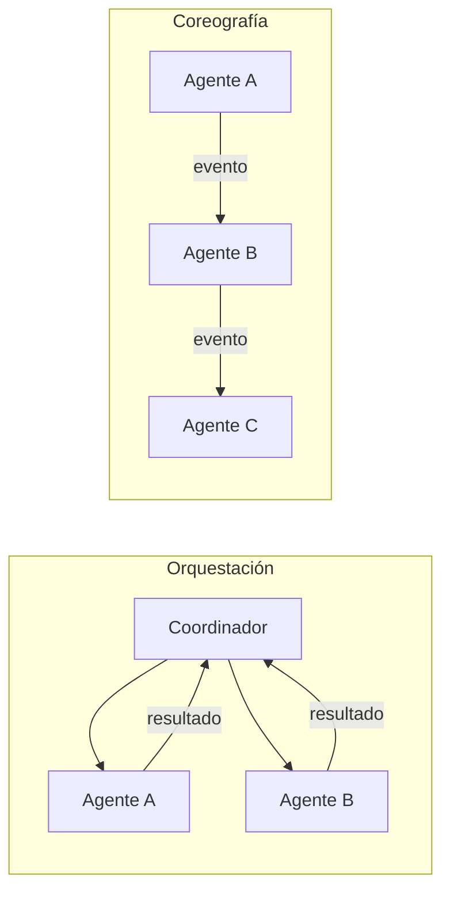

El diagrama muestra la diferencia que importa: en la orquestación, todo resultado vuelve al coordinador antes de seguir; en la coreografía, lo que produce un agente le llega directamente al siguiente.

| | Orquestación | Coreografía |
|---|---|---|
| **Control** | Centralizado: un coordinador dirige | Repartido: cada agente reacciona a eventos |
| **Visibilidad** | El coordinador conoce el estado de todo | Cada agente solo ve su entrada y su salida |
| **Previsibilidad** | El flujo está escrito y se puede seguir | El comportamiento sale de las interacciones |
| **Depuración** | Un único punto donde mirar | Hay que reconstruir qué evento lanzó qué |
| **Cambios** | Añadir un agente obliga a tocar el coordinador | Se añaden y quitan agentes sin tocar los demás |
| **Con agentes de IA** | Recomendable | Arriesgada |

¿Por qué arriesgada? Porque un agente no es determinista: a veces produce algo inesperado. En la coreografía, ese resultado le llega al siguiente agente **sin que nadie lo revise**, y el error se propaga y crece. En la orquestación, el coordinador puede comprobar cada resultado antes de pasarlo.

Un ejemplo de coreografía que podrías montar sin darte cuenta: un workflow de GitHub que lanza un agente para corregir el código cada vez que la CI falla, y otro que lanza un agente revisor cada vez que llega un commit nuevo. El revisor revisa lo que escribió el corrector, el corrector corrige lo que encontró el revisor… y nadie ha decidido si ese bucle debía empezar.

> 💡 **Tip del Examinador**: «¿Por qué se prefiere la orquestación a la coreografía en el desarrollo con agentes?». Porque hay un punto que conoce el estado de todo y comprueba cada resultado antes de pasarlo al siguiente agente. Como los agentes no son deterministas, en la coreografía un resultado inesperado se propaga sin control y es difícil rastrear de dónde salió.

En este curso, el coordinador principal eres **tú**. Los agentes pueden coordinar partes del trabajo (lo verás en el apartado 1.5.3), pero las decisiones que cierran una fase siguen siendo de una persona, como en la UD2.

---

## 1.3. Topologías

La **topología** de un sistema multiagente es la forma en que se conectan sus agentes: quién le pasa trabajo a quién. Hay tres formas básicas.

### 1.3.1. En cadena

En una topología **en cadena** (*pipeline*), la salida de un agente es la entrada del siguiente.

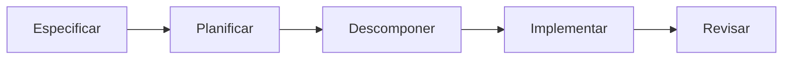

Ya la conoces: es el **flujo SDD** de la UD2, con un agente (o un papel) por fase. Es la más fácil de entender y de seguir, y encaja cuando cada paso necesita el resultado completo del anterior. Su límite es que no aprovecha el paralelismo: aunque haya dos features independientes, la cadena las procesa de una en una.

En el flujo del curso, entre cada eslabón hay un **punto de control**: la persona aprueba antes de que el resultado pase al siguiente. Una cadena de agentes sin esos puntos es la coreografía del apartado anterior.

### 1.3.2. Jerárquica: un orquestador y sus trabajadores

En la topología **jerárquica** (*orchestrator-workers*), un agente **orquestador** divide el trabajo, se lo encarga a varios **trabajadores**, recoge sus resultados y los junta.

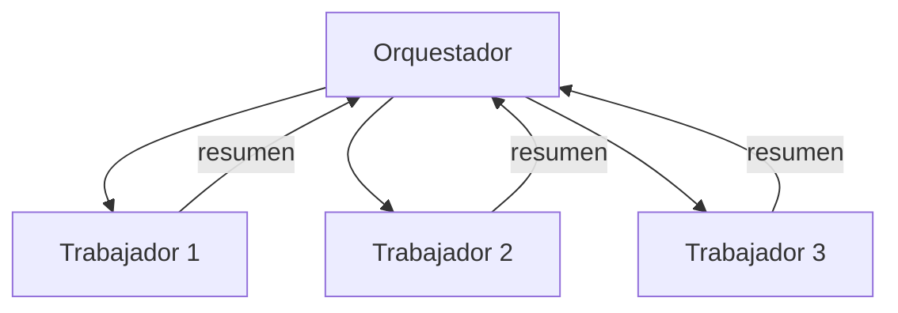

Los trabajadores no hablan entre ellos: solo con el orquestador. Eso permite que trabajen **en paralelo** sin coordinarse y que haya un único punto que conoce el estado de todo.

Es la topología que ya usaste en la UD2 sin llamarla así: el agente *plan* le encargaba a *explore* que buscara en el código, y solo recibía su resumen. Es también la más útil cuando hay varias features o varias búsquedas independientes.

### 1.3.3. En red

En una topología **en red** (*mesh*), cualquier agente puede hablar con cualquier otro, sin jerarquía.

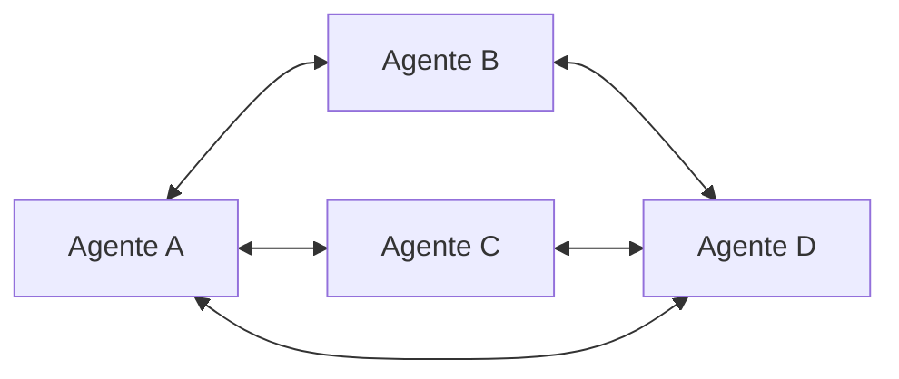

Cada conexión es un sitio por donde puede entrar un resultado inesperado, y con cuatro agentes ya hay muchos caminos posibles. Es difícil de depurar, de auditar y de mantener alineada con las specs. En el desarrollo de software casi nunca compensa.

### 1.3.4. Cuál elegir

| Topología | Encaja cuando… | Riesgo principal |
|-----------|----------------|------------------|
| **En cadena** | Cada paso necesita el resultado del anterior (las fases de una feature) | Lenta: no hay paralelismo |
| **Jerárquica** | Hay partes independientes que un coordinador puede repartir y juntar | El orquestador es el cuello de botella y tiene que saber repartir bien |
| **En red** | Casi nunca en desarrollo | Imprevisible y difícil de rastrear |

En la práctica se **combinan**: una cadena para las fases de cada feature y, dentro de una fase, un orquestador que reparte búsquedas o features independientes.

> 💡 **Tip del Examinador**: «Nombra las topologías de un sistema multiagente y di cuál es el flujo SDD». En cadena (la salida de uno es la entrada del siguiente), jerárquica (un orquestador reparte y junta) y en red (todos con todos). El flujo SDD es una cadena, con un punto de control humano entre cada eslabón.

---

## 1.4. Los roles

Cuando el trabajo se reparte, cada agente tiene un **rol**: un papel con su misión, su contexto y sus herramientas. En el desarrollo con SDD se suelen distinguir tres roles. Sus nombres en inglés están extendidos en la comunidad: ***Architect***, ***Builder*** y ***Craftsman***.

### 1.4.1. *Architect*: entender, especificar y planificar

**Misión:** que todo esté decidido y escrito **antes** de implementar. Recibe una idea con ambigüedades y la convierte en documentos aprobables: la spec (con la persona), el plan y las tasks.

- **Coordina** el trabajo previo: encarga búsquedas en el código, compara alternativas, reparte el análisis de varias features.
- **No implementa nada.** Su salida son documentos.
- **Su contexto:** el PRD, la constitución, el índice de features, las specs y el código que hace falta conocer (a través de búsquedas, no leyéndolo entero).

Es el arquitecto de la obra de la UD2: hace el proyecto y lo deja listo para los albañiles.

### 1.4.2. *Builder*: implementar contra la spec

**Misión:** implementar las tasks aprobadas, ciclo a ciclo, con la spec como referencia.

- Sigue el ciclo de la UD2: tests en rojo, código, tests en verde, y para cuando algo no encaja.
- **No avanza si no cumple:** si los tests de la task no pasan o algo contradice la spec, el ciclo no se da por terminado. Es su forma de detectar el *drift* en el momento en que aparece.
- **Su contexto:** las tasks del ciclo, la spec, el plan y los ficheros que tocan esas tasks.
- **Sus herramientas:** terminal, tests y, desde la UD3, el linter. Sin permiso sobre los tests ni sobre las specs.

La calidad de lo que produce depende de lo que recibe: unas tasks vagas producen código vago, con uno o con diez agentes.

### 1.4.3. *Craftsman*: cuidar la calidad

**Misión:** que el sistema **no se degrade** con el tiempo. Cada feature que implementa un agente puede dejar pequeñas inconsistencias: un nombre distinto para lo mismo, una función duplicada porque el agente no sabía que ya existía, un bloque copiado en tres sitios. Ninguna rompe un test; juntas, hacen el código más difícil de mantener.

- **Revisa el conjunto**, no solo el último cambio: compara módulos escritos en sesiones distintas.
- **Propone mejoras sin cambiar el comportamiento** (refactorizaciones), que pasan por el flujo como cualquier otro cambio.
- **Mejora las primitivas**: si un problema aparece varias veces, no basta con arreglar el código; hay que cambiar la regla, la skill, el comando o la constitución que lo produjo. Es el **meta-mantenimiento** (apartado 1.9).

La revisión independiente que hiciste con el revisor en la UD3 (¿cumple esta feature su spec?) es parte de este papel, pero el *Craftsman* mira más lejos: ¿sigue siendo **fácil de cambiar** el proyecto después de esta feature?

### 1.4.4. Los roles en la lista de tareas

Los roles no son agentes: un rol puede repartirse entre varios agentes, y un agente puede cubrir parte de un rol. Así se reparten en la lista de tareas, con los dos agentes nuevos que crearás en este tema:

| Rol | Agentes | Quién decide |
|-----|---------|--------------|
| ***Architect*** | `arquitecto` (nuevo, apartado 1.5.3), con *explore* para buscar | La persona aprueba la spec, el plan y las tasks |
| ***Builder*** | `implementador` | La persona revisa cada ciclo (punto de control 4) |
| ***Craftsman*** | `revisor` (cada feature), `artesano` (nuevo, apartado 1.9, el conjunto) | La persona decide qué mejoras se hacen |
| Apoyo | `documentador`, *explore*, *general* | — |

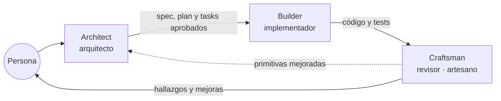

El diagrama muestra el circuito: la persona pone en marcha cada rol y recibe lo que sale del último. La flecha discontinua es el meta-mantenimiento: lo que aprende el *Craftsman* vuelve a las instrucciones con las que trabajan los demás.

> 📝 **Nota del Profesor**: fíjate en que la columna «Quién decide» dice siempre «la persona». Repartir el trabajo entre agentes no reparte las decisiones. Es la misma regla de la UD2 (ninguna fase la cierra el agente), aplicada a un equipo más grande.

---

## 1.5. Subagentes en OpenCode

### 1.5.1. Cómo se encarga trabajo a un subagente

En la UD2 (tema 6) viste que un **subagente** trabaja en una **sesión hija**, con su propia ventana de contexto. En OpenCode se le encarga trabajo de dos formas:

- **Tú**, empezando el mensaje con `@` y su nombre: `@explore ¿qué funciones exporta el repositorio de tareas?`.
- **Un agente principal**, con su herramienta **`subagent`**: el modelo decide que una parte del trabajo es para un subagente (lo elige por su `description`), escribe un **encargo** y recibe el resultado cuando el subagente termina. Un comando con `subagent: true`, como `/validar`, hace lo mismo con un encargo fijo.

Lo importante es qué recibe y qué devuelve el subagente:

- **Empieza con el contexto vacío.** No ve tu conversación ni lo que ha leído el agente principal: solo el **encargo** que este le escribe.
- **Devuelve un único mensaje** al terminar, y ese mensaje solo lo ve el agente principal, que te lo resume.
- El agente principal puede **retomar** la misma sesión hija más tarde para pedirle algo más, en lugar de empezar otra.

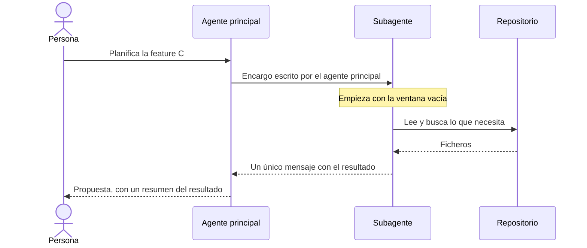

Lo que destaca del diagrama: entre el agente principal y el subagente solo pasan **dos mensajes**, el encargo y el resultado. Todo lo que el subagente necesita saber tiene que ir en el primero. Lo verás a fondo en el apartado 1.8.

Puedes entrar en la sesión hija para ver qué hizo el subagente. En la versión del curso, la flecha abajo abre la lista de sesiones hijas, las flechas izquierda y derecha pasan de una a otra y la flecha arriba vuelve a la principal (pueden cambiar entre versiones; están en la página de atajos de teclado de la documentación).

### 1.5.2. A quién puede encargar trabajo cada agente

En la UD2 le pusiste al documentador una regla `subagent` en `deny` para que no pudiera encargar trabajo a *general*, que sí puede editar. El recurso de esa regla admite también **patrones**, como en `edit` y `shell`, para decir a qué subagentes puede llamar un agente y a cuáles no:

```yaml
permissions:
  - { action: subagent, resource: "*", effect: deny }
  - { action: subagent, resource: "explore", effect: allow }
```

| Subagente | Reglas que coinciden | Gana | Resultado |
|-----------|----------------------|------|-----------|
| *explore* | `*`, `explore` | `explore` | ✅ Puede encargarle trabajo |
| *general* | `*` | `*` | ❌ No puede |
| `revisor` | `*` | `*` | ❌ No puede |

Es la regla de siempre: **gana la última que coincide**. Si el agente intenta encargar trabajo a un subagente que queda en `deny`, OpenCode se lo impide.

Dos detalles más:

- La regla de `subagent` limita lo que **el agente** puede encargar. Tú puedes seguir llamando a cualquier subagente con `@`.
- Un subagente que solo deben usar otros agentes puede llevar `hidden: true`: no aparece en el menú de `@`, pero los agentes que tengan permiso pueden seguir encargándole trabajo.

> ⚠️ **Cuidado**: cuando diseñes un agente con permisos limitados, revisa siempre a quién puede encargar trabajo. Un agente que no puede editar pero puede llamar a *general* **sí** puede editar, a través de otro. Los permisos de un agente valen tanto como los del agente más poderoso al que puede llamar.

### 1.5.3. Un coordinador para planificar: el arquitecto

En la UD2 planificabas en dos pasos: *plan* proponía, y después cambiabas a *build* para que guardara `plan.md`, con el riesgo de que *build* se adelantara a implementar. Con un agente propio para el rol de *Architect* desaparece ese riesgo: puede escribir **solo** los documentos de su fase.

`.opencode/agents/arquitecto.md`:

```markdown
---
description: Coordina la planificación de una feature con la spec aprobada. Encarga las búsquedas en el código al subagente explore y escribe plan.md y tasks.md. No escribe código.
mode: primary
model: proveedor/modelo-capaz
permissions:
  - { action: edit, resource: "*", effect: deny }
  - { action: edit, resource: "docs/specs/*/plan.md", effect: allow }
  - { action: edit, resource: "docs/specs/*/tasks.md", effect: allow }
  - { action: shell, resource: "*", effect: deny }
  - { action: shell, resource: "git status", effect: allow }
  - { action: shell, resource: "git diff *", effect: allow }
  - { action: shell, resource: "git log *", effect: allow }
  - { action: subagent, resource: "*", effect: deny }
  - { action: subagent, resource: "explore", effect: allow }
  - { action: webfetch, resource: "*", effect: deny }
  - { action: websearch, resource: "*", effect: deny }
---

Eres el arquitecto del proyecto de la lista de tareas.

- Trabajas con specs aprobadas. No las cambias: si encuentras algo que
  la spec no decide y que se notaría desde fuera, lo marcas con
  [NECESITA ACLARACIÓN] y lo explicas.
- Para conocer el código, encargas búsquedas concretas al subagente
  explore. En cada encargo dices qué quieres saber, dónde buscar y en
  qué formato quieres la respuesta.
- Escribes plan.md y tasks.md con las plantillas del curso, en estado
  Borrador. Los aprueba una persona.
- No escribes código, ni en ficheros ni dentro del plan.
```

Cambia `proveedor/modelo-capaz` por uno de los modelos de `opencode models` (apartado 1.6).

Cómo lo ve OpenCode (`opencode debug agents`, el agente `arquitecto` resumido; sus reglas se aplican después de las del proyecto):

| Acción | Recurso | Efecto |
|--------|---------|--------|
| `edit` | `*` | deny |
| `edit` | `docs/specs/*/plan.md` | allow |
| `edit` | `docs/specs/*/tasks.md` | allow |
| `shell` | `*` | deny |
| `shell` | `git status`, `git diff *`, `git log *` | allow |
| `subagent` | `*` | deny |
| `subagent` | `explore` | allow |
| `webfetch` | `*` | deny |

Con esta configuración, el arquitecto **coordina** una parte del trabajo (decide qué buscar y se lo encarga a *explore*, que trabaja en paralelo si le hace varios encargos) y **produce** los documentos de su fase, pero no puede escribir código, ni ejecutar comandos que cambien nada, ni encargar trabajo a un agente que pueda hacerlo.

El comando `/planificar` de la UD2 pasa a usarlo: en su cabecera, `agent: arquitecto` en lugar de `agent: plan`. El resto del prompt no cambia.

> ✅ **Buena práctica**: el arquitecto escribe los documentos en `Borrador`. Aprobar sigue siendo tuyo: revisas con `git diff`, cambias el estado y haces el commit. Un agente que pudiera aprobar sus propios documentos se saltaría el punto de control.

---

## 1.6. Qué modelo para cada rol

En la UD2 (tema 6) elegiste un modelo económico para el documentador. Con varios roles, la elección se hace para cada uno con tres criterios:

| Criterio | Pregunta | Ejemplo |
|----------|----------|---------|
| **Capacidad** | ¿Este trabajo necesita razonar mucho o tomar decisiones delicadas? | Planificar una feature que toca varias capas |
| **Coste** | ¿Se va a ejecutar muchas veces o leer mucho? | Buscar en el código, documentar cada feature |
| **Privacidad** | ¿El código o los datos pueden salir del equipo? | Un módulo con datos personales o código de un cliente |

Aplicado a los roles de la lista de tareas:

| Agente | Trabajo | Modelo |
|--------|---------|--------|
| `arquitecto` | Decisiones técnicas que cuestan caras si salen mal | El más capaz que tengas |
| `implementador` | Código de tasks pequeñas y bien definidas | Capaz; si las tasks son muy pequeñas, puede bastar uno intermedio |
| `revisor` | Comparar el código con la spec y encontrar lo que falla | Capaz, y si puede ser, distinto del que implementó |
| `artesano` | Juicio sobre diseño y mantenibilidad | Capaz; se usa pocas veces |
| *explore* | Buscar y resumir | Rápido y económico |
| `documentador` | Redactar a partir de la spec y el código | Económico |
| Cualquiera, en código que no puede salir | — | Un modelo local |

Sobre el revisor: lo esencial de la revisión independiente (UD3, tema 1) es que **no sea la misma sesión** que escribió el código. Usar además **otro modelo** es un paso más de independencia: dos modelos distintos no suelen equivocarse en los mismos sitios.

Recuerda las dos comprobaciones de la UD2: el modelo de cada agente tiene que aparecer en `opencode models` (si no, el agente falla al usarlo) y, si quitas la línea `model`, el agente usa el de la sesión.

> ⚠️ **Cuidado**: repartir el trabajo multiplica las llamadas al modelo. Cuatro encargos a *explore* en paralelo son cuatro sesiones que leen ficheros a la vez. Antes de lanzar muchos subagentes, pregúntate si una búsqueda bien dirigida no daría lo mismo. `opencode stats` te dice cuánto has gastado y en qué modelos.

---

## 1.7. Trabajo en paralelo con *worktrees*

### 1.7.1. Dos agentes en la misma carpeta

Imagina que quieres planificar las features C («Marcar una tarea como hecha») y D («Borrar una tarea») a la vez, cada una con su agente. Las dos van en su rama (UD2, tema 1). Si abres dos OpenCode en la misma carpeta:

- Solo puede haber **una rama activa** en la carpeta. Si un agente cambia a `feature/D-borrar-tarea`, el otro, que creía estar en `feature/C-marcar-hecha`, se encuentra de golpe con los ficheros de la otra rama.
- Los dos ven los cambios sin guardar del otro: `git status` y `git diff` mezclan el trabajo de los dos, y tu revisión del punto de control también.
- Si uno ejecuta los tests, prueba el código a medio hacer del otro.

Hace falta que cada agente tenga **su propia carpeta**, con su propia rama, sin tener que clonar el repositorio dos veces.

### 1.7.2. Qué es un *worktree*

Un ***worktree*** (árbol de trabajo) es una **carpeta de trabajo adicional** enlazada al mismo repositorio de Git. Cada *worktree* tiene su propia rama y sus propios ficheros, pero todos comparten el mismo historial: un commit hecho en uno se ve enseguida desde los demás, porque la base de datos de Git (`.git`) es una sola.

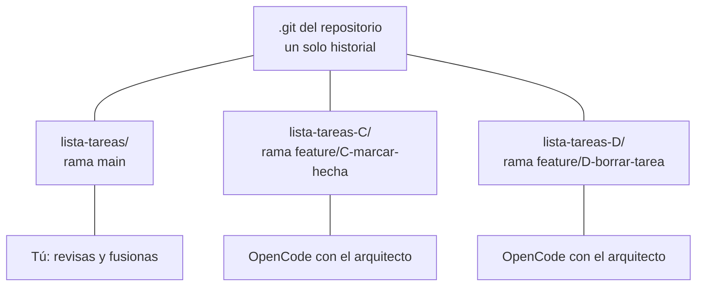

El diagrama muestra la idea: tres carpetas, tres ramas, tres sesiones de trabajo, y un único historial debajo. Cada agente trabaja en su carpeta sin ver los cambios sin guardar de los demás.

| | Clonar el repositorio otra vez | *Worktree* |
|---|---|---|
| **Historial** | Una copia aparte; hay que sincronizar con `push` y `pull` | El mismo: los commits se ven al momento |
| **Espacio** | Todo el historial duplicado | Solo los ficheros de la rama |
| **Ramas** | La misma rama puede estar en los dos clones | Git impide tener la misma rama en dos *worktrees* |

### 1.7.3. Crear, usar y quitar *worktrees*

Desde la carpeta principal del proyecto, en `main`, se crea un *worktree* por feature, **al lado** de la carpeta del proyecto, con su rama nueva:

```bash
git worktree add ../lista-tareas-C -b feature/C-marcar-hecha
git worktree add ../lista-tareas-D -b feature/D-borrar-tarea
git worktree list
```

```text
Preparando árbol de trabajo (nueva rama 'feature/C-marcar-hecha')
HEAD está ahora en ff9b8a7 Spec de la feature D (aprobada)
Preparando árbol de trabajo (nueva rama 'feature/D-borrar-tarea')
HEAD está ahora en ff9b8a7 Spec de la feature D (aprobada)
lista-tareas    ff9b8a7 [main]
lista-tareas-C  ff9b8a7 [feature/C-marcar-hecha]
lista-tareas-D  ff9b8a7 [feature/D-borrar-tarea]
```

Las dos ramas salen del mismo commit de `main`, el que dejó aprobadas las dos specs. Cada carpeta es un proyecto completo, salvo lo que Git no guarda. Antes de trabajar en ella:

```bash
cd ../lista-tareas-C
npm ci          # node_modules no se comparte: cada worktree tiene el suyo
opencode        # una sesión de OpenCode por worktree
```

Tres detalles prácticos:

- **El servidor.** Si arrancas la aplicación en dos *worktrees* a la vez, las dos querrán el mismo puerto. El servidor de la lista de tareas lee la variable `PUERTO`: `PUERTO=3001 npm start` en el segundo.
- **Fuera de su carpeta.** Por defecto, OpenCode deja que un agente lea y escriba fuera de la carpeta en la que lo abriste (el permiso `external_directory`, UD1, tema 3). Con dos *worktrees* hermanos conviene que pregunte: añade a `opencode.json` la regla `{ "action": "external_directory", "resource": "*", "effect": "ask" }`. Si el agente de C intenta tocar `../lista-tareas-D`, te preguntará. No lo permitas: cada agente, en su *worktree*.
- **Una rama, un *worktree*.** Git no deja abrir en otro sitio una rama que ya está en un *worktree*:

  ```text
  fatal: 'feature/D-borrar-tarea' is already used by worktree at 'lista-tareas-D'
  ```

Cuando la feature está fusionada (desde la carpeta principal, en `main`, como en la UD2), se quita el *worktree* y después la rama:

```bash
git worktree remove ../lista-tareas-C
git branch -d feature/C-marcar-hecha
```

Git se niega a quitar un *worktree* con cambios sin guardar, y a borrar una rama que todavía está en uso en un *worktree*:

```text
fatal: '../lista-tareas-D' contiene archivos modificados o no rastreados, usa --force para borrarlo
error: cannot delete branch 'feature/D-borrar-tarea' used by worktree at 'lista-tareas-D'
```

Son dos protecciones útiles: no uses `--force` sin mirar antes qué cambios se perderían.

> ⚠️ **Cuidado**: en el **Dev Container** del curso, la carpeta del proyecto está montada desde tu equipo, pero la carpeta de al lado (`../lista-tareas-C`) se crea **dentro del contenedor**. Mientras el contenedor exista, se conserva; si lo reconstruyes, se pierde lo que no esté en un commit. Los commits sí están a salvo, porque van al `.git` del proyecto. Haz un commit al final de cada fase y de cada ciclo (como siempre), gestiona los *worktrees* siempre desde dentro del contenedor y quítalos antes de reconstruirlo. Si alguno queda huérfano, `git worktree prune` limpia su registro.

### 1.7.4. Qué se puede hacer en paralelo

Tener dos carpetas evita que los agentes se pisen **mientras trabajan**. No evita que sus trabajos choquen **al juntarlos**. Dos trabajos se pueden hacer a la vez cuando se cumplen dos condiciones:

1. **No tocan los mismos ficheros.** Si los dos modifican `src/rutas/tareas.js`, Git tendrá que combinar los cambios al fusionar, y puede que no sepa.
2. **No dependen uno del otro.** Si uno necesita algo que el otro está creando, o los dos deciden lo mismo por separado, el resultado no encaja aunque Git no proteste.

Para comprobarlo antes de lanzar dos agentes, tienes dos herramientas de la UD2: la tabla **Ficheros** de cada plan y el marcador **`[P]`** de las tasks.

| Trabajo | ¿En paralelo? | Por qué |
|---------|---------------|---------|
| Los planes de dos features | Sí, con cuidado | Cada plan vive en la carpeta de su feature, pero pueden decidir lo mismo por separado (apartado 1.12) |
| Implementar dos features que tocan el servicio, el repositorio y las rutas | No | Los mismos ficheros y, a menudo, las mismas piezas nuevas |
| Implementar una feature y documentar otra ya fusionada | Sí | Ficheros distintos: `src/` y `docs/api.md` |
| Varias búsquedas en el código para un mismo plan | Sí | Solo leen |
| Dos tasks marcadas con `[P]` del mismo grupo | Sí | Por definición, no comparten ficheros ni dependen entre sí |

Quien decide qué va en paralelo es el **orquestador**: en el curso, tú. Si dudas, en serie: perder un poco de tiempo es más barato que deshacer dos trabajos que no encajan.

### 1.7.5. Cuando dos ramas tocan lo mismo

¿Qué pasa si te saltas la comprobación? Supón que dejas que C y D se implementen a la vez, cada una en su *worktree*. Los dos implementadores necesitan responder 404 cuando la tarea no existe, así que **los dos** crean `src/errores/error-no-encontrado.js`, y los dos añaden su ruta al final de `src/rutas/tareas.js`. Fusionas C sin problemas. Al fusionar D:

```bash
git merge --no-ff feature/D-borrar-tarea -m "Fusiona la feature D: borrar una tarea"
```

```text
Auto-fusionando src/errores/error-no-encontrado.js
CONFLICTO (agregar/agregar): Conflicto de fusión en src/errores/error-no-encontrado.js
Auto-fusionando src/rutas/tareas.js
CONFLICTO (contenido): Conflicto de fusión en src/rutas/tareas.js
Fusión automática falló; arregle los conflictos y luego realice un commit con el resultado.
```

Git ha sabido juntar las importaciones de las dos rutas (estaban en líneas distintas), pero no las dos líneas que se añadieron en el mismo sitio:

```javascript
rutasTareas.get('/', listarTareasHttp);
rutasTareas.post('/', crearTareaHttp);
<<<<<<< HEAD
rutasTareas.patch('/:id', marcarTareaHttp);
=======
rutasTareas.delete('/:id', borrarTareaHttp);
>>>>>>> feature/D-borrar-tarea
```

Ese conflicto es fácil: hay que quedarse con las dos líneas. El otro es más interesante:

```javascript
export class ErrorNoEncontrado extends Error {
  constructor(mensaje) {
    super(mensaje);
<<<<<<< HEAD
    this.name = 'ErrorNoEncontrado';
=======
    this.name = 'NoEncontrado';
>>>>>>> feature/D-borrar-tarea
  }
}
```

Los dos agentes tomaron **la misma decisión** (crear una clase de error para el 404) y la resolvieron **de forma distinta**. Git lo ha detectado porque coincidía el nombre del fichero; si uno lo hubiera llamado `error-404.js`, no habría conflicto y el proyecto tendría dos clases para lo mismo. Eso no es un problema de Git: es *spec drift* entre dos features (UD3, tema 1), creado por trabajar en paralelo sin coordinar las decisiones.

Si te encuentras en esta situación, `git merge --abort` deja `main` como estaba. Después se resuelve como un hueco: se decide una sola clase, se corrige el plan de la feature que va detrás y se rehace su parte. En el apartado 1.12 verás cómo evitarlo desde el principio.

> 📝 **Nota del Profesor**: los *worktrees* resuelven un problema de **carpetas**, no de **coordinación**. Te dejan trabajar a la vez; no deciden qué trabajos pueden ir a la vez. Esa decisión es del orquestador, y se toma mirando los planes antes de implementar, no los conflictos después.

---

## 1.8. *Handoffs*: pasar el trabajo

### 1.8.1. Qué es un *handoff*

Un ***handoff*** (traspaso) es el momento en que el trabajo pasa de un agente a otro: del arquitecto al implementador, del agente principal a un subagente, de tu sesión de la mañana a la de la tarde. No es pasar un fichero: es pasar **lo necesario para que el siguiente siga sin adivinar**.

Un *handoff* incompleto es el equivalente, entre agentes, a una spec vaga: el que recibe el trabajo rellena los huecos con suposiciones.

### 1.8.2. El encargo es todo lo que sabe el subagente

Como viste en el apartado 1.5.1, un subagente empieza con la ventana vacía. El encargo que le escribe el agente principal es **todo** su contexto. Mira este, del arquitecto a *explore*, al planificar la feature D:

```text
Mira el código de las tareas y dime qué hay.
```

*Explore* no sabe para qué lo quieres, ni qué te importa, ni cuándo parar. Leerá ficheros, te devolverá una descripción general del proyecto y el arquitecto seguirá sin saber lo que necesitaba. Y si el arquitecto lanza tres encargos así a la vez, los tres harán más o menos lo mismo.

Anthropic, en el artículo de la portada, resume lo que necesita cada encargo: un **objetivo**, el **formato** de la respuesta, **qué herramientas y fuentes** usar y **límites** claros. Sin eso, los subagentes duplican trabajo o dejan huecos. El mismo encargo, bien hecho:

```text
Objetivo: voy a planificar la feature D («Borrar una tarea»), que
responde 404 si la tarea no existe y borra del repositorio la que sí
existe. Necesito saber qué puedo reutilizar.

Busca en src/ y tests/:
1. Las clases de error de src/errores/ y qué código HTTP les da el
   controlador.
2. Las funciones de src/repositorios/repositorio-tareas.js y si alguna
   busca una tarea por su id.
3. Cómo se prueba en tests/ que una petición responde 404, si hay
   algún test que lo haga.

Límites: solo lectura; no mires public/ ni docs/.

Devuélveme una lista con una línea por cosa encontrada: fichero,
nombre y para qué sirve. Si algo no existe, dilo expresamente.
```

Fíjate en la última frase: «si algo no existe, dilo». Sin ella, un subagente que no encuentra lo que buscas tiende a devolver lo más parecido que ha visto, y el agente principal lo toma por bueno.

> 💡 **Tip del Examinador**: «¿Qué debe incluir el encargo a un subagente?». El objetivo (para qué se necesita), qué buscar o hacer, qué fuentes o herramientas usar, los límites (qué no tocar, dónde no mirar) y el formato exacto de la respuesta. El subagente no ve la conversación del agente principal: lo que no esté en el encargo, no lo sabe.

### 1.8.3. El *handoff* entre roles

Entre roles, por ejemplo del *Architect* al *Builder*, el *handoff* tiene más partes. Una plantilla:

```markdown
## Traspaso: arquitecto → implementador

- Feature: C, Marcar una tarea como hecha.
- Documentos: docs/specs/C-marcar-hecha/spec.md 1.0 (aprobada),
  plan.md y tasks.md (aprobados).
- Rama y carpeta: feature/C-marcar-hecha, en ../lista-tareas-C.
- Estado: tasks aprobadas; ningún ciclo hecho.
- Encargo: el grupo 1 (T-01 y T-02).
- Límites: solo los ficheros de esas tasks; los tests no se tocan.
- Al terminar: las tasks marcadas, npm test en verde y una lista de lo
  que no encajó con la spec o el plan.
```

Fíjate en lo que **no** lleva: ni una decisión técnica, ni un requisito, ni un *edge case*. En SDD, todo eso ya está **en los documentos aprobados**, y el *handoff* solo los señala. Eso da una regla muy útil:

> **Si un *handoff* necesita explicar una decisión, esa decisión falta en el plan o en la spec.**

Escribirla en el traspaso la deja en un sitio que nadie más leerá: se corrige el documento y el traspaso vuelve a ser una lista de rutas.

¿Dónde vive el *handoff*? Depende de quién lo recibe:

| De → a | Dónde va | Ejemplo |
|--------|----------|---------|
| Agente principal → subagente | El encargo de la herramienta `subagent` | El encargo a *explore* del apartado anterior |
| Tú → un agente, siempre igual | Un **comando** | `/implementar C-marcar-hecha 1` es un *handoff* con formato fijo |
| Una persona → otra (o tu yo de mañana) | La descripción de la *pull request* o el mensaje del commit | «Plan de C aprobado; tasks pendientes de revisar» |

La segunda fila merece una pausa: los comandos que escribiste en la UD2 (`/planificar`, `/implementar`, `/documentar`) **son plantillas de *handoff***. Dicen qué documentos leer, qué hacer, qué límites respetar y qué entregar. Por eso funcionan igual en cada feature.

### 1.8.4. Lo que vuelve

El *handoff* tiene vuelta. Lo que devuelve un subagente es un resumen, y el agente principal trabaja solo con ese resumen. Tres reglas:

- **Pide un formato.** Una lista con una línea por cosa, una tabla, un «sí o no y por qué». Un formato fijo se lee rápido y se compara con lo pedido.
- **Pide lo que no encontró.** Un hueco declarado es información; un hueco rellenado con algo parecido es un error que nadie ve.
- **Comprueba lo importante.** Igual que con los hallazgos del revisor en la UD3: si una decisión del plan va a depender de que «`buscarPorId` ya existe», mira el fichero antes de aprobar el plan.

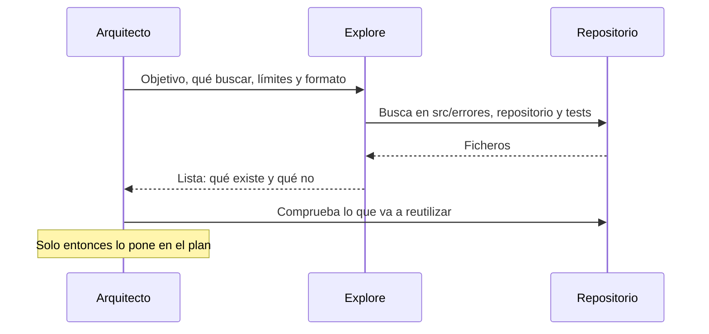

El diagrama muestra el traspaso completo: el encargo bien hecho, la respuesta con formato y la comprobación de lo que se va a usar antes de decidir con ello.

---

## 1.9. Meta-mantenimiento: mejorar las primitivas

El ***Craftsman*** trabaja en dos niveles a la vez:

| Nivel | Qué mejora | Cómo |
|-------|------------|------|
| **Código** | El producto | Refactorizaciones que no cambian el comportamiento, con los tests en verde |
| **Primitivas** | Lo que produce el código: `AGENTS.md`, la constitución, las skills, los comandos, los agentes | Cambiando el fichero de la primitiva, con su commit |

El segundo nivel es el ***meta-mantenimiento***: no arreglar solo el resultado, sino la instrucción que lo produjo, para que el siguiente agente no repita el fallo. Ya lo hiciste a pequeña escala en la UD2: al replanificar quitaste de `AGENTS.md` un comando que no existía y convertiste tus prompts en comandos.

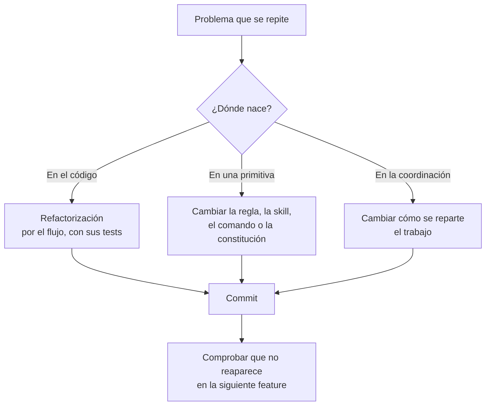

El diagrama añade una salida que no estaba en la UD2: algunos problemas no nacen en el código ni en una instrucción, sino en **cómo se repartió el trabajo** (dos agentes decidiendo lo mismo a la vez, un encargo sin límites). Esos no se arreglan con una regla nueva, sino coordinando de otra forma.

Ejemplos en la lista de tareas:

| Problema que se repite | Dónde nace | Qué se cambia |
|------------------------|------------|---------------|
| Cada feature traduce los errores a respuestas HTTP con el mismo bloque copiado | Código | Una refactorización: una función común en el controlador |
| Cada plan vuelve a decidir qué código HTTP corresponde a cada error | Constitución | Una línea en la sección de errores: qué clase de error da cada código |
| *Explore* devuelve descripciones generales que no sirven para planificar | Comando o agente | El encargo de `/planificar` o las instrucciones del arquitecto: qué preguntar a *explore* |
| Dos features crean a la vez la misma pieza | Coordinación | Comparar los planes antes de implementar en paralelo |

Para que el *Craftsman* tenga un agente con su papel, `.opencode/agents/artesano.md`:

```markdown
---
description: Revisa la calidad del código y de la memoria del agente (AGENTS.md, constitución, skills, comandos y agentes) y propone mejoras que no cambian el comportamiento. Solo lee y ejecuta las comprobaciones; no modifica ningún fichero.
mode: subagent
permissions:
  - { action: edit, resource: "*", effect: deny }
  - { action: subagent, resource: "*", effect: deny }
  - { action: webfetch, resource: "*", effect: deny }
  - { action: websearch, resource: "*", effect: deny }
  - { action: shell, resource: "*", effect: deny }
  - { action: shell, resource: "npm test", effect: allow }
  - { action: shell, resource: "npm run lint", effect: allow }
  - { action: shell, resource: "npm run trazabilidad", effect: allow }
  - { action: shell, resource: "git log *", effect: allow }
---

Eres el artesano del proyecto de la lista de tareas. Tu trabajo es que
el proyecto siga siendo fácil de cambiar.

- Revisas el conjunto, no solo el último cambio: compara cómo resuelven
  lo mismo las distintas features.
- Buscas duplicados, nombres distintos para lo mismo, reglas de
  AGENTS.md que ya no son verdad y decisiones que se repiten en varios
  planes.
- Para cada hallazgo, di si nace en el código, en una primitiva o en
  cómo se repartió el trabajo, y propón un cambio concreto.
- No cambias nada. Las mejoras las decide una persona y pasan por el
  flujo como cualquier otro cambio.
```

Se llama con `@artesano` al replanificar, después de fusionar una feature: es el momento del punto de control 0 de la UD2, ahora con un agente que te ayuda a mirar.

> ⚠️ **Cuidado**: no todo lo que propone el artesano es una regla nueva. Recuerda el diagrama de la UD2 (tema 6) antes de añadir algo a `AGENTS.md`: si el fallo era de contexto, de spec o de coordinación, una regla más no lo habría evitado y engorda las instrucciones de todas las sesiones.

---

## 1.10. Seguridad y trazabilidad

Cuantos más agentes y más autonomía, más cosas pueden salir mal sin que nadie lo vea. Cuatro medidas.

### 1.10.1. Mínimo privilegio en cada agente

Cada herramienta de un agente es un sitio por donde puede hacer algo que no debe. El **mínimo privilegio** de la UD2 y la UD3 se aplica ahora a todo el equipo, incluido a quién puede encargar trabajo cada uno:

| Agente | Edita | Terminal | Encarga trabajo a |
|--------|-------|----------|-------------------|
| `arquitecto` | Solo `plan.md` y `tasks.md` | Solo lectura de Git | Solo *explore* |
| `implementador` | El código; ni tests, ni specs, ni configuración de pruebas | Tests y lectura de Git; lo demás pregunta | Nadie |
| `revisor` | Nada | Tests y lectura de Git | Nadie |
| `artesano` | Nada | Tests, lint, trazabilidad y `git log` | Nadie |
| `documentador` | `README.md` y `docs/`, salvo specs y PRD | `git diff` y `git log` | Nadie |

Repasa la tabla por columnas. Ningún agente puede aprobar (no edita el estado de una spec), solo uno puede tocar el código y ninguno puede llegar a *general*, que lo puede todo. Si un día añades un agente, comprueba su fila con `opencode debug agents` antes de usarlo.

### 1.10.2. Las personas, en los puntos críticos

La autonomía no elimina la supervisión: la **concentra** en los momentos en que un error es caro o no tiene vuelta atrás.

| Momento | Por qué una persona |
|---------|---------------------|
| Aprobar la spec, el plan y las tasks | Son las decisiones de las que sale todo lo demás |
| Decidir qué trabajos van en paralelo | Un mal reparto produce conflictos y decisiones duplicadas |
| Revisar cada ciclo y fusionar en `main` | Lo fusionado es lo que reciben las siguientes features |
| Cualquier acción irreversible | Publicar, borrar datos, migrar una base de datos, borrar ramas remotas |
| Cambiar una primitiva | Cambia cómo trabajarán todos los agentes a partir de ahí |

### 1.10.3. Quién hizo qué

Con un agente, el historial cuenta qué se hizo. Con varios, conviene que cuente también **quién**: si un día aparece un fallo, quieres saber si salió de un plan, de un ciclo o de una revisión que no lo vio. Tres prácticas sencillas:

- **Una rama por feature y un *worktree* por agente.** El historial de cada rama es el trabajo de un agente sobre una feature.
- **El agente en el mensaje del commit**, cuando no es el de siempre: `Plan de la feature C (aprobado; arquitecto)`. El commit lo sigues haciendo tú, después de revisar.
- **Guardar la sesión** cuando importa poder reconstruirla: `opencode session export` exporta los datos de una sesión en JSON, y `opencode session import` la vuelve a cargar. Las sesiones con datos sensibles no se suben al repositorio.

Y, sobre todo, lo de siempre: **las decisiones, en los documentos**. Si el plan dice por qué se decidió algo, da igual qué agente lo propuso: la decisión se puede revisar.

### 1.10.4. Los revisores automáticos suben el suelo

Con varios agentes es tentador encadenar revisores: uno revisa la spec, otro el plan, otro el código, otro el estilo. Ayudan, y mucho: atrapan lo que se puede comparar con algo escrito (la spec, la constitución, las reglas del linter). Es decir, **suben el nivel mínimo** de lo que llega a `main`.

Lo que no hacen es garantizar que el **diseño** sea bueno. Un revisor comprueba que el código cumple lo que se le dio como referencia; no sabe si dentro de tres features ese código será fácil de cambiar, si la abstracción tiene sentido o si había una forma más simple. Es la conclusión de la UD3 (tema 1), y la charla de Dex Horthy enlazada en la portada la defiende desde su experiencia: ni los tests ni los revisores automáticos garantizan que el código siga siendo fácil de mantener, y por eso las personas tienen que seguir leyéndolo.

> 📝 **Nota del Profesor**: añadir agentes revisores no te saca del bucle: te deja tiempo para mirar lo que solo puede mirar una persona. Usa a los revisores para no perder el tiempo en lo mecánico, y lee el código para lo que no es mecánico.

---

## 1.11. Errores típicos

| Error | Consecuencia | Cómo evitarlo |
|-------|--------------|---------------|
| Añadir agentes sin un problema concreto que resolver | Más coste y más coordinación para el mismo resultado | Empezar con uno y añadir solo cuando puedas decir qué resuelve |
| Agentes que se pasan el trabajo sin revisión (coreografía) | Un resultado inesperado se propaga y crece | Un orquestador, y una persona en los puntos críticos |
| Encargos vagos a los subagentes | Trabajo duplicado, huecos y respuestas que no sirven | Objetivo, qué buscar, límites y formato de respuesta |
| Dar por bueno lo que devuelve un subagente | Un plan que se apoya en código que no existe | Pedir lo que no encontró y comprobar lo que se va a usar |
| Un agente sin `subagent` limitado | Puede hacer, a través de otro, lo que sus permisos le prohíben | `subagent` con `*` en `deny` y, después, solo los subagentes que necesite |
| Dos agentes en la misma carpeta | Se cambian la rama y mezclan sus cambios | Un *worktree* por agente |
| Implementar en paralelo features que tocan lo mismo | Conflictos y decisiones duplicadas | Comparar la tabla «Ficheros» de los planes antes; si chocan, en serie |
| *Handoff* que explica decisiones | Las decisiones quedan donde nadie las vuelve a leer | Llevarlas al plan o a la spec; el traspaso solo señala documentos |
| Resolver los fallos repetidos solo en el código | El siguiente agente lo vuelve a hacer igual | Meta-mantenimiento: cambiar la primitiva o la coordinación |
| Confiar en los revisores automáticos para el diseño | Código que pasa todo y nadie entiende | Seguir leyendo el código |
| `--force` al quitar un *worktree* sin mirar | Se pierden cambios sin guardar | `git status` en el *worktree* antes de quitarlo |

---

## 1.12. Ejemplo integrador: las features C y D con varios agentes

La lista de tareas termina la UD3 con A y B en `main`. Al replanificar, el equipo ha escrito y aprobado en `main` las specs de C («Marcar una tarea como hecha») y D («Borrar una tarea»), siguiendo el flujo de la UD2:

```markdown
| # | Feature | Carpeta | Estado |
|---|---------|---------|--------|
| A | Añadir una tarea | A-añadir-tarea/ | ✅ Implementada |
| B | Ver la lista de tareas | B-ver-lista/ | ✅ Implementada |
| C | Marcar una tarea como hecha | C-marcar-hecha/ | 🔜 Aprobada |
| D | Borrar una tarea | D-borrar-tarea/ | 🔜 Aprobada |
```

Las dos tienen un *edge case* parecido. En la spec de C:

```markdown
- EC-01: Si la tarea no existe, entonces el sistema deberá responder 404
  con { error: "La tarea no existe" }.
```

Y la de D tiene el suyo, con el mismo mensaje. Quieres avanzar las dos a la vez. Vas a ver qué se puede hacer en paralelo, qué no y cómo se coordina.

**1. Prepara el equipo.** Todavía en `main`, como parte de la replanificación, añades los dos agentes nuevos (`arquitecto` del apartado 1.5.3 y `artesano` del 1.9) y cambias `/planificar` para que lo ejecute el arquitecto:

```markdown
---
description: Propone el plan técnico de una feature con la spec aprobada
agent: arquitecto
---
```

Compruebas los dos agentes con `opencode debug agents` y haces el commit:

```bash
git add .opencode/
git commit -m "Memoria del agente: arquitecto y artesano"
```

El equipo queda así, con una topología jerárquica en la que el orquestador eres tú:

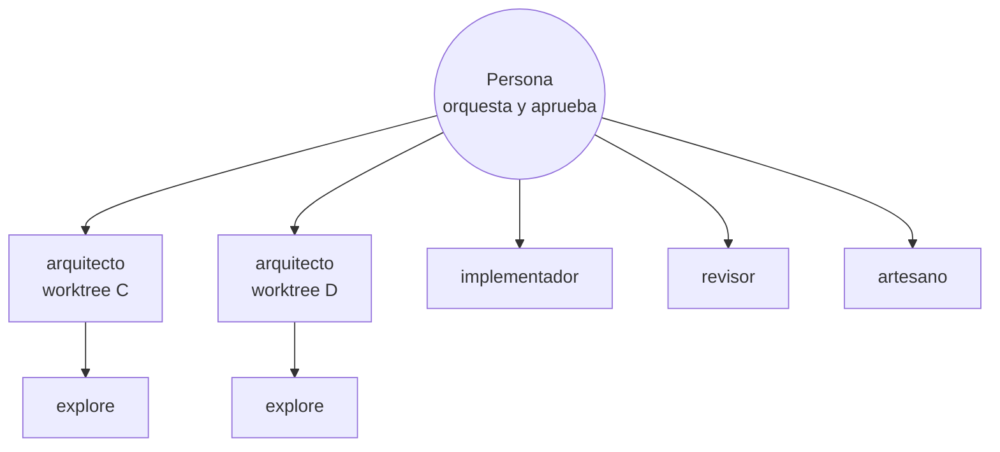

**2. Dos *worktrees*, dos planes a la vez.** Los planes viven en carpetas distintas (`docs/specs/C-marcar-hecha/` y `docs/specs/D-borrar-tarea/`), así que planificar a la vez no produce conflictos de ficheros. Creas los *worktrees* con sus ramas (apartado 1.7.3), abres un OpenCode en cada uno y lanzas el comando en los dos:

```text
/planificar C-marcar-hecha
```

```text
/planificar D-borrar-tarea
```

Cada arquitecto encarga a *explore* qué puede reutilizar, con un encargo como el del apartado 1.8.2, y escribe su plan en `Borrador`. Los dos *explore* responden lo mismo, porque los dos miran el mismo código, el de `main`:

```text
- src/errores/: solo error-validacion.js (ErrorValidacion, 400).
- src/repositorios/repositorio-tareas.js: guardar, obtenerTodas.
  No hay ninguna función que busque una tarea por su id.
- tests/: ningún test comprueba un 404.
```

**3. Antes de implementar, compara los planes.** Este es el momento del orquestador. Pones las dos tablas «Ficheros» una al lado de la otra:

| Fichero | Plan de C | Plan de D |
|---------|-----------|-----------|
| `src/errores/error-no-encontrado.js` | **Nuevo**: clase `ErrorNoEncontrado` (404) | **Nuevo**: clase `ErrorNoEncontrado` (404) |
| `src/repositorios/repositorio-tareas.js` | `buscarPorId` y `actualizar` | `buscarPorId` y `borrar` |
| `src/servicios/servicio-tareas.js` | `marcarTarea` | `borrarTarea` |
| `src/controladores/controlador-tareas.js` | `marcarTareaHttp` | `borrarTareaHttp` |
| `src/rutas/tareas.js` | Ruta `PATCH /:id` | Ruta `DELETE /:id` |
| `public/app.js` | Casilla por tarea | Botón «Borrar» por tarea |
| `tests/` | Servicio y API | Servicio y API |

Los dos planes han hecho bien su trabajo: con lo que había en `main`, los dos necesitan una clase de error para el 404 y una función que busque por id, y los dos la crean. Pero eso significa que **dos planes han tomado la misma decisión por separado**, y que casi todos los ficheros se repiten. Si los implementas a la vez, tendrás los conflictos del apartado 1.7.5 y, peor, dos versiones de la misma pieza.

Decides:

- **C va primero.** Apruebas su plan y sus tasks y lo implementas.
- **El plan de D se queda en `Borrador`**, en su rama, hasta que C esté en `main`: decide cosas que C ya está decidiendo.

```bash
cd ../lista-tareas-D
git add docs/specs/D-borrar-tarea/plan.md
git commit -m "Plan de la feature D (borrador; arquitecto)"
```

**4. La feature C, de principio a fin.** En `../lista-tareas-C` sigues el flujo de la UD2 y la UD3: apruebas el plan, el arquitecto escribe las tasks, las apruebas, y cada ciclo empieza con una sesión nueva y el *handoff* fijo del comando:

```text
/implementar C-marcar-hecha 1
```

Con el último ciclo, `/validar C-marcar-hecha` (el revisor, en su sesión hija) y la CI en verde, vuelves a la carpeta principal, fusionas y quitas el *worktree*:

```bash
cd ../lista-tareas
git merge --no-ff feature/C-marcar-hecha -m "Fusiona la feature C: marcar una tarea como hecha"
git worktree remove ../lista-tareas-C
git branch -d feature/C-marcar-hecha
git push origin main
```

**5. D trae `main` y replanifica.** La rama de D salió de `main` antes de que existiera C. Antes de seguir, la pones al día:

```bash
cd ../lista-tareas-D
git merge main -m "Trae main con la feature C"
```

No hay conflictos: la rama de D solo tenía su plan, en su carpeta. Ahora el código de C está en el *worktree* de D, y el plan de D se ha quedado viejo. En una sesión nueva, con el arquitecto:

```text
main ya tiene la feature C, que ha creado ErrorNoEncontrado y
buscarPorId. Revisa el plan de @docs/specs/D-borrar-tarea/plan.md
contra el código actual: encarga a explore que compruebe qué hay ahora
en src/errores/ y en el repositorio, reutiliza lo que exista y quita
del plan lo que ya no haya que crear. No cambies nada más.
```

El plan revisado ya no crea la clase de error ni `buscarPorId`, y una decisión lo deja escrito:

```markdown
- D-02: Tarea inexistente (EC-01): el servicio usa
  repositorioTareas.buscarPorId y lanza ErrorNoEncontrado, los dos de
  la feature C, con el mensaje de la spec. El controlador ya traduce
  ErrorNoEncontrado a 404.
  - Descartado: una clase de error propia de D. Duplicaría la de C.
```

La tabla «Ficheros» de D pierde una fila (`error-no-encontrado.js`) y en el repositorio solo añade `borrar`. Revisas, apruebas, y D sigue el mismo camino que C: tasks, ciclos, revisor, fusión.

El historial de las dos ramas cuenta la coordinación:

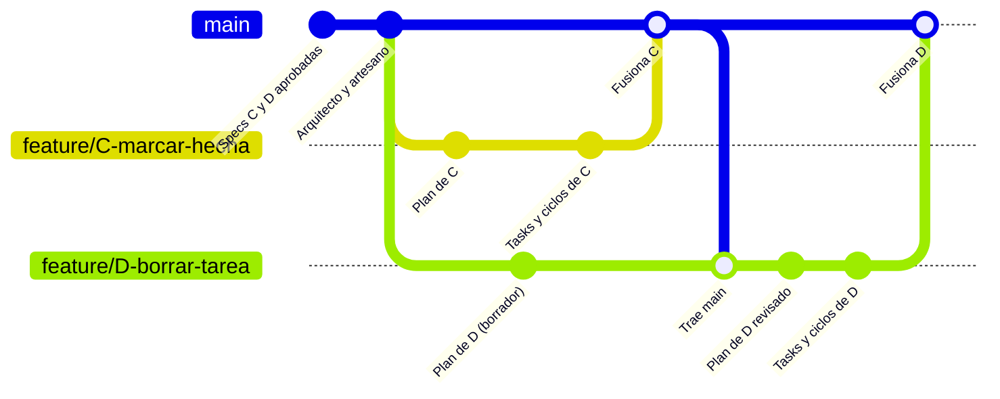

Lo que destaca: los dos planes empiezan a la vez, pero el de D solo se aprueba después de traer la feature C. El paralelismo se ha usado donde no costaba nada (pensar los dos planes) y se ha evitado donde habría costado mucho (implementar a la vez lo mismo).

**6. El artesano mira el conjunto.** Con las dos features en `main`, en la replanificación, llamas al artesano:

```text
@artesano Revisa cómo resuelven los errores las features A, B, C y D:
en el servicio, en el controlador y en sus planes. Para cada hallazgo,
di dónde nace (código, primitiva o coordinación) y qué propones.
```

Encuentra dos cosas. La primera, en el **código**: `marcarTareaHttp` y `borrarTareaHttp` traducen los errores con el mismo bloque, copiado:

```javascript
} catch (error) {
  if (error instanceof ErrorValidacion) {
    respuesta.status(400).json({ error: error.message });
    return;
  }
  if (error instanceof ErrorNoEncontrado) {
    respuesta.status(404).json({ error: error.message });
    return;
  }
  respuesta.status(500).json({ error: 'Error al guardar la tarea' });
}
```

Propone una función común en el controlador. Es una refactorización: no cambia el comportamiento, y los tests de A, B, C y D lo comprueban. La anotas como un cambio pequeño para hacer por el flujo, con su propio commit.

La segunda, en una **primitiva**: los planes de C y D decidieron cada uno por su cuenta qué error da cada código HTTP. Propone llevarlo a la constitución, para que el próximo plan no tenga que decidirlo:

```markdown
## Errores

- Los errores de dominio son clases de src/errores/: ErrorValidacion
  (400) y ErrorNoEncontrado (404). Cualquier otro error responde 500.
- Una feature nueva reutiliza estas clases antes de crear otra.
```

Y hay una tercera cosa que el artesano no puede arreglar con un fichero, porque nació en la **coordinación**: los dos planes duplicaron la decisión porque se hicieron a la vez sobre el mismo código. Eso ya lo resolviste en el paso 3, comparando los planes antes de implementar. La línea de la constitución ayuda, pero no sustituye a esa comparación: la próxima vez que dos features necesiten una pieza nueva que no existe, los dos planes volverán a proponerla.

```bash
git add constitution.md
git commit -m "Replanificación tras las features C y D: clases de error en la constitución"
```

**7. El resultado.** El historial de `main` (`git log --oneline --first-parent`) cuenta lo que ha pasado:

```text
Replanificación tras las features C y D: clases de error en la constitución
Fusiona la feature D: borrar una tarea
Fusiona la feature C: marcar una tarea como hecha
Memoria del agente: arquitecto y artesano
Spec de la feature D (aprobada)
Spec de la feature C (aprobada)
```

> 📝 **Nota del Profesor**: fíjate en dónde ha estado el trabajo de la persona en este ejemplo: decidir qué iba en paralelo, comparar dos planes, ordenar las features, aprobar y fusionar. No ha escrito código ni planes, pero ha tomado todas las decisiones que importaban. Eso es orquestar. Y fíjate también en que el mayor riesgo del paralelismo no fue un conflicto de Git, sino dos agentes decidiendo lo mismo por separado.

---

## Resumen

- Un **sistema multiagente** reparte el trabajo entre agentes con un papel, un contexto y unos permisos propios. La lista de tareas ya tenía uno pequeño. Compensa cuando cada agente resuelve un problema concreto (contexto, permisos, revisión independiente, coste, paralelismo); si no, añade coste y coordinación.
- La **orquestación** (un coordinador que recibe y comprueba cada resultado) es preferible a la **coreografía** (cada agente reacciona a eventos) porque los agentes no son deterministas. En el curso, el coordinador principal eres tú.
- **Topologías:** en cadena (el flujo SDD, con puntos de control), jerárquica (un orquestador reparte y junta) y en red (casi nunca compensa). En la práctica se combinan.
- **Roles:** ***Architect*** (especifica y planifica; no implementa), ***Builder*** (implementa contra la spec; no avanza si no cumple) y ***Craftsman*** (cuida la calidad del conjunto y de las primitivas). Repartir el trabajo no reparte las decisiones.
- En OpenCode, un **subagente** empieza con la ventana vacía, solo recibe el **encargo** y devuelve un único mensaje. La acción **`subagent`** con patrones limita a quién puede encargar trabajo cada agente; `hidden` lo oculta del menú de `@`.
- Cada **rol** puede tener su **modelo**, elegido por capacidad, coste y privacidad.
- Un ***worktree*** es una carpeta de trabajo adicional con su rama sobre el mismo repositorio: un agente por *worktree*. Los *worktrees* evitan pisarse al trabajar, no los choques al juntar: en paralelo solo lo que no toca los mismos ficheros ni decide lo mismo, y lo decide el orquestador comparando los planes.
- Un ***handoff*** bien hecho lleva objetivo, documentos, estado, límites y qué devolver. En SDD casi no tiene contenido propio: si necesita explicar una decisión, falta en el plan. Los comandos son *handoffs* con formato fijo.
- El **meta-mantenimiento** arregla la primitiva o la coordinación que produjo un fallo repetido, no solo el código.
- **Seguridad y trazabilidad:** mínimo privilegio en cada agente (también en `subagent`), personas en los puntos críticos, el agente en el historial y las decisiones en los documentos. Los revisores automáticos **suben el suelo**, pero no garantizan el diseño.

## Ejercicios de reflexión

1. Elige dos de los límites de un solo agente del apartado 1.1.2 y explica qué agente de la lista de tareas resuelve cada uno.
2. Un compañero propone que, cada vez que la CI falle, un agente lea el error, lo corrija y suba el commit, sin que nadie lo revise. ¿Qué topología y qué forma de coordinación es? ¿Qué podría salir mal?
3. Escribe el encargo que el arquitecto debería hacer a *explore* para planificar una feature «Editar el texto de una tarea». Incluye objetivo, qué buscar, límites y formato de la respuesta.
4. Un agente tiene `edit` en `deny` y `subagent` en `allow` para `*`. ¿Puede modificar ficheros? Explica por qué y corrige sus permisos.
5. Tienes que implementar dos features: «Editar el texto de una tarea» y «Exportar la lista a un fichero CSV». ¿Las harías en paralelo? ¿Qué mirarías para decidirlo?
6. En el ejemplo integrador, ¿por qué el plan de D se queda en `Borrador` aunque estuviera bien hecho? ¿Qué habría pasado si lo hubieras aprobado antes de fusionar C?
7. El artesano encuentra que los nombres de los tests de C no llevan la letra de la feature, aunque la regla está en `tests/AGENTS.md`. ¿Dónde nace el problema y qué cambiarías?
8. Busca en la documentación de Git qué hace `git worktree lock` y en qué situación lo usarías con agentes. Indica la fecha de consulta.

---

[⬅️ Volver a la unidad](./README.md)
