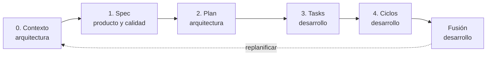
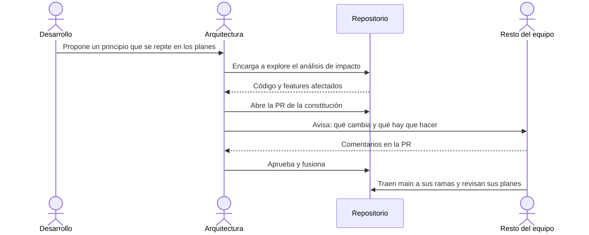
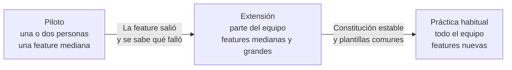
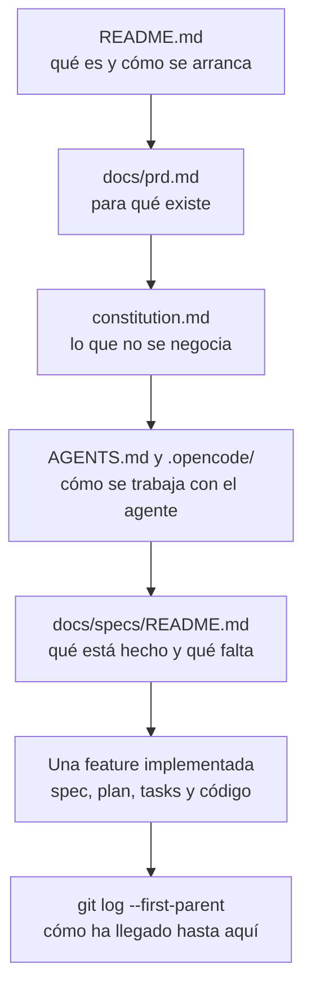
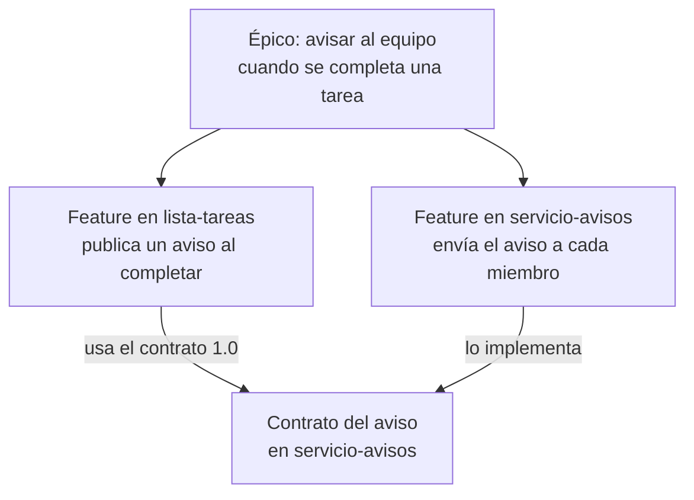

# 2. SDD en equipo

[⬅️ Volver a la unidad](./README.md)

## Índice

- [2.1. Del agente al equipo](#21-del-agente-al-equipo)
  - [2.1.1. Qué cambia cuando sois varios](#211-qué-cambia-cuando-sois-varios)
  - [2.1.2. La spec como contrato entre personas](#212-la-spec-como-contrato-entre-personas)
  - [2.1.3. El conocimiento que solo está en una cabeza](#213-el-conocimiento-que-solo-está-en-una-cabeza)
- [2.2. Los roles de un equipo con SDD](#22-los-roles-de-un-equipo-con-sdd)
  - [2.2.1. Producto](#221-producto)
  - [2.2.2. Arquitectura](#222-arquitectura)
  - [2.2.3. Desarrollo](#223-desarrollo)
  - [2.2.4. Calidad](#224-calidad)
  - [2.2.5. Quién hace qué en cada punto de control](#225-quién-hace-qué-en-cada-punto-de-control)
  - [2.2.6. Personas y agentes](#226-personas-y-agentes)
- [2.3. Revisar en equipo: *pull requests* y propietarios](#23-revisar-en-equipo-pull-requests-y-propietarios)
  - [2.3.1. Cada cambio a `main`, por una *pull request*](#231-cada-cambio-a-main-por-una-pull-request)
  - [2.3.2. Quién revisa qué: `CODEOWNERS`](#232-quién-revisa-qué-codeowners)
  - [2.3.3. Que el tech lead no sea un cuello de botella](#233-que-el-tech-lead-no-sea-un-cuello-de-botella)
- [2.4. Gobernanza de la constitución](#24-gobernanza-de-la-constitución)
  - [2.4.1. El documento más delicado del repositorio](#241-el-documento-más-delicado-del-repositorio)
  - [2.4.2. Cómo se cambia](#242-cómo-se-cambia)
  - [2.4.3. Qué lleva a cambiarla y qué no va en ella](#243-qué-lleva-a-cambiarla-y-qué-no-va-en-ella)
  - [2.4.4. Versiones de la constitución](#244-versiones-de-la-constitución)
  - [2.4.5. La memoria del agente también se gobierna](#245-la-memoria-del-agente-también-se-gobierna)
- [2.5. Adopción gradual](#25-adopción-gradual)
  - [2.5.1. Piloto, extensión y práctica habitual](#251-piloto-extensión-y-práctica-habitual)
  - [2.5.2. Qué hace que funcione](#252-qué-hace-que-funcione)
- [2.6. Incorporar a una persona nueva](#26-incorporar-a-una-persona-nueva)
- [2.7. Equipos grandes y varios repositorios](#27-equipos-grandes-y-varios-repositorios)
  - [2.7.1. Muchas specs a la vez](#271-muchas-specs-a-la-vez)
  - [2.7.2. Una feature que cruza repositorios](#272-una-feature-que-cruza-repositorios)
- [2.8. SDD y regulación](#28-sdd-y-regulación)
  - [2.8.1. El Reglamento europeo de inteligencia artificial](#281-el-reglamento-europeo-de-inteligencia-artificial)
  - [2.8.2. Lo que aporta SDD](#282-lo-que-aporta-sdd)
  - [2.8.3. El historial como registro de decisiones](#283-el-historial-como-registro-de-decisiones)
- [2.9. Señales de que SDD no funciona en el equipo](#29-señales-de-que-sdd-no-funciona-en-el-equipo)
- [2.10. Errores típicos](#210-errores-típicos)
- [2.11. Ejemplo integrador: la lista de tareas con un equipo](#211-ejemplo-integrador-la-lista-de-tareas-con-un-equipo)
- [Resumen](#resumen)
- [Ejercicios de reflexión](#ejercicios-de-reflexión)

> **Criterios que trabaja este tema:** OA4 c.

---

## 2.1. Del agente al equipo

### 2.1.1. Qué cambia cuando sois varios

Hasta ahora has trabajado con SDD tú solo: escribías la spec, la aprobabas, revisabas el plan y las tasks, supervisabas cada ciclo y fusionabas. En el tema 1 repartiste el trabajo entre varios **agentes**, pero todas las decisiones seguían siendo tuyas.

En un equipo, las decisiones se reparten entre **personas**. Quien sabe qué necesita el negocio no es quien conoce la arquitectura, y ninguna de las dos es quien va a escribir los tests de la página. Eso cambia la naturaleza de los documentos:

| Trabajando solo | En equipo |
|-----------------|-----------|
| La spec es un contrato con el **agente** | La spec es un contrato entre **personas**, y también con el agente |
| Lo que no está escrito lo sabes tú | Lo que no está escrito lo sabe una persona, y las demás lo suponen |
| Aprobar es una decisión tuya | Aprobar es un acuerdo: hay que saber quién aprueba qué |
| La constitución la cambias cuando la necesitas | Un cambio en la constitución cambia cómo trabajan los agentes de todo el equipo |

El cambio más importante no es técnico: la comunicación pasa de ser **conversacional e implícita** (un comentario en el chat, una conversación en el pasillo) a ser **escrita y explícita**. Lo que antes «se sabía», ahora tiene que estar en la spec antes de que el agente toque el código. Al principio cuesta, sobre todo en equipos acostumbrados a ir deprisa de manera informal. A cambio, las decisiones quedan escritas, se pueden revisar y cualquiera las puede encontrar.

### 2.1.2. La spec como contrato entre personas

El problema clásico de un equipo sin specs: alguien de desarrollo implementa algo razonable según lo que entendió, producto lo ve en la demostración y dice «esto no es lo que pedí». Los dos tienen razón desde su punto de vista, porque nunca hubo un texto que los pusiera de acuerdo.

Con SDD, ese texto existe **antes** de que haya código, y el desacuerdo aparece en el punto de control 1, cuando corregirlo cuesta una frase. Es el mismo principio de la UD2 (corregir pronto sale barato), con un matiz: en un equipo, el error más caro no es un fallo del código, sino un **malentendido entre personas** que nadie detectó hasta el final.

Un ejemplo con la lista de tareas. Producto pide «poder editar las tareas». Sin spec, cada persona entiende una cosa:

| Quien lo lee | Lo que entiende |
|--------------|-----------------|
| Producto | Cambiar el texto de una tarea que se escribió mal |
| Desarrollo | Cambiar cualquier campo: texto, estado, fecha |
| Calidad | ¿Y si se edita una tarea hecha? ¿Y si se deja vacía? |

La spec obliga a decidirlo: qué se puede editar (solo el texto), qué pasa con una tarea hecha (se puede editar y sigue hecha) y qué pasa con un texto vacío (400, como al crearla). Tres conversaciones que, sin spec, habrían ocurrido después de implementar.

### 2.1.3. El conocimiento que solo está en una cabeza

En muchos equipos hay decisiones importantes que solo conoce una persona: por qué se eligió esa librería, por qué ese módulo no se toca, qué pasó la última vez que alguien cambió aquello. A ese conocimiento que no está escrito en ningún sitio se le suele llamar **conocimiento tribal**. Cuando esa persona se va, de vacaciones o del equipo, el conocimiento se va con ella.

Los artefactos de SDD son el mejor antídoto que hay, aunque no sea perfecto:

| Pregunta | Sin SDD | Con SDD |
|----------|---------|---------|
| ¿Por qué la API responde así? | Pregúntale a quien lo hizo | La spec de la feature |
| ¿Por qué se descartó esta librería? | Nadie se acuerda | La alternativa descartada del plan |
| ¿Qué no se puede hacer en este proyecto? | Lo sabe el tech lead | La constitución y `AGENTS.md` |
| ¿Qué está hecho y qué falta? | Reunión | El índice de features |

Y hay un efecto que no se ve a primera vista: **escribir la constitución** obliga al equipo a poner en común lo que cada persona daba por supuesto. Muchas veces, la primera discusión de la constitución descubre que dos personas del equipo tenían reglas distintas en la cabeza.

> 📝 **Nota del Profesor**: lo que escribes para que el agente lo entienda es exactamente lo que necesita una persona nueva para entender el proyecto. En SDD, documentar para el agente y documentar para el equipo es el mismo trabajo, y por eso se hace.

---

## 2.2. Los roles de un equipo con SDD

SDD no inventa roles nuevos, pero cambia **dónde** trabaja cada uno: casi todos se desplazan hacia el principio del flujo, a los documentos, donde sus decisiones tienen más efecto.

### 2.2.1. Producto

Quien lleva **producto** (*Product Owner*, *Product Manager*) decide qué se construye y por qué.

- **Antes:** escribía historias de usuario y criterios de aceptación, y veía el resultado en la demostración.
- **Con SDD:** su trabajo es la entrada del flujo. Mantiene el PRD, decide el orden del índice de features y es quien **aprueba la spec** en el punto de control 1: comprueba que dice lo que el negocio necesita, en especial los *edge cases* que tienen que ver con el usuario y el fuera de alcance.

La fricción habitual: las specs viven en el repositorio, un sitio que mucha gente de producto no frecuenta. Hay dos salidas razonables: que producto aprenda a revisar una *pull request* de un fichero Markdown (en GitHub se lee y se comenta sin instalar nada), o enlazar cada spec desde la herramienta donde producto ya trabaja. Lo que no funciona es tener la spec en dos sitios (UD2, tema 4: una sola fuente de verdad).

### 2.2.2. Arquitectura

Quien lleva la **arquitectura** (*tech lead*) toma las decisiones técnicas que afectan a todo el proyecto. Con SDD, su trabajo se concentra en dos momentos de mucho efecto:

1. **La constitución y la memoria del agente** (`AGENTS.md`, agentes, comandos y skills). Ahí se escriben las decisiones que todos los agentes de todo el equipo van a respetar. Una buena constitución mejora todo lo que el equipo genera; una mala lo empeora todo a la vez.
2. **El punto de control 2**, el del plan. Ahí comprueba que la forma de construir encaja con la arquitectura **antes** de que exista código.

Encontrar una mala decisión de arquitectura en un plan de dos páginas cuesta minutos. Encontrarla en una *pull request* con cientos de líneas generadas cuesta mucho más, y la tentación es dejarla pasar.

### 2.2.3. Desarrollo

Quien **desarrolla** (*developer*) escribe menos código a mano y pasa más tiempo en:

- Escribir y afinar specs con producto, sobre todo los *edge cases* y el fuera de alcance.
- Supervisar el plan y las tasks que propone el agente.
- Revisar cada ciclo con criterio técnico: es el punto de control 4 de la UD2.
- Proponer cambios a la constitución cuando aparece una decisión que se repite.

Es el papel que has hecho en todo el curso: **orquestar y validar** el trabajo del agente, en lugar de ser quien escribe cada línea.

### 2.2.4. Calidad

Quien se ocupa de **calidad** (*QA*, *tester*) busca dónde puede fallar el sistema.

- **Antes:** llegaba al final, con el código hecho, a encontrar errores.
- **Con SDD:** entra en dos puntos de control donde su trabajo vale mucho más. En el **1**, añade los *edge cases* que producto y desarrollo no han visto: cada uno que añade es un test que existirá antes que el código (UD3, tema 2). En el **3**, comprueba que hay tasks de tests para cada criterio y que van antes de la implementación.

Un *edge case* que calidad añade a la spec cuesta una línea. El mismo caso descubierto en producción cuesta un incidente.

### 2.2.5. Quién hace qué en cada punto de control

Así se reparte el trabajo en los puntos de control del flujo de la UD2. «Aprueba» quiere decir que sin su visto bueno no se sigue; «participa», que revisa y opina; «informado», que lo sabe:

| Punto de control | Producto | Arquitectura | Desarrollo | Calidad |
|------------------|----------|--------------|------------|---------|
| **0. Contexto** (constitución, `AGENTS.md`, índice) | Aprueba el orden del índice | **Aprueba** la constitución y la memoria del agente | Propone cambios | Participa |
| **1. Spec** | **Aprueba** | Participa: restricciones técnicas | Participa: si es viable | **Aprueba** los *edge cases* |
| **2. Plan** | Informado | **Aprueba** | Participa | — |
| **3. Tasks** | — | — | **Aprueba** | Participa: tasks de tests |
| **4. Cada ciclo** | — | — | **Aprueba** | Ejecuta las comprobaciones manuales |
| **Fusión en `main`** | — | Revisión puntual | **Aprueba** | Comprobación final |



El diagrama muestra el flujo de la UD2 con un rol al mando de cada punto de control. Lo que destaca: nadie aprueba en todos, y nadie está ausente de todos.

> 💡 **Tip del Examinador**: «¿En qué puntos de control participa calidad en un equipo con SDD?». En el de la spec, añadiendo *edge cases* (cada uno se convertirá en un test antes que el código), y en el de las tasks, comprobando que hay tasks de tests para cada criterio y que van antes que la implementación. Llegar solo al final, con el código hecho, desaprovecha su trabajo.

### 2.2.6. Personas y agentes

En el tema 1 viste los roles de los **agentes**: *Architect*, *Builder* y *Craftsman*. No sustituyen a los roles del equipo: los **ayudan**. Cada persona trabaja con los agentes de su parte del flujo:

| Rol del equipo | Agentes con los que trabaja | Para qué |
|----------------|-----------------------------|----------|
| Producto | *plan* (entrevista y ronda de aclaración de la UD2) | Encontrar las preguntas que la spec no responde |
| Arquitectura | `arquitecto`, `artesano` | Proponer planes; revisar el conjunto y las primitivas |
| Desarrollo | `implementador`, `revisor` | Implementar las tasks; revisar contra la spec |
| Calidad | `revisor` | La matriz de trazabilidad: qué identificador no tiene test |

La regla del tema 1 sigue valiendo, ahora con varias personas: **los agentes proponen y las personas deciden**, y cada persona decide en su punto de control.

---

## 2.3. Revisar en equipo: *pull requests* y propietarios

### 2.3.1. Cada cambio a `main`, por una *pull request*

Trabajando solo, aprobabas con un commit en `main` (la spec) o con una fusión (la feature). En un equipo, el mecanismo habitual para que otra persona revise antes de que algo llegue a `main` es la ***pull request*** (PR): una propuesta de fusionar una rama, con sus cambios a la vista, donde se comenta, se pide corregir y se aprueba.

El flujo de la UD2 encaja así:

| Paso del flujo | Trabajando solo | En equipo |
|----------------|-----------------|-----------|
| Aprobar la spec | Commit en `main` | PR de una rama corta (`spec/E-editar-texto`); se fusiona cuando aprueban producto y calidad |
| Plan, tasks y ciclos | Commits en la rama de la feature | Igual, en `feature/E-editar-texto`, con una PR en **borrador** abierta desde el plan para que se vea el avance |
| Fusionar la feature | `git merge --no-ff` | Se aprueba y se fusiona la PR con un commit de fusión |

Una PR en **borrador** (*draft*) es una PR que todavía no se puede fusionar: sirve para enseñar el trabajo en curso y recibir comentarios. Arquitectura comenta el plan en la PR de la feature antes de que empiece la implementación; desarrollo y calidad, las tasks. Cuando la feature está implementada, la PR pasa a **lista para revisión** y se aprueba entera.

Y lo que ya sabías sigue igual: la CI se ejecuta en cada `push` (UD2 y UD3) y su resultado aparece en la PR. Con una **regla de protección de rama** en GitHub se puede exigir que la CI esté en verde y que haya aprobaciones antes de fusionar en `main`, y que nadie pueda subir a `main` directamente.

### 2.3.2. Quién revisa qué: `CODEOWNERS`

¿Cómo sabe GitHub a quién pedir la revisión de cada PR? Con un fichero **`CODEOWNERS`** (propietarios del código), en la raíz, en `.github/` o en `docs/`. Cada línea tiene un **patrón** de ficheros y sus **propietarios**: personas (`@usuario`) o equipos de una organización (`@organizacion/equipo`).

`.github/CODEOWNERS` de la lista de tareas:

```text
# Por defecto, cualquier cambio lo revisa desarrollo
*                         @tu-organizacion/desarrollo

# Producto: el PRD y las specs
/docs/prd.md              @tu-organizacion/producto
/docs/specs/*/spec.md     @tu-organizacion/producto @tu-organizacion/calidad

# Arquitectura: los planes, los principios y la memoria del agente
/docs/specs/*/plan.md     @tu-organizacion/arquitectura
/constitution.md          @tu-organizacion/arquitectura
/AGENTS.md                @tu-organizacion/arquitectura
/.opencode/               @tu-organizacion/arquitectura
/.github/                 @tu-organizacion/arquitectura
```

Cómo funciona:

- Al abrir una PR que toca un fichero con propietario, GitHub **pide la revisión** a sus propietarios automáticamente.
- Si un fichero encaja con varias líneas, **gana la última que coincide**, la misma regla que los permisos de OpenCode. Por eso la línea general (`*`) va primero y las excepciones después.
- Con la regla de protección de rama, se puede **exigir** la aprobación de los propietarios antes de fusionar.
- El fichero tiene que estar en la rama de destino (`main`), y los equipos necesitan permiso de escritura en el repositorio.

> ⚠️ **Cuidado**: cuando una línea tiene varios propietarios, basta con que apruebe **uno** de ellos. En el fichero de arriba, una spec la puede aprobar producto **o** calidad. Si el equipo quiere que la apruebe producto **y** que calidad haya revisado los *edge cases*, `CODEOWNERS` no lo garantiza: tiene que ser un acuerdo del equipo (por ejemplo, en la plantilla de la PR de la spec, una casilla que marca calidad).

Fíjate en las dos últimas líneas: `.opencode/` y `.github/` son de arquitectura. Ahí están los agentes con sus permisos, los comandos y la CI. Un cambio en un permiso del implementador o en un paso del workflow es tan delicado como un cambio en la constitución (apartado 2.4.5).

### 2.3.3. Que el tech lead no sea un cuello de botella

Si todo pasa por arquitectura, arquitectura se convierte en el cuello de botella: las PR esperan, el equipo se impacienta y las revisiones se hacen deprisa, que es lo mismo que no hacerlas. Hay que decidir qué cambios necesitan revisión de arquitectura y cuáles puede aprobar cualquier otra persona del equipo:

| Cambio | Revisa |
|--------|--------|
| Constitución, `AGENTS.md`, agentes y permisos, CI | Arquitectura |
| Plan con una decisión que toca varias capas o añade una dependencia | Arquitectura |
| Plan que sigue el patrón de una feature anterior | Otra persona de desarrollo |
| Tasks y ciclos | Otra persona de desarrollo |
| Spec | Producto, con los *edge cases* revisados por calidad |

La constitución ayuda a repartir: cuanto más decide, menos tiene que decidir cada plan, y más planes puede aprobar cualquier persona con criterio. Es la razón de fondo para llevar a la constitución las decisiones que se repiten (UD2, tema 1).

---

## 2.4. Gobernanza de la constitución

### 2.4.1. El documento más delicado del repositorio

La constitución entra en **todas** las sesiones de **todos** los agentes de **todo** el equipo (UD2, tema 6). Un cambio en ella cambia, desde ese momento, cómo planifican e implementan todos. Si se cambia sin avisar, el agente de una persona empieza a generar código distinto del que hay, y nadie sabe por qué.

Por eso necesita **gobernanza** (*governance*): reglas claras sobre quién la cambia, cómo se propone un cambio y cómo se comunica.

### 2.4.2. Cómo se cambia

| Tamaño del equipo | Cómo se cambia |
|-------------------|----------------|
| Pequeño (unas pocas personas) | Cualquiera propone; arquitectura aprueba |
| Mediano o grande | Como infraestructura crítica: PR con revisión de arquitectura, aviso al equipo antes de fusionar y comprobación del impacto |

En los dos casos, un cambio de la constitución va en **su propia PR**, nunca mezclado con una feature: así se revisa por lo que es y el historial muestra cuándo cambió cada principio (UD2, tema 1: la versión de la constitución que produjo cada código).

La descripción de esa PR debería responder a cuatro preguntas:

```markdown
## Cambio de la constitución

- **Qué cambia:** <el principio nuevo, modificado o eliminado>.
- **Por qué:** <el problema, la decisión repetida o el incidente que lo motiva>.
- **A qué afecta:** <código existente que ya no lo cumple; features en curso
  cuyo plan hay que revisar>.
- **Qué hay que hacer:** <traer main a las ramas abiertas; revisar los planes
  afectados; abrir una feature si hay que adaptar código>.
```

La tercera pregunta es la que más se olvida. Para responderla, el agente ayuda: un encargo a *explore* (tema 1) que busque qué partes del código incumplirían el principio nuevo, y una mirada al índice para ver qué features tienen plan en curso.



El diagrama muestra que el cambio no termina al fusionar: termina cuando las ramas abiertas lo han incorporado y sus planes se han revisado con el principio nuevo.

### 2.4.3. Qué lleva a cambiarla y qué no va en ella

Motivos habituales para cambiar la constitución:

- Una **decisión de arquitectura** nueva que vale para todo el proyecto.
- Una **decisión que se repite** en varios planes (el tema 1 terminó con una: las clases de error).
- Un **patrón** que el agente ha generado varias veces y que hay que prohibir de forma explícita.
- Una **tecnología** nueva en el proyecto.
- Una **convención** que era conocimiento tribal y ahora se escribe.
- Un **incidente** causado por código que incumplía una regla que nadie había escrito.

Y lo que no va, aunque a veces se cuele:

| No va en la constitución | Dónde va |
|--------------------------|----------|
| Una decisión de una sola feature | Su spec o su plan |
| Detalles de cómo se implementa algo | El plan |
| Información que cambia a menudo | `AGENTS.md`, si es operativa, o ningún sitio |
| Reglas que se contradicen | En ninguno: se resuelve la contradicción |

> 💡 **Tip del Examinador**: «¿Por qué un cambio en la constitución necesita más control que un cambio en una spec?». Porque la constitución entra en todas las sesiones de todos los agentes del equipo: un cambio altera desde ese momento cómo se planifica e implementa todo, y puede dejar código existente o planes en curso incumpliéndola. Por eso va en su propia PR, con revisión de arquitectura, análisis de impacto y aviso al equipo.

### 2.4.4. Versiones de la constitución

En el curso, la historia de la constitución la cuenta **Git**: cada cambio, en su commit con un mensaje fijo (`Constitución: <qué cambia>`), y en equipo, en su PR. Para saber qué decía en un momento dado basta con `git log` y `git show`.

Algunas herramientas van más allá. La constitución de **Spec Kit** lleva un **número de versión** y dos fechas (cuándo se adoptó y cuándo se cambió por última vez), y su comando para modificarla sigue una regla parecida a las versiones de las librerías:

| Cambio | Versión | Ejemplo |
|--------|---------|---------|
| Se elimina o se redefine un principio de forma incompatible | Mayor (`1.4.0` → `2.0.0`) | Los controladores pasan a poder contener lógica |
| Se añade un principio o se amplía de forma importante | Menor (`1.4.0` → `1.5.0`) | Sección nueva de almacenamiento |
| Se aclara la redacción sin cambiar el significado | Parche (`1.4.0` → `1.4.1`) | Corregir una frase ambigua |

Un número de versión es útil cuando hay que **citar** la constitución desde fuera: otros repositorios, un plan que dice «cumple la constitución 1.5» o una auditoría. Si nada de eso pasa en tu proyecto, el historial de Git basta. Lo que no puede faltar en ningún caso es poder responder a «¿qué decía la constitución cuando se implementó esta feature?».

### 2.4.5. La memoria del agente también se gobierna

La constitución no es el único fichero que cambia el comportamiento de todos los agentes. También lo hacen:

- **`AGENTS.md`** y los **`AGENTS.md` de carpeta**: lo que el agente cree que es verdad del proyecto.
- **Los agentes** de `.opencode/agents/`: un permiso de más en el implementador y vuelve a poder cambiar los tests.
- **Los comandos y las skills**: el encargo con el que trabajan todos.
- **`opencode.json`**: los permisos de todo el proyecto y los servidores MCP (UD3, tema 5).
- **La CI** (`.github/workflows/`): lo que se comprueba antes de fusionar.

Todo eso va al mismo nivel que la constitución: PR propia y revisión de arquitectura (por eso estaban en el `CODEOWNERS` del apartado 2.3.2).

¿Y si una persona quiere trabajar con sus propias preferencias? Para eso está la configuración **personal** de OpenCode, fuera del repositorio: `~/.config/opencode/AGENTS.md` para sus reglas y `~/.config/opencode/` para sus skills o su configuración (UD1, tema 3). Lo personal no se sube; lo que se sube es del equipo y se gobierna como tal.

| Quieres… | Dónde | Quién lo revisa |
|----------|-------|-----------------|
| Que el agente te conteste más breve | `~/.config/opencode/AGENTS.md` | Nadie: es tuyo |
| Un comando que solo usas tú | `~/.config/opencode/commands/` | Nadie |
| Cambiar un comando que usa todo el equipo | `.opencode/commands/` | Arquitectura, en una PR |
| Cambiar los permisos del implementador | `.opencode/agents/implementador.md` | Arquitectura, en una PR |

---

## 2.5. Adopción gradual

### 2.5.1. Piloto, extensión y práctica habitual

Un equipo que ya trabaja de otra manera rara vez adopta SDD de golpe. Escribir buenas specs se aprende con la práctica, y los primeros documentos cuestan más tiempo del que ahorran. Lo que suele funcionar es ir por etapas, y pasar a la siguiente cuando se cumple un hito, no cuando pasa una fecha:



El diagrama muestra las etapas y lo que hace falta para pasar de una a otra.

| Etapa | Quién | Qué se hace | Qué no se hace |
|-------|-------|-------------|----------------|
| **Piloto** | Una o dos personas que quieran probar | El flujo completo en **una** feature mediana; se anota qué costó, qué errores se evitaron y qué falló | Obligar a todo el equipo; elegir una corrección de una línea o un épico |
| **Extensión** | Una parte del equipo | Se comparten los resultados; se escribe o se revisa la constitución con lo aprendido; se acuerda **cuándo** se usa SDD y cuándo no | Aplicarlo a todo: los cambios pequeños siguen con un buen prompt (UD2, tema 1) |
| **Práctica habitual** | Todo el equipo | La spec se aprueba antes de que la feature entre en el trabajo planificado; los puntos de control forman parte del ritmo del equipo; hay plantillas comunes | Dejar de revisar el proceso: la replanificación sigue |

Para elegir la feature del piloto, los criterios de la UD1 (tema 4) siguen valiendo: con valor propio, delimitable y del tamaño en el que pensar antes compensa.

### 2.5.2. Qué hace que funcione

- **Apoyo visible de quien decide.** Si el tech lead o la dirección no lo respaldan, la fricción de las primeras semanas hace que el equipo lo abandone antes de ver el beneficio.
- **Personas que tiran del carro.** Una o dos personas con ganas, que lo usen primero y ayuden a las demás.
- **Expectativas realistas.** Las primeras specs tardan. Con plantillas y práctica, el coste baja y el ahorro se nota.
- **No esperar a tenerlo perfecto.** La primera constitución tendrá huecos y las primeras specs también. Una spec imperfecta que se usa vale más que una perfecta que no se termina nunca. La replanificación de la UD2 está para mejorarlas.

> 📝 **Nota del Profesor**: la adopción de SDD es un cambio de **hábitos**, no de herramienta. Instalar Spec Kit u OpenSpec en el repositorio cuesta minutos; conseguir que el equipo apruebe la spec antes de pedir el código lleva más. Empieza por el hábito, con ficheros a mano, como en este curso, y añade la herramienta cuando el equipo sepa qué quiere automatizar.

---

## 2.6. Incorporar a una persona nueva

Uno de los beneficios menos conocidos de SDD es lo que facilita la incorporación de alguien al equipo (*onboarding*). Sin documentos, una persona nueva depende de largas conversaciones con quien conoce el sistema. Con SDD, gran parte de lo que necesita está escrito, y en un orden razonable para leerlo:



El diagrama es un recorrido de lectura: de lo general a lo concreto. Con él, una persona nueva sabe en poco tiempo qué es el proyecto, qué reglas tiene, cómo se trabaja y cómo se hizo una feature de principio a fin.

Después, una **primera tarea** pequeña, con el flujo completo: una feature acotada o un cambio sobre una existente, con alguien del equipo revisando cada punto de control. No hace falta que conozca todo el sistema: le basta con la spec de su feature, la constitución y los comandos del equipo.

El agente también ayuda, si se le pregunta bien. Con *plan* o con *explore*, y siempre contra los documentos:

```text
Soy nuevo en el proyecto. Con @docs/specs/README.md, @constitution.md y
las specs de las features implementadas, explícame qué hace la API hoy:
cada ruta, qué recibe, qué devuelve y qué errores da. Para cada cosa,
cita la spec o el fichero de donde lo sacas. Si algo no está en ningún
documento, dilo.
```

La última frase importa tanto como en el tema 1: una respuesta que cita sus fuentes se puede comprobar; una que no las cita, no.

> ⚠️ **Cuidado**: la incorporación es también una **prueba** de los documentos. Si la persona nueva pregunta algo que debería estar escrito y no lo está, no basta con contestarle: hay que escribirlo donde corresponda. Cada pregunta así es un hueco del conocimiento del equipo que acaba de salir a la luz.

---

## 2.7. Equipos grandes y varios repositorios

SDD funciona con más fluidez en un repositorio y con un equipo pequeño. Con más personas y más repositorios aparecen problemas que ninguna herramienta resuelve del todo.

### 2.7.1. Muchas specs a la vez

Con muchas personas especificando a la vez, aparecen tres problemas:

| Problema | Ejemplo | Qué se hace |
|----------|---------|-------------|
| **Specs que se contradicen** | Una feature ordena las tareas por fecha y otra, que llega después, da por hecho que se ordenan por texto | Revisión cruzada: quien aprueba una spec mira las specs implementadas que toca; el revisor y el artesano (tema 1) ayudan a encontrarlo |
| **Cuello de botella en la revisión** | Todas las specs y planes esperan al tech lead | Repartir la revisión (apartado 2.3.3) |
| **Constitución desactualizada** | El equipo ha cambiado una práctica y la constitución sigue diciendo la anterior | Revisarla en cada replanificación; quien detecta la diferencia propone el cambio |

Es el mismo problema del tema 1 (dos agentes que deciden lo mismo por separado), con personas en lugar de agentes. Y tiene la misma solución: coordinar **antes**, comparando documentos, no después, resolviendo conflictos.

### 2.7.2. Una feature que cruza repositorios

Cuando una feature toca varios servicios, cada uno en su repositorio, surgen preguntas sin una respuesta única:

- **¿Dónde vive la spec?** ¿En el repositorio del servicio que inicia el cambio, en un repositorio central, copiada en todos?
- **¿Cómo se mantiene coherente** si los repositorios avanzan a ritmos distintos?
- **¿Cómo sabe el agente del servicio B** que el servicio A ha cambiado su API, si solo ve su repositorio?

Algunas prácticas que ayudan:

- **Cada comportamiento, en el repositorio de quien lo implementa.** Lo que hace el servicio A está en las specs de A.
- **El contrato entre servicios, como spec propia.** Lo que un servicio promete a otro (rutas, cuerpos, errores) se escribe una vez, con versión, en el repositorio de quien lo ofrece. Los demás lo **enlazan** con su versión, no lo copian.
- **Una feature que cruza repositorios, como un épico.** Se divide en una feature por repositorio, con una dependencia explícita en el índice de cada uno (UD1, tema 4), y el orden lo decide una persona.
- **El agente, con el contrato en el contexto.** Al planificar en B, el contrato de A va en el encargo, igual que la spec. Si A lo cambia, el plan de B se revisa.

Mientras las herramientas no resuelvan bien este caso, el coordinador entre repositorios es una **persona**: normalmente, quien lleva la arquitectura. Es la orquestación del tema 1 a escala de varios proyectos.



El diagrama muestra la idea: el épico se divide en una feature por repositorio, y las dos se enlazan a través de un **contrato** versionado que vive en un solo sitio.

---

## 2.8. SDD y regulación

### 2.8.1. El Reglamento europeo de inteligencia artificial

El **Reglamento (UE) 2024/1689**, conocido como Reglamento de Inteligencia Artificial (*AI Act*), entró en vigor en agosto de 2024 y se aplica de forma **escalonada**: unas obligaciones antes y otras después. El calendario puede modificarse, así que, si te afecta, consúltalo siempre en la versión oficial vigente.

Lo primero es entender **a qué se aplica**, porque es fácil confundirse:

- Regula los **sistemas de IA** que se introducen en el mercado o se ponen en servicio en la Unión, y a quienes los proporcionan o los usan en su actividad profesional.
- **No** convierte en «sistema de IA» una aplicación por haberla programado con un agente. Si haces la lista de tareas con OpenCode, la lista de tareas no es un sistema de IA: es una aplicación normal.
- Las obligaciones más exigentes (documentación técnica, registros de funcionamiento, supervisión humana, gestión de riesgos) recaen sobre los sistemas de **alto riesgo**: los que se usan, por ejemplo, en el empleo, la educación, el acceso a servicios esenciales o en productos regulados.

Dos ideas te afectan aunque no desarrolles nada de alto riesgo:

- **Alfabetización en IA.** El reglamento pide a quienes usan sistemas de IA en su actividad profesional que su personal tenga un conocimiento suficiente de ellos. Un equipo que trabaja con agentes de codificación los está usando: saber qué hacen, cuáles son sus límites y cómo se supervisan, que es buena parte de este curso, va en esa línea.
- **«Supervisión humana» no significa lo mismo en todas partes.** En el reglamento, es la vigilancia de un sistema de alto riesgo **mientras está en uso**, no la revisión del código durante el desarrollo. Los puntos de control de SDD son buena práctica, pero no son la supervisión humana que pide la ley.

### 2.8.2. Lo que aporta SDD

Si tu equipo desarrolla un sistema que sí está regulado, SDD no basta para cumplir el reglamento, que va mucho más allá del código. Pero los artefactos que el flujo produce de forma natural son buena parte de la **evidencia** que hay que reunir:

| Lo que piden la ley o una auditoría | Artefacto de SDD que ayuda |
|-------------------------------------|----------------------------|
| Descripción técnica del sistema y de su comportamiento | Constitución y specs vigentes |
| Trazabilidad del requisito al código | Spec → plan → tasks → tests → commits (UD2, tema 1) |
| Pruebas de que el sistema cumple lo especificado | Tests con el identificador de la spec, matriz de trazabilidad y CI (UD3) |
| Evidencia de revisión humana en el desarrollo | Puntos de control aprobados: PR con sus revisiones |
| Historia de las decisiones | Historial de Git de las specs, los planes y la constitución |

Lo mismo vale fuera del reglamento: auditorías internas, certificaciones de seguridad o de gestión de la IA (como las normas ISO/IEC 27001 o ISO/IEC 42001) o clientes que piden pruebas de cómo se desarrolla.

Y hay una obligación que no es nueva y sí te afecta siempre: la **protección de datos**. El código, las specs y lo que escribes en las sesiones se envía al proveedor del modelo (UD1). Un equipo necesita una regla clara, escrita en la constitución o en `AGENTS.md`, sobre qué proveedores y modelos se pueden usar con su código y qué datos no se meten nunca en una sesión.

### 2.8.3. El historial como registro de decisiones

El historial de Git de las specs, los planes y la constitución es un **registro de auditoría** (*audit trail*) de las intenciones del equipo. Preguntas como «¿qué decía la spec de C cuando se implementó?» o «¿quién aprobó este cambio de la constitución y cuándo?» se responden con el repositorio:

```bash
git log --format='%h %ad %an %s' --date=short -- constitution.md
git show <commit>:docs/specs/C-marcar-hecha/spec.md
```

La primera orden lista cada cambio de la constitución con su fecha, su autor y su mensaje; la segunda muestra la spec tal como era en un commit concreto. En equipo, la PR añade lo que Git no guarda: quién la **revisó** y quién la **aprobó**, con sus comentarios.

Esto sirve para mucho más que el cumplimiento normativo: para resolver discusiones técnicas internas («esto se decidió así, y por esto»), para entender un incidente y para que una persona nueva vea cómo ha evolucionado el proyecto.

---

## 2.9. Señales de que SDD no funciona en el equipo

Un equipo puede tener specs, planes y puntos de control y, aun así, no estar haciendo SDD. Estas señales lo delatan:

| Señal | Qué está pasando |
|-------|------------------|
| Las specs se escriben después del código | Se documenta lo hecho, no se decide lo que se va a hacer |
| Las PR de specs y planes se aprueban en minutos y sin comentarios | Los puntos de control existen, pero nadie revisa |
| La constitución tiene reglas que se contradicen | Se añaden reglas sin revisar las que había |
| Cada vez más features se consideran «demasiado simples para una spec» | La excepción se ha convertido en la norma |
| Las specs no cambian cuando cambia el código | *Spec drift* (UD3): la spec ya no es la fuente de verdad |
| Solo el tech lead sabe escribir specs | El proceso no escala, y el tech lead es el cuello de botella |

Cada una tiene su corrección, y casi todas pasan por la **replanificación** de la UD2: el momento de mirar cómo está funcionando el proceso, no solo el producto. En el tema 4 estudiarás estas señales y otras como **antipatrones** del flujo.

---

## 2.10. Errores típicos

| Error | Consecuencia | Cómo evitarlo |
|-------|--------------|---------------|
| No decidir quién aprueba cada punto de control | Todo el mundo da por hecho que lo ha revisado otra persona | Una tabla de responsabilidades y `CODEOWNERS` |
| Calidad entra solo al final | Los *edge cases* aparecen en producción | Calidad en los puntos de control 1 y 3 |
| La spec en el repositorio y una copia en otra herramienta | Las dos versiones se separan | Una sola fuente; desde fuera, se enlaza |
| Cambiar la constitución dentro de la PR de una feature | El cambio pasa sin revisión propia y sin aviso | PR propia, con análisis de impacto |
| Cambiar la constitución sin avisar | Los agentes del equipo cambian de comportamiento y nadie sabe por qué | Aviso al equipo y ramas abiertas al día |
| Confiar en que `CODEOWNERS` exige a todos los propietarios | Una spec aprobada solo por una de las dos partes | Saber que basta uno y completar con un acuerdo |
| Todo pasa por el tech lead | Revisiones lentas y, al final, superficiales | Repartir la revisión según el tipo de cambio |
| Preferencias personales en el `AGENTS.md` del proyecto | Todo el equipo recibe las preferencias de una persona | `~/.config/opencode/` para lo personal |
| Adoptar SDD en todo el equipo de golpe | Fricción, abandono y la conclusión de que «no funciona» | Piloto, extensión y práctica habitual |
| Responder a la persona nueva sin escribir la respuesta | El hueco sigue ahí para la siguiente | Escribirlo en el documento que corresponda |
| Confundir los puntos de control con la supervisión humana del reglamento | Creer que se cumple una obligación que no se cumple | Distinguir el desarrollo del sistema en uso |

---

## 2.11. Ejemplo integrador: la lista de tareas con un equipo

La lista de tareas ha crecido. Ya no la lleva una persona: hay un equipo pequeño con **producto**, **arquitectura**, **desarrollo** (dos personas) y **calidad**. Una de las personas de desarrollo acaba de incorporarse. En `main` están las features A, B, C y D, y la constitución con la sección de errores del tema 1.

**1. Repartir la revisión.** Arquitectura propone en una PR el `CODEOWNERS` del apartado 2.3.2 y, en la configuración del repositorio en GitHub, una regla de protección para `main` (sin subidas directas, con la CI en verde y con la aprobación de los propietarios del código) y que las PR se fusionen solo con un commit de fusión, el equivalente del `--no-ff` de la UD2. Añade también una plantilla para las PR de specs, con la casilla que `CODEOWNERS` no puede garantizar:

```markdown
## Spec

- [ ] Producto: dice lo que el negocio necesita.
- [ ] Calidad: he revisado los edge cases y he añadido los que faltaban.
- [ ] No queda ningún [NECESITA ACLARACIÓN].
```

**2. La persona nueva.** Sigue el recorrido de lectura del apartado 2.6 y pide al agente la explicación de la API con fuentes. En la respuesta aparece algo que no estaba en ningún documento:

```text
- No he encontrado en ningún documento cómo se arranca el proyecto en
  otro puerto. En src/servidor.js se lee la variable PUERTO.
```

No basta con decírselo: arquitectura añade la línea a `AGENTS.md` y al `README.md`, en una PR pequeña. Su primera tarea será la feature E («Editar el texto de una tarea»), acotada y parecida a C: con ella aprenderá el flujo, los comandos del equipo y las revisiones.

**3. Una spec entre personas.** La spec de E sale de la entrevista de la UD2, con producto. En la PR, calidad añade dos *edge cases* que nadie había pensado:

```markdown
- EC-04: Si el nuevo texto es igual al actual, entonces el sistema
  deberá responder 200 con la tarea sin cambios.
- EC-05: Si se edita una tarea hecha, entonces el sistema deberá cambiar
  su texto y mantener su estado y su fecha de completado.
```

Producto los aprueba, calidad marca su casilla y la PR se fusiona: la spec de E está aprobada en `main`. La persona nueva crea la rama de E y lanza `/planificar E-editar-texto`.

**4. Un cambio que afecta a todo.** Mientras tanto, producto trae una necesidad nueva del equipo que usa la lista: cada vez que se reinicia el servidor, se pierden todas las tareas. Recuerda el plan de la feature A (UD2, tema 2): el almacenamiento en memoria se aceptó como riesgo «hasta que una spec pida persistencia».

No es una feature más: afecta a cómo se guardan **todas** las tareas, así que el cambio tiene tres partes, cada una con su responsable:

| Qué | Quién | Dónde |
|-----|-------|-------|
| La necesidad: las tareas no se pierden al reiniciar | Producto | PRD, y una feature nueva en el índice: F, «Guardar las tareas entre reinicios» |
| El principio: dónde y cómo se guardan los datos | Arquitectura | Constitución, en su propia PR |
| El comportamiento exacto: qué pasa si el fichero falta o está dañado | Producto y calidad | La spec de F |

**5. La PR de la constitución.** Antes de escribirla, arquitectura pide al arquitecto un análisis de impacto, con un encargo bien hecho a *explore*:

```text
Objetivo: la constitución va a decir que las tareas sobreviven a un
reinicio y que solo la capa de repositorios sabe cómo se guardan.

Busca en src/:
1. Qué ficheros, fuera de src/repositorios/, acceden directamente al
   array de tareas o dependen de que se guarden en memoria.
2. Qué funciones exporta el repositorio de tareas.

Límites: solo lectura.

Devuélveme una lista con fichero, función y si cumpliría el principio.
Si todo cumple, dilo expresamente.
```

La respuesta es la que se esperaba de un proyecto en capas: solo `src/repositorios/repositorio-tareas.js` sabe que las tareas están en un array, y el resto usa sus funciones. Arquitectura abre la PR:

```markdown
## Cambio de la constitución

- **Qué cambia:** sección nueva «Almacenamiento».
- **Por qué:** las tareas se pierden al reiniciar (PRD, feature F).
- **A qué afecta:** solo al repositorio de tareas; ningún otro fichero
  depende del almacenamiento en memoria. La feature E, en curso, usa
  las funciones del repositorio y no se ve afectada.
- **Qué hay que hacer:** traer main a feature/E-editar-texto. La
  feature F adaptará el repositorio.
```

Con el cambio:

```markdown
## Almacenamiento

- Las tareas sobreviven a un reinicio del servidor.
- Solo la capa de repositorios sabe cómo y dónde se guardan; los
  servicios usan sus funciones.
```

Fíjate en lo que **no** dice: ni el formato, ni el nombre del fichero, ni cuándo se escribe. Eso lo decidirá el plan de F. La constitución fija el principio que deben cumplir F y todas las features que vengan.

Desarrollo y calidad comentan, arquitectura aprueba y fusiona, y avisa al equipo. La persona nueva trae `main` a su rama:

```bash
git switch feature/E-editar-texto
git merge main -m "Trae main con la sección de almacenamiento de la constitución"
```

Y revisa su plan con la sección nueva: E solo usa `buscarPorId` y `actualizar` del repositorio, así que cumple sin cambios. El análisis de impacto ya lo decía, pero comprobarlo en su plan es su responsabilidad.

**6. La spec de F, con calidad.** Producto escribe la spec de F y calidad, en el punto de control 1, añade lo que pasa cuando el almacenamiento falla. Una de esas decisiones es de producto, no técnica: si el fichero está dañado al arrancar, ¿se empieza con la lista vacía o no se arranca? Producto decide no arrancar, para no perder las tareas sin que nadie se entere:

```markdown
- EC-01: Si al arrancar no existe el almacenamiento, entonces el sistema
  deberá empezar con la lista vacía.
- EC-02: Si al arrancar el almacenamiento no se puede leer, entonces el
  sistema no deberá arrancar y deberá indicar en el registro qué fichero
  ha fallado.
- EC-03: Si no se puede guardar un cambio, entonces el sistema deberá
  responder 500 con el mensaje de error de esa operación, y la tarea no
  deberá cambiar.
```

El reparto de F en los puntos de control queda así:

| Punto de control | Quién aprueba | Qué mira |
|------------------|---------------|----------|
| 1. Spec | Producto; calidad, los *edge cases* | ¿Qué ve el usuario si algo falla? |
| 2. Plan | Arquitectura | ¿Solo cambia el repositorio? ¿Cumple la constitución? |
| 3. Tasks | Desarrollo; calidad revisa las de tests | ¿Hay un test por cada EC, antes del código? |
| 4. Ciclos | Desarrollo | Lo de siempre: ficheros, tests, alcance |
| Fusión | Desarrollo, con la CI en verde | ¿Pasan los tests de A, B, C, D y E? |

La última fila es la prueba de que la arquitectura en capas funciona: F cambia cómo se guardan las tareas, y los tests de las demás features no deberían notarlo.

**7. El registro.** Unas semanas después, alguien pregunta por qué el servidor no arranca con el fichero dañado en lugar de empezar vacío. La respuesta está en el repositorio:

```bash
git log --format='%h %ad %s' --date=short -- docs/specs/F-guardar-tareas/spec.md constitution.md
```

El historial muestra cuándo se añadió la sección de almacenamiento, cuándo se aprobó la spec de F, y la PR de la spec conserva el comentario de producto con el motivo. Nadie tiene que recordarlo.

> 📝 **Nota del Profesor**: repasa el ejemplo y cuenta cuántas decisiones tomó cada rol: producto decidió la necesidad y qué pasa si falla; arquitectura, el principio y que solo cambia el repositorio; calidad encontró los casos que faltaban; la persona nueva comprobó que su plan seguía valiendo. El agente trabajó en todos los pasos, pero no decidió ninguno. Eso es SDD en equipo: el trabajo se reparte entre personas y agentes, y cada decisión tiene dueño.

---

## Resumen

- En equipo, la spec es un **contrato entre personas**, además de con el agente: los malentendidos se descubren en el punto de control 1, no en la demostración. Los documentos de SDD sustituyen al **conocimiento tribal**.
- Los roles del equipo se desplazan hacia el principio del flujo: **producto** aprueba la spec; **arquitectura**, la constitución, la memoria del agente y el plan; **desarrollo**, las tasks y los ciclos; **calidad** añade *edge cases* en la spec y revisa las tasks de tests. Los agentes del tema 1 ayudan a cada rol; las decisiones son de las personas.
- En GitHub, cada cambio llega a `main` por una ***pull request***. **`CODEOWNERS`** pide la revisión a quien corresponde (gana la última línea que coincide) y una regla de protección puede exigirla, pero basta con la aprobación de **uno** de los propietarios de una línea. Hay que repartir la revisión para que arquitectura no sea un cuello de botella.
- La **constitución** necesita gobernanza: PR propia, revisión de arquitectura, **análisis de impacto** y aviso al equipo; las ramas abiertas traen `main` y revisan sus planes. Se cambia por decisiones de todo el proyecto, no por las de una feature. Su historia la cuenta Git; Spec Kit le añade un número de versión. Los agentes, los comandos, `opencode.json` y la CI se gobiernan igual; lo personal va en `~/.config/opencode/`.
- La **adopción** va por etapas (piloto, extensión, práctica habitual) que se superan por hitos, con apoyo visible, personas que tiran del carro y sin esperar a la perfección.
- Para **incorporar** a alguien: un recorrido de lectura del README al historial, una primera tarea pequeña con el flujo completo y el agente respondiendo con fuentes. Cada pregunta sin respuesta escrita es un hueco que hay que escribir.
- Con equipos grandes aparecen specs que se contradicen y constituciones desactualizadas; con varios repositorios, **contratos** versionados entre servicios y una persona que coordina.
- El **Reglamento europeo de IA** regula los sistemas de IA, no programar con IA; su supervisión humana es la del sistema en uso. SDD no basta para cumplirlo, pero sus artefactos son buena parte de la evidencia, y el historial de Git es un registro de decisiones.

## Ejercicios de reflexión

1. Piensa en un trabajo en grupo (de clase o de otro sitio) en el que dos personas entendieron cosas distintas de lo que había que hacer. ¿Qué habría dicho la spec y en qué punto de control se habría descubierto?
2. Escribe un `CODEOWNERS` para un proyecto con una carpeta `api/`, otra `web/` y otra `docs/`, con un equipo para cada una y otro de arquitectura que revise la constitución y la CI. Comprueba el orden de las líneas.
3. Producto quiere que una spec la aprueben producto **y** calidad. ¿Por qué no basta con ponerlos a los dos en la misma línea de `CODEOWNERS`? Propón cómo garantizarlo.
4. Una persona de desarrollo, con prisa, añade una línea a la constitución dentro de la PR de su feature. ¿Qué problemas tiene? ¿Qué le pedirías?
5. En el ejemplo integrador, ¿por qué la sección de almacenamiento de la constitución no dice que las tareas se guardan en un fichero JSON?
6. Diseña el recorrido de lectura para una persona nueva en un proyecto tuyo. ¿Qué documento falta?
7. Un compañero dice que, como el equipo usa agentes de IA para programar, la aplicación de gestión de un taller que están haciendo está regulada por el Reglamento europeo de IA. ¿Tiene razón? Justifícalo.
8. Busca en la documentación de GitHub cómo se configura una plantilla para las *pull requests* de un repositorio. Indica la fecha de consulta.

---

[⬅️ Volver a la unidad](./README.md)
