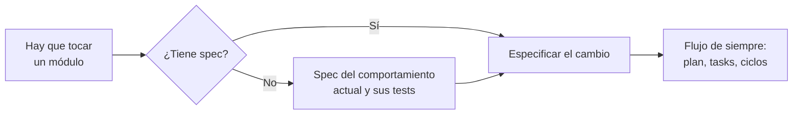
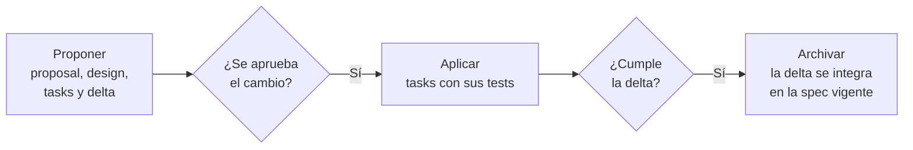
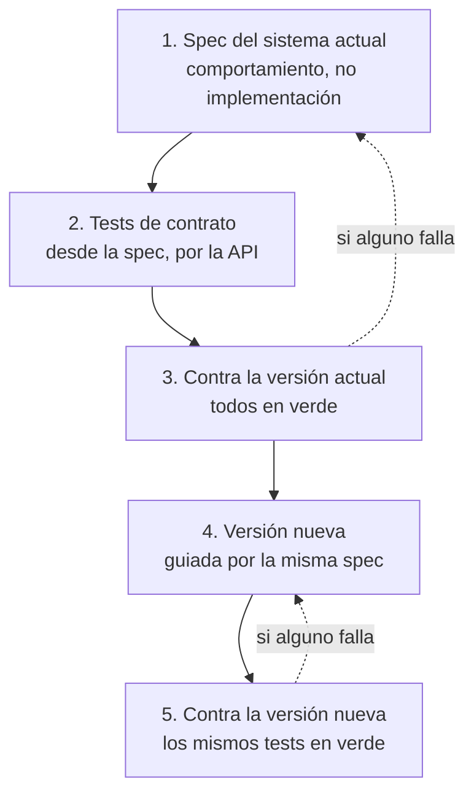

# 3. Casos prácticos: proyectos nuevos y código existente

[⬅️ Volver a la unidad](./README.md)

## Índice

- [3.1. Cuatro situaciones distintas](#31-cuatro-situaciones-distintas)
  - [3.1.1. Proyectos nuevos y código que ya existe](#311-proyectos-nuevos-y-código-que-ya-existe)
  - [3.1.2. Explorar primero, especificar después](#312-explorar-primero-especificar-después)
- [3.2. Un proyecto nuevo](#32-un-proyecto-nuevo)
- [3.3. Código existente](#33-código-existente)
  - [3.3.1. El reto: encajar en lo que ya hay](#331-el-reto-encajar-en-lo-que-ya-hay)
  - [3.3.2. Una constitución que describe el presente](#332-una-constitución-que-describe-el-presente)
  - [3.3.3. Especificar al tocar](#333-especificar-al-tocar)
  - [3.3.4. Descubrir el comportamiento actual: tests de caracterización](#334-descubrir-el-comportamiento-actual-tests-de-caracterización)
  - [3.3.5. ¿Fallo o comportamiento?](#335-fallo-o-comportamiento)
  - [3.3.6. La spec de una feature en código existente](#336-la-spec-de-una-feature-en-código-existente)
- [3.4. Especificar un cambio: specs delta](#34-especificar-un-cambio-specs-delta)
  - [3.4.1. Reescribir la spec o describir el cambio](#341-reescribir-la-spec-o-describir-el-cambio)
  - [3.4.2. Specs vigentes y cambios en OpenSpec](#342-specs-vigentes-y-cambios-en-openspec)
  - [3.4.3. Cómo se escribe una delta](#343-cómo-se-escribe-una-delta)
  - [3.4.4. Proponer, aplicar y archivar](#344-proponer-aplicar-y-archivar)
  - [3.4.5. La delta y el flujo del curso](#345-la-delta-y-el-flujo-del-curso)
- [3.5. Refactorizar con la spec como mapa](#35-refactorizar-con-la-spec-como-mapa)
- [3.6. Migrar de stack](#36-migrar-de-stack)
  - [3.6.1. La spec como puente](#361-la-spec-como-puente)
  - [3.6.2. Tests que no dependen del stack](#362-tests-que-no-dependen-del-stack)
  - [3.6.3. El flujo de una migración](#363-el-flujo-de-una-migración)
- [3.7. Los cuatro casos, comparados](#37-los-cuatro-casos-comparados)
- [3.8. Errores típicos](#38-errores-típicos)
- [3.9. Ejemplo integrador: el módulo de exportación heredado](#39-ejemplo-integrador-el-módulo-de-exportación-heredado)
- [Resumen](#resumen)
- [Ejercicios de reflexión](#ejercicios-de-reflexión)

> **Criterios que trabaja este tema:** OA4 d.

---

## 3.1. Cuatro situaciones distintas

### 3.1.1. Proyectos nuevos y código que ya existe

Todo el curso ha seguido un proyecto que empezó **de cero**: la lista de tareas nació con su PRD, su constitución y sus specs, y cada línea de código vino de una task. En el sector, a eso se le llama un proyecto ***greenfield*** (un terreno sin construir).

Lo habitual en un trabajo real es lo contrario: llegar a un proyecto que **ya existe**, con años de código, sin specs, con decisiones que nadie recuerda y con usuarios que dependen de cómo funciona hoy. Es un proyecto ***brownfield*** (un terreno con construcciones). Y dentro de un proyecto existente hay dos trabajos que merecen un tratamiento propio: **refactorizar** (mejorar el código sin cambiar lo que hace) y **migrar** a otra tecnología.

| Situación | Qué hay al empezar | Qué se especifica primero | El riesgo principal |
|-----------|--------------------|---------------------------|---------------------|
| **Proyecto nuevo** | Nada | La constitución y la primera feature | Que las primeras features fijen malos patrones |
| **Código existente** | Código sin specs | El comportamiento actual de lo que vas a tocar | Romper algo de lo que alguien depende |
| **Refactorización** | Código que funciona pero cuesta cambiar | El comportamiento que no puede cambiar | Cambiar el comportamiento sin querer |
| **Migración** | Un sistema en una tecnología | El contrato observable del sistema | Que la versión nueva no haga lo mismo |

Este tema recorre los cuatro. Lo que tienen en común es la idea de toda la unidad: la spec dice **qué** hace el sistema, con independencia de **cómo** está hecho. En un proyecto nuevo eso sirve para decidir antes de construir; en uno existente, para saber qué no se puede romper.

### 3.1.2. Explorar primero, especificar después

En la UD1 viste que el *vibe coding* y SDD no son lo bueno y lo malo, sino dos herramientas para momentos distintos. Los casos de este tema lo confirman:

| *Vibe coding* | SDD |
|---------------|-----|
| Explorar una idea que todavía no sabes si quieres | Construir algo que tiene que durar |
| Un prototipo para enseñarlo y tirarlo | Una feature que va a producción |
| Probar una librería o una API | Trabajar en equipo |
| Requisitos que de verdad no se conocen | Requisitos que se pueden decidir |

La combinación que mejor funciona: **explorar** con *vibe coding* para descubrir qué quieres y **formalizar** lo aprendido en una spec antes de llevarlo a producción. El problema aparece cuando lo explorado se queda en producción tal cual, sin spec, y con el tiempo alguien tiene que cambiarlo. Es justo el caso del ejemplo integrador de este tema.

---

## 3.2. Un proyecto nuevo

La lista de tareas es tu ejemplo de proyecto nuevo, y lo que aprendiste con ella son las reglas de este caso:

- **La constitución, antes de la primera feature**, aunque sea corta. En la UD1 tenía la arquitectura en capas y el formato de los errores; la tecnología llegó con el plan de la feature A (UD2, tema 2), en cuanto hizo falta. No hace falta tenerla completa: hace falta que exista y que crezca con las decisiones de todo el proyecto.
- **Las primeras features fijan el estilo.** Sin código anterior, el agente decide cómo se nombran las cosas, cómo se organizan las carpetas y cómo se escriben los tests. Lo que decida en la feature A lo copiará en la B, la C y la D. Por eso los primeros planes merecen una revisión más lenta que los siguientes.
- **La primera spec tarda más.** Es normal: también es el momento en que el equipo aprende el formato que va a repetir.
- **Sin código, el agente lo decide todo.** En un proyecto nuevo no hay nada que copiar, así que, sin spec ni constitución, el agente elige la librería, la estructura, el formato de la API y la forma de guardar los datos. Algunas elecciones serán buenas y otras no, y nadie las habrá revisado.

> 📝 **Nota del Profesor**: en un proyecto nuevo, el riesgo no es romper nada, sino **empezar mal**. Un mal patrón en la primera feature es barato de corregir en la primera feature y caro en la décima, porque para entonces el agente lo habrá copiado en todas. Ese es el motivo de fondo de la replanificación de la UD2: revisar el contexto en cada feature, cuando los cambios todavía son pequeños.

---

## 3.3. Código existente

### 3.3.1. El reto: encajar en lo que ya hay

En un proyecto existente, el agente tiene que integrarse en un sistema con sus propias convenciones, sus patrones y sus decisiones. Si no las conoce, genera código que **funciona** pero que **no encaja**:

| Lo que hace el agente | Por qué es un problema |
|-----------------------|------------------------|
| Usa una librería distinta de la que ya hay para lo mismo | Dos formas de hacer lo mismo en el proyecto |
| Sigue un patrón distinto del resto del código | El siguiente que lo lea no sabrá cuál es el bueno |
| Escribe una función que ya existe en otro módulo | Duplicación: el día que cambie una, la otra se queda atrás |
| «Mejora» un comportamiento que le parece raro | Alguien dependía de ese comportamiento |

La última fila es la más peligrosa. En un proyecto nuevo, cambiar un comportamiento solo afecta a lo que todavía no existe. En uno existente puede romper un informe, un script de otro equipo o la costumbre de los usuarios.

### 3.3.2. Una constitución que describe el presente

En un proyecto nuevo, la constitución **decide** cómo será el proyecto. En uno existente, primero tiene que **describir** cómo es: la arquitectura que hay, las librerías que se usan, las convenciones que se siguen. Sin eso, el agente no tiene con qué comparar lo que va a escribir.

Es el primer paso, y el más barato: la constitución y `AGENTS.md` se escriben en poco tiempo y ayudan al agente en cualquier tarea, antes de que exista una sola spec. En la UD1 viste que `/init` de OpenCode genera un borrador de `AGENTS.md` a partir del código. Para la constitución, un prompt con el agente *plan*:

```text
Lee el código de src/ y tests/, package.json y el README.md. Propón un
borrador de constitución que describa cómo está hecho el proyecto HOY:
arquitectura, librerías, formato de la API, forma de probar.

Reglas:
- Describe lo que hay, no lo que debería haber.
- Si encuentras dos formas distintas de hacer lo mismo (dos patrones,
  dos librerías), no elijas: pon las dos y márcalas con
  [NECESITA DECISIÓN].
- Para cada principio, cita un fichero donde se vea.
```

La regla de los dos patrones es la importante. Un proyecto existente casi siempre tiene **incoherencias**: una parte con capas y otra sin ellas, dos formas de devolver los errores. El agente no puede decidir cuál es la buena; el equipo sí. Cada `[NECESITA DECISIÓN]` acaba de dos maneras:

- **Una forma es la norma** y va a la constitución.
- **La otra es deuda conocida**: se apunta (en la constitución o en el índice, como trabajo pendiente) para que el agente no la tome como ejemplo y para corregirla cuando se toque ese código.

> ⚠️ **Cuidado**: un borrador de constitución generado a partir del código **copia también sus defectos**. Si el agente ve que medio proyecto mete lógica en los controladores, puede escribir que «los controladores contienen la lógica de negocio». Por eso pide fuentes y por eso lo revisa una persona: describir el presente no es aceptar todo lo que hay en él.

### 3.3.3. Especificar al tocar

Con la constitución en su sitio, la tentación es especificar todo el proyecto. No lo hagas: en un proyecto grande es inviable, y las specs de módulos que nadie va a tocar se desactualizan antes de servir para nada.

La estrategia que funciona se llama ***spec-on-touch*** (especificar al tocar):

1. Cuando vas a **tocar** un módulo, por una feature nueva, un error o una refactorización, primero escribes la spec de su **comportamiento actual**.
2. Después especificas el **cambio** que vas a hacer, sobre esa spec.
3. Con el tiempo, los módulos que más cambian acumulan specs; los estables siguen sin especificar hasta que alguien los toque.



El diagrama muestra que la spec del comportamiento actual no es un proyecto aparte: es el primer paso del trabajo que ibas a hacer de todas formas.

Si hay que elegir qué especificar sin esperar a tocarlo, el criterio es el **riesgo**: primero lo que más daño hace si falla (la autenticación, los pagos, los datos personales) y lo que más cambia.

¿Qué estado tiene esa spec? Describe código que ya existe y funciona, así que, una vez revisada (punto de control 1: ¿describe de verdad lo que hace?), pasa directamente a `✅ Implementada`. Su primera versión es la fotografía del módulo; las siguientes, sus cambios.

> 💡 **Tip del Examinador**: «¿Qué es *spec-on-touch* y por qué se usa en código existente?». Escribir la spec del comportamiento actual de un módulo justo antes de modificarlo, y especificar el cambio sobre ella. Se usa porque especificar todo un proyecto existente es inviable y las specs de lo que nadie toca se desactualizan; así, las specs crecen donde hay actividad.

### 3.3.4. Descubrir el comportamiento actual: tests de caracterización

¿De dónde sale la spec del comportamiento actual? De tres fuentes, de más a menos fiable:

1. **Ejecutarlo.** Lo que el sistema hace de verdad.
2. **Leer el código.** Lo que parece que hace, con el riesgo de interpretarlo mal.
3. **Preguntar** a quien lo usa o lo escribió. Lo que se cree que hace, que no siempre coincide.

La herramienta para la primera fuente son los **tests de caracterización** (*characterization tests*): tests que **fijan lo que el código hace hoy**, esté bien o mal. No comprueban una spec, porque todavía no la hay; comprueban el comportamiento actual, para que cualquier cambio en él se note.

Se escriben al revés que los tests de la UD3:

| Test desde la spec (UD3) | Test de caracterización |
|--------------------------|-------------------------|
| La spec dice qué debe pasar; el test lo comprueba | El código hace algo; el test lo fija |
| Se escribe antes que el código y falla | Se escribe después del código y pasa |
| Si falla, el código está mal | Si falla, el comportamiento ha cambiado |
| El valor esperado sale de la spec | El valor esperado sale de **ejecutar** el código |

El procedimiento es pequeño: escribes la petición, pones el valor que **crees** que saldrá, ejecutas y, si no coincide, apuntas lo que sale de verdad. Cada vez que el resultado te sorprende, has encontrado un comportamiento que nadie había escrito. Lo verás con un ejemplo real en el apartado 3.9.

El agente es útil para escribirlos, con dos reglas en el prompt: **los valores esperados salen de ejecutar**, no de lo que el agente cree que debería pasar, y **no se arregla nada** mientras se caracteriza. Si el agente encuentra algo que le parece un error, lo apunta como pregunta.

> ✅ **Buena práctica**: escribe los tests de caracterización **a través de la API** (o de la página), no de las funciones internas. Lo que importa conservar es lo que ven los usuarios y los otros sistemas, y así los tests sobreviven a la refactorización que vendrá después.

### 3.3.5. ¿Fallo o comportamiento?

Al caracterizar aparecen comportamientos raros. Algunos son **fallos**; otros, **comportamientos de los que alguien depende**, aunque nadie los decidiera. El código no te dice cuál es cuál: hay que preguntar.

| Lo que encuentras | Pregunta | Si es un fallo | Si es comportamiento |
|-------------------|----------|----------------|----------------------|
| Un texto con comas rompe las columnas de un CSV | ¿Alguien abre ese fichero con algo que espera esas columnas rotas? | Se corrige con un cambio de la spec | Se documenta en la spec tal cual |
| Las fechas salen en UTC y no en hora peninsular | ¿Algún informe o script cuenta con ese formato? | Se corrige | Se documenta |

En la spec del comportamiento actual, lo dudoso se marca con `[NECESITA ACLARACIÓN]` y lo decide quien decide el producto, como cualquier hueco (UD2). La regla es la de siempre: **nada se arregla en silencio**. Si se corrige, es un cambio, con su versión de la spec y sus tests.

> 📝 **Nota del Profesor**: caracterizar suele descubrir comportamientos que nadie conocía y que eran importantes para alguien. Encontrarlos **antes** de cambiar el código cuesta una pregunta; encontrarlos después, cuando un informe mensual deja de cuadrar, cuesta un incidente y la confianza de quien lo usaba.

### 3.3.6. La spec de una feature en código existente

Una feature **nueva** en un proyecto existente se especifica como siempre, con una sección más: cómo se **integra** con lo que ya hay.

```markdown
## Integración con el sistema existente

- Usa: el repositorio de tareas (buscarPorId, actualizar) y
  ErrorNoEncontrado.
- Modifica: las rutas de tareas (una ruta nueva) y la página (un botón
  por tarea).
- No toca: la exportación (GET /tareas.csv), que no cambia.
```

Esa sección no decide cómo se implementa (eso es el plan), sino **qué partes del sistema existente** se ven afectadas, que es una decisión visible: si la feature cambia algo que otros usan, la spec tiene que decirlo. Y el plan, como viste en el tema 1, necesita **leer** esas partes antes de proponer nada: en el prompt de planificar se nombran los módulos que la feature va a tocar, o se encarga a *explore* que los encuentre.

---

## 3.4. Especificar un cambio: specs delta

### 3.4.1. Reescribir la spec o describir el cambio

En la UD2, cada cambio en una feature ya implementada subía la versión de su spec (`1.0` → `1.1`): la spec se **reescribía** con el cambio dentro, y el historial de Git guardaba la versión anterior. Funciona, pero tiene dos inconvenientes en código existente:

- Para revisar el cambio hay que **comparar** la versión nueva con la anterior (`git diff`), y en una spec larga es fácil que se escape algo.
- Mientras el cambio está en curso, la spec en la rama dice lo que **será** el sistema, no lo que **es**.

Una **spec delta** describe **solo el cambio**: qué requisitos se añaden, cuáles se modifican y cuáles se eliminan. Mientras el cambio está en curso, la spec del sistema sigue intacta; cuando se termina, la delta se **integra** en ella. Es la idea de **OpenSpec**, el framework que usaste en las prácticas de la UD2, y la razón de que esté pensado para código que ya existe.

### 3.4.2. Specs vigentes y cambios en OpenSpec

OpenSpec separa dos cosas en dos carpetas:

```text
openspec/
├── specs/                         ← lo que el sistema hace HOY
│   └── exportacion/
│       └── spec.md
└── changes/                       ← lo que se propone cambiar
    ├── exportar-por-estado/       ← un cambio en curso
    │   ├── proposal.md            ← por qué y qué cambia
    │   ├── design.md              ← cómo (opcional)
    │   ├── tasks.md               ← los pasos
    │   └── specs/
    │       └── exportacion/
    │           └── spec.md        ← la delta
    └── archive/                   ← los cambios terminados
```

| Carpeta | Contenido | Equivale en el curso a… |
|---------|-----------|-------------------------|
| `specs/<capacidad>/` | Las **specs vigentes**, una por capacidad del sistema | Las specs implementadas de `docs/specs/` |
| `changes/<cambio>/proposal.md` | El porqué del cambio, qué cambia y a qué afecta | La parte de producto de una spec nueva |
| `changes/<cambio>/design.md` | Las decisiones técnicas, si hacen falta | `plan.md` |
| `changes/<cambio>/tasks.md` | Los pasos, con casillas | `tasks.md` |
| `changes/<cambio>/specs/` | La **delta** de cada capacidad afectada | La versión nueva de la spec |
| `changes/archive/` | Los cambios ya integrados, con fecha | El historial de Git de la spec |

### 3.4.3. Cómo se escribe una delta

Una spec vigente de OpenSpec tiene requisitos con escenarios. Esta es la de la exportación de la lista de tareas que verás en el apartado 3.9, tal como estaba antes de cambiarla (resumida):

```markdown
# Exportación

## Purpose

Descargar la lista de tareas en un fichero CSV para abrirla en una hoja
de cálculo.

## Requirements

### Requirement: Formato del CSV
El sistema SHALL responder a GET /tareas.csv con el tipo text/csv y una
primera línea con las columnas id,texto,estado,fecha, seguida de una
línea por tarea en orden de creación. La fecha SHALL ser el día de
creación en UTC, con el formato AAAA-MM-DD.

#### Scenario: Sin tareas
- WHEN no hay tareas y se pide GET /tareas.csv
- THEN el cuerpo tiene solo la cabecera
```

Los títulos de las secciones y las palabras `SHALL`, `WHEN` y `THEN` van en inglés, porque OpenSpec los usa para entender el fichero; el resto, en español (con `--language es`, OpenSpec lo deja configurado así). Es el mismo papel que tienen EARS y Gherkin en el curso, con otra notación.

La delta del cambio tiene secciones fijas:

| Sección | Qué contiene | Al archivar… |
|---------|--------------|--------------|
| `## ADDED Requirements` | Requisitos nuevos, con sus escenarios | Se añaden a la spec vigente |
| `## MODIFIED Requirements` | Requisitos que cambian, **completos** | Sustituyen al requisito con el mismo nombre |
| `## REMOVED Requirements` | Requisitos que desaparecen, con el motivo | Se quitan |

Así queda la delta que añade el filtro por estado y corrige los textos con comas:

```markdown
## MODIFIED Requirements

### Requirement: Formato del CSV
El sistema SHALL responder a GET /tareas.csv con el tipo text/csv y una
primera línea con las columnas id,texto,estado,fecha, seguida de una
línea por tarea en orden de creación. La fecha SHALL ser el día de
creación en UTC, con el formato AAAA-MM-DD. Un texto que contenga una
coma, unas comillas o un salto de línea SHALL ir entre comillas dobles,
con cada comilla interior duplicada.

#### Scenario: Sin tareas
- WHEN no hay tareas y se pide GET /tareas.csv
- THEN el cuerpo tiene solo la cabecera

#### Scenario: Texto con una coma
- WHEN una tarea tiene el texto Pan, leche y huevos
- THEN su campo texto es "Pan, leche y huevos", entre comillas

## ADDED Requirements

### Requirement: Filtro por estado
El sistema SHALL devolver solo las tareas con el estado pedido en el
parámetro estado (pendiente o hecha), y SHALL responder 400 con
{ error: "El estado debe ser pendiente o hecha" } si el estado no es
uno de esos dos.

#### Scenario: Estado que no existe
- WHEN se pide GET /tareas.csv?estado=borrada
- THEN la respuesta tiene el código 400
```

Al revisarla ves de un vistazo lo que cambia: un requisito se modifica (una frase nueva y un escenario nuevo) y otro se añade. No hay que buscar las diferencias en una spec entera.

> ⚠️ **Cuidado**: un requisito en `MODIFIED` **sustituye entero** al anterior al archivar. Si copias solo la frase nueva, el requisito vigente perderá todo lo demás, escenarios incluidos. Copia el requisito completo de la spec vigente y cámbialo ahí.

### 3.4.4. Proponer, aplicar y archivar

Con `openspec init --tools opencode --language es`, OpenSpec crea su carpeta y añade a OpenCode comandos y skills con el prefijo `opsx` (los nombres pueden cambiar entre versiones). El ciclo de un cambio tiene tres pasos, cada uno con su punto de control:



El diagrama es el flujo de la UD2 con otros nombres: proponer es especificar y planificar; aplicar, implementar; archivar, actualizar la spec del sistema cuando el cambio está hecho.

Desde la terminal, OpenSpec valida y archiva:

```bash
openspec list
openspec validate --all --strict
```

```text
Changes:
  exportar-por-estado     0/2 tasks     just now
✓ spec/exportacion
✓ change/exportar-por-estado
Totals: 2 passed, 0 failed (2 items)
```

`validate --strict` comprueba la estructura: que cada requisito tenga escenarios, que los requisitos modificados existan en la spec vigente y que las secciones se llamen como deben. No comprueba si el cambio es una buena idea: eso es el punto de control.

Cuando las tasks están hechas, se archiva:

```bash
openspec archive exportar-por-estado
```

```text
Specs to update:
  exportacion: update
Applying changes to openspec/specs/exportacion/spec.md:
  + 1 added
  ~ 1 modified
Totals: + 1, ~ 1, - 0, → 0
Specs updated successfully.
Change 'exportar-por-estado' archived as '2026-11-03-exportar-por-estado'.
```

La spec vigente pasa a tener el requisito modificado y el nuevo, y el cambio se mueve a `changes/archive/`, con la fecha delante.

> ⚠️ **Cuidado**: `openspec archive` con la opción `-y` archiva **aunque queden tasks sin marcar**, con solo un aviso. Archivar es como fusionar: se hace después del último punto de control, no antes. Y OpenSpec recoge estadísticas de uso anónimas; si tu equipo no lo quiere, se desactiva con la variable de entorno `OPENSPEC_TELEMETRY=0`.

### 3.4.5. La delta y el flujo del curso

| | Versión nueva de la spec (curso) | Delta (OpenSpec) |
|---|---|---|
| **Qué se escribe** | La spec entera, con el cambio dentro | Solo lo que cambia |
| **Cómo se revisa** | Comparando versiones con `git diff` | Leyendo la delta |
| **La spec del sistema durante el cambio** | En la rama, ya cambiada | Intacta hasta archivar |
| **Dónde queda la historia** | El historial de Git de la spec | `changes/archive/`, además de Git |
| **Encaja mejor en** | Features nuevas, proyectos pequeños | Cambios frecuentes en código existente |

No son incompatibles: un equipo puede escribir con el formato del curso las features nuevas y con OpenSpec los cambios sobre lo que ya hay, siempre que cada comportamiento tenga **una sola** spec vigente. Lo que no puede pasar es que la misma capacidad esté descrita en `docs/specs/` y en `openspec/specs/` y que las dos digan cosas distintas.

---

## 3.5. Refactorizar con la spec como mapa

**Refactorizar** es cambiar la estructura del código sin cambiar su comportamiento: separar en capas, quitar duplicados, poner nombres que se entiendan. Con un agente tiene un riesgo concreto: el agente optimiza lo que **parece mejor desde el código**, y por el camino puede «arreglar» comportamientos que no debía tocar.

La spec y sus tests son el mapa que lo evita:

1. **Primero, la spec del comportamiento que no puede cambiar**, con sus tests (de caracterización, si no los había). Antes de tocar nada, todos en verde.
2. **El plan dice qué cambia y qué no**: qué ficheros se reorganizan y qué queda igual. El agente sabe exactamente dónde intervenir.
3. **Los tests son el contrato de no regresión.** Si pasan antes y después, el comportamiento externo se ha conservado. Y **no se tocan** durante la refactorización: un test que hay que cambiar para que pase significa que el comportamiento ha cambiado.
4. **Refactorizar y cambiar, por separado.** Primero se reorganiza con los tests intactos; después, en otro ciclo y con otros tests, se cambia el comportamiento. Si los mezclas, cuando un test falle no sabrás si es por la reorganización o por el cambio.

El implementador de la UD3, que no puede modificar los tests, es exactamente el agente que necesitas para refactorizar: puede mover todo el código que quiera, pero no puede hacer que los tests digan otra cosa.

> 💡 **Tip del Examinador**: «¿Qué papel tienen los tests en una refactorización con un agente?». Son el contrato de no regresión: se escriben o se comprueban antes, en verde, y no se modifican durante la refactorización. Si siguen pasando, el comportamiento externo se ha conservado; si hay que cambiar un test para que pase, la refactorización ha cambiado el comportamiento.

---

## 3.6. Migrar de stack

### 3.6.1. La spec como puente

**Migrar de stack** es rehacer un sistema con otra tecnología: otro framework, otro lenguaje, otra base de datos. Es el caso en el que una spec es más necesaria. Sin ella, el agente que escribe la versión nueva tiene que **deducir** qué hace la vieja leyendo su código, y el código no muestra muchas decisiones: qué pasa en un caso raro, qué formato exacto tiene un error, en qué orden sale una lista.

La spec es el **puente** entre las dos versiones: describe el **contrato observable** (lo que entra, lo que sale, los errores y los casos límite), que no depende de la tecnología. La versión vieja y la nueva tienen que cumplir la misma spec.

### 3.6.2. Tests que no dependen del stack

Para comprobar que las dos versiones cumplen la spec, hacen falta tests que se puedan ejecutar **contra cualquiera de las dos**. Eso descarta los que importan el código o tocan sus piezas por dentro, como los tests de la lista de tareas que guardan tareas directamente en el repositorio. Un test que sirve de contrato solo puede usar lo que ve un cliente: **la API** (o la página, como los e2e de Playwright de la UD3).

supertest, además de probar la aplicación sin abrir un puerto, puede hacer peticiones a una **URL**. Este test de contrato prepara sus datos con la propia API y no sabe en qué está hecho el servidor:

```javascript
import request from 'supertest';
import { expect, test } from 'vitest';

const api = request(process.env.API_URL);

test('G-RF-04: un texto con una coma vuelve entre comillas', async () => {
  const creada = await api.post('/tareas').send({ text: 'Pan, leche y huevos' });

  const respuesta = await api.get('/tareas.csv?estado=pendiente');

  expect(respuesta.status).toBe(200);
  expect(respuesta.headers['content-type']).toMatch(/^text\/csv/);
  expect(respuesta.text).toMatch(
    new RegExp(`^${creada.body.id},"Pan, leche y huevos",pendiente,\\d{4}-\\d{2}-\\d{2}$`, 'm'),
  );
});
```

Fíjate en lo que **no** comprueba: ni el identificador exacto (lo genera el servidor), ni la fecha exacta (es la de hoy). Comprueba lo que la spec fija: el formato, las comillas y el estado.

Como necesita un servidor arrancado, va en su carpeta (`contrato/`) y en un script aparte, como los e2e de la UD3. `npm test` la deja fuera con una línea en `vitest.config.js`, y un segundo fichero de configuración la incluye:

```javascript
// vitest.config.js
import { configDefaults, defineConfig } from 'vitest/config';

export default defineConfig({
  test: {
    exclude: [...configDefaults.exclude, 'contrato/**'],
  },
});
```

```javascript
// vitest.contrato.config.js
import { defineConfig } from 'vitest/config';

export default defineConfig({
  test: {
    include: ['contrato/**/*.test.js'],
  },
});
```

```json
"contrato": "vitest run --config vitest.contrato.config.js"
```

Con la versión actual arrancada en el puerto 3005:

```bash
PUERTO=3005 npm start &
API_URL=http://localhost:3005 npm run contrato
```

```text
 Test Files  1 passed (1)
      Tests  2 passed (2)
```

### 3.6.3. El flujo de una migración



El diagrama tiene dos vueltas atrás, y son distintas. Si un test falla contra la versión **actual** (paso 3), la spec está mal: no describe lo que el sistema hace, y hay que corregirla antes de seguir. Si falla contra la **nueva** (paso 5), la versión nueva no cumple el contrato. El paso 3 es el que más se olvida, y sin él no sabes si estás comparando con el sistema de verdad o con lo que crees que hace.

Una migración grande no se hace de golpe: se migra **por partes** (una ruta, un módulo), con las dos versiones conviviendo y los mismos tests de contrato vigilando cada parte. Cada parte es un cambio con su flujo.

> 📝 **Nota del Profesor**: una spec que describe el **qué** sin el **cómo** es lo que hace posible migrar con confianza. Por eso en la UD1 insistías en que la spec no lleve nombres de funciones ni estructuras internas: una spec que dijera «el controlador llama a `exportarTareasCsv`» no serviría para una versión en otro lenguaje.

---

## 3.7. Los cuatro casos, comparados

| | Proyecto nuevo | Código existente | Refactorización | Migración |
|---|---|---|---|---|
| **Primera tarea** | Constitución breve | Constitución que describe el presente | Spec y tests de lo que no puede cambiar | Spec del contrato observable |
| **De dónde sale la spec** | De las decisiones del equipo | Del comportamiento actual (*spec-on-touch*) y del cambio | Del comportamiento actual | Del sistema actual |
| **Tests clave** | Desde la spec, antes del código | De caracterización, después los del cambio | Los existentes, sin tocarlos | De contrato, por la API |
| **El agente debe…** | Seguir la constitución desde la primera feature | No «mejorar» lo que no se le pide | Mover código sin cambiar los tests | Cumplir la misma spec que la versión vieja |
| **Error típico** | Dejar que la primera feature fije un mal patrón | Arreglar en silencio un comportamiento | Refactorizar y cambiar a la vez | Dar por buena la spec sin probarla con la versión actual |

---

## 3.8. Errores típicos

| Error | Consecuencia | Cómo evitarlo |
|-------|--------------|---------------|
| Intentar especificar todo un proyecto existente | Mucho trabajo y specs que se desactualizan sin usarse | *Spec-on-touch* y prioridad por riesgo |
| Aceptar una constitución generada que copia los defectos del código | El agente aprende los malos patrones como norma | Pedir fuentes, marcar las incoherencias y decidirlas |
| Escribir la spec actual leyendo solo el código | Interpretaciones que no coinciden con lo que hace | Tests de caracterización: ejecutar antes que leer |
| Poner en los tests de caracterización lo que «debería» pasar | Tests que fallan por lo que ya hacía el código | El valor esperado sale de ejecutarlo |
| Arreglar un comportamiento raro al caracterizar | Se rompe algo de lo que alguien dependía | Marcarlo como duda y decidirlo con producto |
| Copiar en `MODIFIED` solo la frase que cambia | El requisito vigente pierde el resto al archivar | Copiar el requisito completo |
| Archivar un cambio con tasks pendientes | La spec vigente dice algo que el código aún no hace | Archivar después del último punto de control |
| Refactorizar y cambiar el comportamiento en el mismo ciclo | Si falla un test, no se sabe por qué | Dos cambios, en este orden |
| Cambiar un test durante una refactorización | El contrato de no regresión deja de serlo | El implementador no puede tocar los tests |
| Tests de contrato que tocan las piezas internas | No se pueden ejecutar contra la versión nueva | Solo la API o la página |
| Saltarse la ejecución de los tests contra la versión vieja en una migración | Se compara con una spec que no describe el sistema | Paso 3 del flujo: todo en verde antes de empezar |

---

## 3.9. Ejemplo integrador: el módulo de exportación heredado

Hace meses, alguien del equipo necesitó pasar la lista de tareas a una hoja de cálculo y, con prisa, pidió al agente una exportación a CSV. Funcionó, se quedó y nadie volvió a mirarla. No tiene spec ni tests. Ahora producto pide un cambio: poder exportar **solo las tareas pendientes**, para repartirlas en la reunión semanal.

Es código existente dentro de un proyecto con SDD, y vas a tratarlo con los pasos de este tema: caracterizar, especificar el comportamiento actual, refactorizar y, por último, cambiar.

**1. El código heredado.** `src/exportar.js`:

```javascript
import { repositorioTareas } from './repositorios/repositorio-tareas.js';

export function exportarCsv(peticion, respuesta) {
  const tareas = repositorioTareas.obtenerTodas();
  let csv = 'id,texto,estado,fecha\n';
  for (const t of tareas) {
    csv +=
      t.id + ',' + t.text + ',' + t.estado + ',' + t.fechaCreacion.slice(0, 10) + '\n';
  }
  respuesta.set('Content-Type', 'text/csv');
  respuesta.send(csv);
}
```

Y en `src/app.js`, una línea: `app.get('/tareas.csv', exportarCsv);`.

**2. ¿Encaja con la constitución?** Antes de tocar nada, comparas el módulo con la constitución (o se lo encargas a *explore*, con un encargo como los del tema 1). Hay dos choques:

| Principio | Qué hace el módulo | Decisión |
|-----------|-------------------|----------|
| Capas: los controladores no contienen lógica y solo los repositorios acceden al almacenamiento | Una sola función que lee el repositorio, construye el CSV y responde | **Deuda**: se corrige al tocarlo (paso 5) |
| Todas las respuestas son JSON | Responde `text/csv` | **El principio se queda corto**: exportar a CSV es una necesidad real |

La segunda decisión es de arquitectura y de todo el proyecto, así que va a la constitución en su propia PR (tema 2):

```markdown
- Todas las respuestas son JSON, salvo las exportaciones, que usan el
  formato del fichero que se descarga (por ejemplo, text/csv). Sus
  errores sí son JSON.
```

**3. Caracterizar.** Escribes tests a través de la API que fijan lo que hace hoy. Uno de ellos lo escribiste pensando que un texto con una coma partiría la línea en seis columnas; al ejecutarlo, el test falló: salían **cinco** (una columna más que las cuatro de siempre). Lo ajustaste a lo que hace el código, que es exactamente cómo se escribe un test de caracterización. Así quedaron:

```javascript
describe('GET /tareas.csv (comportamiento actual)', () => {
  test('sin tareas, solo la cabecera', async () => {
    const respuesta = await request(app).get('/tareas.csv');

    expect(respuesta.status).toBe(200);
    expect(respuesta.headers['content-type']).toBe('text/csv; charset=utf-8');
    expect(respuesta.text).toBe('id,texto,estado,fecha\n');
  });

  test('una línea por tarea, en orden de creación', async () => {
    guardar('Comprar leche', '2026-11-03T09:15:00.000Z');
    guardar('Llamar al taller', '2026-11-03T10:00:00.000Z', 'hecha');

    const respuesta = await request(app).get('/tareas.csv');

    expect(respuesta.text).toBe(
      'id,texto,estado,fecha\n' +
        'id-13,Comprar leche,pendiente,2026-11-03\n' +
        'id-16,Llamar al taller,hecha,2026-11-03\n',
    );
  });

  test('la fecha es el día en UTC, no en hora peninsular', async () => {
    guardar('Tarea de madrugada', '2026-11-02T23:30:00.000Z');

    const respuesta = await request(app).get('/tareas.csv');

    expect(respuesta.text).toContain(',2026-11-02\n');
  });

  test('un texto con comas parte la línea en más columnas', async () => {
    guardar('Comprar pan, leche y huevos', '2026-11-03T09:15:00.000Z');

    const respuesta = await request(app).get('/tareas.csv');
    const linea = respuesta.text.split('\n')[1];

    expect(linea.split(',')).toHaveLength(5);
  });
});
```

(`guardar` es una función auxiliar del fichero que guarda una tarea con un identificador fijo, para que la salida sea siempre la misma.)

Los dos últimos tests documentan **sorpresas**: la fecha es el día en UTC (una tarea creada a las 00:30 en España sale con el día anterior) y un texto con comas rompe las columnas. Los cuatro pasan, también con la zona horaria peninsular. Haces el commit de los tests solos: a partir de aquí, cualquier cambio en el comportamiento se notará.

**4. La spec del comportamiento actual.** Con los tests como fuente, escribes la spec de G, «Exportar las tareas a CSV», en `docs/specs/G-exportar-csv/spec.md`. Las dos sorpresas son preguntas para producto:

- **La fecha en UTC:** el equipo tiene una hoja de cálculo para el informe mensual que agrupa por esa columna y espera el formato `AAAA-MM-DD`. Producto decide **conservarla** tal cual: es comportamiento, no un fallo, y la spec lo dice expresamente.
- **Las comas:** nadie depende de las columnas rotas; es un **fallo**, y se corregirá con el cambio.

La spec 1.0 describe el comportamiento actual (con las comas como hueco conocido) y, una vez revisada, entra en el índice como `✅ Implementada`. Inmediatamente después, la versión 1.1 añade el cambio que pidió producto y la corrección:

```markdown
- RF-03: El sistema deberá escribir la fecha como el día de creación en
  UTC, con el formato AAAA-MM-DD.
- RF-04: Si el texto de una tarea contiene una coma, unas comillas o un
  salto de línea, entonces el sistema deberá escribirlo entre comillas
  dobles, con cada comilla interior duplicada.
- RF-05: Cuando se pida la exportación con el parámetro estado, el
  sistema deberá incluir solo las tareas en ese estado.
- EC-02: Si el parámetro estado no es pendiente ni hecha, entonces el
  sistema deberá responder 400 con
  { error: "El estado debe ser pendiente o hecha" }.
```

Fíjate en EC-02: el error es JSON, como dice la excepción que acabas de añadir a la constitución.

**5. Refactorizar, sin cambiar nada.** El plan de G 1.1 tiene dos partes, en este orden: primero la refactorización, después el cambio. La refactorización lleva la exportación a las capas del proyecto, con los tests de caracterización **intactos**. `src/servicios/servicio-exportacion.js`:

```javascript
import { repositorioTareas } from '../repositorios/repositorio-tareas.js';

const CABECERA = 'id,texto,estado,fecha';

function lineaCsv(tarea) {
  const dia = tarea.fechaCreacion.slice(0, 10);
  return [tarea.id, tarea.text, tarea.estado, dia].join(',');
}

export function exportarTareasCsv() {
  const lineas = repositorioTareas.obtenerTodas().map(lineaCsv);
  return [CABECERA, ...lineas].join('\n') + '\n';
}
```

`src/controladores/controlador-exportacion.js` solo traduce a HTTP, y `app.js` cambia la función de la ruta, que sigue siendo `/tareas.csv`: la URL es parte del comportamiento y no se toca.

```javascript
export function exportarTareasCsvHttp(peticion, respuesta) {
  respuesta.type('text/csv').send(exportarTareasCsv());
}
```

¿Qué pasa si la refactorización cambia algo sin querer? Si en el servicio se pierde el `+ '\n'` final (un descuido fácil al pasar de concatenar a `join`), los tests de caracterización lo detectan enseguida:

```text
     × sin tareas, solo la cabecera
     × una línea por tarea, en orden de creación
     × la fecha es el día en UTC, no en hora peninsular
     ✓ un texto con comas parte la línea en más columnas
      Tests  3 failed | 1 passed (4)
```

Con el salto de línea en su sitio, todos en verde, y la refactorización va en su propio commit. El código ya cumple la constitución, y el comportamiento es exactamente el de antes.

**6. Cambiar el comportamiento.** Ahora sí, el cambio de la spec 1.1, con el flujo de la UD3: primero los tests, aprobados en su commit, y después el código. Los tests de caracterización pasan a llevar los identificadores de la spec, y el de las comas se **sustituye** por los de RF-04: el comportamiento ha cambiado porque lo ha decidido producto, no porque lo haya decidido quien implementa.

```javascript
test.each([
  ['una coma', 'Comprar pan, leche y huevos', '"Comprar pan, leche y huevos"'],
  ['comillas', 'Leer "El Quijote"', '"Leer ""El Quijote"""'],
  ['un salto de línea', 'Primera línea\nSegunda', '"Primera línea\nSegunda"'],
])('G-RF-04: un texto con %s va entre comillas', async (_caso, text, campo) => {
  guardar('t1', text, '2026-11-03T09:15:00.000Z');

  const respuesta = await request(app).get('/tareas.csv');

  expect(respuesta.text).toBe(
    `id,texto,estado,fecha\nt1,${campo},pendiente,2026-11-03\n`,
  );
});

test('G-EC-02: un estado que no existe responde 400', async () => {
  const respuesta = await request(app).get('/tareas.csv?estado=borrada');

  expect(respuesta.status).toBe(400);
  expect(respuesta.body).toEqual({
    error: 'El estado debe ser pendiente o hecha',
  });
});
```

El servicio añade el entrecomillado y el filtro:

```javascript
function campoCsv(valor) {
  if (/[",\r\n]/.test(valor)) {
    return `"${valor.replaceAll('"', '""')}"`;
  }
  return valor;
}

export function exportarTareasCsv(estado) {
  if (estado !== undefined && !ESTADOS.includes(estado)) {
    throw new ErrorValidacion('El estado debe ser pendiente o hecha');
  }

  const lineas = repositorioTareas
    .obtenerTodas()
    .filter((tarea) => estado === undefined || tarea.estado === estado)
    .map(lineaCsv);
  return [CABECERA, ...lineas].join('\n') + '\n';
}
```

(`ESTADOS` es `['pendiente', 'hecha']`, y `lineaCsv` pasa el texto por `campoCsv`.)

La primera versión del controlador hizo fallar a G-EC-02, y por un motivo que merece verse:

```javascript
respuesta.type('text/csv').send(exportarTareasCsv(peticion.query.estado));
```

`type` pone la cabecera `text/csv` **antes** de llamar al servicio. Cuando el servicio lanza el error, el bloque `catch` responde 400 con el JSON del error… pero con la cabecera que ya estaba puesta. El cliente recibe un 400 que dice ser un CSV:

```text
400 text/csv; charset=utf-8 "{\"error\":\"El estado debe ser pendiente o hecha\"}"
```

La corrección es calcular primero y responder después:

```javascript
const csv = exportarTareasCsv(peticion.query.estado);
respuesta.type('text/csv').send(csv);
```

Es un error que nadie habría visto probando a mano en el navegador: el texto del error se lee igual. Lo vio el test porque comprueba lo que dice la spec, que el error es JSON. Con la corrección, los 58 tests del proyecto pasan.

**7. El resultado.** El historial (resumido) cuenta el trabajo en el orden en que se hizo:

```text
Fusiona la feature G 1.1: exportar por estado y textos con comas
Spec de la feature G 1.1: filtro por estado y comillas (aprobada)
Feature G: exportación en capas (refactorización sin cambios)
Spec de la feature G: comportamiento actual (implementada)
Tests de caracterización de la exportación
Constitución: las exportaciones responden en el formato del fichero
```

Un módulo que nadie entendía tiene ahora una spec que dice qué hace y por qué, tests con los identificadores de la spec, una estructura que cumple la constitución y un cambio hecho con el flujo. Y el informe mensual sigue cuadrando, porque la fecha en UTC se conservó a propósito.

> 📝 **Nota del Profesor**: fíjate en lo que **no** se hizo: no se rehízo el módulo desde cero, no se especificó el resto del proyecto y no se «aprovechó» la refactorización para cambiar nada. Cada paso tuvo un objetivo y un commit, y el orden (caracterizar, especificar, refactorizar, cambiar) es el que hace que, si algo falla, sepas exactamente en qué paso fue.

---

## Resumen

- Un proyecto **nuevo** (*greenfield*) y uno **existente** (*brownfield*) piden cosas distintas, y en uno existente hay dos trabajos especiales: **refactorizar** y **migrar**. Se explora con *vibe coding* y se formaliza con una spec antes de llevarlo a producción.
- En un proyecto **nuevo**, la constitución va antes de la primera feature y las primeras features fijan el estilo: el riesgo es empezar mal.
- En código **existente**, la constitución primero **describe el presente**, con las incoherencias marcadas para que el equipo decida qué es norma y qué es deuda. Se especifica **al tocar** (*spec-on-touch*), con prioridad por riesgo. El comportamiento actual se descubre **ejecutando**, con **tests de caracterización** que fijan lo que hace el código, y cada rareza se decide con producto: fallo o comportamiento. Una feature nueva añade a su spec cómo se integra con lo que hay.
- Una **spec delta** describe solo el cambio. En **OpenSpec**, las specs vigentes están en `openspec/specs/` y cada cambio en `openspec/changes/`, con su delta (`ADDED`, `MODIFIED`, que sustituye el requisito entero, y `REMOVED`); se propone, se aplica y se **archiva**, y al archivar la delta se integra en la spec vigente.
- En una **refactorización**, los tests son el contrato de no regresión: en verde antes, sin tocarlos durante, y refactorizar y cambiar en ciclos separados.
- En una **migración**, la spec es el puente: **tests de contrato** que solo usan la API, en verde contra la versión actual antes de empezar y contra la nueva al terminar, y por partes.

## Ejercicios de reflexión

1. Piensa en un proyecto de clase que hayas hecho sin specs. Si mañana tuvieras que añadirle una funcionalidad, ¿qué módulo especificarías primero y por qué?
2. Un borrador de constitución generado por el agente dice: «Los errores se devuelven a veces como texto y a veces como JSON». ¿Qué haces con esa línea?
3. Escribe dos tests de caracterización para una función que conozcas. ¿En qué se diferencian de los tests que escribirías a partir de una spec?
4. Al caracterizar una API descubres que, si el cuerpo trae un campo desconocido, la petición falla con 500. ¿Es un fallo o un comportamiento? ¿Qué preguntarías antes de decidirlo?
5. Escribe la delta de OpenSpec que eliminaría el filtro por estado de la exportación. ¿Qué sección usas y qué tendrías que explicar?
6. ¿Por qué en el ejemplo integrador se hizo primero la refactorización y después el cambio, y no al revés?
7. Un compañero quiere migrar la lista de tareas a otro framework y propone usar los tests de `tests/` como contrato. ¿Qué problema tienen y qué tendría que cambiar?
8. Busca en la documentación de OpenSpec qué otras secciones admite una delta además de `ADDED`, `MODIFIED` y `REMOVED`, y para qué sirven. Indica la fecha de consulta.

---

[⬅️ Volver a la unidad](./README.md)
