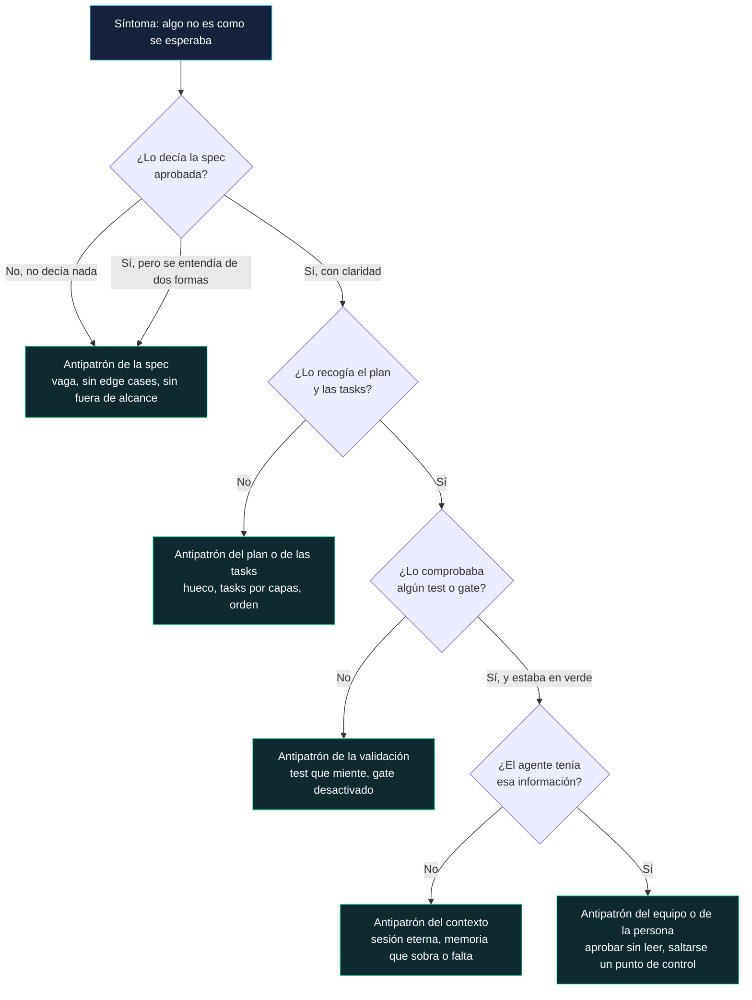
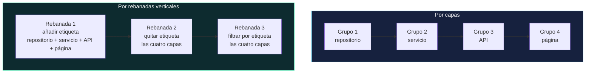
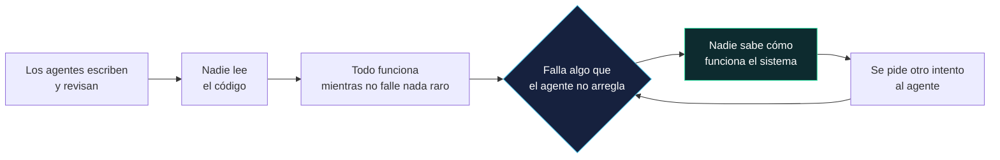
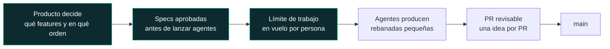
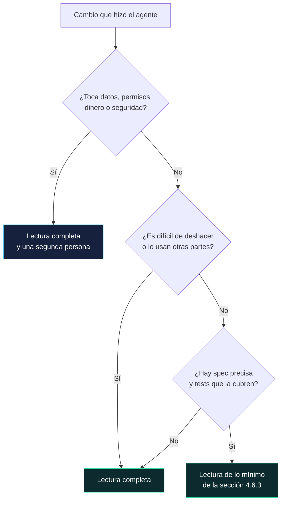

# 4. Antipatrones del flujo

[⬅️ Volver a la unidad](./README.md)

## Índice

- [4.1. Qué es un antipatrón del flujo](#41-qué-es-un-antipatrón-del-flujo)
  - [4.1.1. Dónde nace cada problema](#411-dónde-nace-cada-problema)
- [4.2. Antipatrones por fase](#42-antipatrones-por-fase)
  - [4.2.1. En la spec](#421-en-la-spec)
  - [4.2.2. En el plan](#422-en-el-plan)
  - [4.2.3. En las tasks y la implementación](#423-en-las-tasks-y-la-implementación)
  - [4.2.4. En la validación](#424-en-la-validación)
  - [4.2.5. En el contexto](#425-en-el-contexto)
  - [4.2.6. En el equipo](#426-en-el-equipo)
- [4.3. Tasks por rebanadas verticales y firmas en el plan](#43-tasks-por-rebanadas-verticales-y-firmas-en-el-plan)
  - [4.3.1. El problema de las capas](#431-el-problema-de-las-capas)
  - [4.3.2. La rebanada vertical](#432-la-rebanada-vertical)
  - [4.3.3. Las firmas en el plan](#433-las-firmas-en-el-plan)
- [4.4. Lo que exige SDD a quien desarrolla](#44-lo-que-exige-sdd-a-quien-desarrolla)
- [4.5. Tres riesgos de ir demasiado deprisa](#45-tres-riesgos-de-ir-demasiado-deprisa)
  - [4.5.1. La fábrica a oscuras](#451-la-fábrica-a-oscuras)
  - [4.5.2. La deuda cognitiva](#452-la-deuda-cognitiva)
  - [4.5.3. La avalancha de revisiones](#453-la-avalancha-de-revisiones)
- [4.6. ¿Leer o no leer el código?](#46-leer-o-no-leer-el-código)
  - [4.6.1. Tres posturas](#461-tres-posturas)
  - [4.6.2. Leer según el riesgo](#462-leer-según-el-riesgo)
  - [4.6.3. Lo que se lee siempre](#463-lo-que-se-lee-siempre)
  - [4.6.4. La spec como única fuente](#464-la-spec-como-única-fuente)
- [4.7. Hacia dónde va](#47-hacia-dónde-va)
- [4.8. Auditar un repositorio: señales de antipatrones](#48-auditar-un-repositorio-señales-de-antipatrones)
- [4.9. Errores típicos al corregir antipatrones](#49-errores-típicos-al-corregir-antipatrones)
- [4.10. Ejemplo integrador: auditar la rama de la feature H](#410-ejemplo-integrador-auditar-la-rama-de-la-feature-h)
- [Resumen](#resumen)
- [Ejercicios de reflexión](#ejercicios-de-reflexión)

> **Criterios que trabaja este tema:** OA4 e.

---

## 4.1. Qué es un antipatrón del flujo

Un **antipatrón** (*antipattern*) es una costumbre que parece razonable, se repite mucho y produce un mal resultado. No es un error puntual: es una forma de trabajar que acaba dando el mismo problema una y otra vez. Tiene tres partes que conviene nombrar siempre:

| Parte | Pregunta | Ejemplo |
|-------|----------|---------|
| **Síntoma** | ¿Qué se ve en el repositorio o en la sesión? | Un commit de trescientas líneas que mezcla tests y código |
| **Causa** | ¿Qué se hizo (o no) para llegar ahí? | Se pidió «implementa todas las tasks» |
| **Corrección** | ¿Qué se cambia para que no vuelva a pasar? | Un ciclo corto por grupo de tasks, con un commit cada uno |

Hasta ahora has visto muchos antipatrones sueltos, cada uno en el tema donde nace: la spec vaga en la UD1, el contexto cargado en la UD2, el test que miente en la UD3, la adopción de golpe en el tema 2 de esta unidad. Este tema los **reúne y ordena por fase**, añade los que aparecen cuando se trabaja deprisa y a escala, y termina con una pregunta incómoda: ¿hace falta leer el código que escribe el agente?

> 📝 **Nota del Profesor**: aprender los antipatrones no sirve para colgar etiquetas a los demás. Sirve para diagnosticar. Cuando algo sale mal, la pregunta útil no es «¿qué ha hecho mal el agente?», sino «¿en qué punto del flujo habría podido detectarse esto y por qué no se detectó?». Casi siempre la respuesta es un punto de control que se saltó alguien.

### 4.1.1. Dónde nace cada problema

La regla del curso para depurar es la misma desde el tema 1 de la UD3: **el diagnóstico empieza en la spec**. Este diagrama ordena las preguntas de esa regla cuando lo que tienes delante es un síntoma raro.



El diagrama va de lo más barato de corregir (la spec) a lo más caro (las personas y sus costumbres). Fíjate en que el agente solo aparece como último sospechoso: un agente que tiene la información, una spec clara y un test que lo comprueba rara vez falla; cuando falla, el test se pone en rojo y lo ves.

---

## 4.2. Antipatrones por fase

Cada subapartado sigue el orden del flujo: spec, plan, tasks e implementación, validación, contexto y equipo. Los más importantes se desarrollan con un caso de la lista de tareas; el resto, en una tabla con su síntoma y su corrección.

### 4.2.1. En la spec

| Antipatrón | Síntoma | Corrección |
|------------|---------|------------|
| **Spec vaga** | «Manejar los errores correctamente», «rápida», «amigable»: cada agente la interpreta a su manera | Un adjetivo se convierte en una medida o en un comportamiento observable (UD1, tema 6) |
| **Spec sin *edge cases*** | Solo el camino feliz: funciona en la demo y falla con la primera entrada rara | Recorrer los tipos de *edge case* con la lista del tema 5 de la UD1 |
| **Sin fuera de alcance** | El agente añade «ya que estaba» un filtro, un borrado o una paginación que nadie pidió | Sección «Fuera de alcance» con lo que se deja fuera a propósito |
| **Spec gigante** | Cincuenta requisitos sin jerarquía; el agente se pierde y la revisión es imposible | Dividir en features (UD1, tema 4) |
| **Aprobada con marcadores** | `[NECESITA ACLARACIÓN]` en una spec en estado `Aprobada` | Una spec con marcadores no se aprueba; un gate lo detecta (UD3, tema 3) |
| **Spec que nadie lee** | Se aprueba en un minuto, sin comentarios | Revisión con la lista del punto de control 1 y un revisor distinto del autor |
| **Spec que prescribe la implementación** | Nombres de funciones, tablas o librerías dentro de la spec | El cómo va al plan; la spec dice qué se observa desde fuera |

El que más daño hace a escala es el último, así que merece un caso de cerca.

**Caso: una spec que decide por el plan.** La feature H añade etiquetas a las tareas. El autor de la spec, que viene de otro proyecto, escribe:

```markdown
### Requisitos funcionales

- **RF-01:** El sistema deberá guardar las etiquetas en una tabla
  `etiquetas` con las columnas `id`, `tarea_id` y `nombre`.
- **RF-02:** El servicio `añadirEtiqueta(idTarea, nombre)` deberá
  insertar una fila y devolver la tarea completa.
```

Revisa qué hay aquí: dos requisitos que **nadie notaría desde fuera** si cambiaran (el nombre de la tabla, el nombre de la función). Y tres problemas:

1. La constitución del proyecto dice cómo se guardan los datos (un fichero JSON, desde la feature F). No hay tablas ni columnas. El agente se encuentra una spec que contradice la constitución y tiene que elegir cuál obedece; unas veces elegirá una y otras, la otra.
2. Si el equipo decide más adelante guardar las etiquetas dentro de la propia tarea, hay que **reabrir la spec** y volver a aprobarla, aunque el comportamiento no haya cambiado.
3. Lo que sí importa y no está: qué pasa con una etiqueta repetida, una etiqueta vacía o una tarea que no existe.

La corrección separa lo que se observa de cómo se consigue:

```markdown
### Requisitos funcionales

- **RF-01:** El sistema deberá permitir añadir una etiqueta a una
  tarea existente.
- **RF-02:** Cuando se añada una etiqueta que la tarea ya tiene,
  el sistema deberá responder 409 con el error `etiqueta_repetida`
  y dejar la tarea sin cambios.
- **RF-03:** Si la tarea no existe, entonces el sistema deberá
  responder 404 con el error `tarea_no_encontrada`.
```

Los nombres de la tabla y de la función pasan al plan, donde se pueden cambiar sin pedir permiso a nadie. La prueba es la del tema 6 de la UD1: **¿lo notaría alguien desde fuera?** El 409 de una etiqueta repetida, sí; el nombre de la tabla, no.

> ⚠️ **Cuidado**: no confundas «no prescribir la implementación» con «no decir nada del diseño». Si un contrato externo obliga (el formato de un CSV que lee otro sistema, la ruta de una API que ya usa un cliente), eso **sí es comportamiento** y va en la spec. La diferencia es quién lo observa.

### 4.2.2. En el plan

| Antipatrón | Síntoma | Corrección |
|------------|---------|------------|
| **Plan que es código** | Cuerpos de funciones enteros dentro del plan; el agente copia en lugar de pensar y el plan caduca al primer refactor | El plan decide y justifica; el código lo escribe la fase de implementar. Solo las firmas (apartado 4.3.3) |
| **Decisiones sin alternativa descartada** | `D-04: usar una librería` sin decir por qué ni qué otras se miraron | Cada decisión lleva su alternativa descartada y el motivo (UD2, tema 2) |
| **Tecnología nueva por la puerta de atrás** | El plan introduce una librería que la constitución no menciona | Primero la constitución, en su propia PR (tema 2 de esta unidad) |
| **Plan que ignora el código existente** | El agente crea `ErrorNoEncontrado` por segunda vez porque no miró qué había | El agente *explore* mira antes de planificar; el plan cita lo que reutiliza (tema 1 de esta unidad) |
| **Pruebas sin plan** | La estrategia de pruebas dice «se probará bien» | Una fila por identificador de la spec con su tipo de prueba (UD2, tema 2) |
| **Plan aprobado sin comprobar la constitución** | La sección «Comprobación de la constitución» está vacía o dice «OK» | Cada regla de la constitución, con una línea que diga cómo la cumple el plan |

### 4.2.3. En las tasks y la implementación

| Antipatrón | Síntoma | Corrección |
|------------|---------|------------|
| **Tasks por capas en una feature grande** | Nada se puede ver ni probar de punta a punta hasta la última task | Rebanadas verticales (apartado 4.3) |
| **Tasks sin criterio de terminado** | «Terminada cuando: funciona» | Un test que pasa o un comando que se ejecuta |
| **Todas las tasks de golpe** | Un commit enorme, imposible de revisar | Un ciclo por grupo de tasks, con su commit (UD2, tema 3) |
| **El agente cambia los tests** | El test que fallaba ya no falla porque ahora comprueba otra cosa | Permisos de edición sobre `tests/` solo en la fase de tests; `git diff` de los tests en cada revisión |
| **Tocar ficheros que no están en la task** | `git status` muestra ficheros que nadie pidió | Cualquier fichero fuera de la línea «Ficheros» se revisa o se revierte |
| **Sin commit por ciclo** | No se puede volver atrás sin perder trabajo bueno | Un commit por grupo de tasks, con el identificador en el mensaje |

**Caso: «implementa todas las tasks».** La feature H tiene ocho tasks. Para ir deprisa, el desarrollador escribe un solo prompt:

```text
Implementa todas las tasks de docs/specs/H-etiquetas/tasks.md.
```

El agente trabaja un buen rato y entrega un resultado que parece completo: los tests pasan. Pero lo que queda en el repositorio es esto:

```text
$ git log --oneline -1 --shortstat
2b5765e Feature H: etiquetas
 5 files changed, 295 insertions(+)
```

Un solo commit con cinco ficheros y casi trescientas líneas. ¿Qué has perdido?

- **La revisión por ciclos.** El punto de control 4 pregunta «¿hace esto la task y nada más?». Con ocho tasks juntas, nadie responde nada.
- **Los tests antes que el código.** No puedes saber si los tests se escribieron primero ni si se ajustaron para que pasara el código. Todo entra en el mismo commit.
- **El punto de vuelta atrás.** Si la task 7 está mal, el commit tiene seis tasks buenas pegadas a ella.
- **La atención del agente.** Con la ventana de contexto llena de ocho tasks, las últimas se hacen con menos cuidado que las primeras (UD2, tema 5).

La corrección no es solo «hazlo en ciclos»: es **cambiar el prompt para que el ciclo sea la unidad**.

```text
Implementa solo el grupo 1 de docs/specs/H-etiquetas/tasks.md
(T-01 y T-02). Escribe los tests, enséñame que fallan y para.
No toques ningún fichero que no esté en la línea «Ficheros».
```

> ✅ **Buena práctica**: la señal de que vas bien es que cada commit tiene **un motivo** que puedes explicar en una frase. Si necesitas «y también» para describir un commit, es que eran dos.

### 4.2.4. En la validación

| Antipatrón | Síntoma | Corrección |
|------------|---------|------------|
| **El test describe el código** | Se escribió después y repite lo que hace la función | Tests desde los criterios de aceptación, antes del código (UD3, tema 2) |
| **Verde significa hecho** | Se da por terminada una task con los tests en verde sin mirar si cubren la spec | Matriz de trazabilidad y revisión independiente (UD3, tema 1) |
| **Confiar solo en tests unitarios** | Todo pasa, pero la página no muestra el mensaje de error | Un test de extremo a extremo por feature |
| **Arreglar el código sin tocar la spec** | El mismo hueco reaparece en la feature siguiente | Si el hueco está en la spec, se sube su versión |
| **Gates que se desactivan** | `// eslint-disable`, `test.skip` o un umbral de cobertura rebajado | Un gate que molesta se discute, no se apaga en silencio |

**Caso: el gate que molestaba.** El agente implementa la task T-06 y `npm run lint` falla: el servicio de etiquetas importa el repositorio de tareas, y la regla `no-restricted-imports` del tema 3 de la UD3 lo prohíbe. En vez de rediseñar, el agente hace lo más rápido:

```javascript
// eslint-disable-next-line no-restricted-imports
import { repositorioTareas } from '../repositorios/repositorio-tareas.js';
```

El lint pasa, los tests pasan, la CI queda en verde. Y el control que protegía la arquitectura ha dejado de proteger **esa línea**, para siempre, sin que nadie lo decidiera. Los gates se desactivan de uno en uno, y cada uno parece inofensivo.

La corrección es doble. Por un lado, una regla en `AGENTS.md` que cierra la puerta: «Nunca añadas `eslint-disable`, `test.skip` ni bajes un umbral; si un control falla, para y cuéntamelo». Por otro, un gate que busca la trampa:

```bash
git diff main...HEAD | grep -E '^\+.*(eslint-disable|\.skip\(|\.only\()'
```

Si imprime algo, la PR no se fusiona hasta que una persona lo haya leído y lo haya aceptado por escrito.

### 4.2.5. En el contexto

| Antipatrón | Síntoma | Corrección |
|------------|---------|------------|
| **`AGENTS.md` cajón de sastre** | Cada fallo del agente añade una regla; ya hay cuarenta y se contradicen | Diagnosticar antes de añadir (UD2, tema 6) y podar de vez en cuando |
| **Sesión eterna** | A media tarde el agente repite errores que había corregido por la mañana | Una sesión por fase; `/undo` o sesión nueva (UD2, tema 5) |
| **Decisiones solo en el chat** | «Ya lo hablamos antes»; en la sesión siguiente, el agente no lo sabe | Lo que importa se escribe en un fichero del repositorio |
| **Todo el repositorio en el contexto** | Se cargan veinte ficheros «por si acaso» | Lo justo para la task y recuperación bajo demanda con `@` |
| **Reglas que ya no son verdad** | `AGENTS.md` manda ejecutar `npm run lint` y el script no existe | Revisarlo al replanificar entre features (UD2, tema 1) |

### 4.2.6. En el equipo

| Antipatrón | Síntoma | Corrección |
|------------|---------|------------|
| **Adopción de golpe** | Todos los artefactos desde el primer día; al mes, nadie los usa | Etapas que se superan por hitos (tema 2) |
| **SDD para todo** | Spec completa para cambiar el texto de un botón | Niveles de SDD: una línea de commit para lo trivial (UD1, tema 4) |
| **Esperar que la herramienta lo haga** | Se instala un framework y se da por hecho que habrá buenas specs | Ninguna herramienta escribe por ti el qué ni decide el alcance |
| **Specs y planes que se aprueban sin leer** | Las PR de specs se aprueban con un «LGTM» en dos minutos | `CODEOWNERS`, lista de revisión y revisor que no es el autor (tema 2) |
| **La constitución cambia sin PR** | Una regla desaparece en un commit con el mensaje «ajustes» | Cambios de constitución en su propia PR y con análisis de impacto (tema 2) |

**Caso: el «LGTM» de dos minutos.** El equipo tiene `CODEOWNERS`, ramas protegidas y PR de specs. Todo está montado. Pero la persona de producto, con diez PR pendientes, aprueba la spec de la feature H en dos minutos. La spec decía «las etiquetas distinguen mayúsculas de minúsculas» (RF-05) y era una decisión que nadie había tomado: la había escrito el agente. Tres semanas después, el filtro por etiqueta no encuentra «Urgente» cuando buscas «urgente».

El mecanismo existía; **lo que faltó fue la lectura**. Un control mecánico (una PR aprobada) se puede cumplir sin hacer la comprobación que lo justifica. Por eso las PR de specs llevan una plantilla con preguntas concretas («¿qué decisiones de producto aparecen aquí que no estaban en el PRD?»): obligan a que el revisor busque algo, no solo a que pulse un botón.

> 💡 **Tip del Examinador**: si te preguntan por qué una aprobación en una PR no garantiza que la spec sea buena, la respuesta es que **aprobar es un acto y revisar es un trabajo**. Los controles del flujo (PR, `CODEOWNERS`, ramas protegidas) hacen posible la revisión y la hacen obligatoria, pero no la hacen.

---

## 4.3. Tasks por rebanadas verticales y firmas en el plan

### 4.3.1. El problema de las capas

En la UD2 las tasks de la feature A se agrupaban **por capas**: repositorio, servicio, API y página. Era razonable: la feature cabía en una sesión, cada grupo terminaba en verde y los tests de un grupo se escribían antes del código. Con una feature grande, el mismo reparto da problemas.

Imagina la feature H completa: añadir, quitar y filtrar por etiqueta, con su página. Por capas:

```markdown
## Grupo 1 · Repositorio de etiquetas
- [ ] T-01: Tests del repositorio
- [ ] T-02: Repositorio de etiquetas (añadir, quitar, buscar)

## Grupo 2 · Servicio
- [ ] T-03: Tests del servicio
- [ ] T-04: Servicio de etiquetas (las tres operaciones)

## Grupo 3 · API
- [ ] T-05: Tests de las rutas
- [ ] T-06: Rutas y controlador (las tres operaciones)

## Grupo 4 · Página
- [ ] T-07: Test e2e
- [ ] T-08: Página con etiquetas
```

Cada grupo termina en verde, y sin embargo:

- **Hasta el grupo 4 no se ve nada funcionando.** Puedes tener tres grupos «terminados» y ni una sola etiqueta visible.
- **Los errores de encaje aparecen al final.** Si el servicio devuelve la tarea en un formato que la ruta no esperaba, lo descubres en el grupo 3, con las tres operaciones ya escritas.
- **La feature no se puede recortar.** Si el tiempo se acaba, no tienes «añadir etiquetas» terminado y «filtrar» pendiente: tienes tres capas a medias.
- **Dos agentes no pueden trabajar en paralelo sin pisarse**, porque todas las tasks tocan los mismos cuatro ficheros.

### 4.3.2. La rebanada vertical

Una **rebanada vertical** (*vertical slice*) es una porción pequeña de la feature que atraviesa todas las capas y se puede probar de punta a punta. En lugar de «todo el repositorio, luego todo el servicio», se hace «añadir una etiqueta, de la ruta a la página»:



Arriba, cada caja es una capa entera y solo al final hay algo que enseñar. Abajo, cada caja ya es una funcionalidad que funciona y que puede fusionarse sola si hace falta. Lo que destaca es **cuándo aparece lo primero que se puede probar**: en la primera rebanada, no en la última.

Las tasks de la primera rebanada, con la forma del curso:

```markdown
## Rebanada 1 · Añadir una etiqueta a una tarea (RF-01, RF-02, RF-03)

- [ ] T-01: Tests de «añadir etiqueta»: servicio y API
  - Ficheros: tests/servicio-etiquetas.test.js, tests/etiquetas.test.js
  - Cubre: AC-01, AC-02, EC-01 (RF-01, RF-02, RF-03)
  - Terminada cuando: los tests existen y fallan

- [ ] T-02: Añadir etiqueta de la API al almacenamiento
  - Ficheros: src/repositorios/repositorio-tareas.js,
    src/servicios/servicio-etiquetas.js,
    src/rutas/etiquetas.js
  - Depende de: T-01
  - Terminada cuando: los tests de T-01 pasan

- [ ] T-03: Mostrar las etiquetas en la página y añadir desde ella
  - Ficheros: src/publico/lista.js, e2e/etiquetas.spec.js
  - Depende de: T-02
  - Terminada cuando: el test e2e de AC-01 pasa

> Punto de control: revisar, ejecutar todo, commit y (opcional) fusionar.
```

| | Por capas | Por rebanadas |
|---|-----------|---------------|
| Primer resultado visible | Al final | En la primera rebanada |
| Fallos de encaje entre capas | Al final | En cada rebanada |
| Recortar la feature | Imposible | Se queda la rebanada que esté terminada |
| Trabajo en paralelo | Se pisan los ficheros | Cada agente toma una rebanada |
| Tamaño de cada ciclo | Una capa de toda la feature | Una funcionalidad completa |
| Riesgo | Integrar tarde | Que las rebanadas repitan código si no se refactoriza |

> ⚠️ **Cuidado**: la rebanada vertical no significa «sin orden». La primera rebanada suele ser la más cara porque crea la estructura (el servicio, las rutas, la página); las siguientes la reutilizan. Y el tamaño importa: si la rebanada no cabe en un ciclo, se parte; si hace falta una librería nueva o una decisión de arquitectura, eso va **antes**, en el plan y la constitución.

**¿Cuándo capas y cuándo rebanadas?** Una regla práctica: si la feature cabe en una sesión y la haces una sola persona o agente, las capas son más sencillas. En cuanto la feature es grande, la hacen varios o se quiere fusionar por partes, rebanadas.

### 4.3.3. Las firmas en el plan

Hay una duda razonable al repartir rebanadas entre agentes: ¿cómo se ponen de acuerdo en las **interfaces**? Si el agente que hace «añadir» llama a la función `añadirEtiqueta(idTarea, nombre)` y el que hace «quitar» crea `quitarEtiqueta(nombre, idTarea)`, tendrás dos funciones con los argumentos al revés.

Una solución es que el plan fije las **firmas** (*signatures*) de las funciones principales: nombre, parámetros, qué devuelven y qué errores lanzan, **sin cuerpo**.

```markdown
## Interfaces entre módulos (D-06)

src/servicios/servicio-etiquetas.js

    añadirEtiqueta(idTarea, nombre) -> Tarea
        lanza ErrorNoEncontrado, ErrorValidacion, ErrorConflicto
    quitarEtiqueta(idTarea, nombre) -> Tarea
        lanza ErrorNoEncontrado
    tareasConEtiqueta(nombre) -> Tarea[]
```

Esto da tres cosas: las rebanadas encajan porque comparten un contrato; la revisión del plan puede comprobar los errores contra la spec (cada `lanza` debería corresponder a un `EC-`); y el agente de implementación no inventa nombres.

| Cabe en el plan | No cabe en el plan |
|-----------------|--------------------|
| Nombre, parámetros, retorno y errores de una función que usan otras partes | El cuerpo de la función |
| La forma de los datos que cruzan una frontera (`Tarea`) | Variables locales y algoritmos internos |
| Qué módulo es dueño de qué | Un fichero entero de código |

> ⚠️ **Cuidado**: una firma es una **decisión de diseño**, no un comportamiento. Va en el plan, nunca en la spec (apartado 4.2.1). Y no se fijan todas: solo las que cruzan fronteras entre tasks o entre agentes. Fijar la firma de cada función privada convierte el plan en un fichero de código aburrido y rígido.

---

## 4.4. Lo que exige SDD a quien desarrolla

SDD no te quita trabajo: **lo cambia de sitio**. En *vibe coding* eres sobre todo quien evalúa lo que sale: recibes código, lo miras, lo corriges y vuelves a pedir. El bucle es rápido, pero el control es reactivo. En SDD eres quien diseña la intención antes de que se genere el código y quien valida en puntos fijos.

| | *Vibe coding* | SDD |
|---|---------------|-----|
| Dónde se pasa el tiempo | Pidiendo, mirando y corrigiendo código | Escribiendo y revisando specs, planes y tasks |
| Cuándo se detecta un error | Cuando se ve el resultado | En el punto de control más cercano a su origen |
| Qué se revisa | El código final | Cada artefacto, y el código por ciclos |
| Si algo falla | Se corrige el código y se repite el prompt | Se diagnostica desde la spec |
| Qué queda al terminar | Código | Código, spec, plan, tasks y un historial que los une |

Cuatro habilidades se vuelven centrales:

- **Escribir con precisión.** Decir exactamente qué debe hacer el sistema, con los casos raros incluidos. Siempre fue importante en ingeniería; ahora es el cuello de botella visible.
- **Pensar en comportamiento antes que en implementación.** Separar el qué del cómo, como en el caso de la tabla de etiquetas.
- **Juzgar cuánta estructura hace falta.** Saber cuándo el flujo completo aporta y cuándo es burocracia. Es una decisión de criterio, no una regla.
- **Mantener vivos los artefactos.** Una spec desactualizada es peor que ninguna, porque da contexto falso al agente.

Hay una quinta que enlaza con el resto del tema: **seguir entendiendo el sistema**. Antes, entender el código venía solo, por haberlo escrito. Ahora hay que hacerlo a propósito (apartado 4.5.2).

> 📝 **Nota del Profesor**: fíjate en que ninguna de las cuatro habilidades es «saber usar una herramienta concreta». Las herramientas cambian cada pocos meses; escribir un criterio de aceptación sin ambigüedades vale igual con cualquiera.

---

## 4.5. Tres riesgos de ir demasiado deprisa

Los antipatrones anteriores se pueden corregir con disciplina. Estos tres son más sutiles, porque **no producen ningún fallo visible**: el repositorio parece sano, los tests están en verde y el equipo avanza muy rápido. El problema aparece más tarde.

### 4.5.1. La fábrica a oscuras

Una **fábrica a oscuras** (*dark factory*, por las fábricas automáticas que funcionan sin personas dentro y sin luz) es el extremo del *vibe coding* con control: los agentes escriben, revisan y fusionan, y nadie lee el código. Solo se miran los resultados: tests, métricas y comportamiento en producción.

Es lo que pasa cuando se confía todo al **arnés (*harness*)** del proyecto (UD3, tema 3): guías y controles cada vez mejores, y ninguna persona que conozca el código.

Funciona, y mientras funciona resulta muy atractiva. El problema aparece con el primer fallo que el agente **no sabe arreglar**.

**Caso.** La feature F guarda las tareas en un fichero JSON. Un día, tras un reinicio, la lista aparece vacía. El equipo le pide al agente que lo arregle:

1. El agente propone una causa (una escritura que no espera a terminar) y la corrige. El fallo vuelve.
2. Propone otra (dos escrituras seguidas) y añade un bloqueo. El fallo vuelve.
3. Propone reescribir el almacenamiento con otra estrategia. Los tests pasan. El fallo, a veces, vuelve.

Nadie en el equipo ha leído nunca `repositorio-tareas.js`. No saben qué hace, qué decisiones tomó el agente ni por qué. La spec decía *qué* debía pasar al reiniciar (EC-03), pero el *cómo* vive solo en un código que nadie conoce. El equipo está a merced de que el siguiente intento del agente acierte.



El diagrama muestra un bucle del que es difícil salir: cuanto más tiempo pasa sin que nadie lea el código, más caro es empezar a hacerlo. Lo que destaca es el ciclo final entre «falla» y «otro intento»: no hay nadie que lo rompa con una explicación.

> 📝 **Nota del Profesor**: este riesgo no depende de que el agente sea bueno o malo. Un agente excelente falla menos, pero no deja de fallar nunca, y los fallos que quedan son justo los difíciles. Lo que decide si el día del fallo es un mal rato o un desastre es **quién en el equipo entiende el sistema**.

### 4.5.2. La deuda cognitiva

La **deuda técnica** es el código que funciona pero es difícil de cambiar. La **deuda cognitiva** es la comprensión que **no has pagado**: el sistema existe, funciona, pero nadie en el equipo (tú tampoco) podría explicar por qué está hecho así. Se acumula cada vez que apruebas algo que no has entendido porque «los tests pasan».

No aparece en ningún *gate*: el lint no sabe lo que sabes, ni la cobertura. Se nota en cosas como estas:

- Alguien pregunta por qué la decisión `D-07` es como es, y la respuesta es «lo hizo el agente».
- Para añadir una feature, el equipo prefiere pedírsela al agente de cero antes que tocar el código existente, porque nadie se atreve.
- Los comentarios de las PR son sobre estilo, nunca sobre el diseño.
- Un cambio pequeño tarda más que la feature entera, porque lo primero que hay que hacer es entender dónde está cada cosa.

Se paga con hábitos pequeños, que el flujo del curso ya favorece:

| Hábito | Qué compra |
|--------|-----------|
| **Explicar el plan con tus palabras** antes de aprobarlo (aunque sea en un comentario de la PR) | Si no puedes, no lo has entendido |
| **Leer los tests antes que el código** | Los tests cuentan qué hace el sistema; es la entrada más barata |
| **Pedirle al agente que te explique** una parte y luego comprobarlo contra el código | Funciona si desconfías de la explicación, no si la aceptas sin más |
| **Rotar quién revisa** | El conocimiento no vive en una sola persona |
| **Tomar una decisión por rebanada con tu nombre** | Hay alguien que puede defenderla |
| **Dejar el porqué en el repositorio** | La spec y el plan son la memoria del equipo, no solo del agente |

### 4.5.3. La avalancha de revisiones

Con varios agentes en paralelo (tema 1) es fácil producir en una tarde más trabajo del que una persona puede revisar con cuidado. A eso se le llama **avalancha de revisiones**: muchos cambios pendientes, a menudo mal alineados con lo que el equipo necesitaba, y revisores que acaban aprobando por cansancio.

**Caso.** Tres agentes trabajan en tres worktrees. Al final de la mañana hay nueve PR abiertas: tres de la feature H (una por capa), dos de la G, una de refactorización sin pedir y tres arreglos pequeños. La revisora dedica cinco minutos a cada una. A la tercera PR de la tarde ya no lee los tests. La octava toca `AGENTS.md` y la aprueba sin comentar.

Lo importante es entender **dónde está el problema**. Podría parecer una cuestión de capacidad de revisión («necesitamos más revisores» o «revisores automáticos»). Pero casi nunca lo es: es un problema de **planificación**. Se han lanzado nueve cosas a la vez sin decidir antes cuáles importaban, sin spec aprobada para varias de ellas y con las PR cortadas por capas, donde ninguna se entiende sin las otras.



El diagrama marca dónde se frena el flujo: **antes de que los agentes empiecen**, no después. Lo que destaca es que los tres primeros pasos son humanos y son los que determinan cuánto trabajo llega al final.

| Medida | Qué evita |
|--------|-----------|
| **Spec aprobada antes de lanzar un agente** (una comprobación mecánica en la PR) | Que se implemente algo que nadie ha decidido |
| **Límite de PR abiertas por persona**, por ejemplo dos | Que se acumule más de lo que se puede leer |
| **Rebanadas pequeñas** (apartado 4.3) | PR que solo se entienden juntas |
| **Una idea por PR**: no mezclar refactorización con cambio | PR que hay que revisar dos veces |
| **Rechazar sin leer** lo que no cumple las normas (sin spec, sin tests, sin identificadores) | Gastar atención en lo que ya se sabe que está mal |
| **El orden lo decide producto**, no el orden en que terminan los agentes | Revisar por azar |

> ⚠️ **Cuidado**: los revisores automáticos (el subagente `revisor` del tema 1 de la UD3) **suben el nivel mínimo** de cada PR, pero no resuelven la avalancha. Un revisor automático puede encontrar un test que miente; no puede decidir que las nueve PR eran demasiadas ni que la feature no hacía falta.

---

## 4.6. ¿Leer o no leer el código?

Los apartados anteriores desembocan en una pregunta abierta en el sector: si un agente escribe el código y los tests lo comprueban, ¿hay que leerlo? No hay una respuesta única, y estas son las posturas que se defienden. Se presentan como argumentos para sopesar, no como una verdad.

### 4.6.1. Tres posturas

| Postura | Qué defiende | Qué exige | Su punto débil |
|---------|--------------|-----------|----------------|
| **Leerlo siempre** | El código es responsabilidad de quien lo fusiona; leerlo es la única forma de entenderlo | Tiempo de revisión proporcional a lo que se produce | No escala si el agente produce mucho; la lectura se vuelve superficial |
| **No leerlo y rodear al agente de controles** | Lo que importa es el comportamiento: si las comprobaciones son buenas, el código es un detalle interno | Specs precisas, tests muy buenos, *gates*, observación en producción | Las comprobaciones solo cubren lo que alguien pensó; los fallos nuevos pasan |
| **Leerlo según el riesgo** | No todo el código merece la misma atención: se lee más donde un fallo cuesta más | Un criterio claro de riesgo y un mínimo que se lee siempre | Hay que acertar con el riesgo; lo que parecía trivial puede no serlo |

La segunda postura es la **ingeniería del arnés (*harness engineering*)** de la UD3 llevada al extremo: todo el esfuerzo va a las guías y a los controles, y ninguno a la lectura. Suele ir de la mano de las **especificaciones ejecutables**: si la spec se puede ejecutar como test, la comprobación del comportamiento es muy fuerte. Aun así, queda fuera lo que la spec no dice, que es justo lo que el agente rellena por su cuenta.

### 4.6.2. Leer según el riesgo

La postura del curso es la tercera, con un matiz: **mientras aprendes, se lee todo**. Lo que se pregunta es qué leer cuando ya trabajas a otro ritmo. Tres preguntas ayudan a decidir:

1. **¿Cuánto cuesta que falle?** Un texto mal escrito en un botón no es lo mismo que perder las tareas de un usuario.
2. **¿Se puede deshacer fácilmente?** Un cambio de interfaz se revierte con un commit; un dato guardado mal, a veces no.
3. **¿Cuánto lo comprueba ya algo?** Una función con una spec precisa y buenos tests pide menos lectura que una zona sin comprobaciones.



El diagrama ordena las preguntas de más grave a menos. Lo que destaca es que «sin tests que la cubran» vuelve a la lectura completa: la lectura **compensa** la falta de comprobaciones, y no al revés.

Ejemplos de la lista de tareas:

| Cambio | Riesgo | Cuánto leer |
|--------|--------|-------------|
| Cambiar el texto del botón «Añadir» | Bajo: se ve y se deshace | El diff, de un vistazo |
| Un filtro nuevo en la página, con spec y e2e | Medio-bajo: está cubierto | Los tests y las partes que no cubren |
| La exportación a CSV (comas, comillas, saltos de línea) | Medio: otro sistema consume el fichero | El código completo; los casos raros están ahí |
| Guardar las tareas en un fichero (feature F) | Alto: datos, escrituras, reinicios | Todo, y con una segunda persona |
| El permiso de quién borra una tarea | Alto: seguridad | Todo, con una segunda persona y un test de rechazo |

### 4.6.3. Lo que se lee siempre

Sea cual sea la postura, hay un mínimo que se revisa en toda PR porque ahí es donde un agente puede hacer más daño con menos ruido:

- **Los tests modificados o borrados** (`git diff --diff-filter=M` sobre `tests/`): ¿se ha cambiado lo que comprueban?
- **Los ficheros fuera de la línea «Ficheros»** de la task.
- **Las dependencias nuevas** (`package.json`, `package-lock.json`).
- **La configuración**: lint, CI, permisos de OpenCode, `AGENTS.md`.
- **Lo que toca datos, accesos o secretos.**
- **Las trampas**: `eslint-disable`, `.skip`, `.only`, comentarios de «TODO» en código que se da por terminado.

### 4.6.4. La spec como única fuente

Una idea que se oye mucho es la de que la spec sea **la única fuente** (*spec-as-source*): el código es un resultado que se regenera cuando la spec cambia y no se edita ni se lee. Es una idea con atractivo, y en este curso se toma así: la spec es la **fuente de verdad del comportamiento**, pero el código sigue siendo de las personas. Hay razones prácticas:

- **El código tiene estado.** Los datos que ya guardó una versión tienen que seguir funcionando con la siguiente; regenerar no los migra.
- **La regeneración no es idéntica.** Dos ejecuciones con la misma spec dan código distinto. Cualquier diferencia que la spec no fije (un orden, un redondeo) cambia.
- **Hay que depurar.** Cuando algo falla en producción se investiga el código real, no la spec.
- **La spec no lo dice todo.** Como viste con los tests de caracterización (tema 3), lo que el sistema hace de verdad es más que lo que alguien escribió.

> 📝 **Nota del Profesor**: en el curso, leer el código es también **entrenamiento**. No leerlo porque «ya lo hará el agente» es dejar de aprender la parte que más te va a servir el día que el agente no pueda.

---

## 4.7. Hacia dónde va

Nadie sabe cómo será el desarrollo con agentes dentro de unos años, y este material se escribe para no caducar: no hay aquí predicciones con fecha. Sí se puede separar lo que probablemente seguirá siendo cierto de lo que probablemente cambiará.

**Lo que probablemente se mantiene**

- **La intención tiene que estar escrita.** Cuanto más capaz sea el agente, más importa decirle bien qué quieres, porque la ambigüedad es un problema de los requisitos, no del modelo.
- **Las comprobaciones independientes.** Quien escribe no es quien comprueba; los tests, los *gates* y las revisiones siguen siendo la red de seguridad.
- **La responsabilidad es de las personas.** Quien fusiona responde del cambio; el agente no responde de nada.
- **El contexto es un recurso limitado.** Elegir qué ve el agente seguirá siendo una habilidad.

**Lo que probablemente cambia**

- **Las herramientas y sus nombres.** Los comandos, formatos y marcos de este curso son ejemplos de un momento; lo que se aprende es el método.
- **Cuánta estructura hace falta.** Con modelos más capaces, quizá el flujo completo solo se justifique en cambios grandes y una versión más ligera baste en otros. Los niveles de SDD de la UD1 ya contemplan esa gradación.
- **Cuánto se automatiza.** Más comprobaciones, más agentes trabajando en paralelo, más revisión automática. Eso hace más importantes los tres riesgos del apartado 4.5, no menos.
- **El marco normativo.** Las obligaciones sobre sistemas con IA se desarrollan y se precisan; se consultan en la versión oficial vigente (tema 2).

**Cómo seguir aprendiendo.** Cuando aparezca una herramienta o una técnica nueva, usa las mismas preguntas del tema 4 de la UD3: qué problema del flujo resuelve, qué artefactos deja en el repositorio y qué pasa si dejas de usarla. Pruébala en una feature pequeña, mide si ha mejorado algo concreto (menos revisiones rechazadas, menos *drift*) y recuerda que la mejor herramienta es la que tu equipo mantiene al día.

---

## 4.8. Auditar un repositorio: señales de antipatrones

Muchos antipatrones dejan **huellas en Git** que se pueden buscar con comandos sencillos. No sustituyen a la lectura, pero señalan dónde mirar primero. Esta tabla reúne las que usarás en el ejemplo integrador (todas se han probado sobre un repositorio con una rama de feature):

| Señal | Comando | Qué sugiere |
|-------|---------|-------------|
| Commits enormes | `git log --format="%h %s" --shortstat main..HEAD` | Tasks de golpe, sin ciclos |
| Tests y código en el mismo commit | `git show --name-only --format= <hash>` | Tests escritos a la medida del código |
| Tests existentes modificados o con líneas borradas | `git diff --stat --diff-filter=M main...HEAD -- tests` | El agente ha cambiado lo que se comprueba |
| Ficheros que no estaban en las tasks | `git diff --name-only main...HEAD -- src` y se compara con la línea «Ficheros» | Alcance que creció solo |
| Marcadores sin resolver | `grep -rn "NECESITA ACLARACIÓN" docs/specs` | Spec aprobada con huecos |
| Trampas en el diff | `git diff main...HEAD \| grep -E '^\+.*(eslint-disable\|\.skip\(\|\.only\()'` | Controles desactivados |
| La spec no se tocó mientras el código sí | `git log --format=%h main..HEAD -- docs/specs/<feature>/spec.md` frente a los commits de `src/` | Código sin spec o *drift* |
| Estado de la spec incoherente con el índice | `npm run estado` (UD2, tema 4) | Estados sin mantener |

> ✅ **Buena práctica**: convierte en *gates* las señales que sean mecánicas (marcadores, trampas, tests modificados) y deja a las personas las que requieren criterio (si el commit es demasiado grande, si la spec decide por el plan). Un gate no entiende, pero nunca se cansa.

---

## 4.9. Errores típicos al corregir antipatrones

| Error | Por qué falla | Qué hacer |
|-------|---------------|-----------|
| Corregir solo el código | La causa está en la spec o en el flujo y volverá | Seguir el diagrama del apartado 4.1.1 |
| Añadir una regla a `AGENTS.md` por cada fallo | Se convierte en un cajón de sastre | Comprobar antes si es un fallo de spec, de contexto o de la persona |
| Buscar al culpable en el agente | El agente hace lo que el flujo le permite | Preguntar qué punto de control no detectó el problema |
| Imponer todos los controles a la vez | Nadie los usa; se apagan | Un control cada vez, el que más duele |
| Convertir en *gate* algo que requiere criterio | El gate da falsos positivos y se ignora | Gates para lo mecánico, personas para el criterio |
| Confundir velocidad con productividad | Más commits no es más valor | Medir lo que llega a `main` sin retrabajo |
| Prohibir la revisión por cansancio en vez de reducir la carga | La avalancha no es un problema de disciplina | Limitar el trabajo en vuelo |

> 💡 **Tip del Examinador**: ante un caso con varios antipatrones, no los listes todos: **ordénalos por fase** y señala el primero que habría evitado los demás. Normalmente es una spec o un plan mal aprobados.

---

## 4.10. Ejemplo integrador: auditar la rama de la feature H

Una compañera ha dejado lista una PR de la rama `feature/H-etiquetas`. Te pide una revisión de equipo antes de fusionar. El repositorio es la lista de tareas con las features A a G en `main`. La feature H: poder poner etiquetas a las tareas.

**1. Primera mirada: el historial.**

```text
$ git log --format="%h %s" --shortstat main..HEAD
2379145 Arreglos
 3 files changed, 10 insertions(+), 5 deletions(-)
2b5765e Feature H: etiquetas
 5 files changed, 295 insertions(+)
e35e55e Plan y tasks de la feature H
 2 files changed, 65 insertions(+)
8e86797 Spec de la feature H (aprobada)
 1 file changed, 3 insertions(+)
```

Ya hay cosas que ver sin abrir un fichero: la spec tiene **tres líneas** (para una feature con añadir, quitar y filtrar), un solo commit con 295 líneas contiene la implementación entera, y «Arreglos» borra líneas (5) en un repositorio donde el resto solo añade.

**2. La spec.**

```text
$ grep -rn "NECESITA ACLARACIÓN" docs/specs
docs/specs/H-etiquetas/spec.md:3:[NECESITA ACLARACIÓN] ¿Cuántas etiquetas por tarea?
```

La spec está en estado `Aprobada` y tiene una pregunta sin responder. El agente, sin límite definido, habrá decidido uno. **Antipatrón: aprobada con marcadores** (apartado 4.2.1).

**3. Los tests.**

```text
$ git diff --stat --diff-filter=M main...HEAD -- tests
 tests/servicio-tareas.test.js | 5 -----
 1 file changed, 5 deletions(-)
```

Un test que ya existía en `main` ha perdido cinco líneas. No lo ha pedido ninguna task de la feature H. Se abre el diff y resulta que desaparece un `expect` sobre el orden de la lista, que molestaba al nuevo servicio. **Antipatrón: el agente cambia los tests** (4.2.3). El *gate* `herramientas/comprobar-tests-modificados.sh` de la UD3 avisa de esto, pero un aviso se puede leer y dejar pasar: aquí nadie lo leyó.

**4. El alcance.**

```text
$ git diff --name-only main...HEAD -- src
src/publico/etiquetas.js
src/repositorios/repositorio-etiquetas.js
src/rutas/etiquetas.js
src/servicios/servicio-etiquetas.js
src/servicios/servicio-tareas.js
src/servicios/utilidades.js
```

Se compara con las líneas «Ficheros» de `tasks.md`. `servicio-tareas.js` y `utilidades.js` no aparecen. El commit «Arreglos» los toca para que el test borrado pase. **Antipatrón: tocar ficheros fuera de la task.**

**5. El plan.** Las tasks están por capas (repositorio, servicio, rutas, página) y no hay ninguna rebanada probable por sí sola. **Antipatrón: tasks por capas en una feature grande** (4.3.1). Tampoco hay interfaces entre módulos, y el servicio de etiquetas importa el repositorio de tareas en lugar de usar su servicio.

**6. El diagnóstico, ordenado por fase.**

| Fase | Antipatrón | Es la causa de |
|------|-----------|----------------|
| Spec | Aprobada con un marcador; spec de tres líneas | El límite de etiquetas inventado |
| Plan | Sin interfaces; sin comprobar la constitución | El import prohibido |
| Tasks | Por capas; todas de una vez | El commit único de 295 líneas |
| Implementación | Se tocaron tests y ficheros ajenos | El orden de la lista roto y «arreglado» |
| Equipo | La PR de la spec se aprobó sin lectura | Todo lo anterior |

El primero de la lista es el que habría evitado los demás: una spec revisada de verdad.

**7. La corrección, en el orden del flujo.** No se arregla el código. Se devuelve la feature a la fase donde nació el problema:

1. **Spec.** Se vuelve a `En revisión`. Se resuelve el marcador con producto (por ejemplo, un máximo de diez etiquetas por tarea; EC nuevo con su 422) y se añaden los *edge cases* que faltan (etiqueta repetida, etiqueta vacía, tarea inexistente, mayúsculas). Se sube a la versión 1.1.
2. **Plan.** Se añade la sección de interfaces (apartado 4.3.3) y se rehace la comprobación de la constitución: el servicio de etiquetas usará el servicio de tareas, no su repositorio.
3. **Tasks.** Se rehacen en tres rebanadas: añadir, quitar y filtrar. Cada una con sus tests antes y con su commit.
4. **Implementación.** Se parte de `main`, no de la rama. Se conserva lo que sirva (el servicio de etiquetas, adaptado) y se **descarta** el test borrado: el `expect` del orden vuelve a su sitio y es el servicio nuevo el que tiene que cumplirlo.
5. **Controles.** El marcador sin resolver y las trampas del apartado 4.8 pasan a un `herramientas/comprobar-trampas.sh`, que se ejecuta en la CI y falla (no avisa). Es el gate que proponía el ejercicio 5 del tema 3 de la UD3. La regla «no añadir `eslint-disable` ni tocar tests existentes» entra en `AGENTS.md` con su motivo.

**8. Lo que cambia en la PR.** El historial queda así:

```text
Fusiona la feature H 1.1: etiquetas en las tareas
Rebanada 3 de la feature H: filtrar por etiqueta
Rebanada 2 de la feature H: quitar una etiqueta
Rebanada 1 de la feature H: añadir una etiqueta
Plan y tasks de la feature H 1.1 (aprobados)
Spec de la feature H 1.1: límite de etiquetas y edge cases (aprobada)
```

Tres rebanadas con un commit cada una, una spec con un 1.1 y un plan que cita lo que reutiliza. La revisora puede ahora leer cada rebanada en unos minutos, y la deuda cognitiva baja porque cada commit cuenta una cosa.

> 📝 **Nota del Profesor**: el trabajo de esta revisión no ha sido técnico. Ha sido **ordenar**: de cada síntoma a la fase de origen y de ahí a la corrección. Con la práctica, los pasos 1 a 4 se hacen en diez minutos; lo que lleva tiempo es el paso 7, y es el que evita repetirlo en la feature siguiente.

---

## Resumen

- Un **antipatrón** es una costumbre que parece razonable y da mal resultado. Se describe con **síntoma, causa y corrección**, y el diagnóstico empieza por la spec: casi nunca es culpa del agente.
- **En la spec**: vaga, sin *edge cases*, sin fuera de alcance, gigante, aprobada con marcadores o que prescribe la implementación (si nadie lo nota desde fuera, es del plan). **En el plan**: que es código, sin alternativas, con tecnología nueva sin constitución o que ignora lo que ya existe. **En las tasks**: por capas en una feature grande, sin criterio de terminado, todas de golpe. **En la validación**: tests que describen el código, verde como sinónimo de hecho, gates desactivados. **En el contexto**: `AGENTS.md` cajón de sastre y sesiones eternas. **En el equipo**: adopción de golpe, SDD para todo y aprobaciones sin lectura.
- Las **rebanadas verticales** atraviesan todas las capas y se pueden probar y fusionar solas; frente a las capas, adelantan la integración, permiten recortar y repartir el trabajo. Las **firmas** de las funciones que cruzan fronteras pueden fijarse en el plan, sin cuerpo.
- SDD **cambia el trabajo de sitio**: de evaluar código a diseñar la intención y validar en puntos fijos. Exige precisión, pensar en comportamiento, criterio sobre cuánta estructura y artefactos vivos.
- Tres riesgos no dan fallos visibles: la **fábrica a oscuras** (nadie entiende el sistema el día que falla), la **deuda cognitiva** (comprensión sin pagar) y la **avalancha de revisiones** (un problema de planificación, no de capacidad de revisión: se frena antes de que empiecen los agentes).
- Sobre **leer o no el código** hay tres posturas; el curso lee **según el riesgo** (coste del fallo, reversibilidad y comprobaciones existentes) con un mínimo fijo: tests modificados, ficheros fuera de la task, dependencias, configuración, datos y accesos, y trampas. La spec es fuente de verdad del comportamiento, pero el código sigue siendo de las personas.
- Muchos antipatrones dejan huellas en Git que se auditan con comandos; las mecánicas se convierten en *gates* y las que piden criterio, en revisión.

## Ejercicios de reflexión

1. Escoge un proyecto tuyo con agente y busca el antipatrón que más has cometido. ¿En qué fase nace y qué punto de control lo habría detectado?
2. Reescribe este requisito para que no prescriba la implementación: «El servicio `calcularRecordatorios()` deberá recorrer la lista con un `for` y guardar los resultados en un `Map`». ¿Qué comportamiento observable queda?
3. Tienes una feature de «filtros por estado, por etiqueta y por fecha». ¿La harías por capas o por rebanadas? ¿Y si fuera «añadir un campo opcional a la tarea»? Justifica la diferencia.
4. Escribe las firmas (sin cuerpo) que fijarías en el plan para repartir «añadir etiqueta» y «quitar etiqueta» entre dos agentes. ¿Cuáles dejarías fuera?
5. Un compañero dice que la deuda cognitiva «no existe, porque basta con preguntar al agente». Rebátelo con un caso en el que preguntar al agente no ayuda.
6. En tu equipo hay una PR de una spec esperando desde hace dos días y siete PR de código por revisar. ¿Qué harías para que la avalancha no crezca? ¿Qué dejarías sin hacer?
7. Para cada cambio, decide cuánto del código leerías y por qué: (a) cambiar el color de un botón, (b) añadir un límite de intentos de acceso, (c) borrar tareas antiguas automáticamente.
8. Escribe un *gate* sencillo (un comando de una línea) que detecte una de las trampas del apartado 4.6.3. ¿Qué falsos positivos podría dar?
9. Defiende y rebate, por escrito, la frase: «Si los tests están en verde y la spec es precisa, no hace falta leer el código».
10. Busca en la documentación de una herramienta de SDD que hayas visto en el curso una novedad reciente. Usando las preguntas del apartado 4.7, ¿qué problema del flujo resuelve y qué pasaría si dejaras de usarla? Indica la fecha de consulta.

---

[⬅️ Volver a la unidad](./README.md)
