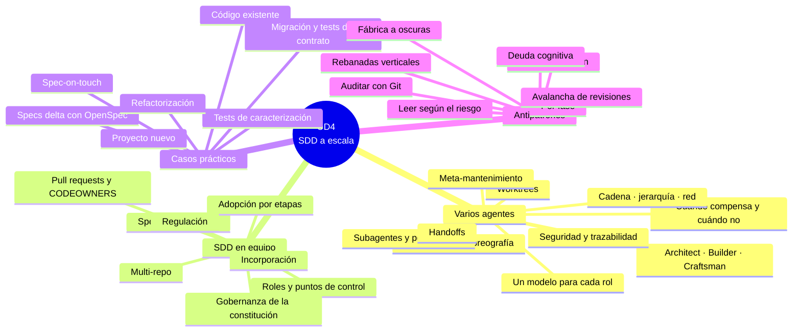
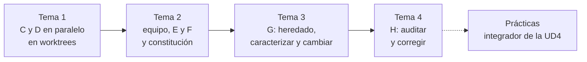

# 5. Resumen y mapa mental

[⬅️ Volver a la unidad](./README.md)

## Índice

- [Resumen ejecutivo](#resumen-ejecutivo)
- [Mapa mental](#mapa-mental)
- [El proyecto al terminar la unidad](#el-proyecto-al-terminar-la-unidad)
- [Checklist de evaluación](#checklist-de-evaluación)
  - [Sistemas multiagente y trabajo en paralelo (criterio a)](#sistemas-multiagente-y-trabajo-en-paralelo-criterio-a)
  - [*Handoffs*, seguridad y trazabilidad (criterio b)](#handoffs-seguridad-y-trazabilidad-criterio-b)
  - [SDD en equipo y gobernanza (criterio c)](#sdd-en-equipo-y-gobernanza-criterio-c)
  - [Proyectos nuevos y código existente (criterio d)](#proyectos-nuevos-y-código-existente-criterio-d)
  - [Antipatrones del flujo (criterio e)](#antipatrones-del-flujo-criterio-e)

> **Criterios que trabaja este tema:** OA4 a, b, c, d, e.

---

## Resumen ejecutivo

En esta unidad has pasado de trabajar con **una persona y un agente** a trabajar a escala: varios agentes, varias personas y código que ya existe. El método no cambia; cambia cuánto hay que coordinar y cuánto cuesta equivocarse:

1. **Varios agentes**: repartir el trabajo compensa cuando cada agente resuelve un problema concreto (contexto limpio, permisos distintos, revisión independiente, coste o paralelismo). La **orquestación** (un coordinador que recibe y comprueba cada resultado) se prefiere a la coreografía; en el curso, el coordinador eres tú. Roles: *Architect*, *Builder* y *Craftsman*. En OpenCode, un subagente solo conoce su **encargo** y devuelve un único mensaje; `permission.task` limita a quién encarga cada agente. En paralelo se trabaja con *worktrees*, y solo lo que no toca los mismos ficheros ni decide lo mismo. Un *handoff* bien hecho lleva objetivo, documentos, estado, límites y qué devolver. Mínimo privilegio, personas en los puntos críticos y el agente en el historial.
2. **SDD en equipo**: la spec es un contrato entre personas y sustituye al conocimiento tribal. Producto aprueba la spec; arquitectura, la constitución y el plan; desarrollo, las tasks y los ciclos; calidad añade *edge cases*. Las *pull requests*, `CODEOWNERS` y las ramas protegidas hacen posible y obligatoria la revisión, pero no la hacen. La constitución se gobierna con PR propia y análisis de impacto. La adopción va por etapas; el Reglamento europeo de IA regula los sistemas, no el hecho de programar con IA.
3. **Casos prácticos**: un proyecto nuevo pide la constitución primero; el código existente, una constitución que **describe el presente**, *spec-on-touch* y **tests de caracterización** para descubrir qué hace de verdad (cada rareza se decide con producto: fallo o comportamiento). Los cambios se describen con **specs delta** (`ADDED`, `MODIFIED`, `REMOVED` en OpenSpec). Refactorizar es cambiar la estructura con los tests como contrato; migrar, con **tests de contrato** que solo usan la API.
4. **Antipatrones**: una costumbre razonable que da mal resultado, con síntoma, causa y corrección. Se ordenan por fase (spec, plan, tasks, validación, contexto, equipo) y el diagnóstico empieza por la spec. Las tasks por **rebanadas verticales** adelantan la integración; las **firmas** del plan reparten el trabajo sin escribir el cuerpo. Los riesgos que no dan fallos visibles son la **fábrica a oscuras**, la **deuda cognitiva** y la **avalancha de revisiones** (un problema de planificación). Sobre leer o no el código, el curso lee **según el riesgo** con un mínimo fijo.

---

## Mapa mental

El mapa recoge los conceptos clave de los cuatro temas:



Cada rama es un tema; si no sabes explicar alguna de sus hojas con tus palabras, vuelve a ese tema.

---

## El proyecto al terminar la unidad

La **lista de tareas compartida** termina la unidad con un equipo, varios agentes y un módulo heredado ya integrado. Estas son las piezas que ha añadido la unidad a lo que tenía al terminar la UD3:

```text
lista-tareas/
├── .github/
│   ├── CODEOWNERS                    ← tema 2: quién revisa qué
│   └── (plantillas de PR)            ← tema 2: spec y constitución
├── AGENTS.md                         ← tema 2: cómo se arranca el proyecto
├── constitution.md                   ← temas 1 a 3: Errores, Almacenamiento y la
│                                       excepción de las exportaciones
├── .opencode/
│   └── agents/
│       ├── arquitecto.md             ← tema 1: solo edita plan.md y tasks.md
│       └── artesano.md               ← tema 1: solo lectura, meta-mantenimiento
├── docs/specs/
│   ├── README.md                     ← A a H en el índice
│   ├── C-… D-… E-… F-… G-… H-…       ← una carpeta por feature
├── contrato/                         ← tema 3: tests de contrato por la API
├── vitest.contrato.config.js         ← tema 3: npm run contrato
├── herramientas/
│   └── comprobar-trampas.sh          ← tema 4: gate de marcadores y controles apagados
└── src/
    ├── controladores/controlador-exportacion.js   ← tema 3: la exportación en capas
    └── servicios/servicio-exportacion.js
```

Así ha ido avanzando el trabajo, tema a tema:



Y así lo cuentan los hitos de `main` (`git log --oneline --first-parent`, resumidos):

```text
Fusiona la feature H 1.1: etiquetas en las tareas
Fusiona la feature G 1.1: exportar por estado y textos con comas
Constitución: las exportaciones responden en el formato del fichero
Fusiona la feature F: guardar las tareas entre reinicios
Constitución: almacenamiento
Fusiona la feature E: editar el texto de una tarea
Replanificación tras las features C y D: clases de error en la constitución
Fusiona la feature D: borrar una tarea
Fusiona la feature C: marcar una tarea como hecha
Memoria del agente: arquitecto y artesano
```

El proyecto ya tiene, de forma completa, lo que necesita para crecer: un flujo, comprobaciones, un equipo con responsabilidades, una forma de tocar código heredado y una lista de costumbres que vigilar. Lo que queda ya no es teoría: es practicar con ello.

---

## Checklist de evaluación

### Sistemas multiagente y trabajo en paralelo (criterio a)

- [ ] Sé qué problemas de un solo agente resuelve repartir el trabajo y cuándo no compensa
- [ ] Diferencio orquestación y coreografía y sé por qué se prefiere la primera con agentes no deterministas
- [ ] Reconozco las topologías en cadena, jerárquica y en red, y cuándo se combinan
- [ ] Distingo los roles *Architect*, *Builder* y *Craftsman* y lo que no hace cada uno
- [ ] Configuro un subagente en OpenCode con sus permisos, su modelo y su límite de `subagent`
- [ ] Sé que un subagente empieza con la ventana vacía y que su encargo es todo su contexto
- [ ] Elijo el modelo de cada rol por capacidad, coste y privacidad
- [ ] Creo un *worktree* por feature y sé qué evita y qué no evita
- [ ] Decido qué features pueden ir en paralelo comparando los planes antes de implementar

### *Handoffs*, seguridad y trazabilidad (criterio b)

- [ ] Escribo un *handoff* con objetivo, documentos, estado, límites y qué devolver
- [ ] Sé por qué en SDD un *handoff* casi no tiene contenido propio y qué indica que lo tenga
- [ ] Uso comandos como *handoffs* de formato fijo
- [ ] Hago meta-mantenimiento: arreglo la primitiva o la coordinación que produjo un fallo repetido
- [ ] Aplico mínimo privilegio a cada agente, también en `subagent` y en los directorios externos
- [ ] Dejo en el historial qué agente intervino y las decisiones en los documentos
- [ ] Sé que los revisores automáticos suben el suelo, pero no garantizan el diseño

### SDD en equipo y gobernanza (criterio c)

- [ ] Explico por qué en un equipo la spec es un contrato entre personas
- [ ] Reparto los puntos de control entre producto, arquitectura, desarrollo y calidad
- [ ] Escribo un `CODEOWNERS` y sé qué exige y qué no exige una regla de protección de rama
- [ ] Hago un cambio de constitución con PR propia, análisis de impacto y aviso al equipo
- [ ] Sé qué motiva un cambio de la constitución y qué no
- [ ] Gobierno igual los agentes, los comandos, `opencode.json` y la CI
- [ ] Planteo una adopción por etapas que se superan por hitos
- [ ] Preparo la incorporación de una persona nueva y convierto cada pregunta sin respuesta escrita en documentación
- [ ] Sé qué cambia con equipos grandes y con varios repositorios
- [ ] Sé qué regula el Reglamento europeo de IA y qué artefactos de SDD sirven de evidencia

### Proyectos nuevos y código existente (criterio d)

- [ ] Diferencio proyecto nuevo, código existente, refactorización y migración y lo que pide cada uno
- [ ] Exploro antes de especificar y formalizo antes de llevarlo a producción
- [ ] Escribo una constitución que describe el presente y marco lo que es deuda
- [ ] Aplico *spec-on-touch* y priorizo por riesgo
- [ ] Escribo tests de caracterización y decido con producto si cada rareza es un fallo o un comportamiento
- [ ] Añado a la spec de una feature nueva cómo se integra con lo que hay
- [ ] Escribo una spec delta con `ADDED`, `MODIFIED` y `REMOVED` y sé que `MODIFIED` sustituye el requisito entero
- [ ] Propongo, aplico y archivo un cambio con OpenSpec
- [ ] Refactorizo con los tests intactos y en un ciclo separado del cambio
- [ ] Planteo una migración con tests de contrato que solo usan la API

### Antipatrones del flujo (criterio e)

- [ ] Describo un antipatrón con síntoma, causa y corrección
- [ ] Sigo las preguntas para encontrar la fase donde nace un problema
- [ ] Reconozco los antipatrones de la spec, del plan, de las tasks, de la validación, del contexto y del equipo
- [ ] Reescribo una spec que prescribe la implementación para que solo diga lo que se observa
- [ ] Reparto las tasks de una feature grande en rebanadas verticales y decido cuándo bastan las capas
- [ ] Fijo en el plan las firmas que cruzan fronteras, sin cuerpo y sin llevarlas a la spec
- [ ] Explico qué es la fábrica a oscuras, la deuda cognitiva y la avalancha de revisiones, y cómo se evita cada una
- [ ] Decido qué parte del código leo según el riesgo y qué leo siempre
- [ ] Audito una rama con comandos de Git y convierto en *gates* las señales mecánicas
- [ ] Corrijo un antipatrón en la fase donde nació, no solo en el código

> 📝 **Nota del Profesor**: lo más importante de esta unidad cabe en una frase: **a escala, lo que falla no suele ser el agente, sino la coordinación**. Dos agentes que deciden lo mismo por separado, una spec aprobada sin leer, un cambio heredado sin tests o nueve PR a la vez: en todos los casos, el remedio es una decisión humana tomada antes (qué va en paralelo, quién aprueba, qué se caracteriza primero, cuánto se lanza) y no una herramienta nueva.

> 💡 **Tip del Examinador**: las preguntas más frecuentes de esta unidad son: cuándo compensa un sistema multiagente, la diferencia entre orquestación y coreografía, qué recibe y qué devuelve un subagente, qué evita un *worktree* y qué no, qué lleva un *handoff*, qué revisa cada rol en cada punto de control, por qué basta uno de los propietarios en `CODEOWNERS`, cómo se cambia la constitución, qué es un test de caracterización y cuándo se usa, qué es una spec delta, cómo se refactoriza y cómo se migra con seguridad, y por qué la avalancha de revisiones es un problema de planificación.

---

[⬅️ Volver a la unidad](./README.md)
