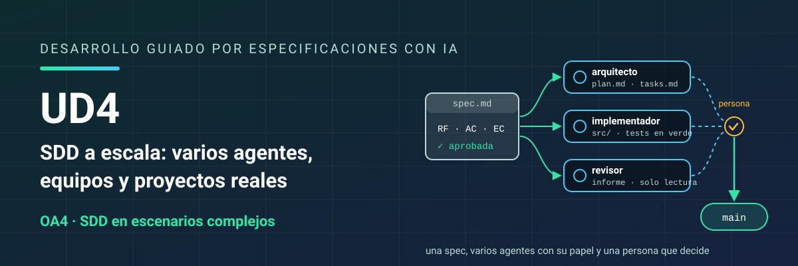

# Desarrollo guiado por especificaciones con IA - UD4 SDD a escala: varios agentes, equipos y proyectos reales

Unidad 4 SDD a escala: varios agentes, equipos y proyectos reales.

## Objetivo de aprendizaje

Esta unidad trabaja el **OA4** y sus criterios de evaluación: [ver objetivo de aprendizaje y criterios de evaluación](./objetivos-aprendizaje.md).

## Contenidos

1. [Varios agentes: orquestación, roles y trabajo en paralelo](./01-multiagente.md)
2. [SDD en equipo](./02-sdd-en-equipo.md)
3. [Casos prácticos: proyectos nuevos y código existente](./03-casos-practicos.md)
4. [Antipatrones del flujo](./04-antipatrones.md)
5. [Resumen y mapa mental](./05-resumen.md)

## Diapositivas

Las diapositivas resumen las **ideas principales** de cada tema, con un ejemplo de cada una. Se proyectan en clase y te sirven para repasar; el detalle está en el tema.

1. [Varios agentes](./diapositivas/pdf/01-multiagente.pdf)
2. [SDD en equipo](./diapositivas/pdf/02-sdd-en-equipo.pdf)
3. [Casos prácticos](./diapositivas/pdf/03-casos-practicos.pdf)
4. [Antipatrones del flujo](./diapositivas/pdf/04-antipatrones.pdf)

## Referencias

- [Building effective agents](https://www.anthropic.com/research/building-effective-agents), de Anthropic (en inglés). Describe los patrones con los que se combinan varios modelos o agentes (en cadena, en paralelo, un orquestador con trabajadores…) y aconseja empezar por lo más sencillo y añadir complejidad solo cuando hace falta. Es la base del tema 1.
- [How we built our multi-agent research system](https://www.anthropic.com/research/multi-agent-research-system), de Anthropic (en inglés). Cuenta de primera mano cómo un agente principal reparte el trabajo entre subagentes, qué necesita cada encargo para que no se dupliquen ni se dejen huecos y por qué no todas las tareas se benefician de repartirse. Complementa el tema 1.
- [`git worktree`](https://git-scm.com/docs/git-worktree), la documentación oficial de Git (en inglés). Explica cómo tener varias carpetas de trabajo, cada una con su rama, sobre el mismo repositorio. Consúltala en el tema 1.
- [Documentación de OpenCode](https://opencode.ai/docs/), la herramienta del curso (en inglés). Para el tema 1, consulta las páginas de [agentes](https://opencode.ai/docs/agents/) y de [permisos](https://opencode.ai/docs/permissions/). Los nombres y opciones pueden cambiar entre versiones.
- [Harness Engineering Is Not Enough: Why Software Factories Fail](https://ai.engineer/talks/Ib5GBkD555M-harness-engineering-is-not-enough-why-software-factories-fail), charla de Dex Horthy en AI Engineer (vídeo con transcripción, en inglés). Explica por qué automatizar más el trabajo de los agentes no sustituye a que las personas entiendan y lean el código. La ingeniería del arnés (*harness engineering*) del título se explica en el tema 3 de la UD3. Es la opinión y la experiencia del ponente: tómala como argumento, no como datos. Complementa los temas 1 y 4.
- Documentación de GitHub sobre los [propietarios del código (`CODEOWNERS`)](https://docs.github.com/es/repositories/managing-your-repositorys-settings-and-features/customizing-your-repository/about-code-owners) y las [ramas protegidas](https://docs.github.com/es/repositories/configuring-branches-and-merges-in-your-repository/managing-protected-branches/about-protected-branches) (en español). Explican cómo pedir y exigir revisiones antes de fusionar en `main`. Consúltalas en el tema 2.
- [GitHub Spec Kit](https://github.com/github/spec-kit) (en inglés). Su comando para la constitución propone versionarla y dejar escrito cómo se cambia. Complementa el tema 2.
- [Reglamento (UE) 2024/1689, de inteligencia artificial](https://eur-lex.europa.eu/eli/reg/2024/1689/oj?locale=es), en EUR-Lex, el sitio oficial del Derecho de la Unión Europea. Consulta ahí a qué se aplica y su calendario vigente, que puede cambiar. Complementa el tema 2.
- [OpenSpec](https://github.com/Fission-AI/OpenSpec), un framework de SDD de código abierto que separa las specs vigentes de los cambios propuestos (en inglés). Lo usarás en el tema 3 para especificar cambios sobre código existente.

## Licencia

Este material se distribuye bajo licencia **Creative Commons BY-NC-SA 4.0**. Consulta las condiciones en [LICENSE.md](./LICENSE.md).
