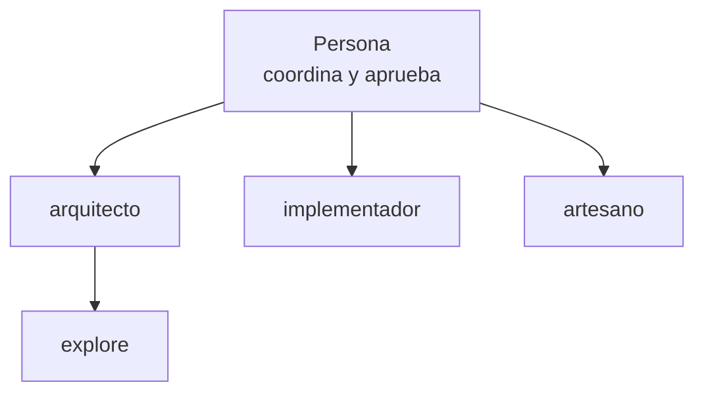

# Subagentes del préstamo

## Situaciones

| # | Compensa | Problema que resuelve (o por qué no compensa) | Agente |
|---|----------|-----------------------------------------------|--------|
| 1 | Sí | **Contexto**: leer muchos ficheros llenaría la ventana del arquitecto para una respuesta de cinco líneas. *Explore* lo hace en su propia ventana y devuelve solo el resumen | `explore` (encargado por el `arquitecto`) |
| 2 | No | La conversación con la persona **es** el trabajo: un subagente no puede preguntar, solo devuelve un mensaje. Repartirlo pierde el hilo | El `arquitecto` o *plan*, en una sola sesión con la persona |
| 3 | Sí | **Revisión independiente**: quien implementó se cree su código y tiene el contexto lleno de sus decisiones. Un agente nuevo, de solo lectura, compara con la spec | `artesano` (o el `revisor` de la UD3) |
| 4 | No | Es un cambio de una línea: el encargo costaría más que el cambio y no hay nada que proteger | Ninguno: se hace en la sesión de siempre |
| 5 | Sí | **Coste y permisos**: no necesita razonar mucho (modelo económico) y solo debe tocar `README.md` y `docs/`, no el código ni las specs | Un `documentador` (UD2, tema 6) |
| 6 | Depende | **Paralelismo**: solo si los planes de C y D no tocan los mismos ficheros ni deciden lo mismo por separado. Se decide comparando los planes antes de implementar | Un `arquitecto` por *worktree*, y la persona compara |
| 7 | No | **Aprobar es un punto de control de una persona**: un agente que aprueba sus propios documentos se salta el control. Otro agente no lo arregla | Ninguno: aprueba la persona |
| 8 | Sí | **Privacidad**: el código con datos personales no puede salir del centro, así que lo lee un agente aparte con un modelo local, de solo lectura | Un subagente de solo lectura con modelo local |

## Agentes y roles

| Agente | Rol | Edita | Terminal | Encarga trabajo a | Modelo y razón |
|--------|-----|-------|----------|-------------------|----------------|
| `arquitecto` | *Architect* | Solo `plan.md` y `tasks.md` | Solo lectura de Git | Solo *explore* | El más capaz: sus decisiones (plan y tasks) cuestan caras si salen mal y se ejecuta pocas veces |
| `implementador` | *Builder* | Solo `src/` | Tests y lint sin preguntar; Git de lectura; lo demás pregunta | Nadie | Intermedio: las tasks son pequeñas y están bien definidas, y se ejecuta muchas veces |
| `artesano` | *Craftsman* | Nada | Tests, lint y `git log` | Nadie | Económico o intermedio: lee mucho y propone; lo que encuentra lo revisa una persona. Local si el código es sensible |

## Comprobación

### `arquitecto`

```text
arquitecto (primary)
  *         *                            allow
  edit      *                            deny
  edit      docs/specs/*/plan.md         allow
  edit      docs/specs/*/tasks.md        allow
  shell     *                            deny
  shell     git status                   allow
  shell     git diff *                   allow
  shell     git log *                    allow
  subagent  *                            deny
  subagent  explore                      allow
  webfetch  *                            deny
  websearch *                            deny
```

### `implementador`

```text
implementador (subagent)
  *         *                            allow
  edit      *                            deny
  edit      src/**                       allow
  shell     *                            ask
  shell     npm test                     allow
  shell     npm run lint                 allow
  shell     git status                   allow
  shell     git diff *                   allow
  shell     git log *                    allow
  subagent  *                            deny
  webfetch  *                            deny
  websearch *                            deny
```

### `artesano`

```text
artesano (subagent)
  *         *                            allow
  edit      *                            deny
  subagent  *                            deny
  webfetch  *                            deny
  websearch *                            deny
  shell     *                            deny
  shell     npm test                     allow
  shell     npm run lint                 allow
  shell     git log *                    allow
```

### Preguntas

- (a) **No puede** modificar `tests/servicio-carros.test.js`: no coincide con `src/**` y cae en la regla de `*` en `deny`. **Sí puede** modificar `src/servicios/servicio-carros.js`: coincide con `src/**` y gana la última regla que coincide.
- (b) **No.** El artesano tiene `edit` y `subagent` en `deny`: no puede editar ni encargar trabajo a otro agente que edite (por ejemplo, *general*). Si tuviera `subagent` abierto, valdría tanto como el agente más poderoso al que puede llamar.
- (c) Agravaría que el arquitecto pudiera encargar trabajo a cualquier subagente, incluido *general*, que puede editar: con él escribiría código aunque tenga `edit` casi cerrado. Hay que dejarlo en `explore`.

## Topología



Es una topología **jerárquica** pequeña, con una cadena entre fases (spec, plan, tasks, código); la coordina la **persona**, que decide qué agente entra en cada punto de control. Solo el arquitecto encarga trabajo a otro agente (*explore*).
