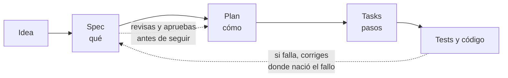

# 1. Qué es SDD y por qué

[⬅️ Volver al curso](README.md)

## Qué aprenderás

- Por qué, sin especificación, el agente **rellena los huecos** con lo que le parece más probable.
- Qué es el desarrollo guiado por especificaciones (**SDD**) y cuándo usarlo.
- Qué documentos intervienen y cómo se encadenan.

## 1.1. Con un agente, lo difícil ya no es escribir código

Un agente de IA lee tu proyecto, escribe y edita ficheros, ejecuta comandos y corrige. Escribir código es cada vez más fácil. Lo difícil pasa a ser otra cosa: **decir exactamente qué quieres** y **comprobar que es lo que pediste**.

Fíjate en una petición normal:

```text
Haz el sistema de reservas de salas del centro.
```

Una persona de tu equipo te haría preguntas: ¿qué salas hay?, ¿hasta qué hora?, ¿se puede reservar el pasado?, ¿qué pasa si dos personas piden la misma sala? El agente **no pregunta**: elige la opción más probable y sigue adelante. Cada una de esas elecciones es una **decisión que nadie ha tomado**, y queda escrita en el código, donde nadie la discute.

| Pregunta que nadie respondió | Lo que el agente decide |
|------------------------------|-------------------------|
| ¿Qué pasa si la sala no existe? | Crea la reserva igualmente |
| ¿Se puede reservar ayer? | Sí |
| ¿Dos reservas seguidas (10–11 y 11–12) chocan? | Depende de si escribió `<` o `<=` |
| ¿Cuánto puede durar una reserva? | Lo que sea |
| ¿Cómo se avisa de un error? | Un texto distinto en cada sitio |

> 📝 **Nota del Profesor**: el código funciona en la demostración y falla con la primera entrada rara. Los fallos más caros son los que pasan la demo.

## 1.2. El ciclo «casi, pero no»

Sin estructura, el trabajo cae en un bucle: pides algo, el agente genera código, ves que «casi» es lo que querías, pides un ajuste, y otro, y otro. Cada vuelta puede romper algo anterior y **ninguna decisión queda escrita**. Con el tiempo, la única forma de saber qué hace el sistema es **leer el código**: el código es la especificación de facto.

## 1.3. SDD: decidir antes de generar

El **desarrollo guiado por especificaciones** (*spec-driven development*, SDD) propone lo contrario: **escribir y revisar una especificación (spec) antes de que el agente genere código**, y usarla como **contrato**.

- La **spec** dice **qué** debe hacer el sistema y en qué casos: lo que nota **quien lo usa**, sin mirar el código. Qué datos pide, qué responde, qué deja hacer y qué errores da.
- El **plan** dice **cómo** se va a construir: lo que solo ve **quien lee el código**. En qué ficheros, cómo se guardan los datos, qué funciones hay.
- Las **tasks** son los pasos pequeños para construirlo.
- Los **tests** comprueban que lo construido cumple la spec.



La idea clave es que **corregir pronto sale barato**: una frase de la spec cuesta mucho menos que reescribir código que ya está en uso. Y que **las personas deciden**: el agente redacta, propone e implementa; tú apruebas en cada punto.

## 1.4. Vibe coding y SDD: dos herramientas para momentos distintos

*Vibe coding* es pedir cambios y aceptar lo que funciona. No es «malo»: sirve para explorar.

| Situación | Enfoque |
|-----------|---------|
| Probar una idea en una tarde, un prototipo que vas a tirar | *Vibe coding* |
| Cambiar un texto o una configuración | Un buen prompt, sin spec completa |
| Una funcionalidad con reglas de negocio, que va a durar o que mantendrá más de una persona | **SDD** |

Si el prototipo se queda, **escribe su spec** antes de seguir construyendo sobre él.

## 1.5. Los documentos del flujo

| Documento | Responde a | Dura |
|-----------|------------|------|
| **Prompt** | ¿Qué hago ahora? | Una conversación |
| **PRD** | ¿Para qué existe el producto? | Todo el proyecto |
| **Constitución** y **`AGENTS.md`** | ¿Qué no se negocia? ¿Cómo se trabaja aquí? | Todo el proyecto |
| **Spec** | ¿Qué hace esta funcionalidad, exactamente? | Una funcionalidad |
| **Plan y tasks** | ¿Cómo y en qué pasos se construye? | Una funcionalidad |

Una **feature** es una capacidad delimitable con valor propio («crear una reserva»): **una spec por feature**. Ni un producto entero ni un botón.

## 1.6. Tres principios

1. **Humano en el bucle:** revisas la spec, el plan y el código en puntos de control.
2. **Reglas antes que herramientas:** unas instrucciones claras importan más que el agente concreto.
3. **Especificar antes de construir:** explicas el problema y **cómo se comprobará** la solución.

## Ejercicio: las decisiones que nadie tomó

**Formato:** individual, **sin agente**. Trabajas con el dominio que usarás en todo el curso: la **reserva de salas del centro** (hay tres salas y se reservan por franjas).

### En clase

**Parte A · Un prompt vago.** Lee la petición del apartado 1.1. Escribe una lista de **diez decisiones** que tendría que tomar quien la programe y que la petición no resuelve (qué salas hay, qué formato tiene una fecha, qué pasa si…). Para cada una, indica quién la notaría. Si la nota **quien usa el sistema** (por ejemplo, si se puede reservar una fecha pasada), va en la spec. Si solo la ve **quien lee el código** (por ejemplo, si las reservas se guardan en un fichero o en una base de datos), va en el plan.

**Parte B · El código «generado por el agente».** Este es el núcleo de lo que un agente generó para esa petición (pseudocódigo):

```text
funcion crearReserva(sala, fecha, inicio, fin, nombre):
    para cada r en reservas:
        si r.sala == sala y r.fecha == fecha
           y inicio <= r.fin y fin >= r.inicio:
            devolver "Ocupada"
    reserva = { id: contador, sala, fecha, inicio, fin, nombre }
    contador = contador + 1
    reservas.añadir(reserva)
    devolver reserva
```

Lista **todas las decisiones implícitas** del código: qué comprueba, qué no comprueba y qué devuelve en cada caso. Mínimo ocho.

**Puesta en común.** Cada persona comparte su decisión implícita más sorprendente.

### En casa

1. **Parte B, para terminar.** Para tres de las decisiones del código, escribe **una frase de spec** que la fijaría («Si la hora de fin no es posterior a la de inicio, el sistema deberá…»).
2. **Parte C · ¿*Vibe coding* o SDD?.** Elige y justifica en una línea: **(1)** una demo para enseñar una idea mañana; **(2)** el módulo que calcula las reservas de todo un centro; **(3)** cambiar el color de un botón; **(4)** un prototipo que acaba usándose en el centro todos los días.
3. **Parte D · Otro encargo vago.** Imagina este prompt: *«Hazme una aplicación para prestar portátiles en el centro»*. Sin mirar ningún código, escribe **diez decisiones** que un agente tendría que tomar y que el prompt no resuelve (quién puede pedir un portátil, cuánto dura un préstamo, qué pasa si no se devuelve…). Marca con una estrella las **tres** que más cambiarían lo que ve el usuario: esas irían a la spec.

**Está hecho cuando:** tienes las diez decisiones clasificadas, las ocho del código, las tres frases de spec, la parte C y las diez decisiones del encargo de los portátiles. (Solución en `soluciones/01-que-es-sdd.md`.)

## Quédate con esto

1. Sin spec, el agente **rellena los huecos** y el código pasa a ser la especificación.
2. SDD **escribe y aprueba la spec antes** de generar código, y la usa como contrato.
3. Spec = **qué**; plan = **cómo**; tasks = pasos; tests = comprobación.
4. *Vibe coding* para explorar; SDD para lo que tiene que durar.

**Siguiente:** [2. El contexto y el entorno](02-contexto-y-entorno.md)
