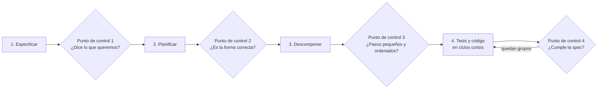

# 4. El flujo: de la spec al código

[⬅️ Volver al curso](README.md)

## Qué aprenderás

- Las fases del flujo y qué se revisa en cada **punto de control**.
- Qué lleva un **plan**, incluidas las **firmas**, y cómo se dividen las **tasks**.
- Por qué los **tests se escriben antes** que el código y qué es el «rojo correcto».
- Implementar en **ciclos cortos** y corregir cada problema **donde nació**.

## 4.1. Cuatro fases, cada una con su documento

| Fase | Documento | Responde a | La aprueba |
|------|-----------|------------|------------|
| Especificar | `spec.md` | ¿Qué se construye? | Tú |
| Planificar | `plan.md` | ¿Cómo se construye? | Tú |
| Descomponer | `tasks.md` | ¿En qué pasos? | Tú |
| Implementar | Tests, código y commits | ¿Está hecho y funciona? | Tú, en cada grupo de tasks |



Cada fase termina con una revisión humana, y **no se pasa a la siguiente sin aprobarla**. Así los errores se descubren donde cuesta menos corregirlos. El agente redacta, propone e implementa; **ninguna fase la cierra él**.

Dos costumbres que ayudan: **una sesión nueva por fase** (`/new`; lo importante ya está en los documentos) y **un commit por documento aprobado**.

## 4.2. El plan: el cómo, sin código

El plan decide **cómo** se construye la feature con la spec ya aprobada. Sale de tres fuentes: la **spec** (qué cubrir), la **constitución** (los límites) y el **código existente** (dónde encaja). Lleva:

| Sección | Para qué |
|---------|----------|
| **Decisiones** (`D-01`…) | Cada una con su **motivo**, su **alternativa descartada** y los identificadores de la spec que cubre |
| **Firmas** | Nombre, parámetros, qué devuelve y qué errores da cada pieza que usan otras partes o los tests. **Sin cuerpo** |
| **Estrategia de pruebas** | Una fila por identificador de la spec: cómo y dónde se comprueba |
| **Comprobación de la constitución** | Cómo cumple el plan cada principio |

Una decisión bien escrita:

```text
D-03: Fecha de hoy (EC-03). La lógica recibe `hoy` como parámetro; la
entrada la obtiene del sistema.
  - Descartado: leer la fecha dentro de la lógica. Los tests dependerían
    del día en que se ejecutan.
```

En esta fase **el agente no escribe código**: el plan se revisa mejor sin él, el código ancla («ya está hecho, lo acepto») y el plan todavía puede descubrir un hueco en la spec. Si lo descubre, **se para**, se decide, la spec sube de versión y se vuelve a aprobar.

Las **firmas** son lo que permite repartir el trabajo (sesiones 5 y 6): si el plan dice que existe `crearReserva(datos, hoy)` y lo que devuelve, otro agente puede escribir los tests y otro el código sin verse.

## 4.3. Las tasks: pasos pequeños y verificables

Una buena task es **pequeña** (uno o dos ficheros), **verificable** (tiene un criterio de terminado objetivo), **ordenada** y **trazable** al plan:

```text
- [ ] T-03: Validaciones y creación de la reserva
  - Fichero: módulo de lógica
  - Depende de: T-02
  - Terminada cuando: todos los tests de T-01 pasan
```

Se agrupan; **cada grupo termina en un punto de control**. El primer grupo son los tests.

## 4.4. Tests antes que el código

Los tests se escriben **desde la spec** y **antes** que el código. Si el mismo agente escribe el código y luego los tests, los dos salen de la misma interpretación y **comprueban el código contra sí mismo**.

- **Uno por cada criterio y cada *edge case***, con el identificador en el nombre: `A-EC-08: rechaza una reserva que se solapa`.
- **Valores exactos de la spec** (códigos, mensajes), y límites por los dos lados.
- **Datos que distinguen:** elige los datos preguntándote qué implementación incorrecta pasaría el test.

Un test recién escrito tiene que **fallar**, y por el **motivo correcto**: porque todavía no existe lo que promete el plan. Vale que falle porque no existe `crearReserva`, si ese es exactamente el nombre de la firma, o porque esperaba `sala_ocupada` y la reserva se creó. **No** valen un error de sintaxis, una ruta mal escrita ni un nombre distinto del de la firma: el test falla antes de comprobar nada, y seguiría fallando cuando el código existiera.

Se revisan **antes** de implementar, con la spec al lado: es el último momento barato.

## 4.5. Ciclos cortos de implementación

No se pide «implementa todo»: se hace **un grupo de tasks por ciclo**.

1. Sesión nueva y agente *build*.
2. Prompt con **reglas**: haz solo estas tasks, no cambies un test para que pase, si algo no encaja para y pregunta.
3. Revisas **tú** (`git status`, `git diff`) y **ejecutas tú los tests**: el «todos pasan» del agente no basta.
4. Commit del grupo, con las tasks en el mensaje.

Un agente que no consigue que un test pase puede **cambiar el test**: todo queda en verde y los tests ya no comprueban la spec. Por eso el siguiente tema lo hace imposible con permisos.

## 4.6. Cuando algo falla, se corrige donde nació

| Detectas… | Se corrige en |
|-----------|---------------|
| Un comportamiento que nadie decidió | La **spec** (versión nueva) |
| Una decisión técnica que no te gusta | El **plan** |
| Una task enorme o mal ordenada | Las **tasks** |
| Un error de código | El **código**, con un test que lo reproduce |
| Una decisión que se repite en todas las features | La **constitución** |

> ⚠️ **Cuidado**: corregir solo el código cuando el problema era de la spec deja documentos que mienten, y el agente repetirá el error. Es el ***spec drift***.

## Ejercicio: la feature A de principio a fin

**Formato:** individual, con los agentes `plan` y `build` (los roles llegan en la sesión 5). Trabajas con **tu spec aprobada** de la sesión 3. Si no la terminaste, copia la [spec de referencia](ejemplo-reservas/docs/specs/A-crear-reserva/spec.md). Crea la rama `feature/A-crear-reserva`.

### En clase

**Parte A · La feature A** (pasos 1 a 3 en clase; 4 y 5, en casa).

**Paso 1 · Plan.** Sesión nueva, agente *plan*:

```text
Planifica la feature A. Lee @docs/specs/A-crear-reserva/spec.md, @constitution.md
y las plantillas @docs/plantillas/plan.md y @docs/plantillas/tasks.md.
Propón el plan con decisiones (motivo y alternativa descartada), una
sección «Firmas» sin cuerpo y una estrategia de pruebas con una fila por
identificador de la spec. No escribas código ni cambies la spec. Si
encuentras algo que la spec no decide, márcalo con [NECESITA ACLARACIÓN].
```

Revisa el plan con esta lista: ¿respeta las tres capas?; ¿la fecha de hoy llega a la lógica sin leerse dentro?; ¿cada identificador de la spec está en la estrategia de pruebas?; ¿hay alternativas descartadas?; ¿hay código en el plan? Rechaza lo que no valga, **con motivo**. Cuando te convenza, cambia a *build* y pídele que lo guarde en `plan.md` **sin tocar nada más**; comprueba con `git status`. Estado `Aprobado`; commit.

**Paso 2 · Tasks.** Sesión nueva, agente *plan*: pide `tasks.md` a partir del plan aprobado, con cuatro grupos: tests, errores y almacenamiento, lógica y entrada. Revisa que cada task tiene criterio de terminado y que los tests van primero. Guárdalo con *build*, como el plan, y haz commit.

**Paso 3 · Tests.** Con *build* y una sesión nueva, pide los tests del grupo 1 (un test por `AC` y por `EC`, con letra e identificador en el nombre, valores exactos de la spec). Ejecútalos: deben **fallar por el motivo correcto**. Revisa con la spec al lado, test por test. Commit: «Tests de la feature A».

### En casa

1. **Paso 4 · Implementar en ciclos.** Un ciclo por grupo (2, 3 y, si hay tiempo, 4), sesión nueva en cada uno, con el prompt de reglas del apartado 4.5. Después de cada ciclo: `git diff`, tests ejecutados por ti, commit. Al terminar, **rompe el código a propósito** (por ejemplo, cambia `<` por `<=` en el solapamiento): si ningún test falla, ese test no protege nada.
2. **Paso 5 · Cierre.** Todos los tests en verde. Anota **en una línea cada problema que apareció** y en qué documento lo corregiste (tabla del apartado 4.6). Fusiona la rama en `main` y actualiza el índice (`🔜 → ✅`).
3. **Parte B · ¿Dónde se corrige?** Para cada problema, di en qué documento se corrige y por qué: **(a)** el plan propone guardar las reservas en un fichero y la spec no dice nada de persistencia; **(b)** un test falla porque la spec no dice si una reserva puede terminar a las 24:00; **(c)** el código usa la hora del sistema dentro de la lógica, contra la constitución; **(d)** un test comprueba un mensaje que no coincide con el de la spec.

**Está hecho cuando:** los tests de A están en verde, el historial tiene plan, tasks, tests y un commit por ciclo, tienes la tabla de problemas y los cuatro casos clasificados. (Qué suele salir mal, en `soluciones/04-flujo-spec-plan-tests-codigo.md`.) Si no llegas al grupo 4 (la entrada), es aceptable.

## Quédate con esto

1. Spec, plan, tasks y código: cada fase con su documento y **su punto de control**.
2. El plan decide el **cómo** sin código, y sus **firmas** permiten repartir el trabajo.
3. Los **tests salen de la spec y se escriben antes**; el rojo tiene que ser el correcto.
4. Ciclos cortos, revisión tuya y un commit por grupo; cada problema se corrige **donde nació**.

**Siguiente:** [5. Agentes con roles](05-agentes-y-roles.md)
