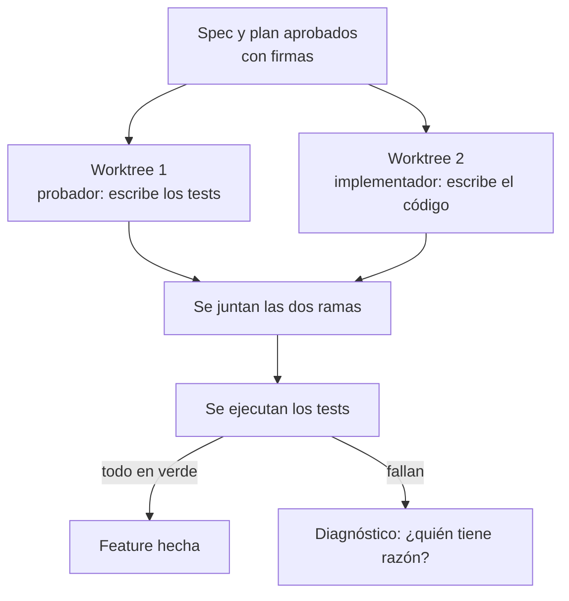

# 6. Trabajar en paralelo

[⬅️ Volver al curso](README.md)

## Qué aprenderás

- Por qué dos agentes no pueden compartir carpeta y cómo lo resuelven los ***worktrees***.
- Qué trabajos se pueden hacer **a la vez** y quién lo decide.
- Lanzar `probador` e `implementador` **en paralelo** sobre la misma spec y el mismo plan, y qué indican las **discrepancias**.
- Los pasos para **arrancar un proyecto** con SDD cuando termine el curso.

## 6.1. Dos agentes en la misma carpeta se pisan

Si abres dos OpenCode en la misma carpeta:

- Solo puede haber **una rama activa**: si un agente cambia de rama, el otro se encuentra de golpe los ficheros de la otra.
- Los dos ven los cambios sin guardar del otro: `git status` y `git diff` **mezclan** el trabajo.
- Si uno ejecuta los tests, prueba el código a medio hacer del otro.

## 6.2. *Worktrees*: una carpeta por agente

Un ***worktree*** es una **carpeta de trabajo adicional** enlazada al mismo repositorio de Git: tiene su propia rama y sus propios ficheros, pero comparte el mismo historial. Se crean desde la carpeta principal, **al lado** del proyecto:

```bash
git worktree add ../reservas-tests -b feature/C-tests
git worktree add ../reservas-codigo -b feature/C-codigo
git worktree list
```

Cada carpeta es un proyecto completo, salvo lo que Git no guarda. Antes de trabajar en ella:

- **Instala las dependencias** otra vez si tu tecnología las guarda en la carpeta del proyecto (no se comparten).
- Abre **una sesión de OpenCode por carpeta**, cada una en su terminal.
- Cada agente se queda **en su carpeta**: la plantilla le prohíbe leer o escribir fuera del proyecto (`external_directory` en `deny`, sesión 2), así que el `implementador` no puede asomarse a los tests de la otra carpeta. Si cambias esa regla a `ask` y un agente te pide salir, **no lo permitas**.
- Si arrancas la aplicación en dos carpetas a la vez, usan puertos distintos.
- Una rama solo puede estar en un *worktree* a la vez.

Cuando terminas, desde la carpeta principal: `git worktree remove ../reservas-tests` y `git branch -d <rama>` (Git se niega si hay cambios sin guardar).

## 6.3. Qué se puede hacer en paralelo

Los *worktrees* evitan que los agentes se **pisen mientras trabajan**, no que sus trabajos **choquen al juntarse**. Dos trabajos pueden ir a la vez si:

1. **No tocan los mismos ficheros**, y
2. **No dependen uno del otro** ni deciden lo mismo por separado.

| Trabajo | ¿En paralelo? | Por qué |
|---------|---------------|---------|
| Tests de una feature y su código, **con firmas fijadas en el plan** | Sí | Ficheros distintos y el contrato es el mismo |
| Dos features que tocan el mismo módulo | **No** | Mismos ficheros y decisiones duplicadas |
| Varias búsquedas en el código para un plan | Sí | Solo leen |
| Un agente que necesita lo que crea otro | **No** | Dependencia |

Quien decide qué va en paralelo es **quien orquesta: tú**, mirando los planes **antes**. Si dudas, en serie: perder un rato es más barato que deshacer dos trabajos que no encajan.

## 6.4. El patrón del curso: tests y código a la vez

Tras aprobar el plan, `probador` e `implementador` reciben **la misma spec y las mismas firmas** y trabajan sin verse:



Es más rápido que hacerlo en serie, y además es una **prueba de la spec**: si dos agentes que parten de lo mismo no coinciden, **algo estaba ambiguo**. Cuando fallan tests al juntarlos, **no se arregla a ciegas**: se decide quién se equivocó.

| Qué pasa | Diagnóstico | Dónde se corrige |
|----------|-------------|------------------|
| El test comprueba algo que la spec no dice | **Test mal** | El test (lo corriges tú, en un commit propio) |
| El código no hace lo que dice la spec | **Error de implementación** | El código, con el test que ya lo reproduce |
| Test y código siguen la spec, pero la leen distinto | **Spec ambigua** | La spec (versión nueva) y después lo que dependa |
| La firma no era la misma | **Firma incompleta en el plan** | El plan |

**Lo que se pierde:** el `implementador` no ve los tests mientras trabaja, así que no puede comprobar su código contra ellos. A cambio, descubres antes las ambigüedades. Se usa cuando la spec y las firmas están claras; si no, en serie.

**Conflictos al juntar.** Si dos ramas crean el mismo fichero o añaden líneas en el mismo sitio, Git avisa de un **conflicto** y hay que resolverlo; si crean cosas **distintas para lo mismo**, ni siquiera avisa y tienes dos soluciones duplicadas. Por eso se comparan los planes antes.

**Subagentes en paralelo.** Un agente puede lanzar **varios subagentes a la vez** (por ejemplo, varias búsquedas con *explore*), sin *worktrees*, porque solo leen. Para escribir ficheros, un *worktree* por agente.

## 6.5. Después del curso: pasos de arranque en un proyecto

Este curso no incluye un proyecto: se practica sobre el ejemplo. Cuando tengas el proyecto de tu módulo, estos son los pasos que se repiten (cada uno ya lo has practicado en una sesión):

| Paso | Qué haces | Dónde |
|------|-----------|-------|
| 1 | **PRD** breve: problema, usuarios, alcance y fuera de alcance | `docs/prd.md` |
| 2 | **Lista de features** ordenada por dependencias y valor; elige la primera | `docs/specs/README.md` |
| 3 | **Constitución** con tu tecnología, tus capas y tus reglas | `constitution.md` |
| 4 | **`AGENTS.md`** con los comandos que existen **de verdad** | `AGENTS.md` |
| 5 | **Agentes** adaptados (carpeta y comando de tests) y permisos comprobados | `.opencode/agents/` |
| 6 | **Spec** de la primera feature con los **siete pasos**, revisada con el agente y aprobada | `docs/specs/<letra>-<nombre>/spec.md` |
| 7 | **Plan** con decisiones y **firmas**, aprobado | `plan.md` |
| 8 | Decidir: ¿en **serie** o en **paralelo**? | tasks y *worktrees* |

**Cuándo SDD y cuándo un buen prompt:** una corrección pequeña, un texto o un prototipo, con un prompt cuidado; lo que tiene reglas, casos límite o lo va a mantener más de una persona, con spec.

## Ejercicio: la feature C en paralelo

**Formato:** individual, con agentes. Partes de tu repositorio del ejemplo con A y B en `main` y las specs de B y C copiadas.

### En clase

**Parte A · La feature C en paralelo.**

1. **Plan.** `/planificar C-consultar-reservas` con el `arquitecto`. Revisa **sobre todo las firmas**: nombre, parámetros, qué devuelve y qué errores da la consulta. Si las firmas no están claras, los dos agentes no podrán coincidir. Apruébalo y haz commit **en `main`**: es la excepción a «una feature por rama», para que las dos ramas del paso 2 partan del mismo plan.
2. **Preparar.** Desde la carpeta principal:

   ```bash
   git worktree add ../reservas-tests  -b feature/C-tests
   git worktree add ../reservas-codigo -b feature/C-codigo
   ```

   Instala lo que necesite cada carpeta (dependencias) si tu tecnología lo exige.
3. **Lanzar en paralelo.** Dos terminales, **a la vez**:

   - Terminal 1, en `../reservas-tests`: OpenCode y `/escribir-tests C-consultar-reservas` (el `probador`).
   - Terminal 2, en `../reservas-codigo`: OpenCode y `/implementar-paralelo C-consultar-reservas 2` (el `implementador`, que sabe que no tiene los tests).

   Si el plan tiene más de un grupo de código, repite el paso con el siguiente grupo. Mientras trabajan, **no los ayudes ni les cuentes lo que hace el otro**. Revisa cada resultado por separado (`git diff`) y haz commit en cada rama.
4. **Juntar y ejecutar.** Desde la carpeta principal, en `main`:

   ```bash
   git merge --no-ff feature/C-tests
   git merge --no-ff feature/C-codigo
   ```

   Es probable un conflicto en `tasks.md`, porque los dos agentes han marcado tasks: **quédate con las dos marcas**. Ejecuta los tests. Si no coinciden, no toques nada todavía.
5. **Diagnóstico.** Para **cada test que falle**, rellena: qué esperaba el test, qué hizo el código, **a quién se lo atribuyes** (test mal, código mal, spec ambigua o firma incompleta) y dónde se corrige (tabla del apartado 6.4). Arregla lo que puedas con el agente correspondiente: el test lo cambias **tú**, no el `implementador`.

### En casa

1. **Parte A, para terminar.** Termina el diagnóstico si no te dio tiempo, deja los tests en verde (o con el diagnóstico escrito) y retira los *worktrees* (`git worktree remove`, `git branch -d`).
2. **Parte B · ¿Serie o paralelo?** Para cada pareja de tareas, decide si se pueden hacer a la vez y qué comprobarías antes: **(a)** los tests y el código de la feature C con el plan con firmas; **(b)** las features B y C, que usan el mismo almacenamiento; **(c)** la spec de una feature y su plan; **(d)** el código de dos features que no comparten ficheros.
3. **Informe de una página.** Qué has aprendido: tres decisiones que tomaste al escribir la spec y que el agente habría tomado por su cuenta; qué propuestas del agente aceptaste y cuáles rechazaste, con motivo; y qué rol te resultó más útil y por qué.

**Está hecho cuando:** la feature C está en `main` con los tests en verde (o con el diagnóstico de los que no), has retirado los *worktrees* y tienes las cuatro parejas decididas y el informe. (Interpretación de las discrepancias típicas en `soluciones/06-paralelo.md`.)

## Quédate con esto

1. Cada agente que escribe, en **su propio *worktree***; las ramas comparten el historial.
2. Los *worktrees* evitan pisarse al **trabajar**, no los choques al **juntar**: en paralelo solo lo que no toca lo mismo ni decide lo mismo.
3. Con firmas en el plan, `probador` e `implementador` pueden trabajar a la vez; **si no coinciden, la spec era ambigua** (o el test o el código estaban mal).
4. Antes de paralelizar, pregunta qué se pisa y qué decide lo mismo; si hay duda, en serie.

**Evaluación:** [evaluacion.md](evaluacion.md). Después del curso: aplica el método en el proyecto de tu módulo.
